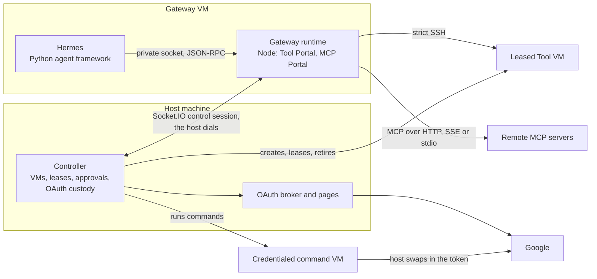

# The Switchboard left this repository

On 2026-10-30 the Switchboard (formerly the Tool Portal) and the sign-in service were copied out of agent-vm into their own repository, [`agent-collaboration/switchboard`](https://github.com/agent-collaboration/switchboard). The copy was taken from `2dfea38e`, the head of PR #262, which already contains PR #263.

agent-vm is frozen for this work. It may stay broken until the owner returns to it. Fixes to the copied packages go into the switchboard repository, not here.

This page records what moved, what stayed, how agent-vm communicates today, and the direction the owner set for later, so the split can be understood without the conversation that produced it.

## What was copied, and what stayed

The cut follows the code. At `2dfea38e`, the six packages that run VMs and gateways import the other seventeen, and none of those seventeen imports any of the six.

| | Packages |
|---|---|
| **Copied to the switchboard repository** (17) | `tool-access`, `tool-engine`, `tool-host-core`, `tool-host-node`, `tool-host-cloudflare`, `auth`, `agent-portal-sdk`, `tool-portal`, `mcp-portal`, `oauth-broker`, `oauth-approval-ui`, `oauth-broker-contracts`, `config-contracts`, `secret-management`, `gateway-control-contracts`, `control-protocol-contracts`, `controller-execution-contracts` |
| **Stay here** (6) | `agent-vm` (the controller), `gateway-runtime`, `gateway-lifecycle`, `hermes-gateway`, `managed-vm`, `gondolin-vm-adapter`, plus `python/agent-vm-hermes-adapter` |

The switchboard repository kept 11 of those 17 and removed the rest: everything gateway-, VM- or controller-shaped. It renamed `agent-portal-sdk`, `config-contracts`, `oauth-broker-contracts`, `oauth-broker` and `oauth-approval-ui` to `@agent-collaboration/*`.

This repository's `master` still has its own pre-#262 versions of the old packages. PRs #262 and #263 were never merged here.

What else was compared with the copy, and where it went:

| Where | In the copy? | Note |
|---|---|---|
| #262, #263 and the stack below them (#238–#259) | Yes | #238 and #240 show extra commits, but each has an identical change in the copy; the stack was rebased |
| #243 `tool-access-ui` (an admin panel) | No | The owner decides whether it moves to the switchboard repository |
| #264, #255, #92, #269 | No | agent-vm packaging, images, VM work and dependency bumps |
| Local branch `tool-host-node/s3c-host-bounds` | No | One unpushed work-in-progress commit (2026-10-20), parked |

## Why

The owner's direction, in their words (2026-10-30):

- "switchboard is the thing we are focusing on; the rest is about leaving the documentation and thinking in the repos and plans, then ripping out switchboard into its own repo"
- "we move agent-vm to agent-collaboration. we make a copy for switchboard and then new repo. then we edit that there"
- "its ok if agent-vm is broken until i get to it as long as docs and clarification and trail is there"
- "we don't have to fix or solve anything in agent-vm"

## How agent-vm communicates today

The following is read from the source at `38569fca`. No running deployment was observed. The full map, with a file and line at both ends of every connection, is in [the research trail](../wip/2026-10-30-switchboard-split/agent-vm-comms-map/report.md).

- **Inside the gateway VM:** Hermes sends each tool call over a private socket to the Node gateway runtime, which hosts the Tool Portal and MCP Portal.
- **The control session:** the controller opens it to the gateway runtime, with a signed readiness check and then Socket.IO. On that session the runtime asks for leases, approvals and controller-run commands.
- **Tool VMs:** the runtime runs commands on them directly over SSH, with a key and host pin the controller hands out.
- **Credentialed VMs:** the controller runs those commands itself, including per-user Google command-line tools.
- **Secrets:** they stay on the host. VMs see placeholders, and the host swaps in the real value on the way out.
- **Nothing in agent-vm talks to codex-router or Fleet.**

## Where tool control lives today, and where VM work lives

Tool control is spread across the gateway runtime and the controller. The controller also does all the VM work.

| | Today |
|---|---|
| **Tool control** | Profile and capability policy (the gateway runtime); exact-call approvals (a crash-durable ledger in the controller); Google consent and tokens (the OAuth broker in the controller); the Google deny/ask/allow policy (the controller) |
| **VM work** | Creating, leasing and retiring VMs; SSH bindings; workspace mounts; credentialed command VMs; host Git (all in the controller). Commands over SSH and run artifacts (the gateway runtime) |

The split moved the tool-control packages. It did not move the tool-control behavior that lives inside the `agent-vm` package itself: the approval ledger, the OAuth runtime and the Google policy service stay here until the rework.

## The direction for later (owner's words; not designed)

- "i dont want gateways to run in vms anyways going forward so agent-vm later has to go through changes"
- "agent vm is a tool / vm provider to harnesses on same computer or via switchboard to connect them to provide distributed vm access"
- "agent-vm registers to switchboard to allow mcp access to it. this is like tool portal only and all tool portal features"
- "in the future i could have a version of agent-vm not connected to gondolin that spins up cloud vms"

**One known constraint for later.** `managed-vm` reads as backend-neutral, but its interface assumes a local machine:

- a local process ID;
- locally mounted folders with inode identity;
- HTTP hooks that swap in secrets and run in the controller's own process;
- an SSH key file on local disk.

A cloud backend needs that interface changed, not only a new adapter. See [the computer-contracts research](../wip/2026-10-30-switchboard-split/new-structure/computer-contracts.md#addendum-provider-assumptions-for-a-later-cloud-vm-backend).

## The trail

- **Research**, source-anchored at `38569fca` (agent-vm) and `2dfea38e` (#262), in [`docs/wip/2026-10-30-switchboard-split/`](../wip/2026-10-30-switchboard-split/):
  - the communication map and its lanes;
  - the package-ownership and computer-contract lanes;
  - the blockers to the copy.
- **The current-state map as a page:** [agent-vm-map.html](../wip/2026-10-30-switchboard-split/agent-vm-map.html).
- **The copy itself:** `agent-collaboration/switchboard`, PR #1. Its proof reports are under `tmp/` there.
