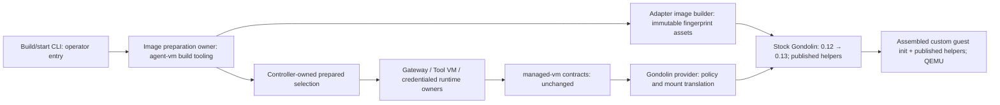
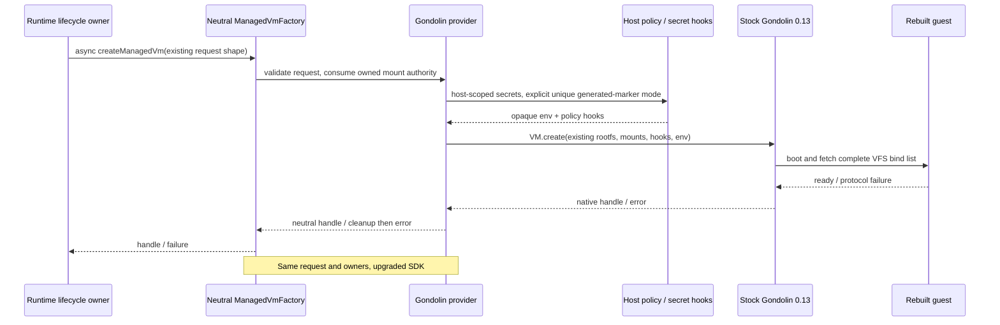
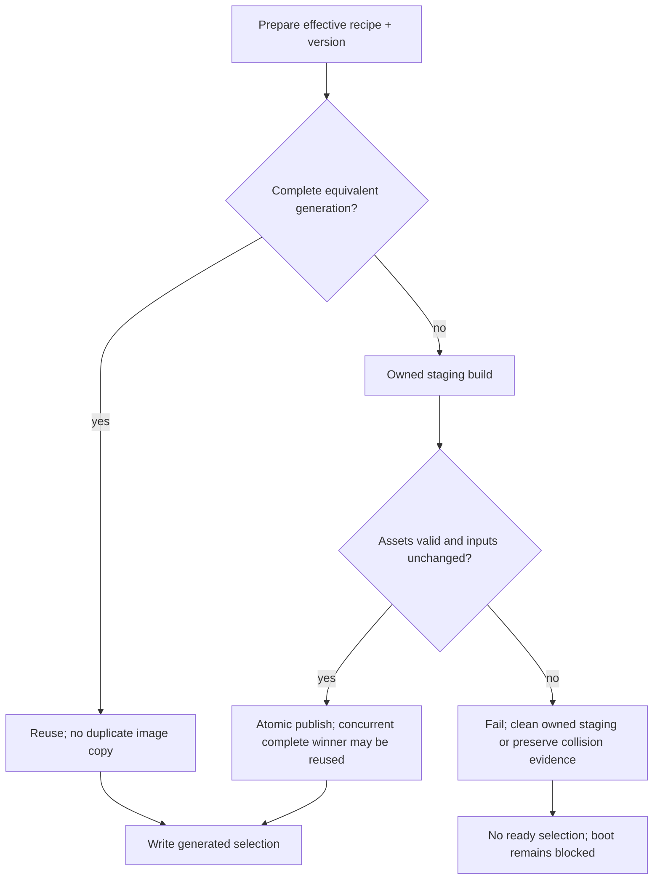
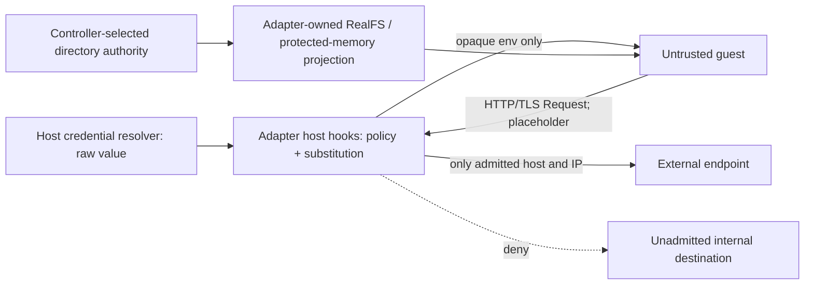

# Gondolin 0.13 upgrade program design

[Requirements](requirements.md) → [Specification](specification.md) → this structural realization.

The upgrade replaces the SDK and guest-build inputs inside the existing Gondolin adapter. Controller ownership, neutral VM interfaces, RealFS and protected-memory mounts, SSH transport, ingress and image-selection authority stay in their current homes. Qualification exercises those production paths against rebuilt images rather than introducing another orchestration layer.

## Entity bindings and boundary shapes

All homes below are existing. Only the adapter's dependency/build inputs and any bounded compatibility correction change. TypeScript explicit types and existing Zod boundary schemas remain authoritative; no parallel shapes are introduced.

| E | Semantic owner | Home and schema/type home | Boundary shape / disposition |
|---|---|---|---|
| E1 Managed VM | Gateway, Tool VM or credentialed-runtime lifecycle owner; provider owns mechanical SDK wrapper cleanup | `agent-vm` lifecycle modules; `managed-vm/src/managed-vm-contracts.ts` (`ManagedVm`, `ManagedVmCreateRequest`), existing | Request to factory: image reference, resources, rootfs mode/optional size, environment, mediated credentials, mounts, allowed hosts, TCP mappings and optional mediation/SSH egress. VM identity and lifecycle records persisted by controller; wrapper state derived |
| E2 Image generation | Adapter image builder | `gondolin-vm-adapter` build pipeline; `managed-vm` `ManagedVmImageBuildResult`, existing | `{fingerprint:string,imageReference:string,built:boolean}`; recipe is upstream `BuildConfig` validated by adapter. Shared assets cached; complete fingerprint directories immutable |
| E3 Deployment image selection | Agent-VM image preparation/preflight | `agent-vm` prepared-image cache; selection schema in `prepared-gondolin-image-cache.ts`, existing | `{schemaVersion:3,fingerprint:string,recipeIdentity:string,fingerprintInput?:unknown,managedGatewayBoot?:{kind:"managed-gateway-exact-two-role",frameworkBootEntry:"hermes-framework-service"}}`; generated selection path scoped by deployment/family/profile. Generated, not durable backup state |
| E4 Mediated credential | Host secret resolver / credentialed-runtime owner | `managed-vm` `ManagedVmMediatedSecretDescriptor`; adapter hook translation, existing | `{environmentVariable:string,value:string,allowedHosts:readonly string[],guestPlaceholder?:string}` travels only through trusted host factory. Guest receives `Record<string,string>` placeholder environment, never raw value; in-memory runtime material |
| E5 Destination request | Adapter egress policy and upstream host HTTP bridge; controller authors admitted policy | Adapter `HttpHooks` translation and `managed-vm` mediation/TCP shapes, existing | HTTP `Request`/`Response`; IP policy receives hostname, IP, family, port, protocol. Raw TCP `{guestHost:string,target:string}` remains separate; request state transient |
| E6 Owned worktree | Operator using AgentStudio helper | Existing AgentStudio Git/worktree command surface; no new project schema | Host checkout path, branch, base commit, status/integration evidence; checkout persisted until scoped cleanup |

The E3 parser and writer retain schema version 3. The image path is derived from shared cache root plus fingerprint after recipe/input and containment checks; it is not stored in the selection. The internal prepared reader returns `{built:false,fingerprint,imagePath,fingerprintInput?,managedGatewayBoot?}`, while the provider returns the neutral `{built,fingerprint,imageReference}` shape. No persisted shape changes are selected.

## What changes at runtime

| Path | Current entry → effect → result/error | Target delta and preserved authority |
|---|---|---|
| Build and select | CLI build → Gateway/Tool image preparation → provider `images.prepareImage` → `computeEffectiveBuildFingerprint` → stock `buildAssets` → verified staging → atomic complete generation → generated selection; errors return without ready publication | **Changed:** stock SDK/version, architecture-matched published helper and compatible generated-init inputs; no local helper source compilation in the normal path; effective fingerprint already includes SDK version. **Unchanged:** recipe validation, immutable publication, selection writer, staging failure cleanup and startup no-build preflight. **Corrected:** doctor/E2E prerequisite decisions that currently require host Zig unconditionally must match the actual published-helper path, while preserving actual build/boot failures |
| Create and boot | Runtime owner → `ManagedVmFactory.createManagedVm` → adapter validates request/consumes directory transfers → native adapter compiles hooks/mounts → `VM.create` → wrapper → start; failed construction closes owned transfers and propagates error | **Changed:** stock SDK implementation. **Unchanged:** neutral shape, policy ownership, VFS mount translation, rootfs choice and failure cleanup; no native SDK handle crosses composition boundary |
| HTTP mediation | Host-resolved E4 descriptors → adapter `createHttpHooks` → placeholder env plus hooks → guest HTTP/TLS → host policy/substitution → admitted destination → response/error | **Changed:** upstream shared-marker default is available. Preserve prior random generated-marker behavior by choosing upstream `secretPlaceholderMode: 'unique'` inside the adapter; explicit supplied markers remain exact. **Unchanged:** host resolution, host scope, redaction, raw-secret confinement and custom hooks |
| Network and SSH | Runtime-authored host policy → adapter scoped IP/internal mapping policy → Gondolin HTTP bridge; Gateway-to-Tool SSH uses synthetic DNS and explicit raw TCP slot | **Changed:** upstream no-hook default protection/network fixes. **Unchanged:** Agent-VM always installs its hooks, exact host/port mapping policy, strict SSH identity and WebSocket upgrade guard; no blanket private-network allowance |
| Close | Owning lifecycle closes access/terminates exact runner under current fences → provider wrapper close → stock VM.close; controller only removes records/releases slot after process/listener absence | **Changed:** stock closed state rejects resurrection. **Unchanged:** controller record/process/slot authority. SDK terminality supplements, not replaces, exact cleanup proof |

Source anchors: provider factory in `managed-vm-provider.ts:520`, native translation in `vm-adapter.ts:909`, image fingerprint/build in `build-pipeline.ts:235`, prepared-selection reader in `prepared-gondolin-image-cache.ts:117`, Tool VM request in `tool-vm-lifecycle.ts:428`, Hermes requirements in `hermes-lifecycle.ts:341`.

## Published helpers and accurate prerequisites

Agent-VM's selected cached image path consumes helper binaries; it does not expose an admitted helper-source-compilation mode. Stock Gondolin resolves complete explicit helper files first, then an explicit helper directory, then its verified published/cache bundle. The cached adapter rejects the source-build flag unless all four helper files are supplied; supplied files make upstream return before its compiler branch. Zig 0.17 is metadata for upstream contributor compilation, outside this selected Agent-VM path. No contributor builder, mode selector or compile fallback is added.

The custom rootfs/init/overlays are still assembled and verified. A prebuilt helper is not a prebuilt final Agent-VM image. Published-helper validation and resolution remain stock Gondolin ownership; doctor does not download helpers or add a parallel resolver.

| Existing owner / entry | Current decision | Proposed input → decision → result/error |
|---|---|---|
| Build CLI normal preparation | Source flag unset: no compiler lookup; current no-Zig integration case already covers that decision | Existing image recipes and normal environment → unchanged adapter fingerprint/build admission → published/provided binaries consumed, verified complete image result and selection; helper/input/build errors propagate. No compiler fact is needed for this normal path |
| Doctor environment collection and readiness | Always resolves source minimum and probes host Zig, which may make normal readiness fail | Existing system config, available binaries, Docker readiness and host runtime facts → stop collecting/passing source-minimum and Zig-version facts for this binary-consuming path; stop emitting the compiler-version failure → retain actual Node/Docker/QEMU/filesystem/config/state/secret/runtime checks and their existing results/errors. No recipe/source-mode classifier or helper download is added |
| Normal VM/Hermes E2E prerequisite admission | Architecture plus Docker/QEMU availability, then unconditional minimum/installed-Zig callbacks | Existing architecture and command-availability inputs → retain QEMU-for-architecture and Docker checks, invoke no compiler resolvers → eligible when those real prerequisites exist, otherwise existing ineligible result. Inventory opt-in remains. Real image preparation and VM boot still run and genuine helper/build/boot failures fail the proof lane rather than skip it |
| Cached adapter override admission | Source flag with an incomplete explicit helper set is rejected; complete explicit inputs are content-fingerprinted | Unchanged rejection/content-fingerprint rules; no supported source-build branch is inferred from the legacy CLI flag-only compiler check. This cycle does not make unsupported source inputs succeed or introduce a new override path |

The diagnostic compiler-only fields are removed from the doctor collection/decision path; the other existing diagnostic inputs and public result shape remain. The E2E compiler callback options are removed from that internal prerequisite helper and its callers/fixtures; no new mode input replaces them. The current normal build CLI decision stays intact. The legacy source-flag-only CLI guard is not reused to select doctor/E2E prerequisites and is not presented as an admitted compiler mode.

The decisive qualification keeps the stock SDK, verified published helpers, real custom image assembly and boot, in a controlled environment without a Zig executable. Negative cases retain missing actual host prerequisites, unavailable/corrupt helpers, rejected unsupported overrides and failed image/VM preparation. No live test becomes optional because this stale compiler decision is removed.

Source anchors: Agent-VM build CLI `build-command.ts:349,605` and current normal/source integration cases at `build-command.integration.test.ts:1541`; doctor inspection `controller-operation-commands.ts:293`; E2E prerequisite `e2e-harness.ts:299`; cached override admission `build-input-fingerprint.ts:76`; upstream `host/src/build/shared.ts:398-470`, `sandbox-helpers.ts:634-680`, and `container.ts:32`.

## Storage, state and failure

Guest Linux scratch remains the upstream built-in tmpfs set because this cycle does not authorize a new scratch-storage contract. Hermes's existing HOME, temporary and uv environment settings remain application-authored. `/work` stays disposable COW; `/workspace` and Hermes state retain their current host-backed meaning. Credential files stay on protected finalizable memory, and Hermes profile-secret shadows stay temporary; neither is replaced by disk scratch.

Image generation states are preparing → complete or failed. Publication verifies assets and current input identity before atomic rename. A concurrent winner is reused only if complete; an incomplete final generation fails closed and may preserve staging evidence. Startup reads ready selections only. Old generations are not modified to make them match the new SDK. This preserves the existing cache format; SDK-version fingerprint input supplies the version boundary.

Closing a VM is terminal in the upstream implementation. Its controller runtime record remains independently authoritative until exact process and listener cleanup succeeds. A failed or ambiguous cleanup preserves current evidence and quarantines the resource under the existing owner; it does not adopt an old VM or silently restart a closed handle.

The upgrade adds no retry loop, detached work, filesystem RPC writer or session-reattachment path. Request cancellation and failure propagation use existing operations. If qualification exposes a defect, the existing owner receives the smallest correction; a patch, changed public contract, changed stored format, ownership move or weaker proof requires a new owner decision.

## Trust and compatibility

No auth input becomes an image ingredient. No native SDK object becomes a domain interface. HTTP secret mediation and raw TCP forwarding remain different contracts. The Node 24 project target remains; the upstream minimum downgrade does not lower Agent-VM's supported runtime.

The release/import boundary changes to stock 0.13 but managed base GHCR tags and immutable upstream Hermes distribution pins remain independent. Compatible downstream custom images must be assembled under the upgraded package with compatible published helper inputs before boot. A mandatory host Zig0.17 upgrade is not selected for that path. The existing package train must stay synchronized for any later release; no release is executed by this design.

## Housekeeping boundary

Capacity control is an operator/executor obligation for this run, not a new production garbage collector. The Sidekick inventories exact identities and active/selected/build references; Lead verifies deletions. Existing AgentStudio removes eligible worktrees; exact existing image-removal primitives remove only established obsolete owned image identities. Shared-image removal is not delegated to Gondolin `removeImage`, which owns a different store, and Agent-VM `cache clean` is not described as shared-image GC.

The qualification executor declares a conservative free-space reserve and a measured/estimated batch peak, checks actual available bytes before each image batch, and limits simultaneous cold preparations. Keep the current selected images and the needed baseline until successor qualification is real. Unknown/shared references remain protected. No new registry, cache ownership model, retention daemon or automatic-GC code is introduced. The cost is explicit operational inspection; the operator pays it during qualification. Revisit a product GC design only with measured recurring generation growth and separately authorized requirements.

## Sunclaw beta qualification

The existing local-tarball synchronization tool builds/packages the changed workspace and refreshes only beta's host package pins and managed overlay inputs. The existing beta build command assembles compatible images before startup. The installed beta controller and Hermes Gateway then run through the same provider and neutral lifecycle path described above. Readiness, control-link and Tool VM SSH/command observations must come from that installed chain; production and unrelated authored beta policy are protected. No package publication or production restart is part of this cutover. Leave the verified beta controller running and retain its current image selections.

## Requirement realization and proof seams

| U | R / observable contract | E | Owner | Interface | Shape and home | State | Failure | Proof seam |
|---|---|---|---|---|---|---|---|---|
| U1,U5,U8 | R1 stock dependency/published helpers | E1,E2 | Adapter composition/build tooling | SDK import and stock image builder | package metadata / verified helper manifest, adapter | installed/helper input identity | refuse helper mismatch or unapproved patch | installed/packed metadata plus real no-Zig assembly |
| U1,U5 | R2 compatible image selection | E2,E3 | Image preparation/preflight | prepareImage / prepared reader | PreparedImageBuildResult + selection source, above | preparing→complete→selected | no ready publication on failed/incomplete input | rebuilt image and startup selection |
| U1,U5 | R3 mount and CA completeness | E1,E5 | Adapter mount translation + upstream bind RPC | factory mounts / TLS mediation | ManagedVmMount / HttpHooks, managed-vm + adapter | fixed before boot | creation/protocol error, no silent partial mount | real guest content and mediated TLS with long bind list |
| U1,U5 | R4 admitted and denied networking | E1,E5 | Adapter policy + runtime-authored rules | IP hooks / TCP mapping / ingress | existing neutral request and HttpHooks | request admit/deny | fail closed; no broad exception | real allowed/denied HTTP, ingress/control and SSH |
| U5 | R5 credential confinement | E1,E4,E5 | Host resolver + adapter mediation | createHttpHooks, unique generated marker | existing descriptor + opaque env | host-resolved→active→closed | redacted creation error or denied request | guest marker/raw-value absence and endpoint substitution |
| U1,U5 | R6 storage meaning | E1 | Runtime lifecycle owners + adapter mount projection | existing env/rootfs/mount request | ManagedVmCreateRequest / Hermes boot env | disposable vs durable lifetimes unchanged | no alternate disk credential path | real backing/env/workspace/secret isolation |
| U1,U5 | R7 terminal close | E1 | Runtime lifecycle owner + provider wrapper | close/start/exec | existing ManagedVm and runtime records | running→closed terminal | reject reuse; preserve uncertain cleanup record | no replacement runner/listener, real late-operation rejection |
| U4,U7 | R8 capacity-safe qualification | E2,E3 | Qualification executor under Lead | existing build harness and host inventory | observed byte counts; no new stored schema | admission→batch→measured completion | stop new preparation below declared reserve | reuse and before/after host capacity |
| U4,U7 | R9 exact obsolete-image cleanup | E1,E2,E3 | Operator under Lead | existing exact image deletion primitive | immutable ID/path + reference evidence, operational | candidate→protected or removed | unknown refs preserved; deletion failure recorded | exact deletion plus reference/absence/space observation |
| U2,U3 | R10 remote working context | E6 | Operator / AgentStudio helper | worktree new/list/remove | existing Git/helper results | assessed→preserved/removed | retain useful or active work | exact base, status, patch equivalence and archive |

| U1,U5,U8 | R11 accurate prerequisite admission | E1,E2 | Existing build CLI, doctor and E2E prerequisite owners | normal binary-path prerequisite checks and real prepare/boot | existing host facts/architecture; diagnostic compiler-only inputs and internal E2E compiler callbacks removed, no mode/public wire/storage shape added | normal binary consumption, existing unsupported override rejection | actual missing/corrupt helpers or build/boot errors fail; no compiler-only skip | no-Zig real build/VM boot plus genuine prerequisite/override failure cases |

| U1,U5,U9 | R12 real running Sunclaw beta | E1,E2,E3 | Existing beta package/build and controller/Gateway lifecycle owners | existing local package sync, image preparation and controller/Tool VM entrypoints | installed package metadata and existing neutral runtime/health/exec shapes, current homes | installed→prepared→running→ready, beta left running | fail on stale chain, build/boot/control/SSH failure; preserve authored beta and production | real installed beta controller/Gateway/control-link plus Tool VM command and final live health |

Unit seams may substitute SDK construction to prove translation, never the VM interaction being claimed. Integration seams prove selection, policy, lifecycle and failure wiring with declared fake VM edges. Real VM/Hermes seams keep the actual adapter, guest images, QEMU, mounts, HTTP mediation, ingress/control and SSH path real. Release artifact inspection proves packaging; it cannot prove deployed behavior.

Invalid states: unapproved dependency patch is rejected by the owner boundary; stale/incomplete selection is rejected at preflight; raw credentials in images/guest env are prohibited by existing image/runtime guards; internal destinations require existing exact policy admission; closed-handle resurrection is rejected by stock SDK; removal with uncertain references is rejected operationally. No safety guarantee is assigned solely to a mock or a green inventory lane.
