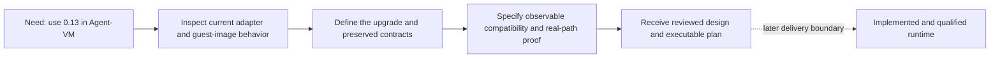
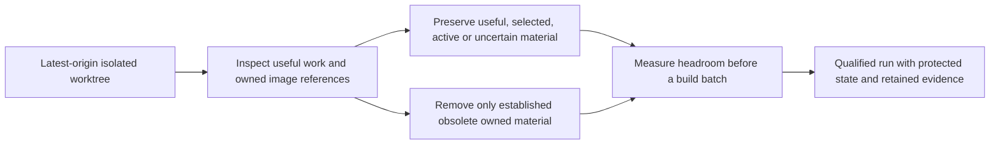

# Gondolin 0.13 upgrade requirements

The operator needs a qualified upgrade from Gondolin 0.12.0 to 0.13.0 for Agent-VM, with controlled image-building disk use on Sunclaw. This document records authorized outcomes and separates proposed adoption from the requested upgrade. [Specification](specification.md) owns observable obligations; [Program Design](program-design.md) owns their structural realization.

## The maintainer’s job

U1: turn the current 0.12 integration into a concrete, qualified 0.13 upgrade plan. Current gap: the dependency and guest/toolchain inputs are still 0.12-era; no 0.13 Agent-VM runtime qualification has been established. The desired outcome is a plan whose compatibility and proof obligations are grounded before any deployment changes.

## The operator’s constraint

U2–U4 and U7: create isolated remote working context, preserve useful old work, and keep the qualification run from exhausting shared host capacity. Disk exhaustion is a stated owner concern; a repeated-growth rate and cold-build peak have not been measured. Cleanup is ongoing operational work alongside the design, not a replacement for it.

## People and needs

| ID | Affected class | Need | Evidence and authority | Priority / assigner |
|---|---|---|---|---|
| U1 | Agent-VM maintainer | Obtain a source-grounded upgrade design and implementation plan for 0.13.0 | Owner request, 2026-10-14; authorized | Must / owner |
| U2 | Operator and execution agent | Work in AgentStudio copy-on-write forks locally and on Sunclaw over Tailscale SSH, based on latest origin default branch | Owner request and latest-origin correction; authorized | Must / owner |
| U3 | Operator | Assess old remote worktrees and uncommitted changes for usefulness; remove obsolete integrated work | Owner cleanup request and clarification; authorized | Must / owner |
| U4 | Operator and other users of Sunclaw | Avoid exhausting host disk through repeated Agent-VM image builds; remove obsolete owned artifacts carefully | Owner disk-space concern; authorized; exact reserve/retention tolerance unresolved | Must / owner |
| U5 | Existing Gateway and Tool VM consumers | Preserve existing authorization, credential isolation, workspace/state meaning and operational paths through the upgrade | Repository AGENTS.md and current maintainer contracts; authorized constraint | Must / repository contract |
| U7 | Operator | Clean up obsolete Agent-VM images throughout the work while preserving selected images and live VM/build inputs | Owner follow-up, 2026-10-14; authorized | Must / owner |
| U9 | Maintainer and beta operator | Deliver the update through a verified unmerged PR and leave shravan-claw-beta actually running on Sunclaw; preserve authored beta config and production | Owner delivery selection and runtime/beta corrections, 2026-10-15; authorized | Must / owner |
| U8 | Operator and maintainer | Use upstream published sandbox helpers for normal image preparation without imposing an unnecessary local Zig upgrade; retain real image/VM qualification | Owner correction, 2026-10-14, confirmed against source; authorized | Must / owner |
| U6 | Agents with cache-heavy workloads | Select Linux scratch backing to reduce guest-RAM pressure when justified by actual workload | Upstream capability observed; Lead recommendation; unresolved owner adoption scope | Proposed / Lead, not normative-eligible |

No customer/buyer need separate from the operator's capacity constraint has been established. New browser clients, remote session-IPC consumers, checkpoint users and new image-GC users are outside the proposed bounded cycle; owner scope selection remains open.

## Current foundation and desired difference

| Surface | Current foundation to preserve | Upgrade difference to qualify |
|---|---|---|
| SDK and guest builds | Stock 0.12.0, Node 24 project target, published helper path; repository Zig pin is 0.16.0 | Stock 0.13.0 with its published, architecture-matched helpers; freshly compatible custom guest images. Zig 0.17 is a source-compilation requirement, not a normal host prerequisite |
| Workspaces and state | Durable `/workspace`, protected Hermes state, disposable `/work` | Existing isolation and lifecycle behavior remains valid with new guest init |
| Hermes caches | Explicit `/work/tmp`, `/work/cache/uv`, host-mounted rebuildable home cache | Do not assume every cache currently resides in RAM |
| Linux scratch | Upstream built-in tmpfs set currently selected implicitly | Optional explicit replacement map, only if U6 is authorized |
| Credentials | Host HTTP mediation and separate protected memory-backed file material | Placeholder default change must preserve confidentiality and exact substitution |
| Networking | Existing host allowlist and scoped internal mapping rules, SSH and WebSocket control link | New upstream default must preserve admitted paths and deny unintended private destinations |
| Image builds | Shared immutable fingerprint generations and deployment selection records | Rebuilt generation selected; avoid duplicate image copies and uncontrolled growth |

These are observable outcome comparisons, not a selection of new components or a cleanup mechanism.

## Scope boundary

- Goal: create reviewed Requirements, Specification and Program Design, then a concrete implementation plan for this upgrade. Implementation and Sunclaw beta qualification are authorized through a verified unmerged PR; merge and release remain outside the terminal.
- Affected classes: maintainer, Sunclaw operator, existing Gateway/Tool VM consumers, downstream execution/review agents.
- Permitted capability surface: Agent-VM's existing Gondolin integration, build/toolchain inputs, qualification, relevant maintainer/manual guidance and scoped operational housekeeping. Any scratch-policy contract remains pending U6.
- Protected: current production deployment, durable state, active VM resources, credential-memory isolation, workspace authorization, ingress/control-link and Tool VM SSH contracts; unrelated repositories and useful uncommitted work.
- Complexity: extend existing ownership where needed. No new upstream dependency patch, fork adoption, runtime monkeypatch, VM reattachment, remote agent control plane, browser/CDP broker, checkpoint persistence or shared-image-GC redesign is authorized.
- Evidence: exact installed package/toolchain inputs, focused behavioral tests, integration proof, no-skip host and real VM/Hermes/mediation proof appropriate to affected paths, existing required quality gates, and measured before/after disk inventory. Inventory skips are not runtime qualification. Test mechanics belong in the later plan.

## Decisions and unknowns

1. **Scratch opportunity:** U6 remains an unapproved follow-on opportunity. The core upgrade preserves existing scratch/storage contracts and does not add a configurable scratch interface or blanket `tmpfs: {}` policy. An optional agent proposal does not block the authorized upgrade design.
2. **Qualification capacity:** the run must declare conservative free-space reserve and batch peak inputs, measure them and preserve active/selected generations. This is operational execution control; no global retention service or new production GC policy is required by this design.

## Sources

- Agent-VM base: `8535fdd433dc90fed627ee7a05f63e59d58cf8ee` from origin/master, 2026-10-14.
- [Storage model](../../architecture/storage-model.md), [Gondolin boundary](../../subsystems/gondolin-vm-layer.md), [patch constraints](../../architecture/gondolin-patches.md).
- [Upstream 0.13 changelog](https://github.com/earendil-works/gondolin/blob/fcbcef162a73b214f79069f8430c70cebda0f827/CHANGELOG.md), [scratch API](https://github.com/earendil-works/gondolin/blob/fcbcef162a73b214f79069f8430c70cebda0f827/host/src/sandbox/tmpfs.ts), [generated guest init](https://github.com/earendil-works/gondolin/blob/fcbcef162a73b214f79069f8430c70cebda0f827/host/src/alpine/init-scripts.ts).

The upstream sources establish capability and compatibility facts. They do not authorize Agent-VM product choices. Readiness, review receipts and the running work account stay in the session trace rather than becoming requirements.
