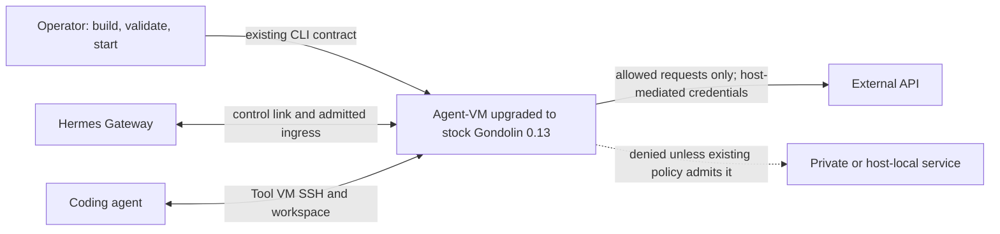
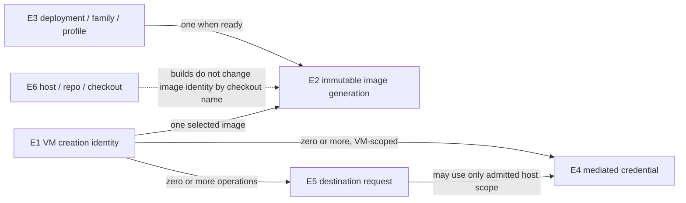

# Gondolin 0.13 upgrade specification

[Requirements](requirements.md) → this observable contract → [Program Design](program-design.md).

Agent-VM adopts stock Gondolin 0.13.0 and rebuilds compatible guest images while preserving its current managed-VM, authorization and storage contracts. The upgrade must work through real Gateway and Tool VM paths. New upstream features are not automatically new Agent-VM interfaces.

The opaque system boundary above does not add session reattachment, browser control, native guest-file access, checkpoint persistence or a new image garbage collector.

## Entities

| ID / term | Identity and relationships | Invariant / observable states | Basis |
|---|---|---|---|
| E1 Managed VM | One VM creation identity; belongs to one controller-owned lifecycle; zero or more E2 images may exist in storage but one image is selected for a creation | Its mounts and credentials follow the controller's selected authority. Created → running → closed; closed does not restart | U1, U5; current managed-VM/lifecycle contracts |
| E2 Image generation | Same generation only when effective recipe, runtime inputs and upstream version identify the same artifact; shared by zero or more E3 selections and E1 creations | Complete generations are immutable. Preparing → complete or failed; selected and in-use are independent reference properties | U1, U4, U7; storage model |
| E3 Deployment image selection | One deployment, image family and configured profile; references exactly one complete E2 generation when ready | Missing/stale/invalid selections cannot authorize boot. Ready → stale when effective inputs change → ready after build | U1, U5; prepared-image contract |
| E4 Mediated credential | One descriptor identified by the VM environment name within one E1 creation, with its host restriction; zero or more admitted requests may use it | Guest receives an opaque placeholder, not the host credential. Resolved → active → unavailable when its owning runtime closes | U5; existing secret contracts |
| E5 Destination request | One outbound protocol operation from one E1 VM to a hostname, resolved destination and port | Host and destination policy both apply; approved raw TCP mappings do not create HTTP credential authority. Pending → admitted/completed or denied/failed | U5; existing egress contracts |
| E6 Owned worktree | One registered checkout path and branch in one repository on one host | Useful uncommitted work is not erased because the committed branch is integrated. Retained → assessed → preserved or removed | U2, U3 |

## Obligations and proof

P1: current SDK/guest images are 0.12 inputs; the requested upgrade is not qualified. O1: compatible 0.13 runtime inputs and observable production-shaped behavior.
P2: repeated image generations can consume host capacity; prevalence and precise build peak are not yet measured. O2: bounded, reference-safe qualification and cleanup.
P3: obsolete remote checkouts consume space or hide useful work. O3: preserve useful changes and remove confirmed obsolete checkouts.

Each R row below is also its C observable contract; its V cell names the proof modality. U6 is an advisory scratch-storage opportunity and authorizes none of these obligations.

| R / contract | Normative behavior, success and failure | U / E / P → O | V |
|---|---|---|---|
| R1 Dependency and toolchain identity | The installed adapter MUST use stock Gondolin 0.13.0 with compatible architecture-matched published sandbox helpers for normal image preparation. Local Zig MUST NOT be a prerequisite of that path. Zig 0.17 is required only for an explicitly selected, admissible upstream helper source-compilation path; no automatic source fallback is added. No patch, fork or guest/helper override may be introduced without fresh owner approval. Package identity mismatch fails qualification | U1,U5,U8 / E1,E2 / P1→O1 | V1: installed package/helper provenance and real image assembly without local Zig; source-path prerequisite negative cases |
| R2 Compatible guest images | A ready E3 selection MUST name an E2 generation built for current effective inputs. Old or incomplete generations MUST NOT become ready merely because they exist. Rebuild failure leaves boot inadmissible rather than repairing a complete generation in place | U1,U5 / E2,E3 / P1→O1 | V2: build/selection inspection plus real custom-image boot |
| R3 Mount and CA completeness | Every admitted E1 mount MUST remain accessible at its selected guest path, including late mounts and the MITM CA when the aggregate bind list exceeds the previous command-line limit. Path spaces or commas must not silently remove a mount | U1,U5 / E1,E5 / P1→O1 | V3: real VM mount/content and TLS observation; multiple mounts beyond old limit |
| R4 Network policy preservation | E5 requests MUST retain current host/destination restrictions. Existing admitted Gateway control, ingress WebSocket and Tool VM SSH paths MUST function. Unadmitted private, loopback and metadata destinations MUST remain denied; broad internal-range opt-out is prohibited | U1,U5 / E1,E5 / P1→O1 | V4: allowed and denied real VM HTTP/TLS, ingress/control-link and cross-VM SSH cases |
| R5 Credential confinement | An E4 credential MUST remain host-side for HTTP mediation and substitute only on its admitted hosts. Explicit controller-authored placeholders MUST keep their exact value. A change in upstream generated-placeholder default MUST NOT leak the raw value or broaden substitution | U5 / E1,E4,E5 / P1→O1 | V5: guest environment/response inspection, admitted-host substitution and denied-host negative cases |
| R6 Existing storage meaning | E1 VMs MUST preserve durable workspace/Hermes-state paths, disposable work paths and protected credential-memory material. Application-authored environment values remain authoritative. New guest XDG/UV defaults are qualified and documented; this upgrade adds no persisted scratch or checkpoint contract | U1,U5 / E1 / P1→O1 | V6: real guest environment/path/backing inspection and workspace/state/credential isolation cases |
| R7 Terminal close and cleanup | Closing E1 MUST be terminal. Later start/exec must reject without a replacement runner or socket; existing controller exact-process/record/port cleanup guarantees remain intact | U1,U5 / E1 / P1→O1 | V7: real lifecycle close/reuse-negative observation, process and listener absence |
| R8 Capacity-safe qualification | Image preparation MUST reuse complete equivalent E2 inputs and measure available/consumed host storage before each build batch. If the batch cannot fit the declared operational reserve and measured/estimated peak, the executor stops build admission and cleans proven obsolete owned artifacts; it does not weaken qualification or consume protected state | U4,U7 / E2,E3 / P2→O2 | V8: host inventory, build reuse and before/after storage measurements with explicit uncertainty |
| R9 Safe obsolete-image removal | Removal MUST target exact Agent-VM-owned E2 generations or source-image identities whose obsolescence and absence of selection, live VM and active-build use are established. Unknown references are preserved. Removal records exact identities and observed outcomes; unrelated images, volumes and runtime/state roots remain protected | U4,U7 / E1,E2,E3 / P2→O2 | V9: selection/consumer inventory, exact cleanup transcript and absence/reclaimed-space observation |
| R10 Remote working context | E6 upgrade checkouts MUST use AgentStudio copy-on-write creation from latest origin default branch on each host. An obsolete E6 may be removed after integration/usefulness assessment; useful uncommitted contributions and needed evidence are preserved | U2,U3 / E6 / P3→O3 | V10: helper receipt, Git identity/status, integration equivalence and evidence archive |

| R11 Accurate prerequisite admission | Normal published-helper image/VM qualification and readiness diagnostics MUST NOT fail or skip solely because host Zig is absent or older than upstream source metadata. Missing/corrupt/incompatible helpers and actual Docker/QEMU/build failures MUST remain failures; real VM proof cannot be replaced by relaxed prerequisite checks | U1,U5,U8 / E1,E2 / P1→O1 | V11: prerequisite decision cases plus no-Zig real published-helper build/boot, with zero live-proof skips |

| R12 Real Sunclaw beta qualification | Delivery MUST include the upgraded package chain installed in shravan-claw-beta on Sunclaw, successfully built custom images, a running controller and ready Hermes Gateway, and real Tool VM execution evidence appropriate to the upgrade. Existing beta-authored configuration and production MUST be preserved. Static checks, skipped inventory, simulated VM factories or a prior release running do not satisfy this obligation | U1,U5,U9 / E1,E2,E3 / P1→O1 | V12: exact installed chain plus real beta controller/Gateway/control-link and Tool VM execution observations; final health while beta remains running |

## Compatibility and negative cases

- Existing public CLI/HTTP and neutral managed-VM contracts are retained. No new `VMOptions.tmpfs` field leaks into controller-domain types.
- Current COW rootfs and Gondolin default scratch mount set remain selected. Explicit adoption of a different scratch map would be a separate storage design decision.
- Generated `/init` in 0.13 no longer forces XDG/UV locations under `/tmp`. Hermes already authors its HOME and `/work` temporary/uv paths. Tool VM and credentialed-runtime default behavior needs real-path qualification; it is not assumed equivalent from that Hermes fact.
- A valid explicit secret placeholder still substitutes on the correct host. The same marker sent to another host must not substitute. Duplicate/unsafe upstream secret identifiers must fail creation with a redacted error rather than bypass validation.
- A stale selection must request rebuild; startup must not secretly build images. A failed image build must not publish a ready selection or delete an active generation.
- Cancellation preserves existing owning-lifecycle cleanup. No VM adoption or host-crash reattachment is added. Independent runtime failures remain distinct from inventory-only skips.
- Upstream prebuilt helpers do not mean a prebuilt final Agent-VM guest image: our custom rootfs/init/overlays still need assembly and qualification. Missing published helpers fail explicitly instead of triggering an unrequested Zig build.
- The disk reserve is an operational run input, not a new public configuration or stored-data format. This contract does not promise a global automatic-GC service or a measured efficiency gain before measurement exists.

## Sources

[Storage model](../../architecture/storage-model.md), [Gondolin layer](../../subsystems/gondolin-vm-layer.md), [patch boundary](../../architecture/gondolin-patches.md), and [upstream 0.13 changelog at the exact tag](https://github.com/earendil-works/gondolin/blob/fcbcef162a73b214f79069f8430c70cebda0f827/CHANGELOG.md).
