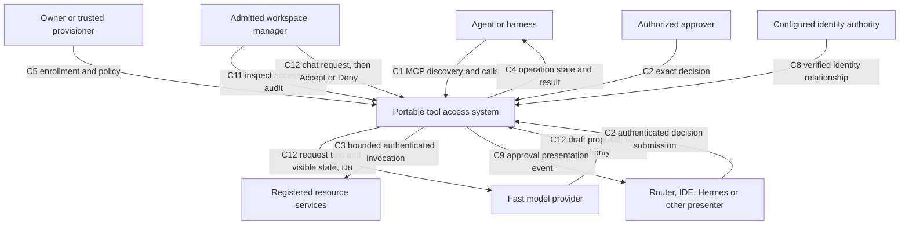
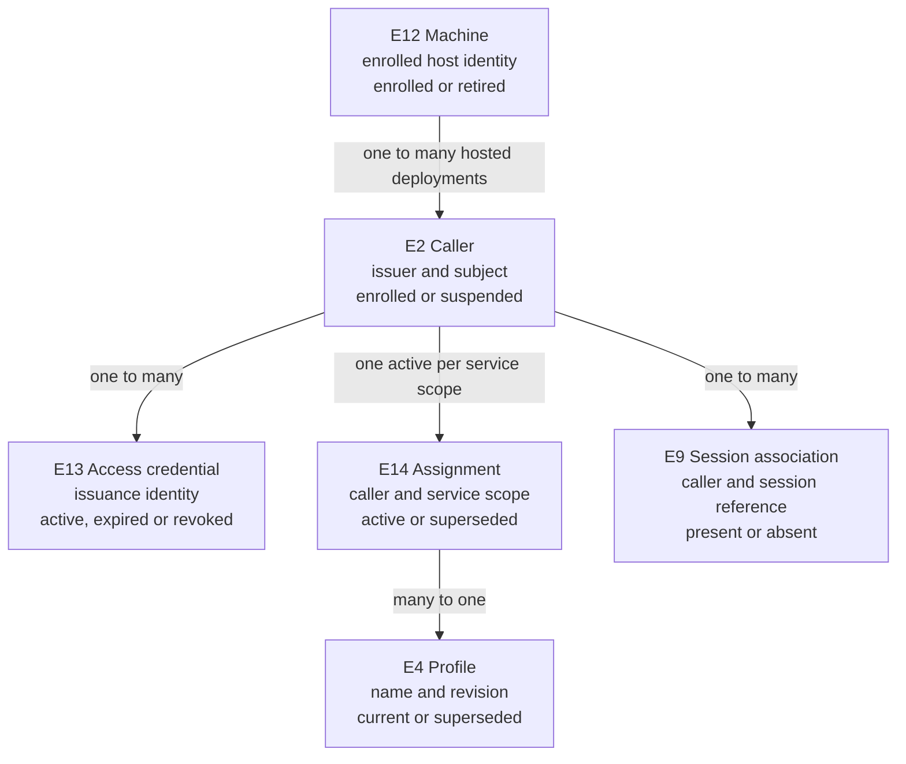
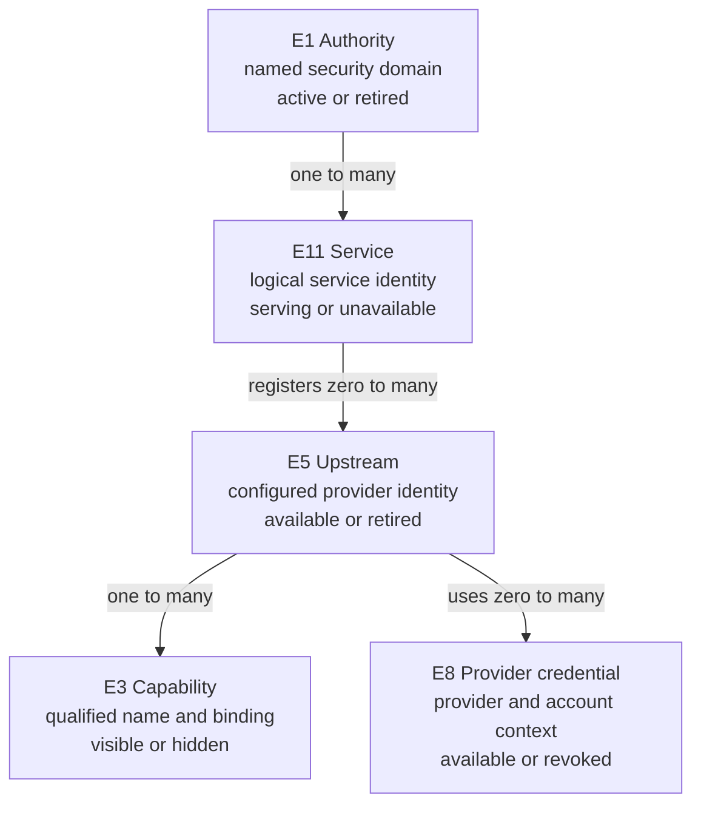
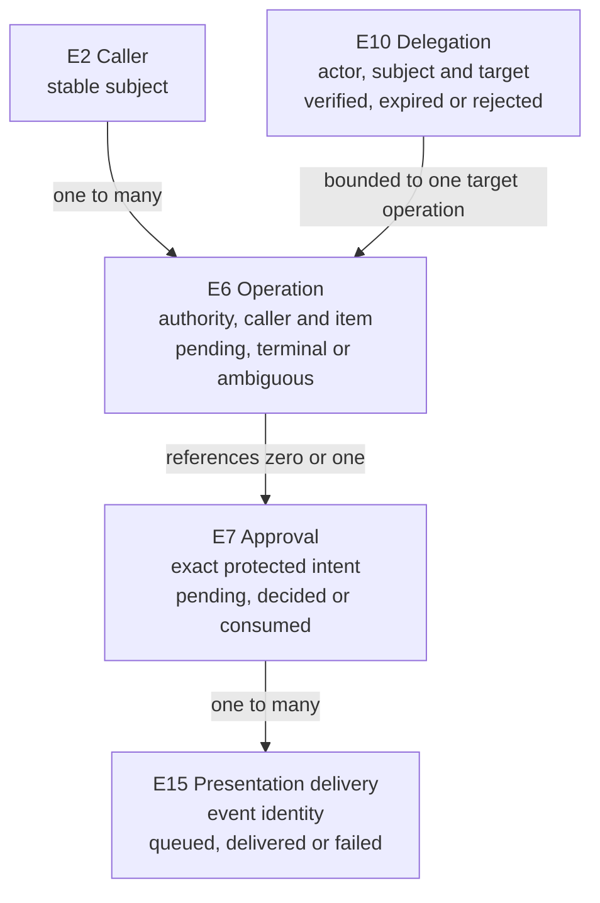
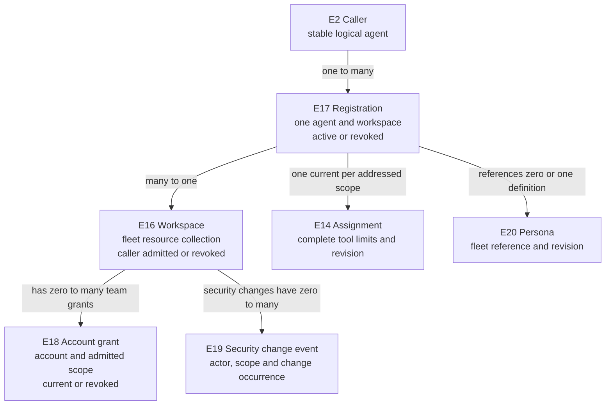
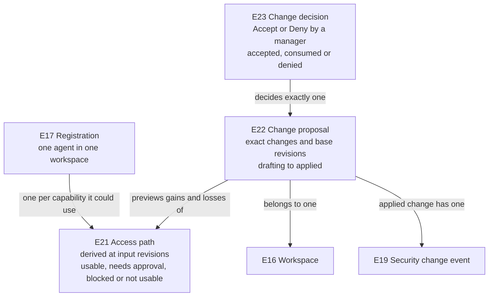

# Specification: portable tool access

[Overview](index.html) · [HTML](2026-10-14-portable-tool-portal-hosts.html) · [Requirements](requirements.md) · [Program Design](program-design.md)

An authenticated agent can discover and use only its permitted tools, whether the tool lives in a cloud service or on a registered computer. The same identity and authorization meaning survives routing. Approval permits one exact otherwise-admissible action; it does not grant general access.

This is the observable contract for [Requirements `U1–U22`](requirements.md#authorized-needs). Structural choices live in Program Design. Unselected policies `D1–D10` remain explicit: no default below settles them. Fleet entity references follow the [parent decisions](../2026-10-18-fleet-framework/2026-10-18-fleet-framework.md); this document defines only their tool-access consequences.

The persona-to-person relationship, launched-instance enrollment proof and auto-judge policy still lack their domain contracts under D2/D3. Existing caller, assignment and approval definitions do not implicitly implement those meanings. In particular, an acts-for association is not account authorization and an allow rule is not an automatic approval judge.

## System boundary

The resource may be another composable service. Coordination is a separate service with a separate permission/approval domain (`C7`); reusable identity or presentation integrations cross that boundary explicitly (`C8`, `C9`). No tool call can enroll an agent, invent a profile or become an operator.

## Problems and outcomes

| Problem | Desired outcome | Needs |
| --- | --- | --- |
| `P1` Hosting currently carries local runtime dependencies. | `O1` Equivalent portable behavior under explicit host capabilities. | U1, U4, U8, U12 |
| `P2` Security ownership and effect ownership can become confused across hops. | `O2` One accountable authority per decision, credential and effect; no privilege expansion. | U3, U5, U9, U10, U14 |
| `P3` A lost connection does not reveal whether an action happened. | `O3` Recover the same operation or report uncertainty without repeating its effect. | U6 |
| `P4` Clients offer different discovery and approval interfaces. | `O4` Equivalent policy through standard MCP and replaceable presenters. | U2, U7, U11, U14 |
| `P5` A conversation identifier is being used where an enrolled identity is needed. | `O5` Separate agent, machine, service, credential and session identities with explicit grants. | U13, U15 |
| `P6` The operator cannot tell what the app is for or why an agent can or cannot use a tool: one agent–tool–account–workspace association is split across separate editors, and browser-only edits can be mistaken for authority. | `O6` One view, filtered by agent, tool, account or workspace, shows what each agent can use and names why not; search reaches any of them; separate places exist only for the audit log and account connections. | U16, U17, U19 |
| `P7` Changing access means operating editors, and a typed or spoken request could be mistaken for permission. | `O7` A chat request becomes an exact proposed change; nothing changes until an admitted manager accepts it; the actual result, or failure, is shown and audited. | U16, U17, U18, U20 |

## Entity meanings

Identity is stable within an authority. Changing a network address, connection or signing key does not silently rename the entity. All states below are observable to an appropriately authorized reader; hidden entities remain hidden to other callers.

| Entity | Identity and relationships | Invariants and states |
| --- | --- | --- |
| `E1` Portal authority | One named security domain. Owns many caller admissions, assignments, operations and approvals; one service selects one authority. | Active, unavailable or retired. Shared implementation does not merge authorities. |
| `E2` Caller | A logical issuer/subject with an admitted role: agent, human or acting service. Many credentials may authenticate one caller; many sessions may refer to it. | Enrolled, suspended or retired. Client brand, a model name and a session ID do not establish identity. Agent and approver roles confer different powers. |
| `E3` Capability | A qualified tool name in one authority, at a binding revision; supplied by one registered upstream. | Visible/hidden for a caller; available/unavailable. Arguments cannot choose a different execution authority. |
| `E4` Permission profile | A complete permission set at one revision, reusable by many assignments. | Current or superseded. No implicit inheritance. A profile may allow, deny or require approval for a capability. |
| `E5` Upstream service | Operator-registered provider identity and binding. Supplies many capabilities and may use several provider credentials. | Configured, available, unavailable or retired. Address changes alter binding revision, not identity. Reachability grants no permission. Each upstream declares what it needs before use: nothing, a secret (API key or token) or a provider sign-in (OAuth); that need is shown, the secret never is. |
| `E6` Operation | One authority/caller/operation-item identity, bound to one exact capability intent. A batch identifier is correlation. A routed operation fixes its target and inner key before forwarding; its inner reference may still be unknown. | Awaiting approval, ready, reserved, armed, running, forwarding with remote outcome unknown, awaiting remote, succeeded, failed, denied, cancelled with proof, ambiguous or result-expired. Reordering or reconnecting does not create a new operation. |
| `E7` Approval | An attributable decision over one exact current protected intent, requesting access-credential issuance and expiry, within one authority. At most one dispatch may consume it. | Pending, approved, denied, expired, revoked or consumed. It is neither standing permission nor proof that the effect happened. |
| `E8` Provider credential | Protected authorization material for one provider/account context. A binding may select it; an agent never receives it. | Available, expired, revoked or unavailable. Refresh does not authorize a different account. |
| `E9` Logical session association | A caller-scoped conversation/run association referencing zero or more operations. | Present or absent. It is correlation, not authentication. The harness/Router retains conversation ownership. |
| `E10` Delegated caller authority | An acting service represents one originating caller to one target with bounded scope and validity. A changed actor, subject, audience or scope changes this relationship. | Presented, verified, rejected, expired or revoked. A copied caller object is not delegation. Destination ceilings still apply. |
| `E11` Portal service | One logical cloud gateway or computer resource service, selected independently of host process and transport. Authenticated using its service caller identity; a computer service binds one enrolled target machine. | Configured, serving, unavailable or retired. A Worker has a service identity; it need not pretend to be a physical machine. |
| `E12` Machine | One enrolled host or VM boundary, distinct from physical hardware, credentials, IP and hosted agents. A host plus two VMs means three boundaries (F-34). Hosts zero or more services and agent deployments. | Pending enrollment, enrolled, suspended or retired. Source machine and target machine are different roles. A claimed machine name is not proof of possession. |
| `E13` Access credential | One separately identifiable issuance used to authenticate a caller or machine. Several may belong to the same principal; replacement is a new issuance. | Issued, active, expired or revoked. Compromise of one credential need not revoke every deployment of the logical agent. It is distinct from a provider credential. |
| `E14` Permission assignment | One authority's binding of one caller to a complete profile, workspace/service scope and revision; may constrain source/target machine relationships. | Active, superseded or revoked. A caller can name a workspace, but cannot supply that workspace's assignment or override its limits. One active assignment applies in each addressed scope. |
| `E15` Approval presentation delivery | One notification/event identity referring to an existing approval and its authority. May be delivered to several approved surfaces. | Queued, delivered, acknowledged or failed. Duplicate delivery does not create a decision; acknowledgement does not approve. |
| `E16` Workspace | One fleet-identified collection of resources and admitted members, independent of its display name, directory or physical computer. One caller may participate in several; each has its own tool allowance. | Admitted/unavailable/revoked for a particular caller. Managers have workspace-scoped configuration authority, not global authority. Canonicalizes the owner's workspace/resource-set meaning (F-4/F-8/F-24/F-29/F-32); registry membership proof remains D2. |
| `E17` Agent registration | One logical agent's tool-access relationship to one workspace, referring to E2/E16 and its E14 assignment. A harness/session change alone does not create a different agent; the same agent may have registrations in several workspaces. | Active, superseded or revoked. Harness is descriptive integration metadata. Canonicalizes “agent in Hermes,” not registration of Hermes itself (F-23). No principal credential is created merely by saving a display name. |
| `E18` Account access grant | One account authority's permission for an admitted agent or workspace scope to use one registered provider account, with a grant revision. Separate from E8 credential bytes and provider consent. | Current, superseded, revoked or unavailable. Team grants may be configured by that workspace's admitted manager; personal grants require the account owner's consent. Unknown classification cannot be treated as team. Its grant revision includes the provider-specific options allowed on that account (for example, which Gmail, Calendar or Drive operations). Canonicalizes F-27/F-35/F-47; trusted classification mechanism remains D6. |
| `E19` Security change event | One attributable occurrence of a security/permission change, with stable identity, affected scope, actor, change kind and bounded before/after meaning. One change has one authoritative occurrence even when delivered to multiple views. | Recorded or unavailable; delivery/projection can lag without creating another change. No credentials/proofs in its display. Canonicalizes F-28/F-30/F-35; persistence, readership and retention remain D6. |
| `E20` Persona | One fleet definition, referenced at a revision, which composes capabilities and can be used by many agent registrations. It is not a running session, an issuance or an account grant. | Referenced revision or superseded revision. A persona change does not itself confer resource consent or force a catalog reload; changed authorization is evaluated separately. Canonicalizes persona/role in F-1–F-3/F-12/F-17; fleet definition lifecycle remains parent-owned. |
| `E21` Access path | One agent registration (E17) and one capability (E3) in that registration's workspace, evaluated at the revisions of every input it reads: workspace allowance and agent subset (E14), account grant and its options (E18), provider consent (E8), upstream availability (E5) and the profile's mode (E4). The same pair at different input revisions is a different evaluation. | Derived; no writer of its own; computed by the same effect-free assessment that admission uses. It can be shown and filtered but never edited, and showing it grants nothing. Its answer is either one state for the whole capability or, when admission depends on the call (the operation chosen, the arguments' surface or the selected account), a breakdown per operation class or account, plus the rule decided per call for anything the breakdown cannot fix in advance. States per entry: **usable**; **usable with approval each call**; **blocked by policy**; **not usable**, naming the first unmet condition in this order: registration revoked, not allowed in the workspace, not given to the agent, account not granted, account policy paused while applying, provider consent missing or expired, service unavailable. Where a capability is exposed on some surfaces and not others (today's managed MCP surface versus its protected private-socket surface), each path names the surface it describes, and a surface the profile does not expose the capability on counts as not given to the agent, as admission treats it today. When a deny rule and an unmet condition both apply, the entry shows whichever admission meets first: a capability's own deny after the first three conditions, and an account's deny after its paused check, the order admission uses today. Canonicalizes “what can this agent do” and “why can't it” (F-42, U19) and each account's own options (F-47). |
| `E22` Change proposal | One proposal identity within one workspace's policy authority, created for one request. It holds an exact set of typed changes to that workspace's allowance, agent registrations or team-account grants, against stated base revisions. Changing its content makes a new proposal. | References one E16 workspace, its requester (E2, human or agent) and every affected E14/E17/E18. Creating it changes nothing. States: **drafting** (clarifying with the requester); **ready**; **invalid** (contains a change no manager may make, such as a personal-account grant, named per item); **superseded** (a base revision changed before decision); **accepted**; **denied**; **expired**; **applying**; **applied**; **failed**. Canonicalizes the chat-generated proposal and its “generative UI” card (F-41, F-43). |
| `E23` Change decision | One Accept or Deny over one exact E22: its content and base revisions, by one authenticated manager or owner of that proposal's workspace. | At most one decision per proposal, and at most one application per Accept. States: **accepted** → **consumed** (applied or refused at application), or **denied**. It is not an E7 approval: it never authorizes a tool action, and an E7 approval never accepts a proposal. The model, chat text, an agent or a presenter cannot make it. Canonicalizes “acept deny” (F-43). |

A service principal can act on behalf of an agent. The resource must be able to distinguish both. An agent can own many sessions and run on multiple machines using distinct credentials. These relationships do not imply the gateway should become a session database or credential issuer.

## Relationships among those identities

Each map selects one domain slice. Labels include identity/state cues; the entity table above remains the authoritative definition. Edges name cardinality, not implementation ownership.

### Caller, credentials and assignment

The machine edge identifies a hosted deployment relationship, not ownership of the logical agent: one agent can have deployments on several machines. Replacing its credential or session does not rename it.

### Resource identity and account custody

A computer service binds one target machine E12; a Worker service need not represent a physical host. Account credentials are not agent access credentials.

### Work, exact decisions and notifications

Routed outer and inner operations have distinct authority-scoped identities, the same represented caller and operation item, and an explicit reference once recovered. The acting gateway is not the inner caller. A notification state never becomes an approval state.

### Workspaces, registrations and account use

### Access paths and chat-led change

A proposal changes nothing until its decision is Accept and the application succeeds against unchanged base revisions. An access path is computed, never stored as permission.

Discovery can show the union of admitted registrations. Each call uses one named workspace's allowance; grants from another workspace do not widen that call. This relation does not prevent a bot deliberately using another workspace it belongs to. A requester attribution label adds no membership, grant or credential.

## Observable obligations

Each row names its complete upstream need set and its deciding contract/proof. References `C1–C12` and proof obligations `V1–V26` are defined below; there is one structural trace row per `R` in Program Design.

| ID | Required behavior | Needs; entities | Contract / proof |
| --- | --- | --- | --- |
| `R1` | Equivalent admitted intent and state MUST produce equivalent visibility, policy and normalized outcomes on Node and Worker hosts. Unsupported host capabilities MUST fail validation before serving. | U1, U3, U9, U12; E1–E7 | P1→O1; C1, C5 / V1 |
| `R2` | Every request MUST authenticate for its target authority and resolve the current assignment. Missing, unmapped, revoked, expired or wrong-audience identity MUST fail before discovery, result access or dispatch. Client names/profile fields MUST NOT establish authority. | U2, U3, U13; E1, E2, E4, E13, E14 | P2,P5→O2,O5; C1, C4, C8 / V2 |
| `R3` | Catalog, search, description, calls and operation lookup MUST enforce caller policy. Hidden or denied tools MUST NOT become callable through aliases, stale catalogs or nested services. | U3, U7, U10; E2–E6, E14 | P2,P4→O2,O4; C1, C4 / V2 |
| `R4` | Invocation MUST use registered bindings and credential contexts only. An explicitly supported account selector MUST resolve to a registered account admitted by current caller policy. Tool arguments MUST NOT substitute an unauthorized account, address, backend kind, executable policy or credential. Provider secrets MUST remain outside caller-visible inputs, catalogs, results and diagnostics. | U4, U5, U8; E3, E5, E8 | P2→O2; C3 / V3 |
| `R5` | Protected operations MUST remain undispatched until exact current approval is verified and consumed once. Concurrency, separate handlers and restarts MUST NOT consume that approval for a second dispatch. Changed or stale intent MUST fail. | U1, U3, U6, U14; E1–E7 | P2,P3→O2,O3; C2, C4 / V4 |
| `R6` | Only a separately authorized approver MAY grant or deny. The decision MUST identify the authenticated approver. Callers, presenters and downstream responses MUST NOT mint approval by naming an approver. | U3, U9, U14; E2, E6, E7, E15 | P2,P4→O2,O4; C2, C9 / V4 |
| `R7` | Reusing an operation identity with identical intent MUST reuse the record; changed intent MUST conflict. A pending undispatched operation may make its first dispatch after valid approval. An uncertain external dispatch MUST remain ambiguous and MUST NOT be replayed automatically. | U3, U6; E1–E3, E6, E7 | P3→O3; C2, C4 / V5 |
| `R8` | Full catalog and explicitly configured compact discovery MUST preserve policy, approval and result meaning. Client-native tool search/code mode MUST NOT require a second portal-side execution runtime. | U2, U7; E2–E5 | P4→O4; C1 / V6 |
| `R9` | An authorized caller MUST recover known operation state through a new authenticated connection independently of protocol-session lifetime. A session identifier MUST NOT authorize it. Cancellation MUST distinguish proven non-execution from uncertainty. | U6, U13; E1, E2, E6, E9 | P3,P5→O3,O5; C4 / V5 |
| `R10` | Remote MCP MUST use authenticated confidential HTTP transport with Host/Origin, version and input bounds. Plaintext listeners MUST be loopback-only behind a protected terminator. Unavailability MUST NOT cause rerouting to another machine or replay of uncertain effects. | U1, U2, U4, U10; E1, E2, E5, E6, E11 | P1,P2→O1,O2; C1, C3, C5 / V7 |
| `R11` | Existing managed execution, artifact, generation, approval and credential-custody checks MUST remain enforced. Public hosts MUST NOT grant shell/controller-admin/lease/filesystem authority or reinterpret existing grants under new identity/fingerprint semantics. | U3, U5, U8, U9; E1–E8 | P2→O2; C5 / V8 |
| `R12` | Supported TypeScript and Python clients MUST preserve validation, operation identity, result variants and artifact authorization. Unsupported contract versions MUST fail before admission. Generic MCP clients need no Hermes-specific connection. | U2, U6, U9; E1–E3, E6 | P1,P4→O1,O4; C1, C4, C5 / V9 |
| `R13` | Configuration MUST select host, authentication, assignments, upstreams, authority stores and bounds explicitly. Missing inputs, incomplete profiles or unsupported bindings MUST fail closed. Connecting MUST NOT automatically enroll privileges. | U1, U3, U4, U5, U13; E1–E5, E8, E12–E14 | P1,P5→O1,O5; C5, C8 / V10 |
| `R14` | Request/result/artifact/state/concurrency bounds MUST be finite. Result expiry MUST NOT re-enable an operation. Unsafe storage capacity or storage failure MUST prevent new side effects. Diagnostics MUST omit credentials and approval proofs. | U3, U5, U6, U9; E1, E6–E8, E13 | P2,P3→O2,O3; C4, C5 / V11 |
| `R15` | A gateway MUST compose caller-permitted ordinary, sensitive and computer capabilities. Names/collisions and stale bindings MUST NOT redirect work. Public endpoint count MUST NOT be treated as tool permission. | U1, U2, U4, U8, U10; E2–E5, E11, E14 | P1,P2→O1,O2; C1, C3, C6 / V12 |
| `R16` | A destination MUST verify the acting service and represented caller authority. Its operation key MUST use the destination authority, represented stable caller and original caller item, never a fresh gateway item or the gateway as caller. Outer results MUST preserve inner operation identity and pending/denied/completed/expired/uncertain meaning, including loss before the inner reference is recorded. Wrapper success or reconnect MUST NOT imply a second leaf action or completed effect. | U3, U4, U5, U6, U10; E1, E2, E5–E7, E10, E11 | P2,P3→O2,O3; C2–C4, C6 / V13 |
| `R17` | Collaboration MUST remain independently governed. Shared ingress, identity adapters or approval presentation MUST NOT implicitly share tool permissions or operation state. | U3, U9, U11, U15; E1, E2, E4, E11, E14 | P2,P4→O2,O4; C7 / V14 |
| `R18` | Identity, authorization, approval and credential interfaces MUST be consumable without importing a portal, desktop, controller or VM runtime. Reusing them MUST NOT create two writers for one authoritative record. | U1, U8, U12, U14; E1, E7, E8, E13–E15 | P1,P2→O1,O2; C5, C8, C9 / V15 |
| `R19` | Trusted enrollment MUST bind agent, service and machine identities explicitly. Credentials and session IDs MUST remain separate from principal identity. Caller-controlled session/agent/machine fields MUST NOT create identity or scope. | U3, U13, U15; E2, E9, E11–E14 | P5→O5; C8 / V16 |
| `R20` | Separately issued credentials MUST be independently revocable and rotation MUST preserve admitted logical identity. Every admission/effect boundary MUST enforce the selected freshness policy. Missing required machine proof MUST fail closed. | U3, U13; E2, E6, E12–E14 | P2,P5→O2,O5; C5, C8 / V16 |
| `R21` | Approval events and decisions MUST use surface-neutral meaning. Duplicate, delayed, tampered or spoofed webhook delivery MUST NOT grant authority or repeat an effect. Remote decisions MUST return to the approval's authoritative owner. | U3, U14, U15; E2, E6, E7, E15 | P2,P4→O2,O4; C2, C9 / V17 |
| `R22` | Router/IDE identity and approval integration MUST use explicit verified relationships and a documented authority contract. Router sessions MUST remain correlation unless separately authenticated and enrolled. Installing an adapter MUST NOT confer unrelated permissions. | U11, U12, U13, U14, U15; E1, E2, E7, E9–E15 | P2,P5→O2,O5; C7–C9 / V18 |
| `R23` | A multi-workspace agent MAY discover the union of its admitted tools. Every invocation MUST name one workspace and verify that caller's current registration and allowance there, including its agent/persona subset. Other registrations MUST NOT widen that invocation. Missing, revoked or unverifiable context MUST prevent dispatch. The chosen workspace MUST bind exact intent and approval; changing it on the same operation item MUST conflict without another effect. | U3,U6,U10,U16; E2–E7,E10,E14,E16,E17,E20 | P2,P6→O2,O6; C10 / V19 |
| `R24` | Only an admitted manager/owner of the addressed workspace MAY change its tool configuration or grant its agents connected team-account use, and a chat-proposed change takes effect only through that person's Accept (R31). A manager MUST NOT grant a shared agent another person's personal account or classify an account as team by an unverified label. Provider consent and current account grants MUST be checked separately. Requester attribution MUST NOT select requester credentials. | U3,U5,U16,U18,U20; E2,E8,E14,E16–E19,E22,E23 | P2,P6,P7→O2,O6,O7; C3,C10,C12 / V19,V21,V23 |
| `R25` | The access view, chat proposals, account connections and audit log MUST use the selected React/Base UI/shadcn design system. Each MUST show its states truthfully: field validation, proposal state, conflict, unavailable and unconfirmed. Cancelling an account connection MUST NOT depend on unrelated required fields. A failed or unknown application MUST NOT appear applied. Server enforcement MUST remain effective when browser checks are bypassed. | U16,U17,U19,U20; E2,E14,E16–E18,E21–E23 | P6,P7→O6,O7; C11,C12 / V20 |
| `R26` | Every committed security/permission change MUST have an attributable E19 event tied to its affected scope and before/after meaning; for a change applied from a proposal, the event MUST name the requester and the accepting manager and reference the proposal and decision. A successful change MUST NOT be reported without its authoritative audit event. Audit/projection delivery acknowledgement MUST NOT confer permission. Logs MUST exclude credentials and proofs. If audit persistence cannot satisfy this contract, the security change MUST NOT be admitted. | U3,U16,U18,U20; E2,E14,E16–E19,E22,E23 | P2,P6,P7→O2,O6,O7; C11,C12 / V21 |
| `R27` | Registration MUST refer to the admitted agent, workspace and complete effective assignment, with the configured agent/persona subset inside workspace limits. A harness, persona label, new session or saved UI name MUST NOT issue identity or inherit another agent's account grants/history. Tool registration and fleet identity enrollment MUST remain distinct authorities. | U12,U13,U15,U16,U20; E2,E4,E8,E9,E13,E14,E16–E18,E20,E22 | P5,P7→O5,O7; C8,C10,C12 / V16,V19,V23 |
| `R28` | For every access path (E21) shown to an operator, each shown state MUST equal what admission decides for the same agent, capability, workspace, operation class or account and input revisions. A capability whose admission depends on the call MUST show its breakdown by operation or account, or the per-call rule, and MUST NOT be flattened into one state. A path that is not usable MUST name its first unmet condition; a paused account policy MUST NOT be shown as missing consent. Filtering by agent, tool, account or workspace MUST show the same paths and states. Viewing a path MUST grant nothing, and an operator MUST see only workspaces they manage or own. | U3,U16,U19,U21; E3–E5,E8,E14,E16–E18,E21 | P6→O6; C11 / V22 |
| `R29` | The app MUST present only these places: the access view, connections, the audit log and, where D7 is confirmed, approvals, each stating its purpose in one line. Account connections get a place because connecting needs the provider's own sign-in and its status must stay visible; this is the design's reading of F-42's “accoutns maybe useful”. Search MUST find agents, tools, integrations (upstreams) and accounts in the operator's workspaces and open the access view filtered to the result. Search MUST NOT reveal anything outside those workspaces. | U17,U19,U22; E3,E5,E8,E16,E17,E21 | P6→O6; C11 / V20,V22 |
| `R30` | When an operator makes a request in the request bar (one always-visible bar with composed results below it and no conversation transcript, F-46, F-55), the system MUST answer with a clarifying question, a proposal (E22) or an explanation that no proposal is possible; it MUST NOT answer with a change. Creating a proposal MUST NOT change any allowance, registration or grant. A ready proposal MUST show its base revisions, every access path that gains, loses or changes mode, unmet prerequisites (such as an unconnected account), and each requested item it cannot include, with the reason (such as a personal account under F-35). Model output MUST pass the same validation as any other proposal. The set of functions, their questions and their option lists MUST come from the system, not from catalog or name text; tool descriptions and agent or account names reach the model only as data. The impact shown MUST be computed by the system from authoritative state, never written by the model, and the proposal MUST show the operator's original request beside the exact changes. | U16,U19,U20; E14,E16–E18,E21,E22 | P7→O7; C12 / V23 |
| `R31` | Only an authenticated manager or owner of the proposal's workspace MAY Accept or Deny it. An Accept MUST bind the proposal's exact content and base revisions. Deny MUST change nothing and close the proposal. A proposal whose base revisions changed MUST NOT be applied; it becomes superseded and a fresh proposal is needed. An Accept MUST NOT authorize any tool action, and an E7 approval MUST NOT accept a proposal. Chat text, model output, an agent or a presenter MUST NOT produce a decision. | U3,U16,U18,U20; E2,E7,E16,E22,E23 | P2,P7→O2,O7; C12 / V23 |
| `R32` | An accepted proposal MUST be applied at most once, together with its audit occurrence (R26). The operator MUST see the authoritative result: applied with the resulting access paths, applying (account containment pending), conflict, refused, unavailable, or unconfirmed until read back. A partially applied proposal MUST identify exactly which items committed. Retrying after a lost response MUST recover the same application, never apply again. | U6,U16,U18,U20; E19,E21–E23 | P3,P7→O3,O7; C12 / V21,V23 |
| `R33` | The model MUST receive only the request text and state the requesting operator can already see in that workspace (D8 may narrow this), never credentials, approval proofs or other workspaces' data. If the model is unavailable, slow past its bound or returns malformed output, the system MUST create no proposal and change nothing, and MUST tell the operator. Model output and its confidence MUST NOT be treated as a decision or a security bound. | U3,U5,U20; E8,E16,E21,E22 | P2,P7→O2,O7; C12 / V24 |
| `R34` | For each integration (E5), the app MUST show what it needs: nothing, a secret, or a provider sign-in, and whether that need is met. A secret entered in the app MUST go only to the credential authority; it MUST NOT be shown back, logged, returned to the browser, given to agents or sent to the model. A provider sign-in MUST happen on the provider's own consent screen; the app MUST NOT imitate it. Changing an account's provider-specific options MUST go through a proposal and Accept, with the existing preview, revision and applying/containment semantics preserved. | U5,U16,U21; E5,E8,E18,E22,E23 | P2,P6,P7→O2,O6,O7; C3,C11 / V25 |
| `R35` | The app MUST let a manager see and change which tools or operations require approval; such a change is a proposal like any other. Where D7 is confirmed, the app MUST show each pending approval (E7) for the workspace's agents with the caller, target and exact action, and a decision MUST use the authenticated approval decision path (R6). Approving an action MUST NOT accept a proposal, and accepting a proposal MUST NOT approve an action. | U3,U14,U22; E2,E4,E6,E7,E22,E23 | P2,P4,P7→O2,O4,O7; C2,C11 / V26 |

## Contracts and worked examples

### C1 — MCP discovery and invocation

A calendar reader sees the calendar-read tool and can call it. Guessing a hidden delete name fails. Switching between full and compact exposure preserves the result. Capability group membership comes from the current assignment, not a client-brand header. Exposure preference can be supplied by explicit deployment/client configuration but cannot enlarge permissions. An unsupported client feature yields a clear integration limit; all clients are not assumed to implement headless OAuth or code mode.

### C2 — Exact protected action

Agent A requests an event deletion with operation K. The authority records the pending exact intent. A separately admitted human approves K. An identical continuation can dispatch K once. Different arguments, target, account, principal, requesting credential issuance, policy revision or approval generation invalidate the decision. Another issuance for the same agent cannot consume that existing approval for first dispatch; retained caller-scoped lookup remains separately authorized. A denial never dispatches. An already denied policy cannot be overridden by approval.

A batch is not atomic: direct permitted calls may complete while protected calls await decisions. Each item retains its identity and outcome. The existing managed per-call mechanism and standalone batch-token mechanism are not silently treated as identical.

### C3 — Credentialed resource access

A registered calendar service resolves its provider account and scopes. An admitted selector may choose among the caller's authorized registered accounts; it cannot choose an unauthorized account by supplying its identifier. The selected account is part of exact protected intent (C2), and provider authorization is rechecked at dispatch. The agent receives bounded calendar data, never the OAuth grant. A controlled CLI backend can start several CLI families using protected credentials; this does not grant arbitrary command execution. Direct downstream MCP and controlled CLI are alternative adapters with the same custody obligation. Encrypted storage alone does not protect credentials from an executor that is allowed to read them; key custody and process isolation remain required.

Registering a service or assigning a profile does not transfer account ownership or create provider consent. A personal account requires its owner's grant. For a registered team account, an admitted workspace manager may grant that workspace's agents use under F-27/F-35. Account classification and the grant must come from their trusted authority; an account-name string cannot establish either. Provider scopes, the applicable account grant and the agent's workspace tool allowance are separate prerequisites.

### C4 — Recovery without effect replay

Clients MUST use operation item identities that resist collisions across deployments of the same logical caller; a transport JSON-RPC counter is not that identity. Operation lookup is caller-scoped and additionally governed by current lookup permission; separate credentials for one caller do not create isolated agent histories.

Disconnect after the resource is armed but before its response arrives. The caller reconnects and asks for K. A known receipt returns its result; unknown outcome returns ambiguity. Neither replacing a WebSocket nor changing a batch ID makes K new. Once retained result bytes expire, K still has a non-replay record; safe exhaustion blocks new admissions rather than forgetting the dispatch and retrying it.

### C5 — Explicit deployment authority

A Worker configured with a Node-only stdio provider fails validation. A computer service without an assigned target machine or required approval store does not serve privileged work. A caller's valid cloud credential does not grant controller administration. Concrete finite limits and identity/continuation policies must be selected before a deployment is admitted; `D1–D5` do not imply working defaults.

At a legacy standalone cutover, an independently valid new caller cannot use an old approval token as a new grant. Old operation references are not automatically translated into new dispatches. Closing the old listener, expiry, or a missing log entry does not prove that an already dispatched effect did not happen. Outstanding work is accounted for per item, including partial batches; unknown old effects remain unresolved and affected capabilities remain unadmitted until reconciled. The new service does not claim historical lookup that the old authority never persisted. Existing managed records remain under their managed owner.

### C6 — Cloud to computer composition

The agent invokes a qualified Mac capability through the cloud. The selected computer verifies the gateway's service identity, represented agent and current resource policy. It reports its own inner operation. The cloud retains that reference and reports pending or ambiguous honestly. A failed Mac is not replaced by another Mac with a similar tool name. More than one policy domain may gate the same action; approval from one is not automatically approval in another.

For caller A and item K, the outer key is `gateway-authority/A/K` and the inner key is `computer-authority/A/K`. The gateway records the registered target and inner key before its first outbound attempt. If the computer creates or dispatches that operation but its reply is lost before the outer reference is recorded, recovery addresses that same inner key. It never mints another item, substitutes the acting gateway as caller, or selects a replacement target. Learning or recreating a reference is not permission to dispatch; current admission and exact approval still apply. If D1 later admits direct computer access, the same authenticated caller and K converge on that inner record, subject to that path's admission policy.

Which domain can require its own approval for a routed call remains D3. Neither silently dropping a cloud approval requirement nor silently adding two prompts is a selected default. A deployment with an unresolved cloud/resource approval composition must reject that capability binding rather than guess how the two gates combine.

### C7 — Collaboration stays independent

A collaboration-only agent cannot invoke private tools. A tool agent cannot post on a collaboration board without that service's separate permission. Shared login proof can identify the same principal to both, with distinct audiences, assignments and stores.

### C8 — Enrollment, credentials and machines

A trusted provisioner registers agent A as belonging to the owner, issues credential A1 for one deployment, and assigns read-only calendar access. A second deployment may receive A2 for the same agent. Revoking A1 leaves A2 governed by its own valid assignment. Self-asserting A's name or copying a Router session ID fails.

An existing account grant to A remains scoped to A. Enrolling another caller B with the same profile, agent type or persona label does not give B that grant or A's retained operations. A new group/template grant requires separately authorized consent for its actual scope; changing a template or registration cannot silently widen an existing grant. D2 must define the future instance-consent contract before such grants are admitted.

The target machine M and service S have an enrolled relationship. When source-machine proof is required by the selected resource policy, it is independently verified and bound to the request. A machine claim in a bearer token identifies an issued relationship but does not alone prove the current physical sender. Workload proof requirements remain governed by `D4`.

### C9 — Approval through another product

A pending action emits a bounded, redacted event referring to K and its approval owner. Router, IDE or Hermes may render it. A human authenticates to the authorized decision endpoint, directly or through an explicitly enrolled approver-client credential, chooses approve/deny, and receives the recorded decision with the proof kind. An ordinary presenter service credential cannot assert that the owner clicked approve. A webhook receiver acknowledging delivery does not approve K. If a shared approval service is selected as authority, it alone owns that decision record; the resource still owns final effect admission and verifies the exact decision. Merely forwarding events does not make Router the authority.

### C10 — Workspace context and team resources

Agent A belongs to Studio and Home. Studio permits calendar read; Home permits a computer capture. Discovery may show both tools. A call naming Studio can read its admitted calendar but cannot capture the Home computer. Naming Home permits its admitted capture; that is allowed use of another membership, not an isolation breach the gateway promises to prevent. A forged workspace or revoked registration fails even if discovery was cached.

An identical retry keeps its original operation item and workspace. Reusing that item with another workspace conflicts; it does not create a second operation under a new namespace. Lookup rechecks permission for the operation's recorded workspace and does not disclose another scope's protected result merely because the caller names a different workspace.

A Studio manager can configure A's subset and its admitted team-calendar grant. That role cannot configure Home or expose a person's personal calendar to a shared agent. An incoming channel naming another person is attribution only. Changing persona does not merge A's identity, account grants or history with another agent.

### C11 — Inspecting access, connections and the audit log

A Studio manager opens the app on the access view, filtered to Calendar assistant. It lists each tool the agent could use in Studio:

| Tool | Shown state |
| --- | --- |
| Search the web | usable |
| Capture a screen | usable with approval each call |
| Read team calendar | not usable: account not granted |
| Change team calendar | not usable: not allowed in the workspace |
| Gmail (team account) | read: usable · send: usable with approval each call · delete: blocked |

Filtering instead by the tool Read team calendar lists every Studio agent with its state for that tool. Filtering by the team Google account lists every path that depends on it. The same states appear under every filter. Searching “calendar” offers the two calendar tools, the Google Workspace integration and the team account; choosing one opens the view filtered to it. Nothing on the view is editable, and it never shows another workspace the manager does not manage.

Account connections lists each integration with what it needs (nothing, a secret, or a provider sign-in) and whether that is met, and each connected account with its provider, status (awaiting confirmation, connected, cancelled), its provider-specific options and the paths that depend on it. Entering a secret shows only that it is set; it is never displayed again. Connecting a new account starts the provider's own sign-in: consent happens at the provider, not in chat. Cancel on account confirmation works with an empty account name and preserves the existing authenticated cancellation contract. Successful completion removes stale field errors.

Approvals lists, where D7 is confirmed, each pending approval for the workspace's agents: who is asking, the target and the exact action, with Approve and Deny that go through the authenticated decision path. Approval modes themselves are shown on each access path and changed through proposals.

The audit log lists each committed security change with its actor, workspace, affected registration or grant and bounded before/after meaning. For a change applied from a proposal, it also names the requester and the accepting manager. Credential values, approval proofs and account tokens never enter page bootstrap, field errors, model input or the audit display. UI appearance and validation do not establish manager authority: invalid, stale or forbidden requests sent directly to the protected API still fail.

### C12 — Chat request to accepted change

1. **Request.** In Studio, the manager types “let Calendar assistant read the team calendar”.
2. **Clarify when needed.** Two calendar accounts are connected, so the request bar asks which one, and the manager picks Team calendar (team@example.test). A request naming a tool no registered integration provides gets an explanation instead of a proposal.
3. **Proposal.** Below the bar, proposal P-17 appears as generated UI. It lists the changes (allow Read team calendar in Studio; give it to Calendar assistant; grant Calendar assistant use of the team account), the effect (Calendar assistant: Read team calendar becomes usable; no other path changes) and the base revisions. Nothing has changed yet, and the access view still shows the old state.
4. **Accept.** The manager selects Accept. The decision binds P-17's exact content and base revisions. It is not a tool approval: a tool whose mode requires approval still needs one per call.
5. **Result.** The authority applies P-17 once, with an audit event naming the manager as requester and acceptor. The proposal's result and the access view show Read team calendar as usable for Calendar assistant.

The same request can end differently:

| Situation | What the manager sees | What changes |
| --- | --- | --- |
| Deny | P-17 closed as denied | nothing |
| Another manager changed Studio's allowance after P-17 was drafted | Accept refused: superseded; the bar offers a fresh proposal against current state | nothing |
| The request also says “and my personal calendar” | That item is marked invalid (personal accounts need their owner's consent, F-35); the rest of P-17 can still be accepted | only the accepted valid items |
| The person asking is a member, not a manager | The proposal is visible, but Accept is unavailable; a direct API Accept is refused | nothing |
| The team account's provider consent has expired | P-17 lists “reconnect the team account” as an unmet prerequisite and predicts the path stays not usable | if accepted, the grant only; the path shows “not usable: consent expired” |
| An account-policy change enters containment | Result: applying; the path is not usable until activation | the stored policy; access paused until active |
| The policy authority or audit store is unavailable | Result: unavailable | nothing |
| The response is lost after Accept | Result: unconfirmed; the app reads P-17's state back before offering anything else | at most the one application |
| The model is unavailable, too slow or returns malformed output | “Couldn't draft a proposal”; no proposal is created | nothing |
| The authority applies some items and refuses others | Result names exactly which items committed | only those items, each audited |

## Proof obligations and references

Each proof uses the worked example above as its behavioral reference. Unless stated otherwise, supported targets are Node 24 on macOS/Linux and a deployed Cloudflare Worker using the selected contract version. A local Worker emulator is useful integration evidence, not hosted proof. Runtime versions, client versions and finite operational values must be pinned by the delivery plan and `D5` before execution.

| ID | Outcome that must be distinguishable from a wrong build | Reference and target constraint |
| --- | --- | --- |
| `V1` | Identical admitted requests produce equivalent policy/results; portable public imports work without host effects. | C1, C5; Node and actual Worker. |
| `V2` | A permitted caller succeeds and a different/unmapped/revoked caller cannot list, call or read its operations. | C1, C8; every exposed discovery/invocation path. |
| `V3` | Real provider/CLI boundary receives selected account authorization; agent-facing material contains no credential. | C3; controlled test provider/account, both backend forms. |
| `V4` | Parallel submissions, denied decisions, stale revisions and restart do not permit another protected dispatch. | C2; durable authority plus independently observed effect. |
| `V5` | Same identity survives disconnect; conflict, unknown effect and cancellation remain distinguishable; one effect maximum. | C4; replace handlers and crash at reservation/arming/receipt boundaries. |
| `V6` | Full and compact clients produce equivalent admitted capabilities and outcomes without a second code runtime. | C1; supported named client integrations only. |
| `V7` | Actual ingress preserves protocol metadata/confidentiality and rejects untrusted origin/auth paths; outages do not redirect effects. | C5, C6; configured Cloudflare/private route, not an assumed tunnel. |
| `V8` | Existing managed admission, generation and custody checks reject public-host escalation. | C5; real managed controller/backend path. |
| `V9` | TS/Python clients preserve versions, identity/result/artifact behavior and fail unsupported versions. | C1, C4; real clients against selected hosts. |
| `V10` | Invalid configuration cannot start a privileged service; complete explicit valid configuration can. | C5, C8; actual host startup. |
| `V11` | Bounds, safe retention and store failures reject new effects without enabling replay or leaking secrets. | C4, C5; finite selected limits with boundary cases. |
| `V12` | Qualified calls reach only the selected ordinary/sensitive/computer binding with caller-specific visibility. | C6; multiple independently identifiable resources. |
| `V13` | Inner pending/denial/uncertainty and original identity survive both service hops without duplicate effects, including a lost computer response before the outer reference persists. Recovery uses the same represented caller/item and has at most one leaf effect. | C6; real two-service path. |
| `V14` | Tool and collaboration permissions cannot be exchanged through shared ingress or adapters. | C7; two separate authority domains. |
| `V15` | Security components run without either portal or host runtime; records retain one writer. | C5, C9; package graph plus consumer and store contention proof. |
| `V16` | Enrolled agent/machine/service relationships, separate credentials, rotation and revocation satisfy explicit freshness/machine policy. | C8; selected issuer and independent negative actors; D2, D4, D5 unresolved. |
| `V17` | Real event delivery and human decision return to the selected owner; replay/spoof/acknowledgement cannot approve or dispatch. | C9; selected webhook/Router/IDE/Hermes surface. |
| `V18` | Router sessions correlate without granting authority; configured identity/approval adapters preserve service isolation. | C7–C9; current distributed Router contract, not only a fake adapter. |
| `V19` | Union discovery, named-workspace admission, manager scope, registration and team-account grants preserve C10; another membership, harness label, persona or session cannot widen a call. Same item/different workspace cannot cause another effect. | C3,C8,C10; independently identified agents and two workspaces, with current/revoked membership and team/personal account cases. |
| `V20` | The selected design system renders the access view, chat proposals, account connections and audit log at wide and narrow widths, with only the places of R29. Field errors, cancellation, proposal states, conflict and unavailable/unconfirmed outcomes match C11 and C12. Bypassing the browser does not bypass enforcement. | C11, C12; actual protected surface and its server, including keyboard/error focus and live data readback. |
| `V21` | Every successful security change has one attributable authoritative occurrence, naming the requester and accepting manager when it came from a proposal; failed audit admission has no committed grant, and duplicate delivery never grants access or duplicates the change. Audit views disclose no secret/proof. | C11, C12; selected D6 audit authority and authoritative permission state, including persistence failure and lost acknowledgement. |
| `V22` | Every shown access path, and every entry of a conditional breakdown, matches the admission decision for the same agent, capability, workspace, operation or account and input revisions, including each not-usable reason and the paused case; all filters agree; search finds only in-scope items; nothing on the view changes state. | C10, C11; the real admission entry invoked independently for the same inputs, across fixed and call-dependent capabilities. |
| `V25` | Each integration's need and its status are shown truthfully; an entered secret never reappears in the browser, logs, audit, agent paths or model input; sign-in happens on the provider's screen; account options change only through an accepted proposal with preview, revision and containment preserved. | C3, C11; the real credential authority and provider sign-in with nonproduction canary secrets. |
| `V26` | Approval-mode changes are proposals; pending approvals show caller, target and exact action; deciding uses the authenticated decision path; neither kind of decision can stand in for the other. | C2, C11; the real approval authority and proposal path, with cross-use attempts in both directions. |
| `V23` | A proposal changes nothing; only an authenticated manager of its workspace can Accept; Accept binds exact content and base revisions; Deny, superseded, invalid items and forbidden deciders produce no change; an accepted proposal applies once even after a lost response; an Accept authorizes no tool action. | C12; the actual protected proposal/decision path and authoritative policy, grant and audit state, including a concurrent edit and a lost response. |
| `V24` | The model receives no credential, approval proof or other workspace's data; an unavailable, slow or malformed model yields no proposal and no change. | C12; the actual model-call path under D8 with unique nonproduction secret canaries, plus induced model failure. |

## Open contract decisions

`D1–D8` remain owned in [Requirements](requirements.md#decisions-that-remain-open); D7 (approval-inbox placement) and D8 (model, model-call placement, readable state) leave C11 and C12 intact. Particularly, lifetime/revocation thresholds, original-caller proof through managed MCP Portal and the approval authority placement are not settled by these obligations. A deployment must choose and validate them; review cannot treat their absence as an implemented default.
