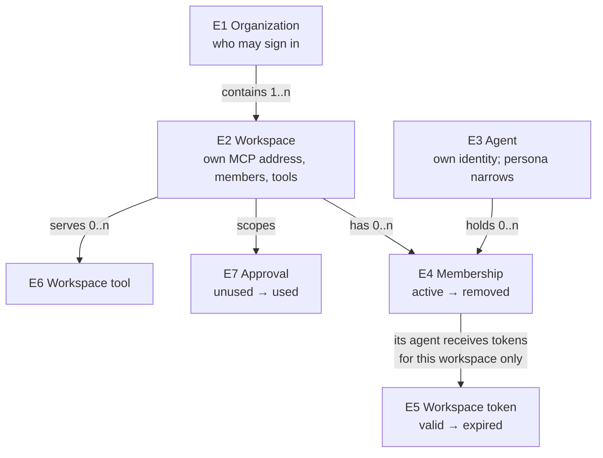

# Specification: what must be true when this is done

[Requirements](requirements.md) · [Program Design](program-design.md) · [Verification Design](verification-design.md)

Each check below compares the new pieces against **today's behaviour at `master` commit `08f9e426`**. That makes today's `@agent-vm/tool-portal` and `@agent-vm/mcp-portal` the reference: if they did something, the new pieces do the same thing, unless a check below names the change.

There are three ways in today, and checks 1 to 12 apply to each one:
- agent-vm's private gateway connection;
- the standalone Tool Portal (its MCP tools and its JSON-over-HTTP endpoint);
- the MCP proxy.

They're described in the [Program Design](program-design.md#the-three-ways-in).

## What these checks are about

Checks 2, 6, 13, 14 and 17 are written over these things, from the owner's decisions of 2026-10-22 and 2026-10-23 (fleet F-69 to F-82). "Same one when" decides whether two of them are one thing or two.

| | Thing | Same one when | Belongs to | Always true | Its states |
| --- | --- | --- | --- | --- | --- |
| E1 | **Organization** | same organization; two organizations are never merged by name | contains one or more workspaces | decides who may sign in: its owner, people and bots. Being its owner gives no tool access. The first deployment has exactly one (F-82) | not decided: creating and closing organizations isn't in this work |
| E2 | **Workspace** | same workspace; two workspaces with the same name are still two | exactly one organization | has its own MCP address, members, tool servers and rules. Its tools are served only at its own address, and nothing reaches them another way (F-70, F-73) | not decided: creating and closing workspaces isn't in this work |
| E3 | **Agent** | same verified identity: one bot's own sign-in, or one Router session its Router vouches for. The same program in two Router sessions is two agents; one bot signing in from two machines is one agent (F-77) | a member of any number of workspaces | has no access of its own (F-71). Its persona can only narrow what a workspace offers it, never widen it. It never uses the admin console (F-78), and "on behalf of" is only a label (F-35) | a bot: registered, then removed. A Router agent lasts as long as its Router session; how the Router vouches isn't designed yet |
| E4 | **Membership** | one agent in one workspace | one workspace and one agent | only a member can list or call the workspace's tools; an agent that isn't a member reaches the workspace only through agent-collaboration, outside this Worker (F-72, F-75). It's read from configuration until the fleet carries it (F-53, F-76) | active, then removed |
| E5 | **Workspace token** | one token, issued for one workspace's address to one agent | one workspace and one agent | works only at that workspace's address: refused at every other workspace, including one in the same organization (F-75). An agent's token is never a person's ([sign-in](../2026-10-20-people-sign-in/2026-10-20-people-sign-in.md) R16) | valid, then expired |
| E6 | **Workspace tool** | one tool name on one of the workspace's tool servers | exactly one workspace | never listed or callable from another workspace | as today's tools |
| E7 | **Approval** | one approval for the exact calls it names | one workspace and one agent | used at most once, even when two copies of the Worker receive it; never used in another workspace | unused, then used |

## Each way in looks the same

1. **Same tools and the same shapes.** With the same configuration and the same caller, each way in offers the same tools as today. Each tool has the same names, inputs and result shapes, and artifact reads work the same way.
2. **Each client gets one of two cases, and both reach the same tools.**
   - A client that connects with `?tools=direct` (`client-deferred`, for clients that defer tool loading themselves) gets `direct`: every tool the agent may use is listed as its own MCP tool, and the four search tools (list, search, describe, call) are listed too and work.
   - A client on the plain address (`portal-deferred`) gets `indirect`: only the four search tools are listed.
   - A caller gets the same case on every request, whatever other clients of the workspace are connected.
   - The workspace's portal connects to its tool servers and reads their tool lists when it starts, before any client's first call.
   - Either way the agent can reach exactly the same tools, and the same call gives the same result.
   - In `client-deferred`, the tool list comes in pages of at most 1 MiB, and only a client whose own page and tool limits cover the caller's whole list is set up that way.
   - The changes from today: `direct` also offers the search tools; the case is chosen per client instead of per server; and the list comes in pages.
3. **Hidden stays hidden.** A tool the caller may not use can't be found or called through any way in, by its name, by a guessed name, or through the search tools.

## Calls behave the same

4. **Same outcomes.** For the same call, the result matches today's: allowed and run, refused, needs approval, or failed. That includes what `describe` returns, such as today's per-tool TypeScript helper.
5. **One way to a tool.** Every call, whichever way it came in, goes through the same dispatcher and the same rules check. Nothing can reach a tool another way.
6. **Approvals.**
   - A call that needs approval doesn't run without it.
   - An approval covers exactly the calls it names (one call or a batch, as today). It can be used once, and it can't be reused for other calls.
   - **In agent-vm,** approvals go through the controller, as today.
   - **In the standalone Tool Portal,** its signed batch approval works as today, carried in MCP metadata on its MCP route and in its header on its JSON route. That includes refusing an old approval after the server restarts with a new service generation.
   - **In the MCP proxy,** its signed approval token works as today, carried in `mcp_portal_call`'s input or in MCP metadata on a `direct` call. Its record of used tokens lasts for the life of the process.
7. **Credentials stay out.** Provider credentials never appear in what a caller sends, receives, sees in errors, or can read from logs. Secrets in results and errors are redacted, as today.
8. **Same limits.** Each way in enforces today's limits, with today's meaning, and no new ones. They're listed in the [Program Design](program-design.md#limits-today). The Worker's own limits are check 15.

## agent-vm keeps working

9. **Managed tools unchanged.** agent-vm's own tools (native tools, configured CLIs and Tool VMs), its approvals, its private gateway connection and its controller's authority all work end to end after the switch, as they do today.
10. **MCP 2026-07-28 clients only** (owner, 2026-10-21).
    - Clients that speak MCP 2026-07-28, including the Portal SDK on the new client and Claude Code, connect and call the same tools in the same way.
    - A 2025-era `initialize` gets MCP's unsupported-version error. A 2026-07-28 request that's malformed (missing its required metadata, or with headers that don't match its body) gets the protocol's own error for that case. Neither runs anything.
    - There are no protocol sessions: no `Mcp-Session-Id` is issued, and one a client sends is ignored. `GET` and `DELETE` get 405.
    - Every `tools/list` page and every `resources/read` result carries `ttlMs` and `cacheScope: "private"`, because they depend on the caller. So does `server/discover`.
    - agent-vm's private connection, which Hermes uses inside agent-vm, isn't MCP and works as today.
    - Connections out to tool servers use whatever MCP version each server speaks: 2026-07-28 when the server offers it, its 2025-era version otherwise (owner, 2026-10-22). This doesn't loosen anything above: what we serve stays 2026-07-28 only.

## The pieces stay separate

11. **Allowed imports only.**
    - `tool-access` imports none of the other pieces.
    - `tool-engine` imports `tool-access`, but no Node-only code and nothing from agent-vm.
    - `tool-host-node` doesn't import agent-vm.
    - `tool-host-cloudflare` imports neither agent-vm nor `tool-host-node`.
    - agent-vm's managed adapter lives inside agent-vm.
12. **Clean switch.** When agent-vm runs on the new pieces, `@agent-vm/tool-portal` and `@agent-vm/mcp-portal` are deleted. Nothing re-exports them, and nothing translates old calls into new ones. The three ways in stay as they are.

## The Worker

The Worker serves the MCP proxy's way in for workspace tools. One deployment serves many workspaces, each at its own MCP address (F-73). Its reference is today's proxy at `08f9e426`, run on a machine with the same configuration: one workspace on the Worker is one proxy configuration on a machine. Checks 14 and 17 have no "today" to compare with; each line is judged against the owner decision it names.

13. **The Worker behaves like the proxy.**
    - With the same configuration and caller, it offers the same tools, in `direct` or `indirect` mode, with the same results and the same refusals, as checks 1 to 4 require of the proxy. The only differences are the four search tools `direct` adds (check 2) and the Worker's own limits (check 15).
    - Its approval token works as the proxy's does (check 6). A token can be used only once, even when two copies of the Worker receive it at the same time, and no call runs if its use can't be recorded.
    - `describe` returns the same per-tool helper as on a machine, built from the tool's current schema.
14. **Only members, and each workspace kept apart.**
    - The Worker refuses a caller it can't identify: a request with no sign-in token, or with one that's forged, expired or meant for another service.
    - A workspace token works only at the address of the workspace it was issued for. At any other workspace's address it's refused, including another workspace in the same organization (F-75).
    - An agent that isn't a member of the workspace is refused like an unknown caller, and nothing runs (F-69, F-72).
    - A member lists and calls only that workspace's tools, narrowed by its persona. Nothing in a call can name another workspace (F-71, F-73).
    - An agent can't gain another agent's tools, connections or effects by sending another's name, session ID or client name. Such labels are ignored, and the call runs, or is refused, as the agent's own credential allows.
    - One workspace's members can't list or call another workspace's tools, use its credentials or connections, or read its auth data, even when both use the same agent or server names.
    - Removing an agent from a workspace stops that agent's next call in that workspace, and changes nothing in its other workspaces.
    - The Worker reads membership. Nothing on the MCP path adds or removes a member (F-76).
15. **The Worker's own limits hold,** as listed in the [Program Design](program-design.md#limits-on-the-worker): a request over the size limit is refused; a batch over the call limit is refused; no more than 6 calls of one batch run at once; and a reply that would pass its limit returns too-large results instead of failing the Worker.
16. **Analytics carry nothing private.** Each call sends one data point, in the shape the Program Design lists, and none holds arguments, results, secrets, tokens or personal details. Every data point fits Analytics Engine's limits, however long the configured names are, and a failed analytics write never changes the call. Credentials stay out of the Worker's logs, as check 7 requires everywhere.

## Only people administer

17. **No agent at the admin console.**
    - No admin or management route accepts an agent's token, whether a bot's or a Router agent's, or any token without a person's live sign-in. Such a request changes nothing (F-78).
    - A person administers through an interactive sign-in, like the Cloudflare CLI's, and every admin command is checked against that person's live sign-in (F-79). How a person signs in is the [sign-in specification](../2026-10-20-people-sign-in/2026-10-20-people-sign-in.md)'s; how strong the human check must be is not decided.

## Not checked here

- Everything under "Not in this work" in the [Requirements](requirements.md#not-in-this-work).
- Code mode, which comes later.
- Per-user and computer tools, which come after the first version. Only the design's openings for them are in this work.
- How a Router vouches for its agents' sessions (F-77). Until that's designed, agents reach the Worker through their own sign-in.
- Rooms, where an agent runs (F-80): which rooms a workspace allows isn't decided, and no check here depends on it.
