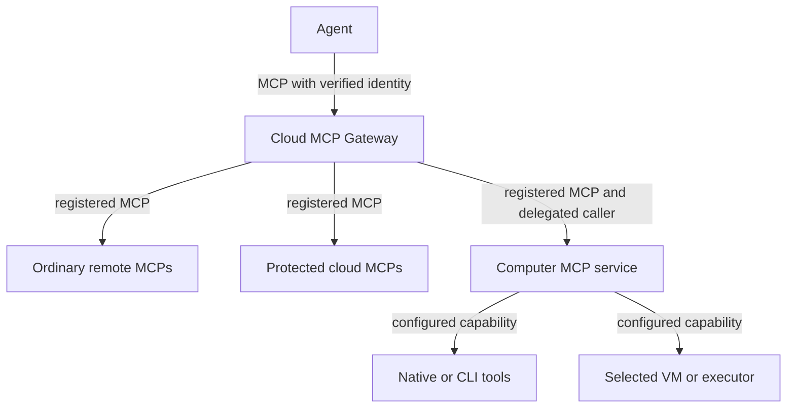

# MCP Gateway: the agent-facing door

[Overview](index.html) · [HTML](mcp-portal-explainer.html) · [Full structure](program-design.html)

Our MCP Gateway lets an agent discover and invoke the tools its identity is allowed to use. It speaks MCP to the agent and connects registered downstream resources. It does not need to host their operating systems or credentials.

## Two levels, independent of package count

The three branches are resource groups; they do not fix the number of public URLs or server processes.

The gateway aggregates services; the computer exposes its configured local capabilities. Each enforces policy at its own boundary. A calendar service can be remote; a native Mac action must reach a Mac with the required local authority. A missing computer is unavailable, not permission to pick another computer.

## Which MCP Portal are we talking about?

| Name | Owner and role |
| --- | --- |
| Cloudflare MCP Portal | Cloudflare's managed aggregator/entry product. Optional outer integration; its documented identity behavior constrains our deployment. |
| Current `@agent-vm/mcp-portal` | Our existing mixed server/client package. Proposed split and rename, not the Cloudflare product. |
| Proposed MCP Gateway | Our agent-facing MCP projection and caller-scoped composition. |
| Proposed MCP connectors | Outbound MCP client and transport plumbing; no independent permission authority. |
| Proposed shared `tool-access` | Portable contracts and separate policy/approval-rule modules; one language-neutral artifact owner, with no portal or host runtime. |
| Tool Portal | Capability execution orchestration behind MCP or another API; independent of protocol hosting. |

## One address can expose different groups

An agent's current assignment may allow ordinary search tools, calendar reads and one Mac capability. Another agent may see only search. Both can connect to the same gateway URL if the authentication path preserves their distinct identities. A separate sensitive endpoint can add ingress separation but still needs the same per-caller checks.

Full-catalog and compact search/describe/call modes change presentation. They use the same permissions. Client-native code mode does not require another general code runtime in this server.

## The Cloudflare identity constraint

For unattended service-token sessions, Cloudflare's managed Portal uses its linked server's configured admin credential upstream. The gateway must not infer the original agent from that shared credential or a forwarded client name. Direct Cloudflare Access in front of our gateway is an option with a verifiable credential assertion. Keeping managed Portal requires an explicitly configured/verified separation scheme. This is an open ingress decision, not a claim that all Cloudflare products behave alike.

[See the alternatives and cost](program-design.html#program--identity-login-and-revocation). The [Specification](2026-10-14-portable-tool-portal-hosts.html) owns the required isolation; [Verification Design](verification-design.html) specifies the actual-chain proof.
