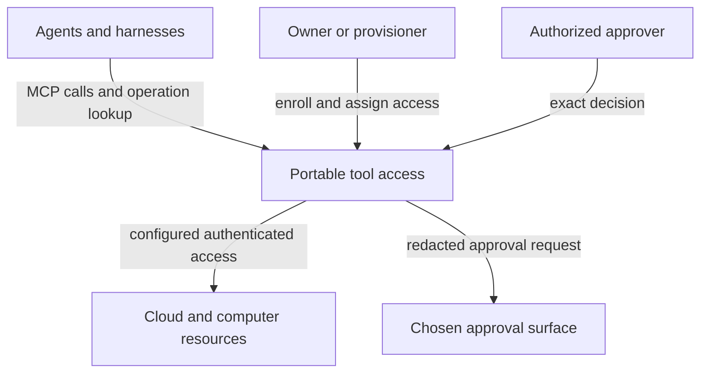
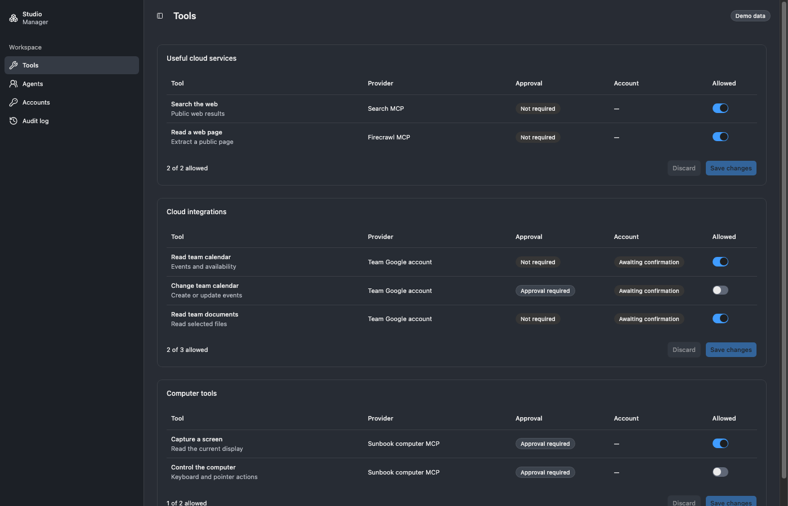

# Requirements: portable tool access

[Overview](index.html) · [HTML](requirements.html) · [Specification](2026-10-14-portable-tool-portal-hosts.md)

Shravan wants agents on different computers and harnesses to use his tools through MCP. A cloud entry connects ordinary remote MCPs, protected cloud services, and configured computer services. A computer may run macOS tools, controlled CLIs, a VM executor, or another backend. Execution technology does not define the portal.

Reusable identity, authorization, credential and approval components must work independently of both existing portal packages. This is a distributed system design, rather than an attempt to put today's entire Node/controller runtime in a Worker.

The owner narrowed this work to **Tool Portal, MCP Gateway and related access components**, not all of Agent VM (Fleet Framework F-36). Workspace configuration, Tool Portal's control API and the reusable React control-surface package are in scope. The console service that will most likely host that surface (F-57, provisional) is not; nor are the fleet registry, agent hosting, collaboration channels and AgentStudio daemon remain their own products.

This document owns authorized needs and limits. The [Specification](2026-10-14-portable-tool-portal-hosts.md) owns observable behavior; [Program Design](program-design.md) proposes its realization; [Verification Design](verification-design.md) plans proof. These documents do not establish implementation or acceptance.

## The owner's picture

**Service groups do not fix public endpoint count.** The owner first described four endpoints, then reopened that requirement: callers may see different groups through one gateway. Separate URLs remain a deployment isolation option. Neither one URL nor four supplies tool authorization by itself.

Cloudflare's managed **MCP Portal** is an outer product that may aggregate our gateway. Our current **`@agent-vm/mcp-portal` package** is different. The owner requested a rename; **MCP Gateway** is the proposed name for our server role. Exact npm names remain a structural proposal.

## Authorized needs

All rows are authorized, required outcomes; priority assigner: Shravan, with no relative delivery order selected. U1–U15 preserve the earlier owner conversation and repository invariants. U16–U22 carry the later explicit UI corrections and [Fleet Framework decisions](../2026-10-18-fleet-framework/2026-10-18-fleet-framework.md#owner-decisions-in-this-design-verbatim), rather than narrowing needs to fit current code. F-41 supersedes the earlier agent-authored manual-editor interaction; U16–U18 outcomes remain.

| ID | Consumer | Authorized outcome and reason |
| --- | --- | --- |
| `U1` | Library integrator | Host portable components in a Cloudflare Worker or Node/Mac process with equivalent security semantics. Unsupported features fail explicitly. |
| `U2` | Harness integrator | Use MCP from Hermes, Codex, Claude Code, Cursor, Pi and other clients. Client adapters address limitations; harness/model names are not identities. |
| `U3` | Owner and callers | Preserve caller isolation, complete permission profiles, revocation and exact-call approval throughout the distributed path. |
| `U4` | Operator | Compose registered local and remote services, including Workers, independently of execution placement. |
| `U5` | Account holder | Keep provider credentials outside agents. Use authenticated downstream MCPs or controlled MCP/CLI backends without disclosing their grants. |
| `U6` | Caller and operator | Recover known operations across disconnects, handler replacement and restarts. Logical sessions outlive transports; uncertain effects stay visible. |
| `U7` | Harness integrator | Select full tool exposure or compact search/describe/call presentation. Native client search/code mode needs no second server-side code runtime. |
| `U8` | Execution integrator | Support configured native tools, controlled CLI families and different execution services. Gondolin is one adapter, not a prerequisite. |
| `U9` | Existing operator | Preserve managed controller authority, generation fences, credential custody, artifact access, storage boundaries and protected administration. |
| `U10` | Fleet operator | Use a cloud MCP Gateway in front of remote providers and computer MCP services. Computers expose configured resources; agents may access different groups. |
| `U11` | Collaboration operator | Keep collaboration a distinct MCP service, behavior and state owner. Shared ingress or identity code must not merge tool and collaboration permissions. |
| `U12` | Package consumer | Use shared identity, authorization, credentials and approvals without importing portal runtime, full Node hosting, desktop integration or a VM provider. |
| `U13` | Fleet owner | Identify agents, machines and services separately. Trusted administration enrolls and assigns them; deployment credentials can rotate/revoke separately. Connecting does not register privileges. |
| `U14` | Operator and harness | Present approvals through Hermes, Router, the IDE or another authorized surface using a common decision contract. Webhook delivery is distinct from a decision. |
| `U15` | Owner | Integrate with the distributed Codex/Agent Router's central fleet and machine services through narrow identity and approval contracts. Follow applicable standards and avoid unnecessary service, account and operating costs, including per-agent paid human accounts, without designing those projects here. |
| `U16` | Workspace owner or manager; agent integrator | Register an agent in a harness, configure the workspace's tool allowance and the agent/persona's subset, and apply that allowance to every named-workspace call. Multi-workspace discovery is a union, not a security partition. Managers may grant connected team-account use; personal-account consent remains separate. Basis: F-10–F-12, F-23/F-24, F-27/F-29/F-32/F-35. |
| `U17` | Workspace operator | Inspect access and decide proposed changes through a clear React + Base UI + official shadcn interface using Bridge's theme, `cn` and `@shadcn/lint`, with visible validation, conflict, unavailable and failure states. Manual editors are not the interaction (F-41); the stack and visible-state outcomes remain. Basis: direct owner rejection of Hono JSX and explicit tooling URLs; F-41; browser baseline in the WIP review. |
| `U18` | Owner and security operator | Review an attributable event for every security or permission change, including its scope and before/after meaning and, for a chat-proposed change, who asked and which manager accepted, without logging credentials. On-behalf metadata describes the requester; it never switches account authority. Basis: F-28/F-30/F-35/F-43. |
| `U19` | Workspace owner or manager | Understand what the app is for and what each agent can use. One view shows how a workspace's agents, tools and accounts are associated, filtered by any of them, and says for any agent and tool whether it is usable and, when it is not, why. Separate places are justified only for the audit log and, possibly, accounts (F-42). Search finds any agent, tool, integration or account. Basis: F-42; owner: “whats the ui even sukppsoe dto d o? i dunno what he sidebar does”, “so that i can … serach to find the righ tintegration”, “yes its two problems”. |
| `U20` | Workspace owner or manager | Change access by describing it in chat. A fast model turns the request into generated UI that shows exactly what would change; the owner's only action is Accept or Deny, and nothing changes without Accept. Chat wording never grants access by itself. Basis: F-41, F-43; owner: “edit shsoudl be thorkugh chat not thorugh some screen”, “its by chat so i dont ahve to do anythnign uses a fast model and only gerative ui to acept deny”. |
| `U21` | Workspace owner or manager | See, for each integration, what it needs before agents can use it: nothing, an API key or token, or an OAuth sign-in. Supply it in the app without it ever being shown back, sent to agents or given to the model; or start the provider's own OAuth screen. Then set the account's provider-specific options (for example, which Gmail, Calendar or Drive operations are allowed). Basis: F-47 parts 2–3; U5. |
| `U22` | Workspace owner or manager; authorized approver | Configure which tools or operations need a person's approval, and see and decide pending approval requests for that workspace's agents, as one approval surface among the selected presenters (U14). Basis: F-47 part 1; D-9 modes; U3, U14. |

Owner evidence includes: “all agents should communicate with MCP”; “generic MCP gateway; Hermes is one possible client”; “tool portal shouldn't be tied to gondolin”; credentials must not leak to agents; “we need agent/machine identity”; and the explicit full-design request. `U12` incorporates the correction that shared security cannot live only inside Tool Portal. `U14` and `U15` incorporate the latest Router/IDE integration and cost constraints.

## Consumers and success

### Agent and machine identity

An **agent operator** authorizes agent types and their launchers; trusted launchers enroll launched instances automatically. External agents are registered separately. Each admitted logical agent has a complete assignment and separately revocable credentials. A session is a conversation/run association, not an agent credential. One logical agent may have several deployment credentials without sharing a secret.

### Configured resources

A **computer operator** registers a computer service, its authenticated service/machine relationship and a finite capability set. Google CLI and unrelated CLIs may share one configured credentialed backend. A privileged backend may run anywhere its authenticated route and custody policy permit.

### Shared security consumers

A **library integrator** composes security and execution components without importing host effects.

### Approval surfaces

A **human approver** sees the caller, target and exact action and decides through an authorized surface. A **Router integrator** may supply trusted registration and approval adapters; the gateway does not assume a session ID already provides durable identity.

Success means every authorized need has an observable contract, an owner and a proof route. Extraction alone does not establish distributed authentication, durable approval or remote execution.

### What the app is for — U16–U20

The app has one job: let a workspace owner or manager **see what their agents can use, and change it by asking**. The owner confirmed it splits into two problems (“yes its two problems”):

1. **Understanding.** Which agent can use which tool, through which account, in which workspace, and why not when it can't. Tools, agents and most account facts are associations of the same data, so one view filtered by any of them answers this. Only the audit log and, possibly, accounts justify places of their own (F-42).
2. **Changing.** The owner describes a change in chat. A fast model generates it as a proposal on screen, and the owner Accepts or Denies (F-41, F-43).

**The current screen.** The rejected review mock splits that one association into Tools, Agents and Accounts editors. Answering “what can Calendar assistant use?” takes three pages, and every change is a manual edit:

*Current review mock (fixture data, http://127.0.0.1:56071), captured 2026-10-19. The sidebar lists entity editors; nothing on this page says what any agent can actually use.*

The desired screen is one filtered access view with a chat panel whose proposals carry Accept and Deny. A generated picture of it is a gap (no image generation route in this session); the [Specification](2026-10-14-portable-tool-portal-hosts.md#c12--chat-request-to-accepted-change) pins what the owner observes, and the [explainer](tool-access-explainer.md) shows the end-to-end example.

The current product has agent/profile configuration and OAuth forms, but no workspace registration, access explanation or chat-led change. The [React review prototype](../../wip/2026-10-18-agent-vm-review/review.html#react-evidence) is rejected as the interaction model; its official components, theme and validation observations may be reused. Its captures are UI evidence only. Production scope, identity, credential, model and audit integration remain missing.

## The distinct user journeys

These are views of the authorized U rows, not additional requirements. Source observations describe current code; no new hosted behavior or UI has been observed.

### Workspace owner or manager — U16, U17, U19, U20

| Journey | Current pain or evidence | Desired observable difference |
| --- | --- | --- |
| Find out what an agent can use, and why not | Review mock: three editor pages; no page says what an agent can use or why a tool is unavailable. Owner: “hard to udnetandc what each screen does”. | One view filtered by agent, tool or account shows usable, usable with approval, or blocked, with the missing condition named. |
| Ask for a change → read the proposal → Accept or Deny → see the result | Review mock: manual switches, forms and Save buttons. Owner: “edit shsoudl be thorkugh chat not thorugh some screen”. | A chat request becomes an exact proposal; nothing changes until Accept; the applied, conflicting, refused or unconfirmed result is shown truthfully. |
| Find a tool, integration, agent or account | No search exists. Owner asked to “serach to find the righ tintegration”. | Search reaches any of them and opens the access view filtered to it. |
| Connect a team account | Review mock: a stubbed confirmation of one pre-seeded account. | Account connections show status and start the provider's own sign-in; chat can propose the connection, but consent happens at the provider. |

### Owner and computer operator — U3, U4, U5, U10, U13, U15

| Journey | Current pain or evidence | Desired observable difference |
| --- | --- | --- |
| Enroll → assign complete permissions → register resource → rotate/revoke | Current standalone registration is a fixed configured set; Router session identity is not authenticated agent enrollment. Dynamic fleet outcome remains unobserved. | Trusted registration and separate revocation, with explicit caller-specific resource access. |

### Agent and harness integrator — U2, U6, U7, U10

| Journey | Current pain or evidence | Desired observable difference |
| --- | --- | --- |
| Connect → discover permitted tools → invoke/await decision → recover operation | Node MCP surfaces and SDK contracts exist. Cross-host caller identity and recovery proof is missing; exact runtime usability for every harness is unknown. | The same admitted work remains understandable across client type and replacement connections. |

### Library integrator — U1, U8, U9, U12

| Journey | Current pain or evidence | Desired observable difference |
| --- | --- | --- |
| Import security → compose capability adapters → select host → retain controls | Current public exports reach Node hosting/provider code; [source map](program-design.html#program--current-code-and-the-required-change). | Independent security consumers and portable hosts without weakening managed execution. |

### Authorized approver — U3, U14

| Journey | Current pain or evidence | Desired observable difference |
| --- | --- | --- |
| Inspect caller/target/action → decide exact request → inspect recorded outcome | Managed Hermes presenter and controller decision path exist by source. Generalized Router/IDE delivery and authenticated remote decisions remain unobserved. | Same challenge meaning through selected presenters, one authoritative decision and honest pending/uncertain outcomes. |

Exact-action approval presenters remain adapter consumers. This cycle adds the access view and chat-led change; it does not require rebuilding Hermes, Router or the IDE's approval presentation, and it adds no approval inbox unless D7 selects one.

## Scope and limits

This cycle designs package responsibilities, MCP ingress/egress, caller/machine identity, policy, credential custody, approval interaction, operation recovery and host composition. Existing managed authority remains authoritative.

Source, config and infrastructure stay read-only. No provisioning, credential migration, deployment, Gondolin patch, Hermes distribution change or Router/coordination implementation is authorized. This is not a hypervisor, VM scheduler, arbitrary remote shell, general fleet database or new identity-provider product.

The focus is tool resources, access policy and credentialed runtimes. Agent launching and identity enrollment are external integrations; this design does not turn the gateway into an agent host. An agent can belong to several workspaces and use their configured team resources (F-32), but an incoming requester does not change the agent's own access or select that requester's personal accounts (F-35). Personal-account sharing through a manager is excluded.

HTTPS MCP is the primary remote boundary. Local sockets may connect processes on one machine. Stdio can remain an explicit Node compatibility adapter. A Rust rewrite is not needed to define these boundaries. The tool gateway neither owns the harness conversation nor replicates its history.

Managed and standalone policy inputs remain distinct until a reviewed hard cutover. Profiles stay complete with no inheritance. Shared code does not mean a globally writable approval database. Identity, authorization and approval remain separate responsibilities even if a deployment serves them together.

The new public contract retires the legacy standalone approval protocols; it does not translate their tokens or uncertain calls into new authority. Existing managed control and account consent remain preserved. A deployment cutover must account for outstanding legacy work before enabling affected capabilities; changing a package name or closing a connection is insufficient evidence.

Use existing standards where they fit the boundary; document platform-specific adapters and unsupported client paths explicitly. A working draft is prior art until deliberately adopted. A new paid tier, hosted service or bespoke protocol needs a concrete capability and cost justification. This is an operating-cost constraint, not a claim that the current Cloudflare account is free or that hosted usage has no cost.

### Shared fleet direction

The [Fleet Framework parent](../2026-10-18-fleet-framework/2026-10-18-fleet-framework.md) carries current shared meaning. The older WIP concept record is evidence only where it differs. A persona is a definition, not a harness, transport session or credential. Registration into a workspace does not require running the agent loop on a machine we control.

Those directions constrain the next contracts; they do not supply an implemented identity issuer or a distributed approval authority. Persona-to-person relationships, agent enrollment/credential carriage, auto-judge policy and the authoritative approval settlement protocol still need their own definitions. An acts-for label does not grant access to that person's accounts. Fleet write leases do not set tool-execution leases, approval lifetimes or operation-retention periods.

Automatic identity enrollment must preserve resource consent. Today's grant to a configured agent cannot become a grant to every future instance of its persona through a key rename. A future template-based grant needs explicit authorization for the instances and limits it covers. The concrete instance remains the caller and the owner of its operation/artifact history; sharing a persona or permission profile does not merge those histories.

F-32 selects union discovery across a bot's workspaces. Each call names one workspace and must fit its allowance for that agent/persona; another membership does not widen that call. The bot may deliberately name another workspace it is allowed to use, so this mechanism is attribution and mistake prevention, not isolation between mutually distrusting workspaces. F-34 makes each host or VM a separate boundary, independent of physical hardware. File/ambient credential isolation still requires its own host boundary; a tool profile supplies neither.

F-27/F-29/F-35 admit workspace-local manager grants for **team** accounts only. Personal accounts retain their owner's consent. Provider consent, account classification, the workspace grant and an agent's tool allowance remain distinct. Security/permission changes always produce an audit event (F-28); audit ownership, retention and cross-product aggregation remain with the parent Q-F7 decision.

The UI stack is selected: React, Base UI, official shadcn, `cn` and `@shadcn/lint`, with a Bridge-derived theme. Framework choice does not choose an identity issuer, make browser validation authoritative, or create an audit service.

Chat-led change is generative UI from a fast model (F-43). The model proposes; it never decides, applies or holds a credential. Out of scope: automatic application of any change, free-text editing of configuration, a model with write access, and a replacement fleet registry or identity store.

## Decisions that remain open

| ID | Unselected meaning | Effect of deferral |
| --- | --- | --- |
| `D1` | Independent computer admission during cloud loss versus fresh cloud admission for every new call. | No offline-admission promise. Existing work can still be safely contained and looked up. |
| `D2` | The shared backbone is the intended identity home; its issuer/bootstrap, persona and instance relationships, resource consent for future instances, launcher authority, credential carriage through ingress, original-caller proof and revocation freshness remain to be contracted. | No claim of preserved caller identity through managed MCP Portal or of an implemented production issuer. Until D2 lands, identity, workspace membership and managers come from explicit configuration (F-53); the seam stays shaped for the fleet contract. |
| `D3` | Distributed approval routing through agent-collaboration is the direction; decision-record ownership, grant consumption, auto-judge rules, composition of cloud and resource approval gates, and continuation after expiry, disconnect or gateway loss remain to be contracted. | No cloud override, shared writable decision record, implicit merging of approval gates or continuation default is adopted. |
| `D4` | Identify tool hosts only, restrict source machines per resource, or enroll every calling machine. | Earlier owner question remains pending. Source-machine policy cannot be silently selected. |
| `D5` | Concrete finite bounds, retention/deletion rules and recovery/revocation service levels. | Bounds are required but no operational values are declared ready. |
| `D6` | Parent Q-F7: authoritative audit persistence, readership, retention and cross-product aggregation. Account classification authority also needs the parent/tool account contract. | No unlogged security mutation or manager self-assertion that a personal account is a team account. |
| `D7` | F-47 lists “approvals system and config” as a part of this app, read here as: this app is one approval surface (U22) beside Hermes, IDE and Router presenters. Awaiting the owner's confirmation of that reading. | Until confirmed, approval configuration is designed; the pending-approval place is designed but marked unconfirmed. |
| `D9` | ~~How this app works with the fleet and Tool VM control~~ **Settled by F-49:** option (c). This app ships now and reads fleet and Tool VM state through their verified contracts. Its UI is a separate, reusable package with concerns separated, and the router's function list is pluggable per product, so a shared shell can follow. F-57 (provisional) answers who owns it: a separate console service that talks to both Tool Portal and the fleet will most likely own the UI and the request router. This design supplies Tool Portal's control API and the UI package; the console itself is outside this scope (F-36). | No fleet or Tool VM control action happens through Tool Portal; the console reaches those through their owners' APIs. |
| `D10` | What the “built-in scan screen” is (F-47 part 4). Candidate readings: scanning a new integration's tools when it is added; scanning a QR code to connect a device or agent; scanning a workspace for risky or unused access. | Not designed until the owner says which. |
| `D8` | Parent Q-F9 remainder (surface settled by F-46: a request bar with composed UI, no chat thread): which cheap fast model; F-48 settles the route: through OpenRouter, Jev as the router model, alternatives as fallback behind one abstraction. Still open: what current state the model may read to propose (F-20 allows the provider to see context). F-57 makes the console service the likely caller. The F-45 experiment informs the choice but does not settle it. On 16 frozen synthetic cases, one Jev encoding matched 4 and Haiku 14, and Jev was about five times faster. Two Jev proposals added unrequested removals that validation accepted. So F-48's Jev route is still the owner's to confirm or change. | The proposal and Accept/Deny contract holds for any choice; the model holds no authority. No model is selected by this design. |

Target-machine authentication and caller isolation are required regardless of `D4`. The backbone direction does not make existing Router session records into authenticated agent identities. Identity and approval integration must be checked against its owning contract and implementation before claiming reuse.

## Evidence boundary

Agent VM source baseline: `8535fdd433dc90fed627ee7a05f63e59d58cf8ee`. Portable dispatch ports exist, but standalone hosting and provider clients include Node dependencies; approvals use different mechanisms. [Program Design](program-design.md#current-code-and-the-required-change) supplies decisive anchors.

The latest corrections supersede older chapters assuming exactly four public endpoints, security owned entirely by Tool Portal, client labels as identity or three governing documents. Historical inputs are preserved under checkout `tmp/`; they are not competing contracts.
