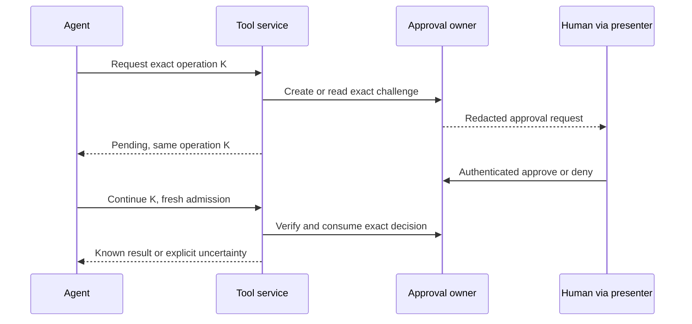

# Identity, permissions and approvals

[Overview](index.html) · [HTML](tool-portal-explainer.html) · [Full structure](program-design.html)

An agent acting for you needs an enrolled identity, a valid credential and a current permission assignment. A protected action additionally needs an exact approval. The provider's OAuth grant stays with the resource backend throughout.

## Who is who?

| Example | Its purpose | Changes independently |
| --- | --- | --- |
| Persona | Owner-authorized agent type and acts-for association in the shared fleet direction. | Its instance population; exact person/profile relationships still need their contract. It is not a credential or an access grant. |
| Agent A | Logical subject acting for the owner. | Its credentials, sessions and deployment machines. |
| Credential A1 / A2 | Separate issued proofs for deployments of A. | One can be revoked without sharing the other secret. |
| Machine M | Enrolled host providing tools or, when policy requires, hosting A. | Its IP, connections and keys. |
| Service S | Gateway/computer deployment acting as itself. | Its process and service credential. |
| Router session K | A conversation/run reference. | It can end while A remains the same agent. |
| Permission assignment | Complete allowed tools/targets at a revision. | It can change without renaming A or erasing operation history. |

A copied session ID or agent name does not authenticate its sender. A machine claim alone does not prove where a copied bearer token is currently running. Source-machine restrictions remain a separate policy choice.

## How an agent gets access

You authorize an agent type and its trusted launcher once. The launcher enrolls agent instances automatically and obtains separately revocable credentials through the intended shared identity authority. External agents use a separate registration path. Each product still assigns its own permissions; a persona's name or acts-for association grants no account access by itself.

Cloudflare machine/service admission and proof of the individual agent are separate. The exact way both proofs reach the gateway remains open, especially through managed MCP Portal. A new Router session is only a new conversation, not a new Cloudflare user or automatically a new principal. A host adapter must keep connection secrets outside the tool sandbox if the agent must not be able to read them. Provider OAuth grants always remain at the resource backend.

## A protected call

Hard-denied work never reaches approval as an escape hatch. A lost response after dispatch remains uncertain until there is a known receipt; a reconnect does not repeat the action.

The same operation item must survive a retry. Two intentional identical actions use different items, even when their tool and arguments match. Delivering the approval directly to the resource could remove the need for a client-carried private token; it does not solve call identity. Retry versus automatic first dispatch remains a continuation choice.

## What is shared, and what is a service?

The proposed shared `tool-access` package has separate contract, authorization and approval-rule modules. These are usable without importing a portal runtime; they are not three separately published packages. The deployed approval authority owns its durable decision record and authorizes decision writers; the resource owns consumption and dispatch. A presenter renders the challenge. A webhook delivers an event. [Package and module homes](program-design.html#program--the-packages-and-why-each-exists).

Hermes, Router and IDE can all present a challenge through adapters. A webhook acknowledgement means delivery, not approval. A human decision returns to the selected authority through authenticated control. The resource service still performs final admission before the effect.

Router already has useful typed interaction choices and a local broker. Its inspected broker cancels pending interactions on Host restart and accepts declared actors; its distributed design explicitly names missing continuation/cross-machine answer work. Therefore its current local API is not automatically the tool authority. [Source-grounded integration boundary](program-design.html#program--router-integration-reuse-the-boundary-not-declared-actors-as-authentication).

## Where credentials run

The credential broker selects a registered provider/account and permits controlled use. A downstream MCP adapter or a protected CLI executor uses the credential. CLI families may share one configured execution environment. Neither the gateway nor the agent needs a provider-specific VM merely because a tool uses Google.

Encryption at rest helps protect stored grants. The encryption key must be separately protected, and the process allowed to use plaintext credentials remains privileged. Moving tokens into SQLite is not by itself isolation from the agent.

## What changes next in the design

The target separates these concerns from Tool Portal and the renamed MCP Gateway, then supplies Node/computer and Worker hosts. The shared backbone is the intended identity home. Its enrollment/credential contract, approval settlement and continuation, source-machine policy and freshness bounds remain open. The [entity bindings and trace table](program-design.html) show concrete proposed ownership; no implementation has started.
