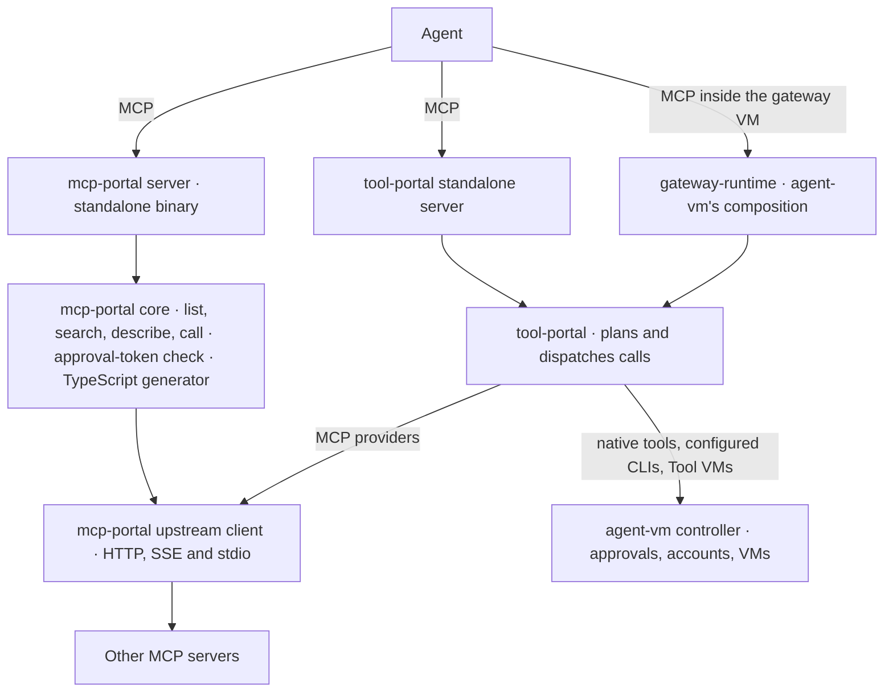
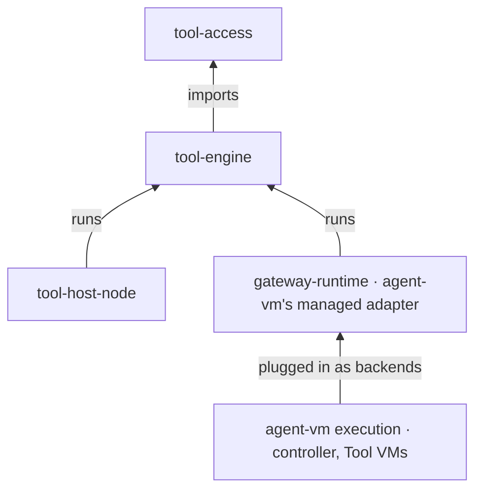
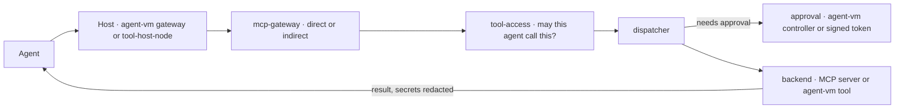

# Program Design: the pieces and how they fit

[Requirements](requirements.md) · [Specification](2026-10-14-portable-tool-portal-hosts.md) · [Verification Design](verification-design.md)

**The short version.** Today's two libraries become three packages with one job each, plus an adapter that stays inside agent-vm:
- `tool-access` holds the rules;
- `tool-engine` shows tools and routes every call through one dispatcher;
- `tool-host-node` runs the engine on a machine;
- agent-vm plugs its own tools and approvals into the engine through its managed adapter.

Nothing new is stored. Behaviour stays the same.

## Today

**What's tangled, and why we split it:**
1. **`tool-portal` can't be used without agent-vm.** Its ports carry agent-vm's managed types. [`ToolPortalBackendCallOptions`](../../../packages/tool-portal/src/tool-portal-service.ts#L104) takes a `GatewayRuntime…DispatchAuthority`, and [`ToolPortalApprovalPort`](../../../packages/tool-portal/src/tool-portal-service.ts#L182) reserves and arms `GatewayRuntime…` intents.
2. **`mcp-portal` mixes serving with Node-only code.** Its core imports the TypeScript catalog generator ([portal-tools.ts:12](../../../packages/mcp-portal/src/core/portal-tools.ts#L12)). Its upstream client mixes HTTP with stdio and `process.env` ([upstream-mcp-client-runtime.ts:266](../../../packages/mcp-portal/src/upstream-mcp-client-runtime.ts#L266)).
3. **`config-contracts` mixes pure schemas with host loaders.** See [tool-portal-config.ts](../../../packages/config-contracts/src/tool-portal-config.ts#L280) and [controller-configured-cli.ts](../../../packages/config-contracts/src/controller-configured-cli.ts#L1).
4. **The call digest is in the wrong place.** Approvals bind to it, but it lives inside the HMAC token file ([portal-tools.ts:11](../../../packages/mcp-portal/src/core/portal-tools.ts#L11)).

## The new pieces

| Package | Its one job | What's inside | May not import |
| --- | --- | --- | --- |
| `@agent-collaboration/tool-access` | the rules | `contracts` (schemas and the call digest), `authorization` (`assessAccess`, policy helpers, CLI allowances), `approval-rules` (which call an approval is valid for), `credentials` (rules for which provider account a call may use) | any other piece, agent-vm, `node:*` |
| `@agent-collaboration/tool-engine` | show tools and route calls | `dispatch` (the one dispatcher, with neutral interfaces for backends and approvals), `mcp-gateway` (what an agent sees: `direct` or `indirect`, plus list, search, describe and call), `connectors` (calls to other MCP servers over HTTP or SSE) | any host, agent-vm, `node:*` |
| `@agent-collaboration/tool-host-node` | run it on a machine | HTTP and stdio listeners, caller checks (agent bearer tokens), config loading, the stdio connection to MCP servers, the TypeScript catalog compiler, and the standalone approval-token check | agent-vm |
| agent-vm's managed adapter (in `gateway-runtime`) | plug agent-vm in | wraps agent-vm's existing backends (native tools, configured CLIs, Tool VMs, MCP providers) and the controller's approvals behind `tool-engine`'s interfaces; keeps agent-vm's own IDs and fingerprints | n/a; it's agent-vm code |

**Execution stays outside the engine.** A Tool VM or a configured CLI reaches the engine only as a backend that agent-vm plugs in. The engine never imports a VM provider.

## One call, step by step

The same path serves both modes and both hosts. Nothing reaches a backend except through the dispatcher.

## Direct and indirect

- **`direct`** lists every tool the agent may use as its own MCP tool, plus the four search tools. Today's catalog mode listed only the tools, so offering the search tools as well is the one small change in this mode.
- **`indirect`** lists only the four search tools: list, search, describe and call.
- **Underneath, they're the same.** Both use the same rules and the same dispatcher.
- **Code mode, later.** Today's code already has most of one route to code mode:
  1. the catalog compiler builds typed TypeScript modules for the tools an agent may use;
  2. the client SDK binds them to an MCP client;
  3. code in the agent's own environment calls those functions, and each one makes an ordinary MCP call.

  `describe` also returns a lighter, per-tool helper. When code mode is picked up, the first question is which client runs that code and where.

## What's stored

**Nothing new.**
- **The standalone server** keeps sessions in memory and no record of each call, as today's `mcp-portal` does.
- **agent-vm's controller** keeps what it keeps today: approvals, provider accounts and Tool VM leases. It stays the owner of that state, and the managed adapter uses it.
- **`tool-engine` and `tool-access`** store nothing.

## Where today's code goes

The per-file list is the [port inventory](../../wip/2026-10-19-tool-portal-port-inventory/port-inventory.md). It's evidence: read a file's body before moving it.

| Today | New home |
| --- | --- |
| `mcp-portal` core: list, search, describe, call, and sessions | `tool-engine/mcp-gateway` |
| `mcp-portal` upstream client: HTTP and SSE | `tool-engine/connectors` |
| `mcp-portal` upstream client: stdio and environment | `tool-host-node` |
| `mcp-portal` server, config, CLI and binary | `tool-host-node` |
| `mcp-portal` TypeScript catalog generator | `tool-host-node`; its output bytes stay identical |
| `mcp-portal` agent bearer tokens and approval tokens | `tool-host-node`; which standalone approval path it keeps is an open question |
| `tool-portal` standalone server (`standalone-entrypoint`), with its signed batch approvals | `tool-host-node`, which replaces both of today's standalone servers |
| `mcp-portal` call digest | `tool-access/contracts`; same bytes |
| `mcp-portal` provider backend | `tool-engine/connectors`, used by agent-vm's adapter |
| `tool-portal` capability core and ports | `tool-engine/dispatch`, with agent-vm's types removed from the interfaces |
| `tool-portal` dispatch authority, managed IDs and fingerprints | stay in agent-vm (`gateway-runtime`) |
| `tool-portal` CLI allowances | `tool-access/authorization` |
| `config-contracts` tool schemas | `tool-access/contracts`; schema IDs unchanged |
| `config-contracts` loaders | `tool-host-node` |
| `oauth-approval-ui` | unchanged; not part of this work |

**Byte-exact outputs stay byte-exact:** config schema IDs, the `mcp:` tool reference encoding, the call digest and the generated TypeScript catalog.

## What's built, and what changes

| Step | Status | Change under this design |
| --- | --- | --- |
| S1 `tool-access` | draft PR [#238](https://github.com/ShravanSunder/agent-vm/pull/238), built and reviewed | keep; `assessAccess` stays as built, but isn't expanded for the deferred UI |
| S2 dispatcher and agent-vm's adapter | draft PR [#240](https://github.com/ShravanSunder/agent-vm/pull/240), built and reviewed | keep; the standalone host records nothing per call |
| S3a gateway and connectors | draft PR [#241](https://github.com/ShravanSunder/agent-vm/pull/241), built and reviewed | keep; rename the modes to `direct`/`indirect`; `direct` also lists the search tools |
| S3b `tool-host-node` | branch at `51c98139`, no PR yet | keep the listeners, stdio, config, compiler and the review fixes; **remove** its per-call store and the requirement that direct calls carry a name in `_meta` (if the owner confirms question 2); **carry over** today's standalone approvals (which path depends on question 3) |
| S4 switch agent-vm over | not started | agent-vm runs on the new pieces, then the old packages are deleted |
| S3c limits, S5 control API, S6 Worker host, sign-in, UI | cancelled | none |

The stack's branches start from `33914cbe`. `master` now also has the 2.5G VM memory change (#242), which the stack takes in when building resumes.
