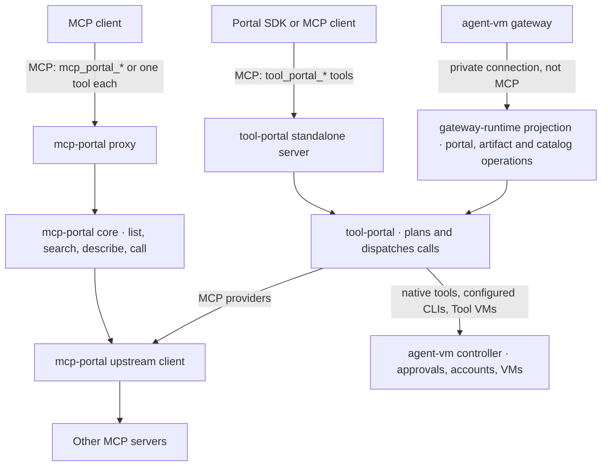
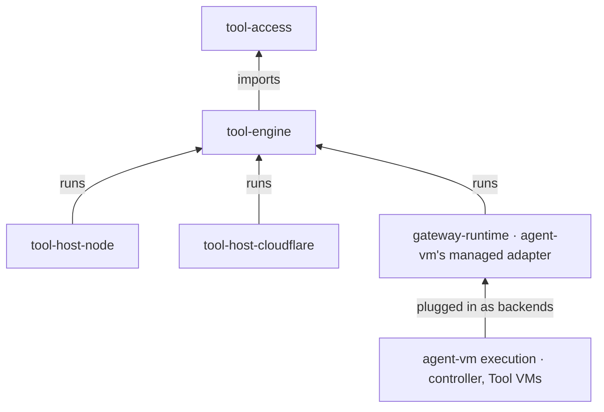
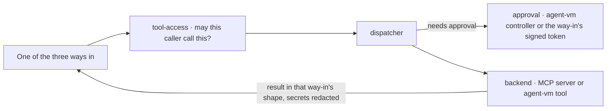
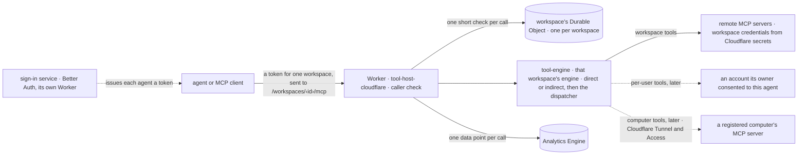

# Program Design: the pieces and how they fit

[Requirements](requirements.md) · [Specification](2026-10-14-portable-tool-portal-hosts.md) · [Verification Design](verification-design.md)

**The short version.** Today's two libraries become four packages with one job each, plus an adapter that stays inside agent-vm:
- `tool-access` holds the rules;
- `tool-engine` routes every call through one dispatcher and talks to other MCP servers;
- `tool-host-node` runs the standalone servers on a machine;
- `tool-host-cloudflare` runs the MCP proxy on a Cloudflare Worker;
- agent-vm plugs its own tools and approvals in through its managed adapter.

The three ways callers reach tools today stay exactly as they are; only what sits behind them changes. On a machine nothing new is stored and no new limits are added. The Worker is the one addition, described in [The Cloudflare Worker](#the-cloudflare-worker).

## Today



**What's tangled, and why we split it:**
1. **`tool-portal` can't be used without agent-vm.** Its ports carry agent-vm's managed types. [`ToolPortalBackendCallOptions`](../../../packages/tool-portal/src/tool-portal-service.ts#L104) takes a `GatewayRuntime…DispatchAuthority`, and [`ToolPortalApprovalPort`](../../../packages/tool-portal/src/tool-portal-service.ts#L182) reserves and arms `GatewayRuntime…` intents.
2. **`mcp-portal` mixes serving with Node-only code.** Its core imports the TypeScript catalog generator ([portal-tools.ts:12](../../../packages/mcp-portal/src/core/portal-tools.ts#L12)). Its upstream client mixes HTTP with stdio and `process.env` ([upstream-mcp-client-runtime.ts:266](../../../packages/mcp-portal/src/upstream-mcp-client-runtime.ts#L266)).
3. **`config-contracts` mixes pure schemas with host loaders.** See [tool-portal-config.ts](../../../packages/config-contracts/src/tool-portal-config.ts#L280) and [controller-configured-cli.ts](../../../packages/config-contracts/src/controller-configured-cli.ts#L1).
4. **The call digest is in the wrong place.** Approvals bind to it, but it lives inside the HMAC token file ([portal-tools.ts:11](../../../packages/mcp-portal/src/core/portal-tools.ts#L11)).

## The three ways in

Each way in keeps its own contract: its tool names, inputs, results, artifact reads and approvals. Only what sits behind it moves.

| Way in | Who uses it | Its contract today | New home |
| --- | --- | --- | --- |
| **agent-vm's private connection** | agent-vm's gateway | Not MCP. Authenticated private operations: `portal`, `artifact.read` and catalog operations ([tool-portal-projections.ts:39](../../../packages/gateway-runtime/src/tool-portal-projections.ts#L39)) | Stays in agent-vm (`gateway-runtime`), now calling `tool-engine`'s dispatcher through the managed adapter |
| **Standalone Tool Portal** | the Portal SDK ([tool-portal-mcp-client](../../../packages/agent-portal-sdk/src/tool-portal-mcp-client/index.ts#L191)) and other clients | Two routes. **Its MCP route:** tools `tool_portal_list`, `tool_portal_search`, `tool_portal_describe` and `tool_portal_call`, with the Portal result in `structuredContent`; artifacts through MCP `resources/read`; its signed batch approval in MCP metadata `_meta['agent-vm/tool-portal-approval-token']`, which is what the Portal SDK sends ([standalone-tool-portal-mcp-projection.ts:38](../../../packages/tool-portal/src/standalone-entrypoint/standalone-tool-portal-mcp-projection.ts#L38), [:203](../../../packages/tool-portal/src/standalone-entrypoint/standalone-tool-portal-mcp-projection.ts#L203)). **Its JSON-over-HTTP route:** an `{operation, request}` body, with the approval in the `x-agent-vm-tool-portal-approval-token` header ([standalone-tool-portal-http-server.ts:36](../../../packages/tool-portal/src/standalone-entrypoint/standalone-tool-portal-http-server.ts#L36)) | `tool-host-node`, keeping both routes with the same names, shapes and approval carriers |
| **MCP proxy** | MCP clients and harnesses | Either `mcp_portal_list`, `_search`, `_describe` and `_call`, with the core result wrapped as text, or one MCP tool per configured tool. Its signed approval token comes in one of two forms: `portalApprovalToken` in the `mcp_portal_call` input, or MCP metadata `_meta['agent-vm/tool-portal-approval-token']` on a call to a single tool ([portal-mcp-server.ts:39](../../../packages/mcp-portal/src/mcp-proxy/portal-mcp-server.ts#L39), [:243](../../../packages/mcp-portal/src/mcp-proxy/portal-mcp-server.ts#L243)) | `tool-host-node` plus `tool-engine/mcp-gateway`, in `direct` or `indirect` mode |

**Deleting the old packages doesn't change any of these contracts.** Retiring a way in would be the owner's decision, not a side effect of the move. The protocol under the MCP routes does change, by the owner's decision below.

### MCP 2026-07-28 only

The owner wants only MCP 2026-07-28, stateless (2026-10-21; Requirements). It changes the transport edges and nothing behind them: tools, results, approvals, paging and the dispatcher stay as they are.

**Which surfaces speak MCP.** Inbound: the standalone Tool Portal's MCP route, the MCP proxy, and the Worker. Outbound: the connectors to tool servers, including the managed provider backend inside agent-vm's Gateway VM ([gateway-runtime-production-service.ts:541](../../../packages/gateway-runtime/src/production/gateway-runtime-production-service.ts#L541)). Clients: the Portal SDK's Node and Python clients. **Not MCP, so unchanged:** agent-vm's private connection, which Hermes uses inside agent-vm. It's JSON-RPC over a Unix socket with Content-Length framing ([gateway_runtime_uds_transport.py:181](../../../python/agent-vm-agent-portal-sdk/src/agent_vm_agent_portal_sdk/gateway_runtime_uds_transport.py#L181)). Also unchanged: the in-VM tool relay ([local-transport.ts:66](../../../packages/agent-portal-sdk/src/tool-vm-relay/local-transport.ts#L66)).

**Inbound, every MCP route:**
- Built with the SDK v2 handler, `createMcpHandler` from `@modelcontextprotocol/server` 2.3.1, with **`legacy: "reject"`**. Its default, `"stateless"`, still serves 2025 clients ([createMcpHandler.ts:119](https://github.com/modelcontextprotocol/typescript-sdk/blob/fcef852f6cdafea07f36cf6fae69b37c8adf85be/packages/server/src/server/createMcpHandler.ts#L119)).
- **Over HTTP,** one protocol server per request, with no protocol session.
- **Over stdio,** `serveStdio` with `legacy: "reject"` keeps one server for the life of the connection ([serveStdio.ts:84](https://github.com/modelcontextprotocol/typescript-sdk/blob/fcef852f6cdafea07f36cf6fae69b37c8adf85be/packages/server/src/server/serveStdio.ts#L84)). Each message still carries its own version and capabilities, and there's no protocol session.
- **On a machine, the host reads the request body itself, as today's proxy does,** and passes it as `parsedBody` to the function `toNodeHandler` (from `@modelcontextprotocol/node`) returns. Given a parsed body, neither the adapter nor the handler applies its own 4 MiB body limit ([toNodeHandler.ts:47](https://github.com/modelcontextprotocol/typescript-sdk/blob/fcef852f6cdafea07f36cf6fae69b37c8adf85be/packages/middleware/node/src/toNodeHandler.ts#L47), [createMcpHandler.ts:210](https://github.com/modelcontextprotocol/typescript-sdk/blob/fcef852f6cdafea07f36cf6fae69b37c8adf85be/packages/server/src/server/createMcpHandler.ts#L210)). That limit can't be switched off any other way, and mounting the handler on the raw request would add a limit today's proxy doesn't have (check 8).
- **On the Worker,** the same handler serves the `fetch`, under the Worker's own 4 MiB request limit ([Limits on the Worker](#limits-on-the-worker)).
- Today's session maps go: the proxy's ([portal-http-server.ts:126](../../../packages/mcp-portal/src/mcp-proxy/portal-http-server.ts#L126)) and the standalone Tool Portal's ([standalone-tool-portal-mcp-http-server.ts:143](../../../packages/tool-portal/src/standalone-entrypoint/standalone-tool-portal-mcp-http-server.ts#L143)). Each request is authenticated on its own.
- **Requests that don't fit 2026-07-28 are refused before anything runs,** each with its own error:
  - a 2025-era `initialize` (no 2026-07-28 metadata): HTTP 400 with `-32022` and the supported versions;
  - a 2026-07-28 request missing its required `_meta` (protocol version, client capabilities): 400 with `-32602` ([metadata](https://modelcontextprotocol.io/specification/2026-07-28/basic/index#meta));
  - a required header missing or not matching the body: 400 with `-32020` ([server validation](https://modelcontextprotocol.io/specification/2026-07-28/basic/transports/streamable-http#server-validation)). `MCP-Protocol-Version` and `Mcp-Method` are required on every request; `Mcp-Name` only on `tools/call`, `resources/read` and `prompts/get` ([standard headers](https://modelcontextprotocol.io/specification/2026-07-28/basic/transports/streamable-http#standard-request-headers)), so `server/discover` and `tools/list` don't carry it;
  - `GET` and `DELETE`: 405.
  - An `Mcp-Session-Id` a client sends is ignored and never echoed.
  - stdio has no headers or status codes. A message that claims 2026-07-28 but lacks required metadata gets `-32602`; a message that claims no version at all is treated as 2025-era and gets `-32022`.
- **`server/discover` is mandatory for servers.** The SDK handler provides it.
- Responses may still stream as server-sent events within one request; only protocol sessions and the standalone `GET` stream are gone.

**What our results add:** every complete `tools/list` page carries `ttlMs` and `cacheScope`, as 2026-07-28 requires ([caching](https://modelcontextprotocol.io/specification/2026-07-28/server/utilities/caching)).
- `cacheScope` is `"private"`, because the list depends on who's asking.
- `ttlMs` is 60,000 (the Lead's choice, reversible). A client may reuse a list for up to a minute, and normally fetches it again the next time it needs it after that. That's a freshness hint, not a delivery guarantee.
- The order is deterministic, which 2026-07-28 recommends: configuration order, then tool name.
- The standalone Tool Portal's artifact reads (`resources/read`) carry `cacheScope: "private"` and `ttlMs: 0`: an artifact belongs to the caller who made it, and a client shouldn't keep it.
- `server/discover` answers come from the SDK handler; a test checks that they carry the cache fields too.

**Approvals don't change.** The approval token still travels as `portalApprovalToken` in the call's input, or under the vendor `_meta` key `agent-vm/tool-portal-approval-token`. 2026-07-28 allows vendor metadata. Its own required metadata (protocol version, client capabilities) is separate, and the SDK handles it. **MRTR isn't adopted.** 2026-07-28's multi-round-trip requests (`input_required`, then a retry) could carry an approval prompt. That would be a new approval flow, so it's the owner's call, not part of this move. Either way, the one-use check stays on the server, as the protocol itself requires ([MRTR](https://modelcontextprotocol.io/specification/2026-07-28/basic/patterns/mrtr)).

**Outbound: connect to whatever each tool server speaks** (owner question 8, answered 2026-10-22).
- The connectors' SDK v2 client uses `versionNegotiation: { mode: "auto" }`. It speaks 2026-07-28 to a server that offers it, and that server's 2025-era version otherwise. A server that offers 2026-07-28 is never downgraded. DeepWiki's public server, which lists versions only up to 2025-11-25, must keep working.
- Today's `auto-http`, which falls back from Streamable HTTP to the deprecated HTTP+SSE transport ([upstream-mcp-client-runtime.ts:305](../../../packages/mcp-portal/src/upstream-mcp-client-runtime.ts#L305)), stays for the servers that need it.
- The fallback is outbound only. The routes we serve to client agents stay 2026-07-28 only, and row 10's controls still refuse a 2025-era client.

**Clients and packages:**
- The Portal SDK's Node client moves to `@modelcontextprotocol/client` with the version pinned.
- Its Python client moves to `mcp` 2.x with 2026-07-28 pinned. Raising the version range alone would keep today's `initialize()` ([standard_mcp_transport.py:66](../../../python/agent-vm-agent-portal-sdk/src/agent_vm_agent_portal_sdk/standard_mcp_transport.py#L66)).
- It also removes a clash inside agent-vm's Hermes image whenever Hermes's optional MCP extra is installed: that extra needs `mcp==2.0.0`, and our package needs `mcp<2` ([pyproject.toml:10](../../../python/agent-vm-agent-portal-sdk/pyproject.toml#L10)). Both install into the same environment. Which version the built image ends up with hasn't been checked, and the Hermes version pin itself doesn't change.
- `tool-engine` uses SDK v1 only for types in `mcp-gateway`, and for the client in `upstream-mcp-connectors`. Both move to the v2 packages; the transports stay injected by the host.

**Clients that can connect:**
- **Claude Code:** by default.
- **Codex:** only with its `mcp_2026_07_28` feature on.
- **Clients on MCP SDK v1.29 or older:** none can.

## The new pieces

| Package | Its one job | What's inside | May not import |
| --- | --- | --- | --- |
| `@agent-collaboration/tool-access` | the rules | `contracts` (schemas and the call digest), `authorization` (`assessAccess`, policy helpers, CLI allowances), `approval-rules` (which calls an approval covers), `credentials` (rules for which provider account a call may use) | any other piece, agent-vm, `node:*` |
| `@agent-collaboration/tool-engine` | route calls and talk to MCP servers | `capability-dispatch` (the one dispatcher, with neutral interfaces for backends and approvals), `standalone-tool-portal` (the standalone Tool Portal's list, search, describe and call over that dispatcher), `mcp-gateway` (the proxy's tools in `direct` or `indirect` mode, its agent bearer tokens and its approval token), `upstream-mcp-connectors` (calls to other MCP servers over HTTP or SSE). Folders inside each follow [the package structure plan](plans/2026-10-21-package-structure.md) | any host, agent-vm, `node:*` |
| `@agent-collaboration/tool-host-node` | run the standalone servers | HTTP and stdio listeners, the two standalone projections (Tool Portal and the proxy), caller checks, the Tool Portal's batch approval check, the proxy's in-memory used-token list, config loading, the stdio connection to MCP servers, and the TypeScript catalog compiler | agent-vm |
| `@agent-collaboration/tool-host-cloudflare` | run the MCP proxy on a Worker | the Worker's MCP listener, its caller check, each workspace's Durable Object (including the proxy's used approval tokens), config and secrets from Cloudflare bindings, and the analytics data point | agent-vm, `tool-host-node`, `node:*` beyond what Cloudflare's Node compatibility provides |
| agent-vm's managed adapter (in `gateway-runtime`) | plug agent-vm in | wraps agent-vm's existing backends (native tools, configured CLIs, Tool VMs, MCP providers) and the controller's approvals behind `tool-engine`'s interfaces; keeps the private connection and agent-vm's own IDs and fingerprints | n/a; it's agent-vm code |



**Execution stays outside the engine.** A Tool VM or a configured CLI reaches the engine only as a backend that agent-vm plugs in. The engine never imports a VM provider.

## One call, step by step



Every way in uses the same rules check and the same dispatcher. Nothing reaches a backend except through the dispatcher.

## Who loads tools lazily: the client or the portal

This applies to the MCP proxy, on a machine and on the Worker. The owner's direction (2026-10-20): there are exactly two cases, chosen for each client, and never a third.

```ts
// Exactly one of two cases, chosen for each caller.
type ToolLoading =
  | { readonly kind: 'client-deferred' } // the client loads tool definitions lazily itself
  | { readonly kind: 'portal-deferred' }; // the portal does it, through its search tools
```

| Case | What the caller's `tools/list` shows | Today's name |
| --- | --- | --- |
| `client-deferred` | **`direct`:** every tool the caller may use, each as its own MCP tool, plus the four search tools | catalog |
| `portal-deferred` | **`indirect`:** only the four search tools (list, search, describe and call); the caller finds and calls every tool through them | compact |

- **Same tools either way.** "Every tool" means every tool this caller may use. The case changes only how tools are shown, never which ones the caller can reach. Both cases use the same rules, the same dispatcher, the same approvals and the same results.
- **In `direct`, the search tools work too.** A call to a search tool goes to its search handler, and a call to any other name goes to that tool. Today's catalog mode listed only the tools, so offering the search tools as well is one deliberate change. The routing matters: the S3b branch currently sends every `direct` call to the tool lookup, which would refuse the search tools ([node-mcp-server.ts:42](https://github.com/ShravanSunder/agent-vm/blob/tool-host-node/s3b-node-host/packages/tool-host-node/src/ingress/node-mcp-server.ts#L42)).

### Choosing the case

Today the case is one command-line flag for the whole proxy ([mcp-portal-cli-parser.ts:54](../../../packages/mcp-portal/src/cli/mcp-portal-cli-parser.ts#L54)). It becomes a choice per client, made in `tool-engine/mcp-gateway` from the address the client connects to (owner, 2026-10-20):
- **`…/mcp?tools=direct` gives `client-deferred`;** the plain address gives `portal-deferred`. Whoever sets up a client gives it the address that matches it. Cloudflare's own MCP Portal works the same way: a client adds `optimize_context` to the portal address ([MCP Portal](https://developers.cloudflare.com/cloudflare-one/access-controls/ai-controls/mcp-portals/#optimize-context)). A query parameter works with every client because it's part of the address; a header would need each client to support custom headers.
- **The default is `portal-deferred`.** A client on the plain address never receives the full list.
- **A wrong choice can't grant anything.** It only changes how tools are shown; the caller's tools and approvals stay the same.
- **The case is stable:** a client uses the same address for every request. For example, Claude Code defers MCP tool definitions by default ([Claude Code MCP](https://code.claude.com/docs/en/mcp)), so it's given the `?tools=direct` address.
- **The address doesn't prove the client defers.** The real-client check in Verification row 2 does.
- **Why not the client's own signal:** MCP's core capabilities have no field for deferring tool loading ([schema](https://github.com/modelcontextprotocol/modelcontextprotocol/blob/main/schema/2026-07-28/schema.ts#L716)). MCP does let a client declare namespaced extensions ([extension negotiation](https://modelcontextprotocol.io/specification/2026-07-28/basic/lifecycle#extension-negotiation)), but no client is known to declare one for this. Honouring such a signal is later work. It needs its own rule for keeping a caller's case stable, because a signal sent on some requests and not others would otherwise flip the case.

**When it's chosen.** 2026-07-28 MCP has no connect step: each request carries its version and the client's capabilities ([lifecycle](https://modelcontextprotocol.io/specification/2026-07-28/basic/lifecycle)). So the case is chosen on each request, from the address it's sent to, and it's the same answer every time. That also fits MCP's rule that a tool list must not vary from connection to connection ([tools](https://modelcontextprotocol.io/specification/2026-07-28/server/tools)).
- **The client's name isn't used.** The client reports it about itself, and it says nothing reliable about deferral.

### The workspace's portal starts once

**This is a change from today.** Each workspace's portal connects to its configured tool servers and reads their tool lists into one catalog when it starts. Today, discovery is lazy and separate for each agent: it runs the first time that agent's session starts ([portal-session.ts:194](https://github.com/ShravanSunder/agent-vm/blob/377ae627ab64b2bf7b00d558f872e2b6ba711b0d/packages/tool-engine/src/mcp-gateway/portal-session.ts#L194), [:243](https://github.com/ShravanSunder/agent-vm/blob/377ae627ab64b2bf7b00d558f872e2b6ba711b0d/packages/tool-engine/src/mcp-gateway/portal-session.ts#L243)).
- **Each client's view is filtered from that catalog,** by what the caller may use, in whichever case it gets. Calls keep using connections per agent and per server, as today.
- **The case belongs to the caller, not the workspace.** The gateway already takes the case on each `listTools` call ([mcp-gateway.ts:73](https://github.com/ShravanSunder/agent-vm/blob/377ae627ab64b2bf7b00d558f872e2b6ba711b0d/packages/tool-engine/src/mcp-gateway/mcp-gateway.ts#L73)). The host sets it for each client's protocol server ([node-mcp-server.ts:27](https://github.com/ShravanSunder/agent-vm/blob/51c9813938a9f6e5a9bf4494696c5c847aa58f92/packages/tool-host-node/src/ingress/node-mcp-server.ts#L27)), never as one setting shared across the workspace. So two clients of one workspace can be in different cases at once.
- **A tool server that's down at startup costs only its own tools, as today.** Starting never fails because a tool server is unreachable; only configuration, secret and listener errors stop it, as now. Today's rules carry over unchanged ([portal-session.ts:177](../../../packages/mcp-portal/src/portal-session.ts#L177), [:234](../../../packages/mcp-portal/src/portal-session.ts#L234); [portal-http-server.ts:267](../../../packages/mcp-portal/src/mcp-proxy/portal-http-server.ts#L267)):
  - the catalog records which servers failed, with diagnostics, and keeps the healthy ones;
  - an incomplete catalog isn't treated as final: the next request that needs it lists the failed servers again;
  - a complete catalog is reused for today's 60 seconds and refreshed on the next access after that, with no timer;
  - if a refresh of a complete catalog fails, the complete one stays in use, with diagnostics, on both addresses. **This differs from today on purpose:** today's `?tools=direct` refused a new session in that state, but clients already connected kept their own catalog ([portal-core.ts:232](../../../packages/mcp-portal/src/core/portal-core.ts#L232), [portal-session.ts:236](../../../packages/mcp-portal/src/portal-session.ts#L236)). 2026-07-28 has no sessions, so refusing would cut off every connected direct client after one failed refresh. Serving the retained catalog keeps today's availability for those clients (the Lead's reading, open to the owner);
  - in `portal-deferred` (the plain address), callers get the healthy servers' tools;
  - in `client-deferred` (`?tools=direct`), a `tools/list` that still finds the catalog incomplete after that retry is refused with today's bounded diagnostics (the failed server names) and HTTP 503, as a full-catalog session is today.

  This policy lives in `tool-engine` so both hosts share it. It adds no timer or background retry.
- **On a machine,** the portal starts with the process.
- **On the Worker,** it starts with the first request that creates the workspace's engine in an isolate; that request waits for the catalog. The engine and its catalog then last as long as the isolate, and a new isolate starts its own. **Clients to tool servers don't:** each request builds its own and closes it at the end, because a Worker request can't use input or output that another request opened ([Workers errors](https://developers.cloudflare.com/workers/observability/errors/#cannot-perform-io-on-behalf-of-a-different-request)). This was checked in local workerd. The MCP SDK 1.29 HTTP client keeps the abort controller from its first request and reuses it for later sends, so a cached client fails on the next request (S6, 2026-10-21). Results, tools and approvals are the same either way; the cost is one connection per request, which 2026-07-28's lack of a handshake keeps small.

### The tool list's size

- **Client deferral doesn't shrink the download.** In `client-deferred`, the client keeps tool definitions out of the model's context, but it still downloads the whole tool list. So deferral alone doesn't fix a list that's too big for the client. The 4.56 MB figure is 4,558,322 bytes across 170 tools: large schemas, not many tools. It was measured in Router PR [#153](https://github.com/agent-collaboration/agent-collaboration/pull/153), where the Router Host's own `tools/list` readiness check had a 1 MiB response limit, raised to 16 MiB (local Router commit `f1a3310f`, from before the PR's history was squashed). That limit belongs to the Router's check, not to an agent client.
- **The list is sent in pages.** MCP lets a server split `tools/list` into pages with a cursor ([tools](https://modelcontextprotocol.io/specification/2026-07-28/server/tools)). Today the proxy returns every tool in one reply ([portal-mcp-server.ts:215](../../../packages/mcp-portal/src/mcp-proxy/portal-mcp-server.ts#L215)). In `client-deferred`, the portal sends the list in pages of at most 1 MiB each. That's our own budget, and a page holds whole tools. The 1 MiB counts the serialized `tools/list` result (its tools, `nextCursor`, `cacheScope` and `ttlMs`), not the JSON-RPC envelope around it, whose request ID the client chooses. How many pages the real list takes, and how big each one is, are measured in Verification row 2; the total size alone doesn't say.
- **Only clients whose own limits cover the whole list can be set to `client-deferred`.** "The whole list" means everything the caller is offered, including the four search tools. Past a client's limit, discovery fails or tools go missing, depending on the client. These are the defaults on the paths inspected:
  - Codex, for ordinary MCP servers, refuses a list longer than 2,048 tools or 100 pages with an error (Codex's own apps get 8,192) ([pagination.rs:44](https://github.com/openai/codex/blob/d34f104c22ae815fc213641b8a637c5947f14ac1/codex-rs/codex-mcp/src/pagination.rs#L44)).
  - Hermes stops at 50 pages, logs a warning, and keeps the partial list ([mcp_tool.py:262](https://github.com/NousResearch/hermes-agent/blob/bd3cbe91a90097f9804f16ea5c1768f5cbaaf0b7/tools/mcp_tool.py#L262)).
  - Version 2 of the MCP TypeScript SDK, when it gathers pages itself, stops at 64 by default and throws; the limit is configurable ([client.ts:289](https://github.com/modelcontextprotocol/typescript-sdk/blob/46d9c9921b6542e813c1ecc5f9fc964085e8e3bb/packages/client/src/client/client.ts#L289)). Version 1.29.0, which this repository uses, returns one page per call.

  So a client whose limit is below the caller's list stays `portal-deferred`, where `list` and `search` already return bounded pages ([portal-tools.ts:111](../../../packages/mcp-portal/src/core/portal-tools.ts#L111), [:120](../../../packages/mcp-portal/src/core/portal-tools.ts#L120)).
- **This is a setup rule, not a runtime switch.** It's checked when a client is set up, and again whenever the workspace adds tool servers. The portal can't know a client's limits, so it never moves a caller to another case by itself; that's what keeps each caller's case stable. If a workspace's list outgrows a client, whoever manages the workspace moves that client to the default setup.
- **The size caps found so far are larger than 1 MiB,** as defaults on the paths inspected: 8 MiB per message on Codex's modern transports; 10 MiB per HTTP response or SSE event in Hermes; and a 10 MiB stdio buffer in version 2 of the TypeScript SDK. None of them is near 1 MiB, so the 1 MiB page budget leaves plenty of room.

### `describe` and code mode

Deferring tool loading isn't code mode: in both cases the caller still calls tools one at a time.
- **`describe` keeps returning today's per-tool TypeScript helper** ([portal-tools.ts:595](../../../packages/mcp-portal/src/core/portal-tools.ts#L595)). The full catalog compiler stays too, for its existing users.
- **Code mode, later.** Today's code already has most of one route to code mode:
  1. the catalog compiler builds typed TypeScript modules for the tools an agent may use;
  2. the Portal SDK binds them to a client;
  3. code in the agent's own environment calls those functions, and each one makes an ordinary call.

  When code mode is picked up, the first question is which client runs that code and where.

## Approvals

The dispatcher needs a record and a receipt for any call that requires approval ([capability-dispatcher.ts:125](../../../packages/tool-engine/src/dispatch/capability-dispatcher.ts#L125)). Each way in supplies them from the approval it already has:
- **agent-vm:** the controller, through the managed adapter, as S2 built it.
- **Standalone Tool Portal:**
  1. The batch approval arrives in MCP metadata on its MCP route, or in its header on its JSON route.
  2. It's checked against the exact batch of calls it names (1 to 50, [standalone-tool-portal-approval.ts:31](../../../packages/tool-portal/src/standalone-entrypoint/standalone-tool-portal-approval.ts#L31)) and against the server's current service generation, so an approval from before a restart with a new generation is refused, as today ([:383](../../../packages/tool-portal/src/standalone-entrypoint/standalone-tool-portal-approval.ts#L383)).
  3. It's used once.
  4. Each call in the batch then goes through the dispatcher with its own in-memory entry.
- **MCP proxy:**
  1. The token arrives as `portalApprovalToken` in an `mcp_portal_call`, or as MCP metadata `_meta['agent-vm/tool-portal-approval-token']` on a `direct` call to a single tool. Both forms must work again, and the metadata token is turned into the approval only inside the proxy, so a tool's own arguments never change. This existing approval metadata is separate from the `tool-portal/operation-item` field that S3b added and that is being removed.
  2. It's checked against the calls it names ([hmac-token.ts:11](../../../packages/mcp-portal/src/portal-auth/hmac-token.ts#L11)) and marked used in the process's used-token list, as today ([resolve-agent-identity.ts:139](../../../packages/mcp-portal/src/mcp-proxy/resolve-agent-identity.ts#L139)).
  3. Each call then goes through the dispatcher with its own in-memory entry.
- **Calls that need no approval** aren't recorded.

### Approval modes and who decides

**Each tool has one of four modes** (fleet D-9, decided 2026-10-18: "auto, approved, requires approval, blocked"; [concepts §7.4](../../wip/2026-10-18-fleet-backbone-concepts/concepts.md)):

| Mode | Who decides | Today |
| --- | --- | --- |
| **approved** | nobody; it runs | `allowWithoutApprovalTools`, `withoutApproval` namespaces, trusted read-only ([mcp-portal-approval-policy.ts:57](../../../packages/config-contracts/src/mcp-portal-approval-policy.ts#L57)) |
| **auto** | a judge (Jev or a classifier) inside fixed limits set outside the model | new. The mode is decided; the judge's rules are proposed (approve, escalate to a person or deny; escalate when unsure, unavailable or timed out; record each decision), and where it runs is open (T-16) |
| **requires approval** | a person: the approver in the resource owner's policy | `alwaysAskTools`, `writeTools`, `requiresApproval` namespaces |
| **blocked** | nobody; it never runs, and no approval overrides it | everything else |

A mode is a per-tool setting, not the state of a call, and a timed-out approval never counts as a yes. That critical tools always go to a person is part of the proposed judge rules.

**Approved can have an end time** (owner, 2026-10-20, turning part of fleet F-61's interest into a decision): **approved until** a set time is a temporary grant, and when the time passes the tool goes back to its previous mode. Blocked has no end time: "blocked until a time not required". This is new, so it isn't in the first version; when it comes is owner question 6. A blocking ask with a time limit, which lets an agent carry on with a reason (fleet D-8), is a different thing: it's about one question the agent asks, not a tool's mode. For a person's own account, today's Allow, Ask and Deny correspond to approved, requires approval and blocked.

**Who must say yes, by what the call touches:**

| What the call touches | What must already allow it | Who decides "requires approval" | Status |
| --- | --- | --- | --- |
| a workspace tool (the workspace's credentials) | the agent is a member of the workspace (new, on the Worker); its persona, today's profile, includes the tool and sets its mode (built today) | the agent's configured approver | built today, except the membership check |
| a team account | a manager gave the workspace's agents that account | the configured approver | decided (fleet F-27) |
| a person's own account | the owner consented to this agent; read and write modes, within hard limits | the account's owner (owner decision, 2026-10-20), unless they've set the action to auto (the judge, asking them when unsure), approved, or approved until a time, which they can change easily. Today it's the configured approver, through Hermes or Discord | consent and modes built today; owner as approver decided |
| someone else's account, for the requester | not allowed: "on behalf of" is a label (fleet F-35) | | decided |
| several resources in one call | each resource's own yes | each resource's approver | proposed only |
| changing a tool's mode or a profile | the configured policy manager for that agent (fleet F-23); a chat proposal with Accept or Deny | that manager | decided (fleet F-23, F-41, F-43); detail proposed |
| changing a person's account rules | that account's owner, who is also a configured editor for the agent | that owner | built today (website); the chat form is decided (F-41, F-43) |

**Across all rows:** any blocked gate stops the call; every "requires approval" gate needs its own yes; and approving never changes a tool's mode. Each existing approval keeps its own reach and deadline: the managed controller's covers one call and lasts five minutes from when it's requested ([controller-runtime.ts:182](../../../packages/agent-vm/src/controller/controller-runtime.ts#L182)); the standalone Tool Portal's covers an exact batch of 1 to 50 calls with a configured lifetime ([standalone-tool-portal-approval.ts:140](../../../packages/tool-portal/src/standalone-entrypoint/standalone-tool-portal-approval.ts#L140)); and the proxy's token carries its own expiry within a maximum ([hmac-token.ts:11](../../../packages/mcp-portal/src/portal-auth/hmac-token.ts#L11)). Which of auto, time limits, per-user tools and the change flow come after the first version, and in what order, is owner question 6.

## What's stored

**Nothing new on a machine.**
- **The standalone servers** keep no protocol sessions, since 2026-07-28 has none. They keep the in-memory approval entries above for the life of the process. That matches today: the old Tool Portal's one-use token tombstones ([standalone-tool-portal-approval.ts:306](../../../packages/tool-portal/src/standalone-entrypoint/standalone-tool-portal-approval.ts#L306)) and the proxy's used-token list.
- **agent-vm's controller** keeps what it keeps today: approvals, provider accounts and Tool VM leases. It stays the owner of that state, and the managed adapter uses it.
- **`tool-engine` and `tool-access`** store nothing.
- **The Worker** keeps each workspace's membership, and the approval tokens already used until each expires, in that workspace's Durable Object. See [The workspace's Durable Object](#the-workspaces-durable-object). It keeps no record of calls.

## Limits today

Each limit stays at its own way in, with its current meaning. No new limits are added.

| Where | Limit today | Source |
| --- | --- | --- |
| Standalone Tool Portal, JSON route only | HTTP request body at most 64 KiB, checked against both `Content-Length` and the bytes received. Its MCP route has no such guard of its own; it hands the body to the SDK transport ([standalone-tool-portal-mcp-http-server.ts:227](../../../packages/tool-portal/src/standalone-entrypoint/standalone-tool-portal-mcp-http-server.ts#L227)) | [standalone-tool-portal-http-server.ts:38](../../../packages/tool-portal/src/standalone-entrypoint/standalone-tool-portal-http-server.ts#L38) |
| Standalone Tool Portal | the text form of an MCP tool result at most 4,096 bytes; the full structured result is still returned | [standalone-tool-portal-mcp-projection.ts:45](../../../packages/tool-portal/src/standalone-entrypoint/standalone-tool-portal-mcp-projection.ts#L45) |
| MCP proxy | each tool server's response at most 4 MiB, measured before redaction | [upstream-mcp-client-runtime.ts:156](../../../packages/mcp-portal/src/upstream-mcp-client-runtime.ts#L156) |
| MCP proxy | no cap on incoming requests in its own code; it reads the body through `@hono/mcp` | [portal-http-server.ts:249](../../../packages/mcp-portal/src/mcp-proxy/portal-http-server.ts#L249) |
| MCP proxy | no cap on the number of calls in one `mcp_portal_call`, and they all run at once | [portal-tools.ts:148](../../../packages/mcp-portal/src/core/portal-tools.ts#L148), [:846](../../../packages/mcp-portal/src/core/portal-tools.ts#L846) |

## The Cloudflare Worker

The Worker serves the MCP proxy's way in, in `direct` or `indirect` mode, with today's tools, results and approval token. `tool-host-cloudflare` is to the Worker what `tool-host-node` is to a machine: it takes connections, checks who's calling and loads config, then hands every call to `tool-engine`. `tool-engine` already has no Node-only code ([package.json](https://github.com/ShravanSunder/agent-vm/blob/tool-engine/s3a-mcp-gateway/packages/tool-engine/package.json), with no `node:` imports in its source), and its connectors use the MCP SDK's HTTP client. Both run in Cloudflare's own runtime on a machine: S6's local proof (#246) passes the Worker's host suite in workerd. Neither has run on a deployed Worker yet; the private test deploy is planned in [plans/2026-10-21-private-worker-deploy.md](plans/2026-10-21-private-worker-deploy.md).



### Where each thing lives

The [Specification](2026-10-14-portable-tool-portal-hosts.md#what-these-checks-are-about) defines these things; this table says who owns each one and where it lives. Today's code calls the portal's unit an organization (`OrganizationConfiguration`, `organization_id`, the organization's Durable Object). The workspace build renames that unit to the workspace and keeps the organization only as who may sign in.

| Thing | Owner | Where it lives | What crosses a boundary |
| --- | --- | --- | --- |
| E1 Organization | its owner, who decides who may sign in | the owner's rule (2026-10-20, Requirements item 4) keeps each organization's sign-in state in its own Durable Object, and the sign-in service keeps the logins. The sign-in design keeps each organization's owner, allowlist and their records in that organization's own Durable Object (sign-in E12, `R19`, `R20`); a person signs in to one organization, and their proof names it ([sign-in Program Design](../2026-10-20-people-sign-in/program-design.html#doc--the-organization-admission-object)) | the token's `organization_id`, in agent and person proofs |
| E2 Workspace | configuration now, the fleet later (F-53, F-76) | its configuration versions and secrets; one engine per isolate; one Durable Object | its ID, taken from the address `/workspaces/‹id›/mcp`; nothing in a call's body or headers can pick it |
| E3 Agent | the sign-in service, for a bot (its registered client, sign-in E9). A Router-vouched session isn't designed yet | the sign-in service's database | the token's subject (`client_id`) |
| E4 Membership, with the member's persona in that workspace | configuration now, written only by the owner's management path; the fleet later (F-53, F-76) | the workspace's Durable Object | read before every call; nothing on the MCP path writes it |
| E5 Workspace token | issued by the sign-in service | nowhere: short-lived, never stored | audience: the workspace's address; claims `organization_id` and `workspace_id`; checked by the agent verifier in `tool-access/contracts` |
| E6 Workspace tool | the workspace's configuration | the workspace's catalog, filled from its tool servers at startup | its name, within that workspace only |
| E7 Approval | the Worker, when it accepts a token | the used-token records in the workspace's Durable Object, each until it expires | the approval token, signed with the workspace's key |

### The caller check

One function at the Worker's edge answers "which agent, of which workspace, is calling". It returns the workspace and the agent, or it refuses the call. Nothing else in the Worker reads tokens, so a change of sign-in touches only this function.
- **Agents sign in with our own login, Better Auth** (owner, 2026-10-20). The sign-in service ([`@agent-collaboration/auth`](../2026-10-20-people-sign-in/requirements.md)) runs in its own Worker and gives each agent a token for this Worker. Better Auth's OAuth provider supports a client signing in as itself (`client_credentials`), with the client as the token's subject.
- **Each workspace has its own address** (F-73): `/workspaces/‹workspace-id›/mcp`. One deployment serves many workspaces.
- **The check verifies that token:** signed by our sign-in service, its audience is this workspace's address, not expired, its `workspace_id` matches the address, and it names an agent that the workspace's object still lists as a member. A missing, forged, expired or wrong-audience token is refused, and so is a token for another workspace, even one in the same organization (F-75).
- **The workspace comes from the address, and the token must agree.** The sign-in service signs the agent's organization (`organization_id`, from its registration) and the workspace it asked for (`workspace_id`, from the token's audience) into the token. The check opens that workspace's object and refuses the call unless the object lists the agent as a member. No header or argument names the workspace.
- **This needs a change in the sign-in design, and nothing on a workspace address works until it lands.** The sign-in build in progress (S1) links an agent's client (sign-in E9) to one service, and its tokens carry the Worker as their audience and no `workspace_id`. Workspace admission needs what the sign-in design now specifies ([sign-in `R15` and `R18`](../2026-10-20-people-sign-in/2026-10-20-people-sign-in.md#requirements), [Adding, removing and retiring an agent](../2026-10-20-people-sign-in/program-design.html#doc--adding-removing-and-retiring-an-agent-r17-r18)): one link per workspace an agent belongs to (sign-in E11), a token per workspace with that workspace's address as its audience and its `workspace_id` signed in, and the agent verifier in `tool-access/contracts` projecting that ID. Until that is built, no call on a workspace address can be admitted, and today's Worker-audience token is a negative control that must be refused.
- **Cloudflare Access isn't in front of the Worker.** Cloudflare stays for machines: the Worker reaches registered computers through it (computer tools, below), like Tailscale.
- **An agent is known only by its token,** never by a name, session ID, client name or tool argument it sends.
- **An agent always acts with its own access.** The fleet's "on behalf of" field records who asked; it's a label in the log and grants nothing (fleet F-30, F-35).
- **Agent sign-in** is in the sign-in design ([`U8`, `R15` to `R17`](../2026-10-20-people-sign-in/2026-10-20-people-sign-in.md)): each agent is a registered client with only the `client_credentials` grant, and an agent verifier beside the person verifier in `tool-access/contracts` checks its token. A person's proof is never accepted as an agent's, and an agent's never as a person's.
- **Each workspace gets its own engine.** Each workspace has its own configuration (today's proxy config format, unchanged), its own secrets and its own approval signing key. The secrets and the signing key are deployed with the Worker. Where the configuration lives, deployed with the Worker or in the workspace's database, is owner question 6 (see [Workspace tools](#workspace-tools)). The workspace this check verified picks the engine that handles the call; nothing the caller sends can pick it. So tools, server settings, connections and the approval key never cross workspaces. Today one runtime picks servers by name alone ([upstream-mcp-client-runtime.ts:532](../../../packages/mcp-portal/src/upstream-mcp-client-runtime.ts#L532)) and reuses connections per agent and server ([:345](../../../packages/mcp-portal/src/upstream-mcp-client-runtime.ts#L345)). Two workspaces can use the same agent or server names, so they can't share one runtime.
- **A member's persona narrows the workspace's tools** (F-71). Today's per-agent profile is that persona: a member is assigned one of the workspace's profiles, and a profile only selects among the workspace's own tools, so it can't add any.

### The workspace's Durable Object

One object per workspace, holding only that workspace's portal state. It's the one authority for each row below. Who may sign in is the organization's state (E1 above), not this object's.

| What it holds | Written by | Checked |
| --- | --- | --- |
| the workspace's members, by their sign-in client IDs, each with its persona | the owner, through the management path; the fleet later (F-53, F-76) | before every call |
| per-user tools, later: what the Worker checks for a consented account. Today agent-vm's controller owns consents, overrides and Google credentials; whether the Worker asks it or holds its own is decided when per-user tools are designed | each account's owner | before every per-user call |
| approval tokens already used, each kept until it expires | the Worker, when it accepts a token | before every approved call |

- **One short check per call, with no cache.** Removing an agent or withdrawing a consent stops that agent's next call. The cost is one hop to the object per call. Cloudflare's soft limit is about 1,000 requests a second per object, which is ample for one workspace today.
- **Three operations, each writing two records in a fixed order.** Tool Portal's agent-management handler coordinates them, and every state in between refuses calls on the workspace concerned:
  - **Adding an agent to a workspace:** link the agent's sign-in client to this workspace, then write this object's membership.
  - **Removing an agent from one workspace:** remove this object's membership first, so its next call here is refused, then remove its client's link to this workspace, so no new token for this workspace is issued. The agent's client stays enabled, and its other workspaces keep working. If the second write fails, the membership stays removed and the unlink is retried, as below.
  - **Retiring an agent:** remove it from every workspace as above, then disable its sign-in client. That last step is the sign-in design's retirement, which disables the client; removing from one workspace is its per-workspace unlink ([Adding, removing and retiring an agent](../2026-10-20-people-sign-in/program-design.html#doc--adding-removing-and-retiring-an-agent-r17-r18)).
  - A removal is complete only after both of its writes; the handler retries the second on the owner's retry and on each later request to manage that agent.
- **Tool calls and their streams run in the Worker, not in the object.** The object only does short reads and writes.
- **Splitting when needed:** if one workspace's used-approval-token records grow too large or too busy, they can split by agent into more objects. That spreads only the approval records: every call still makes its one check against the workspace's object, so a very busy workspace would have that check measured before anything else changes.
- **Why approval state moves here:** today the proxy remembers used tokens in a list inside one process ([resolve-agent-identity.ts:139](../../../packages/mcp-portal/src/mcp-proxy/resolve-agent-identity.ts#L139)). A Worker runs as many copies at once, so a list per copy couldn't stop a token being used twice. The object is the single place that records a use. This is approval state, not call history.
- **Recording a use is one awaited step, before anything runs.**
  1. The Worker checks the token's signature, agent and calls.
  2. It asks the workspace's object to record the token. The object does that in one storage write and answers "first use" or "already used".
  3. Only "first use" lets the calls run. "Already used", an error or no answer means none of them run.

  Today the token check calls a plain function for this ([hmac-token.ts:204](../../../packages/mcp-portal/src/portal-auth/hmac-token.ts#L204)). It becomes an awaited step on both hosts; a machine keeps today's in-memory list behind it. The token's bytes don't change. A token signed with one workspace's key fails the signature check in another.
- **People's and agents' sign-in records aren't kept here.** They live in the sign-in service's own database. A workspace's membership is written in one place only: this object.

### Admin and management routes

The owner's agent-management handler is the Worker's one management route today ([sign-in design](../2026-10-20-people-sign-in/program-design.html#doc--adding-removing-and-retiring-an-agent-r17-r18)); the admin panel's routes join it later. Every one of them:
- accepts only a person's token for the management audience, with a live check of that person and session on every command. An agent's token (a bot's, or a Router agent's later) and any token without a person's session are refused before anything changes (F-78; sign-in R16);
- is reached by a person through an interactive sign-in, like the Cloudflare CLI's (F-79). The CLI opens the browser, and a short-lived person token covers the commands that follow;
- keeps how strong the human check is behind one setting, because the owner hasn't decided it. The first build implements the remembered sign-in; a stronger setting that isn't built yet refuses rather than falling back.

### Workspace tools

Today's proxy config already describes remote MCP servers, with headers whose values are secrets ([mcp-config.ts:39](../../../packages/config-contracts/src/mcp-config.ts#L39)). Each workspace's engine reads its own copy of that config.
- **Where the configuration lives** (the Lead's reading, owner question 6): in the workspace's database, as versions. The Worker reads the current version, so a change applies on the next call with no redeploy. That's what the admin panel changes, through a request bar and editable forms you accept; the panel is in the first version. Profiles, agents' profiles and modes keep today's meaning (fleet D-9; [profile policy](../2026-09-13-profile-oauth-policy/requirements.md)).
- **Secret values** come from that workspace's Worker secrets or Secrets Store bindings, in place of the machine's secret loader. The call itself doesn't change.
- **Connections are reused only inside the workspace's engine,** per agent and per server as today on a machine (on the Worker, each request builds its own; see above), where the agent is the one its bearer token names ([resolve-agent-identity.ts:112](../../../packages/mcp-portal/src/mcp-proxy/resolve-agent-identity.ts#L112)). A reused connection never skips the per-call check.
- **1Password:** the Node host's `op` path doesn't run in a Worker. A 1Password service-account token would need a client that works in a Worker, which is unproven, so Cloudflare secrets are the default.

### Per-user and computer tools: designed, not built

- **Per-user tools use today's permission model unchanged** ([agent account and tool permissions](../2026-09-04-agent-account-and-tool-permissions/requirements.md), [profile policy](../2026-09-13-profile-oauth-policy/requirements.md)):
  - an account's owner consents, in the browser, to a specific agent using it, which gives a separate credential for that agent and account;
  - Deny, Ask or Allow, set separately for reads and writes, within the operator's hard limits. A rule the owner hasn't overridden follows the agent's profile default live, so changing the default changes it;
  - a one-call approval when the policy says Ask. In the managed controller it lasts five minutes from when it's requested, whether or not it's been answered ([controller-runtime.ts:182](../../../packages/agent-vm/src/controller/controller-runtime.ts#L182)).
  - The agent uses only accounts consented to it, never a requester's (fleet F-35). The account a call uses comes from that consent, checked at the workspace's object, and its connection is reused only for that agent and account.
  - Changing a person's account rules needs that account's owner who is also a configured editor for the agent; signing in alone grants neither. Today's changes are revisioned and recorded, and that stays. Making changes through the request bar with Accept or Deny (fleet F-41 to F-49) is the separate control UI. Approved until a time (temporary grants) is decided, but isn't in the first version (see [approval modes](#approval-modes-and-who-decides)); blocked until a time isn't wanted.
  - Today's approval pieces stay separate: the rules that say whether a call needs approval, the record that decides it and uses it once, and the prompt in Hermes, Discord or elsewhere. Per-user tools don't add a shared approval service.
  - Who must approve in each case (an agent on its own, a person's own account, someone else's shared resource, several resources at once, a configuration change) is worked out in the [October 15 approval target-state proposal](../../wip/2026-10-15-portal-approval-research/s1-approval-target-state.md). It's a proposal: when per-user tools are designed, it's reconciled with the adopted fleet F-27 (managers may give team accounts) and F-35 (no one else's personal accounts; "on behalf of" is a label).
- **Computer tools:**
  - Computers are registered on our side. The Worker reaches them through a Cloudflare Tunnel protected by Cloudflare Access, using a key the Worker holds, like Tailscale.
  - The computer's MCP server still checks the Worker's own credential.
  - Approvals for a computer's tools stay with whoever approves them today.

### Code mode stays possible

There are two generators today, and only one is on the Worker's path.
- **`describe`'s per-tool helper** is built from the tool's live record each time by a small generator ([portal-tools.ts:595](../../../packages/mcp-portal/src/core/portal-tools.ts#L595), [typescript-artifact.ts:1](../../../packages/mcp-portal/src/portal-config/typescript-artifact.ts#L1)). Its only Node dependency is one SHA-256 hash ([typescript-artifact.ts:20](../../../packages/mcp-portal/src/portal-config/typescript-artifact.ts#L20)). It moves to `tool-engine/mcp-gateway` on Web Crypto, with the same output bytes. So the Worker builds the helper live, as a machine does today.
- **The full catalog compiler** is separate. It uses `json-schema-to-typescript` ([catalog-typescript-compiler.ts:8](../../../packages/mcp-portal/src/catalog-typescript/catalog-typescript-compiler.ts#L8)) and stays on `tool-host-node` for its existing users. When code mode is picked up, the first question is where that code runs; whether this compiler runs on a Worker is checked then.

### The analytics data point

| Part | What it holds |
| --- | --- |
| index (how Analytics Engine groups and samples) | the workspace's ID, a UUID (36 bytes, under the 96-byte limit). Cloudflare's guidance is to pick the index the data is viewed by, and never a unique ID per call ([sampling](https://developers.cloudflare.com/analytics/analytics-engine/sampling/)). |
| text fields | organization, workspace, agent, mode (`direct` or `indirect`), tool server, tool name, outcome (ran, refused, needs approval or failed), failure kind, and whether the call was for a person (yes or no) |
| number fields | duration in milliseconds, request bytes, response bytes |

- **Kept small and safe:** no arguments, results, secrets, tokens or personal details. Mode, outcome, failure kind and "for a person" have fixed sets of values. Names come from configuration, which sets no length limit, so each text field is cut to at most 256 bytes, on a character boundary. That keeps a data point's nine text fields far under Analytics Engine's 16 KB ([limits](https://developers.cloudflare.com/analytics/analytics-engine/limits/)).
- **Analytics never changes a call:** a data point that can't be written is dropped, and the failure is logged without its contents.
- **Reading it:** counts are weighted by `_sample_interval`, because data is sampled. A rare event inside a busy workspace may not be retrievable on its own.
- **Logs, traces and errors** use Cloudflare's Workers observability. Logs are structured and never contain secrets.

### Limits on the Worker

These are new, and apply to the Worker only. They're our own budgets, chosen to stay well inside Cloudflare's limits ([Workers limits](https://developers.cloudflare.com/workers/platform/limits/)):
- 128 MB of memory per isolate, shared by every request that isolate is serving;
- 6 connections per request waiting for response headers;
- 250 analytics data points per request.

A budget alone doesn't guarantee memory, so each is provisional until measured on a real Worker build, including several requests sharing one isolate.

| What | Limit | Why |
| --- | --- | --- |
| request body | 4 MiB | today's proxy has none; the Worker needs one to stay inside its memory |
| each tool server's response | 4 MiB, measured before redaction | the same as today's proxy |
| calls in one `mcp_portal_call` | 50 | today's proxy has no limit; 50 matches the standalone Tool Portal's batch limit, and stays under 250 data points |
| calls of one batch running at once | 6 | our choice, so at most about 24 MiB of responses (6 × 4 MiB) are held at once; the rest wait their turn. It isn't Cloudflare's limit, which counts connections waiting for headers |
| the whole reply | 16 MiB | calls that would push the reply past it fail with a too-large result, rather than the Worker running out of memory |
| a workspace's object | records far below Cloudflare's 2 MB per record and 10 GB per object | each record is a small row |

## Where today's code goes

The per-file list is the [port inventory](../../wip/2026-10-19-tool-portal-port-inventory/port-inventory.md). It's evidence: read a file's body before moving it.

| Today | New home |
| --- | --- |
| `mcp-portal` core: list, search, describe, call, and sessions | `tool-engine/mcp-gateway` |
| `mcp-portal` upstream client: HTTP and SSE | `tool-engine/upstream-mcp-connectors` |
| `mcp-portal` upstream client: stdio and environment | `tool-host-node` |
| `mcp-portal` proxy server, config, CLI and binary | `tool-host-node` |
| `mcp-portal` proxy's MCP result projection (the core result as MCP content and `structuredContent`, and the direct-call item) | `tool-engine/mcp-gateway`, one pure function both hosts use; output byte-identical |
| `mcp-portal` per-tool TypeScript helper, used by `describe` | `tool-engine/mcp-gateway`, on Web Crypto, so both hosts use it; output byte-identical |
| `mcp-portal` full catalog compiler | `tool-host-node`; output byte-identical |
| `mcp-portal` agent bearer tokens and approval token | `tool-engine/mcp-gateway`, so both hosts use one copy. It's written against Web Crypto, which both hosts have, in place of Node's `crypto` ([hmac-token.ts:1](../../../packages/mcp-portal/src/portal-auth/hmac-token.ts#L1)); the token bytes don't change. The one-use check stays passed in ([hmac-token.ts:28](../../../packages/mcp-portal/src/portal-auth/hmac-token.ts#L28)), but becomes awaited: an in-memory list on a machine, the workspace's object on the Worker |
| `mcp-portal` call digest | `tool-access/contracts`; same bytes |
| `mcp-portal` provider backend | `tool-engine/upstream-mcp-connectors`, used by agent-vm's adapter |
| `tool-portal` standalone server, its MCP projection, artifacts and batch approval | `tool-host-node` |
| `tool-portal` capability core and ports | `tool-engine/capability-dispatch` and `tool-engine/standalone-tool-portal`, with agent-vm's types removed from the interfaces |
| `tool-portal` dispatch authority, managed IDs and fingerprints | stay in agent-vm (`gateway-runtime`) |
| `tool-portal` CLI allowances | `tool-access/authorization` |
| `config-contracts` tool schemas | `tool-access/contracts`; schema IDs unchanged |
| `agent-portal-sdk`'s Tool Portal request, result and error schemas (the `tool_portal_*` contract) | `tool-access/contracts`, same schema IDs and bytes; the Portal SDK re-exports them, so both the SDK and `tool-engine` use one definition |
| `config-contracts` loaders | `tool-host-node` |
| `oauth-approval-ui` | unchanged; not part of this work |

**Byte-exact outputs stay byte-exact:** config schema IDs, the `mcp:` tool reference encoding, the call digest, and both TypeScript generator outputs.

## What's built, and what changes

| Step | Status | Change under this design |
| --- | --- | --- |
| S1 `tool-access` | draft PR [#238](https://github.com/ShravanSunder/agent-vm/pull/238) | keep; `assessAccess` stays as built, but isn't expanded for the deferred UI |
| S2 dispatcher and agent-vm's adapter | draft PR [#240](https://github.com/ShravanSunder/agent-vm/pull/240) | keep its code. One rule in its docs and tests changes: a host may answer "not recorded" for calls that need no approval. Calls that need approval still need a record and a receipt (see "Approvals") |
| S3a gateway and connectors | draft PR [#241](https://github.com/ShravanSunder/agent-vm/pull/241) | rename the modes to `direct` and `indirect`; choose `client-deferred` or `portal-deferred` per client from its address (`?tools=direct`), defaulting to `portal-deferred`; send `tools/list` in pages in `client-deferred`; in `direct`, list **and route** the four search tools; accept both approval-token forms again (`portalApprovalToken` in `mcp_portal_call`, and the approval metadata on `direct` calls); make `describe` return today's per-tool helper, with its generator moved into `mcp-gateway`; take in the agent bearer tokens and the approval token from S3b's host. All three run on Web Crypto |
| S3b `tool-host-node` | branch at `51c98139`, no PR yet | **add** the standalone Tool Portal's two routes: its MCP route (`tool_portal_*`, `resources/read`, approval in metadata) and its JSON route (approval header, 64 KiB request limit). **Keep** both of today's approval paths, the standalone Tool Portal's signed batch approval and the proxy's signed approval token, through their existing carriers (MCP metadata and the JSON header); no new approval endpoints; **replace** the disk store with the in-memory approval entries; **remove** the `_meta` name requirement and the new 4 MiB incoming-request check, which today's proxy doesn't have; **keep** the listeners, stdio, config, compiler and the review fixes, with the listeners moved to SDK v2 (`legacy: "reject"`, no session maps; [MCP 2026-07-28 only](#mcp-2026-07-28-only)) |
| MCP v2 | not started | move `tool-engine`'s types and connectors, and the Portal SDK's Node and Python clients, to the SDK v2 packages ([MCP 2026-07-28 only](#mcp-2026-07-28-only)). The connector's outbound rule follows owner question 8 |
| S3d standalone core | not started | move the Tool Portal contract schemas to `tool-access/contracts` (unchanged bytes); move the standalone list, search, describe and call operations into `tool-engine/standalone-tool-portal` over the S2 dispatcher, with agent-vm's managed context, CLI and OAuth facts supplied through ports by agent-vm's adapter; then `tool-host-node`'s standalone routes and adapters. Found missing from the plan during R-S3b |
| S4 switch agent-vm over | not started | agent-vm's private connection runs on the new pieces, then the old packages are deleted |
| S6 Worker host | built, draft PRs [#246](https://github.com/ShravanSunder/agent-vm/pull/246) and [#247](https://github.com/ShravanSunder/agent-vm/pull/247), with the organization as its unit | build `tool-host-cloudflare` for workspace tools, as designed above, serving MCP through the SDK v2 handler with `legacy: "reject"`. Its caller check needs agent sign-in from the sign-in service; deploying uses the existing Cloudflare CLI login |
| Workspace unit | not started | rename the Worker's unit from organization to workspace: the address `/workspaces/‹id›/mcp`, a token audience and `workspace_id` per workspace, membership with personas in the workspace's object (written only by the owner's management path until the fleet carries it), the analytics index and field, and management routes that refuse every agent token. It needs the sign-in change below |
| Agent sign-in | S1 is being built from the independently reviewed design (no open findings at `df2d9676`); its agent token carries the organization only. The per-workspace change (one link per workspace on the agent's client, a token per workspace with `workspace_id` signed in and projected by the verifier, and a per-workspace unlink separate from retiring the agent: sign-in `R15`, `R18`) is built and locally proven in the workspace cutover. Each organization's owner and allowlist live in its own Durable Object in the sign-in service (owner decision of 2026-10-20), written into the sign-in design (E12, `R19`, `R20`) and awaiting its independent review and build. Only the organization's owner adds or removes an agent (`SD9`, decided by the owner); Tool Portal's agent-management handler coordinates the two writes | the sign-in design's `U8` and `R15` to `R18` ([people sign-in](../2026-10-20-people-sign-in/requirements.md)); S6's caller check depends on it |
| Admin panel (`@agent-collaboration/tool-access-ui`, fleet F-63) | designed; Lead-checked | in the first version (owner, 2026-10-20): a request bar that shows or proposes, and editable proposal forms you accept, built from shadcn components ([panel design](../../wip/2026-10-20-admin-panel-design/design.md); Designer and Critic, 2 rounds). The full field inventory of the configuration editors is still open; it follows the configuration contract |
| S3c limits, S5 control API | cancelled | none |

The stack's branches start from `33914cbe`. `master` now also has the 2.5G VM memory change (#242), which the stack takes in when building resumes.
