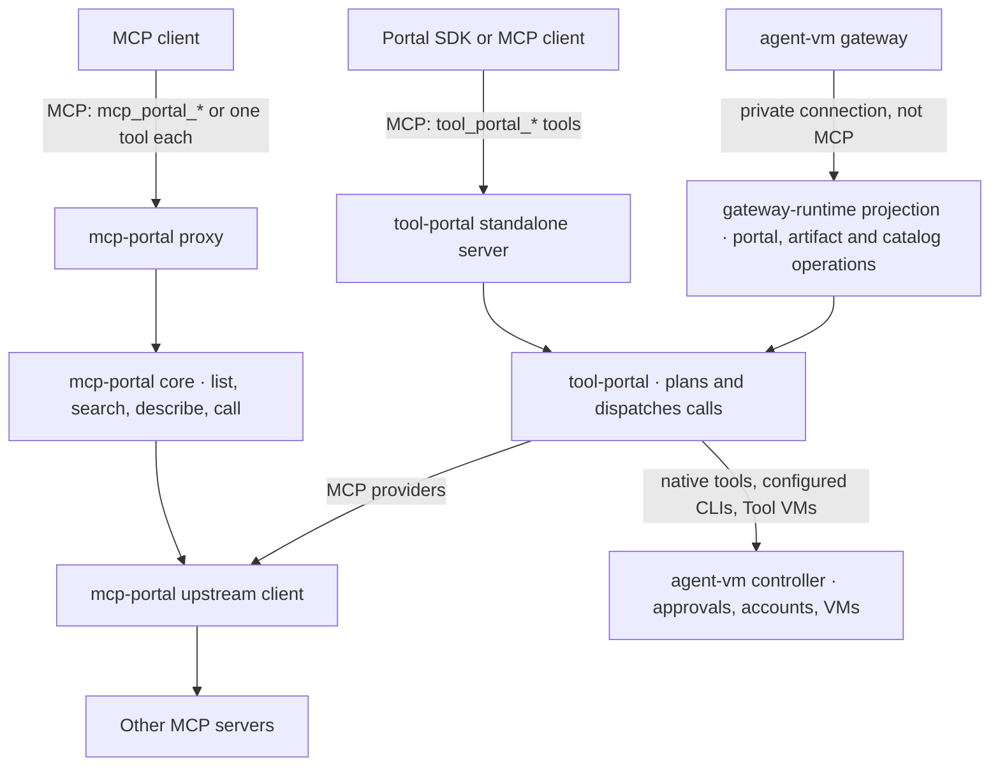
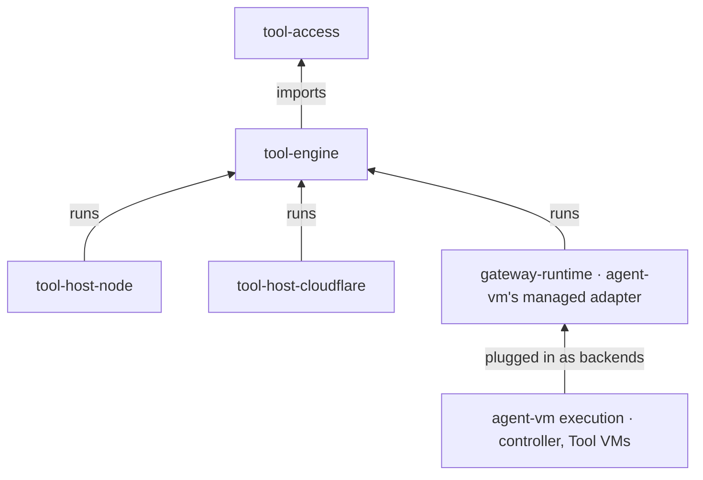
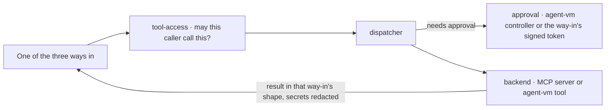
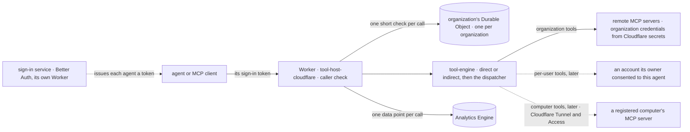

# Program Design: the pieces and how they fit

[Requirements](requirements.md) · [Specification](2026-10-14-portable-tool-portal-hosts.md) · [Verification Design](verification-design.md)

**The short version.** Today's two libraries become four packages with one job each, plus an adapter that stays inside agent-vm:
- `tool-access` holds the rules;
- `tool-engine` routes every call through one dispatcher and talks to other MCP servers;
- `tool-host-node` runs the standalone servers on a machine;
- `tool-host-cloudflare` runs the MCP proxy on a Cloudflare Worker;
- agent-vm plugs its own tools and approvals in through its managed adapter.

The three ways callers reach tools today stay exactly as they are; only what sits behind them changes. On a machine nothing new is stored and no new limits are added. The Worker is the one addition, described in [The Cloudflare Worker](#the-cloudflare-worker).

## Today



**What's tangled, and why we split it:**
1. **`tool-portal` can't be used without agent-vm.** Its ports carry agent-vm's managed types. [`ToolPortalBackendCallOptions`](../../../packages/tool-portal/src/tool-portal-service.ts#L104) takes a `GatewayRuntime…DispatchAuthority`, and [`ToolPortalApprovalPort`](../../../packages/tool-portal/src/tool-portal-service.ts#L182) reserves and arms `GatewayRuntime…` intents.
2. **`mcp-portal` mixes serving with Node-only code.** Its core imports the TypeScript catalog generator ([portal-tools.ts:12](../../../packages/mcp-portal/src/core/portal-tools.ts#L12)). Its upstream client mixes HTTP with stdio and `process.env` ([upstream-mcp-client-runtime.ts:266](../../../packages/mcp-portal/src/upstream-mcp-client-runtime.ts#L266)).
3. **`config-contracts` mixes pure schemas with host loaders.** See [tool-portal-config.ts](../../../packages/config-contracts/src/tool-portal-config.ts#L280) and [controller-configured-cli.ts](../../../packages/config-contracts/src/controller-configured-cli.ts#L1).
4. **The call digest is in the wrong place.** Approvals bind to it, but it lives inside the HMAC token file ([portal-tools.ts:11](../../../packages/mcp-portal/src/core/portal-tools.ts#L11)).

## The three ways in

Each way in keeps its own contract: its tool names, inputs, results, artifact reads and approvals. Only what sits behind it moves.

| Way in | Who uses it | Its contract today | New home |
| --- | --- | --- | --- |
| **agent-vm's private connection** | agent-vm's gateway | Not MCP. Authenticated private operations: `portal`, `artifact.read` and catalog operations ([tool-portal-projections.ts:39](../../../packages/gateway-runtime/src/tool-portal-projections.ts#L39)) | Stays in agent-vm (`gateway-runtime`), now calling `tool-engine`'s dispatcher through the managed adapter |
| **Standalone Tool Portal** | the Portal SDK ([tool-portal-mcp-client](../../../packages/agent-portal-sdk/src/tool-portal-mcp-client/index.ts#L191)) and other clients | Two routes. **Its MCP route:** tools `tool_portal_list`, `tool_portal_search`, `tool_portal_describe` and `tool_portal_call`, with the Portal result in `structuredContent`; artifacts through MCP `resources/read`; its signed batch approval in MCP metadata `_meta['agent-vm/tool-portal-approval-token']`, which is what the Portal SDK sends ([standalone-tool-portal-mcp-projection.ts:38](../../../packages/tool-portal/src/standalone-entrypoint/standalone-tool-portal-mcp-projection.ts#L38), [:203](../../../packages/tool-portal/src/standalone-entrypoint/standalone-tool-portal-mcp-projection.ts#L203)). **Its JSON-over-HTTP route:** an `{operation, request}` body, with the approval in the `x-agent-vm-tool-portal-approval-token` header ([standalone-tool-portal-http-server.ts:36](../../../packages/tool-portal/src/standalone-entrypoint/standalone-tool-portal-http-server.ts#L36)) | `tool-host-node`, keeping both routes with the same names, shapes and approval carriers |
| **MCP proxy** | MCP clients and harnesses | Either `mcp_portal_list`, `_search`, `_describe` and `_call`, with the core result wrapped as text, or one MCP tool per configured tool. Its signed approval token comes in one of two forms: `portalApprovalToken` in the `mcp_portal_call` input, or MCP metadata `_meta['agent-vm/tool-portal-approval-token']` on a call to a single tool ([portal-mcp-server.ts:39](../../../packages/mcp-portal/src/mcp-proxy/portal-mcp-server.ts#L39), [:243](../../../packages/mcp-portal/src/mcp-proxy/portal-mcp-server.ts#L243)) | `tool-host-node` plus `tool-engine/mcp-gateway`, in `direct` or `indirect` mode |

**Deleting the old packages doesn't change any of these contracts.** Retiring a way in would be the owner's decision, not a side effect of the move.

## The new pieces

| Package | Its one job | What's inside | May not import |
| --- | --- | --- | --- |
| `@agent-collaboration/tool-access` | the rules | `contracts` (schemas and the call digest), `authorization` (`assessAccess`, policy helpers, CLI allowances), `approval-rules` (which calls an approval covers), `credentials` (rules for which provider account a call may use) | any other piece, agent-vm, `node:*` |
| `@agent-collaboration/tool-engine` | route calls and talk to MCP servers | `dispatch` (the one dispatcher, with neutral interfaces for backends and approvals), `mcp-gateway` (the proxy's tools in `direct` or `indirect` mode, its agent bearer tokens and its approval token), `connectors` (calls to other MCP servers over HTTP or SSE) | any host, agent-vm, `node:*` |
| `@agent-collaboration/tool-host-node` | run the standalone servers | HTTP and stdio listeners, the two standalone projections (Tool Portal and the proxy), caller checks, the Tool Portal's batch approval check, the proxy's in-memory used-token list, config loading, the stdio connection to MCP servers, and the TypeScript catalog compiler | agent-vm |
| `@agent-collaboration/tool-host-cloudflare` | run the MCP proxy on a Worker | the Worker's MCP listener, its caller check, the organization's Durable Object (including the proxy's used approval tokens), config and secrets from Cloudflare bindings, and the analytics data point | agent-vm, `tool-host-node`, `node:*` beyond what Cloudflare's Node compatibility provides |
| agent-vm's managed adapter (in `gateway-runtime`) | plug agent-vm in | wraps agent-vm's existing backends (native tools, configured CLIs, Tool VMs, MCP providers) and the controller's approvals behind `tool-engine`'s interfaces; keeps the private connection and agent-vm's own IDs and fingerprints | n/a; it's agent-vm code |



**Execution stays outside the engine.** A Tool VM or a configured CLI reaches the engine only as a backend that agent-vm plugs in. The engine never imports a VM provider.

## One call, step by step



Every way in uses the same rules check and the same dispatcher. Nothing reaches a backend except through the dispatcher.

## Who loads tools lazily: the client or the portal

This applies to the MCP proxy, on a machine and on the Worker. The owner's direction (2026-10-20): there are exactly two cases, chosen for each client, and never a third.

```ts
// Exactly one of two cases, chosen for each caller.
type ToolLoading =
  | { readonly kind: 'client-deferred' } // the client loads tool definitions lazily itself
  | { readonly kind: 'portal-deferred' }; // the portal does it, through its search tools
```

| Case | What the caller's `tools/list` shows | Today's name |
| --- | --- | --- |
| `client-deferred` | **`direct`:** every tool the caller may use, each as its own MCP tool, plus the four search tools | catalog |
| `portal-deferred` | **`indirect`:** only the four search tools (list, search, describe and call); the caller finds and calls every tool through them | compact |

- **Same tools either way.** "Every tool" means every tool this caller may use. The case changes only how tools are shown, never which ones the caller can reach. Both cases use the same rules, the same dispatcher, the same approvals and the same results.
- **In `direct`, the search tools work too.** A call to a search tool goes to its search handler, and a call to any other name goes to that tool. Today's catalog mode listed only the tools, so offering the search tools as well is one deliberate change. The routing matters: the S3b branch currently sends every `direct` call to the tool lookup, which would refuse the search tools ([node-mcp-server.ts:42](https://github.com/ShravanSunder/agent-vm/blob/tool-host-node/s3b-node-host/packages/tool-host-node/src/ingress/node-mcp-server.ts#L42)).

### Choosing the case

Today the case is one command-line flag for the whole proxy ([mcp-portal-cli-parser.ts:54](../../../packages/mcp-portal/src/cli/mcp-portal-cli-parser.ts#L54)). It becomes a choice per client, made in `tool-engine/mcp-gateway` from the address the client connects to (owner, 2026-10-20):
- **`…/mcp?tools=direct` gives `client-deferred`;** the plain address gives `portal-deferred`. Whoever sets up a client gives it the address that matches it. Cloudflare's own MCP Portal works the same way: a client adds `optimize_context` to the portal address ([MCP Portal](https://developers.cloudflare.com/cloudflare-one/access-controls/ai-controls/mcp-portals/#optimize-context)). A query parameter works with every client because it's part of the address; a header would need each client to support custom headers.
- **The default is `portal-deferred`.** A client on the plain address never receives the full list.
- **A wrong choice can't grant anything.** It only changes how tools are shown; the caller's tools and approvals stay the same.
- **The case is stable:** a client uses the same address for every request. For example, Claude Code defers MCP tool definitions by default ([Claude Code MCP](https://code.claude.com/docs/en/mcp)), so it's given the `?tools=direct` address.
- **The address doesn't prove the client defers.** The real-client check in Verification row 2 does.
- **Why not the client's own signal:** MCP's core capabilities have no field for deferring tool loading ([schema](https://github.com/modelcontextprotocol/modelcontextprotocol/blob/main/schema/2026-07-28/schema.ts#L716)). MCP does let a client declare namespaced extensions ([extension negotiation](https://modelcontextprotocol.io/specification/2026-07-28/basic/lifecycle#extension-negotiation)), but no client is known to declare one for this. Honouring such a signal is later work. It needs its own rule for keeping a caller's case stable, because a signal sent on some requests and not others would otherwise flip the case.

**When it's chosen.** 2026-07-28 MCP has no connect step: each request carries its version and the client's capabilities. Older clients still send `initialize` ([versioning](https://modelcontextprotocol.io/specification/2026-07-28/basic/lifecycle)). So the case is chosen at `initialize` for older clients, and on each request for current ones. Because it comes from the address each request is sent to, it's the same answer every time. That also fits MCP's rule that a tool list must not vary from connection to connection ([tools](https://modelcontextprotocol.io/specification/2026-07-28/server/tools)).
- **The client's name isn't used.** The client reports it about itself, and it says nothing reliable about deferral.

### The organization's portal starts once

**This is a change from today.** Each organization's portal connects to its configured tool servers and reads their tool lists into one catalog when it starts. Today, discovery is lazy and separate for each agent: it runs the first time that agent's session starts ([portal-session.ts:194](https://github.com/ShravanSunder/agent-vm/blob/377ae627ab64b2bf7b00d558f872e2b6ba711b0d/packages/tool-engine/src/mcp-gateway/portal-session.ts#L194), [:243](https://github.com/ShravanSunder/agent-vm/blob/377ae627ab64b2bf7b00d558f872e2b6ba711b0d/packages/tool-engine/src/mcp-gateway/portal-session.ts#L243)).
- **Each client's view is filtered from that catalog,** by what the caller may use, in whichever case it gets. Calls keep using connections per agent and per server, as today.
- **The case belongs to the caller, not the organization.** The gateway already takes the case on each `listTools` call ([mcp-gateway.ts:73](https://github.com/ShravanSunder/agent-vm/blob/377ae627ab64b2bf7b00d558f872e2b6ba711b0d/packages/tool-engine/src/mcp-gateway/mcp-gateway.ts#L73)). The host sets it for each client's protocol server ([node-mcp-server.ts:27](https://github.com/ShravanSunder/agent-vm/blob/51c9813938a9f6e5a9bf4494696c5c847aa58f92/packages/tool-host-node/src/ingress/node-mcp-server.ts#L27)), never as one setting shared across the organization. So two clients of one organization can be in different cases at once.
- **On a machine,** the portal starts with the process.
- **On the Worker,** it starts with the first request that creates the organization's engine in an isolate; that request waits for the catalog. The engine, its catalog and each tool server's MCP session details then last as long as the isolate, and a new isolate starts its own. Each call still makes its own HTTP requests, because a Worker request can't use input or output that another request opened ([Workers errors](https://developers.cloudflare.com/workers/observability/errors/#cannot-perform-io-on-behalf-of-a-different-request)). Whether the MCP SDK's client object can be kept between requests is checked on a real Worker build.

### The tool list's size

- **Client deferral doesn't shrink the download.** In `client-deferred`, the client keeps tool definitions out of the model's context, but it still downloads the whole tool list. So deferral alone doesn't fix a list that's too big for the client. The 4.56 MB figure is 4,558,322 bytes across 170 tools: large schemas, not many tools. It was measured in Router PR [#153](https://github.com/agent-collaboration/agent-collaboration/pull/153), where the Router Host's own `tools/list` readiness check had a 1 MiB response limit, raised to 16 MiB (local Router commit `f1a3310f`, from before the PR's history was squashed). That limit belongs to the Router's check, not to an agent client.
- **The list is sent in pages.** MCP lets a server split `tools/list` into pages with a cursor ([tools](https://modelcontextprotocol.io/specification/2026-07-28/server/tools)). Today the proxy returns every tool in one reply ([portal-mcp-server.ts:215](../../../packages/mcp-portal/src/mcp-proxy/portal-mcp-server.ts#L215)). In `client-deferred`, the portal sends the list in pages of at most 1 MiB each. That's our own budget, and a page holds whole tools. How many pages the real list takes, and how big each one is, are measured in Verification row 2; the total size alone doesn't say.
- **Only clients whose own limits cover the whole list can be set to `client-deferred`.** "The whole list" means everything the caller is offered, including the four search tools. Past a client's limit, discovery fails or tools go missing, depending on the client. These are the defaults on the paths inspected:
  - Codex, for ordinary MCP servers, refuses a list longer than 2,048 tools or 100 pages with an error (Codex's own apps get 8,192) ([pagination.rs:44](https://github.com/openai/codex/blob/d34f104c22ae815fc213641b8a637c5947f14ac1/codex-rs/codex-mcp/src/pagination.rs#L44)).
  - Hermes stops at 50 pages, logs a warning, and keeps the partial list ([mcp_tool.py:262](https://github.com/NousResearch/hermes-agent/blob/bd3cbe91a90097f9804f16ea5c1768f5cbaaf0b7/tools/mcp_tool.py#L262)).
  - Version 2 of the MCP TypeScript SDK, when it gathers pages itself, stops at 64 by default and throws; the limit is configurable ([client.ts:289](https://github.com/modelcontextprotocol/typescript-sdk/blob/46d9c9921b6542e813c1ecc5f9fc964085e8e3bb/packages/client/src/client/client.ts#L289)). Version 1.29.0, which this repository uses, returns one page per call.

  So a client whose limit is below the caller's list stays `portal-deferred`, where `list` and `search` already return bounded pages ([portal-tools.ts:111](../../../packages/mcp-portal/src/core/portal-tools.ts#L111), [:120](../../../packages/mcp-portal/src/core/portal-tools.ts#L120)).
- **This is a setup rule, not a runtime switch.** It's checked when a client is set up, and again whenever the organization adds tool servers. The portal can't know a client's limits, so it never moves a caller to another case by itself; that's what keeps each caller's case stable. If an organization's list outgrows a client, whoever manages the organization moves that client to the default setup.
- **The size caps found so far are larger than 1 MiB,** as defaults on the paths inspected: 8 MiB per message on Codex's modern transports; 10 MiB per HTTP response or SSE event in Hermes; and a 10 MiB stdio buffer in version 2 of the TypeScript SDK. None of them is near 1 MiB, so the 1 MiB page budget leaves plenty of room.

### `describe` and code mode

Deferring tool loading isn't code mode: in both cases the caller still calls tools one at a time.
- **`describe` keeps returning today's per-tool TypeScript helper** ([portal-tools.ts:595](../../../packages/mcp-portal/src/core/portal-tools.ts#L595)). The full catalog compiler stays too, for its existing users.
- **Code mode, later.** Today's code already has most of one route to code mode:
  1. the catalog compiler builds typed TypeScript modules for the tools an agent may use;
  2. the Portal SDK binds them to a client;
  3. code in the agent's own environment calls those functions, and each one makes an ordinary call.

  When code mode is picked up, the first question is which client runs that code and where.

## Approvals

The dispatcher needs a record and a receipt for any call that requires approval ([capability-dispatcher.ts:125](../../../packages/tool-engine/src/dispatch/capability-dispatcher.ts#L125)). Each way in supplies them from the approval it already has:
- **agent-vm:** the controller, through the managed adapter, as S2 built it.
- **Standalone Tool Portal:**
  1. The batch approval arrives in MCP metadata on its MCP route, or in its header on its JSON route.
  2. It's checked against the exact batch of calls it names (1 to 50, [standalone-tool-portal-approval.ts:31](../../../packages/tool-portal/src/standalone-entrypoint/standalone-tool-portal-approval.ts#L31)) and against the server's current service generation, so an approval from before a restart with a new generation is refused, as today ([:383](../../../packages/tool-portal/src/standalone-entrypoint/standalone-tool-portal-approval.ts#L383)).
  3. It's used once.
  4. Each call in the batch then goes through the dispatcher with its own in-memory entry.
- **MCP proxy:**
  1. The token arrives as `portalApprovalToken` in an `mcp_portal_call`, or as MCP metadata `_meta['agent-vm/tool-portal-approval-token']` on a `direct` call to a single tool. Both forms must work again, and the metadata token is turned into the approval only inside the proxy, so a tool's own arguments never change. This existing approval metadata is separate from the `tool-portal/operation-item` field that S3b added and that is being removed.
  2. It's checked against the calls it names ([hmac-token.ts:11](../../../packages/mcp-portal/src/portal-auth/hmac-token.ts#L11)) and marked used in the process's used-token list, as today ([resolve-agent-identity.ts:139](../../../packages/mcp-portal/src/mcp-proxy/resolve-agent-identity.ts#L139)).
  3. Each call then goes through the dispatcher with its own in-memory entry.
- **Calls that need no approval** aren't recorded.

### Approval modes and who decides

**Each tool has one of four modes** (fleet D-9, decided 2026-10-18: "auto, approved, requires approval, blocked"; [concepts §7.4](../../wip/2026-10-18-fleet-backbone-concepts/concepts.md)):

| Mode | Who decides | Today |
| --- | --- | --- |
| **approved** | nobody; it runs | `allowWithoutApprovalTools`, `withoutApproval` namespaces, trusted read-only ([mcp-portal-approval-policy.ts:57](../../../packages/config-contracts/src/mcp-portal-approval-policy.ts#L57)) |
| **auto** | a judge (Jev or a classifier) inside fixed limits set outside the model. It approves, escalates to a person, or denies; when it's unsure, unavailable or times out, it escalates; each decision is recorded | new; where it runs is still open (T-16) |
| **requires approval** | a person: the approver in the resource owner's policy | `alwaysAskTools`, `writeTools`, `requiresApproval` namespaces |
| **blocked** | nobody; it never runs, and no approval overrides it | everything else |

Critical tools always go to a person when they're allowed to run. A mode is a per-tool setting, not the state of a call, and a timed-out approval never counts as a yes. For a person's own account, today's Allow, Ask and Deny correspond to approved, requires approval and blocked.

**Who must say yes, by what the call touches:**

| What the call touches | What must already allow it | Who decides "requires approval" | Status |
| --- | --- | --- | --- |
| a team tool (the organization's credentials) | the agent is in the organization; its profile includes the tool; the tool's mode | the agent's configured approver | built today |
| a team account | a manager gave the workspace's agents that account | the configured approver | decided (fleet F-27) |
| a person's own account | the owner consented to this agent; read and write modes, within hard limits | today through Hermes or Discord; the October 15 proposal sends it to the account's owner | built today; approver routing proposed |
| someone else's account, for the requester | not allowed: "on behalf of" is a label (fleet F-35) | | decided |
| several resources in one call | each resource's own yes | each resource's approver | proposed only |
| changing modes or account rules | the account's owner who is also a configured editor; a chat proposal with Accept or Deny | that editor | decided (fleet F-41, F-43); detail proposed |

**Across all rows:** any blocked gate stops the call; every "requires approval" gate needs its own yes; an approval covers one call, once, and lasts five minutes from when it's requested; approving never changes a tool's mode. The first version keeps today's three modes. Auto, with its judge, is decided but new, so it follows once where the judge runs (T-16) is settled.

## What's stored

**Nothing new on a machine.**
- **The standalone servers** keep sessions in memory, plus the in-memory approval entries above, for the life of the process. That matches today: the old Tool Portal's one-use token tombstones ([standalone-tool-portal-approval.ts:306](../../../packages/tool-portal/src/standalone-entrypoint/standalone-tool-portal-approval.ts#L306)) and the proxy's used-token list.
- **agent-vm's controller** keeps what it keeps today: approvals, provider accounts and Tool VM leases. It stays the owner of that state, and the managed adapter uses it.
- **`tool-engine` and `tool-access`** store nothing.
- **The Worker** keeps each organization's auth state, and the approval tokens already used until each expires, in that organization's Durable Object. See [The organization's Durable Object](#the-organizations-durable-object). It keeps no record of calls.

## Limits today

Each limit stays at its own way in, with its current meaning. No new limits are added.

| Where | Limit today | Source |
| --- | --- | --- |
| Standalone Tool Portal, JSON route only | HTTP request body at most 64 KiB, checked against both `Content-Length` and the bytes received. Its MCP route has no such guard of its own; it hands the body to the SDK transport ([standalone-tool-portal-mcp-http-server.ts:227](../../../packages/tool-portal/src/standalone-entrypoint/standalone-tool-portal-mcp-http-server.ts#L227)) | [standalone-tool-portal-http-server.ts:38](../../../packages/tool-portal/src/standalone-entrypoint/standalone-tool-portal-http-server.ts#L38) |
| Standalone Tool Portal | the text form of an MCP tool result at most 4,096 bytes; the full structured result is still returned | [standalone-tool-portal-mcp-projection.ts:45](../../../packages/tool-portal/src/standalone-entrypoint/standalone-tool-portal-mcp-projection.ts#L45) |
| MCP proxy | each tool server's response at most 4 MiB, measured before redaction | [upstream-mcp-client-runtime.ts:156](../../../packages/mcp-portal/src/upstream-mcp-client-runtime.ts#L156) |
| MCP proxy | no cap on incoming requests in its own code; it reads the body through `@hono/mcp` | [portal-http-server.ts:249](../../../packages/mcp-portal/src/mcp-proxy/portal-http-server.ts#L249) |
| MCP proxy | no cap on the number of calls in one `mcp_portal_call`, and they all run at once | [portal-tools.ts:148](../../../packages/mcp-portal/src/core/portal-tools.ts#L148), [:846](../../../packages/mcp-portal/src/core/portal-tools.ts#L846) |

## The Cloudflare Worker

The Worker serves the MCP proxy's way in, in `direct` or `indirect` mode, with today's tools, results and approval token. `tool-host-cloudflare` is to the Worker what `tool-host-node` is to a machine: it takes connections, checks who's calling and loads config, then hands every call to `tool-engine`. `tool-engine` already has no Node-only code ([package.json](https://github.com/ShravanSunder/agent-vm/blob/tool-engine/s3a-mcp-gateway/packages/tool-engine/package.json), with no `node:` imports in its source), and its connectors use the MCP SDK's HTTP client. Neither has been run on a Worker yet.



### The caller check

One function at the Worker's edge answers "which agent, of which organization, is calling". It returns the organization and the agent, or it refuses the call. Nothing else in the Worker reads tokens, so a change of sign-in touches only this function.
- **Agents sign in with our own login, Better Auth** (owner, 2026-10-20). The sign-in service ([`@agent-collaboration/auth`](../2026-10-20-people-sign-in/requirements.md)) runs in its own Worker and gives each agent a token for this Worker. Better Auth's OAuth provider supports a client signing in as itself (`client_credentials`), with the client as the token's subject.
- **The check verifies that token:** signed by our sign-in service, meant for this Worker (its audience), not expired, and naming an agent the organization's object still lists. A missing, forged, expired or wrong-audience token is refused.
- **Cloudflare Access isn't in front of the Worker.** Cloudflare stays for machines: the Worker reaches registered computers through it (computer tools, below), like Tailscale.
- **An agent is known only by its token,** never by a name, session ID, client name or tool argument it sends.
- **An agent always acts with its own access.** The fleet's "on behalf of" field records who asked; it's a label in the log and grants nothing (fleet F-30, F-35).
- **The sign-in design admits people only today** (its `R7` and `R10`). Letting agents sign in as themselves is a change to that design, made alongside this one.
- **Each organization gets its own engine.** Each organization has its own configuration (today's proxy config format, unchanged), its own secrets and its own approval signing key, all deployed with the Worker. The organization this check verified picks the engine that handles the call; nothing the caller sends can pick it. So tools, server settings, connections and the approval key never cross organizations. Today one runtime picks servers by name alone ([upstream-mcp-client-runtime.ts:532](../../../packages/mcp-portal/src/upstream-mcp-client-runtime.ts#L532)) and reuses connections per agent and server ([:345](../../../packages/mcp-portal/src/upstream-mcp-client-runtime.ts#L345)). Two organizations can use the same agent or server names, so they can't share one runtime.

### The organization's Durable Object

One object per organization, holding only that organization's auth state. It's the one authority for each row below:

| What it holds | Written by | Checked |
| --- | --- | --- |
| the owner, and who may sign in | the owner | at sign-in |
| the organization's agents, by their sign-in client IDs | the owner | before every call |
| per-user tools, later: what the Worker checks for a consented account. Today agent-vm's controller owns consents, overrides and Google credentials; whether the Worker asks it or holds its own is decided when per-user tools are designed | each account's owner | before every per-user call |
| approval tokens already used, each kept until it expires | the Worker, when it accepts a token | before every approved call |

- **One short check per call, with no cache.** Removing an agent or withdrawing a consent stops that agent's next call. The cost is one hop to the object per call. Cloudflare's soft limit is about 1,000 requests a second per object, which is ample for one organization today.
- **Tool calls and their streams run in the Worker, not in the object.** The object only does short reads and writes.
- **Splitting when needed:** if one organization's used-approval-token records grow too large or too busy, they can split by agent into more objects. That spreads only the approval records: every call still makes its one check against the organization's object, so a very busy organization would have that check measured before anything else changes.
- **Why approval state moves here:** today the proxy remembers used tokens in a list inside one process ([resolve-agent-identity.ts:139](../../../packages/mcp-portal/src/mcp-proxy/resolve-agent-identity.ts#L139)). A Worker runs as many copies at once, so a list per copy couldn't stop a token being used twice. The object is the single place that records a use. This is approval state, not call history.
- **Recording a use is one awaited step, before anything runs.**
  1. The Worker checks the token's signature, agent and calls.
  2. It asks the organization's object to record the token. The object does that in one storage write and answers "first use" or "already used".
  3. Only "first use" lets the calls run. "Already used", an error or no answer means none of them run.

  Today the token check calls a plain function for this ([hmac-token.ts:204](../../../packages/mcp-portal/src/portal-auth/hmac-token.ts#L204)). It becomes an awaited step on both hosts; a machine keeps today's in-memory list behind it. The token's bytes don't change. A token signed with one organization's key fails the signature check in another.
- **People's and agents' sign-in records aren't kept here.** They live in the sign-in service's own database. Membership is written in one place only: this object.

### Organization tools

Today's proxy config already describes remote MCP servers, with headers whose values are secrets ([mcp-config.ts:39](../../../packages/config-contracts/src/mcp-config.ts#L39)). Each organization's engine reads its own copy of that config.
- **Secret values** come from that organization's Worker secrets or Secrets Store bindings, in place of the machine's secret loader. The call itself doesn't change.
- **Connections are reused only inside the organization's engine,** per agent and per server as today, where the agent is the one its bearer token names ([resolve-agent-identity.ts:112](../../../packages/mcp-portal/src/mcp-proxy/resolve-agent-identity.ts#L112)). A reused connection never skips the per-call check.
- **1Password:** the Node host's `op` path doesn't run in a Worker. A 1Password service-account token would need a client that works in a Worker, which is unproven, so Cloudflare secrets are the default.

### Per-user and computer tools: designed, not built

- **Per-user tools use today's permission model unchanged** ([agent account and tool permissions](../2026-09-04-agent-account-and-tool-permissions/requirements.md), [profile policy](../2026-09-13-profile-oauth-policy/requirements.md)):
  - an account's owner consents, in the browser, to a specific agent using it, which gives a separate credential for that agent and account;
  - Deny, Ask or Allow, set separately for reads and writes, within the operator's hard limits. A rule the owner hasn't overridden follows the agent's profile default live, so changing the default changes it;
  - a one-call approval when the policy says Ask. As today, it lasts five minutes from when it's requested, whether or not it's been answered ([controller-runtime.ts:182](../../../packages/agent-vm/src/controller/controller-runtime.ts#L182)).
  - The agent uses only accounts consented to it, never a requester's (fleet F-35). The account a call uses comes from that consent, checked at the organization's object, and its connection is reused only for that agent and account.
  - Changing a person's account rules needs that account's owner who is also a configured editor for the agent; signing in alone grants neither. Today's changes are revisioned and recorded, and that stays. Making changes through the request bar with Accept or Deny (fleet F-41 to F-49) is the separate control UI. Temporary grants and temporary revocation are recorded owner interest (fleet F-61), not part of this design.
  - Today's approval pieces stay separate: the rules that say whether a call needs approval, the record that decides it and uses it once, and the prompt in Hermes, Discord or elsewhere. Per-user tools don't add a shared approval service.
  - Who must approve in each case (an agent on its own, a person's own account, someone else's shared resource, several resources at once, a configuration change) is worked out in the [October 15 approval target-state proposal](../../wip/2026-10-15-portal-approval-research/s1-approval-target-state.md). It's a proposal: when per-user tools are designed, it's reconciled with the adopted fleet F-27 (managers may give team accounts) and F-35 (no one else's personal accounts; "on behalf of" is a label).
- **Computer tools:**
  - Computers are registered on our side. The Worker reaches them through a Cloudflare Tunnel protected by Cloudflare Access, using a key the Worker holds, like Tailscale.
  - The computer's MCP server still checks the Worker's own credential.
  - Approvals for a computer's tools stay with whoever approves them today.

### Code mode stays possible

There are two generators today, and only one is on the Worker's path.
- **`describe`'s per-tool helper** is built from the tool's live record each time by a small generator ([portal-tools.ts:595](../../../packages/mcp-portal/src/core/portal-tools.ts#L595), [typescript-artifact.ts:1](../../../packages/mcp-portal/src/portal-config/typescript-artifact.ts#L1)). Its only Node dependency is one SHA-256 hash ([typescript-artifact.ts:20](../../../packages/mcp-portal/src/portal-config/typescript-artifact.ts#L20)). It moves to `tool-engine/mcp-gateway` on Web Crypto, with the same output bytes. So the Worker builds the helper live, as a machine does today.
- **The full catalog compiler** is separate. It uses `json-schema-to-typescript` ([catalog-typescript-compiler.ts:8](../../../packages/mcp-portal/src/catalog-typescript/catalog-typescript-compiler.ts#L8)) and stays on `tool-host-node` for its existing users. When code mode is picked up, the first question is where that code runs; whether this compiler runs on a Worker is checked then.

### The analytics data point

| Part | What it holds |
| --- | --- |
| index (how Analytics Engine groups and samples) | the organization's ID, a UUID (36 bytes, under the 96-byte limit). Cloudflare's guidance is to pick the index the data is viewed by, and never a unique ID per call ([sampling](https://developers.cloudflare.com/analytics/analytics-engine/sampling/)). Workspaces aren't in this work; when they arrive, the index becomes the workspace ID. |
| text fields | organization, agent, mode (`direct` or `indirect`), tool server, tool name, outcome (ran, refused, needs approval or failed), failure kind, and whether the call was for a person (yes or no) |
| number fields | duration in milliseconds, request bytes, response bytes |

- **Kept small and safe:** no arguments, results, secrets, tokens or personal details. Mode, outcome, failure kind and "for a person" have fixed sets of values. Names come from configuration, which sets no length limit, so each text field is cut to at most 256 bytes, on a character boundary. That keeps a data point's eight text fields far under Analytics Engine's 16 KB ([limits](https://developers.cloudflare.com/analytics/analytics-engine/limits/)).
- **Analytics never changes a call:** a data point that can't be written is dropped, and the failure is logged without its contents.
- **Reading it:** counts are weighted by `_sample_interval`, because data is sampled. A rare event inside a busy organization may not be retrievable on its own.
- **Logs, traces and errors** use Cloudflare's Workers observability. Logs are structured and never contain secrets.

### Limits on the Worker

These are new, and apply to the Worker only. They're our own budgets, chosen to stay well inside Cloudflare's limits ([Workers limits](https://developers.cloudflare.com/workers/platform/limits/)):
- 128 MB of memory per isolate, shared by every request that isolate is serving;
- 6 connections per request waiting for response headers;
- 250 analytics data points per request.

A budget alone doesn't guarantee memory, so each is provisional until measured on a real Worker build, including several requests sharing one isolate.

| What | Limit | Why |
| --- | --- | --- |
| request body | 4 MiB | today's proxy has none; the Worker needs one to stay inside its memory |
| each tool server's response | 4 MiB, measured before redaction | the same as today's proxy |
| calls in one `mcp_portal_call` | 50 | today's proxy has no limit; 50 matches the standalone Tool Portal's batch limit, and stays under 250 data points |
| calls of one batch running at once | 6 | our choice, so at most about 24 MiB of responses (6 × 4 MiB) are held at once; the rest wait their turn. It isn't Cloudflare's limit, which counts connections waiting for headers |
| the whole reply | 16 MiB | calls that would push the reply past it fail with a too-large result, rather than the Worker running out of memory |
| an organization's object | records far below Cloudflare's 2 MB per record and 10 GB per object | each record is a small row |

## Where today's code goes

The per-file list is the [port inventory](../../wip/2026-10-19-tool-portal-port-inventory/port-inventory.md). It's evidence: read a file's body before moving it.

| Today | New home |
| --- | --- |
| `mcp-portal` core: list, search, describe, call, and sessions | `tool-engine/mcp-gateway` |
| `mcp-portal` upstream client: HTTP and SSE | `tool-engine/connectors` |
| `mcp-portal` upstream client: stdio and environment | `tool-host-node` |
| `mcp-portal` proxy server, config, CLI and binary | `tool-host-node` |
| `mcp-portal` per-tool TypeScript helper, used by `describe` | `tool-engine/mcp-gateway`, on Web Crypto, so both hosts use it; output byte-identical |
| `mcp-portal` full catalog compiler | `tool-host-node`; output byte-identical |
| `mcp-portal` agent bearer tokens and approval token | `tool-engine/mcp-gateway`, so both hosts use one copy. It's written against Web Crypto, which both hosts have, in place of Node's `crypto` ([hmac-token.ts:1](../../../packages/mcp-portal/src/portal-auth/hmac-token.ts#L1)); the token bytes don't change. The one-use check stays passed in ([hmac-token.ts:28](../../../packages/mcp-portal/src/portal-auth/hmac-token.ts#L28)), but becomes awaited: an in-memory list on a machine, the organization's object on the Worker |
| `mcp-portal` call digest | `tool-access/contracts`; same bytes |
| `mcp-portal` provider backend | `tool-engine/connectors`, used by agent-vm's adapter |
| `tool-portal` standalone server, its MCP projection, artifacts and batch approval | `tool-host-node` |
| `tool-portal` capability core and ports | `tool-engine/dispatch`, with agent-vm's types removed from the interfaces |
| `tool-portal` dispatch authority, managed IDs and fingerprints | stay in agent-vm (`gateway-runtime`) |
| `tool-portal` CLI allowances | `tool-access/authorization` |
| `config-contracts` tool schemas | `tool-access/contracts`; schema IDs unchanged |
| `config-contracts` loaders | `tool-host-node` |
| `oauth-approval-ui` | unchanged; not part of this work |

**Byte-exact outputs stay byte-exact:** config schema IDs, the `mcp:` tool reference encoding, the call digest, and both TypeScript generator outputs.

## What's built, and what changes

| Step | Status | Change under this design |
| --- | --- | --- |
| S1 `tool-access` | draft PR [#238](https://github.com/ShravanSunder/agent-vm/pull/238) | keep; `assessAccess` stays as built, but isn't expanded for the deferred UI |
| S2 dispatcher and agent-vm's adapter | draft PR [#240](https://github.com/ShravanSunder/agent-vm/pull/240) | keep its code. One rule in its docs and tests changes: a host may answer "not recorded" for calls that need no approval. Calls that need approval still need a record and a receipt (see "Approvals") |
| S3a gateway and connectors | draft PR [#241](https://github.com/ShravanSunder/agent-vm/pull/241) | rename the modes to `direct` and `indirect`; choose `client-deferred` or `portal-deferred` per client from its address (`?tools=direct`), defaulting to `portal-deferred`; send `tools/list` in pages in `client-deferred`; in `direct`, list **and route** the four search tools; accept both approval-token forms again (`portalApprovalToken` in `mcp_portal_call`, and the approval metadata on `direct` calls); make `describe` return today's per-tool helper, with its generator moved into `mcp-gateway`; take in the agent bearer tokens and the approval token from S3b's host. All three run on Web Crypto |
| S3b `tool-host-node` | branch at `51c98139`, no PR yet | **add** the standalone Tool Portal's two routes: its MCP route (`tool_portal_*`, `resources/read`, approval in metadata) and its JSON route (approval header, 64 KiB request limit). **Add** both approval routes; **replace** the disk store with the in-memory approval entries; **remove** the `_meta` name requirement and the new 4 MiB incoming-request check, which today's proxy doesn't have; **keep** the listeners, stdio, config, compiler and the review fixes |
| S4 switch agent-vm over | not started | agent-vm's private connection runs on the new pieces, then the old packages are deleted |
| S6 Worker host | not started | build `tool-host-cloudflare` for organization tools, as designed above. Its caller check needs agent sign-in from the sign-in service; deploying uses the existing Cloudflare CLI login |
| S3c limits, S5 control API, sign-in, UI | cancelled | none |

The stack's branches start from `33914cbe`. `master` now also has the 2.5G VM memory change (#242), which the stack takes in when building resumes.
