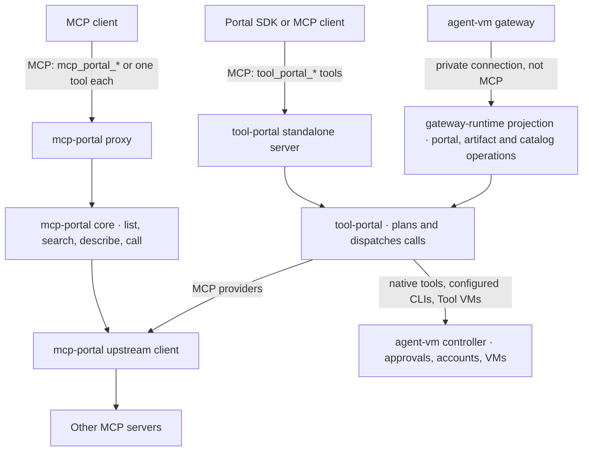
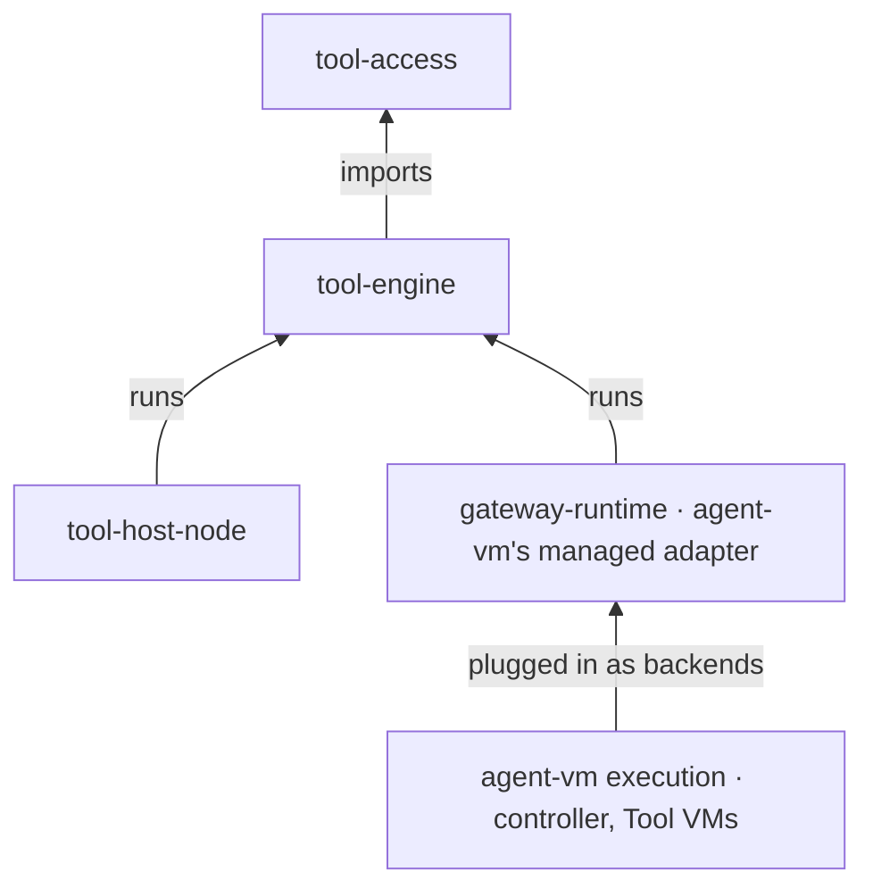
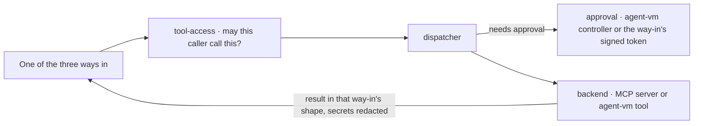

# Program Design: the pieces and how they fit

[Requirements](requirements.md) · [Specification](2026-10-14-portable-tool-portal-hosts.md) · [Verification Design](verification-design.md)

**The short version.** Today's two libraries become three packages with one job each, plus an adapter that stays inside agent-vm:
- `tool-access` holds the rules;
- `tool-engine` routes every call through one dispatcher and talks to other MCP servers;
- `tool-host-node` runs the standalone servers on a machine;
- agent-vm plugs its own tools and approvals in through its managed adapter.

The three ways callers reach tools today stay exactly as they are; only what sits behind them changes. Nothing new is stored, and no new limits are added.

## Today

**What's tangled, and why we split it:**
1. **`tool-portal` can't be used without agent-vm.** Its ports carry agent-vm's managed types. [`ToolPortalBackendCallOptions`](../../../packages/tool-portal/src/tool-portal-service.ts#L104) takes a `GatewayRuntime…DispatchAuthority`, and [`ToolPortalApprovalPort`](../../../packages/tool-portal/src/tool-portal-service.ts#L182) reserves and arms `GatewayRuntime…` intents.
2. **`mcp-portal` mixes serving with Node-only code.** Its core imports the TypeScript catalog generator ([portal-tools.ts:12](../../../packages/mcp-portal/src/core/portal-tools.ts#L12)). Its upstream client mixes HTTP with stdio and `process.env` ([upstream-mcp-client-runtime.ts:266](../../../packages/mcp-portal/src/upstream-mcp-client-runtime.ts#L266)).
3. **`config-contracts` mixes pure schemas with host loaders.** See [tool-portal-config.ts](../../../packages/config-contracts/src/tool-portal-config.ts#L280) and [controller-configured-cli.ts](../../../packages/config-contracts/src/controller-configured-cli.ts#L1).
4. **The call digest is in the wrong place.** Approvals bind to it, but it lives inside the HMAC token file ([portal-tools.ts:11](../../../packages/mcp-portal/src/core/portal-tools.ts#L11)).

## The three ways in

Each way in keeps its own contract: its tool names, inputs, results, artifact reads and approvals. Only what sits behind it moves.

| Way in | Who uses it | Its contract today | New home |
| --- | --- | --- | --- |
| **agent-vm's private connection** | agent-vm's gateway | Not MCP. Authenticated private operations: `portal`, `artifact.read` and catalog operations ([tool-portal-projections.ts:39](../../../packages/gateway-runtime/src/tool-portal-projections.ts#L39)) | Stays in agent-vm (`gateway-runtime`), now calling `tool-engine`'s dispatcher through the managed adapter |
| **Standalone Tool Portal** | the Portal SDK ([tool-portal-mcp-client](../../../packages/agent-portal-sdk/src/tool-portal-mcp-client/index.ts#L191)) and other clients | Two routes. **Its MCP route:** tools `tool_portal_list`, `tool_portal_search`, `tool_portal_describe` and `tool_portal_call`, with the Portal result in `structuredContent`; artifacts through MCP `resources/read`; its signed batch approval in MCP metadata `_meta['agent-vm/tool-portal-approval-token']`, which is what the Portal SDK sends ([standalone-tool-portal-mcp-projection.ts:38](../../../packages/tool-portal/src/standalone-entrypoint/standalone-tool-portal-mcp-projection.ts#L38), [:203](../../../packages/tool-portal/src/standalone-entrypoint/standalone-tool-portal-mcp-projection.ts#L203)). **Its JSON-over-HTTP route:** an `{operation, request}` body, with the approval in the `x-agent-vm-tool-portal-approval-token` header ([standalone-tool-portal-http-server.ts:36](../../../packages/tool-portal/src/standalone-entrypoint/standalone-tool-portal-http-server.ts#L36)) | `tool-host-node`, keeping both routes with the same names, shapes and approval carriers |
| **MCP proxy** | MCP clients and harnesses | Either `mcp_portal_list`, `_search`, `_describe` and `_call`, with the core result wrapped as text, or one MCP tool per configured tool. Its signed approval token comes in one of two forms: `portalApprovalToken` in the `mcp_portal_call` input, or MCP metadata `_meta['agent-vm/tool-portal-approval-token']` on a call to a single tool ([portal-mcp-server.ts:39](../../../packages/mcp-portal/src/mcp-proxy/portal-mcp-server.ts#L39), [:243](../../../packages/mcp-portal/src/mcp-proxy/portal-mcp-server.ts#L243)) | `tool-host-node` plus `tool-engine/mcp-gateway`, in `direct` or `indirect` mode |

**Deleting the old packages doesn't change any of these contracts.** Retiring a way in would be the owner's decision, not a side effect of the move.

## The new pieces

| Package | Its one job | What's inside | May not import |
| --- | --- | --- | --- |
| `@agent-collaboration/tool-access` | the rules | `contracts` (schemas and the call digest), `authorization` (`assessAccess`, policy helpers, CLI allowances), `approval-rules` (which calls an approval covers), `credentials` (rules for which provider account a call may use) | any other piece, agent-vm, `node:*` |
| `@agent-collaboration/tool-engine` | route calls and talk to MCP servers | `dispatch` (the one dispatcher, with neutral interfaces for backends and approvals), `mcp-gateway` (the proxy's tools in `direct` or `indirect` mode), `connectors` (calls to other MCP servers over HTTP or SSE) | any host, agent-vm, `node:*` |
| `@agent-collaboration/tool-host-node` | run the standalone servers | HTTP and stdio listeners, the two standalone projections (Tool Portal and the proxy), caller checks, both standalone approval checks, config loading, the stdio connection to MCP servers, and the TypeScript catalog compiler | agent-vm |
| agent-vm's managed adapter (in `gateway-runtime`) | plug agent-vm in | wraps agent-vm's existing backends (native tools, configured CLIs, Tool VMs, MCP providers) and the controller's approvals behind `tool-engine`'s interfaces; keeps the private connection and agent-vm's own IDs and fingerprints | n/a; it's agent-vm code |

**Execution stays outside the engine.** A Tool VM or a configured CLI reaches the engine only as a backend that agent-vm plugs in. The engine never imports a VM provider.

## One call, step by step

Every way in uses the same rules check and the same dispatcher. Nothing reaches a backend except through the dispatcher.

## Direct and indirect

These apply to the MCP proxy.
- **`direct`** lists every tool the agent may use as its own MCP tool, plus the four search tools.
  - A call to a search tool goes to its search handler, and a call to any other tool name goes to that tool.
  - Today's catalog mode listed only the tools, so offering the search tools as well is the one deliberate change.
  - The routing matters: the S3b branch currently sends every `direct` call to the tool lookup, which would refuse the search tools ([node-mcp-server.ts:42](https://github.com/ShravanSunder/agent-vm/blob/tool-host-node/s3b-node-host/packages/tool-host-node/src/ingress/node-mcp-server.ts#L42)).
- **`indirect`** lists only the four search tools: list, search, describe and call.
- **Underneath, they're the same.** Both use the same rules and the same dispatcher.
- **`describe` keeps returning today's per-tool TypeScript helper** ([portal-tools.ts:595](../../../packages/mcp-portal/src/core/portal-tools.ts#L595)). The full catalog compiler stays too, for its existing users.
- **Code mode, later.** Today's code already has most of one route to code mode:
  1. the catalog compiler builds typed TypeScript modules for the tools an agent may use;
  2. the Portal SDK binds them to a client;
  3. code in the agent's own environment calls those functions, and each one makes an ordinary call.

  When code mode is picked up, the first question is which client runs that code and where.

## Approvals

The dispatcher needs a record and a receipt for any call that requires approval ([capability-dispatcher.ts:125](../../../packages/tool-engine/src/dispatch/capability-dispatcher.ts#L125)). Each way in supplies them from the approval it already has:
- **agent-vm:** the controller, through the managed adapter, as S2 built it.
- **Standalone Tool Portal:**
  1. The batch approval arrives in MCP metadata on its MCP route, or in its header on its JSON route.
  2. It's checked against the exact batch of calls it names (1 to 50, [standalone-tool-portal-approval.ts:31](../../../packages/tool-portal/src/standalone-entrypoint/standalone-tool-portal-approval.ts#L31)) and against the server's current service generation, so an approval from before a restart with a new generation is refused, as today ([:383](../../../packages/tool-portal/src/standalone-entrypoint/standalone-tool-portal-approval.ts#L383)).
  3. It's used once.
  4. Each call in the batch then goes through the dispatcher with its own in-memory entry.
- **MCP proxy:**
  1. The token arrives as `portalApprovalToken` in an `mcp_portal_call`, or as MCP metadata `_meta['agent-vm/tool-portal-approval-token']` on a `direct` call to a single tool. Both forms must work again, and the metadata token is turned into the approval only inside the proxy, so a tool's own arguments never change. This existing approval metadata is separate from the `tool-portal/operation-item` field that S3b added and that is being removed.
  2. It's checked against the calls it names ([hmac-token.ts:11](../../../packages/mcp-portal/src/portal-auth/hmac-token.ts#L11)) and marked used in the process's used-token list, as today ([resolve-agent-identity.ts:139](../../../packages/mcp-portal/src/mcp-proxy/resolve-agent-identity.ts#L139)).
  3. Each call then goes through the dispatcher with its own in-memory entry.
- **Calls that need no approval** aren't recorded.

## What's stored

**Nothing new.**
- **The standalone servers** keep sessions in memory, plus the in-memory approval entries above, for the life of the process. That matches today: the old Tool Portal's one-use token tombstones ([standalone-tool-portal-approval.ts:306](../../../packages/tool-portal/src/standalone-entrypoint/standalone-tool-portal-approval.ts#L306)) and the proxy's used-token list.
- **agent-vm's controller** keeps what it keeps today: approvals, provider accounts and Tool VM leases. It stays the owner of that state, and the managed adapter uses it.
- **`tool-engine` and `tool-access`** store nothing.

## Limits today

Each limit stays at its own way in, with its current meaning. No new limits are added.

| Where | Limit today | Source |
| --- | --- | --- |
| Standalone Tool Portal, JSON route only | HTTP request body at most 64 KiB, checked against both `Content-Length` and the bytes received. Its MCP route has no such guard of its own; it hands the body to the SDK transport ([standalone-tool-portal-mcp-http-server.ts:227](../../../packages/tool-portal/src/standalone-entrypoint/standalone-tool-portal-mcp-http-server.ts#L227)) | [standalone-tool-portal-http-server.ts:38](../../../packages/tool-portal/src/standalone-entrypoint/standalone-tool-portal-http-server.ts#L38) |
| Standalone Tool Portal | the text form of an MCP tool result at most 4,096 bytes; the full structured result is still returned | [standalone-tool-portal-mcp-projection.ts:45](../../../packages/tool-portal/src/standalone-entrypoint/standalone-tool-portal-mcp-projection.ts#L45) |
| MCP proxy | each tool server's response at most 4 MiB, measured before redaction | [upstream-mcp-client-runtime.ts:156](../../../packages/mcp-portal/src/upstream-mcp-client-runtime.ts#L156) |
| MCP proxy | no cap on incoming requests in its own code; it reads the body through `@hono/mcp` | [portal-http-server.ts:249](../../../packages/mcp-portal/src/mcp-proxy/portal-http-server.ts#L249) |

## Where today's code goes

The per-file list is the [port inventory](../../wip/2026-10-19-tool-portal-port-inventory/port-inventory.md). It's evidence: read a file's body before moving it.

| Today | New home |
| --- | --- |
| `mcp-portal` core: list, search, describe, call, and sessions | `tool-engine/mcp-gateway` |
| `mcp-portal` upstream client: HTTP and SSE | `tool-engine/connectors` |
| `mcp-portal` upstream client: stdio and environment | `tool-host-node` |
| `mcp-portal` proxy server, config, CLI and binary | `tool-host-node` |
| `mcp-portal` TypeScript generators: the per-tool helper and the full catalog compiler | `tool-host-node`; both outputs stay byte-identical |
| `mcp-portal` agent bearer tokens and approval token | `tool-host-node` |
| `mcp-portal` call digest | `tool-access/contracts`; same bytes |
| `mcp-portal` provider backend | `tool-engine/connectors`, used by agent-vm's adapter |
| `tool-portal` standalone server, its MCP projection, artifacts and batch approval | `tool-host-node` |
| `tool-portal` capability core and ports | `tool-engine/dispatch`, with agent-vm's types removed from the interfaces |
| `tool-portal` dispatch authority, managed IDs and fingerprints | stay in agent-vm (`gateway-runtime`) |
| `tool-portal` CLI allowances | `tool-access/authorization` |
| `config-contracts` tool schemas | `tool-access/contracts`; schema IDs unchanged |
| `config-contracts` loaders | `tool-host-node` |
| `oauth-approval-ui` | unchanged; not part of this work |

**Byte-exact outputs stay byte-exact:** config schema IDs, the `mcp:` tool reference encoding, the call digest, and both TypeScript generator outputs.

## What's built, and what changes

| Step | Status | Change under this design |
| --- | --- | --- |
| S1 `tool-access` | draft PR [#238](https://github.com/ShravanSunder/agent-vm/pull/238) | keep; `assessAccess` stays as built, but isn't expanded for the deferred UI |
| S2 dispatcher and agent-vm's adapter | draft PR [#240](https://github.com/ShravanSunder/agent-vm/pull/240) | keep its code. One rule in its docs and tests changes: a host may answer "not recorded" for calls that need no approval. Calls that need approval still need a record and a receipt (see "Approvals") |
| S3a gateway and connectors | draft PR [#241](https://github.com/ShravanSunder/agent-vm/pull/241) | rename the modes to `direct` and `indirect`; in `direct`, list **and route** the four search tools; accept both approval-token forms again (`portalApprovalToken` in `mcp_portal_call`, and the approval metadata on `direct` calls); make `describe` return today's per-tool helper |
| S3b `tool-host-node` | branch at `51c98139`, no PR yet | **add** the standalone Tool Portal's two routes: its MCP route (`tool_portal_*`, `resources/read`, approval in metadata) and its JSON route (approval header, 64 KiB request limit). **Add** both approval routes; **replace** the disk store with the in-memory approval entries; **remove** the `_meta` name requirement and the new 4 MiB incoming-request check, which today's proxy doesn't have; **keep** the listeners, stdio, config, compiler and the review fixes |
| S4 switch agent-vm over | not started | agent-vm's private connection runs on the new pieces, then the old packages are deleted |
| S3c limits, S5 control API, S6 Worker host, sign-in, UI | cancelled | none |

The stack's branches start from `33914cbe`. `master` now also has the 2.5G VM memory change (#242), which the stack takes in when building resumes.
