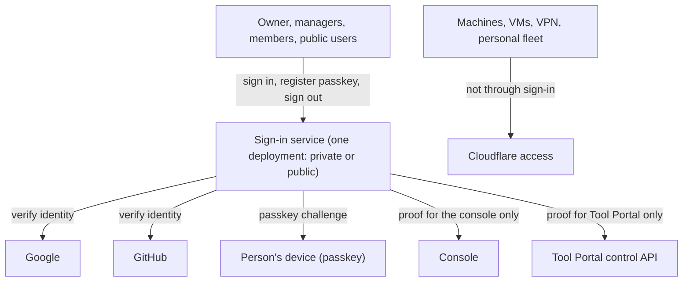
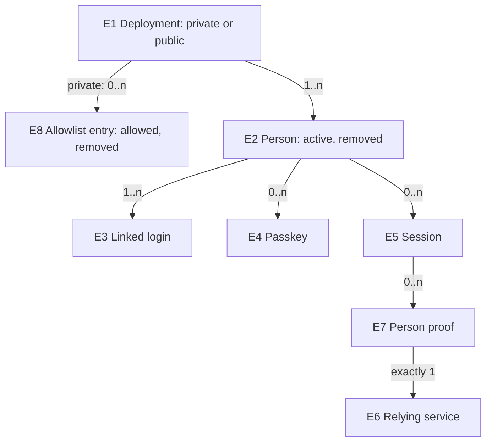

# People sign-in: Specification

[Requirements](requirements.md) · [Fleet decisions](../2026-10-18-fleet-framework/2026-10-18-fleet-framework.md) · [Tool Portal Specification](../2026-10-14-portable-tool-portal-hosts/2026-10-14-portable-tool-portal-hosts.md)

This is what must be observably true of people's sign-in, judged from outside the service. The service is one opaque system here. How it is built belongs to Program Design.

## The system and who touches it

The sign-in service never serves machines or VMs (`U6`). Agents sign in only as agents, never as people (`U8`). It does not decide what a person may do inside a service; each service checks that itself.

## Problems and outcomes

| Problem | Outcome |
| --- | --- |
| `P1` People are identified only by Cloudflare Access, configured per app, with no passkeys (`U1`, `U5`). | `O1` A person signs in to our private apps with Google, GitHub or a passkey through our own service. |
| `P2` A private app has no list of who may sign in that the owner controls in one place, and no record of changes to it (`U2`, `U7`). | `O2` Only approved people get in. Every change to the approved list is recorded. Removal stops privileged actions at once. |
| `P3` Our services have no proof of a person that each can verify for itself; Tool Portal's Accept needs one (`U4`). | `O3` Each relying service receives proof valid only for itself. |
| `P4` There is no way to run a public app with self-registration (`U3`). | `O4` A public deployment lets anyone register, separated from private ones. |

## Entities

| Entity | Identity rule | Relationships | Invariants | Observable states |
| --- | --- | --- | --- | --- |
| `E1` Deployment | One sign-in service instance, identified by its issuer address. A private and a public deployment are different deployments, even when built from the same code. | has many E2, E5, E7; a private one has one E8 | People, sessions and proofs of one deployment are never accepted by another | private or public |
| `E2` Person | One account in one deployment, identified by a stable id that deployment assigns. The same human signing in with Google and with GitHub is one Person only after the signed-in Person explicitly links the second login; matching email addresses alone never merge them. | belongs to one E1; has 1..n E3, 0..n E4, 0..n E5 | Keeps the same id across passkey, Google and GitHub sign-ins once linked | active, removed |
| `E3` Linked login | One Google or GitHub account, identified by provider plus that provider's account id, attached to one Person. | belongs to one E2 | A provider account is linked to at most one Person per deployment | linked, unlinked |
| `E4` Passkey | One WebAuthn credential a signed-in Person registered, identified by its credential id. | belongs to one E2 | Usable only to sign in as its own Person; holds no biometric data or private key | active, removed |
| `E5` Session | One signed-in period of one Person in one deployment. | belongs to one E2 | Ends at sign-out, expiry or removal of the Person | active, signed out, expired, revoked |
| `E6` Relying service | One of our services that receives proof of a person or an agent, identified by its audience identifier: the console; Tool Portal's control API; and each Tool Portal workspace, identified by its own MCP address (F-73, F-75). Two workspaces are two relying services, even in the same organization. | registered in one E1; receives many E7 or E10. A workspace relying service belongs to exactly one organization (F-82) | Proof for one relying service is never valid for another | registered, retired |
| `E7` Person proof | Evidence issued to one relying service that one Person is signed in, valid for that service only and for a bounded time. | names one E2 and one E6; issued during one E5 | Represents a person, never a service or machine | valid, expired, withdrawn |
| `E8` Allowlist entry | One provider-verified email address approved for a private deployment, compared case-insensitively. An unverified address never matches. | belongs to one private E1; admits at most one E2, the Person it first admitted | Changes are recorded (`R12`). A Person in a private deployment is active exactly while at least one E8 admits them and every E8 that admits them is allowed | allowed, removed |
| `E9` Agent client | One agent registered to sign in as itself in one deployment, identified by its client id; registered for one organization. | belongs to one E1; has 0..n E11, one per workspace it may get proofs for; receives many E10 | Signs in only with its own registered credential; never a Person; gets an E10 only for a workspace it has a linked E11 for | active, removed |
| `E10` Agent proof | Evidence issued to one workspace that one agent client signed in, valid at that workspace only and for a bounded time. | names one E9, one workspace E6 and that workspace's organization | Represents an agent, never a person; never accepted as an E7; refused at every other workspace, including one in the same organization | valid, expired |
| `E11` Workspace link | One agent client allowed to get proofs for one workspace, identified by the pair of that E9 and that workspace E6. | belongs to one E9 and one workspace E6, both of the same organization | An E9 is never linked to a workspace of another organization. Unlinking one workspace changes none of the agent's other links and leaves its E9 active | linked, unlinked |

"Organization" is the [Tool Portal Specification](../2026-10-14-portable-tool-portal-hosts/2026-10-14-portable-tool-portal-hosts.md#what-these-checks-are-about)'s E1: it contains workspaces and decides who may sign in (F-82). Where an organization's owner and its list of who may sign in are kept is still open: decision 2 on the 2026-10-21 organization page, with the storage question raised on 2026-10-23. Until it's decided, E8 and the deployment owner stay as written here.

## Requirements

| Id | Requirement | Needs | Entities | Problem → outcome · example | Proof |
| --- | --- | --- | --- | --- | --- |
| `R1` | For people, the service MUST offer exactly three sign-in methods: Google, GitHub, and a passkey the Person registered earlier. Agents sign in only with their own client credentials (`R15`). It MUST NOT offer email and password, magic links, any other provider, or an identity-proxy sign-in path. | U1 | E1–E4 | P1→O1 · C1 | V1 |
| `R2` | A new Person MUST first sign in with Google or GitHub (the default until `SD7` decides whether passkey-first registration is allowed). While signed in, a Person MAY register passkeys, and a later passkey sign-in MUST reach the same Person. | U1 | E2–E5 | P1→O1 · C1 | V1 |
| `R3` | In a private deployment, a Google or GitHub sign-in MUST reach or create a Person only when the provider-verified email matches an allowed E8. Otherwise the sign-in MUST end as "not allowed" with nothing created or linked. | U2 | E1, E2, E3, E8 | P2→O2 · C1 | V2 |
| `R4` | When an E8 is removed, the matching Person MUST be unable to start a new session by any method, including a passkey. The removal takes effect when it is recorded: every session creation, proof issuance and privileged-decision confirmation after that MUST be refused, including one that uses a session created while the removal was in progress. Existing sessions MUST stop being accepted for privileged decisions at once (`R9`), and for any other use within the token lifetime (bound `SD3`). | U2 | E2, E5, E7, E8 | P2→O2 · C1 | V3 |
| `R5` | In a public deployment, anyone MUST be able to register, by the same first-sign-in rule as `R2`, and then add passkeys. Its People, sessions and proofs MUST NOT be accepted by a private deployment's relying services. | U3 | E1, E2, E7 | P4→O4 · C2 | V4 |
| `R6` | For each relying service that serves people (the console; Tool Portal's control API), the service MUST issue an E7 that names the deployment, the Person's stable id, the relying service and an expiry. A workspace's MCP address serves agents only, and no E7 is issued for it. A relying service MUST refuse an E7 issued for another relying service or by another deployment. | U4 | E1, E2, E6, E7 | P3→O3 · C1 | V5 |
| `R7` | An E7 MUST stand for a Person. A credential identifying a service, machine or agent MUST NOT be issued as, or accepted as, an E7. | U4, U6 | E6, E7 | P3→O3 · C1, C3 | V5 |
| `R8` | Linking a second Google or GitHub login to a Person MUST be an explicit action by that signed-in Person. It MUST NOT happen because email addresses match. If an unlinked login carries a verified email that already belongs to a Person, the sign-in MUST be refused with a "link it from your account" outcome, creating nothing. | U1, U4 | E2, E3 | P1→O1 · C1 | V6 |
| `R9` | When a relying service takes a privileged decision for a Person (Tool Portal's Accept or Deny), it MUST be able to confirm at decision time that the Person is still active and the session still current. A valid E7 signature alone MUST NOT be enough. The decision MUST take effect only while that confirmation is younger than the bound `SD8`; past it, the relying service confirms again or refuses. | U2, U4 | E2, E5, E7 | P2, P3→O2, O3 · C1 | V3 |
| `R10` | Machine, VM, VPN and personal-fleet access MUST NOT depend on this service, and this service MUST NOT issue proofs to machines or VMs. Agents sign in only as agents (`R15` to `R18`). | U6 | E1, E7 | boundary (U6), no problem row · C3 | V7 |
| `R11` | Each deployment MUST run on the owner's Cloudflare account with its own D1 database, with no third-party sign-in subscription. | U5 | E1 | P1→O1 | V8 |
| `R12` | Every change to who may sign in, or how, MUST be recorded with who made it, what changed and when. That covers allowlist entries; a Person's removal and reactivation; linked logins and passkeys added or removed; relying-service and client registrations and their authority; and the deployment's owner. A change whose record cannot be written MUST NOT happen. Sign-in successes and refusals MUST be recorded for the owner to review. Credentials, proofs and passkey material MUST NOT appear in any record. | U7 | E2–E4, E6, E8 | P2→O2 · C1 | V9 |
| `R13` | Signing out MUST end that session's ability to obtain new E7s. No proof-renewal grant may outlive the Person's sign-out. | U2, U4 | E5, E7 | P2→O2 · C1 | V3 |
| `R14` | A private deployment's first administrator MUST be the person whose provider-verified email the owner configured for that deployment. No one else can become administrator by signing in first, and until that person signs in nobody else can sign in. | U2 | E1, E2, E8 | P2→O2 · C1 | V10 |
| `R15` | An agent MUST sign in as itself, with its own registered credential, and receive an E10 for one workspace it has a linked E11 for. The E10 names the deployment, the agent's client id, the workspace's organization, the workspace and an expiry. A request for a workspace the agent isn't linked to, or for a workspace of another organization, MUST be refused. A relying service MUST refuse an E10 issued for another workspace, including another workspace of the same organization. | U8 | E6, E9, E10, E11 | agent sign-in, C4 | V11 |
| `R16` | An E10 MUST NOT be issued as, or accepted as, an E7, and an E7 MUST NOT be accepted where an E10 is required. | U8, U4 | E7, E10 | C4 | V11 |
| `R17` | When an E9 is removed (the agent is retired), it MUST be unable to obtain new E10s for any workspace at once, and a relying service that checks its own record on every call (Tool Portal does) MUST refuse that agent on its next call. | U8 | E9, E10 | C4 | V11 |
| `R18` | When an agent is unlinked from one workspace, it MUST be unable to obtain new E10s for that workspace at once, including a request in flight when the unlink is recorded. Its E10s for its other linked workspaces MUST keep being issued, and its E9 MUST stay active. An E10 issued for that workspace before the unlink stays valid until it expires; the workspace refuses its calls through its own membership check (Tool Portal check 14). | U8 | E9, E10, E11 | C4 | V12 |

## Worked examples

### C1 — Private deployment

Setup: the owner deploys with `owner@example.test` configured as its owner. Alice's sign-in is refused, because the deployment admits no one until the owner arrives. The owner signs in with Google using that verified address and becomes the administrator; the record shows the binding (`R14`).

1. The owner adds `alice@example.test` to the allowlist. The record shows the owner, the added address and the time.
2. Alice signs in with Google using that verified address and becomes Person A; Bob, whose address is not listed, ends at "not allowed", and nothing is created for him.
3. Alice registers a passkey, signs out, and signs back in with the passkey: she is Person A again.
4. Alice also has a GitHub account with the same verified email. Signing in with it is refused with "sign in your usual way, then link GitHub", and nothing is created or linked. Only after Alice, signed in, links GitHub explicitly does a GitHub sign-in reach Person A.
5. The console receives a proof for the console. Tool Portal refuses that proof. The console obtains a proof for Tool Portal on Alice's behalf, and Tool Portal accepts it.
6. The owner removes Alice. Her next Accept in Tool Portal is refused at once. Her passkey no longer starts a session, and her other use stops within the token lifetime.

### C2 — Public deployment

Carol registers with GitHub on the public deployment and adds a passkey. A proof from the public deployment is refused by the private deployment's Tool Portal, even if Carol's email is on the private allowlist.

### C3 — Machines

A VM reaching the personal fleet over the VPN, and a machine calling the Router, go through Cloudflare. Neither ever receives or presents a proof from this service.

### C4 — Agents

The organization's owner (or a manager, `SD9`) adds the home agent to workspaces W1 and W2 of organization O1, and gives its credential to the agent's host, never to a tool call.

1. The agent signs in with that credential and asks for a proof for W1. W1's address accepts it; W2's refuses it. It asks for W2 and gets a proof W2 accepts.
2. A request for W3, a workspace of organization O2, is refused, and so is one for a workspace of O1 it was never added to.
3. The console refuses its proofs, and so does any check that needs a person.
4. The owner removes the agent from W1. Its next call on W1 is refused, and its request for a new W1 proof is refused. A new W2 proof is issued, and a call with it runs once.
5. The owner retires the agent. Every token request fails, and W2 refuses its next call.

## Failure behavior

| Situation | What the person or service sees |
| --- | --- |
| Google or GitHub is unavailable or the sign-in is cancelled | sign-in fails with a reason; nothing created |
| The provider returns an unverified email in a private deployment | "not allowed" |
| A passkey assertion fails or uses a removed passkey | sign-in fails; no session |
| A relying service receives an expired, wrong-audience or wrong-deployment proof | refused |
| The service cannot reach its database | no new sessions or proofs; relying services keep refusing what they cannot verify |
| A privileged decision cannot confirm current status | the decision is refused, not accepted |
| A first sign-in is refused, and the records it created can't be deleted because the database fails or the service stops mid-request | those records stay unbound and inactive: they can't start a session or obtain a proof, and the failure is recorded for the owner |
| A removal is recorded while a sign-in or a decision is in progress | a session the sign-in creates can't be used for anything; the decision takes effect only if its confirmation came before the removal and is still within `SD8`, otherwise it is refused |

## Cross-cutting obligations

- **Security:** only the three methods (`R1`); explicit linking only (`R8`); per-service proofs (`R6`); current status for privileged decisions (`R9`); no secrets in records (`R12`).
- **Privacy:** a deployment stores only what sign-in needs: the provider account ids, verified email, display name and passkey public keys. It stores no biometrics.
- **Reliability:** if the service is down, people can't sign in, and services refuse unverifiable proofs (fail closed).
- **Cost:** `R11`; the Free plan only when measured CPU fits (`SD6`).
- **Accessibility:** the sign-in screens are an open UI view to define with the UI design (F-56). Until then, `no current UI`.

## Proof obligations

| Id | What must be distinguishable from a wrong build | Reference and target |
| --- | --- | --- |
| `V1` | Only Google, GitHub and a registered passkey sign a person in. Any other path is absent. A passkey sign-in reaches the same Person. | C1 steps 2–3; a deployed private deployment |
| `V2` | An unlisted or unverified email creates or links nothing. | C1 step 2; private deployment |
| `V3` | After removal or sign-out, a privileged decision is refused at once and new sessions and proofs stop. Other use stops within the token lifetime. | C1 step 6; the real Tool Portal decide path |
| `V4` | Public and private deployments never accept each other's people or proofs. | C2; two deployments |
| `V5` | A proof is accepted only by the service it names, from its own deployment, and only when it stands for a person. | C1 step 5; console and Tool Portal |
| `V6` | Matching emails never link or duplicate a Person, and the refusal says how to link. Explicit linking does link. | C1 step 4 |
| `V7` | Machine and VM access works with the sign-in service absent, and no machine holds a proof. | C3 |
| `V8` | Each deployment runs on the owner's Workers with its own D1, with no external sign-in vendor. | deployment configuration |
| `V9` | Each change `R12` lists has its record, and a change whose record can't be written doesn't happen. No record contains a credential or proof. | C1 step 1 and every change kind in `R12`, with planted test secrets |
| `V10` | On an empty private deployment, only the configured owner's verified email can sign in, and that person becomes administrator; any other first arrival is refused. | C1 before step 1; a fresh private deployment |
| `V11` | An agent's proof is accepted only at the workspace it names, never at another workspace, even in the same organization, and never as a person's proof; a person's proof is never accepted as an agent's; no proof is issued for a workspace the agent isn't linked to or for another organization's; a retired agent gets no new proof and is refused on its next call. | C4 steps 1–3 and 5; Tool Portal's Worker caller check |
| `V12` | After an agent is unlinked from one workspace, a new proof for that workspace is refused, including a request held in flight while the unlink lands, while a new proof for its other workspace is issued and works once, and its client stays active. | C4 step 4; a local runtime for the held request |
