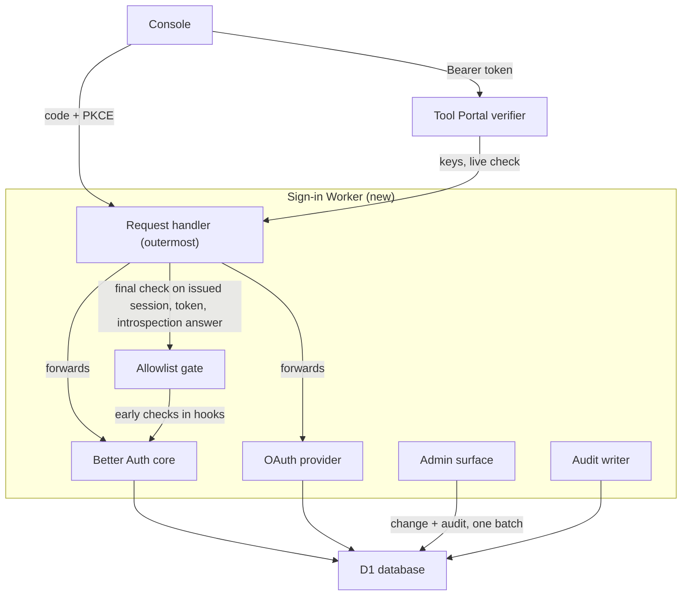
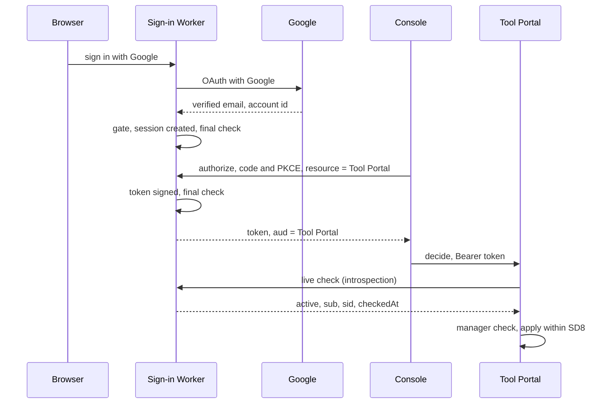
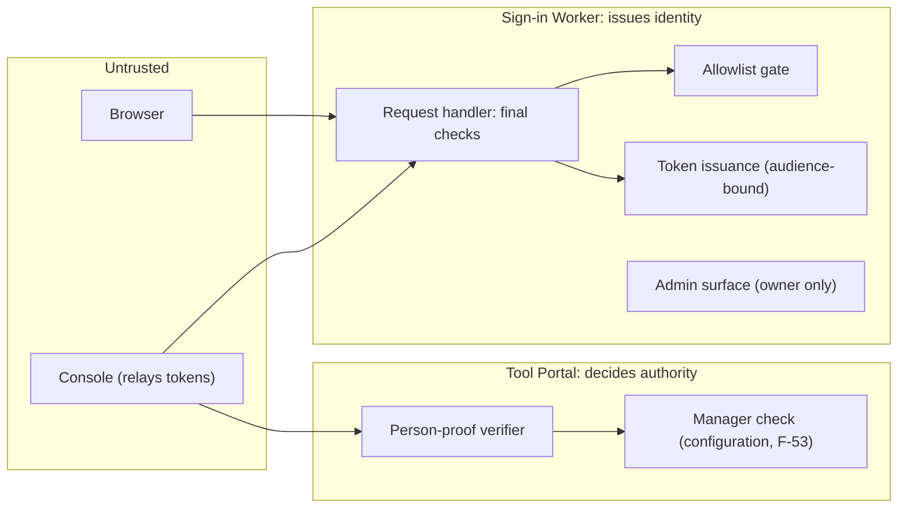

# People sign-in: Program Design

[Requirements](requirements.md) · [Specification](2026-10-20-people-sign-in.md) · [Tool Portal Program Design](../2026-10-14-portable-tool-portal-hosts/program-design.md)

**One small sign-in Worker per deployment runs Better Auth with D1, and issues each relying service its own short-lived, audience-bound token.**
- Tool Portal verifies those tokens itself: locally for ordinary calls, and with a live check against the sign-in Worker for an Accept or Deny.
- A session or token counts as issued only after the Worker's final check, which runs after Better Auth has created it and before the response leaves the Worker. That check is where a removal or sign-out takes effect.
- The owner manages a private deployment's allowlist through a protected admin surface on the same Worker. Every security change is recorded.

## What exists today

People are identified only by Cloudflare Access, in front of the agent-vm controller's browser pages.
- One middleware gates every request: admission must be open, then the Access assertion must verify, or the request ends with 503 or 403 ([oauth-https-server.ts](../../../packages/agent-vm/src/controller/oauth/oauth-https-server.ts#L167)).
- The verifier is built once, with one audience and issuer from controller configuration ([controller-oauth-runtime.ts](../../../packages/agent-vm/src/controller/oauth/controller-oauth-runtime.ts#L243)).
- The account-policy routes verify again before acting ([oauth-account-policy-routes.ts](../../../packages/agent-vm/src/controller/oauth/oauth-account-policy-routes.ts#L175)).
- An owner is admitted when the token's issuer equals the configured issuer and its subject is listed in the configured owners for that agent ([google-permission-policy-service.ts](../../../packages/agent-vm/src/controller/oauth/google-permission-policy-service.ts#L145)). Stored account grants carry that owner's issuer and user id.

No sign-in service of our own exists, so the service below has no predecessor. **The controller path stays unchanged** until the owner decides how existing grants move (`SD5`). Nothing here rewrites stored owner bindings.

## The choice

The crux is how a relying service learns, per call, that a person is signed in and still allowed.

| Option | How a service learns who the person is | Fits | Fails |
| --- | --- | --- | --- |
| **A. Resource-bound tokens from Better Auth's OAuth provider, with a live check for privileged decisions (selected)** | each service gets a token whose audience is itself; ordinary calls verify it with published keys, and Accept/Deny also asks the sign-in Worker whether it is still active | `R6`, `R7`, `R9`, `R13` | costs a network call per Accept, and a dependency on the sign-in Worker being up for decisions |
| B. Better Auth's plain JWT plugin only | one global audience for every service | cheaper | `R6`: a token for the console would also open Tool Portal |
| C. A shared session cookie across our services | services read the same cookie on a shared parent domain | no tokens at all | `R6` and cross-origin use: no per-service limit; every service must reach the session store |
| D. Keep Cloudflare Access for people | as today | no new service | the owner reserved Cloudflare for machines (F-65); no passkeys |

Option A costs one extra call to the sign-in Worker for each Accept or Deny, and makes decisions fail closed when that Worker is down. Each relying service pays a little verifier code.

What would reopen the choice: if live checks prove too slow or unreliable, cache the live answer per session for seconds, never per token lifetime. That is a change to the `SD3` bound and needs the owner.

## Components



| Component | Owns | Home | Consumers | Changes when |
| --- | --- | --- | --- | --- |
| Request handler | the Worker's only HTTP entry. Runs the final check on every response that issues a session, a token or an introspection answer; writes the before-change audit record for changes Better Auth makes itself; refuses the ID-token linking form | `@agent-collaboration/auth`, a Worker app (new) | browsers, the console, relying services | where a removal takes effect, or which changes are audited |
| Better Auth core | Persons, linked logins, passkeys, sessions (E2–E5) | same Worker (existing library) | people's browsers | a sign-in method or session rule changes |
| OAuth provider | relying services, clients, issued proofs, introspection (E6, E7) | same Worker (Better Auth `oauthProvider` plugin, existing library) | the console; Tool Portal's verifier | the token or audience contract changes |
| Allowlist gate | the private-mode admission decision (E8), the Person's derived active state, the owner bootstrap, and the current-person check every other component calls | same Worker (new) | the request handler, Better Auth's hooks, the admin surface | private admission or removal rules change |
| Admin surface | allowlist, client and relying-service changes; owner-only and owner-active | same Worker (new) | the owner | who may administer changes (`SD1`) |
| Audit writer | the audit record of every change `R12` lists and of sign-in outcomes | same Worker (new) | the owner | the record contents change |
| Person-proof verifier | the decision "this proof is a current Person for this service" | `tool-host-node` and `tool-host-cloudflare`, implementing Tool Portal's identity-verifier port (new adapter) | Tool Portal `explain`, `propose`, `decide`, `read` | the proof format or freshness rule changes |

The sign-in Worker is built in agent-vm's workspace under the same rules as the Tool Portal packages. It moves to `agent-fleet-tools` with them (F-58, `SD4`).

Each deployment is its own Worker with its own D1, and they share code and nothing else. Building the private deployment first is the Lead's proposal, not yet confirmed (`SD2`). The public deployment's work and proof stay in scope until the owner decides.

## Where each entity lives

| E | Semantic owner | Home | Schema/type home | Shape at each boundary | Disposition | Convention |
| --- | --- | --- | --- | --- | --- | --- |
| `E1` Deployment | sign-in Worker configuration | `@agent-collaboration/auth` (new) | `deploymentConfigSchema` in the Worker's config module (new) | the `iss` claim in every E7; `mode` and `ownerEmail` in configuration only | persisted (Worker configuration) | Zod schema, `z.infer` type (repo convention) |
| deployment owner (serves `R14`) | Allowlist gate | D1 `deployment_owner`, at most one row (new) | `deploymentOwnerSchema` (Worker, new) | read by the admin checks | persisted, written once | Zod schema |
| `E2` Person | Better Auth core; its active state belongs to the Allowlist gate | D1 `user` table (existing library schema). No status column: a Person in a private deployment is active exactly while an allowed E8 is bound to it | Better Auth's user model (existing) | `sub` in every E7: the Better Auth user id, with subject type `public` (never pairwise) | persisted; active state derived | library schema |
| `E3` Linked login | Better Auth core | D1 `account` table (existing library schema). Provider access, refresh and ID tokens are never stored | Better Auth's account model (existing) | not exposed to relying services | persisted | library schema |
| `E4` Passkey | Better Auth passkey plugin | D1 `passkey` table (existing library schema) | the plugin's model (existing) | not exposed; WebAuthn messages between the browser and the Worker only | persisted | library schema |
| `E5` Session | Better Auth core | D1 `session` table (existing library schema) | Better Auth's session model (existing) | the browser session cookie on the sign-in origin only; `sid` inside E7 and introspection results | persisted | library schema |
| `E6` Relying service | OAuth provider | D1 OAuth resource and client rows (existing plugin schema) | the plugin's resource and client models (existing) | the `aud` claim; the resource identifier at authorization | persisted | library schema |
| `E7` Person proof | OAuth provider | issued JWT access token, not stored (existing plugin issuance) | `personTokenClaimsSchema` (the raw claims) and `PersonProof` (what a relying service keeps after verifying), both in `tool-access/contracts` (new) | on the wire: header `typ: at+jwt`; claims `{ iss, sub, aud, exp, iat, scope, client_id, azp, sid, jti }`, EdDSA-signed, verifiable through the Worker's JWKS. Inside a relying service: `PersonProof` only | derived | Zod schema, `z.infer` type |
| `E8` Allowlist entry | Allowlist gate | D1 `allowed_email` table (new) | `allowlistEntrySchema` in the Worker (new) | the admin surface's add, remove and list operations | persisted | Zod schema, `z.infer` type |
| audit record (serves `R12`) | Audit writer | D1 `sign_in_audit` table (new) | `signInAuditRecordSchema` in the Worker (new) | the owner's audit list | persisted, append-only | Zod discriminated union |

```ts
// The access-token claims Better Auth's OAuth provider issues (v1.7.11, oauth-provider/src/token.ts:255-294).
// Faithful to the provider: other claims are allowed and ignored, and the fields the verifier judges stay visible.
export const personTokenClaimsSchema = z.looseObject({
  iss: z.url(),                                        // E1: the deployment's issuer
  sub: z.string().min(1),                              // E2: the Better Auth user id, never pairwise
  aud: z.union([z.string().min(1), z.array(z.string().min(1)).min(1)]),  // an array when several resources or `openid` were requested; refused
  exp: z.number().int(),
  iat: z.number().int(),
  scope: z.string(),
  client_id: z.string().min(1),
  azp: z.string().min(1),
  sid: z.string().min(1).optional(),                   // E5: present only for a token issued within a person's session
  jti: z.string().min(1),
});
export type PersonTokenClaims = z.infer<typeof personTokenClaimsSchema>;

// What a relying service keeps after verifying. Nothing past the verifier reads raw claims.
export const personProofSchema = z.strictObject({
  issuer: z.url(), subject: z.string().min(1), audience: z.string().min(1),
  sessionRef: z.string().min(1), clientId: z.string().min(1), expiresAt: z.number().int(),
});
export type PersonProof = z.infer<typeof personProofSchema>;

export type PersonProofVerification =
  | { kind: "verified"; proof: PersonProof; freshness: { kind: "signature" } | { kind: "live"; checkedAt: number } }
  | { kind: "refused"; reason: "malformed" | "wrong-token-type" | "bad-signature" | "wrong-issuer" | "wrong-audience" | "not-a-person" | "expired" | "inactive" }
  | { kind: "unavailable"; reason: "keys-unreachable" | "introspection-unreachable" };

export const deploymentConfigSchema = z.strictObject({
  issuer: z.url(),                              // E1 identity
  mode: z.enum(["private", "public"]),
  ownerEmail: z.email(),                        // R14: the owner's provider-verified email, set by the owner at deploy time
});

export const deploymentOwnerSchema = z.strictObject({
  userId: z.string().min(1),                    // E2 id of the first Person admitted through ownerEmail
  boundAt: z.number().int(),
});

export const allowlistEntrySchema = z.strictObject({
  email: z.email(),                             // stored lower-cased; compared only with provider-verified emails
  personId: z.string().min(1).nullable(),       // E2 this entry admitted; null until it first admits one
  addedBy: z.string().min(1),                   // E2 id of the administrator, or "deployment" for the seeded owner entry
  addedAt: z.number().int(),
  removedAt: z.number().int().nullable(),       // null while allowed (E8 state)
});

const credentialChange = z.enum(["passkey-added", "passkey-removed", "login-linked", "login-unlinked"]);
const clientChange = z.enum(["registered", "updated", "retired"]);
export const signInAuditRecordSchema = z.discriminatedUnion("kind", [
  z.strictObject({ kind: z.literal("owner-bound"), userId: z.string(), email: z.string(), at: z.number().int() }),
  z.strictObject({ kind: z.literal("allowlist-added"), actorUserId: z.string(), email: z.string(), reactivatedPersonId: z.string().nullable(), at: z.number().int() }),
  z.strictObject({ kind: z.literal("allowlist-removed"), actorUserId: z.string(), email: z.string(), removedPersonId: z.string().nullable(), revokedSessions: z.number().int(), at: z.number().int() }),
  z.strictObject({ kind: z.literal("relying-service-changed"), actorUserId: z.string(), resource: z.string(), change: clientChange, phase: z.enum(["intent", "outcome"]), requestId: z.string(), succeeded: z.boolean().nullable(), at: z.number().int() }),
  z.strictObject({ kind: z.literal("client-changed"), actorUserId: z.string(), clientId: z.string(), change: clientChange, phase: z.enum(["intent", "outcome"]), requestId: z.string(), succeeded: z.boolean().nullable(), at: z.number().int() }),
  z.strictObject({ kind: z.literal("credential-changed"), actorUserId: z.string(), change: credentialChange, phase: z.enum(["intent", "outcome"]), requestId: z.string(), succeeded: z.boolean().nullable(), at: z.number().int() }),
  z.strictObject({ kind: z.literal("sign-in"), outcome: z.enum(["succeeded", "not-allowed", "failed"]), method: z.enum(["google", "github", "passkey"]), userId: z.string().nullable(), at: z.number().int() }),
]);
```

Both token shapes live in `tool-access/contracts`, so every relying service verifies the same way. The verifier judges the raw token before projecting it, in this order:
1. header `typ` is `at+jwt` (`wrong-token-type`);
2. signature against the deployment's JWKS (`bad-signature`);
3. `iss` is the expected deployment (`wrong-issuer`, `R5`, `R6`);
4. `aud` is a single string equal to this service's own resource identifier; any array is refused (`wrong-audience`, `R6`);
5. `exp` (`expired`);
6. `sid` is present (`not-a-person`, `R7`). In the stock flow, tokens issued without a person's session, such as `client_credentials` tokens, carry no `sid` and have `sub` set to the client id ([token.ts:1774](https://github.com/better-auth/better-auth/blob/52ab801cc6550104199bcf70a3f83005e15eb804/packages/oauth-provider/src/token.ts#L1774)). No extension grant is installed.

`freshness.kind: "live"` appears only after a live check, with the time that check read the Person and session (`checkedAt`). Tool Portal's `decide` refuses a `signature` result. The apply that changes state ([Tool Portal Program Design, application](../2026-10-14-portable-tool-portal-hosts/program-design.md#2-chat-led-change-propose-decide-apply)) takes effect only while `checkedAt` is within `SD8`, measured at that commit (`R9`).

Relying services request exactly one `resource` and no `openid` scope. Better Auth produces an array `aud` when several resources or `openid` are requested ([resources.ts:360](https://github.com/better-auth/better-auth/blob/52ab801cc6550104199bcf70a3f83005e15eb804/packages/oauth-provider/src/resources.ts#L360), [resources.ts:500](https://github.com/better-auth/better-auth/blob/52ab801cc6550104199bcf70a3f83005e15eb804/packages/oauth-provider/src/resources.ts#L500)). The verifier refuses every array, so such a token is valid nowhere. A relying service that later needs an ID token is a change to this contract.

## How a person signs in and a decision is checked

There is no current path to compare: the sign-in Worker is new.



The edges that cross a boundary carry:
- **Browser and Worker:** the sign-in session cookie on the Worker's origin.
- **Console and Worker:** an authorization request with S256 PKCE, `resource` set to one relying service, and no `openid` scope.
- **Worker to console:** an E7 (`personTokenClaimsSchema`), released only after the final check.
- **Console to Tool Portal:** `Authorization: Bearer <E7>`.
- **Tool Portal and Worker:** an introspection request, authenticated as Tool Portal's own confidential client, returning `active`, `sub`, `aud`, `exp`, `sid` and `checkedAt`. `active` is true only when the token is valid, its `sid` session exists unexpired, and its Person is active, all as read by the final check.

The **intentionally unchanged edge** is the controller's Access-gated browser path ([oauth-https-server.ts](../../../packages/agent-vm/src/controller/oauth/oauth-https-server.ts#L167)). It stays until `SD5`.

## Where a removal or sign-out takes effect

A read before an effect can't fence that effect: a request can pass the read, pause, and act after a removal. So the decisive check runs **after** the effect, in the request handler, before anything leaves the Worker:
- A **session** counts as issued when the final check, run after Better Auth inserted it, reads the Person as active. The session-create hook records the new session's id for this request. If the final check reads the Person as removed, the handler deletes that session row, clears the cookie, and answers "not allowed".
- A **token** counts as issued when the final check, run after Better Auth signed it, reads both the Person as active and the token's `sid` session as present. On either failure the handler discards the token and answers `invalid_grant`.
- An **introspection answer** of `active` is released only when the final check reads both the Person and the `sid` session. Its `checkedAt` is the time of that read.

The removal batch is one D1 transaction. It marks the E8 removed, deletes the sessions of the Person bound to it, and writes the audit record. A Person is active only while every entry bound to them is allowed, so this ends their active state even if they have other allowed entries. Sign-out deletes one session. D1 orders both against the final check's reads, giving three cases:
1. **The removal commits before the final check.** The check sees it and refuses.
2. **It commits after the final check but before the session row exists.** That can't happen, because the final check runs after the insert.
3. **It commits after the final check.** Issuance finished first. The session row already existed, so the batch deletes it.

So after a removal commits, no session of that Person exists, and no token or `active` answer is issued for them.

What this does not do:
- It does not recall a token issued before the cutoff. That token works for ordinary calls until it expires (`SD3`), and every live check refuses it.
- It does not apply a decision instantly. A decision whose live check came before the removal applies only within `SD8` of that check.

It needs every read to see the D1 primary, so read replication stays off for this database.

The early checks in Better Auth's hooks remain. They refuse sooner and write less, but correctness rests on the final check.

## Lifecycles

| Entity | States | Transition and guard | Illegal and how it is handled |
| --- | --- | --- | --- |
| deployment owner | unbound → bound | Deploy: a seed migration inserts one E8 for `ownerEmail` with `addedBy: "deployment"`. The first Person whose current-person check binds that entry becomes the owner. The binding batch also does a conditional insert into `deployment_owner` (only when empty) and writes an `owner-bound` audit record | until bound, the gate admits only `ownerEmail`, so no one else can sign in first. A second bind attempt writes nothing. Changing the owner is a configuration change and redeploy by the operator |
| E8 Allowlist entry | allowed ↔ removed | One row per email. The owner adds or removes through the admin surface; the change and its audit record are one D1 batch. **Binding:** see E2 below | Re-adding a removed email sets that same row's `removedAt` back to null and keeps its `personId`. That reactivates the Person if their other entries are allowed (`reactivatedPersonId` in the audit). Adding an email that is already allowed, or removing one that is missing or already removed, returns `no-change` and writes nothing |
| E2 Person (private) | active ↔ removed, derived | Active exactly while at least one E8 is bound to it and every E8 bound to it is allowed. Removing any bound entry removes the Person (`R4`); re-adding it reactivates them if the rest are allowed | **Binding happens inside the current-person check, never in a user-creation hook.** Better Auth's default D1 setup writes the user and account rows without a transaction, and `user.create.after` runs only after both. When the Person has no bound entry, the check binds the allowed, unbound entry whose email equals the Person's verified email. It uses one conditional update (`person_id` null and `removed_at` null) in a D1 batch; when that entry is the seeded owner entry, the same batch inserts `deployment_owner` if it is empty, and writes `owner-bound`. If the update binds nothing, because the entry was removed or bound elsewhere in the meantime, the Person is inactive and the request is refused.

`user.validateUserInfo` refuses a sign-in or link whose verified email matches no allowed entry. When it already knows the target Person (a returning sign-in or a link), it binds a matching unbound entry to that Person the same way, and refuses if that entry is bound to someone else. If that link then fails, the entry stays bound to the Person, so removing it still removes them, which is the cautious side.

**A refused first sign-in leaves nothing behind (`R3`).** The entry can be removed after the gate's read: before Better Auth's two writes, between them, or before the bind. In each case the final check refuses, and the request handler then deletes the `user` and `account` rows this request created, in one D1 batch, before answering "not allowed". `databaseHooks.user.create.after` only records the new user id for that cleanup; it never binds. Those rows were never bound and never had a session or token. If the cleanup itself fails, the rows stay unbound and inactive and the failure is recorded, which is the narrow outcome in the Specification's failure table. A passkey attempt still records its challenge and counter before any check runs |
| E5 Session | active → signed out \| expired \| revoked | sign-out, expiry, or deletion by removal | A deleted session can't yield a token: the final check reads `sid`. There is no offline grant to outlive it, because `offline_access` is never granted, and a refresh grant needs both that scope and client permission ([token.ts:1145](https://github.com/better-auth/better-auth/blob/52ab801cc6550104199bcf70a3f83005e15eb804/packages/oauth-provider/src/token.ts#L1145)) (`R13`) |
| E7 Person proof | valid → expired | time; it can't be individually revoked | its signature still verifies until expiry, so `decide` always performs the live check |

## Failure, partial success and races

| Situation | Detected by | What happens | Recovery owner |
| --- | --- | --- | --- |
| Google or GitHub unreachable | Better Auth callback error | sign-in fails with a reason; nothing written | the person retries |
| D1 unavailable | Worker database error | no sessions, proofs or admin changes; every check that can't read refuses | the Worker recovers when D1 does |
| Introspection unreachable during `decide` | the verifier's call fails or times out | `unavailable`, and `decide` is refused, never accepted | the console retries; nothing applied |
| Signing key rotated | the key id is unknown to the verifier | the verifier refetches the key set once, then refuses | the Worker's key set |
| Removal or sign-out races a sign-in or a token request | the final check after the effect | either refused, with the new session deleted or the new token discarded, or issued before the cutoff, in which case the removal deletes the session (see above) | the request handler |
| A refused first sign-in's cleanup fails | the handler's delete batch errors | its `user` and `account` rows stay unbound and inactive; the failure is recorded | owner review |
| Removal races an in-flight Accept | `checkedAt` against `SD8` at Tool Portal's apply | An Accept whose live check read after the removal committed is refused. One whose check came first applies only within `SD8` (Lead default 5 s) of that check; past it, Tool Portal checks again. Tool Portal's audit names the decider | Tool Portal's `decide` |
| Admin batch partly fails | a D1 batch error | the whole batch rolls back: no change without its audit record | the owner retries |
| A before-change audit record can't be written | the request handler's write fails | the request is refused before Better Auth acts, so the change doesn't happen | the person or owner retries |
| A change happens but its outcome record can't be written | the request handler's second write fails | The change stands, and its before-change record already names the actor, the change kind and the request id. The record is never missing, only unconfirmed | owner review |

## Security and other qualities



- **Only three methods (`R1`):**
  - Better Auth is configured with the Google and GitHub social providers, the passkey plugin, the OAuth provider plugin, and the JWT plugin. The OAuth provider requires the JWT plugin to sign access tokens and publish the JWKS ([oauth.ts:556](https://github.com/better-auth/better-auth/blob/52ab801cc6550104199bcf70a3f83005e15eb804/packages/oauth-provider/src/oauth.ts#L556), [utils/index.ts:103](https://github.com/better-auth/better-auth/blob/52ab801cc6550104199bcf70a3f83005e15eb804/packages/oauth-provider/src/utils/index.ts#L103)).
  - The JWT plugin is supporting infrastructure, not a sign-in method. Its own generic token endpoint is disabled, as the provider's documentation composes it ([oauth-provider.mdx:39](https://github.com/better-auth/better-auth/blob/52ab801cc6550104199bcf70a3f83005e15eb804/docs/content/docs/plugins/oauth-provider.mdx#L39)).
  - Email and password stay disabled. Better Auth's core email routes still exist and answer with their "disabled" error ([sign-in.ts:514](https://github.com/better-auth/better-auth/blob/52ab801cc6550104199bcf70a3f83005e15eb804/packages/better-auth/src/api/routes/sign-in.ts#L514), [sign-up.ts:186](https://github.com/better-auth/better-auth/blob/52ab801cc6550104199bcf70a3f83005e15eb804/packages/better-auth/src/api/routes/sign-up.ts#L186)); nothing is created through them.
  - No magic-link, OAuth-proxy, generic-OAuth or anonymous plugin is installed.
  - The package is pinned at 1.7.11 or later.
- **Current-person check (`R3`, `R4`, `R9`, `R13`):** one Allowlist gate module answers "is this Person active, and is this session present". A check that can't read D1 refuses. The final checks are decisive; the early checks only refuse sooner. All attachment points below are at Better Auth v1.7.11:

  | Point | Kind | Attaches at | The library already | The check adds |
  | --- | --- | --- | --- | --- |
  | Google or GitHub sign-in, account creation, explicit linking by redirect | early | `user.validateUserInfo` ([init-options.ts:955](https://github.com/better-auth/better-auth/blob/52ab801cc6550104199bcf70a3f83005e15eb804/packages/core/src/types/init-options.ts#L955)); linking passes the target Person ([link-account.ts:67](https://github.com/better-auth/better-auth/blob/52ab801cc6550104199bcf70a3f83005e15eb804/packages/better-auth/src/oauth2/link-account.ts#L67)) | nothing for this rule | allowlist match (`R3`), entry binding, an active Person |
  | session creation, passkey included | early | `databaseHooks.session.create.before` ([init-options.ts:1510](https://github.com/better-auth/better-auth/blob/52ab801cc6550104199bcf70a3f83005e15eb804/packages/core/src/types/init-options.ts#L1510)); `session.create.after` records the session id for the final check ([with-hooks.ts:82](https://github.com/better-auth/better-auth/blob/52ab801cc6550104199bcf70a3f83005e15eb804/packages/better-auth/src/db/with-hooks.ts#L82)) | nothing for this rule | an active Person |
  | token signing | early | `oauthProvider.customAccessTokenClaims`, awaited before signing ([claims.ts:143](https://github.com/better-auth/better-auth/blob/52ab801cc6550104199bcf70a3f83005e15eb804/packages/oauth-provider/src/claims.ts#L143), [token.ts:1230](https://github.com/better-auth/better-auth/blob/52ab801cc6550104199bcf70a3f83005e15eb804/packages/oauth-provider/src/token.ts#L1230)) | re-reads the code's user and session ([token.ts:1636](https://github.com/better-auth/better-auth/blob/52ab801cc6550104199bcf70a3f83005e15eb804/packages/oauth-provider/src/token.ts#L1636)) | an active Person |
  | any response that sets a session cookie | **final** | the request handler, after Better Auth answers | — | the Person is active; otherwise the session is deleted and the response refused |
  | a token response | **final** | the request handler, after Better Auth answers | — | the Person is active and the `sid` session is present; otherwise the token is discarded and the response is `invalid_grant` |
  | an `active` introspection answer | **final** | the request handler, after Better Auth answers | refuses a missing or expired `sid` session ([introspect.ts:233](https://github.com/better-auth/better-auth/blob/52ab801cc6550104199bcf70a3f83005e15eb804/packages/oauth-provider/src/introspect.ts#L233)) | re-reads the Person and the `sid` session, and records `checkedAt` |

  - **Why the request handler.** It is last by construction, while a global after-hook can be overwritten by plugin after-hooks ([dispatch.ts:269](https://github.com/better-auth/better-auth/blob/52ab801cc6550104199bcf70a3f83005e15eb804/packages/better-auth/src/api/dispatch.ts#L269)). It covers only HTTP, so nothing in the Worker calls Better Auth endpoints as raw functions.
  - **Session-authenticated routes need no check of their own.** That covers passkey registration, consent, explicit linking, unlinking and admin. Once a removal commits, no session of that Person exists. A request already in flight, holding a session read before the removal, is ordered before it; whatever it writes is recorded (`R12`) and can't create a new session.
  - **The ID-token form of `/link-social` is refused** by the request handler. That branch links without calling `validateUserInfo` ([account.ts:250](https://github.com/better-auth/better-auth/blob/52ab801cc6550104199bcf70a3f83005e15eb804/packages/better-auth/src/api/routes/account.ts#L250)). Only the redirect form is offered.
- **Token profile (`R6`, `R7`):**
  - Relying services request one resource and no `openid`.
  - The verifier refuses array audiences and tokens without `sid`.
  - No client is registered with the `client_credentials` grant.
- **Explicit linking (`R8`):** implicit account linking is disabled (`account.accountLinking.disableImplicitLinking`); `accountLinking.enabled` stays true so explicit linking still works ([init-options.ts:1212](https://github.com/better-auth/better-auth/blob/52ab801cc6550104199bcf70a3f83005e15eb804/packages/core/src/types/init-options.ts#L1212)). A login whose verified email belongs to an existing Person is refused with a "link it from your account" result.
- **Admin protection (`R3`, `R14`):**
  - Better Auth's resource and client administration APIs let any signed-in session act when no privilege callbacks are set.
  - So `resourcePrivileges` and `clientPrivileges`, and the admin surface's own routes, allow a caller only when it is the bound deployment owner **and** the gate reads that Person as active (`SD1` default: owner only).
  - Dynamic client registration is off.
- **Audit (`R12`):**
  - Changes our code writes go in the same D1 batch as their record: allowlist add and remove, reactivation, owner binding, and client and relying-service changes through the admin surface.
  - Changes Better Auth writes itself get a record before the change. These are passkey added or removed, and login linked or unlinked; the record holds the actor, change kind and request id, and if it can't be written the request is refused. After the response, the handler writes the outcome.
  - Sign-in outcomes are recorded by the request handler.
- **Privacy:**
  - The Worker stores provider account ids, verified email, display name and passkey public keys.
  - Provider access, refresh and ID tokens are cleared before every account create and update, by `databaseHooks.account.create.before` and `update.before` returning `{ data }` with `accessToken`, `refreshToken`, `idToken` and their expiry fields set to an explicit `null`. Omitting a key would keep it, because the returned data is merged over the original, and `undefined` is skipped by the adapter, so neither clears a stored value. `account.storeAccountCookie` stays false. Those calls merge over what is written ([with-hooks.ts:42](https://github.com/better-auth/better-auth/blob/52ab801cc6550104199bcf70a3f83005e15eb804/packages/better-auth/src/db/with-hooks.ts#L42), [with-hooks.ts:118](https://github.com/better-auth/better-auth/blob/52ab801cc6550104199bcf70a3f83005e15eb804/packages/better-auth/src/db/with-hooks.ts#L118)), and Better Auth's account writes all pass through them ([internal-adapter.ts:318](https://github.com/better-auth/better-auth/blob/52ab801cc6550104199bcf70a3f83005e15eb804/packages/better-auth/src/db/internal-adapter.ts#L318), [internal-adapter.ts:1265](https://github.com/better-auth/better-auth/blob/52ab801cc6550104199bcf70a3f83005e15eb804/packages/better-auth/src/db/internal-adapter.ts#L1265)).
  - Audit records never contain tokens, cookies, codes or passkey material.
- **Reliability:** relying services fail closed when they can't verify.
- **Cost:** Workers Free remains the target only after measured CPU fits (`SD6`).
- **Accessibility:** the sign-in screens wait for the UI design (F-56).

## How each requirement works and where it is proven

| U | R | E | Owner | Interface | Shape and home | State | Failure | Proof |
| --- | --- | --- | --- | --- | --- | --- | --- | --- |
| U1 | R1: only Google, GitHub, passkey · C1 | E1–E4 | Better Auth core | Worker sign-in routes; plugin configuration | library models; Worker configuration | none: configuration | other methods create nothing; core email routes answer "disabled" | deployed private Worker: well-formed attempts through every other method create no user, account or session |
| U1 | R2: provider first, passkeys after (`SD7`) · C1 | E2–E5 | Better Auth core and passkey plugin | sign-in and passkey registration routes | library models | Person and Session created | a failed passkey assertion creates no session | deployed Worker: sign in with Google, register a passkey, sign back in with it |
| U2 | R3: allowlist gate · C1 | E1–E3, E8 | Allowlist gate | `user.validateUserInfo` at create, link and sign-in; entry binding | `allowlistEntrySchema` (Worker) | entry bound on first admission | "not allowed", nothing written | deployed Worker with test accounts |
| U2 | R4: removal stops sign-in and decisions · C1 | E2, E5, E7, E8 | Allowlist gate, request handler, admin surface | admin remove; the final check after session, token and introspection effects | `allowlistEntrySchema`, audit record | E8 removed, Person inactive, sessions deleted, one batch | batch failure rolls back; an in-flight issuance is refused or precedes the cutoff | remove, then attempt passkey sign-in, a token and an Accept; and requests held after their effect, before the final check, while the removal commits |
| U3 | R5: public deployments separate · C2 | E1, E2, E7 | sign-in Worker configuration | separate Worker and D1 | `deploymentConfigSchema` | none | a cross-deployment token is refused | two deployments; cross-present proofs (pending `SD2`) |
| U4 | R6: proof valid for one service · C1 | E1, E2, E6, E7 | OAuth provider; person-proof verifier | authorize with one resource and no `openid`; verify `typ`, `iss`, single `aud` | `personTokenClaimsSchema`, `PersonProof` (`tool-access/contracts`) | none: derived | `refused` with wrong-audience, wrong-issuer or wrong-token-type | console and Tool Portal exchange each other's real tokens; array-`aud` tokens from `openid` and from two resources |
| U4, U6 | R7: proofs stand for people only · C1, C3 | E6, E7 | OAuth provider; person-proof verifier | client grant types: authorization code only; the verifier requires `sid` | Worker client registration; `personTokenClaimsSchema` | none | a token without `sid` is refused as not-a-person | present a token issued without a person's session at Tool Portal |
| U1, U4 | R8: explicit linking only · C1 | E2, E3 | Better Auth core; request handler | `disableImplicitLinking`; the ID-token linking form refused | library models | link created only by explicit redirect linking | refusal says how to link | second provider with the same email; an ID-token link attempt |
| U2, U4 | R9: live check for privileged decisions · C1 | E2, E5, E7 | person-proof verifier; request handler; Tool Portal `decide` | introspection answered after the final check; `checkedAt` within `SD8` at the apply | `PersonProofVerification` with `freshness.kind: "live"` | none | `unavailable`, signature-only or stale means refused | revoke a session, then Accept; hold an Accept past `SD8` between its check and apply |
| U6 | R10: machines never use sign-in · C3 | E1, E7 | sign-in Worker configuration | no machine clients registered | none: absence | none | none: not applicable | machine and VM access with the Worker offline |
| U5 | R11: owner's Workers and D1, no vendor · the deployment configuration contract | E1 | sign-in Worker configuration | deployment configuration | `deploymentConfigSchema` | none | none: not applicable | inspect the deployment configuration |
| U7 | R12: every change recorded, no secrets · C1 | E2–E4, E6, E8 | Audit writer; request handler | one batch for our changes; a before-change record for Better Auth's changes | `signInAuditRecordSchema` (Worker) | append-only | no change without a record; an unwritable before-change record refuses the change | drive every change kind in `R12`, read the records, hold an audit-write failure, search for planted secrets |
| U2, U4 | R13: sign-out ends new proofs · C1 | E5, E7 | OAuth provider; request handler | no `offline_access`; the final check reads `sid` | library models | Session signed out | none: not applicable | sign out, then request a token and introspect an earlier one; a token request held after signing while sign-out commits |
| U2 | R14: the configured owner is the first administrator · C1 setup | E1, E2, E8 | Allowlist gate | seed entry for `ownerEmail`; conditional owner bind | `deploymentConfigSchema`, `deploymentOwnerSchema` | owner bound once | anyone else's first arrival is "not allowed" | fresh deployment: another account first, then the owner |

Coverage:
- R1–R14 are covered by the rows above.
- E1–E8 are bound in the entity table, with the deployment owner and the audit record as design-only bindings serving `R14` and `R12`.
- C1–C3 are cited in the rows.
- V1–V10 go to the Verification Design.

## Open items that change this design

- **`SD1`:** who administers the allowlist. The default is the deployment owner only.
- **`SD2`:** whether the public deployment is built now or after the private one. The Lead proposes private first; until the owner decides, U3 stays in scope.
- **`SD3`:** the token lifetime bound, which sets how long ordinary use survives a removal. The resource's access-token TTL is set from it.
- **`SD5`:** moving existing controller grants to new identities. Until decided, the controller keeps Cloudflare Access.
- **`SD6`:** measured CPU on Workers Free.
- **`SD7`:** passkey-first registration.
- **`SD8`:** how old a decision's live check may be at its apply.
