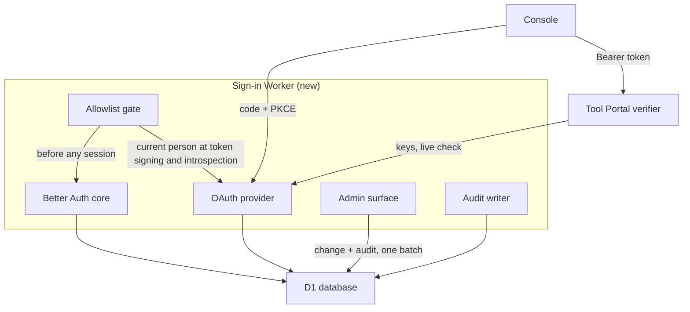
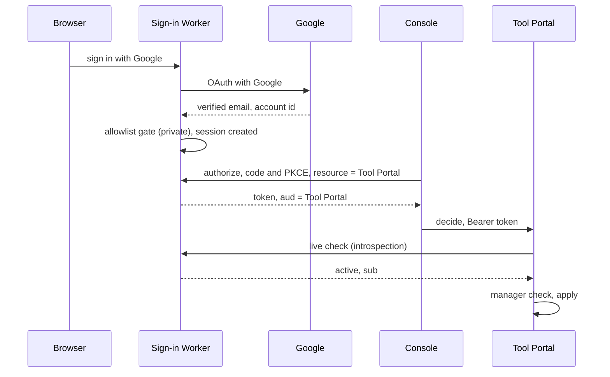
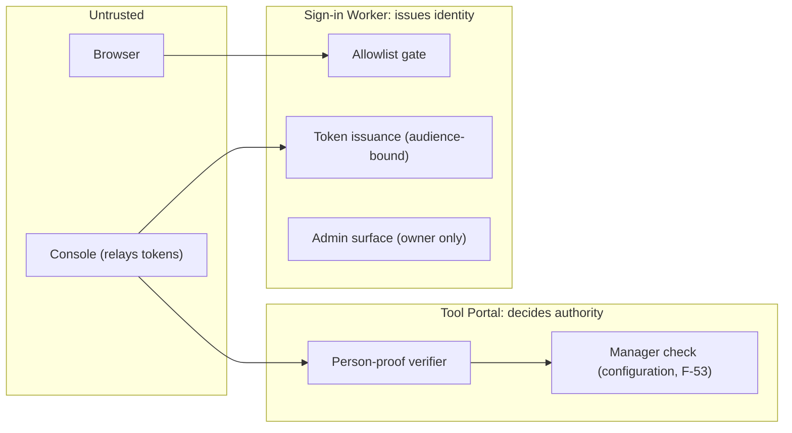

# People sign-in: Program Design

[Requirements](requirements.md) · [Specification](2026-10-20-people-sign-in.md) · [Tool Portal Program Design](../2026-10-14-portable-tool-portal-hosts/program-design.md)

**One small sign-in Worker per deployment runs Better Auth with D1, and issues each relying service its own short-lived, audience-bound token.** Tool Portal verifies those tokens itself: locally for ordinary calls, and with a live check against the sign-in Worker for an Accept or Deny. The owner manages a private deployment's allowlist through a protected admin surface on the same Worker. Every change is written to an audit table in the same database write.

## What exists today

People are identified only by Cloudflare Access, in front of the agent-vm controller's browser pages. One middleware gates every request: admission must be open, then the Access assertion must verify, or the request ends with 503 or 403 ([oauth-https-server.ts](../../../packages/agent-vm/src/controller/oauth/oauth-https-server.ts#L167)). The verifier is built once with one audience and issuer from controller configuration ([controller-oauth-runtime.ts](../../../packages/agent-vm/src/controller/oauth/controller-oauth-runtime.ts#L243)). The account-policy routes verify again before acting ([oauth-account-policy-routes.ts](../../../packages/agent-vm/src/controller/oauth/oauth-account-policy-routes.ts#L175)). An owner is admitted when the token's issuer equals the configured issuer and its subject is listed in the configured owners for that agent ([google-permission-policy-service.ts](../../../packages/agent-vm/src/controller/oauth/google-permission-policy-service.ts#L145)). Stored account grants carry that owner's issuer and user id.

No sign-in service of our own exists, so the service below has no predecessor. **The controller path stays unchanged** until the owner decides how existing grants move (`SD5`). Nothing here rewrites stored owner bindings.

## The choice

The crux is how a relying service learns, per call, that a person is signed in and still allowed.

| Option | How a service learns who the person is | Fits | Fails |
| --- | --- | --- | --- |
| **A. Resource-bound tokens from Better Auth's OAuth provider, with a live check for privileged decisions (selected)** | each service gets a token whose audience is itself; ordinary calls verify it with published keys, and Accept/Deny also asks the sign-in Worker whether it is still active | `R6`, `R7`, `R9`, `R13` | costs a network call per Accept, and a dependency on the sign-in Worker being up for decisions |
| B. Better Auth's plain JWT plugin only | one global audience for every service | cheaper | `R6`: a token for the console would also open Tool Portal |
| C. A shared session cookie across our services | services read the same cookie on a shared parent domain | no tokens at all | `R6` and cross-origin use: no per-service limit; every service must reach the session store |
| D. Keep Cloudflare Access for people | as today | no new service | the owner reserved Cloudflare for machines (F-65); no passkeys |

Option A costs one extra call to the sign-in Worker for each Accept or Deny, and makes decisions fail closed when that Worker is down. Each relying service pays a little verifier code. What would reopen the choice: if live checks prove too slow or unreliable, cache the live answer per session for seconds, never per token lifetime. That is a change to the `SD3` bound and needs the owner.

## Components



| Component | Owns | Home | Consumers | Changes when |
| --- | --- | --- | --- | --- |
| Better Auth core | Persons, linked logins, passkeys, sessions (E2–E5) | `@agent-collaboration/auth`, a Worker app (new) | people's browsers | a sign-in method or session rule changes |
| OAuth provider | relying services, clients, issued proofs, introspection (E6, E7) | same Worker (Better Auth `oauthProvider` plugin, existing library) | the console; Tool Portal's verifier | the token or audience contract changes |
| Allowlist gate | the private-mode admission decision (E8), and the current-person check that re-reads a Person's status wherever a session or token becomes capability | same Worker (new) | Better Auth's identity validation, session creation and token signing; the Worker's introspection response | private admission or removal rules change |
| Admin surface | allowlist and relying-service changes, owner-only | same Worker (new) | the owner | who may administer changes (`SD1`) |
| Audit writer | the audit record of every change and sign-in outcome | same Worker (new) | the owner | the record contents change |
| Person-proof verifier | the decision "this proof is a current Person for this service" | `tool-host-node` and `tool-host-cloudflare`, implementing Tool Portal's identity-verifier port (new adapter) | Tool Portal `explain`, `propose`, `decide`, `read` | the proof format or freshness rule changes |

The sign-in Worker is built in agent-vm's workspace under the same rules as the Tool Portal packages. It moves to `agent-fleet-tools` with them (F-58, `SD4`). Each deployment is its own Worker with its own D1: one private, later one public. They share code and nothing else.

## Where each entity lives

| E | Semantic owner | Home | Schema/type home | Shape at each boundary | Disposition | Convention |
| --- | --- | --- | --- | --- | --- | --- |
| `E1` Deployment | sign-in Worker configuration | `@agent-collaboration/auth` (new) | `deploymentConfigSchema` in the Worker's config module (new) | the `iss` claim in every E7; `mode: "private" \| "public"` in configuration only | persisted (Worker configuration) | Zod schema, `z.infer` type (repo convention) |
| `E2` Person | Better Auth core | D1 `user` table (existing library schema) | Better Auth's user model (existing) | `sub` in every E7: the Better Auth user id, with subject type `public` (never pairwise) | persisted | library schema |
| `E3` Linked login | Better Auth core | D1 `account` table (existing library schema) | Better Auth's account model (existing) | not exposed to relying services | persisted | library schema |
| `E4` Passkey | Better Auth passkey plugin | D1 `passkey` table (existing library schema) | the plugin's model (existing) | not exposed; WebAuthn messages between the browser and the Worker only | persisted | library schema |
| `E5` Session | Better Auth core | D1 `session` table (existing library schema) | Better Auth's session model (existing) | the browser session cookie on the sign-in origin only; a session reference inside introspection results | persisted | library schema |
| `E6` Relying service | OAuth provider | D1 OAuth resource and client rows (existing plugin schema) | the plugin's resource and client models (existing) | the `aud` claim; the resource identifier at authorization | persisted | library schema |
| `E7` Person proof | OAuth provider | issued JWT access token, not stored (existing plugin issuance) | `personTokenClaimsSchema` (the raw claims) and `PersonProof` (what a relying service keeps after verifying), both in `tool-access/contracts` (new) | on the wire: header `typ: at+jwt`; claims `{ iss, sub, aud, exp, iat, scope, client_id, azp, sid, jti }`, EdDSA-signed, verifiable through the Worker's JWKS. Inside a relying service: `PersonProof` only | derived | Zod schema, `z.infer` type |
| `E8` Allowlist entry | Allowlist gate | D1 `allowed_email` table (new) | `allowlistEntrySchema` in the Worker (new) | the admin surface's add, remove and list operations | persisted | Zod schema, `z.infer` type |
| audit record (serves `R12`) | Audit writer | D1 `sign_in_audit` table (new) | `signInAuditRecordSchema` in the Worker (new) | the owner's audit list | persisted, append-only | Zod discriminated union |

```ts
// The access-token claims Better Auth's OAuth provider issues (v1.7.11, oauth-provider/src/token.ts:263-290).
// Faithful to the provider: other claims are allowed and ignored, and the fields the verifier judges stay visible.
export const personTokenClaimsSchema = z.looseObject({
  iss: z.url(),                                        // E1: the deployment's issuer
  sub: z.string().min(1),                              // E2: the Better Auth user id, never pairwise
  aud: z.union([z.string().min(1), z.array(z.string().min(1)).min(1)]),  // an array only with `openid`, which no relying service requests
  exp: z.number().int(),
  iat: z.number().int(),
  scope: z.string(),
  client_id: z.string().min(1),
  azp: z.string().min(1),
  sid: z.string().min(1).optional(),                   // E5: present only for a token issued within a person's session
  jti: z.string().min(1),
});
export type PersonTokenClaims = z.infer<typeof personTokenClaimsSchema>;

// What a relying service keeps after verifying. Nothing past the verifier reads raw claims.
export const personProofSchema = z.strictObject({
  issuer: z.url(), subject: z.string().min(1), audience: z.string().min(1),
  sessionRef: z.string().min(1), clientId: z.string().min(1), expiresAt: z.number().int(),
});
export type PersonProof = z.infer<typeof personProofSchema>;

export type PersonProofVerification =
  | { kind: "verified"; proof: PersonProof; freshness: { kind: "signature" } | { kind: "live"; checkedAt: number } }
  | { kind: "refused"; reason: "malformed" | "wrong-token-type" | "bad-signature" | "wrong-issuer" | "wrong-audience" | "not-a-person" | "expired" | "inactive" }
  | { kind: "unavailable"; reason: "keys-unreachable" | "introspection-unreachable" };

export const deploymentConfigSchema = z.strictObject({
  issuer: z.url(),                              // E1 identity
  mode: z.enum(["private", "public"]),
  ownerUserId: z.string().min(1).nullable(),    // SD1 default: the only administrator; null until the owner first signs in
});

export const allowlistEntrySchema = z.strictObject({
  email: z.email(),                             // stored lower-cased; compared only with provider-verified emails
  addedBy: z.string().min(1),                   // E2 id of the administrator
  addedAt: z.number().int(),
  removedAt: z.number().int().nullable(),       // null while allowed (E8 state)
});

export const signInAuditRecordSchema = z.discriminatedUnion("kind", [
  z.strictObject({ kind: z.literal("allowlist-added"), actorUserId: z.string(), email: z.string(), at: z.number().int() }),
  z.strictObject({ kind: z.literal("allowlist-removed"), actorUserId: z.string(), email: z.string(), revokedSessions: z.number().int(), at: z.number().int() }),
  z.strictObject({ kind: z.literal("relying-service-changed"), actorUserId: z.string(), resource: z.string(), change: z.enum(["registered", "retired"]), at: z.number().int() }),
  z.strictObject({ kind: z.literal("sign-in"), outcome: z.enum(["succeeded", "not-allowed", "failed"]), method: z.enum(["google", "github", "passkey"]), userId: z.string().nullable(), at: z.number().int() }),
]);
```

Both shapes live in `tool-access/contracts`, so every relying service verifies the same way. The verifier judges the raw token before projecting it, in this order:
1. header `typ` is `at+jwt` (`wrong-token-type`);
2. signature against the deployment's JWKS (`bad-signature`);
3. `iss` is the expected deployment (`wrong-issuer`, `R5`, `R6`);
4. `aud` is a single string equal to this service's own resource identifier; an array is refused (`wrong-audience`, `R6`);
5. `exp` (`expired`);
6. `sid` is present (`not-a-person`, `R7`): tokens issued without a person's session, such as `client_credentials` tokens, carry none.

`freshness.kind: "live"` appears only after a live check, with the time it ran. Tool Portal's `decide` refuses a `signature` result, and takes effect only while `checkedAt` is within `SD8` (`R9`).

No relying service requests the `openid` scope. Better Auth adds the UserInfo endpoint to `aud` when `openid` is requested ([resources.ts:500-506](https://github.com/better-auth/better-auth/blob/52ab801cc6550104199bcf70a3f83005e15eb804/packages/oauth-provider/src/resources.ts#L500)), which would make one token valid for two audiences. A relying service that later needs an ID token is a change to this contract.

## How a person signs in and a decision is checked

There is no current path to compare: the sign-in Worker is new.



The edges that cross a boundary carry:
- Browser and Worker: the sign-in session cookie on the Worker's origin.
- Console and Worker: an authorization request with S256 PKCE, `resource` set to one relying service, and no `openid` scope.
- Worker to console: an E7 (`personTokenClaimsSchema`).
- Console to Tool Portal: `Authorization: Bearer <E7>`.
- Tool Portal and Worker: an introspection request authenticated as Tool Portal's own confidential client, returning `active`, `sub`, `aud`, `exp` and `sid`. `active` is true only when the token is valid, its `sid` session still exists unexpired (Better Auth's own check), and its Person is active (the current-person check).

The **intentionally unchanged edge** is the controller's Access-gated browser path ([oauth-https-server.ts](../../../packages/agent-vm/src/controller/oauth/oauth-https-server.ts#L167)). It stays until `SD5`.

## Lifecycles

| Entity | States | Transition and guard | Illegal and how it is handled |
| --- | --- | --- | --- |
| E8 Allowlist entry | allowed → removed | owner adds or removes through the admin surface; the change and its audit record are one D1 batch | a re-add after removal creates a new entry; removal of a missing entry returns `not-found` and writes nothing |
| E2 Person (private) | active → removed | one D1 batch sets the E8's `removedAt`, marks the Person removed, deletes its sessions and writes the audit record. That commit is the cutoff (`R4`) | a removed Person can neither create a session nor use one. **At creation**, the gate runs in Better Auth's `databaseHooks.session.create.before` (v1.7.11, `packages/core/src/types/init-options.ts:1510`), which every stock session creation passes through, including passkey sign-in. It throws a policy error that ends as "not allowed". A passkey attempt still records its challenge and counter before the hook runs. **At use**, the hook's read is not atomic with a removal: a sign-in can pass the hook, pause, and insert its session after the removal deleted sessions. So the current-person check also runs where a session becomes capability: when a token is signed, and when introspection answers. A session that slipped in is inert: no token is signed for it and introspection reports it inactive. |
| E5 Session | active → signed out \| expired \| revoked | sign-out, expiry, or revocation by removal | a revoked session can't mint new E7s; there is no offline grant to outlive it, since the `offline_access` scope is never granted (`R13`) |
| E7 Person proof | valid → expired | time; it cannot be individually revoked | its signature check still passes until expiry, so `decide` always performs the live check |

## Failure, partial success and races

| Situation | Detected by | What happens | Recovery owner |
| --- | --- | --- | --- |
| Google or GitHub unreachable | Better Auth callback error | sign-in fails with a reason; nothing written | the person retries |
| D1 unavailable | Worker database error | no sessions, proofs or admin changes; admin changes return `unavailable` | the Worker recovers when D1 does |
| Introspection unreachable during `decide` | the verifier's call fails or times out | `unavailable`, and `decide` is refused, never accepted | the console retries; nothing applied |
| Signing key rotated | the key id is unknown to the verifier | the verifier refetches the key set once, then refuses | the Worker's key set |
| Removal races a sign-in | the current-person check at token signing and introspection | the late session exists, but no token is signed for it and introspection reports it inactive; it expires | the Worker |
| Removal races an in-flight Accept | the live check, then `checkedAt` against `SD8` at commit | an Accept whose live check ran after the removal committed is refused. One whose check came first takes effect only within `SD8` (Lead default 5 s) of that check, so a paused request can't apply minutes later; past it, Tool Portal checks again. Tool Portal's audit names the decider | Tool Portal's `decide` |
| Admin batch partly fails | a D1 batch error | the whole batch rolls back: no change without its audit record | the owner retries |

## Security and other qualities



- **Only three methods (`R1`):** Better Auth is configured with the Google and GitHub social providers and the passkey plugin. No email-and-password, magic-link or OAuth-proxy plugin is installed. The package is pinned at 1.7.11 or later.
- **Current-person check (`R4`, `R9`, `R13`):** one Worker module reads the Person's status. A check that can't read D1 refuses. It attaches at four points, all at Better Auth v1.7.11:

  | Point | Attaches at | The library already | The check adds |
  | --- | --- | --- | --- |
  | Google or GitHub sign-in, account creation, explicit linking | `user.validateUserInfo` ([init-options.ts:955](https://github.com/better-auth/better-auth/blob/52ab801cc6550104199bcf70a3f83005e15eb804/packages/core/src/types/init-options.ts#L955)); linking passes the target Person ([link-account.ts:67](https://github.com/better-auth/better-auth/blob/52ab801cc6550104199bcf70a3f83005e15eb804/packages/better-auth/src/oauth2/link-account.ts#L67)) | nothing for this rule | allowlist match (`R3`) and an active Person |
  | every stock session creation, passkey included | `databaseHooks.session.create.before` ([init-options.ts:1510](https://github.com/better-auth/better-auth/blob/52ab801cc6550104199bcf70a3f83005e15eb804/packages/core/src/types/init-options.ts#L1510)) | nothing for this rule | an active Person |
  | signing a person token at code exchange | `oauthProvider.customAccessTokenClaims`, awaited before signing ([claims.ts:143](https://github.com/better-auth/better-auth/blob/52ab801cc6550104199bcf70a3f83005e15eb804/packages/oauth-provider/src/claims.ts#L143), [token.ts:1230](https://github.com/better-auth/better-auth/blob/52ab801cc6550104199bcf70a3f83005e15eb804/packages/oauth-provider/src/token.ts#L1230)); it throws to refuse | re-reads the code's user and session, and refuses either missing or expired ([token.ts:1636](https://github.com/better-auth/better-auth/blob/52ab801cc6550104199bcf70a3f83005e15eb804/packages/oauth-provider/src/token.ts#L1636)) | an active Person |
  | introspection | the Worker's outermost request handler, after Better Auth answers | refuses a token whose `sid` session is missing or expired ([introspect.ts:233](https://github.com/better-auth/better-auth/blob/52ab801cc6550104199bcf70a3f83005e15eb804/packages/oauth-provider/src/introspect.ts#L233)) | for an `active` answer, re-reads `sub`'s Person and replaces the answer with `{ active: false }` if removed |

  A global after-hook is not used for introspection, because plugin after-hooks run later and can overwrite it ([dispatch.ts:269](https://github.com/better-auth/better-auth/blob/52ab801cc6550104199bcf70a3f83005e15eb804/packages/better-auth/src/api/dispatch.ts#L269)). The outermost handler is last by construction. It covers only HTTP, so nothing in the Worker calls the token or introspection endpoints as raw functions.

  Authorization itself is not checked: a code yields nothing until its exchange, which is checked. Skipping it also avoids the carried first-login session at authorize ([oauth.ts:681](https://github.com/better-auth/better-auth/blob/52ab801cc6550104199bcf70a3f83005e15eb804/packages/oauth-provider/src/oauth.ts#L681)). With no refresh grant (`offline_access` is never granted), code exchange is the only place a person token is signed.
- **Token profile (`R6`, `R7`):** relying services request no `openid`, so `aud` is one service. The verifier refuses a token without `sid`, and no client is registered with the `client_credentials` grant.
- **Explicit linking (`R8`):** implicit account linking is disabled. A login whose verified email belongs to an existing Person is refused with a "link it from your account" result.
- **Admin protection:** Better Auth's resource and client administration APIs let any signed-in session act when no privilege callbacks are set. So the admin surface sets explicit `resourcePrivileges` and `clientPrivileges` callbacks that allow only the deployment owner's user id (`SD1` default), and exposes only its own owner-checked routes.
- **Privacy:** the Worker stores provider account ids, verified email, display name and passkey public keys. Audit records never contain tokens, cookies, codes or passkey material.
- **Reliability:** relying services fail closed when they can't verify.
- **Cost:** Workers Free remains the target only after measured CPU fits (`SD6`).
- **Accessibility:** the sign-in screens wait for the UI design (F-56).

## How each requirement works and where it is proven

| U | R | E | Owner | Interface | Shape and home | State | Failure | Proof |
| --- | --- | --- | --- | --- | --- | --- | --- | --- |
| U1 | R1: only Google, GitHub, passkey · C1 | E1–E4 | Better Auth core | Worker sign-in routes | library models; Worker configuration | none: configuration | other paths absent, so they 404 | deployed private Worker: enumerate the sign-in routes |
| U1 | R2: provider first, passkeys after (`SD7`) · C1 | E2–E5 | Better Auth core and passkey plugin | sign-in and passkey registration routes | library models | Person and Session created | a failed passkey assertion creates no session | deployed Worker: sign in with Google, register a passkey, sign back in with it |
| U2 | R3: allowlist gate · C1 | E1–E3, E8 | Allowlist gate | `user.validateUserInfo` at create, link and sign-in | `allowlistEntrySchema` (Worker) | none on refusal | "not allowed", nothing written | deployed Worker with test accounts |
| U2 | R4: removal stops sign-in and decisions · C1 | E2, E5, E7, E8 | Allowlist gate and admin surface | admin remove; the current-person check at identity validation, session creation, token signing and introspection | `allowlistEntrySchema`, audit record | E8 removed, Person removed, sessions revoked, one batch | batch failure rolls back; a session that slipped past creation obtains nothing | remove, then attempt a passkey sign-in, a token from a surviving session and a Tool Portal Accept; and a sign-in held before its session insert while the removal commits |
| U3 | R5: public deployments separate · C2 | E1, E2, E7 | sign-in Worker configuration | separate Worker and D1 | `deploymentConfigSchema` | none | a cross-deployment token is refused | two deployments; cross-present proofs |
| U4 | R6: proof valid for one service · C1 | E1, E2, E6, E7 | OAuth provider; person-proof verifier | authorize with one resource and no `openid`; verify `typ`, `iss`, single `aud` | `personTokenClaimsSchema`, `PersonProof` (`tool-access/contracts`) | none: derived | `refused` with wrong-audience, wrong-issuer or wrong-token-type | console and Tool Portal exchange each other's real tokens; an `openid` token with an array `aud` |
| U4, U6 | R7: proofs stand for people only · C1, C3 | E6, E7 | OAuth provider; person-proof verifier | client grant types: authorization code only; the verifier requires `sid` | Worker client registration; `personTokenClaimsSchema` | none | a token without `sid` is refused as not-a-person | present a token issued without a person's session at Tool Portal |
| U1, U4 | R8: explicit linking only · C1 | E2, E3 | Better Auth core | account-linking settings | library models | link created only by explicit action | refusal says how to link | second provider with the same email |
| U2, U4 | R9: live check for privileged decisions · C1 | E2, E5, E7 | person-proof verifier; Tool Portal `decide` | introspection, answered through the current-person check; `checkedAt` within `SD8` at commit | `PersonProofVerification` with `freshness.kind: "live"` | none | `unavailable`, signature-only or stale means refused | revoke a session, then Accept; hold an Accept past `SD8` between its check and commit |
| U6 | R10: machines never use sign-in · C3 | E1, E7 | sign-in Worker configuration | no machine clients registered | none: absence | none | none: not applicable | machine and VM access with the Worker offline |
| U5 | R11: owner's Workers and D1, no vendor · the deployment configuration contract | E1 | sign-in Worker configuration | deployment configuration | `deploymentConfigSchema` | none | none: not applicable | inspect the deployment configuration |
| U7 | R12: every change recorded, no secrets · C1 | E6, E8 | Audit writer | admin batches and sign-in hooks | `signInAuditRecordSchema` (Worker) | append-only | no change without its record (one batch) | read the audit table after changes, with planted test secrets |
| U2, U4 | R13: sign-out ends new proofs · C1 | E5, E7 | OAuth provider; current-person check | no `offline_access` scope; Better Auth requires the session row at code exchange and introspection | library models | Session signed out | none: not applicable | sign out, then request a token and introspect an earlier one |

Coverage: R1–R13 are covered by the rows above. E1–E8 are bound in the entity table. C1–C3 are cited in the rows. V1–V9 go to the Verification Design.

## Open items that change this design

- **`SD1`:** who administers the allowlist. The default is the deployment owner only, through the privilege callbacks.
- **`SD3`:** the token lifetime bound, which sets how long ordinary use survives a removal. The resource's access-token TTL is set from it.
- **`SD5`:** moving existing controller grants to new identities. Until decided, the controller keeps Cloudflare Access.
- **`SD6`:** measured CPU on Workers Free.
- **`SD7`:** passkey-first registration.
