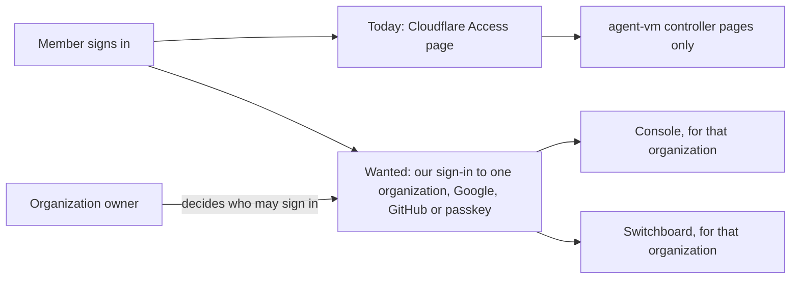

# People sign-in: Requirements

[Specification](2026-10-20-people-sign-in.md) · [Fleet decisions](../2026-10-18-fleet-framework/2026-10-18-fleet-framework.md) · [Switchboard design](../2026-10-14-portable-tool-portal-hosts/program-design.md)

People who run and use our fleet apps sign in with **Google, GitHub or a passkey**, through a sign-in service we host ourselves on Cloudflare Workers with D1. A person signs in **to an organization**: each organization has one owner and its members, and its owner alone decides who may sign in to it. Each of our services gets proof of who the person is that is good **only for that service**. Machines, VMs, the VPN and the personal fleet keep using Cloudflare. People sign in through this service, and since 2026-10-20 so do agents, each as itself.

## Who this is for

| Class | Job | Kind |
| --- | --- | --- |
| Deployment operator | deploys the service, pays for hosting, and registers each organization with the email of its owner | direct user and stakeholder |
| Organization owner | decides who may sign in to their organization and administers its sign-in, including its agents | direct user and stakeholder |
| Organization member (including workspace managers, a Switchboard role) | signs in to an organization in the console and Switchboard to see access and Accept or Deny changes | direct user |
| Public-app user | registers and signs in to a public app | direct user |
| Our relying services (the console, Switchboard's control API) | need to know which person is calling them, and in which organization | consuming service |

For the owner's own fleet, one person is the operator and the owner of every organization. The classes are separate because a deployment can hold organizations with different owners.

## What happens today

People are identified by Cloudflare Access. The agent-vm controller verifies an Access assertion for browser OAuth and Hermes approvals ([verifier](../../../packages/agent-vm/src/controller/oauth/cloudflare-access-identity-verifier.ts#L162)). There are no passkeys and no public registration. There is also no proof our own services can each verify for themselves: Switchboard's design needs one, an identity proof for its own audience, before a manager's Accept counts ([Program Design, `decide`](../2026-10-14-portable-tool-portal-hosts/program-design.md#2-chat-led-change-propose-decide-apply)).

The current sign-in screen is Cloudflare's hosted Access page, not ours: `no current UI` exists for this service.

## Needs

| Id | Who | Need | Basis | Authority |
| --- | --- | --- | --- | --- |
| `U1` | organization owners and members | Sign in to our apps with Google, GitHub or a passkey, and nothing else. | F-64: "i only weant to ukse google, github, passkey" | authorized |
| `U2` | organization owner | A private deployment admits a person to an organization only when that organization's owner approves them. | F-64: "1. only certain users"; per organization since owner 2026-10-20 (`U9`) | authorized |
| `U3` | public-app users | Public apps let anyone register. | F-64: "2. publich" | authorized |
| `U4` | relying services | Each service receives proof of the person that is valid only for that service. | F-64: "we can use only scoped audiences and better auth" | authorized |
| `U5` | owner | Self-hosted on Cloudflare Workers with D1, with no sign-in subscription, paying only for what is used. | F-64: "what is teh backend? cloudflare? workers?", accepting the Workers and D1 research; owner on 2026-10-18: "I don't want to pay beyond what I need" | authorized |
| `U6` | owner | Machines, VMs, the VPN and the personal fleet keep using Cloudflare, not this service. | F-65: "cloduflare works for vm vpn access for persnao fleet not admin/members login"; owner 2026-10-20: Cloudflare is for "registration for computer control ... kinda like tailscale" | authorized |
| `U7` | owner | Every change to who may sign in is recorded and attributable. | F-28: "and ahve some event log trace always  for all security and perm cahgnes for audit" | authorized |
| `U8` | organization owner | Each agent signs in as itself through this service, and each of our services gets proof of the agent that's valid only for that service. | owner 2026-10-20: "i thought we would use our own auth and not cloudflare access"; "we need a identity aware login ... in the worker with better auth? and our config system". Per workspace since 2026-10-22: "mcp is per workspace" (F-73), "auth is per works pace" (F-75) | authorized |
| `U9` | organization owners, members | A person signs in to an organization. An organization has its owner and its members, nothing more, and only its owner decides who may sign in to it and administers its sign-in, including its agents. Each organization's sign-in state is kept apart from every other organization's. | owner 2026-10-20: "you have to be part of an org to acces workspace memeberships etc. so log into a orgnaizaqiton. so you ahve owner and org members. thats it owenres can allow people to log in or allow auth related stuff thats it. and seggragted by durable objects"; restated 2026-10-24: "did i not alrayd say per organization dcurable object?" | authorized |

Priority: `U1`, `U2`, `U4`, `U6`, `U7` and `U9` first (private apps). `U3` (public apps) follows; the order is the Lead's proposal, not yet confirmed by the owner (SD2).

## Boundary

- **In:** people's sign-in for our apps, to an organization in a private deployment, and agents signing in as themselves (`U8`); the proof each relying service receives; removing a person's access to an organization; the record of who may sign in to each organization.
- **Reused:** Better Auth, self-hosted, pinned at exactly 1.7.11; Cloudflare Workers and D1; Google and GitHub as identity providers; Cloudflare for machine access.
- **Owner-set limit (`U9`):** each organization's owner and its list of who may sign in live in that organization's own Durable Object. Since the [agent identity](../2026-10-24-agent-identity/requirements.md) design (U15, 2026-10-24), that object is Fleet central's organization authority, one per organization, which this service asks; it is no longer a class inside the sign-in Worker. People's logins, passkeys and sessions stay in the deployment's D1, reached through Drizzle (identity U22).
- **Not in:**
  - email and password, magic links, other providers, SSO or SAML;
  - identities for machines or VMs (fleet decision D2 and Switchboard E12/E13);
  - a workspace membership registry, which the fleet owns (F-53 until its contract exists);
  - per-call tool approvals (Switchboard E7);
  - proving a manager meant a particular Accept, which stays with the console (F-57);
  - roles inside an organization beyond its owner and its members (`U9`);
  - creating, renaming or deleting organizations, or changing an organization's owner, from inside the service: the operator does these through the deployment's configuration ("so for now we use configs", F-53);
  - organizations in a public deployment, which wait with `SD2`.
- **Acceptable complexity:** one small Worker and database per deployment, plus one Durable Object per organization; no auth-vendor subscription. Paying for Workers Paid ($5 a month) only if Free cannot carry the measured load.

## Decided

| Id | Decision | Decided by | Basis |
| --- | --- | --- | --- |
| `SD1` | Who may change an organization's allowlist: its owner only | owner, 2026-10-20 | "owenres can allow people to log in or allow auth related stuff thats it" (`U9`) |
| `SD2` | Private now: people sign in only by invitation, per organization; open sign-up for organizations comes later, not now | owner, 2026-10-31 | "this is per org, you invite people per org ... right now its just my org, later we will extend to be open to sign up for org, but we dont need it now" |
| `SD9` | Who may register, link, unlink and retire an agent's sign-in: the organization's owner only | owner, 2026-10-20 | the same statement: registering an agent's sign-in is "auth related stuff", which only owners do; an organization has no managers (`U9`) |

## Open decisions

| Id | Decision | Who | Default until decided |
| --- | --- | --- | --- |
| `SD3` | How long ordinary (non-privileged) use may keep working after someone is removed: the token lifetime bound | owner, with D5 | at most the token lifetime |
| `SD4` | Where the service lives | owner, decided | `@agent-collaboration/auth` (F-67), built in agent-vm's workspace and moved to `agent-fleet-tools` with the Switchboard packages (F-58) |
| `SD5` | How people who already own OAuth account grants under their Cloudflare Access identity move to their new identity | owner | they keep working through today's controller until moved; no automatic mapping |
| `SD6` | Workers Free or Paid | owner, after measurement | Free, if measured CPU fits |
| `SD7` | Whether a new person may register with a passkey first, or must first sign in with Google or GitHub | owner | Google or GitHub first, then add passkeys (Lead proposal; Better Auth supports either) |
| `SD8` | How old a privileged decision's confirmation that the person is still active may be when the decision takes effect | owner, with D5 | 5 seconds (Lead proposal) |
