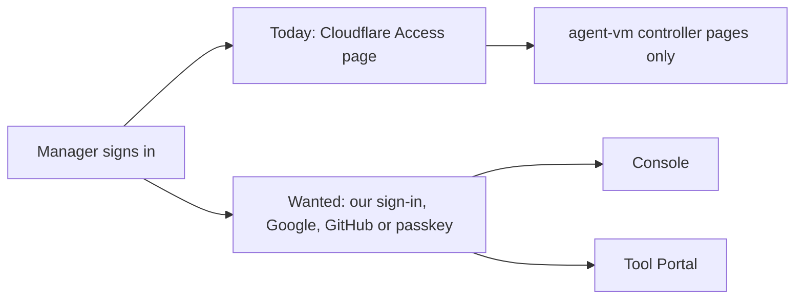

# People sign-in: Requirements

[Specification](2026-10-20-people-sign-in.md) · [Fleet decisions](../2026-10-18-fleet-framework/2026-10-18-fleet-framework.md) · [Tool Portal design](../2026-10-14-portable-tool-portal-hosts/program-design.md)

People who run and use our fleet apps sign in with **Google, GitHub or a passkey**, through a sign-in service we host ourselves on Cloudflare Workers with D1. Each of our services gets proof of who the person is that is good **only for that service**. Machines, VMs, the VPN and the personal fleet keep using Cloudflare. People sign in through this service, and since 2026-10-20 so do agents, each as itself.

## Who this is for

| Class | Job | Kind |
| --- | --- | --- |
| Owner | runs the fleet, decides who may sign in to private apps, pays for hosting | direct user and stakeholder |
| Workspace manager or member | signs in to the console and Tool Portal to see access and Accept or Deny changes | direct user |
| Public-app user | registers and signs in to a public app | direct user |
| Our relying services (the console, Tool Portal's control API) | need to know which person is calling them | consuming service |

## What happens today

People are identified by Cloudflare Access. The agent-vm controller verifies an Access assertion for browser OAuth and Hermes approvals ([verifier](../../../packages/agent-vm/src/controller/oauth/cloudflare-access-identity-verifier.ts#L162)). There are no passkeys and no public registration. There is also no proof our own services can each verify for themselves: Tool Portal's design needs one, an identity proof for its own audience, before a manager's Accept counts ([Program Design, `decide`](../2026-10-14-portable-tool-portal-hosts/program-design.md#2-chat-led-change-propose-decide-apply)).

The current sign-in screen is Cloudflare's hosted Access page, not ours: `no current UI` exists for this service.

## Needs

| Id | Who | Need | Basis | Authority |
| --- | --- | --- | --- | --- |
| `U1` | owner, managers, members | Sign in to our apps with Google, GitHub or a passkey, and nothing else. | F-64: "i only weant to ukse google, github, passkey" | authorized |
| `U2` | owner | Private apps admit only the people the owner approves. | F-64: "1. only certain users" | authorized |
| `U3` | public-app users | Public apps let anyone register. | F-64: "2. publich" | authorized |
| `U4` | relying services | Each service receives proof of the person that is valid only for that service. | F-64: "we can use only scoped audiences and better auth" | authorized |
| `U5` | owner | Self-hosted on Cloudflare Workers with D1, with no sign-in subscription, paying only for what is used. | F-64: "what is teh backend? cloudflare? workers?", accepting the Workers and D1 research; owner on 2026-10-18: "I don't want to pay beyond what I need" | authorized |
| `U6` | owner | Machines, VMs, the VPN and the personal fleet keep using Cloudflare, not this service. | F-65: "cloduflare works for vm vpn access for persnao fleet not admin/members login"; owner 2026-10-20: Cloudflare is for "registration for computer control ... kinda like tailscale" | authorized |
| `U7` | owner | Every change to who may sign in is recorded and attributable. | F-28: "and ahve some event log trace always  for all security and perm cahgnes for audit" | authorized |
| `U8` | owner, managers | Each agent signs in as itself through this service, and each of our services gets proof of the agent that's valid only for that service. | owner 2026-10-20: "i thought we would use our own auth and not cloudflare access"; "we need a identity aware login ... in the worker with better auth? and our config system" | authorized |

Priority: `U1`, `U2`, `U4`, `U6` and `U7` first (private apps). `U3` (public apps) follows; the order is the Lead's proposal, not yet confirmed by the owner (SD2).

## Boundary

- **In:** people's sign-in for our apps, and agents signing in as themselves (`U8`), in private and public deployments; the proof each relying service receives; removing a person's access; the record of who may sign in.
- **Reused:** Better Auth, self-hosted, version 1.7.11 or later; Cloudflare Workers and D1; Google and GitHub as identity providers; Cloudflare for machine access.
- **Not in:**
  - email and password, magic links, other providers, SSO or SAML;
  - identities for machines or VMs (D2 and Tool Portal E12/E13);
  - a workspace membership registry, which the fleet owns (F-53 until its contract exists);
  - per-call tool approvals (Tool Portal E7);
  - proving a manager meant a particular Accept, which stays with the console (F-57).
- **Acceptable complexity:** one small Worker and database per deployment; no auth-vendor subscription. Paying for Workers Paid ($5 a month) only if Free cannot carry the measured load.

## Open decisions

| Id | Decision | Who | Default until decided |
| --- | --- | --- | --- |
| `SD1` | Who may change a private deployment's allowlist: the owner only, or workspace managers too | owner | owner only |
| `SD2` | Whether public deployments are built now or after private | owner | private first |
| `SD3` | How long ordinary (non-privileged) use may keep working after someone is removed: the token lifetime bound | owner, with D5 | at most the token lifetime |
| `SD4` | Where the service lives | owner, decided | `@agent-collaboration/auth` (F-67), built in agent-vm's workspace and moved to `agent-fleet-tools` with the Tool Portal packages (F-58) |
| `SD5` | How people who already own OAuth account grants under their Cloudflare Access identity move to their new identity | owner | they keep working through today's controller until moved; no automatic mapping |
| `SD6` | Workers Free or Paid | owner, after measurement | Free, if measured CPU fits |
| `SD7` | Whether a new person may register with a passkey first, or must first sign in with Google or GitHub | owner | Google or GitHub first, then add passkeys (Lead proposal; Better Auth supports either) |
| `SD8` | How old a privileged decision's confirmation that the person is still active may be when the decision takes effect | owner, with D5 | 5 seconds (Lead proposal) |
| `SD9` | Who may register and remove an agent's sign-in: the organization's owner only, or its managers too | owner | owner and managers (Lead proposal; fleet F-23 has managers configure agents). Either way, Tool Portal's agent-management handler checks who may, and coordinates the two writes (Lead proposal, Program Design "Adding and removing an agent") |
