# Agent identity and workspace access: Alternatives

This study draws every option weighed for this design, with what each gains, what it costs, and why one was chosen. It decides nothing new. Your decisions are recorded in [Requirements](requirements.md), and the Lead's structural choices in [Program Design: the choices, and why](program-design.html#program-design--the-choices-and-why).

Each section gives the question, a picture with one row per option, then a table. "Decided by" says whose call it was: **you** (the owner), or the **Lead** (a structural choice you can overrule).

| # | Question | Chosen | Decided by |
|---|---|---|---|
| 1 | Who is the identity when your agent acts? | The session itself, vouched for by its machine | you |
| 2 | Which workspace does a session belong to? | The workspace of the project it was started for | you |
| 3 | Who holds the truth, and who mints tokens? | X′: Fleet central decides, Better Auth mints | you (the shape); the Lead (the details) |
| 4 | How does the Switchboard know who is a member? | Token-only, with pushed removals | you |
| 5 | How long does a token live? | Configurable, at most 60 minutes | you; the default is open (OD2) |
| 6 | How do a removal and a token minted at about the same time stay in order? | Every grant and every removal gets its own number in one order | the Lead |
| 7 | How does a machine prove it is yours? | Replaced by 19: the issuer-token login | you |
| 8 | How does a session's token reach the Switchboard? | A Router forwarder attaches it | the Lead |
| 9 | Who asks the issuer for a session's token? | Fleet central, as a service client | the Lead |
| 10 | Where is a session's persona narrowing checked? | At the Switchboard, on each call: the session gets what both its default and its persona allow | the Lead |
| 11 | How are organizations kept apart? | One organization authority per organization | you (D2); the Lead (where it lives) |
| 12 | Who may message across workspaces? | Members, where you allow the workspace pair | you |
| 13 | What about sessions sharing a machine? | Record and show the shared bucket now; enforce later | you |
| 14 | Who may start a session in a workspace? | Anyone at a logged-in machine, for the workspaces it serves; a session starts helpers only in its own workspace, on its own machine or another of its organization's | you (OD1, closed; extended by U39) |
| 15 | Is a bot automatically a collaborator of every other workspace? | No: you set each collaboration per workspace | you (OD3, closed) |
| 16 | How do the services prove who's calling each other? | Short-lived service tokens, one per receiver and operation | the Lead |
| 17 | How does a token say which session it is for? | A separate principal claim; Better Auth keeps its own subject | the Lead |
| 18 | Where is a collaboration message or board write checked? | At Fleet central, before the effect, on every path | the Lead |
| 19 | How does a machine log in? | A device code you approve, then short-lived tokens from the sign-in service; VM creators later | you |
| 20 | How does the switch to the new login happen? | Three steps: build; switch behind Access and log every machine in again; remove Access | you |
| 21 | How are organizations' Fleet data kept apart? | One Fleet object per organization | you (OD8) |
| 22 | How does a session start a helper on another machine? | A start carried through Fleet central over both machines' connections, never queued | the Lead, for your U39 |

## 1. Who is the identity when your agent acts?

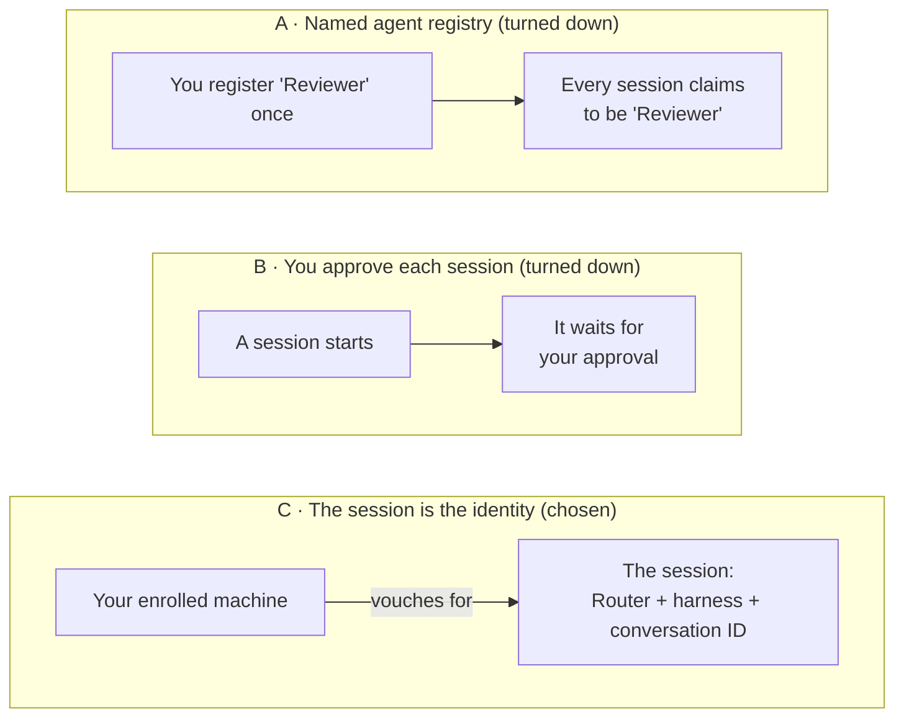

| Option | How it works | Gains | Costs | Verdict |
|---|---|---|---|---|
| A. Named agent registry | You register an agent name once. Each session presents itself as an instance of it. | Stable names across sessions. | A registry nobody asked for. Fleet already knows each session by its conversation ID, and two sessions of "Reviewer" can't be told apart. | Turned down by you |
| B. You approve each session | Every new session waits for you before it may act. | You see everything. | You would approve every session. | Turned down by you |
| C. The session is the identity | One Codex, Claude or Cursor conversation is the identity. Its enrolled machine vouches for it, and it holds no secret. | Uses what Fleet already has, the session reference. Nothing to register. | Trust rests on the machine: whatever can act as the Router on that machine can act as its sessions. | **Chosen** by you ([U3](requirements.md#needs)) |

A bot is different. It is a whole system with its own memory, outside your machines, so it proves itself with its own credential ([U2](requirements.md#needs)).

## 2. Which workspace does a session belong to?

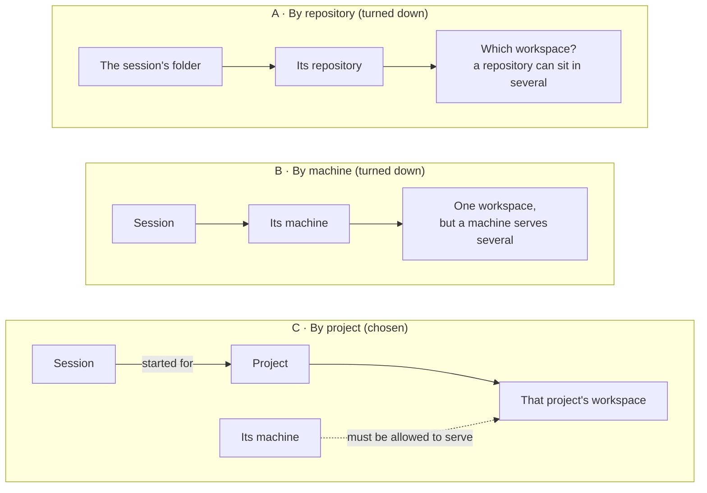

| Option | How it works | Gains | Costs | Verdict |
|---|---|---|---|---|
| A. By repository | Today's Fleet lookup: working directory, then git origin, then the workspaces that repository is attached to. | No new record. | One repository can be attached to several workspaces, so the answer is ambiguous. A folder is a guess, not a grant. | Turned down by you ("not the right topology") |
| B. By machine | Each machine belongs to one workspace. | Simple. | Your machines serve several workspaces at once. | Turned down by you |
| C. By project | A session is started for a project. The project's workspace is the session's workspace, and the machine must be allowed to serve it. | An explicit link Fleet already has: projects live in workspaces. | You allow each machine per workspace (E15). | **Chosen** by you ([U6](requirements.md#needs)) |

## 3. Who holds the truth, and who mints tokens?

"The truth" means organizations, workspaces, projects, bots, sessions, memberships and machines. "Minting" means signing the short-lived tokens the Switchboard checks.

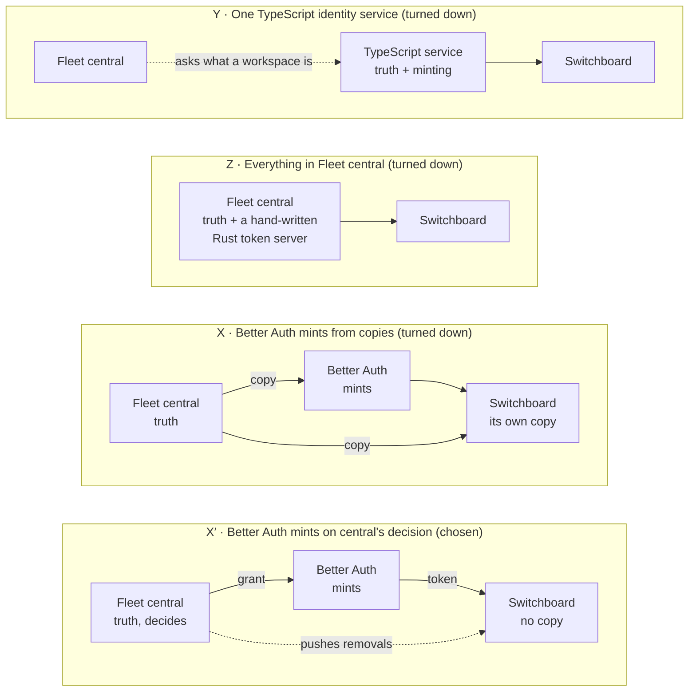

| Option | How it works | Gains | Costs | Verdict |
|---|---|---|---|---|
| Y. One TypeScript identity service | A new TypeScript service on Better Auth holds every truth and mints. | One service. A Switchboard product could ship without Fleet. | Workspace creation moves out of Fleet, which churns built data. Fleet and the Rust services depend on a TypeScript service to know what a workspace or machine is. | Turned down. Reopen if a Switchboard product without Fleet central becomes the priority. |
| Z. Everything in Fleet central | Fleet central holds the truth and mints with a token server written in Rust. | One service, all Rust. | A hand-written, security-critical token server. The MCP sign-in flow that Better Auth already does would be rebuilt. The tested issuer is thrown away. | Turned down by you ([U15](requirements.md#needs)) |
| X. Better Auth mints from copies | Fleet central holds the truth and feeds copies of membership to Better Auth and the Switchboard. | Fleet central is off the sign-in and tool-call path. | Two copies to keep correct, in order, safe to apply twice, caught up after outages. You called the copies "fishy". | Turned down by you |
| X′. Better Auth mints on central's decision | Fleet central decides each issuance. Better Auth mints only on that decision. The Switchboard keeps no membership, only the removal notices central pushes. | One owner per truth and no copies. The tested issuer stays. | Fleet central must be up to issue tokens (fail closed, [U14](requirements.md#needs)). Two services take part in every issuance. | **Chosen** ([U15](requirements.md#needs); [Program Design](program-design.html#program-design--the-choices-and-why)) |

## 4. How does the Switchboard know who is a member?

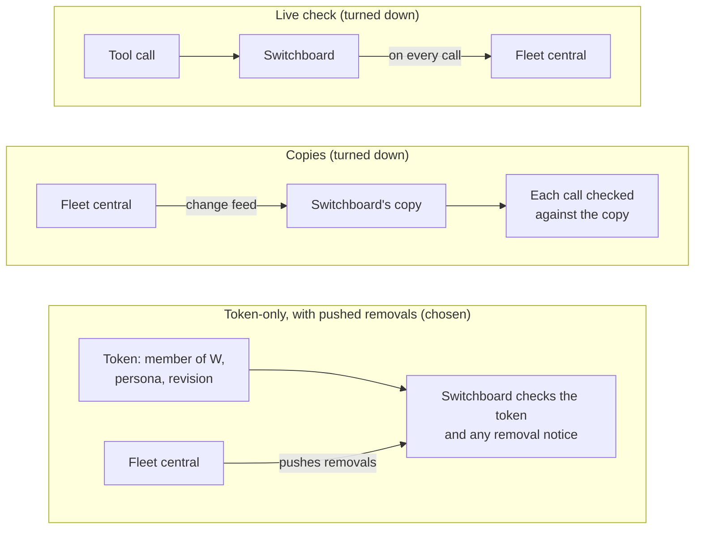

| Option | How it works | Gains | Costs | Verdict |
|---|---|---|---|---|
| Live check | The Switchboard asks Fleet central on every tool call. | Removal is instant. | Fleet central is on every call. Too heavy. | Turned down by you |
| Copies | Fleet central feeds the Switchboard a copy of membership. | Fleet central is off the call path. | A second copy to keep correct. | Turned down by you |
| Token-only, with pushed removals | The token says who it is for, which workspace, which persona, and the revision its grant was decided at. The Switchboard checks the token and any removal notice Fleet central has pushed. | No Fleet central on the call path and nothing copied. A removal bites as soon as its notice lands. | If a notice can't reach the Switchboard, the removed identity keeps access until its token expires, at most one token lifetime. You see the notice as pending meanwhile. | **Chosen** by you ([U12, U13](requirements.md#needs)) |

## 5. How long does a token live?

The lifetime bounds how long a removal can go unenforced if its notice is lost, and how often each identity needs a fresh token.

| Option | Gains | Costs | Verdict |
|---|---|---|---|
| About 1 minute | A lost notice matters for at most a minute. | A new token every minute for every identity in every workspace. Any Fleet central hiccup stops work within a minute. | Not chosen |
| Configurable, at most 60 minutes | You trade the two costs per organization. | A lost notice can leave access open for up to the configured lifetime. | **Chosen** by you ([U12](requirements.md#needs)). The default is open: [OD2](requirements.md#owner-decisions). |
| Hours | Rare issuance. | A lost notice leaves hours of access, and a Fleet central outage goes unnoticed for hours. | Turned down by you (the 1-hour maximum) |

**When does the clock start?** The first draft counted a token's life from when it was minted. Review found the hole: a grant decided before a removal, but minted late enough, would outlive the removal's notice at the Switchboard.

| Option | Gains | Costs | Verdict |
|---|---|---|---|
| From minting | Simple; it is what the issuer does by default. | A delayed or repeated mint stretches an old grant past its removal. | Turned down by the Lead after review |
| From the grant decision, and nothing mints more than 60 seconds after it | A grant's end is fixed when Fleet central decides, however late the token is minted. | The Switchboard checks one more time field. | **Chosen** by the Lead ([R16](specification.md#tokens-and-tool-calls)) |

## 6. How do a removal and a token minted at about the same time stay in order?

The risk: Fleet central decides a session is a member, you remove it a moment later, and the token for the earlier decision is minted after the removal notice has already gone out.

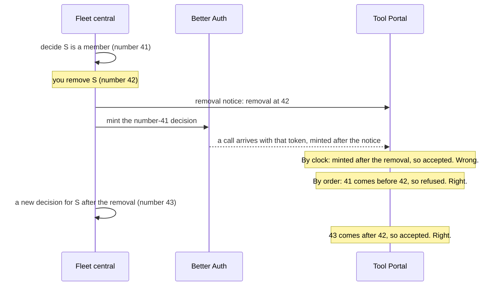

| Option | How it works | Gains | Costs | Verdict |
|---|---|---|---|---|
| Wall-clock times | A notice says "removed at 10:00:05", and tokens minted later are trusted. | Familiar. | A decision taken before the removal but minted after it slips through, and clocks on different services drift. | Turned down by the Lead |
| Count only the removals | A token carries the latest removal count its decision saw; a notice covers every token up to its own count. | No write per grant. | A token decided right after a persona change carries the change's own number and is wrongly refused. | Turned down by the Lead after review |
| One order for grants and removals | Fleet central gives every grant decision and every removal in an organization its own next number. Each token carries its decision's number, and a notice covers every token with a smaller number. The Switchboard keeps the highest removal number it has received. | Exact order, no ties, no clocks; a late notice can't undo a newer one. | One durable write per grant decision, about once per token lifetime per identity. | **Chosen** by the Lead ([Program Design](program-design.html#program-design--how-a-removal-reaches-the-tool-portal)) |

## 7. How does a machine prove it is yours?

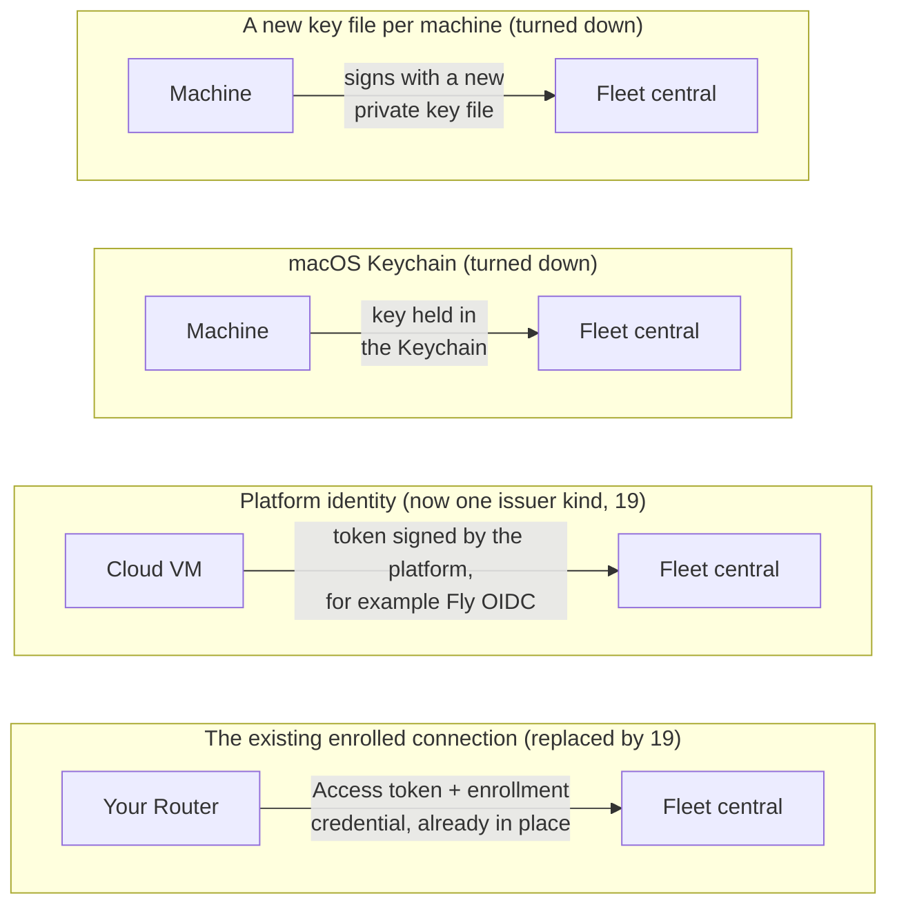

| Option | Gains | Costs | Verdict |
|---|---|---|---|
| A new key file per machine | Standard signed assertions. | A new secret on every machine to create, store and rotate. | Turned down by you ("no bespoke private keys in machine") |
| macOS Keychain as the machine's identity | Storage the OS protects. | It doesn't work for this, and it is Mac-only. | Turned down by you |
| Platform identity, for example Fly OIDC | No secret on the machine: the platform vouches. | Only for cloud VMs on such platforms. | Later: see option D in [19](#19-how-does-a-machine-log-in) |
| The existing enrolled connection | No new secret. Revoking the machine's enrollment revokes its vouching. | Two long-lived secrets tied to your own Cloudflare Access (an Access service token and an enrollment credential whose expiry must match it); enrolling needs the fleet operator's token; the Router's production secret store exists only on macOS. | Chosen by you on 24 October; **replaced on 26 October** by [19](#19-how-does-a-machine-log-in) |

## 8. How does a session's token reach the Switchboard?

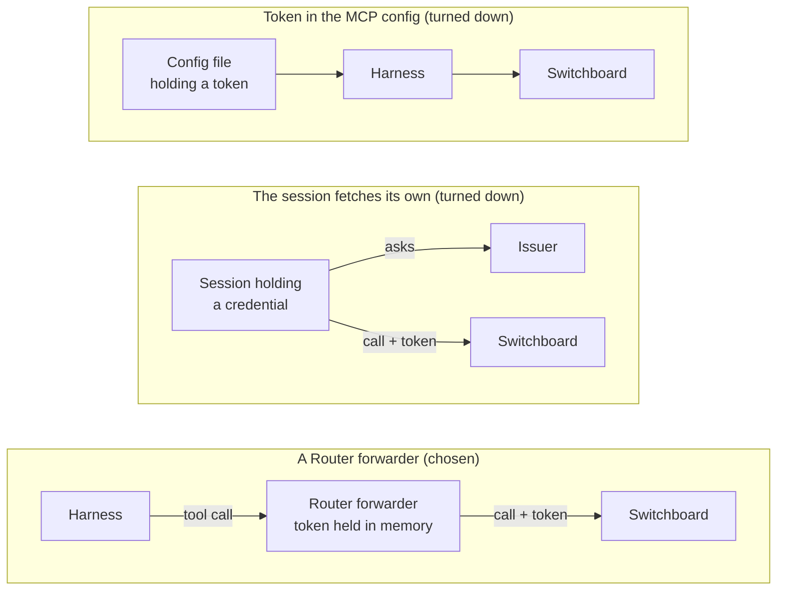

| Option | Gains | Costs | Verdict |
|---|---|---|---|
| Token in the harness's MCP config | No new Router part. | A config file can't refresh a 5-minute token, so the token would have to be long-lived and sit on disk. | Turned down by the Lead |
| The session fetches its own token | No Router involvement. | The agent would hold a credential, which a session never does ([U3](requirements.md#needs)). | Turned down by the Lead |
| A Router forwarder | The agent never sees a credential, and refresh is invisible to it. | A new Router component on every tool call. | **Chosen** by the Lead. Reopen if a harness lets the Router set per-call headers itself. |

## 9. Who asks the issuer for a session's token?

| Option | Gains | Costs | Verdict |
|---|---|---|---|
| The Router | Fleet central isn't involved in minting. | The Router would need its own credential at the issuer: a new machine secret, against [U17](requirements.md#needs). | Turned down by the Lead |
| Fleet central, as a client of the issuer | No machine secrets, and Fleet central already makes the decision. | Fleet central's client key becomes the most valuable key in the system: with it, any session's token can be minted and removal notices sent. It lives in Fleet central's host secret store. | **Chosen** by the Lead ([Program Design: trust boundaries](program-design.html#program-design--trust-boundaries)) |

## 10. Where is a session's persona narrowing checked?

| Option | Gains | Costs | Verdict |
|---|---|---|---|
| At Fleet central, when the session starts | A too-wide persona is refused at start. | Fleet central would need a copy of every workspace's tool profiles, a second owner. | Turned down by the Lead |
| At the Switchboard, refusing a wider persona on its first call (first draft) | Tool profiles keep one owner. | "Wider" between two profiles was never defined, and a default changed later wasn't handled. | Turned down by the Lead after review |
| At the Switchboard, on each call: the session gets what both its default and its persona allow | Widening is impossible by construction. Tool profiles keep one owner. A changed default applies from the first call served by the deployment that carries it. | A wider persona is quietly clipped to the default rather than refused. | **Chosen** by the Lead ([R9](specification.md#membership-and-collaboration)). Reopen if you want the refusal at start. |

## 11. How are organizations kept apart?

| Option | Gains | Costs | Verdict |
|---|---|---|---|
| One shared store keyed by organization | One store to run. | One faulty query could leak records across organizations. | Turned down |
| One organization authority per organization: a Durable Object on Cloudflare, or its own SQLite database on Tokio | Organizations can't share records, on any host ([U16](requirements.md#needs)). | One object per organization to operate. | **Chosen**. This keeps the meaning of your decision D2. |

What moves: D2 placed that per-organization unit in the sign-in service. Because Fleet now holds organizations ([U15](requirements.md#needs)), the unit lives in Fleet central instead ([Specification: what this replaces](specification.md#what-this-replaces)).

## 12. Who may message across workspaces?

| Option | Gains | Costs | Verdict |
|---|---|---|---|
| Anyone in the organization | No setup. | No control over which workspaces talk to each other. | Turned down |
| You approve each session's messages | Full control. | Approvals for every session. | Turned down by you |
| Per workspace pair | You allow, for example, "members of Personal may message members of OSS". A pair never grants tools or starting work. | One admin action per pair. | **Chosen** by you ([U8](requirements.md#needs)) |

## 13. What about sessions sharing a machine?

Sessions on one machine can read each other's files unless their isolation kind separates them.

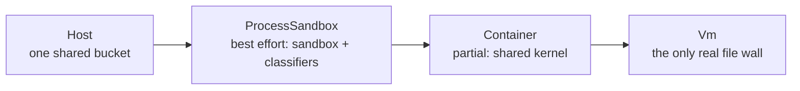

| Option | Gains | Costs | Verdict |
|---|---|---|---|
| Enforce now | Refuse to run two workspaces' sessions on one machine unless a Vm separates them. | Blocks today's way of working, and VM sessions are out of this set. | Deferred |
| A separate OS user per workspace | A file wall without a VM. | A new isolation mechanism outside the agreed isolation kinds. | Dropped |
| Record and show now, enforce later | Each session records its isolation kind, and lookups show which workspaces share a machine's bucket. The leak is visible before it is fenced. | Nothing is prevented yet. | **Chosen** by you ([U18](requirements.md#needs)) |

## 14. Decided: who may start a session in a workspace? (OD1)

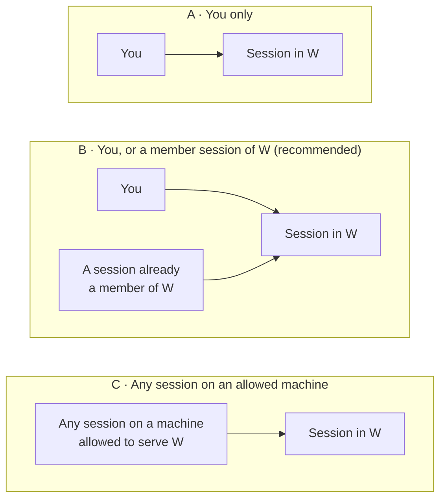

| Option | Gains | Costs |
|---|---|---|
| A. You only | The tightest control. | A Lead can't start its own helpers without you. |
| B. You, or a session already a member of W | Matches how Leads start helpers today. A collaborator never can ([U7](requirements.md#needs)). | A member session can start more members of its own workspace. |
| C. Any session on a machine allowed to serve W | No starter check at all. | A session of workspace A on a shared machine could start work in workspace B, which defeats the workspace boundary. |

**Decided by you (2026-10-26, U32):** C for the machine, B for helpers. There is no way to control the person at a logged-in machine, so anyone who can operate it starts sessions for the workspaces it may serve, and the start is recorded as from the machine. A session starts helpers only in its own workspace. The workspace boundary is held by which workspaces the machine may serve, which you choose when you log it in.

**Extended (2026-10-27, U39):** a session may also start a helper in its own workspace on another machine of its organization that serves that workspace. How it travels is [22](#22-how-does-a-session-start-a-helper-on-another-machine).

**Earlier (2026-10-24):** you sign in once, when you launch and enroll a local Router, and choose there which workspaces it serves; nothing on it needs another sign-in or approval, and a start names its project. Still open: whether a session may start one in another workspace the same Router serves (B says no). A conversation started outside the fleet can't join later just by being resumed: a running conversation keeps the configuration it started with, so it would need its own attach step. You decided (2026-10-24) to leave that out of the first round: the boundary is semi-permeable. A UI at Router launch does the one sign-in and picks the workspaces; Agent Studio can hook it later.

## 15. Decided: is a bot automatically a collaborator of every other workspace? (OD3)

You said a bot is a member of at most one workspace, and "rest collaborator". That can mean two things.

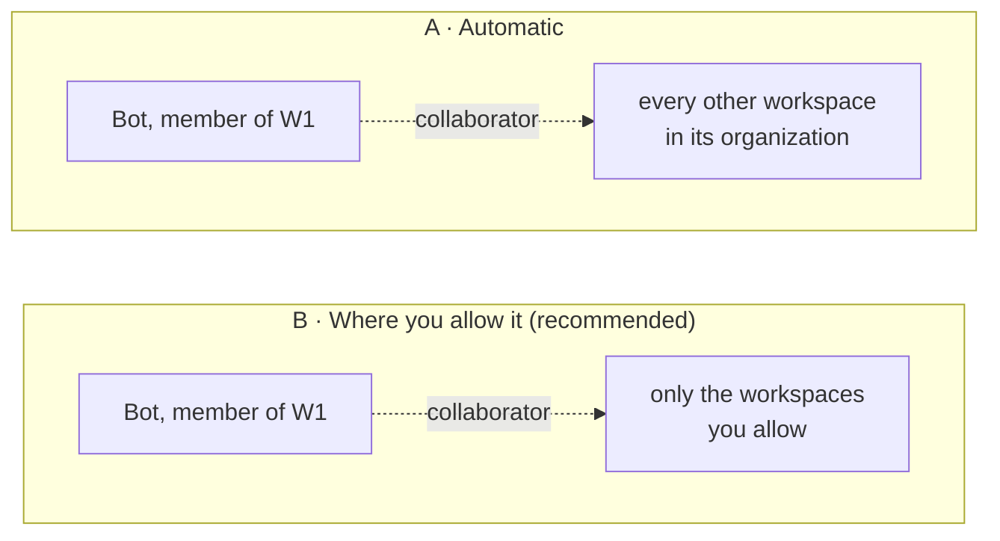

| Option | Gains | Costs |
|---|---|---|
| A. Automatic | No setup per bot. | Every bot you register, including a customer's bot you don't own, can message the members of every workspace in the organization. You can stop it only by retiring the bot. |
| B. Where you allow it | Matches how you chose workspace pairs ([U8](requirements.md#needs)). A bot you don't own reaches only the workspaces you pick. | One admin action per bot per workspace. |

**Decided by you (2026-10-26, U7): B.** You set each collaboration per workspace, for a bot or a person. Managers granting collaborators for their own workspace is a later idea, not decided.

## 16. How do the services prove who's calling each other?

Fleet central, the sign-in service and the Switchboard call each other for: deciding a bot's grant, admitting a person or reading their standing, minting a session's token, delivering a removal notice, managing bot credentials and workspace resources, and confirming a person's session for an admin action. Service tokens carry every one of these except two, which use client authentication instead: minting a session's token (the fleet-session grant) and confirming a person's session (introspection with central's `private_key_jwt`). No service token is minted for confirmation.

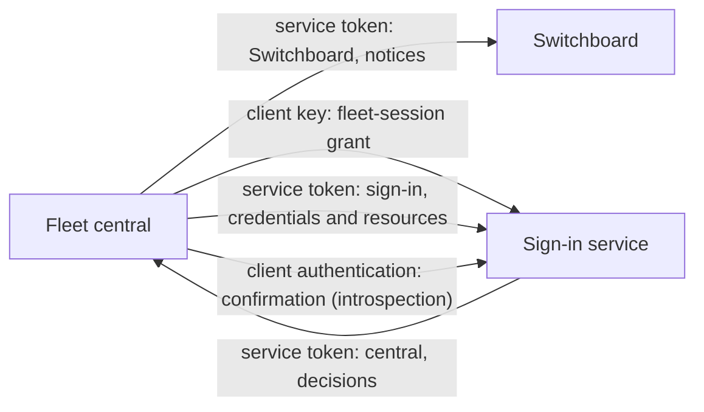

| Option | Gains | Costs | Verdict |
|---|---|---|---|
| "A signed client assertion on every request" (first draft) | Sounded uniform. | That kind of assertion only authenticates a client at the token endpoint; it says nothing about which request or operation it is for. | Turned down by the Lead after review |
| Sign each request body | Proof survives outside the encrypted connection. | A second signing scheme to build and rotate, for no threat this design has. | Not chosen. Reopen if requests must stay verifiable after leaving TLS. |
| Short-lived service tokens from the issuer, each for one receiving service and one operation, over TLS | Reuses the issuer, its keys and client authentication. A token for one receiver or operation is refused everywhere else. | Each receiver pins the issuer, the expected client and the operation. A stolen token can make that one kind of request, within its scope, until it expires a few minutes later; bodies aren't signed, so receivers check what a body says, not who first wrote it. | **Chosen** by the Lead ([R27](specification.md#hosts-outages-and-service-requests)) |

## 17. How does a token say which session it is for?

Better Auth (1.7.8, unchanged in 1.7.11) sets a token's subject itself: always the signed-in user, or else the client that asked. Every session token is asked for by Fleet central, so the subject would be Fleet central for all of them.

| Option | Gains | Costs | Verdict |
|---|---|---|---|
| Make the subject the session | Standard field. | Not possible in 1.7.8 or 1.7.11 without patching the provider. | Not possible |
| Create a user record per session | The subject becomes the session. | Fake "people" for every conversation, mixed into sign-in records. | Turned down by the Lead |
| Keep Better Auth's subject, add a principal claim naming the bot or the whole session | Uses the provider as documented. The Switchboard also checks that only Fleet central's client issued session tokens. | Every consumer reads the principal, never the subject. | **Chosen** by the Lead ([Program Design](program-design.html#program-design--workspace-and-collaboration-token-claims)) |

## 18. Where is a collaboration message or board write checked?

A session's effect can take several paths today: a board write committed on the Router that holds the project or forwarded to it from another, a direct message, a conversation start, and the fleet's own writes (boards, repositories, project directory, decision records). The first draft named only the first three; the Fleet check found the start and the Fleet writes going around them. Each must respect membership, workspace pairs and bot collaborations.

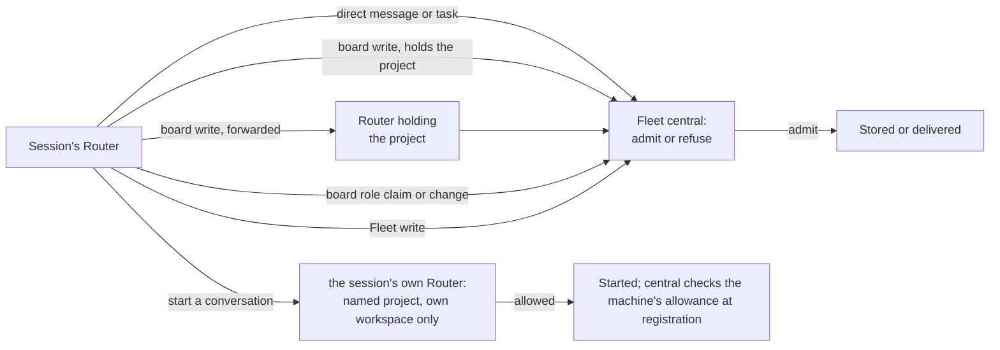

Since the owner's simplification (2026-10-24), a conversation start is checked by the Router itself, not by Fleet central; Fleet central admits every other effect, including a board role change.

| Option | Gains | Costs | Verdict |
|---|---|---|---|
| Check only on the forwarded path (first draft) | One new check. | The holding Router's own writes and direct messages skip it. | Turned down by the Lead after review |
| Check only the three message and board paths (second draft) | Three checks. | Conversation starts and Fleet writes skip them. | Turned down after the Fleet check |
| Each Router keeps a copy of memberships and pairs and checks locally | No round trip; works while Fleet central is down. | A copy to keep correct, which you called "fishy" for tokens. | Turned down by the Lead |
| Fleet central admits each effect before it happens, on every path | One owner of the rule; nothing stored or delivered on a refusal. A pair admits messages and tasks only. | One round trip per collaboration effect; collaboration stops while Fleet central is down (fail closed, as for tokens). | **Chosen** by the Lead ([R28](specification.md#membership-and-collaboration)) |

## 19. How does a machine log in?

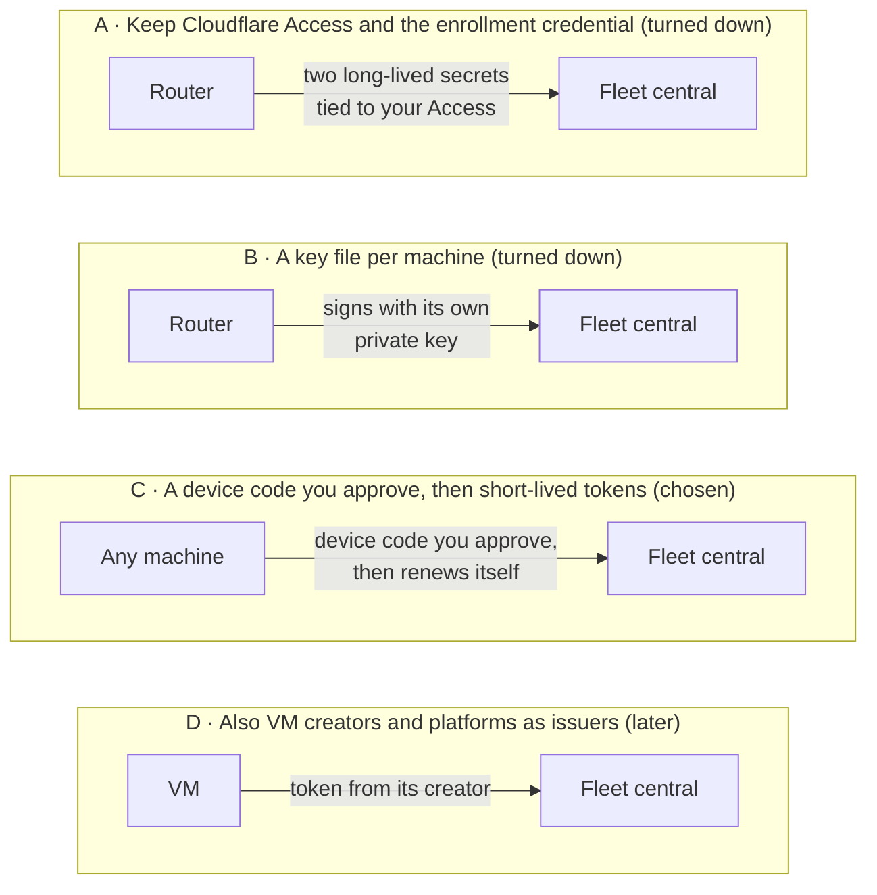

| Option | Gains | Costs | Verdict |
|---|---|---|---|
| A. Keep Access and the enrollment credential | Already built. | Ties every machine to your own Cloudflare Access, forever; two long-lived secrets per machine; a VM would need them placed in it. | Turned down by you: "we want to slowly move off the Access token" |
| B. A key file per machine | Standard signed assertions. | A new private key on every machine to create, store and rotate. | Turned down by you ([U17](requirements.md#needs)) |
| C. A device code you approve, then short-lived tokens from the sign-in service | One model for every machine; you approve each one; the token names its issuer, so D can be added beside it later. | A machine keeps one refresh credential in an encrypted store, or only in memory where none exists, and then you approve it again after each restart (OD9). | **Chosen** by you ([U31](requirements.md#needs), [U33](requirements.md#needs)) |
| D. Also VM creators and platforms as issuers | VMs log in with no one approving each. | Built and tested only against a stand-in, with no real VM creator; agent-vm is out of this set. | **Later**, by you (2026-10-27): "its scope creep" |

## 20. How does the switch to the new login happen?

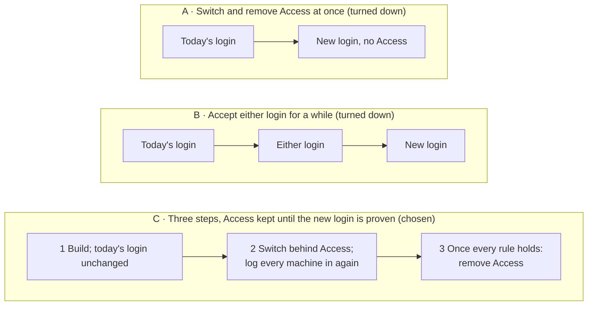

| Option | Gains | Costs | Verdict |
|---|---|---|---|
| A. Switch and remove Access at once | One change. | If the new login has a hole, nothing guards Fleet central while you find it. | Turned down by you: "too risky" |
| B. Accept either login for a while | No re-login day. | Two ways in at once, the half step you ruled out. | Turned down by you: "no half steps" |
| C. Three steps | Access still guards Fleet central while the new login proves itself; at no time are both logins accepted. | Every machine logs in again at step 2; step 2 fixes forward, with no way back to the old login, because that could readmit a machine revoked after the switch. | **Chosen** by you ([U34](requirements.md#needs)) |

## 21. Decided: how are organizations' Fleet data kept apart? (OD8)

Fleet central holds each organization's workspaces, projects and boards. One Fleet central serves several organizations, and nothing may be shared between them ([U27](requirements.md#needs)).

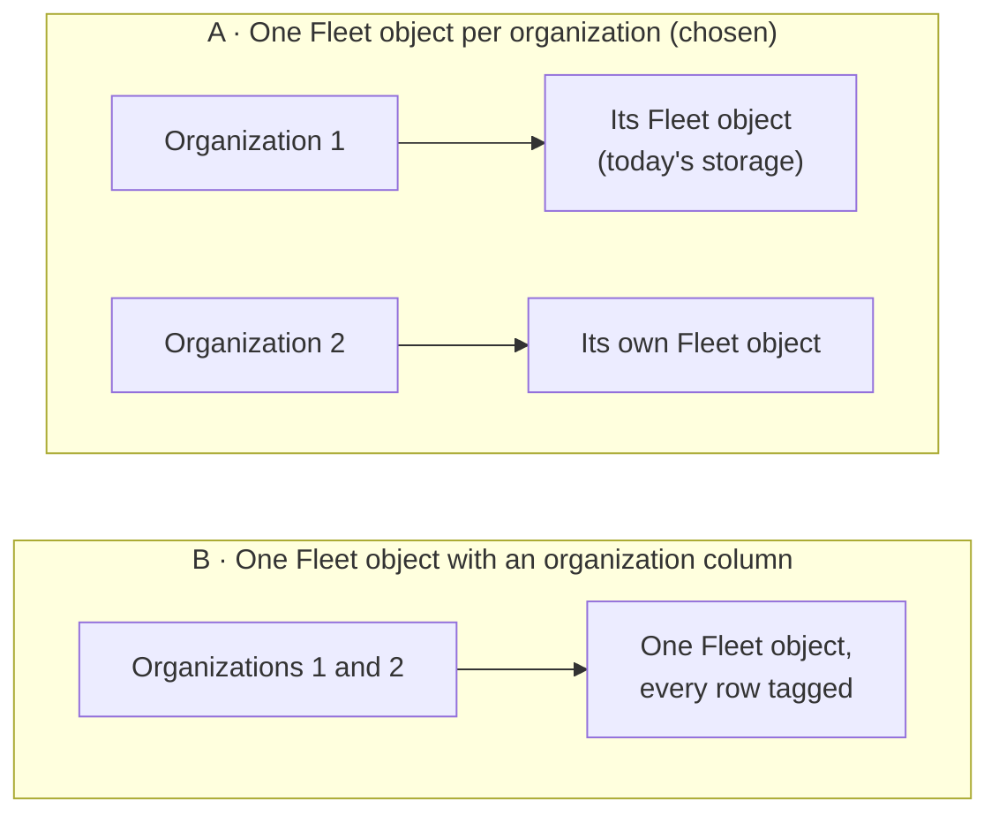

| Option | Gains | Costs |
|---|---|---|
| A. One Fleet object per organization | Separate by address: a machine can reach only its organization's object, so a forgotten filter can't leak. Workspace names stay unique per organization for free. Your existing Fleet data becomes the first organization's, with nothing migrated. | One more object per organization to operate. |
| B. One Fleet object with an organization column | One store. | Every Fleet read and write must filter by organization; one missed filter leaks across organizations; existing rows need a migration to gain the column. |

**Decided by you (2026-10-27): A.** Your existing Fleet data becomes the first organization's through a fixed mapping to today's storage on both hosts. It is still a storage cutover: the address type, every caller, restart and wake recovery, each connection's feed, and refusing the old address change.

## 22. How does a session start a helper on another machine?

Today a session on another fleet machine can only be started there, by SSH and a launcher script: the create goes only to the local Router, the client refuses a creator on another Router, and the fleet carries only messages, notifications, cancels and wakes between machines. You asked for this to work through the fleet ([U39](requirements.md#needs)).

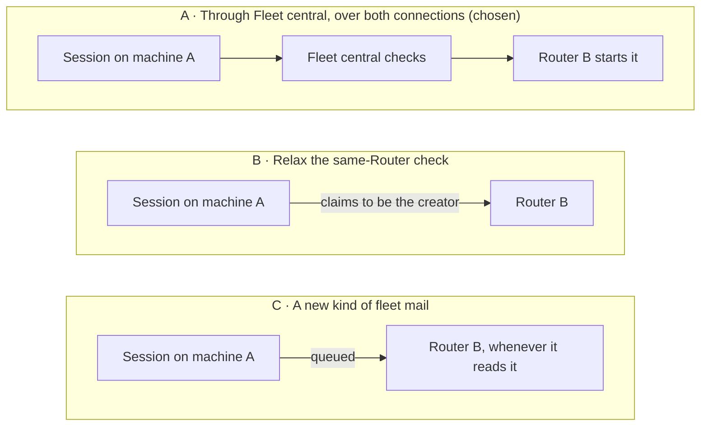

| Option | Gains | Costs | Verdict |
|---|---|---|---|
| A. Through Fleet central | Central already knows both machines, the requester's membership and the target's allowance; both connections are authenticated; nothing waits in a queue. | Two requests on each connection, one delivered frame each way, and a remote-start record; a start to a disconnected machine is refused. | **Chosen** by the Lead |
| B. Relax the client's same-Router check | The smallest change. | Router B can't verify a creator from another machine; it weakens a check rather than authorizing anything. | Turned down |
| C. A new kind of fleet mail | Reuses the fleet's delivery. | Mail is queued and delivered later, so a start could run long after it was asked for; it would need replay rules a start must not have (R46). | Turned down |
| The launcher script (today) | Nothing to build. | Needs SSH and goes around the fleet. | Replaced |
