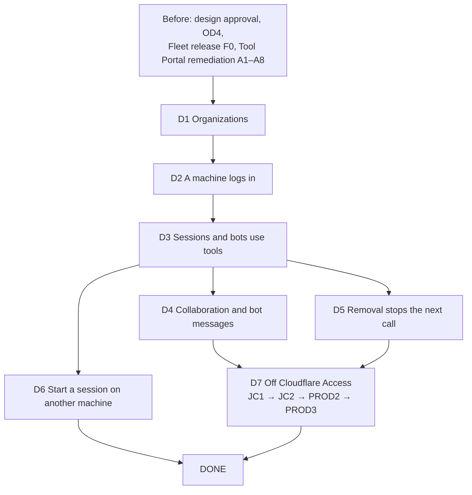

# Agent identity delivery plan

## Result and basis

- **Planning result:** proposed, not yet `ready`.
  - Your decisions of 27 October are in the design (`b734d002`), with check 3's corrections at `fe47ee33`. The Sol Reviewer is checking those corrections. When that check closes and you approve the design, this record becomes `ready`.
- **Originating planner:** `plan-implementation`
- **Governing planning basis:** reviewed four-document design
  - [Requirements](../requirements.md)
  - [Specification](../specification.md)
  - [Program Design](../program-design.md)
  - [Verification Design](../verification-design.md)
  - Review history is in `tmp/practices-research/2026-10-27-identity-four-document-review/`:
    - the four-document review at `66dd3b66`;
    - checks at `33bee8bd` and `5327c6c7`, which closed every correction and returned `decision-needed` on your choices;
    - check 3 at `b05285cf` (`reviewer-recheck-3.md`, needs-revision, RC3-1 to RC3-4) and the Advisor's second look (`advisor-recheck-3.md`, N1 to N4), all corrected at `fe47ee33`.
  - Applicability anchors: agent-vm `design/portal-remediation`, design at `fe47ee33`; codex-router `f465808f` (and `main` for the create path and mail kinds); Better Auth 1.7.11 (`52ab801c`)
- **Delivery context:**
  - Requested terminal: `plan-only`. You said nothing is built until the design is agreed, so this plan goes to you, not to an Implementer.
  - Delivery grouping: `deliverables`, by your direction (27 October): "each plan parts to be delivery vertical slices and how they correlate. within each deliverable, there are workstreams."
  - PR topology: `separate-prs`. Each workstream piece of a deliverable is one PR in its own repository, as the delivery orchestration's rule "every slice merges as one pull request" requires.
- **Order it extends:** the [delivery orchestration](../../2026-10-24-delivery-orchestration/program-design.md), which owns the cross-repository order and is updated in the same change.

## How to read this plan

- **A deliverable** is something you can see working end to end, such as "a machine logs in". It cuts through every part it needs: Fleet central, the Router, the sign-in service, the Tool Portal.
- **A workstream** is one of those parts, owned by one Lead and one repository. Inside a deliverable, each workstream contributes pieces.
- **A piece** (F10, B5, and so on) is one pull request. Its card says what it covers, what proves it, and what it waits on.
- A deliverable is **proven** when its pieces have merged and its journeys pass. It goes **live** on the private stack at the joint cut (D7), together with the others, because changed contracts must go live together.

## The deliverables at a glance

| Deliverable | What you'll see working | Workstreams in it | Waits on |
|---|---|---|---|
| **D1 Organizations: who is in what** | You create an organization and admit people and bots. People sign in only if admitted. A request across organizations is refused. Each organization's Fleet data is its own, and a machine is told only about its workspaces. | Fleet central; sign-in | design approval; OD4 (sign-in tables); the Fleet release F0 |
| **D2 A machine logs in** | You run `fleet login`, approve the code, and the Router connects and renews itself. Without a secret store it keeps the login in memory and asks again after a restart. Revoking it stops it. | sign-in; Fleet central; Router | D1 |
| **D3 Sessions and bots use their workspace's tools** | A session on a logged-in machine registers in its project's workspace, gets a token and calls an allowed tool; a disallowed tool, a collaborator and a person are refused. A bot does the same with its own credential. | Router; Fleet central; sign-in; Tool Portal | D2; the Tool Portal remediation (A8) |
| **D4 Collaboration and bot messages** | A false sender is refused. Members message members in allowed workspace pairs. A bot's messages are stored as the bot's. | Fleet central | D3 |
| **D5 Removal stops the next call** | You remove a member and its very next tool call is refused, as soon as the notice arrives. | Fleet central; Tool Portal | D3 |
| **D6 Start a session on another machine** | A session on your Mac starts a helper on Sunclaw for a project in its workspace, without SSH. | Fleet central; Router | D2, D3 |
| **D7 Off Cloudflare Access** | Everything goes live together on the private stack, then without Access there. Then your production fleet switches to the new login (you run it), and later Access is removed. | both repositories, and you | D1–D5 |
| **DONE** | Every deliverable proven, including on both Fleet central hosts and the sign-in Node host. | — | D6, D7 |

## How the deliverables connect

D2 comes before D3 because a session is registered only through a machine logged in the new way, whose connection carries its enrollment. D4, D5 and D6 can run side by side once D3 is proven. D6 is not needed for the switch off Access, so it doesn't hold D7 up.

## Goal, scope and non-goals

**Goal:** every identity requirement (U1–U39) delivered and proven on its planned target. Your production fleet then moves to the new machine login in U34's three steps.

**In scope:**
- the identity parts of the sign-in service, the Tool Portal, Fleet central and the Router;
- the device-code machine login;
- starting a session on another machine of the organization (U39);
- the private-stack joint cut, and the two production steps.

**Not in scope:**
- the Tool Portal remediation slices A1–A8 (their own plan; D3 waits on A8);
- the Fleet release F0;
- managers' powers;
- machine issuers other than the sign-in service, such as VM creators and platforms (later, U31), and all agent-vm work;
- sessions launched inside VMs, and any proof inside a VM (U35);
- any new check gate. No Linux CI job is added (your call, 27 October).

## Waiting on you

| Decision | Holds | Recommendation |
|---|---|---|
| Design approval, after the Reviewer's check of `fe47ee33` | everything | — |
| OD4, the sign-in tables (now with `deviceCode` and its `enrollmentId`) | D1's B1 | approve the drawn tables and generated SQL together |
| OD2, the default token lifetime | nothing; 5 minutes is built and is one setting | 5 minutes |
| OD-R1 to OD-R4, RD1 to RD6 | as in the delivery orchestration and the remediation design | unchanged |
| Running PROD2 and PROD3 | D7's production steps | at PROD2 you run the new Router build and log every machine in again; nothing in production changes before you say go |

## Current evidence

- **codex-router `f465808f`:**
  - The Registry's `machine_enrollments` table carries no organization and couples the machine to an Access client (`machine_enrollment.rs:439–445`).
  - Machine identity comes from the Access assertion (`access_rules.rs:104–114, 143–160`), and `/v1/session` requires `Cf-Access-Jwt-Assertion` (`central_router.rs:119–136`).
  - The Fleet object is a singleton address (`core_contract.rs:34–42`; Cloudflare `FLEET`/`fleet`, `object_location.rs:8`; the Tokio key `fleet`, `object_keys.rs:12–17`).
  - Fleet reads are directory, snapshot and a contiguous feed (`session_scope/fleet_reads.rs:23–45`, `fleet_feed_store.rs:80–124`).
  - A machine's connection object has a session face (rank 1) and a delivery face (rank 5) that higher-ranked objects call to push frames to that Router (`call_graph.rs:97–171`); forwarded deliveries already carry a deadline and correlation (`forward_delivery.rs:43–144`).
  - The Router reuses its saved installation and peer IDs (`service_identity_storage.rs:53–67, 120–135`).
  - Off macOS the secret store's data key returns `Unavailable` (`keychain_data_key.rs:164–185`).
  - CI's test job runs the Rust workspace on `ubuntu-latest` (`.github/workflows/ci.yml`).
  - There is no request-rate limit.
- **codex-router `main`:**
  - A create naming a creator on another Router is refused (`collaboration-client/src/conversation_client.rs:312–326`); a create needs an absolute working directory and an execution policy (`provider_conversation_contract.rs:441–451`); a Codex create needs a session as creator (`conversation_create_actor.rs:53–70`).
  - The fleet carries only messages, notifications, cancels and wakes between machines (`collaboration-mail-protocol/src/mail_content.rs:52`).
- **Better Auth 1.7.11:**
  - The device plugin takes one grant object with added request and persisted fields (`device-authorization/index.ts:137–192`).
  - `redeemDeviceCode` is exported, and redemption is `consumeOne`, a single conditional statement (`routes.ts:509–645`; `drizzle-adapter.ts:1078–1131`).
  - `issueTokens` takes a `referenceId` that the refresh token stores and restores (`types/index.ts:164–173`; `token.ts:594–640, 1957–1969`), and the claim contributor receives it (`types/index.ts:374–392`).
  - The first signed-in visitor claims a pending code's user slot (`routes.ts:866–885`), which is why the owner hooks guard verify, approve and deny.
- **The Tool Portal and sign-in repository** (agent-vm's repository until they move out):
  - Check gates are yours (`scripts/run-check-gate.ts`).
  - Heavy runs go to sunclaw, a Mac.

## Every piece also passes its repository's existing gates, unchanged

- Tool Portal and sign-in repository: `pnpm check`, `pnpm typecheck`, `pnpm fmt:check`, and the vitest projects it touches. Heavy suites (workerd, `pnpm test:e2e:host`, whole sweeps) run on sunclaw.
- codex-router: `cargo check -p <crate>` and `cargo test -p <crate>` while building, then codex-router's required completion gates. On Apple Silicon these go through its signing runner. The Fleet Lead runs and accepts them, and nothing merges in codex-router without the Fleet Lead.
- No piece adds or changes a gate.

"Earns" names the Verification Design rows whose passing condition the piece first meets and the command or journey that observes it. Focused proofs are the piece's own and never stand in for a row. Proof-layer names come from each repository: the vitest projects (`unit`, `integration`, `e2e-host`) and codex-router's `cargo test -p <crate>` plus `verify-codex-router` journeys.

## D1 Organizations: who is in what

**You'll see:** you create an organization and admit people and bots; people sign in only if admitted; a request naming another organization's workspace, bot, session, machine or project answers as unknown and changes nothing; each organization's Fleet data lives in its own Fleet object; a machine is told only about the workspaces it serves and their paired workspaces' names.

| Workstream | Piece (one PR each) | What it adds |
|---|---|---|
| Fleet central (Fleet Lead) | F1 identity contracts | every shape in the Program Design, including the ones later deliverables use |
| | F2 organization authority | organizations, admission, roles, admin commands and the guard |
| | F2b Fleet data per organization and the filtered view | one Fleet object per organization; filtered directory, snapshot and feed |
| | F3a central receivers and service caller | the authenticated service edges, with person admission and standing |
| Sign-in (Tool Portal Lead) | B1 sign-in core and storage | Drizzle storage on D1 and `better-sqlite3`, the one schema |
| | B3 design-thread fixes | people sign-in as revised |
| | B4a issuer core | the closed token dispatch, one-operation service tokens, person admission asked of central, no token for a person |

**Proven by:** SO4's organization, admission, guard and filtered-view scenarios; SO2's people sign-in through central; SO7 for these edges. **Done when:** those pass and the pieces have merged.

**F1 identity contracts (extended).**
- **Covers:** R26, plus every shape the deliverables need:
  - the machine-login shapes: `MachineTokenClaims` and a `MachinePrincipal` kept outside the actor `Principal`, `DecideDeviceLogin`, `DeviceLoginDecision`, `DecideMachineToken`, `MachineTokenDecision` (with `decided_at`), `AdmitMachineConnection`, `MachineConnectionAdmission`, `MachineEnrollment` (reserved, approved, enrolled, revoked, expired), `AdmissionId`/`AdmissionRef`;
  - the view frames `Withheld` and `ScopeChanged`;
  - the remote-start shapes: `RequestRemoteStart`, `RemoteLaunch`, `RemoteStartAdmission`, `StartRequestedSession`, `ReportRemoteStart`, `RemoteStartAnswer`, `RemoteStartResult`, `RemoteStartStatus`, `ListWorkspaceMachines`, and the `remoteSession` starter.
- **New contracts:** K8 (device-login and machine-token decisions) and K9 (machine token claims), both homed here as JSON Schema with examples. The remote-start shapes stay inside codex-router.
- **Writes:** `collaboration-central-core/src/identity_contract.rs`, generated schema.
- **Earns:** SO6's Rust half; U1's focused parse cases.
- **Focused proof:**
  - **Wrong behaviors caught:** a closed variant serialized under a different tag than the Program Design names; `machine` parsing as an actor.
  - **Layer:** `cargo test -p collaboration-central-core` round trips.
  - **Oracle:** the Program Design's shapes.
- **Waits on:** F0; design approval.

**F2 organization authority (extended).**
- **Covers:** R5, R6, R7, R10, R13, R14, R20; R34 (organization-scoped rows; cross-organization references answer as unknown); R35–R37 (admission-keyed roles, OD5, readmission); the generalized `Collaboration`; the operator check through the sign-in service (built, enabled at PROD2).
- **Earns (SO4 named scenarios):** U26/U36; U27's central half; U21's command and guard cases.
- **Focused proof:**
  - **Wrong behaviors caught:** a role that still counts after its admission ends; a reference to another organization answering differently from a missing one.
  - **Layer:** `cargo test -p collaboration-central-core organization_authority`.
  - **Oracle:** R34–R37.
  - **Property:** for any sequence of admit, grant, end and readmit, a role counts exactly while its admission ID is active.
- **Waits on:** F1; K5 and K6 from B3.

**F2b Fleet data per organization and the filtered view (new).**
- **Covers:** R34's storage separation (OD8) and U29's view:
  - the Fleet object addressed by organization, the first organization adopting today's storage through a fixed mapping on both hosts, and refusing the old address;
  - each machine's visible set, pushed by the organization authority;
  - directory, snapshot and feed filtered, with `Withheld` and `ScopeChanged`.
- **Writes:** `core_contract.rs` addresses, `call_graph.rs`, both hosts' object routing, the Fleet read paths.
- **Earns:** SO4 "one Fleet object per organization, read back after a restart" and SO4's filtered-view scenarios (U27/U29, central half).
- **Focused proof:**
  - **Wrong behaviors caught:** the first organization's workspaces not found after the change; a snapshot leaking a paired workspace's boards; a withheld feed position breaking the cursor.
  - **Layer:** a migration test over a populated Fleet store on both hosts, then read-path tests per frame.
  - **Oracle:** today's rows, and the view contract.
- **Waits on:** F2.

**F3a central receivers and service caller (split from F3).**
- **Covers:** R27 (central side): the C7 service caller, central's receivers checking each service token's audience, scope and operation, and the person admission and standing decisions (K3's person half).
- **Earns:** SO7 for the person admission and standing edges; U15's framework.
- **Focused proof:**
  - **Wrong behavior caught:** an operation picked from the body, not the audience and scope.
  - **Oracle:** the C7 table.
- **Waits on:** F2; K7 from B4a.

**B1 sign-in core and storage (extended).**
- **Covers:** R29–R33, with the device grant's `deviceCode` table (our four columns and `enrollmentId`) in the one schema module.
- **Earns:** U22, U23, U24 and U25 in SO2 on D1.
- **Waits on:** OD4.

**B3 design-thread fixes:** unchanged; produces K5 and K6.

**B4a issuer core (split from B4).**
- **Covers:** R26, R27 (issuer side), R38 (no token of any kind for a person), people sign-in asking central for admission (K3's person half), person confirmation; the closed token-kind dispatch and its refused combinations; one-operation service tokens (K7).
- **Earns:** SO2's people sign-in through central's admission and a person's token request refused; SO7's issuer side for D1's edges.
- **Focused proof:**
  - **Wrong behaviors caught:** a person token minted for any tool or machine audience; a service token valid for a second operation.
  - **Layer:** sign-in core unit tests, then the real provider (integration).
  - **Oracle:** the dispatch table, C7.
- **Waits on:** B3; K3 from F1.

## D2 A machine logs in

**You'll see:** `fleet login` on a machine prints a code; you approve it on the sign-in page; the Router connects and renews on its own; logging in again keeps its sessions; revoking it stops the next renewal and connection; a machine without a secret store keeps its login in memory and asks for a new code after a restart; a damaged store is reported, not replaced.

| Workstream | Piece | What it adds |
|---|---|---|
| Sign-in | B2 sign-in Node host | the sign-in service on Node, used by the local journeys |
| | B5 device-code login | the device grant, owner hooks, our token handler with the enrollment as `referenceId` |
| Fleet central | F10 machine enrollment and the machine token check | enrollments, authorize-claim-activate, the token check, the decision receivers |
| Router | F11 Router machine login | `fleet login`, renewal, where the refresh credential lives |
| | F12 Router secret store, Linux backend | the systemd credential backend |
| Proof | F14 SO8 machine login journey | the journey that drives all of the above |

**Proven by:** SO8 (F14); SO4's machine-login scenarios; SO2's device-code cases; SO7's decision edges; SO9 (macOS, and the Linux tests in codex-router's existing CI). **Done when:** those pass and the pieces have merged.

**B2 sign-in Node host:** unchanged.

**B5 device-code login (new).**
- **Covers:** R42, R40 (issuer side), R31 (single use):
  - the Router login client;
  - the grant object with the machine fields;
  - owner before-hooks on verify, approve and deny;
  - the approve hook sending `DecideDeviceLogin` and storing `enrollmentId` on the code;
  - our device-code token handler, redeeming with `redeemDeviceCode` and minting with `referenceId` = `<organizationId>:<enrollmentId>`;
  - the contributor deciding device-code and refresh mints from `input.referenceId` only;
  - OD6's 10-minute lifetime;
  - the dispatch row and refused combinations;
  - K10 (example machine tokens from the real issuer).
- **Writes:** `packages/auth` `sign-in-core/device-login/`, the provider configuration, the dispatch.
- **Earns:**
  - SO2's device-code cases on D1 and `better-sqlite3`, including non-owner verify and deny, two machines under one owner kept apart across rotation and restart, and the held-grant window;
  - U22's redemption race;
  - U24's codes-not-UUIDs;
  - U25's single-use family.
- **Focused proof:**
  - **Wrong behaviors caught:**
    - a non-owner claiming or denying a code;
    - a code redeemed twice;
    - one machine's refresh minting another's token, including across two organizations;
    - a refresh after revocation minting.
  - **Layer:** sign-in core tests with a central client stand-in (unit), then the real provider on both databases (integration).
  - **Oracle:** C8, R40, R42.
- **Waits on:** B4a, B2; K8 and K9 from F1.
- **Stop if:** at 1.7.11 the token handler can't be registered for the device-code grant type, or `referenceId` raises a consent requirement for the Router login client. Then take the fallback, our own device endpoints through `issueTokens` with the same reference, proven by the same rows.

**F10 machine enrollment and the machine token check (new).**
- **Covers:** R39, R40, R42 (central side), C9:
  - enrollments in the organization authority;
  - the Registry's `fleet_machines` index and the authorize, claim, then activate or cancel sequence, idempotent on the request ID;
  - reserved and approved enrollments, and supersession at an enrollment's first token;
  - the active-enrollment check on every decision;
  - `DecideDeviceLogin`, `DecideMachineToken`, `AdmitMachineConnection`, `RevokeMachineEnrollment`, with their receivers (K8) on F3a's service edges;
  - the token check for the sign-in service's machine tokens, refusing any other issuer;
  - `RenewMachineToken`, and closing expired and superseded connections;
  - the single-valued `machineLogin` setting (production stays `accessEnrollment`);
  - the entry's request limit.
- **Writes:** `organization_authority`, the Registry object, new `machine_token_check`, `central_router.rs` `/v1/session`, both hosts' entries.
- **Earns (SO4's machine-login and token-check scenarios):** U31, and U33's central half; SO7 for the decision edges.
- **Focused proof:**
  - **Wrong behaviors caught:**
    - a claim written for a refused attempt;
    - an unredeemed approval superseding a working enrollment;
    - a superseded connection getting a grant;
    - a token for another organization, or from another issuer, admitted.
  - **Layer:** `cargo test -p collaboration-central-core machine_` with a controlled clock, reading both owners after each refusal.
  - **Oracle:** C9's accept and refuse lists, R39, R40.
  - **Property:** for any interleaving of two organizations' authorized attempts on one installation, at most one claim exists, and it belongs to an authorized attempt.
- **Waits on:** F2, F3a; K8 and K9 from F1; K10 from B5.

**F11 Router machine login (new).**
- **Covers:** R40, R41 (Router side):
  - the device-code flow run in the Router host, with `fleet login` asking the host and printing the code;
  - `RefreshCredentialKeeping` (`encryptedStore`, `memoryOnly`), chosen at host start from the store's classified result and reported at login; a denied or damaged store refuses login and is left untouched;
  - presenting and renewing the token;
  - applying `ScopeChanged` and `Withheld` to the replica;
  - deleting the old enrollment credential after a new login;
  - refusing a second organization.
- **Writes:** `codex-router-host` `fleet_machine_login`, `codex-router-cli`, the replica's feed consumer.
- **Earns (in SO8, with F14):** U33's Router half; R41's memory-only and damaged-store cases; U27/U29's Router half.
- **Focused proof:**
  - **Wrong behaviors caught:** a second long-lived credential kept; the memory-only credential written to disk; a damaged store treated as absent or overwritten; the installation ID lost on re-login; a withheld position stalling the cursor.
  - **Layer:** `cargo test -p codex-router-host fleet_machine_login` with an injected store and clock.
  - **Oracle:** R40, R41, the view contract.
- **Waits on:** F1; F12 for Linux; B5 for the real flow (stand-in: a device-code server honoring C8 in tests, named unverified until SO8).

**F12 Router secret store, Linux backend (new).**
- **Covers:** R41 and R44 for the store. `systemd_credential_data_key.rs`: `read_secret` reads `$CREDENTIALS_DIRECTORY`, `add_secret` returns `Unavailable`. The installer step seals the key with `systemd-creds` and writes the unit's `LoadCredentialEncrypted=`. No credentials directory, or no credential in it, reads as absent (memory-only); an unreadable or invalid credential is an error.
- **Earns:** SO9's Linux tests in codex-router's existing CI test job.
- **Focused proof:**
  - **Wrong behaviors caught:** a plaintext fallback in a production build; an invalid credential read as absent.
  - **Layer:** `cargo test -p codex-router-secret-store`, reading a credentials directory as systemd hands it over. The existing `ubuntu-latest` test job runs it with no workflow change.
  - **Oracle:** R41.
- **Waits on:** design approval.
- **Named unverified:** sealing with `systemd-creds` and running the Router as a service; no Linux job is added.

**F14 SO8 machine login journey (new, TypeScript).** `verify-codex-router` `fleet-machine-login`, including a Router host started with no encrypted store and restarted, and one with a damaged store.
- **Earns:** U33/U31 (consumer side), U17/U33/U35 on macOS, and U14's renewal case.
- **Waits on:** F10, F11, B5.

## D3 Sessions and bots use their workspace's tools

**You'll see:** a session started for a project on a logged-in machine is a member of that project's workspace; it gets a token for that workspace through its machine and calls an allowed tool; a disallowed tool, a collaborator and a person are refused; a narrowed persona is never widened; a bot does the same with its own credential; each organization has its own Tool Portal deployment.

| Workstream | Piece | What it adds |
|---|---|---|
| Router | F4 Router registrar, binding, forwarder | registration in the project's workspace, the session binding, the token forwarder |
| Fleet central | F3b grant decisions and credential management | bot and session issuance decisions, bot credentials and workspace resources at the sign-in service |
| Sign-in | B4b session and bot tokens | workspace and collaboration token claims, the fleet-session grant, bot claims |
| Tool Portal (Tool Portal Lead) | P1a Portal token check | token-only caller check, persona narrowing, one organization per deployment |
| Proof | F8 SO1 TypeScript journey | real sessions on each harness path |

**Proven by:** SO1 (F8); SO2; SO3 (`pnpm test:e2e:host` on sunclaw); SO6; SO7 for these edges. **Done when:** those pass and the pieces have merged; the claims and the check go live together at D7's joint cut.

**F4 Router registrar, binding, forwarder (extended).**
- **Covers:** R2, R3, R7, R8, R23, R24. Registration goes to the machine's organization authority, which looks the project up in its own Fleet object, and checks that the connection's enrollment is the active one.
- **Earns (in SO1):** U6/U32, U19, U18, U3/U17.
- **Waits on:** F2, F2b, F11.

**F3b grant decisions and credential management (split from F3).**
- **Covers:** R18, R25 (central side): bot and session issuance decisions (K3's grant half), credential and resource management toward the sign-in service (K4), the collaboration token check (K1).
- **Earns:** SO7 for these edges; U2's central half in SO4.
- **Focused proof:**
  - **Wrong behavior caught:** a grant decided while the truth is unavailable; a decision for a session on a machine without an allowance.
  - **Oracle:** C2, R25.
- **Waits on:** F3a, F4; K1 from B4b.

**B4b session and bot tokens (split from B4).**
- **Covers:** R1, R4, R15, R16, R18, R25: workspace and collaboration token claims (K1), the fleet-session grant, bot claims and the bot credential receivers (K4), the collaboration resource, mint timing.
- **Earns:** U2, U10/U11 (issuer half), U12, U30 (issuer half), U4/U5 in SO2.
- **Waits on:** B4a; K2–K4 from F1.

**P1a Portal token check (split from P1).**
- **Covers:** R9 (persona narrowed at the Portal), R17 (token-only), R38 (no requester field read), R45 (one organization per deployment; configuration refuses a second); remediation store version 2 with principal keys and R9 (no approval revived at the re-key).
- **Earns:** U10/U11, U12's Portal half, U37 and U30's Portal half in SO3.
- **Waits on:** A8; K1 from B4b.

**F8 SO1 TypeScript journey (extended).** Two organizations; the Router logged in by device code (F14's arrangement); session start and restore on each harness path; token use; other-organization starts; the replica read for the filtered view. D4 and D5 add their cases to this journey.
- **Earns:** U3/U17, U6/U32, U19, U27/U29's Router half, U18.
- **Waits on:** F4, F11, F14.

## D4 Collaboration and bot messages

**You'll see:** a session posting as another session is refused; members message members of an allowed workspace pair; a collaborator only messages and tasks members; a bot's messages are stored as the bot's.

| Workstream | Piece | What it adds |
|---|---|---|
| Fleet central | F6 collaboration admission | admission on every collaboration effect path |
| | F7 bot messaging | bot origin, mailbox, receipts |

**Proven by:** SO1's collaboration cases (added to F8's journey); SO3's collaborator refusals; SO4. **Done when:** those pass and the pieces have merged.

**F6 collaboration admission, F7 bot messaging:** as in the delivery orchestration. Collaboration admission also answers `unknownTarget` across organizations, admits nothing for a person's collaboration, and refuses a superseded connection.
- **Earns:** U7/U8/U28 in SO1.
- **Waits on:** F2 and F4 (F6); F6 (F7).

## D5 Removal stops the next call

**You'll see:** you remove a member, retire a bot, revoke a machine or change a persona, and the next call is refused once the notice arrives; a token decided before the removal but minted after it is refused; the admin view shows a removal as pending until every workspace has it.

| Workstream | Piece | What it adds |
|---|---|---|
| Fleet central | F5 removal outbox | ordered removal notices with resend; a machine's revocation in one transaction |
| Tool Portal | P1b Portal removal receiver | the receiver, its marks, the removal subject key |

**Proven by:** SO1's removal cases; SO3's removal cases; SO4; SO5 at the joint cut. **Done when:** those pass and the pieces have merged.

**F5 removal outbox (extended).**
- **Covers:** R19–R21. A machine's revocation is one organization-authority transaction: allowances withdrawn, sessions removed, notices written, connection closed.
- **Earns:** U13's central half in SO4.
- **Focused proof:**
  - **Wrong behavior caught:** a grant decided after the revocation's commit.
  - **Layer:** `cargo test` with interleaved decisions.
  - **Oracle:** R19.
- **Waits on:** F2, F10.

**P1b Portal removal receiver (split from P1).**
- **Covers:** R19–R22 (Portal side): the removal receiver (K2), stored marks, `deriveRemovalSubjectKey`.
- **Earns:** U13's Portal half in SO3.
- **Waits on:** P1a; K2 from F1.

## D6 Start a session on another machine

**You'll see:** a session on one machine lists the machines that serve its workspace and starts a helper on one of them, in a directory on that machine; you get started, refused (nothing created), or unknown (read the outcome later); one start never makes two sessions; a machine that's offline is refused, never queued.

| Workstream | Piece | What it adds |
|---|---|---|
| Fleet central and Router | F15 starting a session on another machine | admission and records at central; delivery over both connections; the Router's create path and the target's handler |
| Proof | F16 SO11 remote start journey | two Routers, a real conversation on the target |

**Proven by:** SO4's remote-start scenarios; SO11 (F16). **Done when:** those pass and the pieces have merged.

**F15 starting a session on another machine (new).**
- **Covers:** R46, R8's extension, C11:
  - the organization authority's admission of `RequestRemoteStart`, its remote-start records (body, deadline, bound session; `forwarded`, `started`, `refusedByTarget`, `refused`, `unknown`, late `started`), and the lapse to `unknown` on a wake;
  - delivering `StartRequestedSession` through the target connection's delivery face, and `RemoteStartAnswer` back through the requester's, both keyed by the request ID;
  - accepting a `remoteSession` starter only for its own forwarded record, and binding one session to it;
  - `RemoteStartStatus` (the original requester only) and `ListWorkspaceMachines`;
  - the Router's create path sending `RequestRemoteStart` for another machine, with the same-Router check kept for local creates, and reporting `unknown`, never a refusal, once the request may have reached central;
  - the target's handler: the deadline check, the request ID as its create's operation ID, the working directory checked on the target before creating, then the session registrar.
- **Writes:** `organization_authority` (`remote_start` table), the connection protocol's new frames, `collaboration-client` `conversation_client.rs`, `collaboration-service` (new `remote_session_start`).
- **Earns:** SO4's remote-start scenarios (U39's central half).
- **Focused proof:**
  - **Wrong behaviors caught:** a start delivered to a machine without an allowance for W; a refusal that reveals another organization's machine; two sessions from one start; an answer reaching the wrong start; a lost answer reported as refused; a lapsed start redelivered; a `remoteSession` starter accepted without a forwarded record.
  - **Layer:** `cargo test -p collaboration-central-core remote_start` with a controlled clock, and `cargo test -p collaboration-client` for the create path.
  - **Oracle:** R46, C11's result table.
- **Waits on:** F2, F4, F10, F11.
- **Stop if:** the delivery face can't carry a request to the Router and its outcome back without a protocol version change. That is a design correction, routed back before this piece.

**F16 SO11 remote start journey (new, TypeScript).** `verify-codex-router` `fleet-remote-start`: two Routers under isolated debug Hosts with different directories, a local Fleet central, a third Router in another organization; B creates a real Codex conversation (a provider account on the run machine, as SO1).
- **Earns:** U39.
- **Waits on:** F15, F14.

## D7 Off Cloudflare Access

**You'll see:** first, every changed contract goes live together on the private stack, with its test Fleet central on machine tokens behind a test Access application; then the private stack without Access; then your production fleet on the new login (you run it, logging every machine in again); then, in the next change, production without Access.

| Workstream | Piece | What it adds |
|---|---|---|
| Both, the Tool Portal Lead coordinating | JC1 identity joint cut | D1–D5 live together on the private stack |
| Both | JC2 private stack without Access | step 3 rehearsed |
| codex-router, with you | PROD2 production step 2 | production on machine tokens |
| codex-router, with you | PROD3 production step 3 | production without Access |

**Proven by:** JP1–JP4 and SO10 per step; the production observations at PROD2 and PROD3. **Done when:** PROD3 holds.

**JC1 identity joint cut, private stack (extended).**
- **Covers:** the delivery orchestration's JC1 procedure, unchanged, plus the private test central deployed with `machineLogin = machineTokens` behind the test Access application. The test Router logs in by device code before JP1–JP4.
- **Earns:** JP1–JP4; SO10 step 2 on the private stack; U34's step-2 row.
- **Waits on:** D1–D5's pieces merged: B4a, B4b, B5, P1a, P1b, F2b, F3a, F3b, F4, F5, F6, F10, F11.

**JC2 private stack without Access (new).**
- **Covers:** R43 step 3 on the private stack: delete the test Access application.
- **Earns:** SO10 step 3 (SO8 against the test central; unauthenticated, malformed and wrong-kind requests change nothing; the request limit) and U34's step-3 row.
- **Waits on:** JC1.
- **Stop if:** anything fails. Then restore the test Access application and fix forward; production is untouched.

**PROD2 production step 2 (new; you run it).**
- **Covers:** R43 step 2 in production:
  - Fleet central deploys with `machineLogin = machineTokens`, the old login's code and table removed, the first organization created for you adopting today's Fleet storage (F2b), and operator commands through the sign-in service;
  - you run the new Router build and log every machine in again by device code.
- **Earns:** U34's production line: each machine connects with machine tokens; the old credential is refused (one spot check); your sessions, allowances and board relationships are still attached.
- **Waits on:** JC2; your go.
- **If it breaks:** fix forward. There is no revert to the old login, because a machine revoked after the switch could regain access through it. Access still guards central meanwhile.

**PROD3 production step 3 (new; the next change; you run it).**
- **Covers:** R43 step 3 in production: delete the production Access application, and the Routers' Access headers and stored Access token.
- **Earns:** the step-3 production observation: every machine still connects; an unauthenticated request changes nothing.
- **Waits on:** PROD2 holding for a period you choose; your go.

## DONE

- **F9 SO4 conformance (extended):** every deliverable's SO4 scenarios, run on both central hosts (Tokio and local workerd). Earns U9, U21/U31, U26/U36, U27/U29, U39's central half and U34's lasting negatives on both hosts. Waits on F2b, F3b, F10, F15.
- **Covers:** the orchestration's DONE, plus SO8 on macOS, SO9's Linux tests in codex-router's existing CI, and SO11.
- **Waits on:** JC2, B2, F7, F8, F9, F14, F16, P1b.

## Dependency edges that matter

- **Contracts first:** F1 comes before every consumer of K2–K4, K8 and K9 (B4a, B4b, B5, P1a, P1b, F10). B4a produces K7 for F3a. B4b produces K1 for F3b and P1a. B5 produces K10 for F10's tests.
- **Storage before the Router's routing:** F2b comes before F4, because registration looks the project up in the organization's own Fleet object. Production waits on F2b too.
- **Machine login before sessions:** F11 comes before F4, because registration checks the connection's enrollment.
- **Machine login before the joint cut:** F10, F11 and B5 all come before JC1, because the test Router logs in the new way at the cut.
- **Remote start after registration and login:** F15 comes after F4 and F11, because the target registers the new session and both machines must be logged in.
- **Steps in order:** JC1 → JC2 → PROD2 → PROD3, each only after the previous step's observations pass.
- **The deploy hold:** the orchestration's hold before JC1 covers B4a, B4b and B5. The sign-in Worker isn't deployed from master between those merging and JC1.

## Why three pieces were split (a planning call, recorded)

The orchestration had B4 (the issuer), F3 (central's receivers) and P1 (the Portal) each serving several deliverables at once. Kept whole, D1 would wait on D3's token claims and D3 on D5's removal receiver. Each is split at its natural seam:
- **B4** into B4a (dispatch, service tokens, person admission) and B4b (session and bot tokens).
- **F3** into F3a (receivers and service caller, person edges) and F3b (grant decisions and credential management); the machine-login decision receivers move into F10.
- **P1** into P1a (token check and store version 2) and P1b (the removal receiver).

What it costs: three more PRs. What it gains: every deliverable can be proven in order, with no deliverable waiting on a later one. The alternative, the repository-ordered slices, was what you asked to replace.

## Verification Design rows, scheduled

| Row | Deliverable | Piece that earns it | Command or journey | When |
|---|---|---|---|---|
| U1 | D1 | F1, B4a | `cargo test -p collaboration-central-core`; sign-in unit; SO6 | in each piece |
| U2 | D3 | B4b, F3b | SO2; SO4 | B4b; F9 |
| U3, U17 | D3 | F4, F11 | SO1, SO2, SO8; structural search | F8; F14 |
| U4, U5 | D1, D3 | F2, B4b | SO4; SO1 + SO2 | F9; F8 |
| U6, U32 | D3 | F4 | SO1 | F8 |
| U7, U8, U28 | D4 | F6, F7 | SO1; SO3; SO4 | F8; F9 |
| U9 | D1, D2 | F2, F10 | SO4 + SO1 + SO8 | F9 |
| U10, U11 | D3 | P1a | SO3 (`pnpm test:e2e:host`, sunclaw) | P1a |
| U12 | D3 | B4b, P1a | SO2; SO3 | each piece |
| U13 | D5 | F5, P1b | SO1, SO3, SO4, SO5 | F9; P1b; JC1 |
| U14 | D2, D3 | F3b, B5 | SO1, SO2, SO8, SO5 | F8; F14; JC1 |
| U15 | D1, D3 | F3a, F3b | SO7 | F3a; F3b |
| U16 | DONE | B2, F9 | SO2/SO3/SO4 on both hosts | DONE |
| U18 | D3 | F4 | SO1 + SO4 + SO6 | F8 |
| U19 | D3 | F4 | SO1 | F8 |
| U20 | D1 | B3, F2 | `verify-auth` bootstrap + SO4 + SO7 | F9 |
| U21, U31 | D1, D2 | F2, F10, B5 | SO4; SO8; SO2 | F9; F14; B5 |
| U22 | D1, D2 | B1, B5 | SO2 on both databases | B1; B5 |
| U23 | D1, D2 | B1, B2 | SO2 on both hosts | B2 |
| U24, U25 | D1, D2 | B1, B5 | SO2 readback; Hegel families | B1; B5 |
| U26, U36 | D1 | F2 | SO4 | F9 |
| U27, U29 | D1, D3 | F2, F2b, F8 | SO4 (filtered view); SO1 | F9; F8 |
| U30 | D1, D3 | B4a, B4b, P1a | SO2; SO3 | B4b; P1a |
| U33, U31 | D2 | F10, F11, B5 | SO8; SO2; SO4 | F14 |
| U17, U33, U35 (R41) | D2 | F11, F12 | SO8; SO9 | F14; F12 |
| U34 | D7 | F10, JC1, JC2 | SO10 (temporary); SO4 | JC1; JC2 |
| U35 | D2 | F12, F14 | SO9 | F12; F14 (the end-to-end Linux login stays unverified, your call) |
| U37 | D3 | P1a | SO3 | P1a |
| U39 | D6 | F15, F16 | SO4; SO11 | F9; F16 |

## Existing tests these pieces touch

| Existing tests | Piece | Disposition | Proof for a removal |
|---|---|---|---|
| codex-router `machine_enrollment.rs` tests of the enrollment credential and the Access-client match | F10 (old path kept behind `accessEnrollment` until PROD2) | keep through step 1; remove in the PROD2 change | dead contract: R43 retires the old login at step 2; F10's machine-token tests fail on the same wrong behavior (an unauthorized machine connecting) |
| codex-router `access_rules.rs` tests deriving the machine from the Access assertion | F10 | keep through step 1; remove in the PROD2 change | dead contract (R43 step 2); SO4's "same answer whatever Access identity" fails on a build that reads Access identity |
| codex-router `enrollment_prepare.rs` tests (operator token, expiry matching Access) | F10 | remove in the PROD2 change | dead contract: `EnrollMachine` is gone from step 2 |
| codex-router `keychain_data_key.rs` test that non-macOS returns `Unavailable` | F12 | repair: on Linux, absent only when no credentials directory or credential is present, and the Router then keeps memory only | — |
| codex-router Fleet read tests that assume every connection reads every record | F2b | repair: the same reads under a visible set that includes everything, plus new filtered cases | — |
| codex-router `collaboration-client` tests of the same-Router create check | F15 | keep for local creates; add remote-start cases beside them | — |
| sign-in integration tests on `node:sqlite` | B1 | repair onto `better-sqlite3` and D1, as the orchestration already plans | — |
| Portal membership and agent-management tests | P1a | remove | dead contract: R17 (token-only) and the Program Design's "Removed" list; SO3's refusal cases fail on a build that reads membership from the store |

## Integration gates

- **F10 with B5:** a real issuer's machine token first meets central's check. B5's examples (K10) are parsed in F10's tests; the real path is SO8 in F14.
- **F11 with F10 and B5:** SO8 is the first run of the whole device-code login across processes.
- **F2b with F11:** the replica first consumes `Withheld` and `ScopeChanged`, observed in F8's SO1 run.
- **F15 with two Routers:** SO11 is the first remote start across processes, with a real conversation created on the target.
- **JC1:** every cross-repository contract goes live together, now with machine login.

## Risks and false greens

- **F11 before B5:** if F11 merges first, its device-code flow is proven only against a stand-in. It stays named unverified until F14 runs against the real B5 issuer.
- **SO10 is temporary.** The step 2 and step 3 checks run once on the private stack; their lasting regression lives in SO4's entry negatives.
- **Linux:** the store and memory-only tests run on Linux, but the end-to-end login with the Router as a systemd service runs nowhere (no Linux job, your call). A Mac pass plus those tests must not be reported as the whole of U35.
- **A lost remote-start answer:** the requester reports `unknown` while the session may exist on the target. SO11 step 8 checks that the status read returns `started` under the same request ID and that no second session exists.
- **`referenceId`:** if a later Better Auth changes how it is restored on refresh, renewals stop (they fail closed). SO2's rotation and restart cases catch it at an upgrade.
- **The orchestration hold:** a sign-in deploy from master between B4a, B4b or B5 and JC1 would ship the new dispatch alone. The hold covers all three.

## Stop and replan

- **Better Auth:** the device-code token handler can't be registered, or `referenceId` raises a consent requirement, at 1.7.11. Take the fallback, same rows.
- **Fleet replication:** the existing replica can't take a withheld position without a protocol version change. That is a design correction, routed back before F2b.
- **Remote start:** the connection's delivery face can't carry a start and its outcome without a protocol version change. That is a design correction, routed back before F15.
- **The Tool Portal and sign-in move out of agent-vm's repository:** the pieces keep their content; their repository, gates and paths are re-anchored to the new home.
