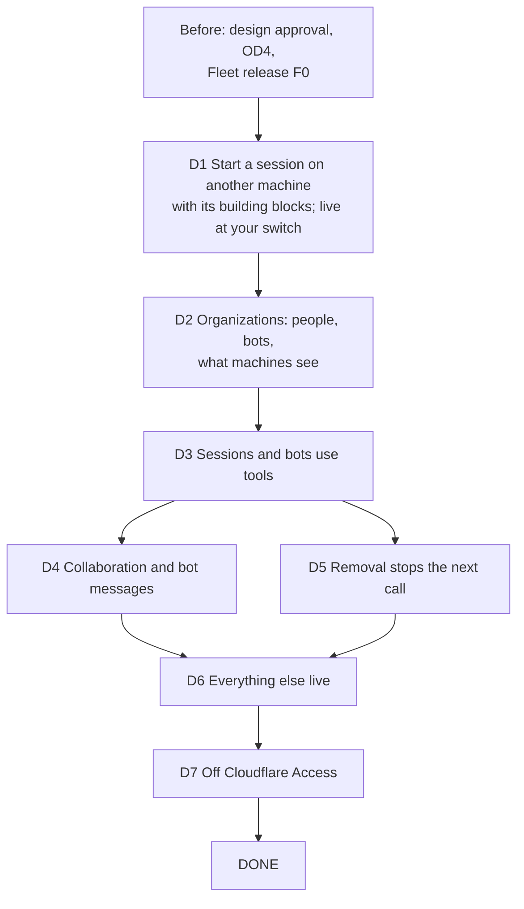

# Agent identity delivery plan

## Result

- **Planning result:** `ready`, plan-only, with one question for you: what runs between your production switch and the second cut (below, "Between the switch and the second cut").
  - Your decisions of 27 October are in the design (`b734d002`). The Sol Reviewer's checks of the changes closed at `b73f308b` with `ready` (`reviewer-recheck-5.md`).
  - The order puts starting a session on another machine first, with its building blocks, at your direction (27 October). The Advisor's review of this order (`advisor-plan-review.md`) is folded in.
  - Nothing is built until you approve the design and this plan.

## How to read this plan

- **A deliverable** is something you can see working end to end, such as "a session on your Mac starts a helper on Sunclaw". It cuts through every part it needs: Fleet central, the Router, the sign-in service, the Tool Portal.
- **A building block** is something a deliverable can't work without, built inside it. D1's building blocks are your sign-in, the organization core, machine login and session registration.
- **A workstream** is one of those parts, owned by one Lead and one repository. Inside a deliverable, each workstream contributes tickets.
- **A ticket** (F15, B5, and so on) is one pull request. Its card says what it covers, what proves it, and what it waits on.
- **Proven** means a deliverable's tickets have merged and its own proofs pass. **Live** means it's deployed: D1 goes live on the private stack at the first joint cut (JC1) and then in production at your switch (PROD2); D2–D5 go live together at the second joint cut (JC2) and then in production (PROD4); Cloudflare Access is removed last (D7).

## The deliverables at a glance

| Deliverable | What you'll see working | Workstreams in it | Waits on |
|---|---|---|---|
| **D1 Start a session on another machine** | You log your Mac and Sunclaw in by device code. A session on your Mac starts a helper on Sunclaw for a project in its workspace, with no SSH. Then your production fleet switches to the new login, and you can do this for real. | sign-in; Fleet central; Router | design approval; OD4 (sign-in tables); the Fleet release F0 |
| **D2 Organizations: people, bots and what machines see** | You add bots and give people and bots their roles; workspace pairs; leaving an organization ends its roles; a machine is told only about the workspaces it serves. | Fleet central; Router | D1 |
| **D3 Sessions and bots use their workspace's tools** | A session gets a token for its workspace through its machine and calls an allowed tool; a disallowed tool, a collaborator and a person are refused. A bot does the same with its own credential. | Router; Fleet central; sign-in; Tool Portal | D2; the Tool Portal remediation (A8) |
| **D4 Collaboration and bot messages** | A false sender is refused. Members message members in allowed workspace pairs. A bot's messages are stored as the bot's. | Fleet central | D3 |
| **D5 Removal stops the next call** | You remove a member and its very next tool call is refused, as soon as the notice arrives. | Fleet central; Tool Portal | D3 |
| **D6 Everything else live** | D2–D5 go live together on the private stack, then in production, with no machine logging in again. | both repositories, and you | D2–D5 |
| **D7 Off Cloudflare Access** | With every rule live, the private stack and then production run with Cloudflare Access removed. | both repositories, and you | D6 |
| **DONE** | Every deliverable proven and live, including on both Fleet central hosts, the sign-in Node host, and Linux's secret store. | — | D7 |

## How the deliverables connect

D1 comes first because it's the capability you need now. It carries only what it can't work without: you must sign in to approve a machine, the machine must log in the new way so Fleet central knows which organization it belongs to, and a session must be registered so Fleet central can check it belongs to the workspace. D2 adds the rest of the organization. D3 needs D2's bots and roles, and the Tool Portal remediation (A1–A8) finished. D4 and D5 run side by side once D3 is proven. D6 takes D2–D5 live together. Cloudflare Access comes off last, because every rule must hold before it goes (R43).

## Between the switch and the second cut (your question)

Putting remote start first means D1 is live in production before D2–D5 exist. For that window, from PROD2 until PROD4:

- **Proposed:** inside your one organization, everything D1 doesn't change works as it does today.
  - Every logged-in machine still reads every workspace, because the filtered view comes in D2.
  - Collaboration calls are attributed to their real session (D1's binding), but aren't yet checked per workspace, because that check comes in D4.
  - The Tool Portal keeps working on today's agent tokens: the sign-in service keeps today's agent path (registration, resource links, workspace policy, release checks) until D3 replaces it.
  - Cloudflare Access stays in front the whole time, and comes off only after everything is live (D7). That's later than the "next change" you described in U34, because R43 requires every rule to hold before Access goes.
- **What it costs:** a bounded period where the new login runs beside today's in-organization behavior, and the sign-in service maintains today's agent path until D3. Only your machines are in the organization, and Access still guards everything.
- **The alternative:** bring the filtered view and the per-workspace collaboration check into D1, and pause the Tool Portal on the private stack between the cuts. That's a larger D1, so remote start comes later, and no Tool Portal in that window.

The identity decisions page asks this one question. Your answer also updates two lines of the design: the Program Design's "no coexistence period" for the sign-in service gains the JC1-to-JC2 window under the proposal, and U34's "remove Access in the next change" becomes "once everything is live".

## Tickets by workstream

The same tickets, seen from the other side: each workstream's tickets, in order, with the deliverable each belongs to. One ticket is one pull request.

**Fleet central and the Router** (Fleet Lead, codex-router)

| Ticket | Deliverable | Waits on |
|---|---|---|
| F1 identity contracts | D1 | F0; design approval |
| F2a organization authority core | D1 | F1 |
| F2b Fleet data per organization | D1 | F2a |
| F3a central receivers and service caller | D1 | F2a |
| F10 machine enrollment, the machine token check, and revocation | D1 | F2a, F3a |
| F11 Router machine login | D1 | F1; B5 for the real flow |
| F4a Router registrar and binding | D1 | F2a, F2b, F11 |
| F14 SO8 machine login journey | D1 | F10, F11, F4a, B5, F15 |
| F15 starting a session on another machine | D1 | F2a, F4a, F10, F11 |
| F8a SO1 journey: sessions and binding | D1 | F4a, F14 |
| F16 SO11 remote start journey | D1 | F15, F14 |
| F12 Router secret store, Linux backend | D1, off the first-use path | design approval |
| F2c bots, roles and workspace pairs | D2 | F2a |
| F2v the filtered view | D2 | F2b, F2c, F11 |
| F3b grant decisions and credential management | D3 | F3a, F4a, F2c |
| F4f Router token forwarder | D3 | F4a, F3b |
| F8b SO1 journey: tokens and tools | D3 | F8a, F4f |
| F6 collaboration admission | D4 | F2c, F4a |
| F7 bot messaging | D4 | F6; B4b |
| F5 removal outbox and notices | D5 | F2c, F10 |
| F9 SO4 conformance on both central hosts | DONE | F2v, F3b, F10, F15 |

**Sign-in service** (Tool Portal Lead)

| Ticket | Deliverable | Waits on |
|---|---|---|
| B1 sign-in core and storage | D1 | OD4 |
| B3 design-thread fixes | D1 | B1 |
| B4a issuer core | D1 | B3; F1's contract fixtures |
| B2 sign-in Node host | D1 | B1 |
| B5 device-code login | D1 | B4a, B2; F1's contract fixtures |
| B4b session and bot tokens | D3 | B4a; F1's contract fixtures |

**Tool Portal** (Tool Portal Lead; the remediation slices A1–A8 are their own plan)

| Ticket | Deliverable | Waits on |
|---|---|---|
| P1a Portal token check | D3 | A8; B4b |
| P1b Portal removal receiver | D5 | P1a |

**Joint and production** (the Tool Portal Lead coordinates; you run the production steps)

| Ticket | Deliverable | Waits on |
|---|---|---|
| JC1 first joint cut, private stack | D1 | D1's tickets merged, F12 aside |
| PROD2 production step 2: the switch | D1 | JC1; your go |
| JC2 second joint cut, private stack | D6 | D2–D5's tickets merged |
| PROD4 production update | D6 | JC2; PROD2; your go |
| JA1 private stack without Access | D7 | JC2 |
| PROD3 production step 3: Access removed | D7 | PROD4 holding; JA1; your go |

## How a contract's real output is checked

Every cross-repository contract (K1–K10) has one home, which publishes the shape its consumer builds and tests against from the start: that is all a ticket waits on. F1 generates the schemas and structural fixtures for the Rust-owned contracts (K2–K4, K8, K9); K1, K5, K6, K7 and K10 keep their agent-vm homes (`tool-access/contracts`, the people sign-in and the issuer). The check that the consumer parses the **real** producer's output (a real decision reply, a real minted token) runs in whichever of the producer's and the consumer's tickets merges second, and must pass before the contract's cut. So no ticket waits on another's runtime output, and nothing that came from a schema is reported as real output.

| Contract | Real producer | Consumer | Real check runs in | Live at |
|---|---|---|---|---|
| K3 person half (admission, standing) | F3a | B4a | the later of F3a and B4a | JC1 |
| K5, K6 (session confirmation, person token) | B3 | F2a | the later of B3 and F2a | JC1 |
| K7 (service tokens) | B4a | F3a | the later of B4a and F3a | JC1 |
| K8 (device-login and machine-token decisions) | F10 | B5 | the later of F10 and B5 | JC1 |
| K9 (machine token claims) | F1 (schema) and B5 (minted) | F10 | as K10 | JC1 |
| K10 (machine tokens as minted) | B5 | F10 | the later of B5 and F10 | JC1 |
| K1 (workspace and collaboration tokens) | B4b | P1a, F3b | P1a; the later of B4b and F3b | JC2 |
| K2 (removal notices) | F5 | P1b | the later of F5 and P1b | JC2 |
| K3 grant half (issuance decisions) | F3b | B4b | the later of F3b and B4b | JC2 |
| K4 (credential and resource management) | F3b | B4b | the later of F3b and B4b | JC2 |

## Goal, scope and non-goals

**Goal:** every identity requirement (U1–U39) delivered and proven on its planned target, with starting a session on another machine usable first. Your production fleet moves to the new machine login in U34's three steps.

**In scope:**
- the identity parts of the sign-in service, the Tool Portal, Fleet central and the Router;
- the device-code machine login;
- starting a session on another machine of the organization (U39);
- the two joint cuts on the private stack, and the production steps.

**Not in scope:**
- the Tool Portal remediation slices A1–A8 (their own plan; D3 waits on A8);
- the Fleet release F0;
- managers' powers;
- machine issuers other than the sign-in service, such as VM creators and platforms (later, U31), and all agent-vm work;
- sessions launched inside VMs, and any proof inside a VM (U35);
- any new check gate. No Linux CI job is added (your call, 27 October).

## Waiting on you

| Decision | Holds | Recommendation |
|---|---|---|
| Design and plan approval | everything | — |
| What runs between the switch and the second cut | D1's scope, and when Access comes off | the proposal above: today's behavior inside your organization, the Tool Portal on today's tokens, Access in front until everything is live |
| OD4, the sign-in tables (now with `deviceCode` and its `enrollmentId`) | D1's B1 | approve the drawn tables and generated SQL together |
| OD2, the default token lifetime | nothing; 5 minutes is built and is one setting | 5 minutes |
| OD-R1 to OD-R4, RD1 to RD6 | as in the delivery orchestration and the remediation design | unchanged |
| Running PROD2, PROD4 and PROD3 | the production steps | at PROD2 you run the new Router build and log every machine in again; nothing in production changes before you say go |

## Basis and review history

- **Originating planner:** `plan-implementation`
- **Governing planning basis:** reviewed four-document design
  - [Requirements](../requirements.md)
  - [Specification](../specification.md)
  - [Program Design](../program-design.md)
  - [Verification Design](../verification-design.md)
  - Review history is in `tmp/practices-research/2026-10-27-identity-four-document-review/`:
    - the four-document review at `66dd3b66`;
    - checks at `33bee8bd` and `5327c6c7`, which closed every correction and returned `decision-needed` on your choices;
    - check 3 at `b05285cf` (`reviewer-recheck-3.md`, needs-revision, RC3-1 to RC3-4) and the Advisor's second look (`advisor-recheck-3.md`, N1 to N4), corrected at `fe47ee33`;
    - check 4 at `fe47ee33` (`reviewer-recheck-4.md`, RC4-1 and RC4-2), corrected at `b73f308b`;
    - check 5 at `b73f308b` (`reviewer-recheck-5.md`): `ready`, no finding left;
    - the Advisor's review of this plan at `ddb75390` (`advisor-plan-review.md`, P1 to P7), folded in here.
  - Applicability anchors: agent-vm `design/portal-remediation`, design at `b73f308b`; codex-router `f465808f` (and `main` for the create path and mail kinds); the sign-in source at `2dfea38e`; Better Auth 1.7.11 (`52ab801c`)
- **Delivery context:**
  - Requested terminal: `plan-only`. You said nothing is built until the design is agreed, so this plan goes to you, not to an Implementer.
  - Delivery grouping: `deliverables`, by your direction (27 October): "each plan parts to be delivery vertical slices and how they correlate. within each deliverable, there are workstreams"; and "the issue with starting sessions in another computer should be first, with the building blocks".
  - PR topology: `separate-prs`. Each ticket is one PR in its own repository, as the delivery orchestration's rule "every slice merges as one pull request" requires.
- **Order it extends:** the [delivery orchestration](../../2026-10-24-delivery-orchestration/program-design.md), which owns the cross-repository order and is updated in the same change.

## Current evidence

- **codex-router `f465808f`:**
  - The Registry's `machine_enrollments` table carries no organization and couples the machine to an Access client (`machine_enrollment.rs:439–445`).
  - Machine identity comes from the Access assertion (`access_rules.rs:104–114, 143–160`), and `/v1/session` requires `Cf-Access-Jwt-Assertion` (`central_router.rs:119–136`).
  - The Fleet object is a singleton address (`core_contract.rs:34–42`; Cloudflare `FLEET`/`fleet`, `object_location.rs:8`; the Tokio key `fleet`, `object_keys.rs:12–17`).
  - Fleet reads are directory, snapshot and a contiguous feed, unfiltered (`session_scope/fleet_reads.rs:20–47`, `fleet_feed_store.rs:80–124`); request admission only binds replication writers to peers (`session_request_admission.rs:7–18`).
  - A machine's connection object has a session face (rank 1) and a delivery face (rank 5) that higher-ranked objects call to push frames to that Router (`call_graph.rs:97–171`); forwarded deliveries already carry a deadline and correlation (`forward_delivery.rs:43–144`).
  - The Router reuses its saved installation and peer IDs (`service_identity_storage.rs:53–67, 120–135`).
  - Off macOS the secret store's data key returns `Unavailable` (`keychain_data_key.rs:164–185`).
  - CI's test job runs the Rust workspace on `ubuntu-latest` (`.github/workflows/ci.yml`).
  - There is no request-rate limit.
- **codex-router `main`:**
  - A create naming a creator on another Router is refused (`collaboration-client/src/conversation_client.rs:312–326`); a create needs an absolute working directory and an execution policy (`provider_conversation_contract.rs:441–451`); a Codex create needs a session as creator (`conversation_create_actor.rs:53–70`).
  - The fleet carries only messages, notifications, cancels and wakes between machines (`collaboration-mail-protocol/src/mail_content.rs:52`).
- **Sign-in source at `2dfea38e`:** today's agent token path reads registration metadata, resource links and workspace policy (`provider-configuration.ts:235–260`), the `oauthClientResource` links (`agent-registration-store.ts:75–84`), and re-checks the minted token's client, claims and links (`sign-in-response-release.ts:114–148`).
- **Better Auth 1.7.11:**
  - The device plugin takes one grant object with added request and persisted fields (`device-authorization/index.ts:137–192`).
  - `redeemDeviceCode` is exported, and redemption is `consumeOne`, a single conditional statement (`routes.ts:509–645`; `drizzle-adapter.ts:1078–1131`).
  - `issueTokens` takes a `referenceId` that the refresh token stores and restores (`types/index.ts:164–173`; `token.ts:594–640, 1957–1969`), and the claim contributor receives it (`types/index.ts:374–392`).
  - The first signed-in visitor claims a pending code's user slot (`routes.ts:866–885`), which is why the owner hooks guard verify, approve and deny.
- **The Tool Portal and sign-in repository** (agent-vm's repository until they move out):
  - Check gates are yours (`scripts/run-check-gate.ts`).
  - Heavy runs go to sunclaw, a Mac.

## Every ticket also passes its repository's existing gates, unchanged

- Tool Portal and sign-in repository: `pnpm check`, `pnpm typecheck`, `pnpm fmt:check`, and the vitest projects it touches. Heavy suites (workerd, `pnpm test:e2e:host`, whole sweeps) run on sunclaw.
- codex-router: `cargo check -p <crate>` and `cargo test -p <crate>` while building, then codex-router's required completion gates. On Apple Silicon these go through its signing runner. The Fleet Lead runs and accepts them, and nothing merges in codex-router without the Fleet Lead.
- No ticket adds or changes a gate.

"Earns" names the Verification Design rows whose passing condition the ticket first meets and the command or journey that observes it. Focused proofs are the ticket's own and never stand in for a row. Proof-layer names come from each repository: the vitest projects (`unit`, `integration`, `e2e-host`) and codex-router's `cargo test -p <crate>` plus `verify-codex-router` journeys. Each deliverable owns its SO4 scenarios, run on Tokio as its tickets land; F9 is the final sweep of all of them on both central hosts.

## D1 Start a session on another machine

**You'll see:** you log your Mac and Sunclaw in by device code, approving each on the sign-in page; a session on your Mac lists the machines that serve its workspace and starts a helper on Sunclaw, in a directory on Sunclaw; you get started, refused (nothing created) or unknown (read the outcome later); one start never makes two sessions; an offline machine is refused, never queued; revoking a machine stops it and removes its sessions. Then your production fleet switches to the new login (PROD2), and you can do this on your real machines.

**Its building blocks**, each needed for the feature to work:

| Building block | Why D1 needs it | Tickets |
|---|---|---|
| Your sign-in and the organization core | You approve each machine as the organization's owner, and Fleet central holds the organization, its machines and their workspaces | B1, B3, B4a · F1, F2a, F2b, F3a |
| Machine login | Fleet central must know which organization a machine belongs to and that its login is current | B2, B5 · F10, F11, F14 |
| Session registration | Fleet central must know the requesting session is a member of the workspace | F4a, F8a |
| The feature | the start itself, through Fleet central over both machines' connections | F15, F16 |
| Going live | the private stack first, then production | JC1, PROD2 |

| Workstream | Tickets |
|---|---|
| Sign-in (Tool Portal Lead) | B1, B3, B4a, B2, B5 |
| Fleet central (Fleet Lead) | F1, F2a, F2b, F3a, F10, F15 |
| Router (Fleet Lead) | F11, F4a; F12 after first use |
| Proof (Fleet Lead) | F14, F8a, F16 |
| Joint, then you | JC1, PROD2 |

D1's first use is from your Mac to Sunclaw, both macOS. F12 (the Linux secret store) belongs to machine login but isn't on that path: a Linux machine without it already keeps its login in memory. It can land any time and must be merged before DONE.

**That's 16 implementation and proof tickets, plus JC1 and PROD2, before remote start works in production.** The first point you can watch it work is SO11 (F16) running two Routers against a local Fleet central.

**Proven by:** SO8 (F14); SO11 (F16); SO1's session and binding cases (F8a); D1's SO4 scenarios (organization, admission, guard, machine login, revocation, registration and remote start); SO2's people sign-in and device-code cases; SO7 for these edges; SO9 on macOS; then, at JC1, SO8, SO11 and JP4 against the private stack, the legacy-path control below, and SO10 step 2. **Done when:** PROD2 holds, with every machine on the new login.

**B1 sign-in core and storage (extended).**
- **Covers:** R29–R33, with the device grant's `deviceCode` table (our four columns and `enrollmentId`) in the one schema module. Today's agent registration, its metadata and its `oauthClientResource` links move onto the new storage unchanged, and stay until B4b.
- **Earns:** U22, U23, U24 and U25 in SO2 on D1.
- **Waits on:** OD4.

**B3 design-thread fixes:** unchanged; produces K5 and K6, and runs their real-output check against F2a's guard if it merges after F2a.

**B4a issuer core (split from B4).**
- **Covers:** R26, R27 (issuer side), R38 (no workspace, collaboration or machine token for a person; people do get their admin and operator tokens), people sign-in asking central for admission (K3's person half), person confirmation; the closed token-kind dispatch and its refused combinations; one-operation service tokens (K7).
- **Keeps today's agent path until B4b:** the agent client-credentials row, the provider configuration's registration metadata, resource links and workspace policy, and the post-mint release checks. So the Tool Portal keeps working, unchanged, between the cuts.
- **Earns:** SO2's people sign-in through central's admission and a person's tool-token request refused; SO7's issuer side for D1's edges.
- **Focused proof:**
  - **Wrong behaviors caught:** a person token minted for a workspace, collaboration or machine audience; a service token valid for a second operation; today's agent token refused, or minted without its link and release checks.
  - **Layer:** sign-in core unit tests, then the real provider (integration).
  - **Oracle:** the dispatch table, C7.
- **Waits on:** B3; F1's contract fixtures.

**B2 sign-in Node host:** unchanged; the local journeys run the sign-in service on it.

**B5 device-code login (new).**
- **Covers:** R42, R40 (issuer side), R31 (single use):
  - the Router login client;
  - the grant object with the machine fields;
  - owner before-hooks on verify, approve and deny;
  - the approve hook sending `DecideDeviceLogin` and storing `enrollmentId` on the code;
  - our device-code token handler, redeeming with `redeemDeviceCode` and minting with `referenceId` = `<organizationId>:<enrollmentId>`;
  - the contributor deciding device-code and refresh mints from `input.referenceId` only;
  - OD6's 10-minute lifetime;
  - the dispatch row and refused combinations;
  - K10 (machine tokens from the real issuer).
- **Writes:** `packages/auth` `sign-in-core/device-login/`, the provider configuration, the dispatch.
- **Earns:**
  - SO2's device-code cases on D1 and `better-sqlite3`, including non-owner verify and deny, two machines under one owner kept apart across rotation and restart, and the held-grant window;
  - U22's redemption race;
  - U24's codes-not-UUIDs;
  - U25's single-use family.
- **Focused proof:**
  - **Wrong behaviors caught:**
    - a non-owner claiming or denying a code;
    - a code redeemed twice;
    - one machine's refresh minting another's token, including across two organizations;
    - a refresh after revocation minting.
  - **Layer:** sign-in core tests with a central client stand-in (unit), then the real provider on both databases (integration).
  - **Oracle:** C8, R40, R42.
- **Waits on:** B4a, B2; F1's contract fixtures.
- **Stop if:** at 1.7.11 the token handler can't be registered for the device-code grant type, or `referenceId` raises a consent requirement for the Router login client. Then take the fallback, our own device endpoints through `issueTokens` with the same reference, proven by the same rows.

**F1 identity contracts (extended).**
- **Covers:** R26, plus every shape the deliverables need, and each contract's schema and structural fixtures (not real output; see "How a contract's real output is checked"):
  - the machine-login shapes: `MachineTokenClaims` and a `MachinePrincipal` kept outside the actor `Principal`, `DecideDeviceLogin`, `DeviceLoginDecision`, `DecideMachineToken`, `MachineTokenDecision` (with `decided_at`), `AdmitMachineConnection`, `MachineConnectionAdmission`, `MachineEnrollment` (reserved, approved, enrolled, revoked, expired), `AdmissionId`/`AdmissionRef`;
  - the view frames `Withheld` and `ScopeChanged`;
  - the remote-start shapes: `RequestRemoteStart`, `RemoteLaunch`, `RemoteStartAdmission`, `StartRequestedSession`, `ReportRemoteStart`, `RemoteStartAnswer`, `RemoteStartResult`, `RemoteStartStatus`, `ListWorkspaceMachines`, and the `remoteSession` starter.
- **Writes:** `collaboration-central-core/src/identity_contract.rs`, generated schema.
- **Earns:** SO6's Rust half; U1's focused parse cases.
- **Focused proof:**
  - **Wrong behaviors caught:** a closed variant serialized under a different tag than the Program Design names; `machine` parsing as an actor.
  - **Layer:** `cargo test -p collaboration-central-core` round trips.
  - **Oracle:** the Program Design's shapes.
- **Waits on:** F0; design approval.

**F2a organization authority core (split from F2).**
- **Covers:** R5 (people's admission at central), R7 (the session registry), R13 (admin commands and the owner guard; the operator check through the sign-in service, built and enabled at PROD2), R14 (lookups for people, machines and sessions), R34 (organization-scoped rows; cross-organization references answer as unknown), R35 for people; organizations and their owner; machine allowances; the ordered marks. Runs the real-output check for K5 and K6 against B3's issuer if it merges after B3.
- **Earns (its SO4 scenarios):** U21's command and guard cases; U27's central half for people, machines and sessions.
- **Focused proof:**
  - **Wrong behaviors caught:** an admin command applied without the current owner; a reference to another organization answering differently from a missing one.
  - **Layer:** `cargo test -p collaboration-central-core organization_authority`.
  - **Oracle:** R13, R34, R35.
- **Waits on:** F1.

**F2b Fleet data per organization (new).**
- **Covers:** R34's storage separation (OD8): the Fleet object addressed by organization, the first organization adopting today's storage through a fixed mapping on both hosts, and refusing the old address.
- **Writes:** `core_contract.rs` addresses, `call_graph.rs`, both hosts' object routing.
- **Earns:** SO4 "one Fleet object per organization, read back after a restart".
- **Focused proof:**
  - **Wrong behavior caught:** the first organization's workspaces not found after the change.
  - **Layer:** a migration test over a populated Fleet store on both hosts.
  - **Oracle:** today's rows.
- **Waits on:** F2a.

**F3a central receivers and service caller (split from F3).**
- **Covers:** R27 (central side): the C7 service caller, central's receivers checking each service token's audience, scope and operation, and the person admission and standing decisions (K3's person half).
- **Earns:** SO7 for the person admission and standing edges; U15's framework.
- **Focused proof:**
  - **Wrong behavior caught:** an operation picked from the body, not the audience and scope.
  - **Oracle:** the C7 table.
- **Waits on:** F2a.

**F10 machine enrollment, the machine token check, and revocation (new).**
- **Covers:** R39, R40, R42 (central side), C9, and R19's local part for machines:
  - enrollments in the organization authority;
  - the Registry's `fleet_machines` index and the authorize, claim, then activate or cancel sequence, idempotent on the request ID;
  - reserved and approved enrollments, and supersession at an enrollment's first token;
  - the active-enrollment check on every decision;
  - `DecideDeviceLogin`, `DecideMachineToken`, `AdmitMachineConnection`, with their receivers (K8) on F3a's service edges;
  - `RevokeMachineEnrollment` as one organization-authority transaction: allowances withdrawn, the machine's sessions removed, its connection closed. D5's F5 adds the removal notices to the Tool Portal on top of this same transaction;
  - the token check for the sign-in service's machine tokens, refusing any other issuer;
  - `RenewMachineToken`, and closing expired and superseded connections;
  - the single-valued `machineLogin` setting (production stays `accessEnrollment`);
  - the entry's request limit.
- **Writes:** `organization_authority`, the Registry object, new `machine_token_check`, `central_router.rs` `/v1/session`, both hosts' entries.
- **Earns (its SO4 scenarios):** U31, U33's central half, and revocation's local effects; SO7 for the decision edges.
- **Focused proof:**
  - **Wrong behaviors caught:**
    - a claim written for a refused attempt;
    - an unredeemed approval superseding a working enrollment;
    - a superseded connection getting a grant;
    - a token for another organization, or from another issuer, admitted;
    - a revoked machine keeping a session or an allowance.
  - **Layer:** `cargo test -p collaboration-central-core machine_` with a controlled clock, reading both owners after each refusal.
  - **Oracle:** C9's accept and refuse lists, R19, R39, R40.
  - **Property:** for any interleaving of two organizations' authorized attempts on one installation, at most one claim exists, and it belongs to an authorized attempt.
- **Waits on:** F2a, F3a.

**F11 Router machine login (new).**
- **Covers:** R40, R41 (Router side):
  - the device-code flow run in the Router host, with `fleet login` asking the host and printing the code;
  - `RefreshCredentialKeeping` (`encryptedStore`, `memoryOnly`), chosen at host start from the store's classified result and reported at login; a denied or damaged store refuses login and is left untouched;
  - presenting and renewing the token;
  - deleting the old enrollment credential after a new login;
  - refusing a second organization.
- **Writes:** `codex-router-host` `fleet_machine_login`, `codex-router-cli`.
- **Earns (in SO8, with F14):** U33's Router half; R41's memory-only and damaged-store cases.
- **Focused proof:**
  - **Wrong behaviors caught:** a second long-lived credential kept; the memory-only credential written to disk; a damaged store treated as absent or overwritten; the installation ID lost on re-login.
  - **Layer:** `cargo test -p codex-router-host fleet_machine_login` with an injected store and clock.
  - **Oracle:** R40, R41.
- **Waits on:** F1; B5 for the real flow (stand-in: a device-code server honoring C8 in tests, named unverified until SO8).

**F4a Router registrar and binding (split from F4).**
- **Covers:** R3, R7, R8, R23, R24. Registration goes to the machine's organization authority, which looks the project up in its own Fleet object, and checks that the connection's enrollment is the active one. The session binding attributes every collaboration call to the session it came from.
- **Earns (in SO1, with F8a):** U6/U32, U19, U18.
- **Waits on:** F2a, F2b, F11.

**F14 SO8 machine login journey (new, TypeScript).** `verify-codex-router` `fleet-machine-login`, with registered sessions (F4a), including a Router host started with no encrypted store and restarted, and one with a damaged store. At D1, the old connection left open after a re-login is checked with a registration and a remote start, each refused and the connection closed, against a positive control on the new connection; the session-token case is added once F3b exists (D3).
- **Earns:** U33/U31 (consumer side), U17/U33/U35 on macOS, U14's renewal case, and revocation removing sessions.
- **Waits on:** F10, F11, F4a, B5, and F15 for the remote-start control.

**F15 starting a session on another machine (new).**
- **Covers:** R46, R8's extension, C11:
  - the organization authority's admission of `RequestRemoteStart`, its remote-start records (body, deadline, bound session; `forwarded`, `started`, `refusedByTarget`, `refused`, `unknown`, late `started`), and the lapse to `unknown` on a wake;
  - delivering `StartRequestedSession` through the target connection's delivery face, and `RemoteStartAnswer` back through the requester's, both keyed by the request ID;
  - accepting a `remoteSession` starter only for its own forwarded record, and binding one session to it;
  - `RemoteStartStatus` (the original requester only) and `ListWorkspaceMachines`;
  - the Router's create path sending `RequestRemoteStart` for another machine, with the same-Router check kept for local creates, and reporting `unknown`, never a refusal, once the request may have reached central;
  - the target's handler: the deadline check, the request ID as its create's operation ID, the working directory checked on the target before creating, then the session registrar.
- **Writes:** `organization_authority` (`remote_start` table), the connection protocol's new frames, `collaboration-client` `conversation_client.rs`, `collaboration-service` (new `remote_session_start`).
- **Earns:** its SO4 scenarios (U39's central half).
- **Focused proof:**
  - **Wrong behaviors caught:** a start delivered to a machine without an allowance for W; a refusal that reveals another organization's machine; two sessions from one start; an answer reaching the wrong start; a lost answer reported as refused; a lapsed start redelivered; a `remoteSession` starter accepted without a forwarded record.
  - **Layer:** `cargo test -p collaboration-central-core remote_start` with a controlled clock, and `cargo test -p collaboration-client` for the create path.
  - **Oracle:** R46, C11's result table.
- **Waits on:** F2a, F4a, F10, F11.
- **Stop if:** the delivery face can't carry a request to the Router and its outcome back without a protocol version change. That is a design correction, routed back before this ticket.

**F8a SO1 journey: sessions and binding (split from F8).** Real sessions on each harness path start and restore on a Router logged in by device code (F14's arrangement), register in their project's workspace, have their collaboration calls attributed through their binding, and record their isolation; a false sender is refused.
- **Earns:** U6/U32, U19, U18 in SO1.
- **Waits on:** F4a, F14.

**F16 SO11 remote start journey (new, TypeScript).** `verify-codex-router` `fleet-remote-start`: two Routers under isolated debug Hosts with different directories, a local Fleet central, a third Router in another organization; B creates a real Codex conversation (a provider account on the run machine, as SO1).
- **Earns:** U39.
- **Waits on:** F15, F14.

**F12 Router secret store, Linux backend (new; off the first-use path).**
- **Covers:** R41 and R44 for the store. `systemd_credential_data_key.rs`: `read_secret` reads `$CREDENTIALS_DIRECTORY`, `add_secret` returns `Unavailable`. The installer step seals the key with `systemd-creds` and writes the unit's `LoadCredentialEncrypted=`. No credentials directory, or no credential in it, reads as absent (memory-only); an unreadable or invalid credential is an error.
- **Earns:** SO9's Linux tests in codex-router's existing CI test job.
- **Focused proof:**
  - **Wrong behaviors caught:** a plaintext fallback in a production build; an invalid credential read as absent.
  - **Layer:** `cargo test -p codex-router-secret-store`, reading a credentials directory as systemd hands it over. The existing `ubuntu-latest` test job runs it with no workflow change.
  - **Oracle:** R41.
- **Waits on:** design approval. Must be merged before DONE.
- **Named unverified:** sealing with `systemd-creds` and running the Router as a service; no Linux job is added.

**JC1 first joint cut, private stack (new).**
- **Before it:** the cut inventory: every serving component instance (sign-in Worker and Node host, Fleet central, the Tool Portal Worker and Node host, which this cut leaves untouched), every caller cohort (test Routers, test bot), each audience and the Fleet central each sign-in service asks.
- **Covers:** D1 live together on the private stack: the sign-in service with B1–B5 and Fleet central with F1, F2a, F2b, F3a, F4a, F10, F11 and F15, on `machineLogin = machineTokens` behind the test Access application. The test Routers log in by device code. Every contract D1 changes goes live whole: K3's person half, K5–K10.
- **Earns:** SO8 and SO11 against the private stack; JP4 (your admin command through the sign-in service); SO10 step 2 on the private stack; U34's step-2 row; and the **legacy-path control**: a legacy agent client gets a fresh token from the new issuer and makes one allowed tool call at the unchanged Tool Portal, on the Worker and the Node host, while a forbidden call is still refused. The control reruns at every deploy until JC2.
- **Waits on:** D1's tickets merged: B1, B2, B3, B4a, B5, F1, F2a, F2b, F3a, F4a, F10, F11, F15, and the proof tickets F14, F8a and F16, with their local runs passing.
- **Follows** the orchestration's cutover procedure: freeze, deploy, read back builds, prove, resume.

**PROD2 production step 2: the switch (new; you run it).**
- **Before it:** the production cut inventory, naming the sign-in deployment that serves your production fleet and the production Fleet central it asks, and every caller cohort.
- **Covers:** R43 step 2 in production:
  - Fleet central deploys D1's changes with `machineLogin = machineTokens`, the old login's code and table removed, the first organization created for you adopting today's Fleet storage (F2b), and operator commands through the sign-in service;
  - you run the new Router build and log every machine in again by device code.
- **Earns:** U34's production line, and starting a session on another machine on your real machines: each machine connects with machine tokens; the old credential is refused (one spot check); your sessions, allowances and board relationships are still attached; a session on your Mac starts a helper on Sunclaw.
- **Waits on:** JC1; your go.
- **If it breaks:** fix forward. There is no revert to the old login, because a machine revoked after the switch could regain access through it. Access still guards central meanwhile.

## D2 Organizations: people, bots and what machines see

**You'll see:** you add bots to the organization; you make people and bots members or collaborators of workspaces, and allow workspace pairs; ending someone's admission ends their roles, and re-adding them brings no role back; a machine reads only the workspaces it serves, with paired workspaces shown by name only.

| Workstream | Tickets |
|---|---|
| Fleet central | F2c bots, roles and workspace pairs |
| Fleet central and Router | F2v the filtered view |

**Proven by:** D2's SO4 scenarios (admission, roles, filtered view) and F2v's replica read with a real Router against a local Fleet central. **Done when:** those pass and the tickets have merged. Live at D6's second cut.

**F2c bots, roles and workspace pairs (split from F2).**
- **Covers:** R6, R10, R14 (bots and roles in lookups), R20, R35 for bots, R36 (OD5), R37; the generalized `Collaboration`; bots, memberships, collaborations and workspace pairs, each keyed by the admission it was granted under.
- **Earns (its SO4 scenarios):** U26/U36; U4/U5's central half; U27's central half for roles.
- **Focused proof:**
  - **Wrong behaviors caught:** a role that still counts after its admission ends; an old role revived by readmission.
  - **Layer:** `cargo test -p collaboration-central-core organization_authority`.
  - **Oracle:** R35–R37.
  - **Property:** for any sequence of admit, grant, end and readmit, a role counts exactly while its admission ID is active.
- **Waits on:** F2a.

**F2v the filtered view (split from F2b).**
- **Covers:** U29's view: each machine's visible set, pushed by the organization authority; directory, snapshot and feed filtered, with `Withheld` and `ScopeChanged`; the Router's replica applying them and reconciling its scope at each connection.
- **Writes:** the Fleet read paths; the Router's replica feed consumer.
- **Earns:** its SO4 scenarios (U27/U29), and SO1's replica-read case run here with a real Router against a local Fleet central; F8b reuses it.
- **Focused proof:**
  - **Wrong behaviors caught:** a snapshot leaking a paired workspace's boards; a withheld feed position breaking or stalling the cursor; a scope change missed while disconnected.
  - **Layer:** read-path tests per frame; the replica's consumer tests; the replica read against a local central.
  - **Oracle:** the view contract.
- **Waits on:** F2b, F2c, F11.

## D3 Sessions and bots use their workspace's tools

**You'll see:** a session on a logged-in machine gets a token for its workspace through its machine and calls an allowed tool; a disallowed tool, a collaborator and a person are refused; a narrowed persona is never widened; a bot does the same with its own credential; each organization has its own Tool Portal deployment.

| Workstream | Tickets |
|---|---|
| Sign-in | B4b session and bot tokens |
| Fleet central | F3b grant decisions and credential management |
| Router | F4f Router token forwarder |
| Tool Portal | P1a Portal token check |
| Proof | F8b SO1 journey: tokens and tools |

**Proven by:** SO1 (F8b); SO8's session-token case; SO2; SO3 (`pnpm test:e2e:host` on sunclaw); SO6; SO7 for these edges; D3's SO4 scenarios. **Done when:** those pass and the tickets have merged. Live at D6's second cut, where the token claims and the Portal's check go live together.

**B4b session and bot tokens (split from B4).**
- **Covers:** R1, R4, R15, R16, R18, R25: workspace and collaboration token claims (K1), the fleet-session grant, bot claims and the bot credential receivers (K4), the collaboration resource, mint timing. Removes today's agent path that B1 and B4a kept: the client-credentials row, registration metadata, resource links, workspace policy and the old release checks.
- **Earns:** U2, U10/U11 (issuer half), U12, U30 (issuer half), U4/U5 in SO2.
- **Waits on:** B4a; F1's contract fixtures.

**F3b grant decisions and credential management (split from F3).**
- **Covers:** R18, R25 (central side): bot and session issuance decisions (K3's grant half), credential and resource management toward the sign-in service (K4), the collaboration token check (K1).
- **Earns:** SO7 for these edges; U2's central half in its SO4 scenarios.
- **Focused proof:**
  - **Wrong behavior caught:** a grant decided while the truth is unavailable; a decision for a session on a machine without an allowance.
  - **Oracle:** C2, R25.
- **Waits on:** F3a, F4a, F2c.

**F4f Router token forwarder (split from F4).**
- **Covers:** R2's token path: the Router's forwarder getting, caching in memory and attaching each session's token; refetching before `grant_expires_at` and once on a 401.
- **Earns (in SO1, with F8b):** U3/U17.
- **Waits on:** F4a, F3b.

**P1a Portal token check (split from P1).**
- **Covers:** R9 (persona narrowed at the Portal), R17 (token-only), R38 (no requester field read), R45 (one organization per deployment; configuration refuses a second); remediation store version 2 with principal keys and R9 (no approval revived at the re-key). Runs the real-output check for K1 against B4b's issuer.
- **Earns:** U10/U11, U12's Portal half, U37 and U30's Portal half in SO3.
- **Waits on:** A8; B4b.

**F8b SO1 journey: tokens and tools (split from F8).** Token use and tool calls on each harness path, other-organization starts, reusing F2v's replica read; SO8's session-token case for an old connection. D4 and D5 add their cases to this journey.
- **Earns:** U3/U17, U27/U29's Router half in the full journey.
- **Waits on:** F8a, F4f.

## D4 Collaboration and bot messages

**You'll see:** a session posting as another session is refused; members message members of an allowed workspace pair; a collaborator only messages and tasks members; a bot's messages are stored as the bot's.

| Workstream | Tickets |
|---|---|
| Fleet central | F6 collaboration admission; F7 bot messaging |

**Proven by:** SO1's collaboration cases (added to F8b's journey); SO3's collaborator refusals; D4's SO4 scenarios. **Done when:** those pass and the tickets have merged. Live at D6's second cut.

**F6 collaboration admission, F7 bot messaging:** as in the delivery orchestration. Collaboration admission also answers `unknownTarget` across organizations, admits nothing for a person's collaboration, and refuses a superseded connection.
- **Earns:** U7/U8/U28 in SO1.
- **Waits on:** F2c and F4a (F6); F6 and B4b's collaboration tokens (F7).

## D5 Removal stops the next call

**You'll see:** you remove a member, retire a bot, revoke a machine or change a persona, and the next call is refused once the notice arrives; a token decided before the removal but minted after it is refused; the admin view shows a removal as pending until every workspace has it.

| Workstream | Tickets |
|---|---|
| Fleet central | F5 removal outbox and notices |
| Tool Portal | P1b Portal removal receiver |

**Proven by:** SO1's removal cases; SO3's removal cases; D5's SO4 scenarios; SO5 at the second cut. **Done when:** those pass and the tickets have merged. Live at D6's second cut.

**F5 removal outbox and notices (extended).**
- **Covers:** R19–R21: removal notices to the Tool Portal (K2) with acknowledgement and resend, in the same transaction as each removal. A machine's revocation keeps F10's local transaction and adds its notices to it; nothing is duplicated.
- **Earns:** U13's central half in its SO4 scenarios.
- **Focused proof:**
  - **Wrong behavior caught:** a grant decided after the removal's commit; a revocation whose notice and local effects can disagree.
  - **Layer:** `cargo test` with interleaved decisions.
  - **Oracle:** R19.
- **Waits on:** F2c, F10.

**P1b Portal removal receiver (split from P1).**
- **Covers:** R19–R22 (Portal side): the removal receiver (K2), stored marks, `deriveRemovalSubjectKey`.
- **Earns:** U13's Portal half in SO3.
- **Waits on:** P1a.

## D6 Everything else live

**You'll see:** D2–D5 go live together on the private stack, with their joint proofs passing; then Fleet central in production gets the same changes, and no machine logs in again.

| Workstream | Tickets |
|---|---|
| Both, the Tool Portal Lead coordinating | JC2 second joint cut |
| codex-router, with you | PROD4 production update |

**Proven by:** JP1–JP3 and SO5 at JC2; the production observation at PROD4. **Done when:** PROD4 holds.

**JC2 second joint cut, private stack (new).**
- **Before it:** the cut inventory, as at JC1, now including the Tool Portal Worker and Node host, and any production caller of a shared component.
- **Covers:** D2–D5 live together on the private stack: B4b, P1a, P1b, F2c, F2v, F3b, F4f, F5, F6, F7. The token claims and the Portal's check go live together, so issuer-to-Portal calls never break; today's agent path goes. Every remaining contract goes live whole: K1, K2, K3's grant half, K4.
- **Earns:** JP1 (a real token, one effect), JP2 (removal stops the next call), JP3 (refusals); SO5.
- **Waits on:** D2–D5's tickets merged; JC1.
- **Follows** the orchestration's cutover procedure, as at JC1.

**PROD4 production update (new; you run it).**
- **Before it:** the production cut inventory: the production counterparts of every component JC2 changed, so each contract goes live whole in production too.
- **Covers:** production gets D2–D5's changes on every component the inventory names. No machine logs in again; machines keep their tokens.
- **Earns:** the production observation: a session's tool call works through its token, and a removal stops the next call.
- **Waits on:** JC2; PROD2; your go.

## D7 Off Cloudflare Access

**You'll see:** with every rule live, the private stack and then your production fleet run with Cloudflare Access deleted; every machine still connects, and an unauthenticated request changes nothing.

| Workstream | Tickets |
|---|---|
| Both | JA1 private stack without Access |
| codex-router, with you | PROD3 production step 3 |

**Proven by:** SO10 step 3 at JA1; the production observation at PROD3. **Done when:** PROD3 holds.

**JA1 private stack without Access (new).**
- **Covers:** R43 step 3 on the private stack: delete the test Access application.
- **Earns:** SO10 step 3 (SO8 against the test central; unauthenticated, malformed and wrong-kind requests change nothing; the request limit) and U34's step-3 row.
- **Waits on:** JC2.
- **Stop if:** anything fails. Then restore the test Access application and fix forward; production is untouched.

**PROD3 production step 3: Access removed (new; you run it).**
- **Covers:** R43 step 3 in production: delete the production Access application, and the Routers' Access headers and stored Access token.
- **Earns:** the step-3 production observation: every machine still connects; an unauthenticated request changes nothing.
- **Waits on:** PROD4 holding for a period you choose; JA1; your go.

## DONE

- **F9 SO4 conformance (extended):** the final sweep of every deliverable's SO4 scenarios on both central hosts (Tokio and local workerd). Earns U9, U21/U31, U26/U36, U27/U29, U39's central half and U34's lasting negatives on both hosts. Waits on F2v, F3b, F10, F15.
- **Covers:** the orchestration's DONE, plus SO8 on macOS, SO9's Linux tests in codex-router's existing CI, and SO11.
- **Waits on:** PROD3 (and through it PROD4, JA1, JC2, PROD2 and JC1), B2, F7, F8b, F9, F12, F14, F16, P1b.

## Dependency edges that matter

- **Contracts:** each contract's home publishes its shape before every consumer (F1 for the Rust-owned ones). Each real-output check runs in the later of its producer's and consumer's tickets ("How a contract's real output is checked"), so no ticket waits on another's runtime output.
- **Storage before registration:** F2b comes before F4a, because registration looks the project up in the organization's own Fleet object.
- **Machine login before sessions:** F11 comes before F4a, because registration checks the connection's enrollment.
- **Registration before remote start:** F4a and F11 come before F15, because the target registers the new session and both machines must be logged in.
- **Two cuts, each whole:** JC1 takes D1's contracts live together (K3's person half, K5–K10); JC2 takes the rest live together (K1, K2, K3's grant half, K4). No contract goes live in halves, on the private stack or in production.
- **Steps in order:** JC1 → PROD2; then JC2 → PROD4; then JA1 → PROD3. Each only after the previous step's observations pass.
- **The deploy holds:** from B4a or B5 merging until JC1, and from B4b, P1a or P1b merging until JC2, the sign-in Worker (and, for the second, the Tool Portal) isn't deployed from master.

## Why pieces were split (a planning call, recorded)

Splitting a piece at its natural seam lets each deliverable carry only what it needs, so remote start can go first and no deliverable waits on a later one:
- **B4** into B4a (dispatch, service tokens, person admission, keeping today's agent path) and B4b (session and bot tokens, removing the old path).
- **F2** into F2a (the organization core: organizations, owner, people admission, admin guard, machine allowances, sessions) and F2c (bots, roles, workspace pairs).
- **F2b** into F2b (Fleet data per organization) and F2v (the filtered view).
- **F3** into F3a (receivers and service caller, person edges) and F3b (grant decisions and credential management); the machine-login decision receivers moved into F10.
- **F4** into F4a (registrar and binding) and F4f (the token forwarder).
- **F8** into F8a (sessions and binding) and F8b (tokens and tools).
- **P1** into P1a (token check and store version 2) and P1b (the removal receiver).

Revocation's local transaction stays whole in F10; F5 only adds notices to it.

What it costs: seven more PRs, a second joint cut, and today's agent path maintained in the sign-in service until D3. What it gains: starting a session on another machine is usable in production after D1, before the token and Portal work, and each deliverable is proven in order.

## Verification Design rows, scheduled

| Row | Deliverable | Ticket that earns it | Command or journey | When |
|---|---|---|---|---|
| U1 | D1 | F1, B4a | `cargo test -p collaboration-central-core`; sign-in unit; SO6 | in each ticket |
| U2 | D3 | B4b, F3b | SO2; SO4 | B4b; F3b |
| U3, U17 | D3 | F4f, F11 | SO1, SO2, SO8; structural search | F8b; F14 |
| U4, U5 | D2, D3 | F2c, B4b | SO4; SO1 + SO2 | F2c; F8b |
| U6, U32 | D1 | F4a | SO1 | F8a |
| U7, U8, U28 | D4 | F6, F7 | SO1; SO3; SO4 | F6; F7 |
| U9 | D1, D2 | F2a, F2c, F10 | SO4 + SO1 + SO8 | F2a; F2c; F14 |
| U10, U11 | D3 | P1a | SO3 (`pnpm test:e2e:host`, sunclaw) | P1a |
| U12 | D3 | B4b, P1a | SO2; SO3 | each ticket |
| U13 | D5 | F5, P1b | SO1, SO3, SO4, SO5 | F5; P1b; JC2 |
| U14 | D1, D3 | B5, F3b | SO1, SO2, SO8, SO5 | F14; F8b; JC2 |
| U15 | D1, D3 | F3a, F3b | SO7 | F3a; F3b |
| U16 | DONE | B2, F9 | SO2/SO3/SO4 on both hosts | DONE |
| U18 | D1 | F4a | SO1 + SO4 + SO6 | F8a |
| U19 | D1 | F4a | SO1 | F8a |
| U20 | D1 | B3, F2a | `verify-auth` bootstrap + SO4 + SO7 | F2a |
| U21, U31 | D1 | F2a, F10, B5 | SO4; SO8; SO2 | F2a; F10; F14; B5 |
| U22 | D1 | B1, B5 | SO2 on both databases | B1; B5 |
| U23 | D1 | B1, B2 | SO2 on both hosts | B2 |
| U24, U25 | D1 | B1, B5 | SO2 readback; Hegel families | B1; B5 |
| U26, U36 | D2 | F2c | SO4 | F2c |
| U27, U29 | D1, D2 | F2a, F2b, F2c, F2v | SO4 (filtered view); SO1's replica read | F2a; F2v |
| U30 | D1, D3 | B4a, B4b, P1a | SO2; SO3 | B4b; P1a |
| U33, U31 | D1 | F10, F11, B5 | SO8; SO2; SO4 | F10; F14 |
| U17, U33, U35 (R41) | D1 | F11, F12 | SO8; SO9 | F14; F12 |
| U34 | D1, D7 | F10, JC1, PROD2, JA1, PROD3 | SO10 (temporary); SO4 | JC1; JA1 |
| U35 | D1 | F12, F14 | SO9 | F12; F14 (the end-to-end Linux login stays unverified, your call) |
| U37 | D3 | P1a | SO3 | P1a |
| U39 | D1 | F15, F16 | SO4; SO11 | F15; F16; JC1; PROD2 |

## Existing tests these tickets touch

| Existing tests | Ticket | Disposition | Proof for a removal |
|---|---|---|---|
| codex-router `machine_enrollment.rs` tests of the enrollment credential and the Access-client match | F10 (old path kept behind `accessEnrollment` until PROD2) | keep through step 1; remove in the PROD2 change | dead contract: R43 retires the old login at step 2; F10's machine-token tests fail on the same wrong behavior (an unauthorized machine connecting) |
| codex-router `access_rules.rs` tests deriving the machine from the Access assertion | F10 | keep through step 1; remove in the PROD2 change | dead contract (R43 step 2); SO4's "same answer whatever Access identity" fails on a build that reads Access identity |
| codex-router `enrollment_prepare.rs` tests (operator token, expiry matching Access) | F10 | remove in the PROD2 change | dead contract: `EnrollMachine` is gone from step 2 |
| codex-router `keychain_data_key.rs` test that non-macOS returns `Unavailable` | F12 | repair: on Linux, absent only when no credentials directory or credential is present, and the Router then keeps memory only | — |
| codex-router Fleet read tests that assume every connection reads every record | F2v | repair: the same reads under a visible set that includes everything, plus new filtered cases | — |
| codex-router `collaboration-client` tests of the same-Router create check | F15 | keep for local creates; add remote-start cases beside them | — |
| sign-in integration tests on `node:sqlite` | B1 | repair onto `better-sqlite3` and D1, as the orchestration already plans | — |
| sign-in agent-path tests (registration metadata, resource links, release checks) | B1, B4a keep; B4b | keep through D1; remove in B4b | dead contract at JC2: B4b replaces the path; SO3's refusal cases and JP1 fail on a build that still serves it |
| Portal membership and agent-management tests | P1a | remove | dead contract: R17 (token-only) and the Program Design's "Removed" list; SO3's refusal cases fail on a build that reads membership from the store |

## Integration gates

- **F10 with B5:** a real issuer's machine token first meets central's check, in the later of the two tickets; the real path is SO8 in F14.
- **F11 with F10 and B5:** SO8 is the first run of the whole device-code login across processes.
- **F15 with two Routers:** SO11 is the first remote start across processes, with a real conversation created on the target.
- **JC1:** D1's contracts go live together; the first remote start on the private stack; the legacy-path control proves the Tool Portal still works.
- **F2v with a real Router:** the replica first consumes `Withheld` and `ScopeChanged`, in F2v's own replica read.
- **JC2:** the token claims and the Portal's check go live together, and today's agent path goes.

## Risks and false greens

- **F11 before B5:** if F11 merges first, its device-code flow is proven only against a stand-in. It stays named unverified until F14 runs against the real B5 issuer.
- **The Tool Portal between the cuts:** after JC1 the sign-in service runs B4a's dispatch while the Portal still takes today's agent tokens. A build that drops any piece of today's agent path breaks the Portal; B4a's focused proof and the legacy-path control at JC1 and at every deploy until JC2 catch that.
- **The window between PROD2 and PROD4:** inside your organization, machines still read every workspace and collaboration isn't checked per workspace (your question). Access stays in front throughout.
- **SO10 is temporary.** The step 2 and step 3 checks run once on the private stack; their lasting regression lives in SO4's entry negatives.
- **Linux:** the store and memory-only tests run on Linux, but the end-to-end login with the Router as a systemd service runs nowhere (no Linux job, your call). A Mac pass plus those tests must not be reported as the whole of U35.
- **A lost remote-start answer:** the requester reports `unknown` while the session may exist on the target. SO11 step 8 checks that the status read returns `started` under the same request ID and that no second session exists.
- **`referenceId`:** if a later Better Auth changes how it is restored on refresh, renewals stop (they fail closed). SO2's rotation and restart cases catch it at an upgrade.
- **The deploy holds:** a sign-in deploy from master between B4a or B5 and JC1, or a sign-in or Portal deploy between B4b, P1a or P1b and JC2, would ship a contract in halves. The holds cover both windows.
- **Production counterparts:** if production shares a sign-in or Tool Portal instance with the private stack, production machines are callers at the private cuts too. Each cut's inventory names them, so no cut assumes only test callers.

## Stop and replan

- **Your answer on the window:** if you choose the alternative, F2v and F6 move into D1 and the Tool Portal pauses on the private stack between the cuts; re-cut D1, D2 and D4.
- **Better Auth:** the device-code token handler can't be registered, or `referenceId` raises a consent requirement, at 1.7.11. Take the fallback, same rows.
- **Fleet replication:** the existing replica can't take a withheld position without a protocol version change. That is a design correction, routed back before F2v.
- **Remote start:** the connection's delivery face can't carry a start and its outcome without a protocol version change. That is a design correction, routed back before F15.
- **The Tool Portal and sign-in move out of agent-vm's repository:** the tickets keep their content; their repository, gates and paths are re-anchored to the new home.
