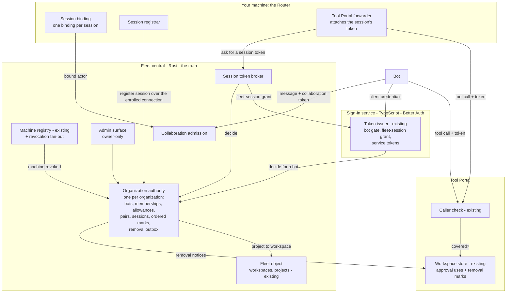
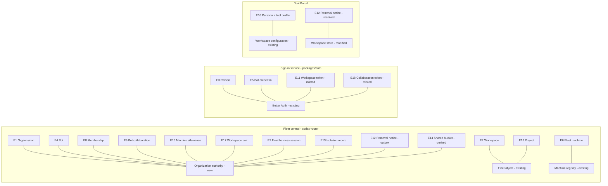
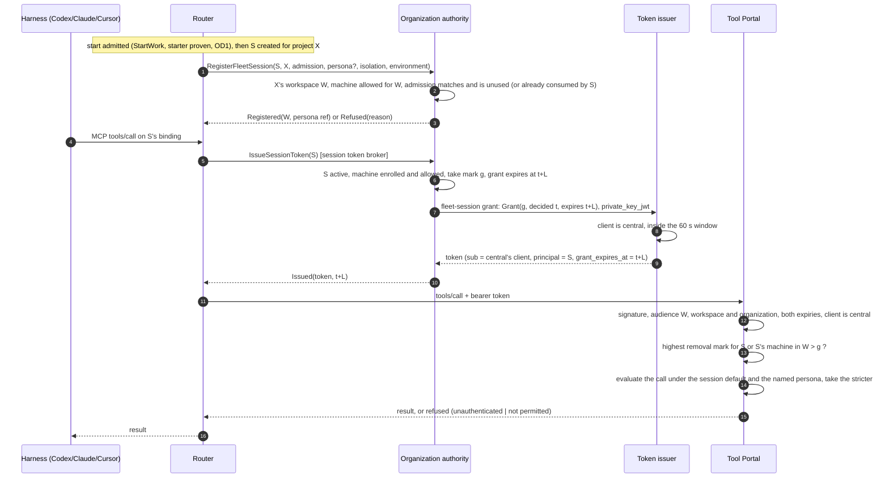
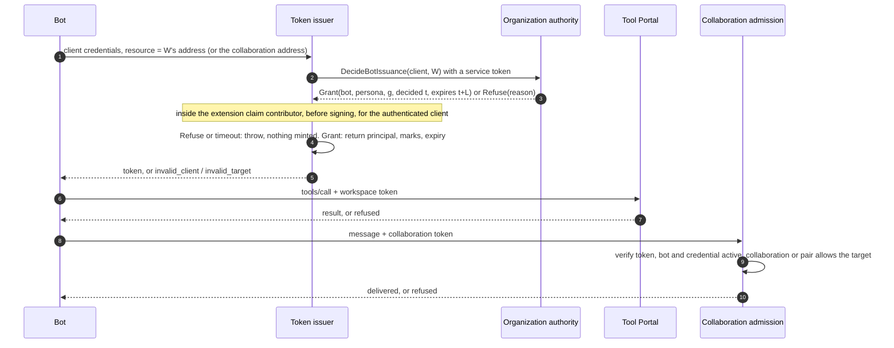
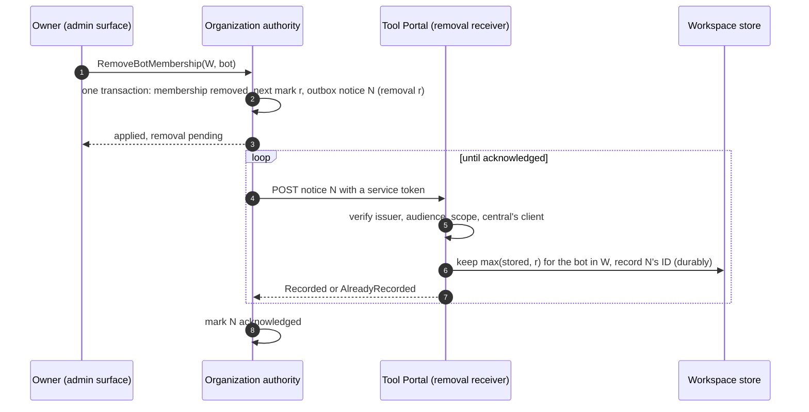
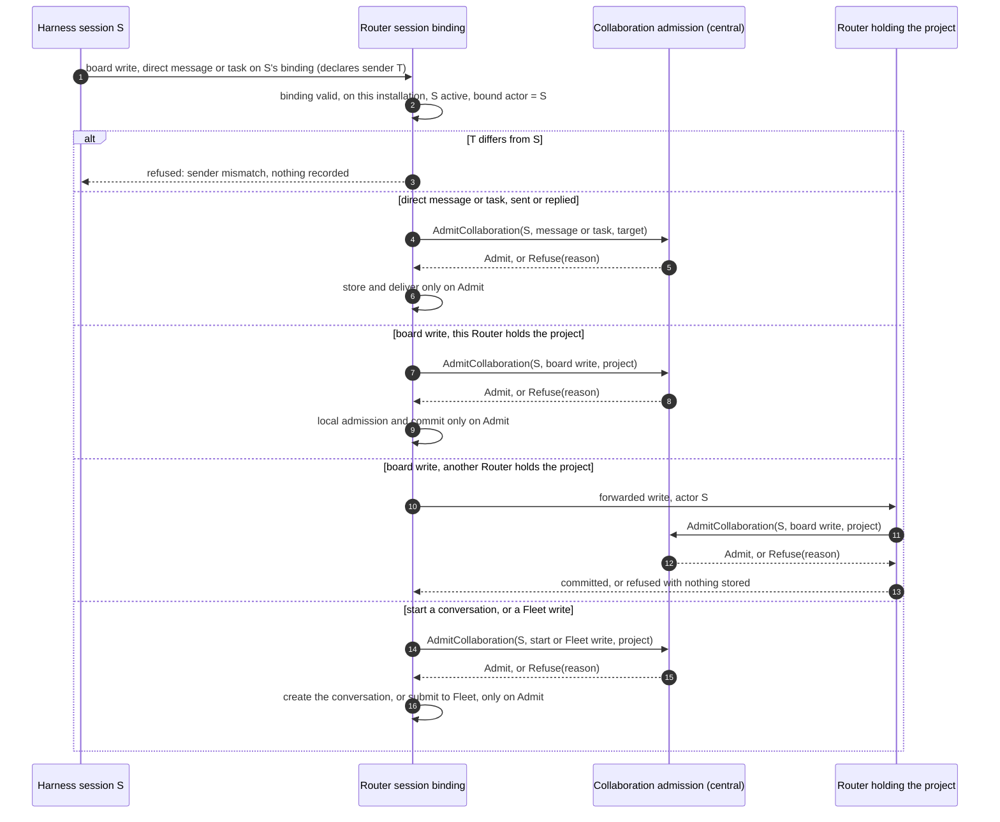
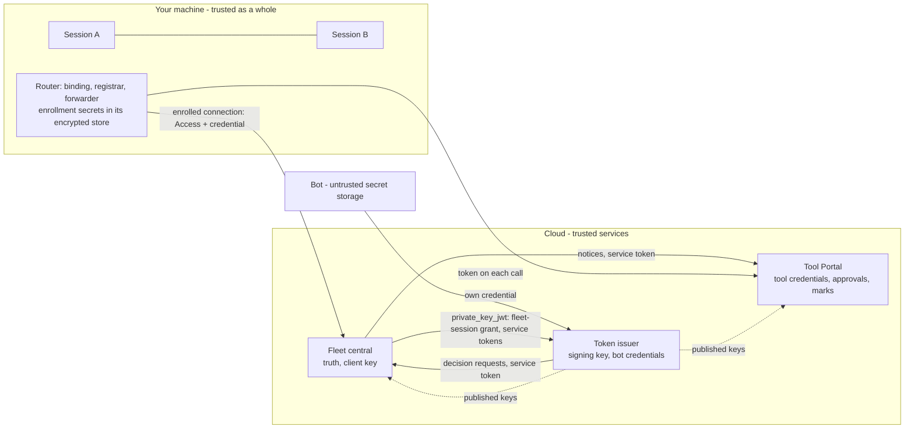

# Agent identity and workspace access: Program Design

How the fleet, the sign-in service and the Tool Portal realize the [Specification](specification.md)'s obligations. Authority: [Requirements](requirements.md). Proof plan: [Verification Design](verification-design.md). Options weighed: [Alternatives](alternatives.md).

## The structure in one picture



Fleet central holds every truth about who belongs where and decides every grant. The sign-in service proves bots and people and mints every token. The Tool Portal checks tokens and keeps two kinds of per-workspace state: approval single-use counts (as today) and the removal marks Fleet central pushes. No component calls Fleet central on a tool call.

## What exists today

| Area | Today | Anchor |
|---|---|---|
| Fleet identities | An actor is a `SessionRef` (Router installation, harness endpoint, conversation ID) or a human ID. Central's callers are only `Machine` or `Owner`. A stored message's origin is `Session`, `OwnerUnverified` or `Router`; there is no bot in either. | `message-board/src/board_identity.rs:204–213`; `collaboration-central-core/src/access_contract.rs:33`; `collaboration-protocol/src/push_line.rs:197–202` |
| Fleet sender | The collaboration MCP server is stateless. It takes the sender from call arguments, and checks only that the service ID is this Router's, then stores it as the session origin. | `crates/collaboration-mcp/src/collaboration_api_router.rs:1–3`; `crates/collaboration-service/src/collaboration_application/message_operations.rs:46–68` |
| Fleet session context | A session's workspace is looked up: working directory, then git origin, then attached workspaces, then projects. No stored link exists. | `collaboration-service/.../board_hook_operations.rs:169–320` |
| ACP MCP servers (Claude, Cursor) | One provider-wide MCP server list, cloned into each new and restored session; HTTP servers are kept only when the provider advertises HTTP MCP support. Load and resume requests each carry a list, but the create and restore commands carry no session-specific context. | `acp-client-runtime/src/agent_session_client/provider_connection_task.rs:280–287, 451–453, 479–489`; `provider_session_restore.rs:54–89`; `provider_client_operations.rs:223–237, 276–292` |
| Codex sessions | Fleet Codex sessions run on the Codex app-server. The Router's native preparation already builds each thread's start and fork `config`, so it can add bound MCP entries. The Host routes Codex sessions through the app-server delivery route on the native control backend. The app-server-to-ACP bridge (`codex-acp-adapter`) serves outside clients and today also carries the Router's own Codex helper starts into the app-server's native `StartThread` or `ForkThread`; its ACP-side MCP handling gets no work here, and you say it is being deprecated. | `collaboration-service/src/native_thread_preparation.rs:76–91, 117`; `codex-router-host/src/session_message_route_composition.rs:42–49`; `codex_app_server_delivery_route.rs:16–17` |
| Helper starts | A Lead starts a helper with `conversation create`; the creator defaults to the calling session and the approver to the creator; a creator from another machine's service is refused. Only the same Router is enforced, not workspace membership. The create request carries no project, and its admission checks only that the creator and approver are local and the backend generation matches; any declared human passes. Starts come from the CLI or an MCP tool through `ConversationClient`: a Codex helper start goes through the client's Codex bridge, which issues the native `StartThread` or `ForkThread`; Claude and Cursor use their provider request. | Fleet Lead's evidence answers, 2026-10-24, §4; `collaboration_application/conversation_operations.rs:68–80, 199–265`; `collaboration-client/src/conversation_client.rs:360–377, 405–449, 492, 648–666`; `codex-acp-adapter/src/session_creation.rs:313–330`; `collaboration-protocol/src/provider_conversation_contract.rs:441–452` |
| Machines | Owner-only enrollment. A Router connects with an Access service token plus a Bearer enrollment credential; central stores only the credential's hash and binds the connection to that machine. No key column. The Host already loads the production enrollment from `<router_root>/fleet/enrollment.json` and hands it to the collaboration runtime. Under Fleet's decision 1201 the two secrets (the Access client secret and the enrollment credential) live in the Router's existing encrypted secret store, its data key in the Keychain; `enrollment.json` holds only non-secret fields and the store keys; plaintext is allowed only in debug. | `registry_migrations/0001_machine_enrollments.sql:1–12`; `machine_enrollment.rs:32–63, 400–445`; `central_router.rs:119–280`; `codex-router-host/src/lifecycle_owner/collaboration_lifecycle.rs:115–137`; `host_configuration.rs:69–72`; codex-router `docs/specs/2026-10-24-production-enrollment/production-enrollment.md` (f2c86cd5, decision 1201) |
| Central hosts | One core, with Cloudflare Durable Object and Tokio hosts. Its object addresses form a closed set: Copy, Registry, Fleet, Connection and Mailbox. An organization authority is a new kind in that set, with routing and storage added on both runtimes. Objects call each other only in rank order (the Registry before an organization authority, which comes before the Fleet object), never the reverse. Every HTTP route sits behind the Access gate, which admits machines on `/v1/session` and the operator under `/admin/v1/` and refuses the rest. The platform offers object calls, time, IDs, wakes, Access-key fetch and RS256 verification; it has no general outbound request. | `platform_capabilities.rs:45–66`; `core_contract.rs:36–42`; `call_graph.rs:24–65, 97–167`; `central_router.rs:111–136`; `access_rules.rs:143–161`; `core_host.rs:26–31` |
| Sign-in issuer | Better Auth 1.7.8 with the OAuth provider. Agent clients use client credentials, a token is issued only for a linked workspace resource, and `customAccessTokenClaims` stamps claims. That hook reads the client ID the app picked from the request, body `client_id` before the Basic header (`sign-in-http-handler.ts:65–75`), while the provider authenticates the Basic client and accepts a bare body `client_id` beside it (`dist/utils-CGIZS-Da.mjs:546–579, 687–737`). The post-mint release re-checks the minted token's own authenticated client (A) against its organization and resource; it does not compare the earlier body hint (B) with A, so under today's claim model a mismatch can't give a token B's identity, though it isn't refused in every case. | `packages/auth/src/sign-in-core/response-release/sign-in-response-release.ts:114–146`; `provider-configuration.ts:220–276` |
| Issuer resources | Every requested resource must be a configured resource: seeded from the provider's options or a row in its resource table, found by `getResource`; there is no resolver hook. With `enforcePerClientResources: true` (our setting, `provider-configuration.ts:203–206`) the client also needs a link row to the resource, checked in the resource policy before any claim contributor runs. | installed 1.7.8 `dist/introspect-H3uoUiuS.mjs:620–655, 712–729, 1772–1794` and `getResource` |
| Better Auth minting | Extension grants and companion endpoints mint through `issueTokens`, which takes a client, an optional user, resources and additive `accessTokenClaims`. The subject is always `user.id ?? client.clientId`; reserved claims (`sub`, `aud`, `exp`, `iat`, `jti`, `client_id`, `scope` and others) are stripped from contributed claims; expiry comes from the provider's options. | installed `@better-auth/oauth-provider` 1.7.8: `dist/oauth-C_RnL2nt.d.mts:770–872`; `dist/introspect-H3uoUiuS.mjs:180–267, 1267–1290, 1342–1364` |
| Tool Portal check | Verify the token offline, then read membership and persona from the workspace's store. Persona is a key into the workspace's tool profiles. | `tool-host-core/src/caller-admission/caller-check.ts:19–38`; `hosted-mcp-proxy.ts:85,119` |
| Tool profiles | A profile lists, per namespace, which tools are available and which run with or without approval; `resolvedMcpPortalProfileSchema` is the resolved form. | `tool-access/src/authorization/mcp-profile-resolution.ts`; `tool-access/src/contracts/mcp-approval-profile.ts:108` |
| Tool Portal store | Holds membership/persona records, agent-management and retirement state, and approval single-use counts. | `tool-host-core/src/workspace-authority/models/workspace-authority-state.ts`; `approval-token-use-rules.ts` |

**Constraint degree:**

- **Compatibility-bound** on the fleet's existing workspace IDs, project records and machine enrollment.
- **Migration-bound** on the Tool Portal's workspace store, where approval state must survive.
- **Platform-bound** on Better Auth, analyzed at the installed 1.7.8 and built at exactly 1.7.11 (the people sign-in design's pin; public tags v1.7.8 `5f4cc5c1` and v1.7.11 `52ab801c`). Every mapping this design relies on remains supported at 1.7.11, but not every seam is unchanged. Byte-identical: client-authentication extraction, resource policy and links, claim precedence and the access-token builder, the client-management privilege gate, the client key cache and passkey verification; the extension input and `issueTokens` keep their shapes. Changed: the client-assertion verifier returns the checked client and takes an optional endpoint-only audience; an opt-in key self-rotation route lets a key-authenticated client replace its inline keys without a person (kept off); consent lookup matches an organization reference exactly, including its absence; and OAuth errors and their order changed (client authentication now precedes code consumption; PKCE failures are 400 `invalid_grant` or `invalid_request`). The build reruns the real negatives at 1.7.11 and carries no 1.7.8 observation or exact error assertion forward. The provider has client credentials, `private_key_jwt`, an extension-grant surface and `customAccessTokenClaims`; no token exchange; the subject and expiry are owned by the provider.

**What stays authoritative:** the fleet's workspaces, projects and machine enrollments; the issuer's signing keys and published key set; the Tool Portal's tool profiles and approval rules.

**What changes:** who holds membership (it moves out of the Tool Portal and sign-in into Fleet central); how a session is identified (bound by the Router, not declared by the caller); how removal reaches the Portal (pushed notices, ordered by marks).

## The choices, and why

| Choice | Selected | Credible alternative | Why selected | Accepted cost, and who pays | Reopen if |
|---|---|---|---|---|---|
| Who mints tokens | The sign-in service (Better Auth) | Fleet central mints in Rust; or a TypeScript identity service that owns all truth (Y) | Keeps the tested issuer on a maintained library and keeps truth where workspaces already live | Two services take part in every issuance. The Fleet and sign-in teams maintain one contract between them. | Better Auth can't carry the claims below, or a Portal-only product without Fleet central becomes the priority (then Y) |
| How the Portal knows membership | **Token-only**, plus pushed removal notices | A live check per call (owner: too heavy); copies of membership (owner: "fishy") | Lightest per-call path. Removal bites on push, and grant expiry is the backstop. | Up to one token lifetime of stale access if a push is lost. The admin sees pending removals. | Removals must be guaranteed instant even when the Portal is unreachable |
| How the token says who it is for | Better Auth keeps `sub` (the authenticated client); a separate `principal` claim names the bot or the whole session reference | A companion plugin that sets `sub` to the session; fake user rows per session | Uses the documented `issueTokens` surface without fighting the provider's ownership of `sub` | Every consumer reads `principal`, never `sub`; the Portal pins which client may issue session principals | A future Better Auth lets a grant set the subject |
| How long a token is usable | A `grant_expires_at` claim fixed at decision time; the Portal enforces it beside `exp`; the issuer's own `exp` is set to the 60-minute maximum | Per-call `exp` (offered by neither 1.7.8 nor 1.7.11); per-resource lifetimes at the issuer (a copy of organization settings) | Delayed or repeated minting can't extend a grant (S-F1); per-organization lifetimes need no issuer copy | Clients learn the real end from the claim or a refusal, not `expires_in` | A later Better Auth offers per-issuance expiry |
| How removal and issuance stay ordered | **One ordered counter per organization; every grant decision and every removal takes its own next value**; a notice covers grants with a smaller value | Counter raised only by removals (a fresh grant then ties a removal); wall-clock effective times | Exact order with no ties and no clocks | One durable write per grant decision (about once per lifetime per identity and workspace) | — |
| How services prove who's calling | Short-lived **service tokens** from the issuer, each naming one receiving service and one operation, over TLS | Signing each request body (HTTP message signatures) | Reuses the issuer, its keys and client authentication; TLS already protects the body in transit | Each receiver pins issuer, client and scope per operation | A request must stay verifiable after leaving TLS (then sign bodies) |
| How a machine proves itself | Its existing enrolled connection | Per-machine key files (owner: no); platform identity such as Fly OIDC (later) | No new secrets on machines | Vouching needs Fleet central reachable | Cloud VMs arrive (then platform identity) |
| How a session's token reaches the Portal | A Router forwarder attaches it | Token in the harness's MCP config (can't refresh); the session fetches its own (an agent holding a credential) | The agent never holds a credential; refresh is invisible | A new Router component on the tool path | A harness lets the Router set per-call headers itself |
| How the issuer knows a workspace's audience | Fleet central provisions one resource row per workspace at the issuer (the workspace's MCP address, enabled or disabled), recording existence only; per-client resource links are turned off (`enforcePerClientResources: false`) and replaced by the token-kind dispatch and Fleet's decisions | Keep per-client links (a second copy of membership, which you rejected); one shared audience for all workspaces (breaks the MCP rule that a client asks for the server's own address) | Membership keeps one owner; the issuer still refuses unknown or disabled audiences | One more Fleet → sign-in operation; the issuer holds a list of workspace addresses | Better Auth gains a resource resolver hook |
| Who asks the issuer for a session token | Fleet central, as a `private_key_jwt` client using a fleet-session extension grant | The Router as client (a new machine secret) | No machine secrets; central already decides | Central's client key is the system's most valuable key | — |
| How a session's persona is narrowed | The Portal evaluates each call under both the current session default and the named persona and takes the stricter outcome | Refuse a wider persona at start (central would need profile copies); merge profile structures | Widening is impossible by construction; profiles keep one owner; a default change applies from the next call | A wider named persona is silently clipped, not refused | Owner wants a refusal at start |
| How a collaborator bot reaches Fleet | A collaboration token (audience: Fleet's collaboration address) from the same issuer | Reusing a workspace token (audience confusion; collaborators have none) | Keeps tools and messaging on separate audiences | One more resource at the issuer | — |
| How a removal crosses owners | Each removal commits at its owner; a durable outbox carries it to every affected organization and workspace; issuance is fenced from the owner's commit | One distributed transaction (not available across Registry, Better Auth and organization objects) | Restart-safe, and honest about "pending" | Some removals show pending for a while | — |
| Organization isolation (D2) | One organization authority per organization (a Durable Object on Cloudflare; its own SQLite database on Tokio) | One shared store keyed by organization | D2's "segregated by durable objects", any host (U16) | One object per organization to operate | — |
| Where an admin change is recorded | In the same transaction as the change, at the owner of the state it changes: the organization authority, the Fleet object or the Registry | Every record in the organization authority (it would have to own workspaces and machines too) | One owner per truth, and a change and its record still commit together | Records live in up to three places; an organization's audit view is assembled from them when read | A compliance need for one audit store |
| Who keeps the list of organizations | The Registry: each organization, its state (`creating`, `active`), and each machine revocation's progress through them | The Fleet object | The Registry already drives revocation and may call organization authorities in rank order; the Fleet object may not | The Registry gains a table and one outbox step per organization | — |

## Where each entity lives



| E | Semantic owner | Package or module home | Schema/type home | Shape at each boundary | Disposition | Convention |
|---|---|---|---|---|---|---|
| E1 Organization | Organization authority | `collaboration-central-core` (new module `organization_authority`) | `collaboration-central-core/src/identity_contract.rs` (new) | `organization_id`: UUID string in tokens, admin API and notices | persisted | Rust newtype with fallible constructor; serde-tagged enums (`access_contract.rs:31`) |
| E2 Workspace | Fleet object (existing) | `collaboration-central-core` workspaces table (existing) | `message-board/src/board_metadata.rs:119` `Workspace` (existing) | `workspace_id`: UUIDv7 string; the Portal's MCP address is derived from its origin plus `workspace_id` (existing `workspaceResourceIdentifier`) | persisted | existing |
| E16 Project | Fleet object (existing) | `project_directory` (existing) | `board_metadata.rs` `ProjectDirectoryEntry` (existing) | `project_id` string in session registration and token | persisted | existing |
| E3 Person | Better Auth (existing) | `packages/auth` (existing) | Better Auth user (existing) | person ID in the person token; central's ownership and person membership key on it | persisted | existing |
| E4 Bot | Organization authority | `organization_authority` (new) | `identity_contract.rs`: `BotId`, `BotRecord` (new) | `bot_id` UUIDv7 string in `principal`; never equal to a credential's client ID | persisted | Rust newtype |
| E5 Bot credential | Better Auth (existing agent-client store) | `packages/auth` `d1-persistence/agent-registration-store.ts` (modified: binds `botId`; workspace links removed) | Better Auth OAuth client plus metadata (modified) | `client_id`; metadata `{ botId }` set only through central's admin path | persisted | Zod at the boundary |
| E6 Fleet machine | Machine registry (existing) | `machine_enrollments` (existing) | `machine_enrollment.rs` `AdmittedMachine` (existing) | installation `service_id`; the session reference's installation | persisted | existing |
| E15 Machine allowance | Organization authority | `organization_authority` (new) | `identity_contract.rs`: `MachineAllowance` (new) | admin API `{ installationId, workspaceId }` | persisted | Rust |
| E7 Fleet harness session | Organization authority | `organization_authority` session registry (new) | `endpoint_identity.rs` `SessionRef` (existing) plus `identity_contract.rs` `FleetSessionRecord` (new) | `principal.session_ref` object in tokens; `session` in registration | persisted (with retention) | existing `SessionRef` plus Rust |
| E8 Membership | Organization authority | `organization_authority` (new) | `identity_contract.rs`: `Membership { workspace, principal, persona: PersonaRef, state }` (new) | issuance decision; admin lookup | persisted | Rust tagged enum `Principal { Person, Bot, FleetHarnessSession }` |
| E9 Bot collaboration | Organization authority | `organization_authority` (new) | `identity_contract.rs` (new) | admin API; collaboration admission | persisted | Rust |
| E17 Workspace pair | Organization authority | `organization_authority` (new) | `identity_contract.rs` (new) | admin API; collaboration admission | persisted | Rust |
| E10 Persona | Tool Portal workspace configuration (existing) | `tool-access` profile resolution (existing), plus a new `portal.sessionDefaultProfile` key | `tool-access` configuration schema (modified) | `persona` claim: `{ kind: "sessionDefault" }` or `{ kind: "named", name }` | persisted (configuration) | Zod, `z.infer` |
| E11 Workspace token | Better Auth issuer (existing, modified claims) | `packages/auth` (modified) | `tool-access` contracts: `workspaceTokenClaimsSchema` (new; the single home; Rust consumers test against fixtures generated from it) | JWT claims, below | derived (signed, never stored) | Zod discriminated union |
| E18 Collaboration token | Better Auth issuer | `packages/auth` (modified) | `tool-access` contracts: `collaborationTokenClaimsSchema` (new) | JWT claims, below | derived | Zod |
| E12 Removal notice | Organization authority (sends); Portal workspace store (keeps) | central outbox (new); Portal store (modified) | `identity_contract.rs` `RemovalNotice` (new, the contract home); the Portal derives its Zod schema from the generated JSON Schema, checked by a contract test | HTTP JSON, below | persisted on both sides | Rust serde, Zod derived |
| E13 Isolation record | Organization authority | session registry (new) | `identity_contract.rs`: `AgentIsolation`, `MachineEnvironment` (new; from the Fleet attestation design) | registration; the token's `principal` | persisted | Rust tagged enum |
| E14 Shared bucket | Organization authority (a derived query) | `organization_authority` (new) | `identity_contract.rs` lookup result (new) | admin lookup | derived | Rust |

### Encoding rules for every boundary below

- **Versions:** every route is under `/v1/`. A breaking change is a new path prefix; contract types carry no version field.
- **Casing:** JWT claims are `snake_case`; HTTP JSON bodies are `camelCase` (the Fleet's serde convention). Rust types say `rename_all` on structs and enums alike.
- **Numbers:** marks (grant and removal) are integers in `0..=2^53−1`, encoded as JSON numbers; the Rust newtype refuses larger values. Times are Unix seconds.
- **Clock model:** any two service clocks differ by at most D = 60 seconds. No receiver adds leeway to `grant_expires_at`; checks of `exp`, `iat` and service-token lifetimes allow D. Retention (below) is computed from D, so a clock difference can refuse a token early but never let a covered one pass after its notice is dropped.

### Workspace and collaboration token claims

The issuer owns `iss`, `sub`, `aud`, `exp`, `iat`, `jti`, `client_id` and `scope`. `sub` is the authenticated client: a bot's credential, or Fleet central's session-issuing client. Every consumer identifies the caller by `principal`, never by `sub`. Home: `tool-access` contracts.

```ts
const sessionRefSchema = z.object({
  installation: z.string().uuid(),   // the Router service ID
  harness_endpoint: z.string(),      // "codex-local" | "claude-local" | "cursor-local" …
  conversation_id: z.string().min(1),
});
const machineEnvironmentSchema = z.discriminatedUnion("kind", [
  z.object({ kind: z.literal("physical") }),
  z.object({ kind: z.literal("cloudVm"), provider: z.string(), instance: z.string() }),
]);
const isolationSchema = z.discriminatedUnion("kind", [
  z.object({ kind: z.literal("host"), instance_id: z.string() }),
  z.object({ kind: z.literal("processSandbox"), mechanism: z.enum(["seatbelt", "bubblewrap", "landlock"]), instance_id: z.string() }),
  z.object({ kind: z.literal("container"), runtime: z.string(), container_id: z.string(), instance_id: z.string() }),
  z.object({ kind: z.literal("vm"), launcher: z.literal("agent-vm"), vm_id: z.string(), instance_id: z.string() }),
]);
const principalSchema = z.discriminatedUnion("kind", [
  z.object({ kind: z.literal("bot"), bot_id: z.string().uuid() }),
  z.object({
    kind: z.literal("fleetHarnessSession"),
    session_ref: sessionRefSchema,
    machine_environment: machineEnvironmentSchema,
    project_id: z.string(),
    isolation: isolationSchema,
  }),
]);
const personaRefSchema = z.discriminatedUnion("kind", [
  z.object({ kind: z.literal("sessionDefault") }),
  z.object({ kind: z.literal("named"), name: z.string().min(1) }),
]);
const mark = z.number().int().nonnegative().max(Number.MAX_SAFE_INTEGER);
const issuerOwned = {
  iss: z.string(), aud: z.string(), sub: z.string(), client_id: z.string(),
  jti: z.string(), iat: z.number().int(), exp: z.number().int(),
};
export const workspaceTokenClaimsSchema = z.object({
  ...issuerOwned,
  principal: principalSchema,
  organization_id: z.string().uuid(),
  workspace_id: z.string().uuid(),
  persona: personaRefSchema,          // bots: always "named"
  grant_revision: mark,
  grant_expires_at: z.number().int(),
}).refine((c) => c.principal.kind === "fleetHarnessSession" || c.persona.kind === "named");
export const collaborationTokenClaimsSchema = z.object({
  ...issuerOwned,
  principal: z.object({ kind: z.literal("bot"), bot_id: z.string().uuid() }),
  organization_id: z.string().uuid(),
  grant_revision: mark,
  grant_expires_at: z.number().int(),
});
export type WorkspaceTokenClaims = z.infer<typeof workspaceTokenClaimsSchema>;
```

**Portal acceptance (C1), in order:** signature against the issuer's published keys; `aud` is W's address; `workspace_id` is W and `organization_id` is W's configured organization; `now < grant_expires_at` with no leeway, and `now < exp + 60 s`; for a session principal, `client_id` is Fleet central's pinned session-issuing client and nothing else; no removal mark covers it (below); then the persona check.

### Grant decisions

Home: `identity_contract.rs`. Only bots and sessions receive workspace tokens, so the subject excludes people.

```rust
#[serde(tag = "kind", rename_all = "camelCase")]
pub enum WorkspaceTokenSubject {
    Bot { bot_id: BotId },
    #[serde(rename_all = "camelCase")]
    FleetHarnessSession { session_ref: SessionRef, machine_environment: MachineEnvironment, project_id: ProjectId, isolation: AgentIsolation },
}
#[serde(tag = "kind", rename_all = "camelCase")]
pub enum PersonaRef { SessionDefault, Named { name: PersonaName } }

#[serde(tag = "result", rename_all = "camelCase")]
pub enum IssuanceDecision {
    #[serde(rename_all = "camelCase")]
    Grant {
        organization_id: OrganizationId,
        workspace_id: WorkspaceId,
        subject: WorkspaceTokenSubject,
        persona: PersonaRef,
        grant_revision: Mark,          // this decision's own place in the organization's order
        decided_at: UnixSeconds,
        grant_expires_at: UnixSeconds, // decided_at + the organization's lifetime (≤ 3600)
    },
    Refuse { reason: IssuanceRefusal },
}
#[serde(rename_all = "camelCase")]
pub enum IssuanceRefusal { NotMember, IdentityNotProven, MachineNotAllowed, Retired }

#[serde(tag = "result", rename_all = "camelCase")]
pub enum CollaborationDecision {
    #[serde(rename_all = "camelCase")]
    Grant { organization_id: OrganizationId, bot_id: BotId, grant_revision: Mark, decided_at: UnixSeconds, grant_expires_at: UnixSeconds },
    Refuse { reason: IssuanceRefusal },
}
```

`Unavailable` is not a decision: a transport failure or timeout, which every caller treats as a refusal (R25).

**Redemption window:** the issuer mints from a `Grant` only while its own clock reads `≤ decided_at + 60 s`, and stamps `grant_expires_at` exactly as decided. A repeat inside the window mints an equivalent token that ends at the same moment; nothing can mint later. At exactly 60 s it may still mint. Under the clock model the window lasts between 0 and 120 s of real time; clock difference never moves `grant_expires_at`. During a Fleet central outage no new decision is made, but a `Grant` already handed to the issuer may still mint inside its window.

### Requests over the enrolled connection (Router → Fleet central)

```rust
#[serde(rename_all = "camelCase")]
pub struct RegisterFleetSession {
    pub session: SessionRef,                    // bound by the Router, never declared by the agent
    pub project_id: ProjectId,
    pub start_admission: AdmissionId,           // the StartWork admission this start consumed; its starter was proven there (OD1). Never a token.
    pub requested_persona: Option<PersonaName>, // None means the session default
    pub isolation: AgentIsolation,
    pub launch_context: LaunchContext,          // launcher-asserted, recorded for display: working directory, repository, commit, model, launched by
    pub machine_environment: MachineEnvironment,
}
#[serde(tag = "result", rename_all = "camelCase")]
pub enum RegisterFleetSessionResult {
    #[serde(rename_all = "camelCase")]
    Registered { organization_id: OrganizationId, workspace_id: WorkspaceId, persona: PersonaRef },
    Refused { reason: SessionRefusal }, // projectUnknown | machineNotAllowed | admissionInvalid | alreadyEnded
}

#[serde(rename_all = "camelCase")]
pub struct IssueSessionToken { pub organization_id: OrganizationId, pub workspace_id: WorkspaceId, pub session: SessionRef } // from Registered
#[serde(tag = "result", rename_all = "camelCase")]
pub enum IssueSessionTokenResult {
    #[serde(rename_all = "camelCase")]
    Issued { access_token: String, grant_expires_at: UnixSeconds },
    Refused { reason: IssuanceRefusal },
}

#[serde(rename_all = "camelCase")]
pub struct EndFleetSession { pub organization_id: OrganizationId, pub session: SessionRef, pub cause: SessionEndCause } // archived | deleted
```

The Router may only name sessions on its own installation; central refuses any other. These are new typed operations on the enrolled connection's session protocol (`/v1/session`), each with its request, its answer and its failure mapping (unavailable, refused, malformed); the machine is the enrolled peer the connection is bound to, never a field of the body.

**Routing and one registration per conversation (R7):** central routes `RegisterFleetSession` from the project to its workspace and that workspace's organization (Fleet object). The Router's session registrar is the one owner of which project a conversation was started for: it records the conversation and its project durably before the first request, and adds the organization, workspace and persona from `Registered` when they arrive; registers each conversation once, resends the identical request after an ambiguous reply or a restart, and refuses to register a recorded conversation for another project. The organization authority treats a repeat of the same `SessionRef` and project as `Registered` again, and refuses a different project. Later requests carry the organization and workspace from `Registered`, and the organization authority refuses a session it doesn't hold. A second registration in another organization is excluded by the registrar, inside the same trusted-Router assumption as the binding; organization authorities don't see each other's sessions.

**Bindings at start and restore:** before a create, the registrar mints a binding and hands it over with the create command: for Codex, in the native `StartThread` or `ForkThread` config wherever it is built (today the client bridge's creation, `session_creation.rs:313–330`, for helper starts, and the native preparation for delivery), and the same address again at `thread/resume`; for Claude and Cursor, the session's own MCP list on the ACP create, load or resume request. Today's create and restore commands carry no session context, so they gain the binding. The binding becomes active only for the conversation the provider returns, once `Registered` arrives; a pending, failed or ambiguous creation activates nothing, so its binding admits no effect. Before a restore, it looks up the session's persisted binding and lifecycle state and reuses that binding and address; a retired or abandoned binding is never restored. The registrar persists the registration's immutable input, the binding ID and address, and the result. A provider that doesn't advertise HTTP MCP support can't carry a binding, so its start is refused rather than run without one. The address must not move: the Router refuses to register sessions while its configured listener port is zero, or when its configured origin differs from the one recorded with a registration. The listener itself is already fixed by configuration (`127.0.0.1:8788` in production, `host_command/mod.rs:374–391`).

**Order and late outcomes:** a start is admitted first (`StartWork`, which proves the starter and returns an admission ID); then the provider creates the conversation; then it is registered, consuming that admission. The registrar persists the admission ID, never a token: the starter's credential is used once, at admission. **The start admission is the persisted authority for that one start.** `RegisterFleetSession` must match it (the same installation, project and requested persona) and consumes it in the same transaction that registers the session. Resending the identical registration after it was consumed, for example after a lost reply, returns the original `Registered`. A registration for another session, or with a different project, persona or installation, is refused `admissionInvalid`. This set sets no expiry for an unused admission. Three outcomes are distinct. Refused at admission: nothing is created. Created, then registration refused (for example, an allowance withdrawn between the two checks): the conversation exists, its binding never activates, and it is sent no prompt. A lost create reply: the binding stays prepared until the registrar learns the outcome. Nothing replays a create or deletes a conversation automatically; such a conversation is idle and acts as no member.

### Collaboration admission (Router → Fleet central, R28)

```rust
#[serde(rename_all = "camelCase")]
pub struct AdmitCollaboration {
    pub organization_id: OrganizationId, // the actor's organization
    pub actor: CollaborationActor,       // tagged: fleetHarnessSession { session } (bound by the Router) | bot { botId } (from its collaboration token)
                                         // | owner { personAccessToken } (StartWork only, checked as the owner guard does)
    pub operation: CollaborationOperation,
}
#[serde(tag = "kind", rename_all = "camelCase")]
pub enum CollaborationOperation {
    DirectMessage { to: CollaborationTarget },   // a session or bot that is a member of the target workspace
    Task { to: CollaborationTarget },
    BoardWrite { workspace_id: WorkspaceId, project_id: ProjectId, write: BoardWriteKind }, // threadCreate | threadPost | projectChange
    RoleChange { workspace_id: WorkspaceId, project_id: ProjectId },
    StartWork { workspace_id: WorkspaceId, project_id: ProjectId },                        // a conversation start
    FleetWrite { workspace_id: WorkspaceId, write: FleetWriteKind }, // workspace rename or archive | board create, update, close or archive | repository attach or detach | project directory create or update | decision record create or transition | definition register
}
#[serde(tag = "result", rename_all = "camelCase")]
pub enum CollaborationAdmission {
    Admit,                                        // good for the one effect that asked; never cached
    #[serde(rename_all = "camelCase")]
    AdmitStart { admission_id: AdmissionId },     // StartWork only: a recorded start admission, below
    Refuse { reason: CollaborationRefusal },      // notMember | noPair | noCollaboration | forbidden
}
#[serde(rename_all = "camelCase")]
pub struct StartAdmission {                       // recorded by the organization authority when it admits StartWork
    pub admission_id: AdmissionId,
    pub installation: InstallationId,             // the enrolled connection the start came on
    pub operation_id: OperationId,                // the start request's own ID
    pub project_id: ProjectId,
    pub requested_persona: Option<PersonaName>,
    pub starter: StarterRecord,                   // owner { personId } | memberSession { session }: who was proven, never a credential
    pub state: StartAdmissionState,               // unused | consumed { session: SessionRef }
}
```

Rules: a member of the target's workspace may do what its board role allows; a workspace pair or a bot collaboration admits only `DirectMessage` and `Task` to members. A bot collaboration in W admits them both ways, between the bot and W's members, while it is active; a member's reply to a bot needs it like any other message. A `Task` is a message to a member; it never changes a board's task records. An admission is good for the one effect that asked for it and is never cached. Unreachable central refuses.

**Every path that produces an effect (R28):**

| Effect | Where it is committed today | Admitted |
|---|---|---|
| A board write on the Router holding the project | `board_project_operations.rs:41–64` → `ProjectAdmission::submit` | before the project admission's decision, refusal or output effects |
| A forwarded post, at the holder | `board_composition/server_calls.rs:75` → `submit_forwarded_post` (`project_admission/mod.rs:138–151`), after `decode_forwarded_post` verifies where it came from | at the holder, before its commit, with that verified provenance; the sender side (`board_forwarded_posts.rs:7–44`) only forwards |
| A direct message, sent or replied | `message_operations.rs:208–225`, `send_draft` | before the local store, delivery and the remote outbox |
| Starting a conversation | the CLI (`conversation_client_commands.rs:203–209`) or MCP tool (`carrier_tools.rs:11–44`) → `ConversationClient` (`conversation_client.rs:360–377`): for Codex, its bridge (`:405–449`) → native `StartThread` or `ForkThread` (`session_creation.rs:313–330`); for Claude and Cursor, the provider request (`:492`). The service's `conversation_create` (`conversation_operations.rs:68`, `admit_submission` `:199–265`) checks only locality and generation | as `StartWork`, before anything is created; the request gains the project, and the starter is proven there |
| Fleet writes: boards, repositories, project directory, decision records, definitions | `board_fleet_operations.rs:8`, `fleet_write` → Fleet's submit; `board_adr_operations.rs:10–75` | as `FleetWrite`, before Fleet's submit |
| Creating a workspace | the same `fleet_write` path | refused there; only the admin command makes one (R13). Renaming and archiving keep their existing rules and go through `FleetWrite` |

**Identities a call claims** are bound where the call enters: the sender, the actor and creator, and the caller of `message_cancel` and of a `push_show` that marks a message read are the session whose binding the call came on. A call naming anyone else there is refused, and a session can't pass as a person (today `actor_is_local` accepts any declared human, `conversation_operations.rs:262–265`). Two fields stay declarations: `acting_for` (the person a session says it works for, `board_messages.rs:113–118`) and an approver (where a later approval is routed, `approval_broker.rs:8–14`). They are recorded as declared, keep their existing rules, and grant nothing. Whether the target may be acted on is decided by admission at the effect, as above.

### Removal notice (Fleet central → Tool Portal)

```rust
#[serde(rename_all = "camelCase")]
pub struct RemovalNotice {
    pub notice_id: NoticeId,               // UUIDv7, the idempotency key
    pub organization_id: OrganizationId,
    pub workspace_id: WorkspaceId,
    pub subject: RemovalSubject,           // tagged: bot { botId } | fleetHarnessSession { sessionRef } | machine { installation }
    pub removal_revision: Mark,            // covers tokens with grant_revision < this
    pub reason: RemovalReason,             // membershipEnded | personaChanged | botRetired | credentialRetired
                                           // | machineRevoked | allowanceWithdrawn | sessionRemoved | sessionEnded
}
#[serde(tag = "result", rename_all = "camelCase")]
pub enum RemovalNoticeAck { Recorded { notice_id: NoticeId }, AlreadyRecorded { notice_id: NoticeId } }
```

The Portal keeps, per workspace and subject, the **highest** `removal_revision` received (a late lower one changes nothing), and the notice IDs for idempotency. It answers only after both are durably written.

### Decision requests (sign-in service → Fleet central)

```rust
#[serde(tag = "resource", rename_all = "camelCase")]
pub enum DecideBotIssuance {
    #[serde(rename_all = "camelCase")]
    Workspace { organization_id: OrganizationId, client_id: ClientId, workspace_id: WorkspaceId }, // → IssuanceDecision
    #[serde(rename_all = "camelCase")]
    Collaboration { organization_id: OrganizationId, client_id: ClientId },                       // → CollaborationDecision
}
#[serde(rename_all = "camelCase")]
#[serde(tag = "operation", rename_all = "camelCase")]
pub enum PersonAdmissionRequest {
    // A Google or GitHub sign-in only. May bind the allowed, unbound entry for this provider-verified
    // email (and the owner binding when it is the owner's) with its audit record, in one transaction.
    #[serde(rename_all = "camelCase")]
    AdmitSignIn { organization_id: OrganizationId, person_id: PersonId, verified_email: Option<String> },
    // A passkey sign-in, a person token issuance or a session confirmation. Writes nothing.
    #[serde(rename_all = "camelCase")]
    Standing { organization_id: OrganizationId, person_id: PersonId },
}
#[serde(tag = "result", rename_all = "camelCase")]
pub enum OrganizationStanding { Admitted { role: StandingRole }, AwaitingOwner, NotAdmitted } // role: member | owner
```

The organization ID always comes from the authenticated client's registration (its metadata `{ botId, organizationId }`, written only through central's admin path), never from the request. The organization authority refuses a client that isn't registered to one of its bots. The two person operations carry the people sign-in design's `admitSignIn` and `standing` (its Program Design, "The organization admission object") to their new home unchanged in meaning. Sign-in sends `AdmitSignIn` only for a Google or GitHub sign-in, with the provider-verified email; the binding and its audit record are one organization-authority transaction, a failed record leaves no binding, and a repeat adds none. Everything else sends `Standing`: a passkey sign-in (which starts a session only for a person already admitted there, people sign-in R3, even if their email is allowed there), each person token issuance, and each session confirmation.

### Credential management (Fleet central → sign-in service)

```rust
#[serde(rename_all = "camelCase")]
pub struct ProvisionBotCredential { pub organization_id: OrganizationId, pub bot_id: BotId, pub client_id: ClientId, pub method: CredentialMethod } // clientSecret | privateKeyJwt { jwks }
#[serde(tag = "result", rename_all = "camelCase")]
pub enum ProvisionedBotCredential { Provisioned { client_id: ClientId, secret_once: Option<String> }, AlreadyProvisioned { client_id: ClientId } }
#[serde(rename_all = "camelCase")]
pub struct DisableBotCredential { pub organization_id: OrganizationId, pub client_id: ClientId }
#[serde(tag = "result", rename_all = "camelCase")]
pub enum DisabledBotCredential { Disabled, AlreadyDisabled }
```

**How the issuer realizes them.** The provider's client-management endpoints require a signed-in session (`dist/authorize-C95F-9E1.mjs:1175–1186, 2221–2249`), and today's management path verifies a person (`sign-in-management-binding.ts:79–113`) and rotates an existing client's secret on retry (`change-agent-client.ts:32–74`). So the service receiver doesn't call them and never fabricates a person session: it writes and disables client rows through the issuer's own persistence, in the provider's stored-secret format (hashed). A repeat returns `AlreadyProvisioned` and no secret. A secret is returned once to central, which hands it to the admin in the command's reply and never stores it; if that reply is lost, the admin retires that credential and provisions a new one. `privateKeyJwt` credentials carry no secret at all. The plan's first sign-in slice proves the row format against the locked 1.7.11 before anything depends on it.

### Workspace resources (Fleet central → sign-in service)

```rust
#[serde(rename_all = "camelCase")]
pub struct SetWorkspaceResource { pub organization_id: OrganizationId, pub workspace_id: WorkspaceId, pub identifier: String, pub enabled: bool } // identifier = the workspace's MCP address
#[serde(tag = "result", rename_all = "camelCase")]
pub enum WorkspaceResourceResult { Set, Unchanged }
```

`CreateWorkspace` writes this through its outbox (enabled); archiving a workspace sets it disabled. It records that the audience exists, nothing about who may use it.

### Admin commands and lookups (person → Fleet central)

Every organization command and lookup names its organization and is refused unless the owner guard below passes. The two fleet commands, `EnrollMachine` and `RevokeMachine`, act across organizations and stay with the fleet operator's existing authority (below). Results are `Applied { removal: Option<RemovalStatus> }`, `Admitted { commandId }` (a change another store applies; `CommandStatus` shows it pending until applied, or cancelled), or `Refused { reason: NotOwner | NotFound | Conflict | RecordUnwritable }`; a refused command reveals nothing. **Audit (people sign-in R12):** every applied command writes its record (who, what changed, the organization, when) in the same transaction as the change, at the owner of the state it changes; if the record can't be written, that transaction fails and nothing changes. Most commands change the organization authority's own state and are recorded there. `CreateWorkspace` changes the Fleet object's workspaces, so it is handed over, as below. `CreateOrganization`, `EnrollMachine` and `RevokeMachine` commit in the Registry with their records there. An organization's audit view is assembled when read, by the admin surface, from each owner's records for that organization; nothing is copied, and an owner that can't be read is shown as unavailable.

**A change another store applies (`CreateWorkspace`):** the organization authority admits it with the guard, in its own transaction, records it, and replies `Admitted`. The authorization point is the handoff: before each attempt to hand the command to Fleet, the authority obtains a fresh confirmation and, in one transaction, re-checks that the person is still the current owner and that the confirmation is within SD8, then marks the command handed off. If the owner changed or the confirmation can't be had, the command is cancelled and nothing applies. Fleet applies a handed-off command once (idempotent by command ID), writing the workspace and its record. The only gap is between the handoff and Fleet's commit, one attempt; that is how SD8 maps onto a change another store applies. Changes that stay at the sign-in service (linked logins, passkeys) keep that design's own records.

**The list of organizations:** the Registry keeps each organization's ID, its authority's address and its state (`creating`, `active`). `CreateOrganization` commits the row as `creating`, with its record. A Registry outbox step then initializes the organization authority in one transaction of the authority: its owner's verified email as an unbound owner entry, every machine the Registry has revoked so far (read when the step runs), and the authority's own record. The row becomes `active` once that is acknowledged. The person is bound to the owner entry at their first Google or GitHub sign-in (`AdmitSignIn`), as in the people sign-in design. An authority's address comes from its organization ID, so nothing reads the Registry to reach it; until its initialization arrives, it refuses every command, decision and sign-in from its own state, so an interrupted creation exposes only a `creating` row the operator can see. `SetOrganizationOwner` commits in the organization authority, which holds the owner entry.

| Command | Request fields | Removal it writes |
|---|---|---|
| `CreateOrganization`, `SetOrganizationOwner` (fleet operator) | organizationId, owner's verified email | — |
| `CreateWorkspace` | organizationId, name | — |
| `AllowSignIn`, `RemoveSignIn` (the organization's allowlist) | organizationId, verified email | — (people sign-in R4 applies) |
| `RegisterBot`, `RetireBot` | organizationId, botId | `botRetired` per member workspace |
| `AddBotCredential`, `RetireBotCredential` | organizationId, botId, clientId | `credentialRetired` (subject: the bot) |
| `SetBotMembership`, `RemoveBotMembership` | organizationId, botId, workspaceId, persona | `personaChanged` / `membershipEnded` |
| `SetBotCollaboration`, `WithdrawBotCollaboration` | organizationId, botId, workspaceId | — (collaboration is checked live at central) |
| `SetPersonMembership`, `RemovePersonMembership` | organizationId, personId, workspaceId, persona | `personaChanged` / `membershipEnded` |
| `AllowMachine`, `WithdrawMachineAllowance` | organizationId, installation, workspaceId | `allowanceWithdrawn` |
| `EnrollMachine` (existing, fleet operator) | as today | — |
| `RevokeMachine` (existing, fleet operator, extended) | installation | `machineRevoked` per affected workspace (fan-out below) |
| `AllowWorkspacePair`, `WithdrawWorkspacePair` | organizationId, fromWorkspaceId, toWorkspaceId | — |
| `RemoveSession` | organizationId, session | `sessionRemoved` |
| `SetTokenLifetime` | organizationId, seconds (60..=3600) | — |
| Lookups: `IdentityLookup`, `WorkspaceLookup`, `MachineLookup`, `RemovalStatus`, `CommandStatus` | organizationId plus the subject | — |

**Owner guard (R13):** the caller presents a person access token whose audience is central's admin address. Central checks that the token's organization is the command's organization and that the person is that organization's current owner in its organization authority. It then confirms with the sign-in service that the person's session is current and the person active there, using the people sign-in design's privileged-decision confirmation (its R9, bound SD8). SD8 is still that design's open decision (the Lead's 5-second proposal); this set inherits whatever it becomes. For a change the organization authority applies, the guard holds in that transaction: the owner check reads its own state there, the confirmation must be within SD8 of it, and a confirmation is never reused for a later command. For a change another store applies, it holds at the handoff (above). The guard refuses everyone else before any read or write.

**Fleet operator authority:** enrolling and revoking machines is fleet-wide, so no organization's owner may do it. It stays with Fleet central's existing operator caller (`AccessCaller::Owner`, `access_contract.rs:31–36`), which this set does not change. An organization's owner withdraws its own allowances instead (`WithdrawMachineAllowance`). In your own deployment you hold both authorities; they stay separate so that a customer's organization owner never becomes a fleet operator. The operator's Access check proves the fleet operator, never an organization's owner.

**Central's new receivers:** every route today sits behind the Access gate, which admits only enrolled machines and the operator. The new routes (the admin address for person access tokens, the decision and admission addresses for the sign-in service's tokens, and the collaboration address for bots' collaboration tokens) each get their own bearer check against the issuer's published keys and their pinned trust configuration, outside the Access rules, so the product doesn't depend on Access for them. `/v1/session` and the operator's `/admin/v1/` keep the Access gate.

**Central's outbound requests:** central has no general outbound request today. A new host capability, the service caller, sends C7 requests outside any storage transaction: a live one (minting a session's token, confirming a person) from the request that needs it, and a durable one (a notice, a credential disable, a workspace resource) from an outbox step. The domain rules see only a typed request and its result. Each host supplies it with a signing-key source for central's client key (on Workers, `fetch` and a Worker secret; on Tokio, an HTTP client and the host's secret store).

## Service requests (R27, C7)

| Edge | Credential | Receiver checks | Repeat |
|---|---|---|---|
| Fleet central → sign-in: mint a session's token | `private_key_jwt` client authentication at the token endpoint (RFC 7523 §2.2), grant type `urn:agent-collaboration:grant-type:fleet-session`, the `Grant` in the request body | client is central's pinned session-issuing client; assertion audience is the token endpoint or the issuer (both accepted: installed 1.7.8 `dist/authorize-C95F-9E1.mjs:1543–1579`, unchanged in 1.7.11), single-use `jti`; the `Grant` is inside its redemption window | equivalent token, same `grant_expires_at` |
| Sign-in → Fleet central: decide for a bot | a service token the sign-in service signs with its published signing key: `aud` = central's decision address, `scope` = `issuance-decisions`, lifetime ≤ 60 s | issuer and key from the pinned published key set; audience; scope; expiry | decides again with a new mark |
| Fleet central → Tool Portal: deliver a notice | a service token from the issuer by client credentials with central's `private_key_jwt`: `aud` = the Portal's notice address, `scope` = `removal-notices` | issuer key; audience; scope; `client_id` is central's pinned client; the notice's organization and workspace are hosted here | no further effect (notice ID) |
| Fleet central → sign-in: confirm a person's session | a service token as in the previous row, `aud` = the sign-in service's confirmation address, `scope` = `session-confirmation` | as above | confirms again |
| Fleet central → sign-in: set a workspace's resource | a service token as above, `aud` = the sign-in service's credential address, `scope` = `resource-management` | as above; the workspace belongs to the named organization | same values → `Unchanged` |
| Fleet central → sign-in: provision or disable a bot credential | a service token as above, `aud` = the sign-in service's credential address, `scope` = `credential-management` | as above; the client belongs to the named organization and bot | same client ID → same credential, no new secret; disable → `AlreadyDisabled` |
| Sign-in → Fleet central: admit a provider sign-in, or read a person's standing | a service token the sign-in service self-signs, `aud` = central's admission address, `scope` = `person-admission`, lifetime ≤ 60 s | as for bot decisions; `AdmitSignIn` only with a provider-verified email | `AdmitSignIn`: a repeat adds no binding; `Standing`: writes nothing |

Service tokens from the issuer get a 5-minute lifetime from the issuer's resource policy for those audiences, and every receiver also refuses one whose `exp − iat` exceeds that. All edges run over TLS, including Cloudflare service bindings, which carry the same tokens. Bodies are not signed: a receiver checks that each body is well-formed and within the caller's scope (its organization and workspace exist here and the caller may act for them), not that the body is the one the caller first wrote. **Trust configuration** is pinned at deploy: each receiver's issuer URL, published-key URL and the client ID expected per operation. **Rotation:** central publishes its client key set at a fixed address the issuer reads; it adds a new key, waits one refresh, then signs with it. The issuer rotates its signing keys the existing way; receivers refetch the key set once on an unknown key ID.

## How the issuer tells token kinds apart

Every issuance runs one closed dispatch on the **authenticated** client's registered kind (metadata written only through central's admin path or deploy configuration), the grant type, and the resource's class. Anything not in the table is refused before minting.

| Client kind | Grant | Resource | Pre-mint decision | Claims | Release checks |
|---|---|---|---|---|---|
| bot credential | client credentials | a workspace address | `DecideBotIssuance::Workspace` in the extension claim contributor | principal (bot), organization, workspace, named persona, marks, `grant_expires_at` | `sub` = `client_id`; `aud` = the resource; workspace claim = the resource's workspace; principal is a bot |
| bot credential | client credentials | Fleet's collaboration address | `DecideBotIssuance::Collaboration` in the same contributor | principal (bot), organization, marks, `grant_expires_at`; no workspace | `aud` = the collaboration address; no workspace claim; principal is a bot |
| Fleet's pinned client | fleet-session extension grant | a workspace address | the `Grant` in the request, inside its window | principal (session), organization, workspace, persona reference, marks, `grant_expires_at` | client is the pinned one; `aud` = the resource; principal is a session |
| Fleet's pinned client | client credentials | a configured service audience (notices, confirmation, credential management) | none: the audience fixes the one operation | scope only; no principal | client is the pinned one; `aud` is a configured service audience; scope matches; lifetime ≤ 5 min |
| person (sign-in app) | authorization code (existing) | the management or admin audience | `AdmitSignIn` for a provider sign-in, `Standing` for a passkey sign-in and each token | as in the people sign-in design | as there |

**Refused combinations** include a bot asking for a service audience, Fleet's client asking client credentials for a workspace or collaboration address, any other client using the fleet-session grant, and a person asking for a workspace address. Resource-policy `customClaims` on these resources carry none of the claim names above.

## Removal across owners (R19–R21)

No transaction spans the Registry, Better Auth and organization objects. Each removal commits at its owner, is fenced from that commit, and reaches every workspace through a durable outbox.

| Reason | Owner and commit | Fence: no new grant from | Notices | The admin sees done when |
|---|---|---|---|---|
| membership ended, persona changed, bot retired, allowance withdrawn, session removed, session ended | organization authority, one transaction: the change, its own next mark, one outbox row per affected workspace | that transaction (decisions read the same state) | outbox → Portal, resent with capped backoff | every row acknowledged |
| credential retired | organization authority, one transaction: the credential marked retiring, its mark, its audit record, outbox rows for the bot's member workspace, and an outbox step `DisableBotCredential` | that transaction: decisions refuse that client | outbox → Portal; outbox → issuer (`DisableBotCredential`, retried until `Disabled` or `AlreadyDisabled`) | Portal rows acknowledged and the issuer's result recorded |
| machine revoked | Registry, existing revocation: new connections refused at commit, open sessions end when the revocation reaches them (FL-12); plus a new fan-out step per organization in the Registry's list, tracked per organization in the existing revocation task | each organization authority, when it records the revocation: that transaction withdraws the machine's allowances and takes mark r_m, so no later grant for the machine is decided there. A grant decided after the Registry commit but before that record took a smaller mark, so the machine notice covers it. The Registry commit additionally stops new enrolled connections. | that same transaction writes a machine notice (removal mark r_m) per affected workspace | every organization has recorded it and every notice is acknowledged |
| a tool profile or the session default changes at the Portal | Portal configuration | not needed: tokens carry the persona name or the default reference, and the Portal resolves both at each call | none | from the first call served by the deployment that carries the change (persona section) |

**The cut-off for each removal is a transaction in the organization authority that decides grants.** Every grant and every removal there takes its own mark in one serialized order, so "decided before the removal" is exactly "smaller mark", and the notice covers it. No unlocked read of another owner's state is the fence.

**Discovery:** an organization authority knows its own memberships, allowances and sessions. The Registry fan-out takes its list of organizations as of the revocation's commit and records, per organization, when that organization has recorded the revocation. An organization created after the commit starts with every revoked machine already revoked (its initialization reads them), so an old connection of a revoked machine, still open until the revocation reaches it, can't register a session there. Steps that run against the rank order (an organization authority telling the Registry something, or the Fleet object telling an organization authority) go through an outbox, never a synchronous call. **Restart:** every step is an idempotent outbox row; a host restart resumes from the outbox. A removal shows `pending` in `RemovalStatus` until its last step completes; nothing reports done early.

## Components

| Component | Owns | Home | Consumers | Changes when |
|---|---|---|---|---|
| **Organization authority** (new) | E1 (including its owner and sign-in allowlist), E4, E7, E8, E9, E13, E15, E17; the ordered marks; the configured lifetime; the removal, credential and admitted-command outboxes; the records of its own changes; admitted commands awaiting handoff; the shared-bucket view | `collaboration-central-core` organization module, hosted as one object per organization (Cloudflare Durable Object class `OrganizationObject`; Tokio: one SQLite database per organization) | session token broker, admin surface, collaboration admission, the sign-in service (decisions) | membership or issuance policy changes |
| **Session token broker** (new) | Turning a Router's request into a token: decide, then mint through the fleet-session grant | `collaboration-central-core` | Router forwarder | the session grant contract changes |
| **Admin surface** (modified) | Organization-owner commands and lookups with their guard, the fleet operator's commands under its existing authority (R13, R14), and the bearer checks of central's new receivers | `central_router.rs` admin routes and `access_rules.rs` (modified) | the owner's CLI and console | admin commands change |
| **Collaboration admission** (modified) | The `AdmitCollaboration` decision at central (bound actor, operation, target, memberships, pairs, bot collaborations), and its enforcement before each effect on every path in the table above: the holder's project write, the forwarded post at the holder, `send_draft` (behind `message_send` and `message_reply`), the conversation start and the Fleet writes; and binding every identity a call claims where it enters | central: a new admission route in `collaboration-central-core`; Router: `board_project_operations.rs`, `board_composition/server_calls.rs` and `project_admission`, `message_operations.rs` `send_draft`, `collaboration-client/src/conversation_client.rs` and `conversation_operations.rs`, `board_fleet_operations.rs` and `board_adr_operations.rs`, `mcp_server/message_tools.rs` (modified); `session_request_admission` unchanged (it binds replication writers to peers) | every collaboration effect; bots via their collaboration token | collaboration rules change |
| **Registry: organization list and revocation fan-out** (new) | The list of organizations and their creation; delivering a machine revocation to every organization on it, with per-organization progress | Registry object (modified) | the fleet operator, organization authorities | organization lifecycle or revocation flow changes |
| **Fleet object** (existing) | E2, E16 | existing | organization authority | — |
| **Session binding** (new, Router) | Which session each collaboration call came from; binding lifecycle | `collaboration-mcp`, `collaboration-service` (modified); Codex: the native `StartThread` and `ForkThread` config where it is built (`native_thread_preparation.rs`; the client bridge's `session_creation.rs` for helper starts) (modified); Claude and Cursor: `acp-client-runtime` per-session MCP list through the create and restore commands (modified) | collaboration MCP tools | harness wiring changes |
| **Session registrar** (new, Router) | Registering each launched session exactly once and recording which project it was started for; minting, activating, persisting and retiring its binding; refusing a start that can't carry one; reporting its end | `collaboration-service` (new module `fleet_session_registrar`) | session binding, forwarder | launch facts change |
| **Tool Portal forwarder** (new, Router) | Getting, caching in memory and attaching each session's token; refetching before `grant_expires_at` and once on a 401 | `codex-router-host` (new module `portal_session_forwarder`) | the harness's Tool Portal MCP entry | token or Portal contract changes |
| **Token issuer** (existing, modified) | Bot credentials (E5) and their provisioning and disabling for central; the token-kind dispatch; bot claim stamping; the fleet-session grant; service tokens; person session confirmation; asking central for person admission | `packages/auth` | bots, Fleet central, Tool Portal (published keys) | claims or grants change |
| **Caller check** (existing, modified) | Admit or refuse a call: token, marks, persona narrowing | `tool-host-core/src/caller-admission`; narrowing in `tool-access/src/authorization` | hosted MCP proxy | admission rules change |
| **Workspace store** (existing, modified) | Approval single-use counts (unchanged, keyed by `principal`) and received removal marks (new) | `tool-host-core/src/workspace-authority`; Cloudflare `WorkspaceAuthority` Durable Object; Node store | caller check, removal receiver, approval use | store shape changes |
| **Service caller** (new, central host capability) | Sending C7 requests outside storage transactions (live ones inline, durable ones from outbox steps); signing with central's client key | each central host: Workers and Tokio | outbox steps | a C7 edge changes |
| **Bot messaging** (new, central) | A bot's messages stored as from the bot; its mailbox of replies; its receipts and cancels | `collaboration-protocol` (`PushOrigin` gains `Bot`), `message-board` actors (gain a bot), a Mailbox object keyed by the organization and bot, a new key form of the existing kind (modified) | bots; members replying | bot messaging changes |
| **Removal receiver** (new, Portal) | Accepting only central's notices (service token); recording durably; acknowledging | `tool-host-core` (new route `/internal/v1/removal-notices`) | Fleet central | notice contract changes |

**Removed:** the Tool Portal's agent-management route and retirement (`workspace-agent-management.ts`, `workspace-agent-retirement.ts`, `agent-retirement.ts`) and its membership records; the sign-in service's workspace links.

**Allowed edges:** Router → Fleet central over the enrolled connection (registration, tokens, collaboration admission); the service-request edges above; bots → issuer, Tool Portal and collaboration admission; people → admin surface; the Tool Portal and Fleet central → the issuer's published keys (cached).

**Forbidden edges, and how they're enforced:**

| Forbidden edge | Enforced by |
|---|---|
| Tool Portal → Fleet central on a tool call (R17) | the caller check has no Fleet client: a dependency rule, checked by lint and review |
| Anyone but the organization's current owner → organization commands; anyone but the fleet operator → `EnrollMachine`, `RevokeMachine` | the owner guard and the existing operator check: runtime |
| An agent supplying its own sender | the bound actor: runtime |
| The issuer minting a workspace or collaboration token without a decision | the response-release gate and the fleet-session grant handler: runtime |
| Any consumer identifying a caller by `sub` | the claims schema exposes `principal`; review rule |
| A collaboration effect stored, delivered or started before `AdmitCollaboration` returns `Admit` | every path in the effect table calls admission before its effect; SO1 negatives on each path, including a refused start (no conversation created) and a Fleet write |
| A session's call passing as a person, or naming another sender or creator | sender, actor and creator bound where the call enters; declarations grant nothing: runtime |
| A bot written as a fleet harness session | bot messages carry the `Bot` origin; `send_draft` takes only a bound session or a bot from its collaboration token: runtime |
| Workspace creation outside the admin command | the Fleet write path refuses workspace create: runtime |
| The issuer deciding for a client ID the provider did not authenticate | the contributor reads only `input.client`; no raw request parsing for client identity; SO2 negative |

## How a session gets and uses its token



The forwarder keeps the token in memory, refetches before `grant_expires_at`, and never hands the token to the harness.

**Change from today:**

- **Added:** session registration; the broker and the fleet-session grant; the forwarder; the mark check; persona narrowing.
- **Removed:** the Portal reading membership from its store (`caller-check.ts:28–31`).
- **Changed:** persona comes from the token; the caller is `principal`, not `sub`; usability ends at `grant_expires_at`.
- **Unchanged, and must stay:** offline signature verification; audience derived from the configured origin, never Host; approval single-use in the store.

## How a bot gets its tokens



**Mapping onto Better Auth** (inspected at 1.7.8, unchanged in 1.7.11): bots keep the standard client-credentials grant. The decision is made in an extension access-token claim contributor, which the provider runs after client authentication and before signing (`dist/introspect-H3uoUiuS.mjs:238–262, 1831–1852`) and which receives the provider's authenticated client object (`OAuthClaimExtensionInput.client`, `dist/oauth-C_RnL2nt.d.mts:964–982`). For a bot's client-credentials request (the first two rows of the dispatch table) it asks central once with `DecideBotIssuance` for `input.client.clientId` and the provider-validated `input.resources`; it throws `invalid_client`, `invalid_target` or `temporarily_unavailable` on a refusal or timeout, so nothing is minted; on a `Grant` it returns the claims. It never reads a client ID from the raw request. The existing `customAccessTokenClaims` hook keeps only its person branch and returns no claims for client credentials, because its claims merge after the contributor's and could otherwise replace them. The outer response release (`sign-in-request-handler.ts:43–51`) runs after the provider and only checks the minted response, as the dispatch table's release column states for each row (no workspace claim for a collaboration token). The issuer's own `exp` is the 60-minute maximum; `grant_expires_at` carries the real end. **Fallback**, the same surface the fleet-session grant uses: a bot extension grant calling `issueTokens` with `accessTokenClaims`.

## How a removal reaches the Tool Portal



**Why ordered marks:** every grant decision and every removal takes the next value of one per-organization counter inside the organization authority's serialized write. A token whose grant took g is covered by a removal r exactly when g < r. A grant decided before the removal is covered however late it was minted; a grant decided after it (the next value, r + 1 or later) is accepted, including right after a persona change. The Specification's grant mark is `grant_revision`, and its removal mark is `removal_revision`.

**Retention:** a covered grant was decided before the removal, so its `grant_expires_at` is at most 60 minutes after the removal on Fleet central's clock. The notice is received no earlier than the removal, which on the Portal's clock is at most D = 60 s before it. With no leeway on `grant_expires_at`, every covered token stops passing within 60 minutes + D of receipt on the Portal's clock. The Portal keeps each mark and notice ID for 61 minutes after receipt by its own clock; a later jump of that clock moves acceptance and cleanup together.

## How a collaboration call is attributed



**Session binding** is a bearer capability, not a secret the session proves:

- **Codex:** today's Router source has no per-thread identity on its MCP surface (it is stateless). Codex 0.163.0 (the installed version; openai/codex tag `rust-v0.163.0`, commit `83086188`) supports per-thread MCP servers: `thread/start` and `thread/resume` take a `config` override map (`app-server-protocol/src/protocol/v2/thread.rs`, `ThreadStartParams.config`, `ThreadResumeParams.config`), merged into that thread's configuration like `-c` overrides (`app-server/src/config_manager.rs:451–476`), and each thread owns its MCP runtime (Codex's test `mcp_calls_stay_bound_to_each_thread`, `core/tests/suite/mcp_tool_cache.rs:142`). The Router sets the collaboration server's and the Tool Portal forwarder's `mcp_servers.<name>.url` to that session's bound address at start. On resume, a thread that isn't loaded is loaded with the given `config` (a cold resume); a loaded thread that is idle, unsubscribed and allows direct input is rebuilt with it; any other loaded thread is rejoined and the overrides are ignored (`app-server/src/request_processors/thread_processor.rs:4550–4617`). So the binding address never changes for a session (below), the Router supplies the same address again on a cold resume, and a running conversation that was never given a binding can't be given one by resuming it. The Router's native thread preparation already builds each thread's start and fork `config` (`native_thread_preparation.rs:76–91, 117`); helper starts reach the app-server through the client's Codex bridge, whose creation builds the native `StartThread` or `ForkThread` (`session_creation.rs:313–330`), so the binding goes into that config too.
- **Claude and Cursor (ACP):** each ACP new-session request already carries an MCP server list, so the seam exists. Today the list is computed once per provider connection and cloned into every session and restore (`provider_connection_task.rs:280–287, 451–453, 479–490`). The Router computes it per session instead, giving each its own MCP address holding a random 128-bit binding ID, carried through the create and restore commands (which carry no session context today, `provider_client_operations.rs:223–237, 276–292`) and on both load and resume (`provider_session_restore.rs:54–89`). A provider that doesn't advertise HTTP MCP support is refused at start (`provider_connection_task.rs:280–287`). Natively launched Claude sessions are outside this seam (OD1).
- **Lifecycle:** minted at launch and persisted with the session's registration in the Router's private state (inside the Router root, owner-only), so it survives a Router restart unchanged. The whole address must survive, not only the binding ID: the Router's MCP listener host and port are fixed by its configuration rather than chosen at startup. A harness thread that is still running keeps the address it was given, and a cold resume is given the same address again. Retired when the session ends and never reused; valid only on the installation that minted it.
- **Limit:** any process of the same machine user that reads another session's configuration holds its binding. That is E14's shared bucket, recorded and shown, not prevented.

**Change from today:** the sender is no longer taken from call arguments (`message_tools.rs:18`). Today the holding Router commits a local write after its own admission (`board_project_operations.rs:41–64`), only non-holder thread posts are forwarded (`board_forwarded_posts.rs`), and direct messages, both sent (`message_send`, `message_operations.rs:47–107`) and replied (`message_reply` → `reply_to`, 110–191), check only that the sender is on this Router before both reach `send_draft` (208). Starting a conversation checks only locality and the backend generation, and the Fleet writes go straight to Fleet's submit. Every path in the effect table now asks `AdmitCollaboration` before its effect, with the bound actor. A reply is admitted like any message: having been messaged earlier grants no lasting right to reply.

**Bot messages:** a bot's message enters the same admission through its collaboration token and is stored with a new `Bot { organizationId, botId }` origin, never as a made-up session (today's origins are `Session`, `OwnerUnverified` and `Router`, `push_line.rs:197–202`; board actors are a session or a human, `board_identity.rs:208–213`; a message draft targets a `SessionRef`, `push_record.rs:63–94`). Replies addressed to a bot go to the bot's mailbox at central; the bot reads them and acknowledges receipt over the collaboration address with its collaboration token, and may cancel only its own messages. Either of a bot's credentials reaches the same mailbox; another bot's token is refused.

```rust
#[serde(tag = "kind", rename_all = "camelCase")]
pub enum DeliveryTarget {           // replaces the SessionRef-only target of a message draft
    #[serde(rename_all = "camelCase")]
    Session { session: SessionRef },
    #[serde(rename_all = "camelCase")]
    Bot { organization_id: OrganizationId, bot_id: BotId }, // stored in that bot's Mailbox object
}
// Over the collaboration address with the bot's collaboration token; the bot is the token's principal.
#[serde(rename_all = "camelCase")]
pub struct BotSend { pub to: CollaborationTarget, pub kind: BotMessageKind, pub text: String, pub in_reply_to: Option<PushId> } // kind: message | task
#[serde(tag = "result", rename_all = "camelCase")]
pub enum BotSendResult { Sent { push_id: PushId }, Refused { reason: CollaborationRefusal } }
#[serde(rename_all = "camelCase")]
pub struct BotInboxFetch { pub after: Option<InboxCursor>, pub limit: u16 }       // → BotInboxPage { messages, next }
#[serde(rename_all = "camelCase")]
pub struct BotAcknowledge { pub push_ids: Vec<PushId> }                          // → Acknowledged
#[serde(rename_all = "camelCase")]
pub struct BotCancel { pub push_id: PushId }                                     // → Cancelled | NotFound | NotYours
```

## How a session's persona is narrowed (R9)

The token carries `persona` as `sessionDefault` or `named`. At each call the Portal resolves the workspace's `portal.sessionDefaultProfile` from the configuration its deployment carries, and, for `named`, that profile too. **When a change takes effect:** workspace configuration is part of the deployment (`deployedConfigurationSource`, `worker-configuration.ts:9–16`), and the hosted proxy caches it per workspace for the life of the process (`hosted-mcp-proxy.ts:53–62`). A changed profile or default therefore applies from the first call served by the deployment that carries it. A normal `wrangler deploy` moves all traffic to the new version in one step; a gradual deployment splits traffic by percentage until it reaches 100% (Cloudflare, "Versions and deployments" and "Gradual deployments"). The Node host applies it when the process loads the new configuration. No per-call configuration read is added. It runs the existing access assessment once per profile and takes the stricter result: the tool is available only if both make it available, and runs without approval only if both allow that. An undefined named profile makes nothing available. Bots carry `named` personas set by the admin and are assessed against that one profile.

## State

**A fleet harness session** (organization authority):

| State | Entered by | Leaves to | Guard and effect |
|---|---|---|---|
| active | `RegisterFleetSession` accepted | removed, ended | The project exists, the machine is allowed for its workspace, and its start admission (where the starter was proven, OD1) matches and is consumed by this registration. |
| removed | The admin removes it, or its allowance or machine is withdrawn | — (terminal) | Membership ends; a mark; `sessionRemoved` (or the machine/allowance) notice. |
| ended | The Router reports the conversation archived or deleted (`EndFleetSession`) | — (terminal) | Membership ends; a mark; `sessionEnded` notice; the binding is retired. |

Any return from removed or ended to active is refused: a new conversation is a new session.

**A session binding** (Router registrar):

| State | Entered by | Leaves to | Guard and effect |
|---|---|---|---|
| prepared | minted before the provider is asked to create | active, abandoned | admits nothing |
| active | the provider returned the conversation and `Registered` arrived | retired | admits the session's calls |
| abandoned | the creation failed or was refused | — (terminal) | admits nothing; never reused |
| retired | the session ended or was removed | — (terminal) | admits nothing; never reused |

An ambiguous creation stays prepared until the registrar learns the outcome; it never becomes active by default. A restore looks up the persisted binding; only an active one is restored.

**A removal** (organization authority outbox):

| State | Entered by | Leaves to | Guard |
|---|---|---|---|
| pending | The transaction that caused it | acknowledged | Resent with capped backoff. Shown in `RemovalStatus`. |
| acknowledged | Every row `Recorded` or `AlreadyRecorded` (and, for a credential, the issuer's confirmation) | lapsed | — |
| lapsed | 61 minutes after the last acknowledgment | — | Kept as history. |

**Marks:** one counter per organization authority. Every grant decision and every removal takes the next value in the same serialized write that reads or changes the state it depends on.

## Failure, recovery and concurrency

| Situation | Detected by | Handling | Owner |
|---|---|---|---|
| Fleet central unreachable for issuance | timeout on the decision or token request | Refuse (C2 unavailable). The forwarder retries on the next call; existing tokens run to `grant_expires_at`. | broker; issuer |
| A grant's mint is delayed or repeated | the issuer's clock vs. `decided_at` | Nothing mints once the issuer's clock is more than 60 s past `decided_at` (equal still mints; 0–120 s of real time under the clock model); a repeat inside it ends at the same moment | issuer |
| Tool Portal unreachable for a notice | no acknowledgment | Resend with capped backoff; show pending; grant expiry is the backstop | organization authority |
| Notices arrive out of order | lower mark than stored | Keep the higher; acknowledge | removal receiver |
| Duplicate notice | same notice ID | `AlreadyRecorded`, no effect | removal receiver |
| Portal restart | — | Marks and notice IDs are persisted before acknowledging | workspace store |
| A grant racing a removal | marks | g < r covered; a decision after the removal takes a larger mark | organization authority |
| Machine revoked; fan-out interrupted | Registry outbox | New connections already refused at the Registry commit; grants decided before an organization records the revocation are covered by its machine notice; fan-out resumes; pending until every organization records | Registry; organization authorities |
| Clocks differ by up to D | — | A token may be refused up to D before `grant_expires_at` (Portal clock ahead) or accepted up to D after it in real time (Portal clock behind); the forwarder refetches before `grant_expires_at`; retention covers D | caller check; forwarder |
| Credential retired; issuer step fails | outbox | Decisions already refuse that client; the disable step retries; pending until confirmed | organization authority |
| A session's token expires mid-call | — | The call admitted at its start completes; the next needs a fresh token | caller check |
| Two starts for one conversation | same `SessionRef` | The second returns the existing registration, or `alreadyEnded` | organization authority |
| Sender mismatch, stale or foreign binding | binding lookup | Refused, nothing recorded | session binding |
| Router restarts during a start or registration | the registrar's record | Resend the identical registration; the binding stays prepared and admits nothing until `Registered` | session registrar |
| A provider can't carry the binding | its advertised MCP support | Start refused before any conversation is created | session registrar |
| Organization creation interrupted | Registry row `creating` | The outbox step resumes; the authority refuses everything until initialized | Registry |
| An owner's records can't be read for the audit view | the read fails | That part shown unavailable; nothing inferred | admin surface |
| Registration refused after the conversation was created | `Refused` | The binding never activates; the conversation gets no prompt; nothing deletes it | session registrar |
| A lost create reply | no provider answer | The binding stays prepared until the outcome is known; no automatic replay | session registrar |
| A registration resent after its admission was consumed | admission consumed by this session | The original `Registered`; another session or changed intent: `admissionInvalid` | organization authority |
| The owner changes while a Fleet-applied command waits | the handoff re-check | Not yet handed off: cancelled, nothing applied | organization authority |
| The issuer's signing key rotates | published key set | Receivers refetch once on an unknown key ID | each receiver |

## Trust boundaries



| Asset | Where | Protects | If stolen |
|---|---|---|---|
| Enrollment credential | Router: the enrollment credential and the Access client secret in its existing encrypted secret store (data key in the Keychain), with `<router_root>/fleet/enrollment.json` holding only non-secret fields and store keys; plaintext only in debug (Fleet decision 1201). No new key. | Machine vouching | Every session on that machine can be impersonated until you revoke it |
| Central's client key | Central's host secret store | Fleet-session grants and central's service tokens | Tokens for any session and forged notices until rotated. The most valuable key; one key for both uses is accepted because both are central's own authority. **Withdrawal is bounded by caches:** the issuer caches a client's key set for 5 minutes and up to 10 on fetch failure (`dist/authorize-C95F-9E1.mjs:1223–1405`), and each receiver's issuer key cache is pinned to at most 5 minutes; those bounds limit only new mints and new service requests made with the old key. Tokens already minted stay valid until their own grant expiry (at most 60 minutes) unless a removal notice covers them, so the worst case after a compromise is the cache bound plus the remaining life of the last token minted, under the clock model. |
| Issuer signing key | Better Auth (existing) | Every token, including service tokens it self-signs | Any token, until rotated |
| Bot secret or key | The bot's own storage (unknown) | That bot | That bot, until retired (accepted limit, U2) |
| Session binding | Router memory and that session's harness configuration | Attribution | Another process of the same user can act as that session: the shared-bucket limit (E14) |
| A service token | In flight between services; lifetime at most 5 minutes (60 s for the issuer's decision token), checked by each receiver | One edge and one operation | Its holder can make that one kind of request, within its scope, until it expires. TLS protects it in transit; bodies are not signed, so the receiver checks each body's meaning (organization, workspace, shape), not its origin. |

The Router is trusted for every session on its machine. Sessions on one machine are not separated from each other unless their isolation kind does it (R23).

## Other qualities

| Quality | Realization |
|---|---|
| Privacy | Tokens carry the machine environment, project and isolation only for sessions, and nothing secret. Notices carry IDs, marks and reasons only. |
| Reliability | Fail closed on issuance. Outboxes with acknowledgment and backoff. Durable marks at the Portal before acknowledging. |
| Performance | Per collaboration effect, one admission round trip to central. Per call, the Portal verifies the signature, reads one stored mark, and assesses up to two profiles. Issuance happens once per lifetime per identity and workspace, each with one durable mark write. |
| Observability | Lookups show pending removals, shared buckets, and identities with their workspaces. Each refusal logs a bounded reason class. |
| Platform | One contract, any host. Central runs on a Durable Object per organization or on Tokio with SQLite per organization. The Portal runs on Cloudflare or Node. The sign-in service runs on Cloudflare and gains a Node host entry (new work, below). |
| Isolation (first round) | Recorded and shown. Never enforced. |

## Changes and cutover

- **Tool Portal (#262 line):** every identity-bearing key moves from the agent client ID to the canonical `principal`: caller identity and scope in the engine (`workspace-engine.ts:151–215`), logs, cache scopes, approval verification and receipts (`approval-token-signing.ts:95–140`), and the durable approval-use keys (`workspace-authority.ts:40–56`, consumed through `hosted-mcp-proxy.ts:131–142`); membership records and the agent-management route are removed; the store keeps approval counts (keyed by `principal`) and adds removal marks; the caller check reads the token's principal and persona and narrows.
- **Sign-in (#263 line):** workspace links removed and `enforcePerClientResources` turned off, with workspace resource rows set by Fleet central; person tokens carry the organization; the token request handler's two-way client-credentials/person split (`sign-in-request-handler.ts:37–45`) becomes the closed dispatch; the gate asks Fleet central; the fleet-session grant, the collaboration resource, service tokens and person confirmation added; bot credentials carry `botId`; people sign-in asks Fleet central for organization admission (D2's location); a Node host entry for the sign-in service.
- **Fleet:** the organization authority, broker, the Registry's organization list and fan-out, binding, registrar, forwarder, admin commands, guard and lookups, central's new receivers and service caller, bot messaging, and collaboration admission on every effect path, including the start request's project and proven starter.

There is no coexistence period. The test deployments are the only consumers, so the cutover is a hard replacement, with no migration of the old Portal membership records.

## Requirement trace

| U | R | E | Owner | Interface | Shape and home | State | Failure | Proof |
|---|---|---|---|---|---|---|---|---|
| U1 | R1: three kinds only | E3, E4, E7 | organization authority; issuer | `Principal`; `principal` claim | `identity_contract.rs`; claims schema | none | unknown kind rejected at parse | contract: claims and principal parse/refuse |
| U3, U17 | R2: a session only as vouched by its machine | E6, E7 | broker | `IssueSessionToken` over the enrolled connection | `identity_contract.rs` | session active | revoked machine → `IdentityNotProven` | Fleet integration: enrolled vs revoked |
| U19, U18 | R3: attribution to the bound session; binding is a capability | E7 | session binding | per-session binding; every claimed identity bound where the call enters | `SenderMismatch` error (new) | binding lifecycle | mismatch, stale or foreign binding refused; a declared person, creator or approver refused | real harness runs; binding lifecycle cases |
| U2 | R4: bot only with an active credential | E4, E5 | issuer + organization authority | client credentials; `DecideBotIssuance` | Better Auth client + `botId`; `BotRecord` | credential active/retiring/retired | retired → `invalid_client` | sign-in integration; two-credential bot |
| U20 | R5: people sign-in as designed, with admission moved to central | E1, E3 | issuer; organization authority | `AdmitSignIn` (provider sign-in only) and `Standing` (passkey, token, confirmation); the people sign-in design's interfaces | `PersonAdmissionRequest`; audit in the organization authority | entry and owner bindings | admission unavailable → refuse; unwritable record → no binding | that design's proof re-run through central; SO7 |
| U5 | R6: a bot in at most one workspace | E4, E8 | organization authority | `SetBotMembership` | `Membership` | active/removed | second → refused | central unit + admin API |
| U6 | R7: session in its project's workspace, registered once | E7, E8, E16 | session registrar; organization authority | `RegisterFleetSession` | as named | session active | other project → refused; repeat → same result; until `Registered`, the binding admits nothing | Router + central with a real session; restart before and after the reply; ambiguous creation; resend |
| U6 | R8: no allowance, no explicit project or an unproven starter → start refused, nothing created (OD1 gap) | E6, E7, E15 | organization authority; session registrar | `RegisterFleetSession`; `StartWork` | `SessionRefusal::MachineNotAllowed`; `AdmissionId` | — | refused at admission: nothing created; refused at registration: no prompt, no effect | central integration; Router start negatives; **gap: OD1 starter rule** |
| U11 | R9: effective persona = both allow; changes apply with the deployment that carries them | E8, E10 | caller check | two assessments, stricter wins | `personaRefSchema`; `portal.sessionDefaultProfile` | none | undefined → nothing | Portal unit + host e2e across a configuration deployment |
| U20, U21 | R10: person membership admin-managed | E3, E8 | admin surface | `SetPersonMembership` | `Membership` | active/removed | non-owner refused | admin API through the guard |
| U7, U2 | R11: bot collaborator messages with a collaboration token (OD3 gap) | E9, E18 | collaboration admission; issuer | collaboration resource; `CollaborationDecision`; `AdmitCollaboration` | `collaborationTokenClaimsSchema` | collaboration active/withdrawn | tool, board write, start, role refused; wrong audience refused | central + Portal; the bot's reply reaches only its mailbox; **gap: OD3 admission rule** |
| U8, U7 | R12: messages and tasks need a pair | E17 | collaboration admission | `AdmitCollaboration` | `WorkspacePair` | active/withdrawn | no pair → refused | Router + central on each path |
| U7, U8, U19, U15 | R28: every collaboration effect admitted before it happens, on every path | E7, E9, E17 | collaboration admission (central decision, Router enforcement) | `AdmitCollaboration` | `CollaborationOperation` | none: per effect | refuse → nothing stored, delivered or started; central unreachable → refuse | every path in the effect table: holding, forwarded at the holder, direct message, conversation start, Fleet write |
| U21, U20 | R13: only the current owner administers, with an audit record; fleet-wide commands only by the fleet operator | E1, E2, E4, E6, E8, E9, E15, E17 | admin surface; each state owner records its own changes | owner guard + person confirmation, held where the change applies or at its handoff; operator check | person token; confirmation request; a record at each change's owner, assembled into the organization's view | none | anyone else refused, nothing revealed; unwritable record → nothing changes | admin API: owner, member, other owner, removed owner, stale session, bot, session; an organization owner attempting `RevokeMachine` or `CreateOrganization`; an unwritable record |
| U9 | R14: lookups answer | E2–E18 | organization authority | lookups | lookup results | none: read | — | admin API |
| U10 | R15: tokens only to active members; claims | E8, E11 | issuer + organization authority | `IssuanceDecision::Grant`; claims | claims schema | — | refuse → no token | contract + sign-in integration |
| U12 | R16: grant expiry fixed at decision; redemption window on the issuer's clock; ≤ 60 min | E11, E18 | organization authority; issuer | `grant_expires_at`; 60 s window | `TokenLifetimeSeconds`; `UnixSeconds` | organization setting | past the window → nothing | unit + mint timing with pinned and offset clocks |
| U10, U12 | R17: Portal admission, no fleet call | E10, E11, E12 | caller check | `checkHostedCaller` (modified) | claims; stored marks | none | each C1 refusal before tools run | Portal host e2e (production entry) |
| U14, U15 | R18: consult once; ended session refused | E8, E11, E15 | organization authority | `IssuanceDecision` | `identity_contract.rs` | marks | unavailable → refuse | central + sign-in integration |
| U13 | R19: every removal kind; cut off at the organization's record; pending shown | E8, E12, E15 | organization authority; the Registry's organization list and fan-out | outboxes | `RemovalNotice` | removal states | interrupted fan-out resumes | interruption cases per owner; a grant held across the Registry commit |
| U13 | R20: ordered marks; strict cover; no lowering | E11, E12 | organization authority; caller check | `removal_revision` vs `grant_revision` | both shapes | marks | — | property test + e2e |
| U13 | R21: resend; durable before ack; retention | E12 | organization authority; workspace store | outbox; persisted marks | `RemovalNotice` | notice states | restart → still applied | Portal down and restarted; retention boundary |
| U13, U15 | R22: notices only from central | E12 | removal receiver | service token check | pinned trust | none | forged → refused | Portal host e2e with forged notices |
| U18 | R23: isolation recorded and shown | E7, E13, E14 | organization authority | registration; lookup | `AgentIsolation`, `MachineEnvironment` | recorded | — | central + token claims round trip |
| U17 | R24: no new machine keys | E6 | Router | enrolled connection only | none | none | — | structural review |
| U14 | R25: no new decision while central is out; an in-flight grant completes only inside its window | E11, E18 | issuer; broker | timeout → refuse; window | — | — | fail closed | central stopped before a decision and between a decision and its mint |
| U16 | R26: one contract, any host | all | each host adapter | `/v1/` HTTP + JSON | generated JSON Schema; Zod derived | — | — | the same suites on Cloudflare and Tokio/Node |
| U13, U15, U16 | R27: service requests authenticated per edge and operation, including credential management and person admission | all | each receiver, including central's new bearer receivers; the issuer's dispatch; central's service caller | service tokens; `private_key_jwt` | pinned trust configuration | — | wrong caller/operation/receiver refused | per-edge negative cases; every dispatch row and refused combination |

**Coverage:** R1–R28 each have a row; **R8** waits on **OD1** and **R11**'s admission rule on **OD3**. E1–E18 are each bound above. Supersessions are as listed in the Specification.

## Deviations and unresolved decisions

- **OD1:** who may start a session for W (the starter check in `RegisterFleetSession`). Today any session on the same Router can start one with no workspace check, and the start carries no project (Fleet Lead; Fleet check). Whatever is chosen, the start names its project and its starter is proven; the recommended rule adds membership of W. Conversations started outside the fleet don't join in the first round (decided by you, 2026-10-24); later, a launch hook (a UI now, Agent Studio support later) registers a conversation you start yourself before it starts.
- **Codex is bound through the app-server's thread config only.** The bridge's ACP-side MCP handling gets no work (the Fleet check's first Codex ACP finding was withdrawn after your correction); its creation code builds the native thread config for helper starts today, so the binding goes there too until the bridge is retired.
- **Records live with each state owner.** An organization's audit view is assembled from them when read.
- **SD8 for a change Fleet applies** is checked at the handoff to Fleet; the gap to Fleet's commit is one attempt.
- **A late registration refusal leaves an idle conversation.** A start is admitted before anything is created, but registration comes after creation, so a refusal there (rights changed in between) or a lost reply leaves a conversation that gets no prompt and acts as no member; nothing deletes it automatically.
- **OD3:** whether a bot collaboration needs the admin's allowance. The design holds `BotCollaboration` records the admin sets (the recommendation). If the owner chooses "automatic", collaboration admission derives a collaboration for every workspace in the bot's organization except its member workspace, and the record becomes a withdrawal.
- **Persona narrowing clips rather than refuses** a wider named persona; it never widens. Refusal at start would need profile copies at central. A configuration change applies with the deployment that carries it, not mid-deployment.
- **SD8** (people sign-in): the freshness bound for the owner guard is still that design's open decision; this set inherits it and doesn't ask it again.
- **One registration per conversation** is enforced by the Router's registrar, inside the trusted-Router assumption; organization authorities don't share session records.
- **Collaboration needs central:** every collaboration effect waits for central's admission, so collaboration stops while central is unreachable (fail closed, as for tokens).
- **Better Auth mapping:** session tokens use a fleet-session extension grant; bot tokens use the existing gate and claim hook, with a bot extension grant as the stated fallback. Neither is proven until the plan's first slice runs against the locked 1.7.11.
- **Sign-in on a non-Cloudflare host** is new work (U16 covers every service).
- **Fleet's attestation proposal:** its path B (a machine identity key certifying a short-lived boot key, kept in the Keychain) is not adopted: you ruled out new machine keys (U17), so machines prove themselves only through the existing enrollment. Its extra launch evidence (profile and image digests, the VM launch record) waits with VM sessions; the launch context is recorded as proposed.
- **agent-vm VM sessions:** the `Vm` kind and its launch record need agent-vm to hand the host Router a launch record over a local channel. In the first round, only Router-launched `Host` and `ProcessSandbox` sessions are registered.
- **People's organization admission** moves to Fleet central. The D2 sign-in revision (people sign-in, 34d1a0e0) changes location before it is built.
