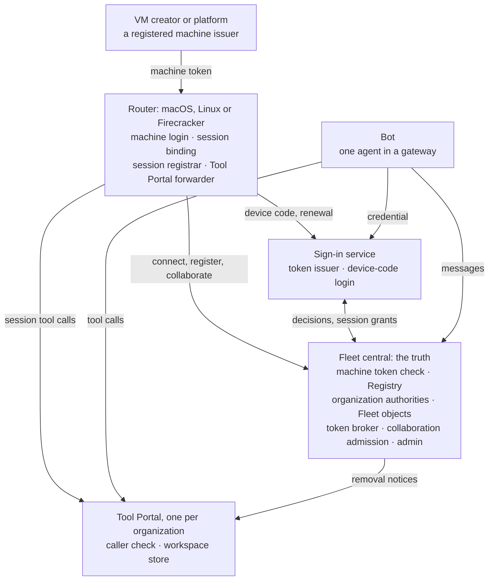
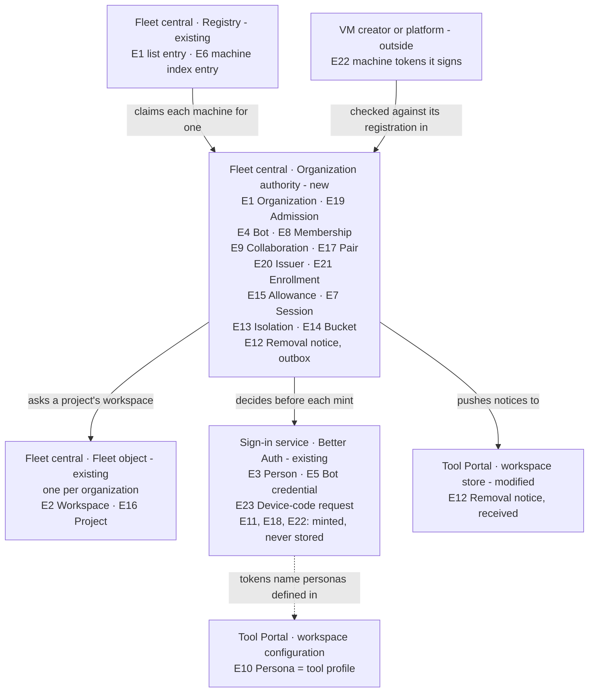
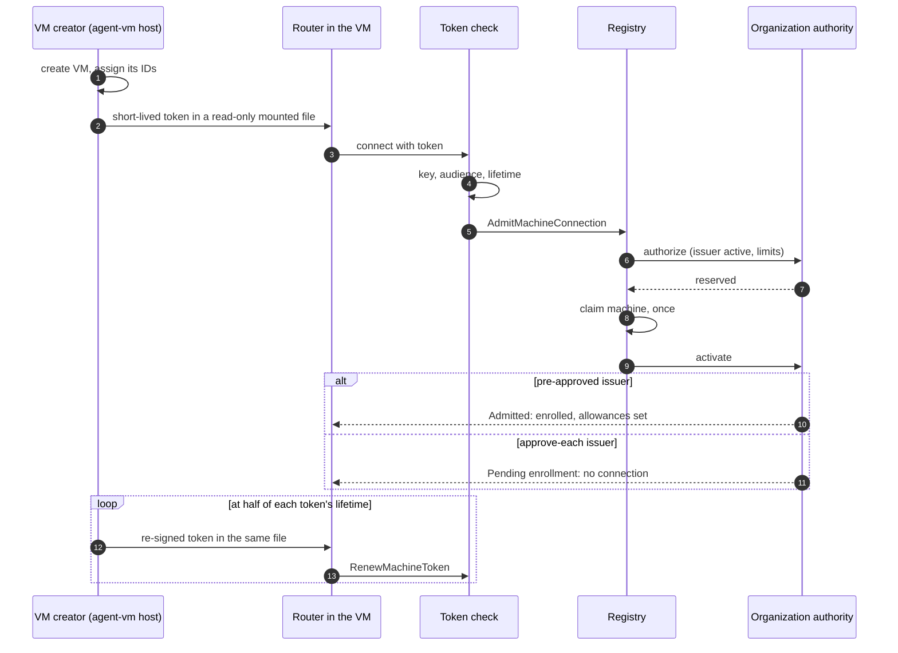
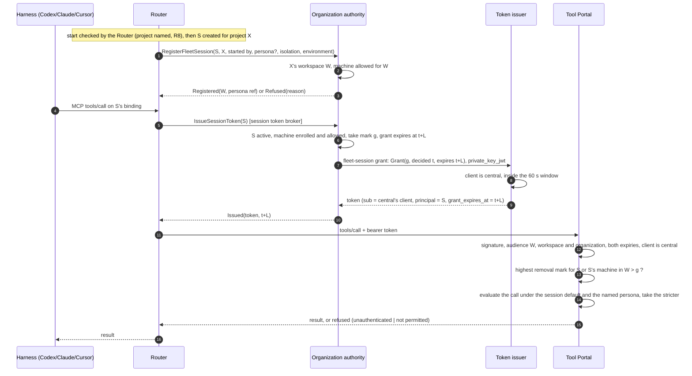
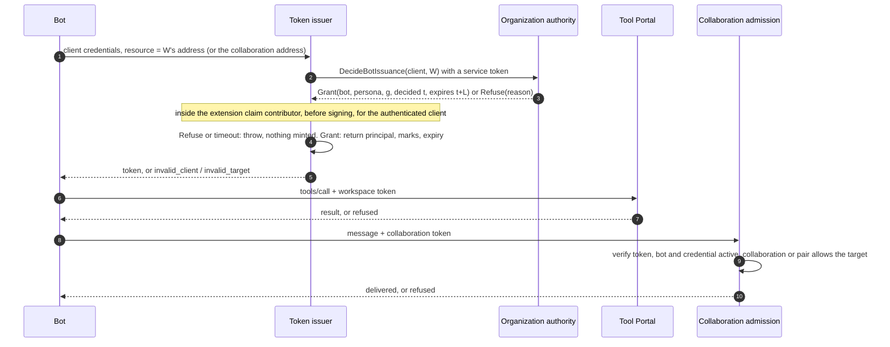
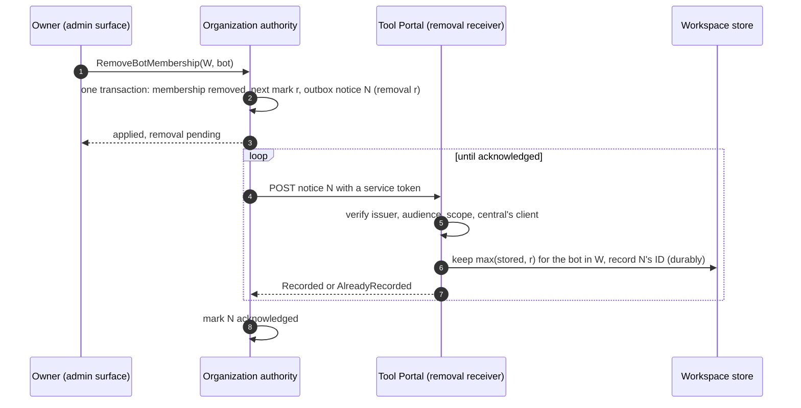
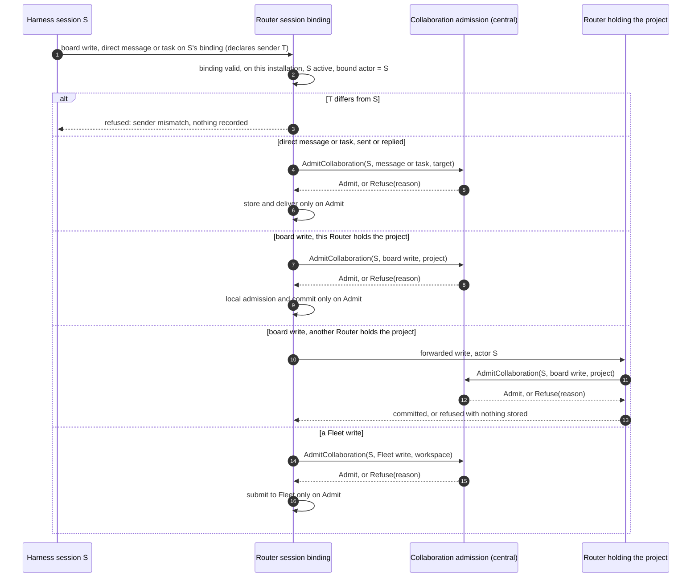
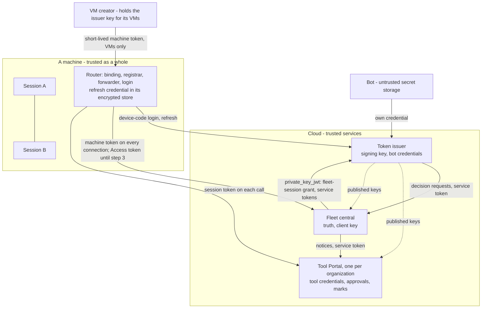
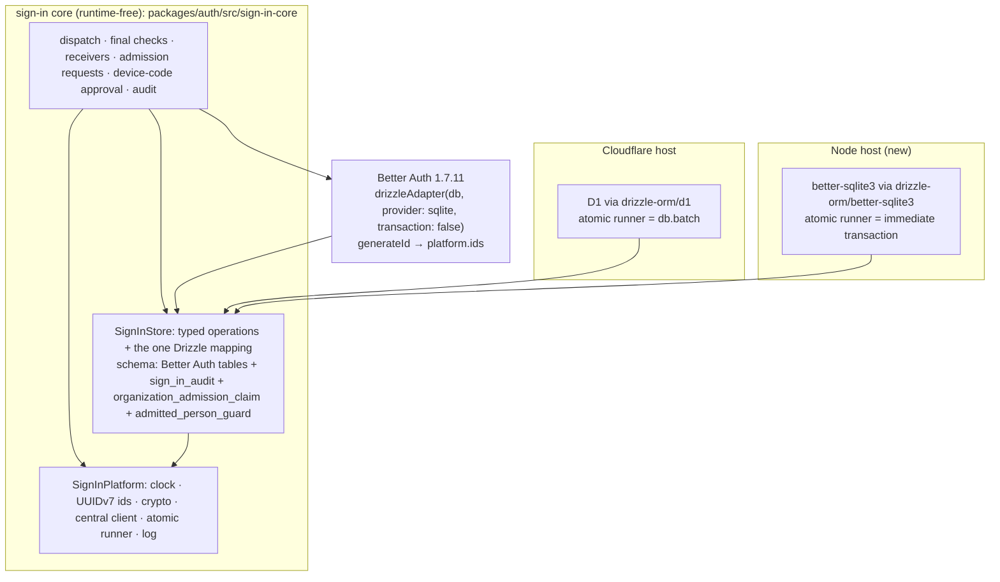

# Agent identity and workspace access: Program Design

How the fleet, the sign-in service and the Tool Portal realize the [Specification](specification.md)'s obligations. Authority: [Requirements](requirements.md). Proof plan: [Verification Design](verification-design.md). Options weighed: [Alternatives](alternatives.md).

## The structure in one picture



The picture shows services; the components table below names each part inside them. Inside Fleet central, the token broker, collaboration admission and admin surface all decide through the organization authority, which hands project-to-workspace questions to its Fleet object. Fleet central holds every truth about who belongs where, which machines are logged in and by whom, and decides every grant. The sign-in service proves bots and people, runs the device-code login, and mints every token except a VM issuer's own machine tokens. The Tool Portal checks tokens and keeps two kinds of per-workspace state: approval single-use counts (as today) and the removal marks Fleet central pushes. No component calls Fleet central on a tool call. People hold no tool tokens; they work through bots.

## What exists today

| Area | Today | Anchor |
|---|---|---|
| Fleet identities | An actor is a `SessionRef` (Router installation, harness endpoint, conversation ID) or a human ID. Central's callers are only `Machine` or `Owner`. A stored message's origin is `Session`, `OwnerUnverified` or `Router`; there is no bot in either. | `message-board/src/board_identity.rs:204–213`; `collaboration-central-core/src/access_contract.rs:33`; `collaboration-protocol/src/push_line.rs:197–202` |
| Fleet sender | The collaboration MCP server is stateless. It takes the sender from call arguments, and checks only that the service ID is this Router's, then stores it as the session origin. | `crates/collaboration-mcp/src/collaboration_api_router.rs:1–3`; `crates/collaboration-service/src/collaboration_application/message_operations.rs:46–68` |
| Fleet session context | A session's workspace is looked up: working directory, then git origin, then attached workspaces, then projects. No stored link exists. | `collaboration-service/.../board_hook_operations.rs:169–320` |
| ACP MCP servers (Claude, Cursor) | One provider-wide MCP server list, cloned into each new and restored session; HTTP servers are kept only when the provider advertises HTTP MCP support. Load and resume requests each carry a list, but the create and restore commands carry no session-specific context. | `acp-client-runtime/src/agent_session_client/provider_connection_task.rs:280–287, 451–453, 479–489`; `provider_session_restore.rs:54–89`; `provider_client_operations.rs:223–237, 276–292` |
| Codex sessions | Fleet Codex sessions run on the Codex app-server. The Router's native preparation already builds each thread's start and fork `config`, so it can add bound MCP entries. The Host routes Codex sessions through the app-server delivery route on the native control backend. The app-server-to-ACP bridge (`codex-acp-adapter`) serves outside clients and today also carries the Router's own Codex helper starts into the app-server's native `StartThread` or `ForkThread`; its ACP-side MCP handling gets no work here, and you say it is being deprecated. | `collaboration-service/src/native_thread_preparation.rs:76–91, 117`; `codex-router-host/src/session_message_route_composition.rs:42–49`; `codex_app_server_delivery_route.rs:16–17` |
| Helper starts | A Lead starts a helper with `conversation create`; the creator defaults to the calling session and the approver to the creator; a creator from another machine's service is refused. Only the same Router is enforced, not workspace membership. The create request carries no project, and its admission checks only that the creator and approver are local and the backend generation matches; any declared human passes. Starts come from the CLI or an MCP tool through `ConversationClient`: a Codex helper start goes through the client's Codex bridge, which issues the native `StartThread` or `ForkThread`; Claude and Cursor use their provider request. | Fleet Lead's evidence answers, 2026-10-24, §4; `collaboration_application/conversation_operations.rs:68–80, 199–265`; `collaboration-client/src/conversation_client.rs:360–377, 405–449, 492, 648–666`; `codex-acp-adapter/src/session_creation.rs:313–330`; `collaboration-protocol/src/provider_conversation_contract.rs:441–452` |
| Machines | Fleet-operator-only enrollment, fleet-wide: the operator prepares it with the operator's owner token, and its expiry must match the Access service token's. A Router connects with an Access service token plus a Bearer enrollment credential; central refuses a mismatched Access client, derives the caller from the Access assertion, stores only the credential's hash and binds the connection to that machine. The Registry's `machine_enrollments` row (`peer_id`, `service_id`, `access_client_id`, `credential_hash`, `state`, `expires_at`) carries no organization and no key. The Host loads the production enrollment from `<router_root>/fleet/enrollment.json`. Under Fleet's decision 1201 the two secrets live in the Router's encrypted secret store, plaintext only in debug. The Router reuses its saved installation and peer IDs across restarts and replacements. | `registry_migrations/0001_machine_enrollments.sql:1–12`; `enrollment_prepare.rs`; `machine_enrollment.rs:32–63, 400–445` (Access client must match, 439–445); `access_rules.rs:104–114, 143–160`; `central_router.rs:119–136, 220–280`; `service_identity_storage.rs:53–67, 120–135`; `codex-router-host/src/lifecycle_owner/collaboration_lifecycle.rs:115–137`; codex-router `docs/specs/2026-10-24-production-enrollment/production-enrollment.md` (f2c86cd5, decision 1201) |
| Router secret store | The store's one data key is read and created through a narrow seam, `KeychainAccess { read_secret, add_secret }`. Production uses the macOS Keychain; on every other platform the production adapter returns `Unavailable`, so a Linux or Firecracker Router has no production secret store. Test builds refuse the production adapter. | `codex-router-secret-store/src/keychain_data_key.rs:50–76, 164–205, 207–240` |
| Device-code login at the issuer | Better Auth 1.7.11's OAuth device grant (`oauthDeviceAuthorization` with the OAuth provider): one device-authorization grant may add request fields and persisted device-code fields and show grant context on the owner's verification page; redemption is one atomic `consumeOne` (a single conditional statement in the Drizzle adapter); tokens are minted through the shared `issueTokens`, with refresh tokens when the client may have them, and carry no session ID, so signing out of the approving browser does not end them; verification guesses are limited (five, then 429). | `packages/oauth-provider/src/device-code.ts:98–196, 255–352`; `packages/better-auth/src/plugins/device-authorization/index.ts:137–192`, `routes.ts:536–640`; `packages/drizzle-adapter/src/drizzle-adapter.ts:1078–1110`; `oauth-provider/src/introspect.ts:333–345` (all at v1.7.11, `52ab801c`) |
| Central hosts | One core, with Cloudflare Durable Object and Tokio hosts. Its object addresses form a closed set: Copy, Registry, Fleet, Connection and Mailbox; there is one Fleet object for the whole fleet. An organization authority is a new kind in that set, with routing and storage added on both runtimes. Objects call each other only in rank order (the Registry before an organization authority, which comes before the Fleet object), never the reverse. Every HTTP route sits behind the Access gate, which admits machines on `/v1/session` and the operator under `/admin/v1/` and refuses the rest. The platform offers object calls, time, IDs, wakes, Access-key fetch and RS256 verification; it has no general outbound request and no request-rate limit. | `platform_capabilities.rs:45–66`; `core_contract.rs:36–42`; `call_graph.rs:24–65, 97–167`; `central_router.rs:111–136`; `access_rules.rs:143–161`; `core_host.rs:26–31` |
| Sign-in issuer | Better Auth 1.7.8 with the OAuth provider. Agent clients use client credentials, a token is issued only for a linked workspace resource, and `customAccessTokenClaims` stamps claims. That hook reads the client ID the app picked from the request, body `client_id` before the Basic header (`sign-in-http-handler.ts:65–75`), while the provider authenticates the Basic client and accepts a bare body `client_id` beside it (`dist/utils-CGIZS-Da.mjs:546–579, 687–737`). The post-mint release re-checks the minted token's own authenticated client (A) against its organization and resource; it does not compare the earlier body hint (B) with A, so under today's claim model a mismatch can't give a token B's identity, though it isn't refused in every case. | `packages/auth/src/sign-in-core/response-release/sign-in-response-release.ts:114–146`; `provider-configuration.ts:220–276` |
| Issuer resources | Every requested resource must be a configured resource: seeded from the provider's options or a row in its resource table, found by `getResource`; there is no resolver hook. With `enforcePerClientResources: true` (our setting, `provider-configuration.ts:203–206`) the client also needs a link row to the resource, checked in the resource policy before any claim contributor runs. | installed 1.7.8 `dist/introspect-H3uoUiuS.mjs:620–655, 712–729, 1772–1794` and `getResource` |
| Better Auth minting | Extension grants and companion endpoints mint through `issueTokens`, which takes a client, an optional user, resources and additive `accessTokenClaims`. The subject is always `user.id ?? client.clientId`; reserved claims (`sub`, `aud`, `exp`, `iat`, `jti`, `client_id`, `scope` and others) are stripped from contributed claims; expiry comes from the provider's options. | installed `@better-auth/oauth-provider` 1.7.8: `dist/oauth-C_RnL2nt.d.mts:770–872`; `dist/introspect-H3uoUiuS.mjs:180–267, 1267–1290, 1342–1364` |
| Tool Portal check | Verify the token offline, then read membership and persona from the workspace's store. Persona is a key into the workspace's tool profiles. | `tool-host-core/src/caller-admission/caller-check.ts:19–38`; `hosted-mcp-proxy.ts:85,119` |
| Tool profiles | A profile lists, per namespace, which tools are available and which run with or without approval; `resolvedMcpPortalProfileSchema` is the resolved form. | `tool-access/src/authorization/mcp-profile-resolution.ts`; `tool-access/src/contracts/mcp-approval-profile.ts:108` |
| Tool Portal store | Holds membership/persona records, agent-management and retirement state, and approval single-use counts. | `tool-host-core/src/workspace-authority/models/workspace-authority-state.ts`; `approval-token-use-rules.ts` |

**Constraint degree:**

- **Compatibility-bound** on the fleet's existing workspace IDs, project records, and each Router's saved installation and peer IDs (R40 keeps them across a new login).
- **Migration-bound** on the Tool Portal's workspace store, where approval state must survive, and on the owner's existing Fleet data, which becomes the first organization's (OD8).
- **Cutover-bound** on U34's three steps: Cloudflare Access stays in front until the new login is proven behind it, and Fleet central never accepts the old and the new machine login together.
- **Platform-bound** for the Router on macOS, Linux and Firecracker (R44), whose production secret store exists today only on macOS.
- **Platform-bound** on Better Auth, analyzed at the installed 1.7.8 and built at exactly 1.7.11 (the people sign-in design's pin; public tags v1.7.8 `5f4cc5c1` and v1.7.11 `52ab801c`). Every mapping this design relies on remains supported at 1.7.11, but not every seam is unchanged. Byte-identical: client-authentication extraction, resource policy and links, claim precedence and the access-token builder, the client-management privilege gate, the client key cache and passkey verification; the extension input and `issueTokens` keep their shapes. Changed: the client-assertion verifier returns the checked client and takes an optional endpoint-only audience; an opt-in key self-rotation route lets a key-authenticated client replace its inline keys without a person (kept off); consent lookup matches an organization reference exactly, including its absence; and OAuth errors and their order changed (client authentication now precedes code consumption; PKCE failures are 400 `invalid_grant` or `invalid_request`). The build reruns the real negatives at 1.7.11 and carries no 1.7.8 observation or exact error assertion forward. The provider has client credentials, `private_key_jwt`, an extension-grant surface and `customAccessTokenClaims`; no token exchange; the subject and expiry are owned by the provider.

**What stays authoritative:** the fleet's workspaces and projects; each Router's installation and peer IDs; the issuer's signing keys and published key set; the Tool Portal's tool profiles and approval rules.

**What changes:** who holds membership (it moves out of the Tool Portal and sign-in into Fleet central); how a session is identified (bound by the Router, not declared by the caller); how removal reaches the Portal (pushed notices, ordered by marks); how a machine logs in (an issuer's short-lived tokens instead of an Access token and an enrollment credential); who owns a machine's enrollment (its organization's authority, not the Registry); and where organizations separate (every workspace, bot, machine and issuer belongs to one).

## The choices, and why

| Choice | Selected | Credible alternative | Why selected | Accepted cost, and who pays | Reopen if |
|---|---|---|---|---|---|
| Who mints tokens | The sign-in service (Better Auth) | Fleet central mints in Rust; or a TypeScript identity service that owns all truth (Y) | Keeps the tested issuer on a maintained library and keeps truth where workspaces already live | Two services take part in every issuance. The Fleet and sign-in teams maintain one contract between them. | Better Auth can't carry the claims below, or a Portal-only product without Fleet central becomes the priority (then Y) |
| How the Portal knows membership | **Token-only**, plus pushed removal notices | A live check per call (owner: too heavy); copies of membership (owner: "fishy") | Lightest per-call path. Removal bites on push, and grant expiry is the backstop. | Up to one token lifetime of stale access if a push is lost. The admin sees pending removals. | Removals must be guaranteed instant even when the Portal is unreachable |
| How the token says who it is for | Better Auth keeps `sub` (the authenticated client); a separate `principal` claim names the bot or the whole session reference | A companion plugin that sets `sub` to the session; fake user rows per session | Uses the documented `issueTokens` surface without fighting the provider's ownership of `sub` | Every consumer reads `principal`, never `sub`; the Portal pins which client may issue session principals | A future Better Auth lets a grant set the subject |
| How long a token is usable | A `grant_expires_at` claim fixed at decision time; the Portal enforces it beside `exp`; the issuer's own `exp` is set to the 60-minute maximum | Per-call `exp` (offered by neither 1.7.8 nor 1.7.11); per-resource lifetimes at the issuer (a copy of organization settings) | Delayed or repeated minting can't extend a grant (S-F1); per-organization lifetimes need no issuer copy | Clients learn the real end from the claim or a refusal, not `expires_in` | A later Better Auth offers per-issuance expiry |
| How removal and issuance stay ordered | **One ordered counter per organization; every grant decision and every removal takes its own next value**; a notice covers grants with a smaller value | Counter raised only by removals (a fresh grant then ties a removal); wall-clock effective times | Exact order with no ties and no clocks | One durable write per grant decision (about once per lifetime per identity and workspace) | — |
| How services prove who's calling | Short-lived **service tokens** from the issuer, each naming one receiving service and one operation, over TLS | Signing each request body (HTTP message signatures) | Reuses the issuer, its keys and client authentication; TLS already protects the body in transit | Each receiver pins issuer, client and scope per operation | A request must stay verifiable after leaving TLS (then sign bodies) |
| How a machine proves itself | A short-lived **machine token from an issuer the owner registered** for its organization, on every connection: the sign-in service for machines the owner logs in by device code, a VM creator or a platform for VMs | Keep the Access service token and enrollment credential (two long-lived secrets tied to the owner's Access; you: move off Access); per-machine key files (you: no) | One login model for every machine and platform; nothing long-lived on a VM; a new kind of machine is a new issuer, not a new mechanism | Fleet central verifies tokens from more than one issuer; a device-code machine keeps one refresh credential | An issuer kind needs a proof the token check can't express |
| Who owns a machine's enrollment | **The machine's organization authority**, with the Registry keeping only an index from installation and peer to organization, written once | Keep enrollments in the Registry with an organization column | A revocation and its grant fence are one transaction, so the revocation fan-out disappears; the owner's approval and issuer state are read where they live | Each new log-in touches the Registry once, then the organization authority | A machine must move between organizations (Fleet Q-B11) |
| How the device-code login is built | Better Auth's OAuth device grant, extended with the machine's fields, and the existing extension claim contributor asking Fleet central before each machine token | Our own device-code endpoints minting through `issueTokens` (the fallback, the surface the fleet-session grant uses) | Single use, guess limits, polling and refresh come from the library; the decision stays with Fleet central | The machine token's `sub` is the approving owner's account (the provider owns `sub`), so consumers read only `principal`; deleting that account ends the machine's renewals | The extension can't add fields or the contributor can't refuse a device-code mint at 1.7.11 (then the fallback) |
| How a VM gets fresh tokens | Its VM creator signs a short-lived token for it and keeps a fresh one where the VM's Router reads it; a platform's VM reads its platform's identity token | A long-lived secret placed in each VM | No secret in a VM; a VM runs past its first token's expiry with no person acting | The VM creator holds a signing key for all its VMs, the issuer's key (R24) | — |
| Linux secret store | The store's data key comes from a **systemd encrypted credential** read through the existing `KeychainAccess` seam. It is created once, at install, by `systemd-creds encrypt` run as root, and delivered to the Router service with `LoadCredentialEncrypted=`. The Linux adapter only reads it; without it, production refuses. The login runs inside the Router host, where that key is available. | A data-key file beside the store; the desktop Secret Service (needs a desktop session) | Works for a Router run as a systemd service, inside a VM guest with systemd too; the data key never changes, so a read-only credential is enough | Protection: with a TPM2, a copied disk can't decrypt; with only the host key, root on that host can. Neither protects from processes running as the Router's own user, the same as the macOS Keychain (the shared bucket). A Linux machine without systemd can't be logged in by device code (OD9). | A target Linux runs the Router outside systemd |
| How separate organizations' Fleet data is kept | **One Fleet object per organization** (OD8, proposed). The first organization adopts today's storage through a fixed mapping on both hosts: the Cloudflare object named `fleet`, and the Tokio singleton key. | One Fleet object with an organization column on every row | Separation by address: a machine reaches only its organization's object, so a forgotten filter can't leak; workspace names stay unique per organization; no rows rewritten | A storage cutover all the same: the address type, every caller, restart and wake recovery, each connection's feed, and refusing the old address all change; one more object per organization | You prefer one store. Then every row is backfilled with the column, names are made unique per organization, and every Fleet read and write filters by organization. |
| How the cutover flips | One deploy-time setting, `machineLogin`, with exactly one value per deployment: today's login before step 2, machine tokens from step 2. Step 2 fixes forward; there is no revert to the old login. | Accept either login during a transition; keep the old login restorable as a revert | You ruled out "either". Restoring the old login after step 2 could readmit a machine revoked after the switch | Step 2 needs every machine logged in again; a broken step 2 leaves machines offline, still behind Access, until a fix lands | — |
| How a session's token reaches the Portal | A Router forwarder attaches it | Token in the harness's MCP config (can't refresh); the session fetches its own (an agent holding a credential) | The agent never holds a credential; refresh is invisible | A new Router component on the tool path | A harness lets the Router set per-call headers itself |
| How the issuer knows a workspace's audience | Fleet central provisions one resource row per workspace at the issuer (the workspace's MCP address, enabled or disabled), recording existence only; per-client resource links are turned off (`enforcePerClientResources: false`) and replaced by the token-kind dispatch and Fleet's decisions | Keep per-client links (a second copy of membership, which you rejected); one shared audience for all workspaces (breaks the MCP rule that a client asks for the server's own address) | Membership keeps one owner; the issuer still refuses unknown or disabled audiences | One more Fleet → sign-in operation; the issuer holds a list of workspace addresses | Better Auth gains a resource resolver hook |
| Who asks the issuer for a session token | Fleet central, as a `private_key_jwt` client using a fleet-session extension grant | The Router as client (a new machine secret) | No machine secrets; central already decides | Central's client key is the system's most valuable key | — |
| How a session's persona is narrowed | The Portal evaluates each call under both the current session default and the named persona and takes the stricter outcome | Refuse a wider persona at start (central would need profile copies); merge profile structures | Widening is impossible by construction; profiles keep one owner; a default change applies from the next call | A wider named persona is silently clipped, not refused | Owner wants a refusal at start |
| How a collaborator bot reaches Fleet | A collaboration token (audience: Fleet's collaboration address) from the same issuer | Reusing a workspace token (audience confusion; collaborators have none) | Keeps tools and messaging on separate audiences | One more resource at the issuer | — |
| How a removal crosses owners | Each removal commits at its owner; a durable outbox carries it to every affected organization and workspace; issuance is fenced from the owner's commit | One distributed transaction (not available across Registry, Better Auth and organization objects) | Restart-safe, and honest about "pending" | Some removals show pending for a while | — |
| Organization isolation (D2) | One organization authority per organization (a Durable Object on Cloudflare; its own SQLite database on Tokio) | One shared store keyed by organization | D2's "segregated by durable objects", any host (U16) | One object per organization to operate | — |
| Where an admin change is recorded | In the same transaction as the change, at the owner of the state it changes: the organization authority, the Fleet object or the Registry | Every record in the organization authority (it would have to own workspaces and machines too) | One owner per truth, and a change and its record still commit together | Records live in up to three places; an organization's audit view is assembled from them when read | A compliance need for one audit store |
| Who keeps the list of organizations | The Registry: each organization and its state (`creating`, `active`), and the index of which organization each machine belongs to | The Fleet object | The Registry may call organization authorities in rank order; the Fleet object may not | The Registry gains two tables | — |

## Where each entity lives



| E | Semantic owner | Package or module home | Schema/type home | Shape at each boundary | Disposition | Convention |
|---|---|---|---|---|---|---|
| E1 Organization | Organization authority; the Registry keeps its list entry (ID, state, authority address) | `collaboration-central-core` (new module `organization_authority`); Registry `organizations` table (new) | `collaboration-central-core/src/identity_contract.rs` (new) | `organization_id`: UUIDv7 string in tokens, admin API, notices and the Router's login request | persisted | Rust newtype with fallible constructor; serde-tagged enums (`access_contract.rs:31`) |
| E2 Workspace | Fleet object (existing), one per organization (OD8) | `collaboration-central-core` workspaces table (existing), in the organization's Fleet object | `message-board/src/board_metadata.rs:119` `Workspace` (existing) | `workspace_id`: UUIDv7 string; the Portal's MCP address is derived from its organization's deployment origin plus `workspace_id` (existing `workspaceResourceIdentifier`) | persisted | existing |
| E16 Project | Fleet object (existing) | `project_directory` (existing) | `board_metadata.rs` `ProjectDirectoryEntry` (existing) | `project_id` string in session registration and token | persisted | existing |
| E3 Person | Better Auth (existing) | `packages/auth` (existing) | Better Auth user (existing) | person ID in the person token (admin and management audiences only, never a workspace, collaboration or machine audience); central's ownership, admission and person roles key on it | persisted | existing |
| E19 Organization admission | Organization authority | `organization_authority` (new): a person's is their sign-in allowlist entry bound to them (`AllowedSignIn`, moved from sign-in); a bot's is its `BotRecord` | `identity_contract.rs`: `AdmissionId` (UUIDv7), `OrganizationAdmission { admissionId, identity: Person { personId } \| Bot { botId }, state }` (new) | admin lookup; every E8 and E9 row carries the `admissionId` it was granted under | persisted (the entry or record); the view is derived | Rust tagged enum |
| E4 Bot | Organization authority | `organization_authority` (new) | `identity_contract.rs`: `BotId`, `BotRecord` (new) | `bot_id` UUIDv7 string in `principal`; never equal to a credential's client ID | persisted | Rust newtype |
| E5 Bot credential | Better Auth (existing agent-client store) | `packages/auth` `d1-persistence/agent-registration-store.ts` (modified: binds `botId`; workspace links removed) | Better Auth OAuth client plus metadata (modified) | `client_id`; metadata `{ botId, organizationId }` set only through central's admin path | persisted | Zod at the boundary |
| E6 Fleet machine | Registry: which organization an installation and its peer belong to, written once; its organization authority: its enrollments and so its state | Registry `fleet_machines` (new at step 2, when `machine_enrollments` is dropped: `service_id` primary key, `peer_id` unique, `organization_id`, `claimed_at`, written only after the organization authority authorized the log-in); the Router's saved state keeps the installation and peer IDs (existing) | `machine_enrollment.rs` `AdmittedMachine` (existing, modified: gains `organizationId`, `enrollmentId`; loses the Access client) | installation `service_id`; the session reference's installation | persisted | existing |
| E21 Machine enrollment | Organization authority | `organization_authority` `machine_enrollment` table (new) | `identity_contract.rs`: `EnrollmentId` (UUIDv7), `MachineEnrollment { enrollmentId, installation, issuerId, issuerSubject, authorizedBy: DeviceCodeApproval { personId, requestId } \| IssuerPreApproved \| OwnerApproved { personId }, requestId, state, endsAt: Option }` (new); `state` adds an internal `reserved`, never observable, which admits nothing and shows in no lookup | the built-in issuer's machine token claims and the token family's `referenceId`; `AdmittedMachine`; admin lookup | persisted | Rust tagged enum |
| E20 Machine issuer | Organization authority | `organization_authority` `machine_issuer` table (new); the built-in device-code issuer exists for every organization without a row | `identity_contract.rs`: `IssuerId`, `MachineIssuer { issuerId, kind: DeviceCode \| VmCreator \| PlatformOidc, verification, subjectRule, approval: ApproveEach \| PreApproved { workspaces }, state }` (new) | admin API (`RegisterMachineIssuer`); the machine token check | persisted | Rust tagged enum |
| E23 Device-code login request | Better Auth (the device grant's record) | `packages/auth`: the `deviceCode` table with the grant's fields plus ours (`machineInstallationId`, `machinePeerId`, `machineLabel`, `organizationId`, and `enrollmentId`, written only after central's `Approved`); the enrollment then lives on as the token family's `referenceId` | Better Auth `deviceCode` model (generated); `sign-in-core/device-login/machine-login-fields.ts` (new) | the Router's device-authorization request; the owner's approval page; `DecideDeviceLogin` | persisted until redeemed or expired | Zod at the boundary |
| E22 Machine token | Its issuer: the sign-in service for device-code machines, a VM creator or platform otherwise | `packages/auth` (modified) for the built-in issuer; the VM creator's own signer (agent-vm, new) | `identity_contract.rs`: `MachineTokenClaims` (new, the contract home; the sign-in service's Zod schema is generated from it) | JWT claims, below | derived (signed, never stored) | Rust serde, Zod derived |
| E15 Machine allowance | Organization authority | `organization_authority` (new) | `identity_contract.rs`: `MachineAllowance` (new) | admin API `{ installationId, workspaceId }`; `DecideDeviceLogin` and `ApproveMachineEnrollment` carry the workspaces chosen at log-in | persisted | Rust |
| E7 Fleet harness session | Organization authority | `organization_authority` session registry (new) | `endpoint_identity.rs` `SessionRef` (existing) plus `identity_contract.rs` `FleetSessionRecord` (new) | `principal.session_ref` object in tokens; `session` in registration | persisted (with retention) | existing `SessionRef` plus Rust |
| E8 Membership | Organization authority | `organization_authority` (new) | `identity_contract.rs`: `Membership { workspace, principal, persona: PersonaRef, admission: AdmissionRef, state }` (new); `AdmissionRef` is the person's or bot's `AdmissionId`, or for a session its machine's installation, which counts while that machine has an active enrollment here | issuance decision; admin lookup | persisted | Rust tagged enum `Principal { Person, Bot, FleetHarnessSession }` |
| E9 Collaboration | Organization authority | `organization_authority` (new) | `identity_contract.rs`: `Collaboration { workspace, collaborator: Person { personId } \| Bot { botId }, admissionId, state }` (new) | admin API; collaboration admission (a person's admits nothing) | persisted | Rust tagged enum |
| E17 Workspace pair | Organization authority | `organization_authority` (new) | `identity_contract.rs` (new) | admin API; collaboration admission | persisted | Rust |
| E10 Persona | Tool Portal workspace configuration (existing) | `tool-access` profile resolution (existing), plus a new `portal.sessionDefaultProfile` key | `tool-access` configuration schema (modified) | `persona` claim: `{ kind: "sessionDefault" }` or `{ kind: "named", name }` | persisted (configuration) | Zod, `z.infer` |
| E11 Workspace token | Better Auth issuer (existing, modified claims) | `packages/auth` (modified) | `tool-access` contracts: `workspaceTokenClaimsSchema` (new; the single home; Rust consumers test against fixtures generated from it) | JWT claims, below | derived (signed, never stored) | Zod discriminated union |
| E18 Collaboration token | Better Auth issuer | `packages/auth` (modified) | `tool-access` contracts: `collaborationTokenClaimsSchema` (new) | JWT claims, below | derived | Zod |
| E12 Removal notice | Organization authority (sends); Portal workspace store (keeps) | central outbox (new); Portal `WorkspaceStore` version 2, `removal_notice` and `removal_mark` keyed by `RemovalSubjectKey` (remediation design) | `identity_contract.rs` `RemovalNotice` (new, the contract home); the Portal derives its Zod schema from the generated JSON Schema, checked by a contract test | HTTP JSON, below | persisted on both sides | Rust serde, Zod derived |
| E13 Isolation record | Organization authority | session registry (new) | `identity_contract.rs`: `AgentIsolation`, `MachineEnvironment` (new; from the Fleet attestation design) | registration; the token's `principal` | persisted | Rust tagged enum |
| E14 Shared bucket | Organization authority (a derived query) | `organization_authority` (new) | `identity_contract.rs` lookup result (new) | admin lookup | derived | Rust |

### Organizations: admission first, nothing across (R34–R38)

- **Admission keys every role (R35, R37).** Every membership and collaboration row records the admission it was granted under: a person's allowlist entry ID, a bot's record ID, or for a session its machine. A session's membership counts while its machine has any active enrollment in the organization, so logging the machine in again keeps its sessions (R40). Every other role counts only while its admission is active, and the check runs in the same transaction as the decision that relies on it. Adding someone back creates a new admission ID, so no earlier row counts again (R37); the admin grants roles afresh.
- **Ending an admission (R36, proposed in OD5)** is `RemoveSignIn` for a person and `RetireBot` for a bot. In that same transaction, the organization authority ends every role held under that admission, and for a bot writes the `botRetired` notices it already writes. People hold no tokens, so ending a person's roles needs no notice. A session's membership is keyed to its machine, not to any person, so a person leaving changes no session. If you decline OD5, the rows stay but no longer count, and they show as ended in lookups: R37 holds either way.
- **Nothing crosses (R34).** Every command and decision names one organization. The organization authority holds only that organization's rows, so a reference to another organization's workspace, bot, session or machine is not found there. It is refused with the same answer as a reference that doesn't exist, so nothing about the other organization is revealed. A workspace pair's two workspaces are both in the authority's own Fleet object, or the pair is refused. A session's project must be in its machine's organization: central sends `RegisterFleetSession` to the organization authority of the connection's machine, which looks the project up in its own Fleet object, so a project in another organization is `projectUnknown`.
- **What a machine is told (R34, U29):** see "The filtered view" below.
- **People hold no tool tokens (R38).** The issuer's dispatch has no row that mints a workspace, collaboration or machine token for a person. A bot's tool call is decided by its own membership and persona alone: the caller check reads no requester field, and a bot's claims carry none.

### The filtered view: what a machine reads of its organization's Fleet (R34, U29)

**Today:**
- A connection reads Fleet records three ways: a directory query, a snapshot (paged by a snapshot cursor) and the feed (`after` a position) (`session_scope/fleet_reads.rs:23–45`, `fleet_read_calls.rs:22–35` at `f465808f`).
- The snapshot assembles canonical workspace, board, project, decision-record and request records (`fleet_snapshot_read.rs:44–105`).
- The feed is one stored range per Fleet object whose positions must be exactly contiguous (`fleet_feed_store.rs:80–124`).
- Nothing is filtered: every connection reads the whole fleet.

**The view contract:**
- **The visible set.** Each machine has a visible set in its organization's Fleet object: the workspaces it is allowed to serve (full records) and the workspaces paired with them (projected to ID and name only). The organization authority owns the allowances and pairs. In the same command, before replying `Applied`, it sends the machine's new visible set to its Fleet object (rank order). If that call fails, an outbox resends it and the command shows pending. The Fleet object only stores and applies the set.
- **Each read path is filtered for the connection's machine** (its `AdmittedMachine`):
  - **Directory:** answers only from the visible set.
  - **Snapshot:** includes the full records of allowed workspaces and their boards, projects, decision records and requests, plus `{ id, name }` for each paired workspace; nothing else.
  - **Feed:** keeps its global positions. An entry outside the visible set is sent as `Withheld { position }`, carrying no content. The Router's replica advances its cursor over it. Contiguity holds on the wire and in the replica, and the stored range is unchanged.
- **Scope changes.** When a machine's visible set changes, the Fleet object sends each of its open connections `ScopeChanged { visibleWorkspaces }`.
  - **A workspace removed from the set:** the Router deletes its replica records for that workspace. Data the machine already read is not unread (R19's limit).
  - **A workspace added:** the Router reads a fresh snapshot for it, then continues the feed from its cursor.
  - **The cut-off:** data stops flowing to a machine at the Fleet object's receipt of the new set. Grants were already fenced at the organization authority's commit.
- **Reconnect and resume:** a reconnecting Router resumes the feed from its cursor, filtered by its machine's current visible set. A cursor issued under an older set stays valid, because positions never change.

**Cost:** two new frames (`Withheld`, `ScopeChanged`), one stored set per machine in the Fleet object, and a filter on each of the three read paths. No second replication engine is added.

### Encoding rules for every boundary below

- **Versions:** every route is under `/v1/`. A breaking change is a new path prefix; contract types carry no version field.
- **Casing:** JWT claims are `snake_case`; HTTP JSON bodies are `camelCase` (the Fleet's serde convention). Rust types say `rename_all` on structs and enums alike.
- **Numbers:** marks (grant and removal) are integers in `0..=2^53−1`, encoded as JSON numbers; the Rust newtype refuses larger values. Times are Unix seconds.
- **Clock model:** any two service clocks differ by at most D = 60 seconds. No receiver adds leeway to `grant_expires_at`; checks of `exp`, `iat` and service-token lifetimes allow D. Retention (below) is computed from D, so a clock difference can refuse a token early but never let a covered one pass after its notice is dropped.

### Workspace and collaboration token claims

The issuer owns `iss`, `sub`, `aud`, `exp`, `iat`, `jti`, `client_id` and `scope`. `sub` is the authenticated client: a bot's credential, or Fleet central's session-issuing client. Every consumer identifies the caller by `principal`, never by `sub`. Home: `tool-access` contracts.

```ts
const sessionRefSchema = z.object({
  installation: z.string().uuid(),   // the Router service ID
  harness_endpoint: z.string(),      // "codex-local" | "claude-local" | "cursor-local" …
  conversation_id: z.string().min(1),
});
const machineEnvironmentSchema = z.discriminatedUnion("kind", [
  z.object({ kind: z.literal("physical") }),
  z.object({ kind: z.literal("cloudVm"), provider: z.string(), instance: z.string() }),
]);
const isolationSchema = z.discriminatedUnion("kind", [
  z.object({ kind: z.literal("host"), instance_id: z.string() }),
  z.object({ kind: z.literal("processSandbox"), mechanism: z.enum(["seatbelt", "bubblewrap", "landlock"]), instance_id: z.string() }),
  z.object({ kind: z.literal("container"), runtime: z.string(), container_id: z.string(), instance_id: z.string() }),
  z.object({ kind: z.literal("vm"), launcher: z.literal("agent-vm"), vm_id: z.string(), instance_id: z.string() }),
]);
const principalSchema = z.discriminatedUnion("kind", [
  z.object({ kind: z.literal("bot"), bot_id: z.string().uuid() }),
  z.object({
    kind: z.literal("fleetHarnessSession"),
    session_ref: sessionRefSchema,
    machine_environment: machineEnvironmentSchema,
    project_id: z.string(),
    isolation: isolationSchema,
  }),
]);
const personaRefSchema = z.discriminatedUnion("kind", [
  z.object({ kind: z.literal("sessionDefault") }),
  z.object({ kind: z.literal("named"), name: z.string().min(1) }),
]);
const mark = z.number().int().nonnegative().max(Number.MAX_SAFE_INTEGER);
const issuerOwned = {
  iss: z.string(), aud: z.string(), sub: z.string(), client_id: z.string(),
  jti: z.string(), iat: z.number().int(), exp: z.number().int(),
};
export const workspaceTokenClaimsSchema = z.object({
  ...issuerOwned,
  principal: principalSchema,
  organization_id: z.string().uuid(),
  workspace_id: z.string().uuid(),
  persona: personaRefSchema,          // bots: always "named"
  grant_revision: mark,
  grant_expires_at: z.number().int(),
}).refine((c) => c.principal.kind === "fleetHarnessSession" || c.persona.kind === "named");
export const collaborationTokenClaimsSchema = z.object({
  ...issuerOwned,
  principal: z.object({ kind: z.literal("bot"), bot_id: z.string().uuid() }),
  organization_id: z.string().uuid(),
  grant_revision: mark,
  grant_expires_at: z.number().int(),
});
export type WorkspaceTokenClaims = z.infer<typeof workspaceTokenClaimsSchema>;
```

**Portal acceptance (C1), in order:** header `typ` is `at+jwt` and `alg` is in the configured allowlist; signature against the issuer's published keys, from the pinned key-set address, never a URL or key named in the token; `iss` is exactly the configured issuer; `aud` is W's address; `workspace_id` is W and `organization_id` is the deployment's one organization (R45: each deployment's configuration names exactly one `portal.organizationId`, and a configuration that also names another organization's workspace fails to load); `now < grant_expires_at` with no leeway, and `now < exp + 60 s`; for a session principal, `client_id` is Fleet central's pinned session-issuing client and nothing else; no removal mark covers it (below); then the persona check.

### Machine token claims (E22, C9)

Home: `identity_contract.rs`. Every machine token has `aud` = Fleet central's machine address, and only Fleet central accepts it. A machine is infrastructure, not an agent actor (R1): `MachinePrincipal` is its own type, never a variant of the agent `Principal` union, and the workspace and collaboration claim schemas don't parse it.

```rust
// Minted by the sign-in service for a device-code machine. Better Auth owns iss, sub (the approving owner's
// account: consumers ignore it), aud, exp (the 60-minute maximum), iat, jti, client_id (the Router login client).
#[serde(rename_all = "snake_case")]
pub struct DeviceCodeMachineClaims {
    pub principal: MachinePrincipal,        // { kind: "machine", installation_id, enrollment_id }
    pub organization_id: OrganizationId,
    pub grant_expires_at: UnixSeconds,      // decided_at + the organization's lifetime (≤ 3600), as for workspace tokens
}
// Signed by a VM creator with its registered key (we define this format; agent-vm implements it).
#[serde(rename_all = "snake_case")]
pub struct VmCreatorMachineClaims {
    pub iss: String,                        // the issuer string registered for it
    pub sub: InstallationId,                // the VM creator assigns the installation (and peer) when it creates the VM
    pub aud: String,
    pub organization_id: OrganizationId,
    pub iat: UnixSeconds,
    pub exp: UnixSeconds,                   // exp − iat ≤ the organization's lifetime
    pub jti: String,
}
// A platform's own OIDC token is not ours to shape: its registration names the claim that identifies
// the machine (subjectRule, for example `sub`) and the claims that must match (for example the app).
```

**Fleet central's check, in order (C9):** the token parses as a JWT with an allowed `alg`; its unverified `iss` selects either the built-in issuer (the sign-in service, keys and client pinned in central's trust configuration) or a registered issuer of the organization the connection names. The signature verifies against that issuer's keys: pinned, inline in the registration, or from its OIDC discovery, cached at most 5 minutes and refetched once on an unknown key ID. `aud` is central's machine address. The time check is `now < grant_expires_at` for the built-in issuer, or `now < exp` with `exp − iat` within the lifetime for others, each allowing D on `exp`. Then the organization authority answers `AdmitMachineConnection` from its own state, read live: the issuer is active; the enrollment the token names, or for other issuers the issuer's active enrollment of that subject, is `enrolled`; it belongs to the installation and peer the connection presents. A token naming another organization, a withdrawn issuer, a pending, revoked or expired enrollment, or another installation is refused.

### Grant decisions

Home: `identity_contract.rs`. Only bots and sessions receive workspace tokens, so the subject excludes people.

```rust
#[serde(tag = "kind", rename_all = "camelCase")]
pub enum WorkspaceTokenSubject {
    Bot { bot_id: BotId },
    #[serde(rename_all = "camelCase")]
    FleetHarnessSession { session_ref: SessionRef, machine_environment: MachineEnvironment, project_id: ProjectId, isolation: AgentIsolation },
}
#[serde(tag = "kind", rename_all = "camelCase")]
pub enum PersonaRef { SessionDefault, Named { name: PersonaName } }

#[serde(tag = "result", rename_all = "camelCase")]
pub enum IssuanceDecision {
    #[serde(rename_all = "camelCase")]
    Grant {
        organization_id: OrganizationId,
        workspace_id: WorkspaceId,
        subject: WorkspaceTokenSubject,
        persona: PersonaRef,
        grant_revision: Mark,          // this decision's own place in the organization's order
        decided_at: UnixSeconds,
        grant_expires_at: UnixSeconds, // decided_at + the organization's lifetime (≤ 3600)
    },
    Refuse { reason: IssuanceRefusal },
}
#[serde(rename_all = "camelCase")]
pub enum IssuanceRefusal { NotMember, IdentityNotProven, MachineNotAllowed, Retired }

#[serde(tag = "result", rename_all = "camelCase")]
pub enum CollaborationDecision {
    #[serde(rename_all = "camelCase")]
    Grant { organization_id: OrganizationId, bot_id: BotId, grant_revision: Mark, decided_at: UnixSeconds, grant_expires_at: UnixSeconds },
    Refuse { reason: IssuanceRefusal },
}
```

`Unavailable` is not a decision: a transport failure or timeout, which every caller treats as a refusal (R25).

**Redemption window:** the issuer mints from a `Grant` only while its own clock reads `≤ decided_at + 60 s`, and stamps `grant_expires_at` exactly as decided. A repeat inside the window mints an equivalent token that ends at the same moment; nothing can mint later. At exactly 60 s it may still mint. Under the clock model the window lasts between 0 and 120 s of real time; clock difference never moves `grant_expires_at`. During a Fleet central outage no new decision is made, but a `Grant` already handed to the issuer may still mint inside its window.

### Requests over the machine's connection (Router → Fleet central)

```rust
#[serde(rename_all = "camelCase")]
pub struct RegisterFleetSession {
    pub session: SessionRef,                    // bound by the Router, never declared by the agent
    pub project_id: ProjectId,
    pub started_by: StartedBy,                  // tagged: routerOperator | session { session } (the binding the start came on); recorded for display (R8)
    pub requested_persona: Option<PersonaName>, // None means the session default
    pub isolation: AgentIsolation,
    pub launch_context: LaunchContext,          // launcher-asserted, recorded for display: working directory, repository, commit, model, launched by
    pub machine_environment: MachineEnvironment,
}
#[serde(tag = "result", rename_all = "camelCase")]
pub enum RegisterFleetSessionResult {
    #[serde(rename_all = "camelCase")]
    Registered { organization_id: OrganizationId, workspace_id: WorkspaceId, persona: PersonaRef },
    Refused { reason: SessionRefusal }, // projectUnknown | machineNotAllowed | alreadyEnded
}

#[serde(rename_all = "camelCase")]
pub struct IssueSessionToken { pub organization_id: OrganizationId, pub workspace_id: WorkspaceId, pub session: SessionRef } // from Registered
#[serde(tag = "result", rename_all = "camelCase")]
pub enum IssueSessionTokenResult {
    #[serde(rename_all = "camelCase")]
    Issued { access_token: String, grant_expires_at: UnixSeconds },
    Refused { reason: IssuanceRefusal },
}

#[serde(rename_all = "camelCase")]
pub struct EndFleetSession { pub organization_id: OrganizationId, pub session: SessionRef, pub cause: SessionEndCause } // archived | deleted
```

The Router may only name sessions on its own installation; central refuses any other. These are new typed operations on the connection's session protocol (`/v1/session`), each with its request, its answer and its failure mapping (unavailable, refused, malformed). The machine, its organization and its enrollment come from the logged-in machine the connection is bound to (`AdmittedMachine`), never from a field of the body.

**Routing and one registration per conversation (R7):** central sends `RegisterFleetSession` to the organization authority of the connection's machine (`AdmittedMachine.organizationId`), which asks its own Fleet object for the project's workspace; a project that organization doesn't hold is `projectUnknown`. The Router's session registrar is the one owner of which project a conversation was started for: it records the conversation and its project durably before the first request, and adds the organization, workspace and persona from `Registered` when they arrive; registers each conversation once, resends the identical request after an ambiguous reply or a restart, and refuses to register a recorded conversation for another project. The organization authority treats a repeat of the same `SessionRef` and project as `Registered` again, and refuses a different project. Later requests carry the organization and workspace from `Registered`, and the organization authority refuses a session it doesn't hold. A machine belongs to one organization, so its sessions can only ever be registered there.

**Bindings at start and restore:** before a create, the registrar mints a binding and hands it over with the create command: for Codex, in the native `StartThread` or `ForkThread` config wherever it is built (today the client bridge's creation, `session_creation.rs:313–330`, for helper starts, and the native preparation for delivery), and the same address again at `thread/resume`; for Claude and Cursor, the session's own MCP list on the ACP create, load or resume request. Today's create and restore commands carry no session context, so they gain the binding. The binding becomes active only for the conversation the provider returns, once `Registered` arrives; a pending, failed or ambiguous creation activates nothing, so its binding admits no effect. Before a restore, it looks up the session's persisted binding and lifecycle state and reuses that binding and address; a retired or abandoned binding is never restored. The registrar persists the registration's immutable input, the binding ID and address, and the result. A provider that doesn't advertise HTTP MCP support can't carry a binding, so its start is refused rather than run without one. The address must not move: the Router refuses to register sessions while its configured listener port is zero, or when its configured origin differs from the one recorded with a registration. The listener itself is already fixed by configuration (`127.0.0.1:8788` in production, `host_command/mod.rs:374–391`).

**Order and late outcomes:** the Router checks the start first (it names its project; a session starts sessions only in its own workspace, R8); then the provider creates the conversation; then the Router registers it, and sends its first prompt only after `Registered`. Starting needs no sign-in: the machine's workspaces were chosen when it was enrolled. Refused by the Router's check: nothing is created. Created, then registration refused (for example, an allowance withdrawn in between): the conversation exists, its binding never activates, and it is never prompted. A lost create reply: the binding stays prepared until the registrar learns the outcome. Nothing replays a create or deletes a conversation automatically; such a conversation is idle and acts as no member. Resending the identical registration returns the original `Registered`.

### Machine login (R39–R43, C8–C10)

**Device-code login request (Router → sign-in service).**
- **Where it runs:** `fleet login --organization <id> --label <label>` asks the running Router host to log in, over the CLI's existing local connection to the host. The host runs the flow and the CLI only prints the user code and address it returns. The refresh credential is therefore written only where the store's data key is available: inside the systemd service on Linux, and in the same host process on macOS, so there is one behavior everywhere.
- **The request:** the host posts the standard device-authorization request for the Router login client (a public client registered at deploy, allowed `offline_access`, resource = central's machine address). The extended device grant persists four added fields on the code: `machine_installation_id` and `machine_peer_id` (from the Router's saved state), `machine_label`, and `organization_id`.
- **The poll:** the host polls the token endpoint with the device code.
- **One organization:** the Router refuses to log in to an organization other than the one its saved state already names (E6).

```rust
// Sign-in → Fleet central, sent when the owner presses Approve, after the sign-in core has checked the code
// is still pending and unexpired, and before the code is marked approved.
#[serde(rename_all = "camelCase")]
pub struct DecideDeviceLogin {
    pub organization_id: OrganizationId,       // the code's organization, which must equal the approver's session organization
    pub approver: PersonId,                    // from the approver's current session at the sign-in service
    pub request_id: DeviceLoginRequestId,      // the device code record's ID, never the code itself; the idempotency key
    pub installation: InstallationId,
    pub peer: PeerId,
    pub label: MachineLabel,
    pub allowed_workspaces: Vec<WorkspaceId>,  // chosen on the approval page (OD1: log-in and its workspaces together)
}
#[serde(tag = "result", rename_all = "camelCase")]
pub enum DeviceLoginDecision {
    #[serde(rename_all = "camelCase")]
    Approved { enrollment_id: EnrollmentId },
    Refused { reason: DeviceLoginRefusal },    // notOwner | machineInAnotherOrganization | unknownWorkspace
}

// Sign-in → Fleet central, from the extension claim contributor, before each device-code or refresh mint.
// The enrollment comes only from the token family's server-side reference (below), never from the request.
// The first Grant for an `approved` device-code enrollment makes it `enrolled` and supersedes the earlier one, in one transaction.
#[serde(rename_all = "camelCase")]
pub struct DecideMachineToken { pub organization_id: OrganizationId, pub enrollment_id: EnrollmentId }
#[serde(tag = "result", rename_all = "camelCase")]
pub enum MachineTokenDecision {
    #[serde(rename_all = "camelCase")]
    Grant { installation: InstallationId, enrollment_id: EnrollmentId, decided_at: UnixSeconds, grant_expires_at: UnixSeconds },
    Refuse { reason: MachineTokenRefusal },    // enrollmentNotActive | superseded
}

// Fleet central's connection entry → Registry → organization authority, for every new connection and renewal.
#[serde(rename_all = "camelCase")]
pub struct AdmitMachineConnection {
    pub organization_id: OrganizationId,
    pub issuer: VerifiedIssuer,                // builtIn | registered { issuerId }, after the signature checked out
    pub machine: TokenMachine,                 // tagged: enrollment { enrollmentId, installation } | subject { subject }
    pub presented: PresentedMachine,           // the installation and peer the connection presents
    pub token_expires_at: UnixSeconds,
}
#[serde(tag = "result", rename_all = "camelCase")]
pub enum MachineConnectionAdmission {
    #[serde(rename_all = "camelCase")]
    Admitted { machine: AdmittedMachine },     // installation, peer, organizationId, enrollmentId, token expiry
    Pending { enrollment_id: EnrollmentId },   // an approve-each issuer's new machine: recorded, no connection
    Refused { reason: MachineConnectionRefusal }, // unknownMachine | issuerWithdrawn | enrollmentNotActive | superseded | outsideIssuerLimits | machineInAnotherOrganization
}
```

**Who decides what, in rank order: authorize, then claim, then activate.** A device-code approval, or a first connection with a registered issuer's token for an unknown machine, enters at the Registry. The Registry calls the organization authority in rank order, and nothing is written anywhere until the organization authority has authorized:

1. **Check.** The Registry reads its machine index. An installation or peer already claimed by another organization is refused as `machineInAnotherOrganization`, and nothing changes.
2. **Authorize and reserve.** The organization authority decides in one transaction:
   - **A device-code approval:** the approver must be the current owner, and every chosen workspace must exist.
   - **A pre-approved issuer's machine:** the issuer must be active, and its listed workspaces apply.
   - **An approve-each issuer's machine:** the issuer must be active, and the enrollment will be pending.

   On success it writes a **reserved** enrollment, keyed by the request ID, and the decision's record. A reserved enrollment admits nothing. On refusal nothing is written, here or at the Registry.
3. **Claim.** The Registry writes its claim for the installation and peer: once, and only for that organization. A repeat for the same organization is a no-op. If another organization's claim won a race in between, the Registry refuses.
4. **Activate or cancel.** The Registry calls the organization authority again:
   - **Activate:** the reserved enrollment moves on, and its allowances are written:
     - **A pre-approved issuer's:** to `enrolled`. Any earlier active enrollment of that installation ends as superseded in the same transaction.
     - **An approve-each issuer's:** to `pending`.
     - **A device-code approval's:** to `approved`. It becomes `enrolled`, and only then supersedes the earlier one, at its first machine token. So an approval whose code is never redeemed never displaces a working enrollment.
   - **Cancel:** the reserved enrollment is dropped.

**Lost replies and restarts.** Every step is idempotent on the request ID, so the caller resends the same request:
- The sign-in service resends until the code expires.
- A VM resends by reconnecting.

A reserved enrollment left by an interrupted attempt admits nothing. It lapses when its request can no longer be resent: at the device code's lifetime, or after the same span for an issuer's attempt. Either way the claim is written only after an authorization succeeded, so a refused attempt leaves nothing in the Registry.

**The device code, from approval to refresh (F1).** The enrollment travels with the token family through the issuer's own persisted reference. Nothing the Router sends chooses it:

- **The approval hooks.** Before-hooks guard the device plugin's verify, approve and deny endpoints. Each first checks, in the sign-in core, that the code is still pending and unexpired, and that the signed-in person is the current owner of the code's organization (`Standing` from central, role `owner`). Anyone else gets a refusal before the plugin's own handler runs, so they never claim the code's user slot and the code stays for the owner. The approve hook then sends `DecideDeviceLogin`. On `Approved`, it writes the returned enrollment ID onto the device code row (an added `enrollmentId` field) before letting the plugin mark the code approved. A refused or unavailable decision leaves the code pending.
- **The first mint.** The sign-in service registers its own token handler for the device-code grant type. It redeems the code with the device plugin's exported redemption (`redeemDeviceCode`: the plugin's polling, expiry, denial and single-use `consumeOne` rules). It then calls the provider's `issueTokens` with `referenceId` set to the redeemed code's `enrollmentId`. The provider stores that reference on the refresh token.
- **Every refresh.** The provider restores the reference from the refresh token on each refresh, across rotation and restarts, and passes it to the extension claim contributor as `referenceId`. The contributor sends `DecideMachineToken` for exactly that enrollment. A superseded, revoked or expired enrollment is refused and nothing is minted.
- **Machines never share a token family.** Two machines approved by the same owner under the one public client are separate code rows, separate enrollments and separate token families.

The plan's first sign-in slice proves this against 1.7.11. It checks in particular that `referenceId`, which the provider also uses to match consent, raises no consent requirement for the Router login client, which asks for no consent. The fallback is our own device endpoints minting through `issueTokens` with the same reference.

**Renewal.**
- **A device-code machine** refreshes at the sign-in service before `grant_expires_at`, as above.
- **A VM** gets fresh tokens from its creator through the mounted token file (below).
- **A platform's VM** reads its platform's token.

Fleet central decides whether any of these is admitted: on each new connection and each `RenewMachineToken`, the organization authority reads the issuer and enrollment live. An external issuer may keep signing after its machine is revoked, its issuer withdrawn, or Fleet central is down. Fleet central refuses what it signs, so nothing it signs authorizes any work (F3).

**The open connection, and supersession.**
- **Renewing:** an open connection carries its token's expiry and its enrollment ID. Before the token expires, the Router sends a fresh one over the connection (`RenewMachineToken { token }` on `/v1/session`), checked like a new connection. The Connection object closes a connection whose token has expired.
- **Every decision checks the connection's own enrollment:** registration, token issuance, collaboration admission and Fleet reads all check that the connection's `AdmittedMachine.enrollmentId` is the installation's active enrollment, not merely that the installation has one. A connection on a superseded or pending enrollment is refused for every grant and effect, and closed.
- **Revocation and supersession** close the connection at once, through the organization authority's outbox and the existing close path (FL-12). If that close is lost, the connection still gets nothing, because every decision reads the enrollment live, and it ends at its token's expiry.

**Logging in again.**
- **While the machine is active,** a new log-in supersedes the old enrollment and keeps its sessions, allowances and board relationships.
- **After a revocation,** a new log-in brings nothing back. The revocation removed its sessions and withdrew its allowances (state tables below), so the owner chooses its workspaces again on the approval page.

**Machine token sources on the Router (R40, R41, R44).** `MachineTokenSource` is a closed set:
- `deviceCodeRefresh`: the refresh credential sits in the encrypted secret store, the Router's only long-lived credential of the new login.
- `issuerFile { path }`: a file the VM creator keeps fresh, mounted read-only into the guest; the Router rereads it before each connect and renewal.
- `platformOidc { endpoint, audience }`: the platform's local token endpoint.

A new issuer kind adds one variant here, plus the matching verification at central. Nothing else changes.

**The VM creator in agent-vm (F8).** agent-vm's VMs boot through Gondolin, whose existing VFS providers mount host files into the guest (`docs/subsystems/gondolin-vm-layer.md`, "What Gondolin Provides").
- **Creating the VM:** agent-vm's VM creator, a host-side controller, assigns the VM's installation and peer IDs (UUIDv7) when it creates the VM, and writes them into the guest Router's saved state through a mount.
- **The token file:** it mounts one host-owned file read-only at the guest Router's `fleet/machine-token`. It writes the first token before `start()`, and re-signs the file at half the token's lifetime for as long as the VM runs.
- **Restarts:** after a restart, the controller re-signs a token for every VM it still runs, from its own record of their installation IDs.
- **If signing stops:** the token expires and the guest's connection closes (fail closed).
- **The signing key:** it is the issuer's key, kept in the creator host's secret store. It never enters a guest; the guest holds only a short-lived token.

The neutral `ManagedVm` mount option that carries the file is named in V1's slice. This uses existing mounts; no new host-to-guest transport is added.

**Issuer registration (C10):**
- **Commands:** `RegisterMachineIssuer { organizationId, kind: vmCreator { issuer, jwks } | platformOidc { discoveryUrl, audience, subjectRule, requiredClaims }, approval: approveEach | preApproved { workspaces } }` and `WithdrawMachineIssuer { organizationId, issuerId }`, both owner commands.
- **Withdrawal** is one transaction. Fleet central then refuses every later enrollment, connection and renewal on that issuer's tokens; the issuer may keep signing. Its machines' open connections end at their current token's expiry unless the owner revokes them sooner.

**The three steps (R43).** `machineLogin` is a deploy-time setting of Fleet central with exactly one value:
- **Step 1**, `accessEnrollment`: production runs today's login unchanged. The new login is built and exercised only on test deployments, and production central refuses machine tokens.
- **Step 2**, `machineTokens`, with Cloudflare Access still in front:
  - **Removed from the code:** the enrollment credential check, the Access-client match, the Access-derived machine identity, and `EnrollMachine` with its operator-token preparation. The `machine_enrollments` table is dropped in the same deploy.
  - **No revert path:** step 2 fixes forward. Restoring the old login could give access back to a machine revoked after the switch, and Access keeps Fleet central guarded while a fix lands.
  - **Now through the sign-in service:** the operator's commands, through the operator check below.
  - **On the Routers:** they still send their Access service token, only to pass the edge; central reads nothing from it.
  - **Every machine logs in again.** It keeps its installation and peer IDs, so its sessions, allowances and board relationships stay attached. The new Router build deletes its old enrollment credential once it has logged in.
- **Step 3**, the next change:
  - The Cloudflare Access application in front of central is deleted, along with the Routers' Access headers and stored Access token.
  - A request limit takes Access's place at the entry: the Workers rate-limit binding on Cloudflare, a fixed-window counter keyed by peer address on Tokio. It limits unauthenticated requests and failed token checks per source.

### Collaboration admission (Router → Fleet central, R28)

```rust
#[serde(rename_all = "camelCase")]
pub struct AdmitCollaboration {
    pub organization_id: OrganizationId, // the actor's organization
    pub actor: CollaborationActor,       // tagged: fleetHarnessSession { session } (bound by the Router) | bot { botId } (from its collaboration token)
    pub operation: CollaborationOperation,
}
#[serde(tag = "kind", rename_all = "camelCase")]
pub enum CollaborationOperation {
    DirectMessage { to: CollaborationTarget },   // CollaborationTarget is the DeliveryTarget below: a session, or a bot
    Task { to: CollaborationTarget },
    BoardWrite { workspace_id: WorkspaceId, project_id: ProjectId, write: BoardWriteKind }, // threadCreate | threadPost | projectChange
    RoleChange { workspace_id: WorkspaceId, project_id: ProjectId },
    FleetWrite { workspace_id: WorkspaceId, write: FleetWriteKind }, // workspace rename or archive | board create, update, close or archive | repository attach or detach | project directory create or update | decision record create or transition | definition register
}
#[serde(tag = "result", rename_all = "camelCase")]
pub enum CollaborationAdmission { Admit, Refuse { reason: CollaborationRefusal } } // notMember | noPair | noCollaboration | forbidden | unknownTarget
```

Rules: the actor is a session or a bot, never a person (people send no collaboration messages of their own, R11); a target outside the actor's organization is `unknownTarget`, the same answer as a target that doesn't exist (R34); a member of the target's workspace may do what its board role allows; a workspace pair admits only `DirectMessage` and `Task` from one paired workspace's members to the other's; a bot collaboration in W admits them both ways, between that bot and W's members, while it and the bot's admission are active, whether or not the bot is a member anywhere; a person's collaboration admits nothing. A member's reply to a bot needs that collaboration like any other message. A `Task` is a collaboration message, to a member or between a member and a collaborating bot; it never changes a board's task records. An admission is good for the one effect that asked for it and is never cached. Unreachable central refuses.

**Every path that produces an effect (R28):**

| Effect | Where it is committed today | Admitted |
|---|---|---|
| A board write on the Router holding the project | `board_project_operations.rs:41–64` → `ProjectAdmission::submit` | before the project admission's decision, refusal or output effects |
| A forwarded post, at the holder | `board_composition/server_calls.rs:75` → `submit_forwarded_post` (`project_admission/mod.rs:138–151`), after `decode_forwarded_post` verifies where it came from | at the holder, before its commit, with that verified provenance; the sender side (`board_forwarded_posts.rs:7–44`) only forwards |
| A direct message, sent or replied | `message_operations.rs:208–225`, `send_draft` | before the local store, delivery and the remote outbox |
| Starting a conversation | the CLI (`conversation_client_commands.rs:203–209`) or MCP tool (`carrier_tools.rs:11–44`) → `ConversationClient` (`conversation_client.rs:360–377`): for Codex, its bridge (`:405–449`) → native `StartThread` or `ForkThread` (`session_creation.rs:313–330`); for Claude and Cursor, the provider request (`:492`). The service's `conversation_create` (`conversation_operations.rs:68`, `admit_submission` `:199–265`) checks only locality and generation | by the Router, not central, before anything is created: the request names its project, and a session may start one only in its own workspace; central checks the machine's allowance at registration |
| Claiming or changing a board role in a project | on the Router holding the project, where the role is committed (the Fleet Lead names the exact commit anchor in F6; it is not yet cited here) | as `RoleChange`, before the role is committed; a refused claim leaves the role unchanged and nothing recorded |
| Fleet writes: boards, repositories, project directory, decision records, definitions | `board_fleet_operations.rs:8`, `fleet_write` → Fleet's submit; `board_adr_operations.rs:10–75` | as `FleetWrite`, before Fleet's submit |
| Creating a workspace | the same `fleet_write` path | refused there; only the admin command makes one (R13). Renaming and archiving keep their existing rules and go through `FleetWrite` |

**The sender a call claims** is bound where the call enters: a call naming another session as its sender is refused, and nothing is recorded. Other fields (`created_by`, an approver, `acting_for`) keep today's rules. Whether the target may be acted on is decided by admission at the effect, as above.

### Removal notice (Fleet central → Tool Portal)

```rust
#[serde(rename_all = "camelCase")]
pub struct RemovalNotice {
    pub notice_id: NoticeId,               // UUIDv7, the idempotency key
    pub organization_id: OrganizationId,
    pub workspace_id: WorkspaceId,
    pub subject: RemovalSubject,           // tagged: bot { botId } | fleetHarnessSession { sessionRef } | machine { installation }
    pub removal_revision: Mark,            // covers tokens with grant_revision < this
    pub reason: RemovalReason,             // membershipEnded | personaChanged | botRetired | credentialRetired
                                           // | machineRevoked | allowanceWithdrawn | sessionRemoved | sessionEnded
}
#[serde(tag = "result", rename_all = "camelCase")]
pub enum RemovalNoticeAck { Recorded { notice_id: NoticeId }, AlreadyRecorded { notice_id: NoticeId } }
```

**One subject shape on both sides (F4).** A `fleetHarnessSession` subject carries the *token's* session shape, `{ installation, harness_endpoint, conversation_id }` (the `sessionRefSchema` above), not Fleet's internal `SessionRef { endpoint { serviceId, endpointId }, sessionId }`. Central converts its internal reference to that shape when it writes the outbox, the same conversion it makes when it builds a session's `Grant`. The fields map one to one: `installation` = `serviceId`, `harness_endpoint` = `endpointId`, `conversation_id` = `sessionId`. The Portal core derives one tagged key from either side with `deriveRemovalSubjectKey` (remediation Program Design):
- `bot:<bot_id>`;
- `session:` plus the canonical JSON of `[installation, harness_endpoint, conversation_id]`;
- `machine:<installation>`.

A bot token reads its bot key. A session token reads its session key and its machine key, and the highest mark across them applies. So a machine's revocation covers every session on it.

The Portal keeps, per workspace and subject key, the **highest** `removal_revision` received (a late lower one changes nothing), and the notice IDs for idempotency. It answers only after both are durably written.

### Decision requests (sign-in service → Fleet central)

```rust
#[serde(tag = "resource", rename_all = "camelCase")]
pub enum DecideBotIssuance {
    #[serde(rename_all = "camelCase")]
    Workspace { organization_id: OrganizationId, client_id: ClientId, workspace_id: WorkspaceId }, // → IssuanceDecision
    #[serde(rename_all = "camelCase")]
    Collaboration { organization_id: OrganizationId, client_id: ClientId },                       // → CollaborationDecision
}
#[serde(rename_all = "camelCase")]
#[serde(tag = "operation", rename_all = "camelCase")]
pub enum PersonAdmissionRequest {
    // A Google or GitHub sign-in only. May bind the allowed, unbound entry for this provider-verified
    // email (and the owner binding when it is the owner's) with its audit record, in one transaction.
    #[serde(rename_all = "camelCase")]
    AdmitSignIn { organization_id: OrganizationId, person_id: PersonId, verified_email: Option<String> },
    // A passkey sign-in, a person token issuance or a session confirmation. Writes nothing.
    #[serde(rename_all = "camelCase")]
    Standing { organization_id: OrganizationId, person_id: PersonId },
}
#[serde(tag = "result", rename_all = "camelCase")]
pub enum OrganizationStanding { Admitted { role: StandingRole }, AwaitingOwner, NotAdmitted } // role: member | owner
```

**Where the organization ID comes from depends on the request:**
- **For a bot decision (`DecideBotIssuance`):** it comes from the authenticated client's registration, its metadata `{ botId, organizationId }` written only through central's admin path, never from the request. The organization authority refuses a client that isn't registered to one of its bots.
- **For a person request (`PersonAdmissionRequest`):** it is the organization the person is signing in to, from the sign-in request's organization (people sign-in R19). For `Standing` on a token or a confirmation, it is the organization stored on the person's session. The organization authority answers only for its own organization ID, and a request naming another organization reaches another authority, which answers from its own state. The two person operations carry the people sign-in design's `admitSignIn` and `standing` (its Program Design, "The organization admission object") to their new home unchanged in meaning. Sign-in sends `AdmitSignIn` only for a Google or GitHub sign-in, with the provider-verified email; the binding and its audit record are one organization-authority transaction, a failed record leaves no binding, and a repeat adds none. Everything else sends `Standing`: a passkey sign-in (which starts a session only for a person already admitted there, people sign-in R3, even if their email is allowed there), each person token issuance, and each session confirmation.

### Credential management (Fleet central → sign-in service)

```rust
#[serde(rename_all = "camelCase")]
pub struct ProvisionBotCredential { pub organization_id: OrganizationId, pub bot_id: BotId, pub client_id: ClientId, pub method: CredentialMethod } // clientSecret | privateKeyJwt { jwks }
#[serde(tag = "result", rename_all = "camelCase")]
pub enum ProvisionedBotCredential { Provisioned { client_id: ClientId, secret_once: Option<String> }, AlreadyProvisioned { client_id: ClientId } }
#[serde(rename_all = "camelCase")]
pub struct DisableBotCredential { pub organization_id: OrganizationId, pub client_id: ClientId }
#[serde(tag = "result", rename_all = "camelCase")]
pub enum DisabledBotCredential { Disabled, AlreadyDisabled }
```

**How the issuer realizes them.** The provider's client-management endpoints require a signed-in session (`dist/authorize-C95F-9E1.mjs:1175–1186, 2221–2249`), and today's management path verifies a person (`sign-in-management-binding.ts:79–113`) and rotates an existing client's secret on retry (`change-agent-client.ts:32–74`). So the service receiver doesn't call them and never fabricates a person session: it writes and disables client rows through the issuer's own persistence, in the provider's stored-secret format (hashed). A repeat returns `AlreadyProvisioned` and no secret. A secret is returned once to central, which hands it to the admin in the command's reply and never stores it; if that reply is lost, the admin retires that credential and provisions a new one. `privateKeyJwt` credentials carry no secret at all. The plan's first sign-in slice proves the row format against the locked 1.7.11 before anything depends on it.

### Workspace resources (Fleet central → sign-in service)

```rust
#[serde(rename_all = "camelCase")]
pub struct SetWorkspaceResource { pub organization_id: OrganizationId, pub workspace_id: WorkspaceId, pub identifier: String, pub enabled: bool } // identifier = the workspace's MCP address
#[serde(tag = "result", rename_all = "camelCase")]
pub enum WorkspaceResourceResult { Set, Unchanged }
```

`CreateWorkspace` writes this through its outbox with `enabled: true`. Archiving a workspace (the Fleet object's existing archive, R28) writes it through the same outbox with `enabled: false`. The sign-in receiver maps `enabled` onto the OAuth resource row's existing `disabled` column (`disabled = !enabled`; the column is in the provider's schema, `0001-better-auth.sql:14` at `2dfea38e`). Issuance already refuses a disabled resource (`workspaceResourceHasIssuancePolicy`, `workspace-resource-store.ts`). It records that the audience exists and whether it is open, nothing about who may use it.

### Admin commands and lookups (person → Fleet central)

Every organization command and lookup names its organization and is refused unless the owner guard below passes. Two commands are the fleet operator's instead, and use the fleet operator's authority (below) in place of the owner guard: `CreateOrganization` and `SetOrganizationOwner`, which exist before or above any organization's owner. Every machine belongs to one organization, so logging machines in, approving them and revoking them are that organization's owner's commands. Results are `Applied { removal: Option<RemovalStatus> }`, `Admitted { commandId }` (a change another store applies; `CommandStatus` shows it pending until applied), or `Refused { reason: NotOwner | NotFound | Conflict | RecordUnwritable }`; a refused command reveals nothing. **Audit (people sign-in R12):** every applied command writes its record (who, what changed, the organization, when) in the same transaction as the change, at the owner of the state it changes; if the record can't be written, that transaction fails and nothing changes. Most commands change the organization authority's own state and are recorded there. `CreateWorkspace` changes the Fleet object's workspaces, so it is handed over, as below. `CreateOrganization` commits in the Registry with its record there. An organization's audit view is assembled when read, by the admin surface, from each owner's records for that organization; nothing is copied, and an owner that can't be read is shown as unavailable.

**A change another store applies (`CreateWorkspace`):** the organization authority checks the guard when you ask, records the command with its record in one transaction, and replies `Admitted`; its outbox has the Fleet object create the workspace once per command ID, with Fleet's own record, retrying until it does. If you stop being the owner in between, it is still created: an empty workspace. The guard holds when you ask, not at Fleet's commit (the simpler version, your direction, 2026-10-24). Changes that stay at the sign-in service (linked logins, passkeys) keep that design's own records.

**The list of organizations:** the Registry keeps each organization's ID, its authority's address and its state (`creating`, `active`). `CreateOrganization` commits the row as `creating`, with its record. A Registry outbox step then initializes the organization authority in one transaction of the authority: its owner's verified email as an unbound owner entry and the authority's own record, and creates the organization's Fleet object (OD8). The row becomes `active` once that is acknowledged. The person is bound to the owner entry at their first Google or GitHub sign-in (`AdmitSignIn`), as in the people sign-in design. An authority's address comes from its organization ID, so nothing reads the Registry to reach it; until its initialization arrives, it refuses every command, decision and sign-in from its own state, so an interrupted creation exposes only a `creating` row the operator can see. `SetOrganizationOwner` commits in the organization authority, which holds the owner entry.

| Command | Request fields | Removal it writes |
|---|---|---|
| `CreateOrganization`, `SetOrganizationOwner` (fleet operator) | organizationId, owner's verified email | — |
| `CreateWorkspace` | organizationId, name | — |
| `AllowSignIn`, `RemoveSignIn` (the organization's allowlist: a person's admission) | organizationId, verified email | — (people sign-in R4 applies). `RemoveSignIn` ends the admission; with OD5, the person's roles there end in the same transaction |
| `RegisterBot`, `RetireBot` (a bot's admission) | organizationId, botId | `botRetired` per member workspace; its collaborations end |
| `AddBotCredential`, `RetireBotCredential` | organizationId, botId, clientId | `credentialRetired` (subject: the bot) |
| `SetBotMembership`, `RemoveBotMembership` | organizationId, botId, workspaceId, persona | `personaChanged` / `membershipEnded` |
| `SetCollaboration`, `WithdrawCollaboration` | organizationId, person or bot, workspaceId | — (collaboration is checked live at central) |
| `SetPersonMembership`, `RemovePersonMembership` | organizationId, personId, workspaceId, persona | — (a person holds no token) |
| `AllowMachine`, `WithdrawMachineAllowance` | organizationId, installation, workspaceId | `allowanceWithdrawn` |
| `RegisterMachineIssuer`, `WithdrawMachineIssuer` | as in "Machine login" | — (later connections and renewals refused at once) |
| `ApproveMachineEnrollment` | organizationId, enrollmentId, workspaces | — |
| `RevokeMachineEnrollment` (replaces the operator's `RevokeMachine`) | organizationId, installation | `machineRevoked` per affected workspace; the open connection closed |
| A device-code approval | not an admin command: the owner approves on the sign-in service's page, which sends `DecideDeviceLogin` (C7). The sign-in service vouches that the approver's session is current, as it does when it sends `Standing`. The organization authority checks that the approver is the current owner in the transaction that creates the enrollment, with its record. | — |
| `AllowWorkspacePair`, `WithdrawWorkspacePair` | organizationId, fromWorkspaceId, toWorkspaceId | — |
| `RemoveSession` | organizationId, session | `sessionRemoved` |
| `SetTokenLifetime` | organizationId, seconds (60..=3600): workspace, collaboration and built-in machine tokens, and the bound on other issuers' machine tokens | — |
| Lookups: `IdentityLookup`, `WorkspaceLookup`, `MachineLookup`, `RemovalStatus`, `CommandStatus` | organizationId plus the subject | — |

**Owner guard (R13):** the caller presents a person access token whose audience is central's admin address. Central checks that the token's organization is the command's organization and that the person is that organization's current owner in its organization authority. It then confirms with the sign-in service that the person's session is current and the person active there, using the people sign-in design's privileged-decision confirmation (its R9, bound SD8). SD8 is still that design's open decision (the Lead's 5-second proposal); this set inherits whatever it becomes. For a change the organization authority applies, the guard holds in that transaction: the owner check reads its own state there, the confirmation must be within SD8 of it, and a confirmation is never reused for a later command. For a change another store applies, it holds when you ask (above). The guard refuses everyone else before any read or write.

**Fleet operator authority:** creating an organization and naming its owner are fleet-wide, so no organization's owner may do them. Until step 2 they stay with Fleet central's existing operator caller (`AccessCaller::Owner`, `access_contract.rs:31–36`). From step 2 the operator is the person named in central's deploy configuration (`fleetOperator`: a person ID at the sign-in service). The operator presents a person token for central's operator address, issued to the sign-in app's pinned client, and central confirms that session as the owner guard does. Access identity proves nothing from step 2. In your own deployment you hold both authorities; they stay separate so that a customer's organization owner never becomes a fleet operator.

**Central's new receivers:** every route today sits behind the Access gate, which admits only enrolled machines and the operator. The new routes (the admin address for person access tokens, the decision and admission addresses for the sign-in service's tokens, and the collaboration address for bots' collaboration tokens) each get their own bearer check against the issuer's published keys and their pinned trust configuration, outside the Access rules, so the product doesn't depend on Access for them. Until step 2, `/v1/session` and the operator's `/admin/v1/` keep the Access gate. From step 2, `/v1/session` admits machines only by the machine token check, and the operator's routes only by the operator check. From step 3, Access is gone and the entry's request limit applies.

**Central's outbound requests:** central has no general outbound request today. A new host capability, the service caller, sends C7 requests outside any storage transaction: a live one (minting a session's token, confirming a person) from the request that needs it, and a durable one (a notice, a credential disable, a workspace resource) from an outbox step. The domain rules see only a typed request and its result. Each host supplies it with a signing-key source for central's client key (on Workers, `fetch` and a Worker secret; on Tokio, an HTTP client and the host's secret store).

## Service requests (R27, C7)

| Edge | Credential | Receiver checks | Repeat |
|---|---|---|---|
| Fleet central → sign-in: mint a session's token | `private_key_jwt` client authentication at the token endpoint (RFC 7523 §2.2), grant type `urn:agent-collaboration:grant-type:fleet-session`, the `Grant` in the request body | client is central's pinned session-issuing client; assertion audience is the token endpoint or the issuer (both accepted: installed 1.7.8 `dist/authorize-C95F-9E1.mjs:1543–1579`, unchanged in 1.7.11), single-use `jti`; the `Grant` is inside its redemption window | equivalent token, same `grant_expires_at` |
| Sign-in → Fleet central: decide for a bot | a service token the sign-in service signs with its published signing key: `aud` = central's decision address, `scope` = `issuance-decisions`, lifetime ≤ 60 s | issuer and key from the pinned published key set; audience; scope; expiry | decides again with a new mark |
| Fleet central → Tool Portal: deliver a notice | a service token from the issuer by client credentials with central's `private_key_jwt`: `aud` = the Portal's notice address, `scope` = `removal-notices` | issuer key; audience; scope; `client_id` is central's pinned client; the notice's organization and workspace are hosted here | no further effect (notice ID) |
| Fleet central → sign-in: confirm a person's session | **client authentication, not a bearer token:** central's pinned confidential client authenticates at the sign-in service's existing introspection endpoint (`/api/auth/oauth2/introspect`) with `private_key_jwt` (RFC 7523 §2.2), the method that client is registered with. Better Auth 1.7.11's introspection accepts only client authentication matching the registered method, and only for a token the authenticating client issued or whose audience resource that client is linked to. So central's client is linked, at deploy, to the central admin audience that person tokens carry. The request is the RFC 7662 form `token=<the person's access token>`. | the client assertion: `iss` = `sub` = central's pinned client, audience the introspection endpoint or the issuer, signed by a key in central's published client key set, single-use `jti`; the authenticating client is linked to the token's audience; then the person token verified against the issuer's keys, its stored session and organization current, and `Standing` asked of central; the reply is the introspection shape the people sign-in design defines (`active`, `sub`, `sid`, `aud`, `exp`, `organization_id`, `checkedAt`), with `active:false` for an invalid, revoked, expired or unavailable session; it never binds anyone | confirms again |
| Fleet central → sign-in: set a workspace's resource | a service token as above, `aud` = the sign-in service's resource address (its own audience, separate from credentials), `scope` = `resource-management` | as above; the workspace belongs to the named organization | same values → `Unchanged` |
| Fleet central → sign-in: provision a bot credential | a service token as above, `aud` = the sign-in service's credential-provisioning address, `scope` = `credential-provision` | as above; the client belongs to the named organization and bot; the body is a `ProvisionBotCredential` | same client ID → `AlreadyProvisioned`, no new secret |
| Fleet central → sign-in: disable a bot credential | a service token as above, `aud` = the sign-in service's credential-disabling address, `scope` = `credential-disable` | as above; the body is a `DisableBotCredential` | disable → `AlreadyDisabled` |
| Sign-in → Fleet central: admit a provider sign-in | a service token the sign-in service self-signs, `aud` = central's admission address, `scope` = `admit-sign-in`, lifetime ≤ 60 s | as for bot decisions; the body is an `AdmitSignIn`, only with a provider-verified email | a repeat adds no binding |
| Sign-in → Fleet central: read a person's standing | a service token the sign-in service self-signs, `aud` = central's standing address, `scope` = `person-standing`, lifetime ≤ 60 s | as for bot decisions; the body is a `Standing` read | writes nothing |
| Sign-in → Fleet central: decide a device-code approval | a service token the sign-in service self-signs, `aud` = central's device-login address, `scope` = `device-login-decisions`, lifetime ≤ 60 s | as for bot decisions; the body is a `DecideDeviceLogin` whose organization is the approver's session organization | the same request ID returns the same `Approved` (every step of the authorize, claim and activate sequence is idempotent on it); the sign-in core sends nothing for a code that is not pending or has expired |
| Sign-in → Fleet central: decide a machine token | a service token the sign-in service self-signs, `aud` = central's machine-token address, `scope` = `machine-token-decisions`, lifetime ≤ 60 s | as for bot decisions; the body is a `DecideMachineToken` | decides again |

**One credential, one operation (security finding SEC-05).** Every C7 operation has its own audience and scope; no two operations share one. The receiver picks the operation from the authenticated audience and scope *before* it parses the body. It then parses the body only as that operation's type, and refuses any other body as `wrong-operation`. A `Standing` credential therefore cannot carry an `AdmitSignIn`, and a provisioning credential cannot disable.

Service tokens from the issuer get a 5-minute lifetime from the issuer's resource policy for those audiences, and every receiver also refuses one whose `exp − iat` exceeds that. All edges run over TLS, including Cloudflare service bindings, which carry the same tokens. Bodies are not signed: a receiver checks that each body is well-formed and within the caller's scope (its organization and workspace exist here and the caller may act for them), not that the body is the one the caller first wrote. **Trust configuration** is pinned at deploy: each receiver's issuer URL, published-key URL and the client ID expected per operation. **Rotation:** central publishes its client key set at a fixed address the issuer reads; it adds a new key, waits one refresh, then signs with it. The issuer rotates its signing keys the existing way; receivers refetch the key set once on an unknown key ID.

## How the issuer tells token kinds apart

Every issuance runs one closed dispatch on the **authenticated** client's registered kind (metadata written only through central's admin path or deploy configuration), the grant type, and the resource's class. Anything not in the table is refused before minting.

| Client kind | Grant | Resource | Pre-mint decision | Claims | Release checks |
|---|---|---|---|---|---|
| bot credential | client credentials | a workspace address | `DecideBotIssuance::Workspace` in the extension claim contributor | principal (bot), organization, workspace, named persona, marks, `grant_expires_at` | `sub` = `client_id`; `aud` = the resource; workspace claim = the resource's workspace; principal is a bot |
| bot credential | client credentials | Fleet's collaboration address | `DecideBotIssuance::Collaboration` in the same contributor | principal (bot), organization, marks, `grant_expires_at`; no workspace | `aud` = the collaboration address; no workspace claim; principal is a bot |
| Fleet's pinned client | fleet-session extension grant | a workspace address | the `Grant` in the request, inside its window | principal (session), organization, workspace, persona reference, marks, `grant_expires_at` | client is the pinned one; `aud` = the resource; principal is a session |
| Fleet's pinned client | client credentials | a configured service audience: notices, resource management, credential provisioning or credential disabling, each its own address | none: each audience serves exactly one operation, so the audience fixes it | scope only; no principal | client is the pinned one; `aud` is a configured service audience; its scope is that audience's one scope; lifetime ≤ 5 min |
| person (sign-in app) | authorization code (existing) | the management, admin or operator audience | `AdmitSignIn` for a provider sign-in, `Standing` for a passkey sign-in and each token | as in the people sign-in design | as there |
| the Router login client (public, deploy-registered) | device code, then refresh token | Fleet central's machine address | `DecideMachineToken` in the same contributor, for the enrollment the code's approval created | principal (machine: installation, enrollment), organization, `grant_expires_at`; no workspace | `aud` = the machine address; principal is a machine; client is the pinned Router login client |

**Refused combinations** include a bot asking for a service or machine audience, Fleet's client asking client credentials for a workspace or collaboration address, any other client using the fleet-session grant, the Router login client asking for any audience but the machine address, and a person asking for a workspace, collaboration or machine address.

**The device-code grant, extended.**
- **The grant object:** the sign-in service configures the device plugin with its own grant object. It keeps the provider's request authorization and adds the machine request fields, persisting them, and later `enrollmentId`, on the code. On the owner's verification page it shows the label, the organization's name and the code.
- **The guards:** before-hooks on the verify, approve and deny endpoints apply the owner rule first; the approve hook sends `DecideDeviceLogin` ("The device code, from approval to refresh", above).
- **The token handler:** the sign-in service's own handler for the device-code grant type redeems with the exported `redeemDeviceCode` and mints with `referenceId` = the enrollment.
- **Inherited from the library:** single use is the provider's `consumeOne`, one conditional statement on D1 and on `better-sqlite3`, and guess limits are the plugin's verification limit.
- **Lifetime:** the code lifetime is set to OD6's 10 minutes, not the plugin's 30-minute default.
- **Proof and fallback:** the plan's first sign-in slice proves this mapping against 1.7.11. The fallback is our own device-code endpoints in the sign-in core, minting through `issueTokens` with the same reference and contributor. Resource-policy `customClaims` on these resources carry none of the claim names above.

## Removal across owners (R19–R21)

No transaction spans Better Auth and organization objects. Each removal commits at its owner, is fenced from that commit, and reaches every workspace through a durable outbox.

| Reason | Owner and commit | Fence: no new grant from | Notices | The admin sees done when |
|---|---|---|---|---|
| membership ended, persona changed, bot retired, allowance withdrawn, session removed, session ended | organization authority, one transaction: the change, its own next mark, one outbox row per affected workspace | that transaction (decisions read the same state) | outbox → Portal, resent with capped backoff | every row acknowledged |
| credential retired | organization authority, one transaction: the credential marked retiring, its mark, its audit record, outbox rows for the bot's member workspace, and an outbox step `DisableBotCredential` | that transaction: decisions refuse that client | outbox → Portal; outbox → issuer (`DisableBotCredential`, retried until `Disabled` or `AlreadyDisabled`) | Portal rows acknowledged and the issuer's result recorded |
| machine enrollment revoked | the machine's organization authority, one transaction: the enrollment revoked, the machine's allowances withdrawn, mark r_m, its record, a machine notice per affected workspace, and an outbox step that closes the open connection (FL-12's close) | that transaction: no later grant, machine token, renewal or connection for the machine is decided there | outbox → Portal; outbox → the connection close | every notice acknowledged and the close recorded |
| a tool profile or the session default changes at the Portal | Portal configuration | not needed: tokens carry the persona name or the default reference, and the Portal resolves both at each call | none | from the first call served by the deployment that carries the change (persona section) |

**The cut-off for each removal is a transaction in the organization authority that decides grants.** Every grant and every removal there takes its own mark in one serialized order, so "decided before the removal" is exactly "smaller mark", and the notice covers it. No unlocked read of another owner's state is the fence.

**Discovery:** an organization authority knows its own memberships, allowances, sessions and machines, because every machine belongs to exactly one organization and its enrollments live there. No removal needs another organization, so there is no fan-out. Steps that run against the rank order (an organization authority telling the Registry something, or the Fleet object telling an organization authority) go through an outbox, never a synchronous call. **Restart:** every step is an idempotent outbox row; a host restart resumes from the outbox. A removal shows `pending` in `RemovalStatus` until its last step completes; nothing reports done early.

## Components

| Component | Owns | Home | Consumers | Changes when |
|---|---|---|---|---|
| **Organization authority** (new) | E1 (including its owner and sign-in allowlist), E19, E4, E7, E8, E9, E13, E15, E17, E20, E21; device-login, machine-token and machine-connection decisions; the ordered marks; the configured lifetime; the removal, credential and admitted-command outboxes; the records of its own changes; admitted commands awaiting handoff; the shared-bucket view | `collaboration-central-core` organization module, hosted as one object per organization (Cloudflare Durable Object class `OrganizationObject`; Tokio: one SQLite database per organization) | session token broker, admin surface, collaboration admission, machine token check, the sign-in service (decisions) | membership, issuance or machine-login policy changes |
| **Session token broker** (new) | Turning a Router's request into a token: decide, then mint through the fleet-session grant | `collaboration-central-core` | Router forwarder | the session grant contract changes |
| **Admin surface** (modified) | Organization-owner commands and lookups with their guard, the fleet operator's two commands under the operator check (R13, R14), and the bearer checks of central's new receivers | `central_router.rs` admin routes and `access_rules.rs` (modified; the Access branches deleted at step 2) | the owner's CLI and console | admin commands change |
| **Machine token check** (new, central entry) | Verifying a machine token on `/v1/session` and on `RenewMachineToken` (C9): issuer selection, signature, audience, time; then `AdmitMachineConnection` through the Registry and the organization authority; the step-3 request limit | `collaboration-central-core` (new module `machine_token_check`), using the existing RS256 capability and a generalized key fetch; each host's entry | the Connection object | an issuer kind or the token contract changes |
| **Collaboration admission** (modified) | The `AdmitCollaboration` decision at central (bound actor, operation, target, memberships, pairs, bot collaborations), and its enforcement before each effect on every path in the table above: the holder's project write, the forwarded post at the holder, `send_draft` (behind `message_send` and `message_reply`) and the Fleet writes | central: a new admission route in `collaboration-central-core`; Router: `board_project_operations.rs`, `board_composition/server_calls.rs` and `project_admission`, `message_operations.rs` `send_draft`, `board_fleet_operations.rs` and `board_adr_operations.rs`, `mcp_server/message_tools.rs` (modified); `session_request_admission` unchanged (it binds replication writers to peers) | every collaboration effect; bots via their collaboration token | collaboration rules change |
| **Registry: organization list and machine index** (modified) | The list of organizations and their creation; which organization each installation and peer belong to, claimed once and only after the organization authority authorized; orchestrating authorize, claim, then activate or cancel | Registry object (modified): `organizations` and `fleet_machines` (`machine_enrollments` dropped at step 2) | the fleet operator, the machine token check, the sign-in service's device-login decisions | organization lifecycle or the machine claim changes |
| **Fleet object** (existing, one per organization, OD8) | E2, E16; each machine's visible set and the filtered view of its directory, snapshot and feed reads (`Withheld`, `ScopeChanged`) | existing, addressed by organization; the first organization adopts today's storage through a fixed mapping on both hosts | organization authority, connections | the view contract changes |
| **Session binding** (new, Router) | Which session each collaboration call came from; binding lifecycle | `collaboration-mcp`, `collaboration-service` (modified); Codex: the native `StartThread` and `ForkThread` config where it is built (`native_thread_preparation.rs`; the client bridge's `session_creation.rs` for helper starts) (modified); Claude and Cursor: `acp-client-runtime` per-session MCP list through the create and restore commands (modified) | collaboration MCP tools | harness wiring changes |
| **Session registrar** (new, Router) | Checking each start (a named project; a session starts only in its own workspace, R8); registering each launched session exactly once and recording which project it was started for; minting, activating, persisting and retiring its binding; refusing a start that can't carry one; reporting its end | `collaboration-service` (new module `fleet_session_registrar`) | session binding, forwarder | launch facts change |
| **Tool Portal forwarder** (new, Router) | Getting, caching in memory and attaching each session's token; refetching before `grant_expires_at` and once on a 401 | `codex-router-host` (new module `portal_session_forwarder`) | the harness's Tool Portal MCP entry | token or Portal contract changes |
| **Machine login** (new, Router) | The device-code flow, run in the Router host; the `MachineTokenSource`; presenting the machine token on connect and renewing it over the open connection; applying `ScopeChanged` to the replica | `codex-router-host` (new module `fleet_machine_login`); `codex-router-cli` (the `fleet login` command, which asks the host and prints the code) | the collaboration runtime's connection | the login contract or an issuer kind changes |
| **Router secret store, Linux backend** (new) | The data key from a systemd encrypted credential, behind the existing `KeychainAccess` seam: `read_secret` reads `$CREDENTIALS_DIRECTORY`, `add_secret` returns `Unavailable` because the key is created only at install; production refuses without one, and never falls back to plaintext | `codex-router-secret-store` (new `systemd_credential_data_key.rs`, selected on Linux); the Router's systemd unit and installer step | the encrypted secret store | Linux secret handling changes |
| **VM creator issuer** (new, agent-vm) | Assigning each VM's installation and peer IDs; signing its short-lived machine tokens with the issuer key; keeping a fresh one in a host-owned file mounted read-only into the guest, re-signed at half its lifetime and again after a controller restart | agent-vm's VM controller, through the neutral `ManagedVm` mounts that Gondolin's VFS providers implement | VMs' Routers | the VM token format or the mount contract changes |
| **Token issuer** (existing, modified) | Bot credentials (E5) and their provisioning and disabling for central; the token-kind dispatch; bot and machine claim stamping; the fleet-session grant; the extended device-code grant, its owner hooks on verify, approve and deny, and its own token handler minting with the enrollment as `referenceId`; service tokens; person session confirmation; asking central for person admission | `packages/auth` | bots, Routers (login and renewal), Fleet central, Tool Portal (published keys) | claims or grants change |
| **Caller check** (existing, modified) | Admit or refuse a call: token, marks, persona narrowing | `tool-host-core/src/caller-admission`; narrowing in `tool-access/src/authorization` | hosted MCP proxy | admission rules change |
| **Workspace store** (existing, modified) | Approval single-use counts (unchanged, keyed by `principal`) and received removal marks (new) | `tool-host-core/src/workspace-store` (the remediation design's `WorkspaceStore`, store version 2: `removal_mark`, `removal_notice`, approval-use tables keyed by `principal`); Cloudflare `WorkspaceStoreObject` Durable Object; Node `<stateDirectory>/tool-portal-<workspaceId>.sqlite` | caller check, removal receiver, approval use | store shape changes |
| **Service caller** (new, central host capability) | Sending C7 requests outside storage transactions (live ones inline, durable ones from outbox steps); signing with central's client key | each central host: Workers and Tokio | outbox steps | a C7 edge changes |
| **Bot messaging** (new, central) | A bot's messages stored as from the bot; its mailbox of replies; its receipts and cancels | `collaboration-protocol` (`PushOrigin` gains `Bot`), `message-board` actors (gain a bot), a Mailbox object keyed by the organization and bot, a new key form of the existing kind (modified) | bots; members replying | bot messaging changes |
| **Removal receiver** (new, Portal) | Accepting only central's notices (service token); recording durably; acknowledging | `tool-host-core` (new route `/internal/v1/removal-notices`) | Fleet central | notice contract changes |

**Removed:** the Tool Portal's agent-management route and retirement (`workspace-agent-management.ts`, `workspace-agent-retirement.ts`, `agent-retirement.ts`) and its membership records; the sign-in service's workspace links.

**Allowed edges:** Router → sign-in service (device-code login and refresh); VM creator or platform → its VM's Router (a token, nothing else); Router → Fleet central over the logged-in connection (registration, tokens, collaboration admission, renewal); the service-request edges above; bots → issuer, Tool Portal and collaboration admission; people → admin surface and the device-code approval page; the Tool Portal and Fleet central → the issuer's published keys (cached); Fleet central → registered issuers' keys (cached).

**Forbidden edges, and how they're enforced:**

| Forbidden edge | Enforced by |
|---|---|
| Tool Portal → Fleet central on a tool call (R17) | the caller check has no Fleet client: a dependency rule, checked by lint and review |
| Anyone but the organization's current owner → organization commands, device-code approvals and issuer registration; anyone but the fleet operator → `CreateOrganization`, `SetOrganizationOwner` | the owner guard, the device-login decision and the operator check: runtime |
| A machine connecting, or a machine token minted, without an active enrollment and issuer | the machine token check and `DecideMachineToken` read the organization authority live: runtime |
| Fleet central accepting both logins | the single-valued `machineLogin` setting, and from step 2 the old path's code deleted: build and runtime |
| One installation in two organizations | the Registry's one-time claim: runtime |
| A person token, a workspace token or a collaboration token accepted as a machine token | the machine address audience and the pinned Router login client: runtime |
| An agent supplying its own sender | the bound actor: runtime |
| The issuer minting a workspace or collaboration token without a decision | the response-release gate and the fleet-session grant handler: runtime |
| Any consumer identifying a caller by `sub` | the claims schema exposes `principal`; review rule |
| A collaboration effect stored or delivered before `AdmitCollaboration` returns `Admit` | every path in the effect table calls admission before its effect; SO1 negatives on each path, including a Fleet write |
| A bot written as a fleet harness session | bot messages carry the `Bot` origin; `send_draft` takes only a bound session or a bot from its collaboration token: runtime |
| Workspace creation outside the admin command | the Fleet write path refuses workspace create: runtime |
| The issuer deciding for a client ID the provider did not authenticate | the contributor reads only `input.client`; no raw request parsing for client identity; SO2 negative |

## How the owner logs a machine in by device code

```mermaid
sequenceDiagram
  autonumber
  participant R as Router host
  participant B as Sign-in service
  participant O as Owner's browser
  participant REG as Registry
  participant OA as Organization authority
  R->>B: device request with machine fields
  B-->>R: user code, address, device code
  Note over R: the CLI prints the code; the host polls
  O->>B: signs in, enters the code
  B->>B: code pending? owner of its organization?
  B-->>O: label, organization, code
  O->>B: Approve, with workspaces
  B->>REG: DecideDeviceLogin (service token)
  REG->>REG: machine claimed elsewhere? (read)
  REG->>OA: authorize
  Note left of OA: owner? reserve enrollment, record
  OA-->>REG: reserved
  REG->>REG: claim machine, once
  REG->>OA: activate
  OA-->>B: Approved(enrollment)
  B->>B: store enrollment on the code; mark approved
  R->>B: poll: device code
  B->>B: redeem once; mint with reference = enrollment
  B->>OA: DecideMachineToken(enrollment)
  OA-->>B: Grant(grant_expires_at)
  B-->>R: machine token, refresh credential
  Note over R: refresh credential into the encrypted store
  R->>OA: connect (through the token check)
```

Refusals at each step:
- **A non-owner** opening, approving or denying the code is refused by the sign-in service before the plugin's handler runs; the code stays pending for the owner.
- **An installation already claimed by another organization** gets `machineInAnotherOrganization`, and nothing is written.
- **A refused authorization** writes nothing in either owner.
- **A denied, expired or used code** mints nothing.

Renewal repeats the last three messages with the refresh credential. The enrollment comes back from the token family's reference, never from the Router.

## How a VM logs in through its creator



A platform's VM follows the same path. Its Router reads the platform's identity token instead of a file. The registration's subject rule names which claim identifies the machine, and the enrollment binds that subject to the installation the first time. Later connections of a known machine skip the claim: the token check goes to the organization authority, which reads the issuer and enrollment live.

## How a session gets and uses its token



The forwarder keeps the token in memory, refetches before `grant_expires_at`, and never hands the token to the harness.

**Change from today:**

- **Added:** session registration; the broker and the fleet-session grant; the forwarder; the mark check; persona narrowing.
- **Removed:** the Portal reading membership from its store (`caller-check.ts:28–31`).
- **Changed:** persona comes from the token; the caller is `principal`, not `sub`; usability ends at `grant_expires_at`.
- **Unchanged, and must stay:** offline signature verification; audience derived from the configured origin, never Host; approval single-use in the store.

## How a bot gets its tokens



**Mapping onto Better Auth** (inspected at 1.7.8, unchanged in 1.7.11): bots keep the standard client-credentials grant. The decision is made in an extension access-token claim contributor, which the provider runs after client authentication and before signing (`dist/introspect-H3uoUiuS.mjs:238–262, 1831–1852`) and which receives the provider's authenticated client object (`OAuthClaimExtensionInput.client`, `dist/oauth-C_RnL2nt.d.mts:964–982`). For a bot's client-credentials request (the first two rows of the dispatch table) it asks central once with `DecideBotIssuance` for `input.client.clientId` and the provider-validated `input.resources`; it throws `invalid_client`, `invalid_target` or `temporarily_unavailable` on a refusal or timeout, so nothing is minted; on a `Grant` it returns the claims. It never reads a client ID from the raw request. The existing `customAccessTokenClaims` hook keeps only its person branch and returns no claims for client credentials, because its claims merge after the contributor's and could otherwise replace them. The outer response release (`sign-in-request-handler.ts:43–51`) runs after the provider and only checks the minted response, as the dispatch table's release column states for each row (no workspace claim for a collaboration token). The issuer's own `exp` is the 60-minute maximum; `grant_expires_at` carries the real end. **Fallback**, the same surface the fleet-session grant uses: a bot extension grant calling `issueTokens` with `accessTokenClaims`.

## How a removal reaches the Tool Portal



**Why ordered marks:** every grant decision and every removal takes the next value of one per-organization counter inside the organization authority's serialized write. A token whose grant took g is covered by a removal r exactly when g < r. A grant decided before the removal is covered however late it was minted; a grant decided after it (the next value, r + 1 or later) is accepted, including right after a persona change. The Specification's grant mark is `grant_revision`, and its removal mark is `removal_revision`.

**Retention:** a covered grant was decided before the removal, so its `grant_expires_at` is at most 60 minutes after the removal on Fleet central's clock. The notice is received no earlier than the removal, which on the Portal's clock is at most D = 60 s before it. With no leeway on `grant_expires_at`, every covered token stops passing within 60 minutes + D of receipt on the Portal's clock. The Portal keeps each mark and notice ID for 61 minutes after receipt, measured on its store's security time, which never goes backwards (remediation Program Design, "Security time"). The caller check passes the token's effective deadline, `min(grant_expires_at, exp + 60 s)`, and the store refuses as `expired` any token whose deadline is at or before that security time. So a clock that jumps forward, prunes a mark and then steps back cannot make a covered token pass again: acceptance and cleanup are measured against the same nondecreasing time (security observation OBS-01).

## How a collaboration call is attributed



**Session binding** is a bearer capability, not a secret the session proves:

- **Codex:** today's Router source has no per-thread identity on its MCP surface (it is stateless). Codex 0.163.0 (the installed version; openai/codex tag `rust-v0.163.0`, commit `83086188`) supports per-thread MCP servers: `thread/start` and `thread/resume` take a `config` override map (`app-server-protocol/src/protocol/v2/thread.rs`, `ThreadStartParams.config`, `ThreadResumeParams.config`), merged into that thread's configuration like `-c` overrides (`app-server/src/config_manager.rs:451–476`), and each thread owns its MCP runtime (Codex's test `mcp_calls_stay_bound_to_each_thread`, `core/tests/suite/mcp_tool_cache.rs:142`). The Router sets the collaboration server's and the Tool Portal forwarder's `mcp_servers.<name>.url` to that session's bound address at start. On resume, a thread that isn't loaded is loaded with the given `config` (a cold resume); a loaded thread that is idle, unsubscribed and allows direct input is rebuilt with it; any other loaded thread is rejoined and the overrides are ignored (`app-server/src/request_processors/thread_processor.rs:4550–4617`). So the binding address never changes for a session (below), the Router supplies the same address again on a cold resume, and a running conversation that was never given a binding can't be given one by resuming it. The Router's native thread preparation already builds each thread's start and fork `config` (`native_thread_preparation.rs:76–91, 117`); helper starts reach the app-server through the client's Codex bridge, whose creation builds the native `StartThread` or `ForkThread` (`session_creation.rs:313–330`), so the binding goes into that config too.
- **Claude and Cursor (ACP):** each ACP new-session request already carries an MCP server list, so the seam exists. Today the list is computed once per provider connection and cloned into every session and restore (`provider_connection_task.rs:280–287, 451–453, 479–490`). The Router computes it per session instead, giving each its own MCP address holding a random 128-bit binding ID, carried through the create and restore commands (which carry no session context today, `provider_client_operations.rs:223–237, 276–292`) and on both load and resume (`provider_session_restore.rs:54–89`). A provider that doesn't advertise HTTP MCP support is refused at start (`provider_connection_task.rs:280–287`). Natively launched Claude sessions are outside this seam (OD1).
- **Lifecycle:** minted at launch and persisted with the session's registration in the Router's private state (inside the Router root, owner-only), so it survives a Router restart unchanged. The whole address must survive, not only the binding ID: the Router's MCP listener host and port are fixed by its configuration rather than chosen at startup. A harness thread that is still running keeps the address it was given, and a cold resume is given the same address again. Retired when the session ends and never reused; valid only on the installation that minted it.
- **Limit:** any process of the same machine user that reads another session's configuration holds its binding. That is E14's shared bucket, recorded and shown, not prevented.

**Change from today:** the sender is no longer taken from call arguments (`message_tools.rs:18`). Today the holding Router commits a local write after its own admission (`board_project_operations.rs:41–64`), only non-holder thread posts are forwarded (`board_forwarded_posts.rs`), and direct messages, both sent (`message_send`, `message_operations.rs:47–107`) and replied (`message_reply` → `reply_to`, 110–191), check only that the sender is on this Router before both reach `send_draft` (208). The Fleet writes go straight to Fleet's submit. Every path in the effect table now asks `AdmitCollaboration` before its effect, with the bound actor; a start is checked by the Router (above). A reply is admitted like any message: having been messaged earlier grants no lasting right to reply.

**Bot messages:** a bot's message enters the same admission through its collaboration token and is stored with a new `Bot { organizationId, botId }` origin, never as a made-up session (today's origins are `Session`, `OwnerUnverified` and `Router`, `push_line.rs:197–202`; board actors are a session or a human, `board_identity.rs:208–213`; a message draft targets a `SessionRef`, `push_record.rs:63–94`). Replies addressed to a bot go to the bot's mailbox at central; the bot reads them and acknowledges receipt over the collaboration address with its collaboration token, and may cancel only its own messages. Either of a bot's credentials reaches the same mailbox; another bot's token is refused.

```rust
#[serde(tag = "kind", rename_all = "camelCase")]
pub enum DeliveryTarget {           // replaces the SessionRef-only target of a message draft
    #[serde(rename_all = "camelCase")]
    Session { session: SessionRef },
    #[serde(rename_all = "camelCase")]
    Bot { organization_id: OrganizationId, bot_id: BotId }, // stored in that bot's Mailbox object
}
// Over the collaboration address with the bot's collaboration token; the bot is the token's principal.
#[serde(rename_all = "camelCase")]
pub struct BotSend { pub to: CollaborationTarget, pub kind: BotMessageKind, pub text: String, pub in_reply_to: Option<PushId> } // kind: message | task
#[serde(tag = "result", rename_all = "camelCase")]
pub enum BotSendResult { Sent { push_id: PushId }, Refused { reason: CollaborationRefusal } }
#[serde(rename_all = "camelCase")]
pub struct BotInboxFetch { pub after: Option<InboxCursor>, pub limit: u16 }       // → BotInboxPage { messages, next }
#[serde(rename_all = "camelCase")]
pub struct BotAcknowledge { pub push_ids: Vec<PushId> }                          // → Acknowledged
#[serde(rename_all = "camelCase")]
pub struct BotCancel { pub push_id: PushId }                                     // → Cancelled | NotFound | NotYours
```

## How a session's persona is narrowed (R9)

The token carries `persona` as `sessionDefault` or `named`. At each call the Portal resolves the workspace's `portal.sessionDefaultProfile` from the configuration its deployment carries, and, for `named`, that profile too. **When a change takes effect:** workspace configuration is part of the deployment (`deployedConfigurationSource`, `worker-configuration.ts:9–16`), and the hosted proxy caches it per workspace for the life of the process (`hosted-mcp-proxy.ts:53–62`). A changed profile or default therefore applies from the first call served by the deployment that carries it. A normal `wrangler deploy` moves all traffic to the new version in one step; a gradual deployment splits traffic by percentage until it reaches 100% (Cloudflare, "Versions and deployments" and "Gradual deployments"). The Node host applies it when the process loads the new configuration. No per-call configuration read is added. It runs the existing access assessment once per profile and takes the stricter result: the tool is available only if both make it available, and runs without approval only if both allow that. An undefined named profile makes nothing available. Bots carry `named` personas set by the admin and are assessed against that one profile.

## State

**A fleet harness session** (organization authority):

| State | Entered by | Leaves to | Guard and effect |
|---|---|---|---|
| active | `RegisterFleetSession` accepted | removed, ended | The project exists and the machine is allowed for its workspace; the Router has already checked the start (R8). |
| removed | The admin removes it, or its allowance or machine is withdrawn | — (terminal) | Membership ends; a mark; `sessionRemoved` (or the machine/allowance) notice. |
| ended | The Router reports the conversation archived or deleted (`EndFleetSession`) | — (terminal) | Membership ends; a mark; `sessionEnded` notice; the binding is retired. |

Any return from removed or ended to active is refused: a new conversation is a new session.

**A session binding** (Router registrar):

| State | Entered by | Leaves to | Guard and effect |
|---|---|---|---|
| prepared | minted before the provider is asked to create | active, abandoned | admits nothing |
| active | the provider returned the conversation and `Registered` arrived | retired | admits the session's calls |
| abandoned | the creation failed or was refused | — (terminal) | admits nothing; never reused |
| retired | the session ended or was removed | — (terminal) | admits nothing; never reused |

An ambiguous creation stays prepared until the registrar learns the outcome; it never becomes active by default. A restore looks up the persisted binding; only an active one is restored.

**A removal** (organization authority outbox):

| State | Entered by | Leaves to | Guard |
|---|---|---|---|
| pending | The transaction that caused it | acknowledged | Resent with capped backoff. Shown in `RemovalStatus`. |
| acknowledged | Every row `Recorded` or `AlreadyRecorded` (and, for a credential, the issuer's confirmation) | lapsed | — |
| lapsed | 61 minutes after the last acknowledgment | — | Kept as history. |

**A machine enrollment** (organization authority):

| State | Entered by | Leaves to | Guard and effect |
|---|---|---|---|
| reserved (internal) | an authorized log-in attempt, before the Registry's claim | approved, enrolled, pending, cancelled | admits nothing and shows in no lookup; lapses when its request can no longer be resent |
| approved (internal) | activation of a device-code approval | enrolled, lapsed | admits nothing; becomes `enrolled` at its first machine token, and only then supersedes the installation's earlier enrollment; lapses at the code's lifetime if never redeemed, leaving the working enrollment untouched |
| pending | activation for an approve-each issuer's first token | enrolled, revoked | no connection, no session, no token |
| enrolled | a device-code enrollment's first machine token, a pre-approved issuer's activation, or `ApproveMachineEnrollment` | revoked, expired | connections, renewals and grants allowed, only on connections carrying this enrollment; a newer enrollment of the same installation becoming `enrolled` ends this one (`revoked`, reason superseded) in the same transaction, without a removal notice, because the machine and its allowances stay; this one's open connections are closed |
| revoked | `RevokeMachineEnrollment`, or superseded | — (terminal) | if not superseded: allowances withdrawn, mark, machine notices, connection closed |
| expired | its optional end time passes (set at approval; none by default) | — (terminal) | as revoked, at the next decision that reads it |

**A machine issuer:** `active` → `withdrawn` (terminal) by `WithdrawMachineIssuer`. A withdrawn issuer's enrollments stay, but no connection, renewal or new enrollment is decided from that issuer.

**A device-code request** (the provider's record): `pending` → `approved` (only after `Approved` from central) or `denied` → `used` when redeemed once (`consumeOne`); `expired` when its lifetime passes before redemption. Only `approved` redeems.

**Marks:** one counter per organization authority. Every grant decision and every removal takes the next value in the same serialized write that reads or changes the state it depends on.

## Failure, recovery and concurrency

| Situation | Detected by | Handling | Owner |
|---|---|---|---|
| Fleet central unreachable for issuance | timeout on the decision or token request | Refuse (C2 unavailable). The forwarder retries on the next call; existing tokens run to `grant_expires_at`. | broker; issuer |
| A grant's mint is delayed or repeated | the issuer's clock vs. `decided_at` | Nothing mints once the issuer's clock is more than 60 s past `decided_at` (equal still mints; 0–120 s of real time under the clock model); a repeat inside it ends at the same moment | issuer |
| Tool Portal unreachable for a notice | no acknowledgment | Resend with capped backoff; show pending; grant expiry is the backstop | organization authority |
| Notices arrive out of order | lower mark than stored | Keep the higher; acknowledge | removal receiver |
| Duplicate notice | same notice ID | `AlreadyRecorded`, no effect | removal receiver |
| Portal restart | — | Marks and notice IDs are persisted before acknowledging | workspace store |
| A grant racing a removal | marks | g < r covered; a decision after the removal takes a larger mark | organization authority |
| Machine enrollment revoked; a notice or the close is interrupted | organization authority outbox | New connections, renewals and grants already refused at the revocation's commit; grants decided before it are covered by its machine notices; steps resume; pending until all complete | organization authority |
| Clocks differ by up to D | — | A token may be refused up to D before `grant_expires_at` (Portal clock ahead) or accepted up to D after it in real time (Portal clock behind); the forwarder refetches before `grant_expires_at`; retention covers D | caller check; forwarder |
| Credential retired; issuer step fails | outbox | Decisions already refuse that client; the disable step retries; pending until confirmed | organization authority |
| A session's token expires mid-call | — | The call admitted at its start completes; the next needs a fresh token | caller check |
| Two starts for one conversation | same `SessionRef` | The second returns the existing registration, or `alreadyEnded` | organization authority |
| Sender mismatch, stale or foreign binding | binding lookup | Refused, nothing recorded | session binding |
| Router restarts during a start or registration | the registrar's record | Resend the identical registration; the binding stays prepared and admits nothing until `Registered` | session registrar |
| A provider can't carry the binding | its advertised MCP support | Start refused before any conversation is created | session registrar |
| Organization creation interrupted | Registry row `creating` | The outbox step resumes; the authority refuses everything until initialized | Registry |
| An owner's records can't be read for the audit view | the read fails | That part shown unavailable; nothing inferred | admin surface |
| Registration refused after the conversation was created | `Refused` | The binding never activates; the conversation gets no prompt; nothing deletes it | session registrar |
| A lost create reply | no provider answer | The binding stays prepared until the outcome is known; no automatic replay | session registrar |
| The owner changes while a workspace creation waits | — | It still applies once: an empty workspace | Fleet object |
| The issuer's signing key rotates | published key set | Receivers refetch once on an unknown key ID | each receiver |
| Fleet central unreachable during a device-code approval or renewal | the decision request times out | The approval is refused and the code stays pending until it expires; a renewal fails and the machine retries before its token's grant expiry, then stops connecting | sign-in core; Router machine login |
| Central approves, then marking the code approved fails | the approve endpoint errors after `Approved` | The new enrollment stays `approved` and admits nothing; it lapses at the code's lifetime; the machine's working enrollment, if any, is untouched | sign-in core; organization authority |
| An attempt is interrupted between authorize, claim and activate | a lost reply; a restart | The caller resends with the same request ID; every step is idempotent; a reserved enrollment admits nothing and lapses; no claim exists without a prior authorization | Registry; organization authority |
| A superseded or pending connection asks for a grant or effect | the connection's enrollment is not the installation's active one | Refused, and the connection is closed | organization authority |
| Two polls redeem one approved code at once | `consumeOne` returns a row to one of them | One token set; the other gets `invalid_grant` | Better Auth |
| An installation already claimed by another organization asks to log in | the Registry claim | `machineInAnotherOrganization`; nothing changes in either organization | Registry |
| A machine token expires on an open connection | the Connection object's stored expiry | The connection closes; the Router reconnects with a fresh token | Connection object; Router |
| A revocation's connection close is lost | outbox | The close retries; the connection ends at its token's expiry at the latest; its effects are already refused | organization authority |
| A registered issuer's keys can't be fetched | key fetch fails or times out | Its tokens are refused (fail closed); cached keys serve up to 5 minutes | machine token check |
| A Linux Router has no systemd credential | the data-key seam returns `Unavailable` | Production refuses device-code login with a clear error; the machine can be logged in by an issuer instead; no plaintext fallback | Router secret store |
| The step 2 deploy breaks login | machines can't connect | Fix forward: deploy a corrected build; the old login is not restored, so no machine revoked after the switch regains access; Access still guards central, so nothing is exposed | operator |

## Trust boundaries



| Asset | Where | Protects | If stolen |
|---|---|---|---|
| Device-code refresh credential | Router: its encrypted secret store, the data key in the macOS Keychain or a Linux systemd encrypted credential; plaintext only in debug. The machine's only long-lived credential of the new login. No new key. | Machine login | Whoever holds it is that machine, and every session on it can be impersonated, until you revoke the enrollment |
| Machine token | Router memory (and, for a VM, the file its creator refreshes) | One connection | That machine's connections until the token expires (at most the organization's lifetime) |
| VM creator's issuer key | The VM creator's host, never inside a VM | Logging its VMs in | VMs logged into that organization within the issuer's limits, until you withdraw the issuer |
| Access service token (until step 3) | Router secret store; for a VM, delivered by its creator | Passing the Access edge only; central reads nothing from it from step 2 | Reaching central's edge; nothing inside |
| Central's client key | Central's host secret store | Fleet-session grants and central's service tokens | Tokens for any session and forged notices until rotated. The most valuable key; one key for both uses is accepted because both are central's own authority. **Withdrawal is bounded by caches:** the issuer caches a client's key set for 5 minutes and up to 10 on fetch failure (`dist/authorize-C95F-9E1.mjs:1223–1405`), and each receiver's issuer key cache is pinned to at most 5 minutes; those bounds limit only new mints and new service requests made with the old key. Tokens already minted stay valid until their own grant expiry (at most 60 minutes) unless a removal notice covers them, so the worst case after a compromise is the cache bound plus the remaining life of the last token minted, under the clock model. |
| Issuer signing key | Better Auth (existing) | Every token, including service tokens it self-signs | Any token, until rotated |
| Bot secret or key | The bot's own storage (unknown) | That bot | That bot, until retired (accepted limit, U2) |
| Session binding | Router memory and that session's harness configuration | Attribution | Another process of the same user can act as that session: the shared-bucket limit (E14) |
| A service token | In flight between services; lifetime at most 5 minutes (60 s for the issuer's decision token), checked by each receiver | One edge and one operation | Its holder can make that one kind of request, within its scope, until it expires. TLS protects it in transit; bodies are not signed, so the receiver checks each body's meaning (organization, workspace, shape), not its origin. |

The Router is trusted for every session on its machine. Sessions on one machine are not separated from each other unless their isolation kind does it (R23).

## Other qualities

| Quality | Realization |
|---|---|
| Privacy | Tokens carry the machine environment, project and isolation only for sessions, and nothing secret. Notices carry IDs, marks and reasons only. |
| Reliability | Fail closed on issuance. Outboxes with acknowledgment and backoff. Durable marks at the Portal before acknowledging. |
| Performance | Per collaboration effect, one admission round trip to central. Per call, the Portal verifies the signature, reads one stored mark, and assesses up to two profiles. Issuance happens once per lifetime per identity and workspace, each with one durable mark write. |
| Observability | Lookups show pending removals, shared buckets, and identities with their workspaces. Each refusal logs a bounded reason class. |
| Platform | One contract, any host. Central runs on a Durable Object per organization or on Tokio with SQLite per organization. The Portal runs on Cloudflare or Node, one deployment per organization. The sign-in service runs on Cloudflare and gains a Node host entry (new work, below). The Router runs on macOS (Keychain), Linux and Firecracker guests (systemd credential), with the same login and token sources on each (R44). |
| Isolation (first round) | Recorded and shown. Never enforced. |

## The sign-in service: storage, core and hosts (R29–R33)

The Tool Portal's version of this is the [Tool Portal remediation](../2026-10-24-tool-portal-remediation/program-design.md) design: one core, Drizzle on SQLite injected, typed capabilities. The sign-in service follows the same shape. The one difference is that D1 is asynchronous and has no interactive transactions.

**Today** (`packages/auth` at `2dfea38e`):

- 32 production `.prepare(` SQL calls across six files: `person-admission-store.ts`, `agent-registration-store.ts`, `owner-client-bootstrap.ts`, `sign-in-http-handler.ts`, `workspace-resource-store.ts` and `workspace-management-audit.ts`.
- Better Auth is handed the raw D1 binding (`provider-configuration.ts:76`), which makes it choose its Kysely adapter.
- The migrations were generated by Better Auth's migration API (`0001-better-auth.sql`), plus a hand-written `0002-private-admission-audit.sql`.
- Two integration tests use `node:sqlite`.
- Request IDs come from `crypto.randomUUID()` (`sign-in-http-handler.ts:114`).
- Two test-only hooks, `beforeFinalCheck` and `observeManagement`, sit in production handlers.



| Part | Design |
|---|---|
| Database type the core accepts | `BaseSQLiteDatabase<'sync' \| 'async', unknown, typeof signInSchema>`: both drivers satisfy it without a cast. Every query builder is awaited, which works for both. |
| Atomic sections | The core builds a fixed list of Drizzle statements, and the host's `runAtomically(statements)` executes them as one unit: `db.batch` on D1, an immediate `better-sqlite3` transaction on Node. No statement depends on reading an earlier one's result in code. A decision that needs a condition puts it in the statement (`where exists`, `on conflict`, `returning`). |
| Schema | One module, `sign-in-core/storage/sign-in-schema.ts`. Better Auth's tables are generated as Drizzle `sqlite-core` by Better Auth's CLI for the pinned 1.7.11, then reviewed: no SQL time default stays. Our three tables are:
- `sign_in_audit`;
- `organization_admission_claim`: `attempt_id` (UUIDv7, primary key), `person_id`, `organization_id`, `claimed_at_ms`, indexed on `person_id`. Each sign-in attempt holds its own claim, so no attempt can release another attempt's claim.
- `admitted_person_guard`: `person_id`, `organization_id`, `admitted_at_ms`; primary key on both IDs. It records that central admitted this Person to this organization, so D1 never deletes them. It decides nothing about admission; central's organization authority stays the one owner of that. `allowed_email` and `deployment_owner` leave the sign-in service, because admission moved to Fleet central (R5). |
| Migrations | Generated by `drizzle-kit` (dialect `sqlite`) into `packages/auth/drizzle/`. On D1, wrangler's D1 migration apply is the one mechanism, with `migrations_dir` set to that folder. Drizzle's D1 migrator reads the filesystem and cannot run inside a Worker, so "before it serves a request" is a deploy step: `wrangler d1 migrations apply` runs and succeeds before `wrangler deploy` of the build that needs it, and the deploy stops if it fails (I7). On Node, the `better-sqlite3` migrator runs at startup. The old `0001`/`0002` files are replaced, not migrated: nothing is deployed and there are no users (people sign-in Program Design, "What's built"). The owner approves the schema before code (U22). |
| Better Auth | `database: drizzleAdapter(db, { provider: 'sqlite', schema: signInSchema, transaction: false })`. Model IDs come from `advanced.database.generateId`, wired to `platform.ids.nextId()` (UUIDv7). Not the built-in `"uuid"` strategy: Better Auth's own derived IDs under it come out as version 5. Under a function generator, a key Better Auth derives for a single-use check is a base64url digest, not a UUID. The client-assertion record keyed by the `jti` digest is the `private_key_jwt` replay gate (`client-assertion.ts:406–425`, `get-id-field.ts:43–44` at 1.7.11), and it stays derived. Better Auth keeps generating its own secrets (session tokens, client secrets, PKCE) and reading its own clock for its own expiries. That is the library's boundary; the design does not patch it. |
| Capabilities | `SignInPlatform { clock, ids, crypto, centralClient, runAtomically, log }`, every one required. `crypto` signs the service tokens the sign-in service self-signs for central (C7). `centralClient` sends `DecideBotIssuance`, `PersonAdmissionRequest`, `DecideDeviceLogin` and `DecideMachineToken` and returns closed results, including `unavailable`. |
| Hosts | **Cloudflare:** the Worker builds the D1 database, its `SignInPlatform` from sign-in's own web-platform adapters, and a `fetch`-based central client. **Node (new):** an HTTP listener, a `better-sqlite3` file under the host's state directory, and the same sign-in adapters. The adapters live in `packages/auth`, not shared with the Tool Portal: the two products' capability contracts differ (sign-in signs service tokens; the Portal verifies), and sharing would make `packages/auth` depend on the Portal's packages. Both use the one pinned `jose` and `uuid` (F7). Neither host holds a sign-in rule. |
| Test hooks | `beforeFinalCheck` and `observeManagement` are removed from production code. Tests hold a flow at an injected capability instead, such as a central client stand-in that waits on the test's signal, in the test host. |

**The typed contracts (R29–R31).** The core owns these; hosts only supply the database and the platform. Every result is a closed union, and a driver error never escapes as a throw.

```ts
// sign-in-core/storage/models/sign-in-store.ts
import type { BaseSQLiteDatabase } from 'drizzle-orm/sqlite-core';
import type { BatchItem, BatchResponse } from 'drizzle-orm/batch';

export type SignInDatabase = BaseSQLiteDatabase<'sync' | 'async', unknown, typeof signInSchema>;

// A fixed group of Drizzle statements built only by the store. No statement depends on code reading an earlier result.
export type AtomicStatementGroup = readonly [BatchItem<'sqlite'>, ...BatchItem<'sqlite'>[]];

export type AtomicRunOutcome<TGroup extends AtomicStatementGroup> =
	| { readonly kind: 'committed'; readonly results: BatchResponse<TGroup> }
	| { readonly kind: 'failed'; readonly reason: 'database-error' }; // nothing in the group took effect

// Supplied by the host: D1 → db.batch(group); Node → one better-sqlite3 transaction with behavior 'immediate'
// running each statement in order. The host executes and reports; it never inspects or reorders a statement.
export type AtomicRunner = <TGroup extends AtomicStatementGroup>(group: TGroup) => Promise<AtomicRunOutcome<TGroup>>;

export type SignInStoreFailure = {
	readonly kind: 'store-unavailable';
	readonly reason: 'database-error' | 'migration-incomplete' | 'row-unparseable';
};

export type AdmissionClaim =
	| { readonly kind: 'claimed'; readonly attemptId: Uuid7 }
	| { readonly kind: 'no-such-person' } // the insert returned no row: the user does not exist
	| SignInStoreFailure;

export type ClaimSettlement =
	| { readonly kind: 'admitted' } // write the admitted guard, then release this attempt's claim
	| { readonly kind: 'refused' }; // release this attempt's claim only

export type ClaimSettled = { readonly kind: 'settled' } | { readonly kind: 'already-settled' } | SignInStoreFailure;

export type RefusedSignInCleanup =
	| { readonly kind: 'removed' } // the account and user rows were deleted
	| { readonly kind: 'kept'; readonly reason: 'pending-claim-or-admitted' } // zero rows: correct, not an error
	| SignInStoreFailure;

export type ProvisionedCredential =
	| { readonly kind: 'client-secret'; readonly secret: OneTimeSecret } // returned once, never stored in clear
	| { readonly kind: 'private-key-jwt' }; // the bot's public keys are registered; there is no secret to return

export type BotCredentialProvision =
	| { readonly kind: 'provisioned'; readonly clientId: BotClientId; readonly credential: ProvisionedCredential }
	| { readonly kind: 'already-provisioned' } // no secret: a lost reply is recovered by retire and provision anew
	| SignInStoreFailure;

export type BotCredentialDisable =
	| { readonly kind: 'disabled' }
	| { readonly kind: 'already-disabled' }
	| { readonly kind: 'not-found' }
	| SignInStoreFailure;

export type WorkspaceResourceWrite =
	| { readonly kind: 'created' }
	| { readonly kind: 'updated' }
	| { readonly kind: 'unchanged' }
	| SignInStoreFailure;

export interface SignInStore {
	readonly claimForAdmission: (props: { readonly personId: PersonId; readonly organizationId: OrganizationId }) => Promise<AdmissionClaim>;
	readonly settleClaim: (props: { readonly attemptId: Uuid7; readonly personId: PersonId; readonly organizationId: OrganizationId; readonly settlement: ClaimSettlement }) => Promise<ClaimSettled>;
	readonly cleanUpRefusedSignIn: (props: { readonly personId: PersonId }) => Promise<RefusedSignInCleanup>;
	readonly provisionBotCredential: (props: ProvisionBotCredentialProps) => Promise<BotCredentialProvision>;
	readonly disableBotCredential: (props: { readonly clientId: BotClientId; readonly organizationId: OrganizationId }) => Promise<BotCredentialDisable>;
	readonly setWorkspaceResource: (props: SetWorkspaceResourceProps) => Promise<WorkspaceResourceWrite>;
	readonly recordAuditIntent: (intent: SignInAuditIntent) => Promise<{ readonly kind: 'recorded' } | { readonly kind: 'already-recorded' } | SignInStoreFailure>;
	readonly recordAuditOutcome: (outcome: SignInAuditOutcome) => Promise<{ readonly kind: 'recorded' } | SignInStoreFailure>;
}

export function createSignInStore(props: {
	readonly database: SignInDatabase;
	readonly platform: Pick<SignInPlatform, 'clock' | 'ids' | 'crypto' | 'runAtomically' | 'log'>;
}): SignInStore;
```

```ts
// sign-in-core/contracts/sign-in-platform.ts
export type CentralUnknown = { readonly kind: 'unknown'; readonly reason: 'unavailable' | 'timeout' | 'malformed-reply' };

export type AdmitSignInAnswer =
	| { readonly kind: 'admitted' }
	| { readonly kind: 'not-admitted' }
	| { readonly kind: 'awaiting-owner' }
	| CentralUnknown; // never treated as a refusal: the claim stays (R31)

export type StandingAnswer =
	| { readonly kind: 'admitted'; readonly checkedAt: EpochMilliseconds }
	| { readonly kind: 'not-admitted'; readonly checkedAt: EpochMilliseconds }
	| CentralUnknown;

export type DeviceLoginAnswer =
	| { readonly kind: 'approved'; readonly enrollmentId: EnrollmentId }
	| { readonly kind: 'refused'; readonly reason: 'not-owner' | 'machine-in-another-organization' | 'unknown-workspace' }
	| CentralUnknown; // the approval is refused; the code stays pending until it expires

export type MachineTokenAnswer =
	| { readonly kind: 'grant'; readonly installationId: InstallationId; readonly enrollmentId: EnrollmentId; readonly decidedAt: UnixSeconds; readonly grantExpiresAt: UnixSeconds } // the issuer mints only within 60 s of decidedAt (R16's window)
	| { readonly kind: 'refuse'; readonly reason: 'enrollment-not-active' | 'superseded' }
	| CentralUnknown; // nothing is minted

export interface CentralClient {
	readonly decideBotIssuance: (request: DecideBotIssuance) => Promise<BotIssuanceDecision | CentralUnknown>;
	readonly admitSignIn: (request: AdmitSignInRequest) => Promise<AdmitSignInAnswer>;
	readonly readStanding: (request: StandingRequest) => Promise<StandingAnswer>;
	readonly decideDeviceLogin: (request: DecideDeviceLoginRequest) => Promise<DeviceLoginAnswer>;
	readonly decideMachineToken: (request: DecideMachineTokenRequest) => Promise<MachineTokenAnswer>;
}

export interface SignInPlatform {
	readonly clock: SignInClock; // now(): EpochMilliseconds
	readonly ids: SignInIdSource; // nextId(): Uuid7
	readonly crypto: SignInCrypto; // signServiceToken, randomSecret, hashClientSecret (the provider's stored-secret format)
	readonly centralClient: CentralClient;
	readonly runAtomically: AtomicRunner;
	readonly log: SignInLog;
}
```

`PersonId`, `OrganizationId`, `BotClientId`, `OneTimeSecret` and `Uuid7` are branded strings; `EpochMilliseconds` is the branded number shared with the Tool Portal's capability contract. Rows are parsed with Zod when read, and a row that does not parse is `store-unavailable` (`row-unparseable`), never "no row". The C experiment's awaited sync-or-async store and its batch on D1 and immediate transaction on `better-sqlite3` are the evidence that both hosts can supply `SignInDatabase` and `AtomicRunner` without a cast (`c-drizzle-drivers/report.md`); the product port above is this design's, not the experiment's.

**The decisions that write more than one row (R31):**

| Decision | Statements, as one atomic unit | Why it holds without a read in code |
|---|---|---|
| Claim a Person for an organization before asking central (every sign-in that asks `AdmitSignIn`) | `insert into organization_admission_claim (attempt_id, person_id, organization_id, claimed_at_ms) select ?, ?, ?, ? where exists (select 1 from user where id = ?) returning attempt_id`, with a fresh `attempt_id` from `platform.ids` | Each attempt adds its own row, so a returning or concurrent sign-in never conflicts and never errors (fixes #237 thread r4366161295). The only way to get no row back is that the user does not exist; then central is not asked and the sign-in is refused. |
| Central answers `Admitted` | `insert into admitted_person_guard (person_id, organization_id, admitted_at_ms) values (?, ?, ?) on conflict do nothing`, then `delete from organization_admission_claim where attempt_id = ?` | The guard is written before this attempt's claim goes, in one unit, so the Person is never unprotected. |
| Central gives a definite refusal (`NotAdmitted`, `AwaitingOwner`) | `delete from organization_admission_claim where attempt_id = ?` | Releases only this attempt's claim. Another attempt's claim, or a guard, still protects the Person. |
| Central's answer is unknown (`unavailable`, timeout, lost reply) | nothing is released | An ambiguous answer is never treated as a refusal. The claim stays and blocks cleanup, and nothing later releases it: a later `Standing` read cannot fence the original `AdmitSignIn`, which may still arrive and bind after that read. Only a definite answer to that same attempt changes it. If the Person was never admitted, their rows stay unbound and inactive, the narrow outcome in the people sign-in failure table. |
| Clean up a refused first sign-in | `delete from account where user_id = ? and not exists (select 1 from organization_admission_claim where person_id = ?) and not exists (select 1 from admitted_person_guard where person_id = ?)`, then `delete from user where id = ? and not exists (…same two…)` | If any attempt still holds a claim, or central admitted the Person anywhere, both deletes change zero rows. Zero rows is correct, not an error. |
| Audit intent, then outcome | intent: `insert … on conflict do nothing returning id`; outcome: a separate insert after the effect | Two events by design; a missing outcome is visible as a pending intent. |
| Provision a bot credential | `insert into oauthClient … on conflict (client_id) do nothing returning client_id`, in the provider's stored-secret format | A repeat returns no row, which answers `AlreadyProvisioned` with no secret. A lost reply is recovered by retiring and provisioning anew, never by re-reading a secret (fixes #237 thread r4343749199, together with the people sign-in design's change). |

The statements above are written as SQL so the condition each one carries is visible. They are built with the Drizzle query builder: `insert … select … where exists` through `db.insert(...).select(...)` with the condition as a builder `sql` fragment with bound values, conditional deletes through `db.delete(...).where(and(..., notExists(...)))`. No SQL text is executed (R29).

**The sign-in tables, for the owner's approval (OD4).** Better Auth's own tables are generated by its CLI for the pinned 1.7.11 and the Drizzle adapter (`user`, `session`, `account`, `verification`, `passkey`, `jwks`, and the OAuth provider's `oauthClient`, `oauthAccessToken`, `oauthRefreshToken`, `oauthConsent`, `oauthClientAssertion`, `oauthResource`, and the device grant's `deviceCode`). The owner approves that generated module and its migration SQL as generated, with these review edits and additions:

| Table or change | Columns | Keys and checks | Why |
|---|---|---|---|
| Better Auth tables | as generated | as generated; every SQL time default (`unixepoch`) removed, so time comes only from the clocks | R33; no wall clock in storage |
| `session` (add a column) | `organizationId` text not null | — | a session records its organization (people sign-in R19) |
| `sign_in_audit` | `id` text primary key (UUIDv7) · `organization_id` text not null · `request_id` text not null · `kind` text not null · `actor` text not null · `outcome` text null · `recorded_at_ms` integer not null | unique (`request_id`, `kind`) for the intent; index on `organization_id` | intent, then outcome (people sign-in R12) |
| `organization_admission_claim` | `attempt_id` text primary key (UUIDv7) · `person_id` text not null · `organization_id` text not null · `claimed_at_ms` integer not null | index on `person_id` | one pending claim per sign-in attempt (R31, SEC-02) |
| `admitted_person_guard` | `person_id` text not null · `organization_id` text not null · `admitted_at_ms` integer not null | primary key (`person_id`, `organization_id`) | D1 never deletes a Person central admitted (R31) |
| `deviceCode` (generated with the device grant) | as generated, plus `machineInstallationId` text not null · `machinePeerId` text not null · `machineLabel` text not null · `organizationId` text not null · `enrollmentId` text null (set only after central's `Approved`) | as generated; the code and user code stay random secrets (R32) | the machine login request (E23, R42); carries the enrollment to the first mint |
| `oauthRefreshToken` (as generated) | its existing `referenceId` holds the machine's enrollment ID for the Router login client's tokens | — | binds a machine's whole token family to its enrollment (R40) |
| removed | `allowed_email`, `deployment_owner` | — | admission moved to Fleet central (R5) |

`drizzle-kit` generates the migration from the one schema module. The old `0001`/`0002` files are replaced, not migrated, because nothing is deployed.

**Time in tests (R33).** The sign-in core reads only `platform.clock`, so its tests move a controlled clock. Better Auth's own expiries read the process clock, so those cases run on the Node host with Vitest's controlled system time (`vi.useFakeTimers()` with `vi.setSystemTime`). That is a controlled clock, not the wall clock, and no production build changes. The workerd suite asserts nothing that depends on Better Auth's internal time.

## Changes and cutover

- **Tool Portal (#262 line):** every identity-bearing key moves from the agent client ID to the canonical `principal`: caller identity and scope in the engine (`workspace-engine.ts:151–215`), logs, cache scopes, approval verification and receipts (`approval-token-signing.ts:95–140`), and the durable approval-use keys (today `workspace-authority.ts:40–56`, consumed through `hosted-mcp-proxy.ts:131–142`; after the remediation, the `WorkspaceStore` approval-use tables); membership records and the agent-management route are removed; the remediated store moves to version 2 (remediation Program Design, "The tables"): approval rows keyed by `principal`, plus `removal_mark` and `removal_notice` keyed by `RemovalSubjectKey`; the caller check reads the token's principal and persona and narrows.
- **Sign-in (#263 line):** workspace links removed and `enforcePerClientResources` turned off, with workspace resource rows set by Fleet central; person tokens carry the organization; the token request handler's two-way client-credentials/person split (`sign-in-request-handler.ts:37–45`) becomes the closed dispatch; the gate asks Fleet central; the fleet-session grant, the collaboration resource, service tokens and person confirmation added; bot credentials carry `botId`; people sign-in asks Fleet central for organization admission (D2's location); a Node host entry for the sign-in service; storage moves to Drizzle (D1 and `better-sqlite3`) with regenerated migrations, Better Auth's Drizzle adapter replaces its Kysely path, and every `.prepare(` call is replaced (R29–R31).
- **Sign-in, machine login:** the Router login client, the extended device grant and its approval hook, machine claims in the contributor, the two new decision requests, and the `deviceCode` columns.
- **Fleet:** the organization authority, broker, the Registry's organization list and machine index, binding, registrar, forwarder, admin commands, guard and lookups, central's new receivers and service caller, bot messaging, and collaboration admission on every effect path; the Router's start check (a named project); one Fleet object per organization (OD8); the machine token check; the Router's machine login and token sources; the Linux secret store backend.
- **agent-vm:** the VM creator issuer (installation assignment, token signing, keeping a fresh token in the VM).
- **Tool Portal:** one organization per deployment.

**The three steps (U34, R43).** For the Tool Portal and the sign-in service there is no coexistence period: the test deployments are the only consumers, so their cutover is a hard replacement, with no migration of the old Portal membership records. Fleet central serves your production fleet, so it follows the three steps:

| Step | Fleet central in production | Machines | Proven before the next step |
|---|---|---|---|
| 1. Build | today's login, `machineLogin = accessEnrollment`; Access in front; no organizations yet | unchanged | everything in this set on test deployments, including the step 2 checks below behind a test Access application |
| 2. Switch, behind Access | `machineLogin = machineTokens`; the old login's code and its `machine_enrollments` table removed; the first organization created for you, adopting the existing Fleet object's storage (OD8); operator commands through the sign-in service | each runs the new Router build and logs in again by device code, keeping its installation and peer IDs, then deletes its old enrollment credential; still sends its Access token to pass the edge | every machine connects only with machine tokens; the old credential and a missing, bad, expired or other-organization token are refused even with a valid Access token; admin and operator actions need no Access identity |
| 3. Remove Access (the next change) | the Access application deleted; the request limit at the entry | the Access token deleted from each Router | every obligation holds with no Access token; unauthenticated, malformed or wrong-kind requests change nothing |

Step 2 fixes forward; there is no revert to the old login. Restoring it could give access back to a machine revoked after the switch, because the old table knows nothing of revocations made under the new login. While a fix lands, machines are offline and Access still guards central.

## Requirement trace

| U | R | E | Owner | Interface | Shape and home | State | Failure | Proof |
|---|---|---|---|---|---|---|---|---|
| U1 | R1: three agent kinds only; machines and services are not agent actors | E3, E4, E6, E7 | organization authority; issuer | `Principal`; `principal` claim; `MachinePrincipal` kept separate | `identity_contract.rs`; claims schema | none: parse rule | unknown kind rejected at parse; a machine or service token refused where an agent actor is expected | contract: claims and principal parse/refuse, machine and service tokens each under their own schema |
| U3, U17 | R2: a session only as vouched by its logged-in machine | E6, E7, E21 | broker; organization authority | `IssueSessionToken` over the logged-in connection | `identity_contract.rs` | session active; enrollment enrolled | pending, revoked or expired enrollment → `IdentityNotProven` | Fleet integration: enrolled vs pending, revoked, expired |
| U19, U18 | R3: attribution to the bound session; binding is a capability | E7 | session binding | per-session binding; mismatch refusal | `SenderMismatch` error (new) | binding lifecycle | mismatch, stale or foreign binding refused | real harness runs; binding lifecycle cases |
| U2 | R4: bot only with an active credential | E4, E5 | issuer + organization authority | client credentials; `DecideBotIssuance` | Better Auth client + `botId`; `BotRecord` | credential active/retiring/retired | retired → `invalid_client` | sign-in integration; two-credential bot |
| U20 | R5: people sign-in as designed, with admission moved to central | E1, E3 | issuer; organization authority | `AdmitSignIn` (provider sign-in only) and `Standing` (passkey, token, confirmation); the people sign-in design's interfaces | `PersonAdmissionRequest`; audit in the organization authority | entry and owner bindings | admission unavailable → refuse; unwritable record → no binding | that design's proof re-run through central; SO7 |
| U5 | R6: a bot in at most one workspace | E4, E8 | organization authority | `SetBotMembership` | `Membership` | active/removed | second → refused | central unit + admin API |
| U6 | R7: session in its project's workspace, registered once | E7, E8, E16 | session registrar; organization authority | `RegisterFleetSession` | as named | session active | other project → refused; repeat → same result; until `Registered`, the binding admits nothing | Router + central with a real session; restart before and after the reply; ambiguous creation; resend |
| U6, U32 | R8: no allowance or no project → start refused; never prompted before registration; no sign-in to start; recorded as from the machine; a helper only in its starter's workspace | E6, E7, E15 | session registrar; organization authority | the Router's start check; `RegisterFleetSession` (`started_by`) | `SessionRefusal::MachineNotAllowed` | none: the start check is stateless; registration state is R7's | refused by the Router: nothing created; refused at registration: no prompt, no effect | central integration; Router start negatives, including a helper start naming another workspace |
| U11 | R9: effective persona = both allow; changes apply with the deployment that carries them | E8, E10 | caller check | two assessments, stricter wins | `personaRefSchema`; `portal.sessionDefaultProfile` | none | undefined → nothing | Portal unit + host e2e across a configuration deployment |
| U20, U21, U4 | R10: person memberships and collaborations, any number, admin-managed, in admitted organizations | E3, E8, E9 | admin surface | `SetPersonMembership`, `SetCollaboration` | `Membership`, `Collaboration` | active/removed | non-owner refused; not admitted → refused | admin API through the guard |
| U7, U2, U30 | R11: bot collaborator messages with a collaboration token; the admin sets each per workspace; a person's admits nothing | E9, E18 | collaboration admission; issuer | collaboration resource; `CollaborationDecision`; `AdmitCollaboration` | `collaborationTokenClaimsSchema` | collaboration active/withdrawn | tool, board write, start, role refused; wrong audience refused | central + Portal; the bot's reply reaches only its mailbox; a person's collaboration admits no effect |
| U8, U7, U28 | R12: messages and tasks need a pair in one organization | E17 | collaboration admission | `AdmitCollaboration` | `WorkspacePair` | active/withdrawn | no pair, or another organization → refused | Router + central on each path |
| U7, U8, U19, U15 | R28: every collaboration effect admitted before it happens, on every path | E7, E9, E17 | collaboration admission (central decision, Router enforcement) | `AdmitCollaboration` | `CollaborationOperation` | none: per effect | refuse → nothing stored, delivered or started; central unreachable → refuse | every path in the effect table: holding, forwarded at the holder, direct message, conversation start, Fleet write |
| U21, U20, U31 | R13: only the current owner administers (admissions, roles, allowances, pairs, workspaces, device-code approvals, issuers, enrollment approval and revocation, lookups), with an audit record; organization creation only by the fleet operator | E1, E2, E4, E6, E8, E9, E15, E17, E19, E20, E21, E23 | admin surface; the device-login decision; each state owner records its own changes | owner guard + person confirmation, held when you ask; `DecideDeviceLogin`; operator check through the sign-in service from step 2 | person token; confirmation request; a record at each change's owner, assembled into the organization's view | none | anyone else refused, nothing revealed; unwritable record → nothing changes | admin API and the approval page: owner, member, other owner, removed owner, stale session, bot, session, machine issuer; an organization owner attempting `CreateOrganization`; an unwritable record |
| U9 | R14: lookups answer, including machines (organization, enrollment state, what authorized it) and issuers | E1–E23 | organization authority | lookups | lookup results | none: read | an owner's records unreadable → that part shown unavailable, nothing inferred | admin API |
| U10, U30 | R15: tokens only to active members that are bots or sessions; claims | E8, E11 | issuer + organization authority | `IssuanceDecision::Grant`; claims; the dispatch | claims schema | none: one decision per request; marks are R20's | refuse → no token; a person → refused before minting | contract + sign-in integration |
| U12 | R16: grant expiry fixed at decision; redemption window on the issuer's clock; ≤ 60 min | E11, E18 | organization authority; issuer | `grant_expires_at`; 60 s window | `TokenLifetimeSeconds`; `UnixSeconds` | organization setting | past the window → nothing | unit + mint timing with pinned and offset clocks |
| U10, U12 | R17: Portal admission, no fleet call | E10, E11, E12 | caller check | `checkHostedCaller` (modified) | claims; stored marks | none | each C1 refusal before tools run | Portal host e2e (production entry) |
| U14, U15 | R18: consult once; ended session, missing allowance or inactive enrollment refused | E8, E11, E15, E21 | organization authority | `IssuanceDecision` | `identity_contract.rs` | marks | unavailable → refuse | central + sign-in integration |
| U13 | R19: every removal kind, a machine's revocation included, cut off at the organization's transaction; no new connection or machine token after revocation; pending shown | E8, E12, E15, E21 | organization authority | outboxes | `RemovalNotice` | removal states | interrupted steps resume | interruption cases; a grant decided just before a revocation; a connection and a renewal just after |
| U13 | R20: ordered marks; strict cover; no lowering | E11, E12 | organization authority; caller check | `removal_revision` vs `grant_revision` | `Mark` in `identity_contract.rs`; `removal_mark` in the workspace store | marks | a lower late notice changes nothing | property test + e2e |
| U13 | R21: resend; durable before ack; retention | E12 | organization authority; workspace store | outbox; persisted marks | `RemovalNotice` | notice states | restart → still applied | Portal down and restarted; retention boundary |
| U13, U15 | R22: notices only from central | E12 | removal receiver | service token check | pinned trust | none | forged → refused | Portal host e2e with forged notices |
| U18 | R23: isolation recorded and shown (kept unless you strike it, OD7) | E7, E13, E14 | organization authority | registration; lookup | `AgentIsolation`, `MachineEnvironment` | recorded | none: nothing is refused for isolation | central + token claims round trip |
| U17, U33 | R24: no machine needs a key of its own; an issuer's key stays with the issuer | E6, E20 | Router machine login; VM creator issuer | machine token sources | `MachineTokenSource` | none | none: structural; no key path exists to fail | structural review of the Router and the VM image: no key created or stored |
| U14 | R25: no new decision while central is out, so no workspace, collaboration or machine token; an in-flight grant completes only inside its window | E11, E18, E22 | issuer; broker; machine token decisions | timeout → refuse; window | `IssuanceDecision`, `MachineTokenDecision`; a timeout is `CentralUnknown` | none: no decision is made while central is out | fail closed | central stopped before a decision and between a decision and its mint; a renewal during the outage |
| U16 | R26: one contract, any host | all | each host adapter | `/v1/` HTTP + JSON | generated JSON Schema; Zod derived | none: a contract, not a store | a host-specific divergence fails the shared suites | the same suites on Cloudflare and Tokio/Node |
| U13, U15, U16 | R27: service requests authenticated per edge and operation, including credential management and person admission | all | each receiver, including central's new bearer receivers; the issuer's dispatch; central's service caller | service tokens; `private_key_jwt` | pinned trust configuration | none: each request authenticated on its own; key caches bounded at 5 minutes | wrong caller/operation/receiver refused | per-edge negative cases; every dispatch row and refused combination |
| U22 | R29: sign-in storage is Drizzle on D1 / `better-sqlite3`; Better Auth's Drizzle adapter; generated migrations, the device-code table included | E3, E5, E11, E18, E23 | `SignInStore` | typed store operations; `drizzleAdapter` | `sign-in-core/storage/sign-in-schema.ts`; `packages/auth/drizzle/` | migration history per database | a database serves only after migrating | the sign-in suite on D1 (workerd) and `better-sqlite3`; source scan |
| U23, U16 | R30: one sign-in core, the device-code approval rule included; hosts inject only | E3, E5, E11, E18, E23 | sign-in core | `SignInPlatform` | `sign-in-core` platform module | none | missing capability is a type error | the same suite on both hosts; recording-capability run |
| U22, U16, U33 | R31: multi-row decisions without interactive transactions; a device code consumed once | E3, E23 | `SignInStore`; Better Auth `consumeOne` | `runAtomically(statements)`; one conditional statement | the statements in "The decisions that write more than one row" | claim present/absent; code approved/used | zero-row conditional statements are correct outcomes | concurrent sign-in and cleanup, and concurrent redemption of one code, on D1 and `better-sqlite3`; Hegel families |
| U24 | R32: no UUID but v7; secrets stay random; derived single-use keys stay derived | E3, E5 | `SignInPlatform.ids`; Better Auth `generateId` (a function returning `platform.ids.nextId()`) | `nextId()` | branded `Uuid7` | none: identifier minting | a client-assertion record keeps Better Auth's derived `jti`-digest key (`encodeDeterministicId`, base64url under a function generator) | every UUID-shaped stored identifier parsed as v7; a replayed client assertion refused |
| U25 | R33: no wall clock in sign-in tests; Hegel | E11, E18, E23 | sign-in test suites | controlled clock; Vitest system time for Better Auth cases on Node | test fixtures | none: test discipline | none: structural; the test scan finds a wall-clock read | test-file scan; the four Hegel families |
| U27, U28, U29 | R34: one organization each; nothing across; a machine told only its allowed and paired workspaces; a pair shows ID and name | E1, E2, E4, E6, E7, E8, E9, E15, E17, E20 | organization authority; Registry machine index; Fleet object per organization (OD8) | every command and decision names its organization; `unknownTarget`; the filtered view of directory, snapshot and feed (`Withheld`, `ScopeChanged`) | `identity_contract.rs` | each machine's visible set in its Fleet object; the Registry's write-once claims | a cross-organization reference answers as unknown | central integration across two organizations, each kind of request; a machine's feed inspected |
| U26, U27 | R35: no role without admission at that moment | E8, E9, E19, E21 | organization authority | role commands; `AdmissionRef` checked in the same transaction | `Membership`, `Collaboration` | admission active/ended | not admitted → refused, nothing changed | central unit and admin API: before and after admission |
| U26 | R36 (proposed, OD5): ending an admission ends its roles; bot notices | E8, E9, E19 | organization authority | `RemoveSignIn`, `RetireBot` | `Membership`, `Collaboration` with their `AdmissionRef` | roles ended in the same transaction | an unwritable record → nothing ends | admin API; a session unaffected by a person leaving |
| U36 | R37: no role comes back on readmission | E8, E9, E19 | organization authority | new `AdmissionId` on readmission | `AdmissionId` | admission active/ended; a fresh `AdmissionId` per readmission | old rows never count | admin API: remove, re-add, look up |
| U30 | R38: no tokens for people; a bot decided by its own membership only | E3, E4, E8, E11, E18 | issuer dispatch; caller check | the dispatch's refused combinations; no requester field | claims schema | none: a dispatch rule | a person's token request refused before minting | sign-in integration; Portal e2e with an extra requester claim present |
| U31, U33 | R39: only the owner's device-code approval or a registered issuer logs a machine in; approve-each stays pending; what authorized it recorded | E6, E20, E21, E23 | organization authority; Registry claim; sign-in device-login rule | `DecideDeviceLogin`; `AdmitMachineConnection`; `ApproveMachineEnrollment`; authorize, claim, activate | `MachineEnrollment.authorizedBy`; `fleet_machines` | enrollment states, including internal reserved and approved | non-owner, withdrawn or foreign issuer → refused with nothing written in either owner; pending → no connection; interrupted attempt → resend, reserved lapses | central + sign-in integration reading both owners after each refusal; issuer cases with a test issuer |
| U33, U34 | R40: from step 2 only valid machine tokens; identity from the token and enrollment; lifetime ≤ the organization's; renewal without a person; re-login keeps the installation | E6, E20, E21, E22 | machine token check; organization authority; Router machine login | C9 check; `DecideMachineToken` with the token family's `referenceId`; `RenewMachineToken`; the active-enrollment check on every decision | `MachineTokenClaims`; `AdmittedMachine`; `oauthRefreshToken.referenceId` | enrollment states; connection token expiry | expired, revoked, withdrawn or foreign → refused; superseded or pending connection → refused and closed; external issuers may keep signing, nothing they sign is admitted | central integration with each issuer kind; two machines under one owner and client kept apart through refresh and restart; a VM renewing past its first token's expiry; re-login keeping sessions and allowances, and re-login after revocation restoring nothing |
| U17, U33, U35 | R41: one refresh credential on a device-code machine, in an encrypted store on each platform; nothing long-lived on an issuer's VM after step 3 | E6, E21 | Router secret store (Keychain; systemd credential) | `KeychainAccess` | `MachineTokenSource` | one refresh credential per device-code machine in its encrypted store | no store → refused in production, no plaintext | per-platform runs; store inspection; VM image inspection |
| U33, U31 | R42: code and address shown; owner-only approval; single use; lifetime; guess limit; only the requesting installation, only that organization | E6, E21, E23 | sign-in device-login rule; Better Auth device grant; organization authority | the extended grant; owner hooks on verify, approve and deny; `DecideDeviceLogin`; the device-code token handler | `deviceCode` columns including `enrollmentId` | code states | denied, expired, used or wrong person viewing, approving or denying → nothing, and the code stays for the owner | sign-in integration on both hosts; concurrent redemption; guess limit; a non-owner opening and denying a code |
| U34, U31 | R43: three steps; never both logins | E6, E21, E22 | central deploy setting | `machineLogin` (one value per deployment) | central's deploy configuration | the step the deployment is at | step 2 failure → fix forward under Access; the old login is not restored | each step's checks on a test deployment behind and without Access; a machine revoked after step 2 never regains access |
| U35 | R44: every Router obligation on macOS, Linux and Firecracker | E6 | Router | all Router contracts | the `KeychainAccess` adapters: Keychain, systemd credential | none: a platform matrix | a missing platform capability refuses, never weakens | the Router suites and login on each platform |
| U37 | R45: one Tool Portal deployment per organization | E1, E2, E11 | caller check; configuration loading | `portal.organizationId` | Portal configuration schema | none: deployment configuration | another organization's token or workspace → refused or fails to load | Portal host e2e with two deployments |

**Coverage:** R1–R45 each have a row. **R36** is proposed (OD5) and **R23** is kept unless you strike it (OD7); the Fleet object per organization is proposed (OD8). E1–E23 are each bound above. U38 is a non-goal with no obligation: nothing in this design detects two organizations' Routers on one machine. Supersessions are as listed in the Specification.

## Deviations and unresolved decisions

- **OD8 (new, storage boundary): one Fleet object per organization.**
  - **Recommended:** the organization becomes part of the Fleet object's address. Today's address is a singleton (`core_contract.rs:34–42`; `call_graph.rs:127–129`; Cloudflare binding `FLEET`, name `fleet`, `object_location.rs:8`; the Tokio singleton key, `object_keys.rs:12–17`). The first organization adopts that storage through a fixed mapping on both hosts, so no rows are rewritten, though it is still a storage cutover. The address type, every caller, restart and wake recovery, each connection's filtered feed, and refusing the old address all change.
  - **The alternative:** one Fleet object with an organization column: every row backfilled, names unique per organization, and a filter on every Fleet read and write, where one missed filter leaks.
  - **What waits:** until you decide, the organization authority, machine login and the sign-in work proceed. The Fleet object's addressing, organization-scoped project lookups, the filtered view and your production switch wait.
- **OD9 (new):** whether Linux without systemd may use device-code login. Recommended: no; those machines use an issuer. The alternative is a key file beside the Router, protected only as well as a plaintext file.
- **OD10 (new):** which VMs the Router is proven in. Recommended: agent-vm's own VMs, booted through Gondolin on QEMU, with agent-vm as the VM creator. Firecracker specifically needs a host or runner you name.
- **OD5** (R36): ending an admission ends that identity's roles. The design keys every role to its admission, so R37 holds either way; OD5 only decides whether the old rows show as ended or simply stop counting.
- **OD6**: the device code's lifetime, proposed 10 minutes, set on the device grant (the plugin's default is 30).
- **OD7**: keep or strike U18 and R23 (isolation recorded and the shared bucket shown).
- **OD1** is closed: you log a machine in once and choose its workspaces on the approval page; starting needs no sign-in; a start names its project; a session starts helpers only in its own workspace (R8).
- **OD3** is closed: the admin sets each collaboration per workspace (R11).
- **Codex is bound through the app-server's thread config only.** The bridge's ACP-side MCP handling gets no work (the Fleet check's first Codex ACP finding was withdrawn after your correction); its creation code builds the native thread config for helper starts today, so the binding goes there too until the bridge is retired.
- **Records live with each state owner.** An organization's audit view is assembled from them when read.
- **SD8 for a change Fleet applies** (creating a workspace) holds when you ask; Fleet creates it shortly after, even if you stopped being the owner in between (an empty workspace). The simpler version, your direction (2026-10-24).
- **A late registration refusal leaves an idle conversation.** Registration comes after creation, so a refusal there (rights changed in between) or a lost reply leaves a conversation that gets no prompt and acts as no member; nothing deletes it automatically.
- **Persona narrowing clips rather than refuses** a wider named persona; it never widens. Refusal at start would need profile copies at central. A configuration change applies with the deployment that carries it, not mid-deployment.
- **SD8** (people sign-in): the freshness bound for the owner guard is still that design's open decision; this set inherits it and doesn't ask it again.
- **One registration per conversation** is enforced by the Router's registrar, inside the trusted-Router assumption; organization authorities don't share session records.
- **Collaboration needs central:** every collaboration effect waits for central's admission, so collaboration stops while central is unreachable (fail closed, as for tokens).
- **Better Auth mapping:** session tokens use a fleet-session extension grant; bot tokens use the existing gate and claim hook, with a bot extension grant as the stated fallback; machine tokens use the provider's device grant, extended, with our own device-code endpoints as the fallback. None is proven until the plan's first sign-in slice runs against the locked 1.7.11.
- **A device-code machine token's `sub` is the approving owner's account,** because the provider owns `sub`. Fleet central reads only `principal`, and the token's audience and client keep it from being used anywhere else. Deleting the approving owner's account ends that machine's renewals; it logs in again.
- **The filtered view** changes the replication contract with two frames (`Withheld`, `ScopeChanged`). The Router's replica must accept withheld positions and scope changes; data a machine already read before a scope shrinks is not unread.
- **Sign-in on a non-Cloudflare host** is new work (U16 covers every service).
- **A Linux Router without systemd** can't keep a refresh credential, so it is logged in by an issuer instead (OD9); a production Router never falls back to plaintext.
- **External issuers keep signing:** Fleet central fences what it admits; it cannot stop a VM creator or platform from signing. Every guarantee about withdrawal, revocation and outages is about what Fleet central admits.
- **`referenceId` carries the enrollment.** The provider also uses it to match consent. The Router login client asks for no consent, and the first sign-in slice proves that no consent requirement follows; otherwise the fallback endpoints apply.
- **Fleet's attestation proposal:** its path B (a machine identity key certifying a short-lived boot key) is not adopted: you ruled out per-machine keys (U17). Machines prove themselves through the issuer login. Its extra launch evidence (profile and image digests, the VM launch record) waits with VM sessions; the launch context is recorded as proposed.
- **agent-vm VM sessions:** the `Vm` isolation kind and its launch record need agent-vm to hand the host Router a launch record over a local channel. In the first round, only Router-launched `Host` and `ProcessSandbox` sessions are registered. This is separate from a VM that runs its own Router and logs in through its VM creator, which this round builds.
- **How a VM creator's token reaches the VM:** a host-owned file mounted read-only into the guest through the existing `ManagedVm` mounts, re-signed by agent-vm's controller ("The VM creator in agent-vm"). The exact neutral mount option is named in V1's slice.
- **People's organization admission** moves to Fleet central. The D2 sign-in revision (people sign-in, 34d1a0e0) changes location before it is built.
