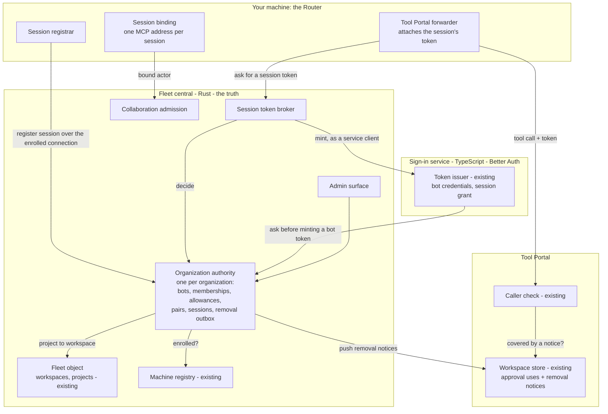
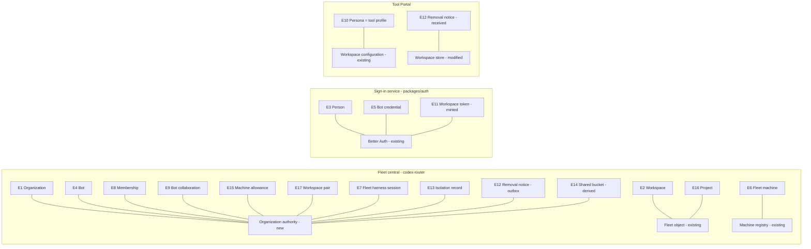
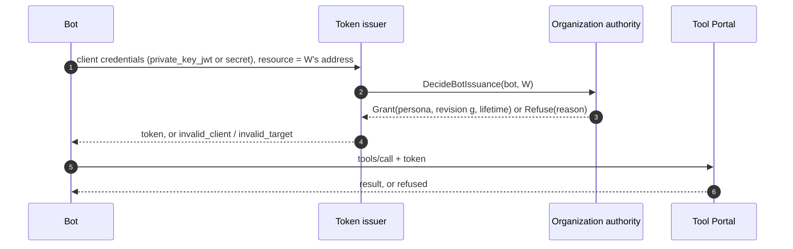
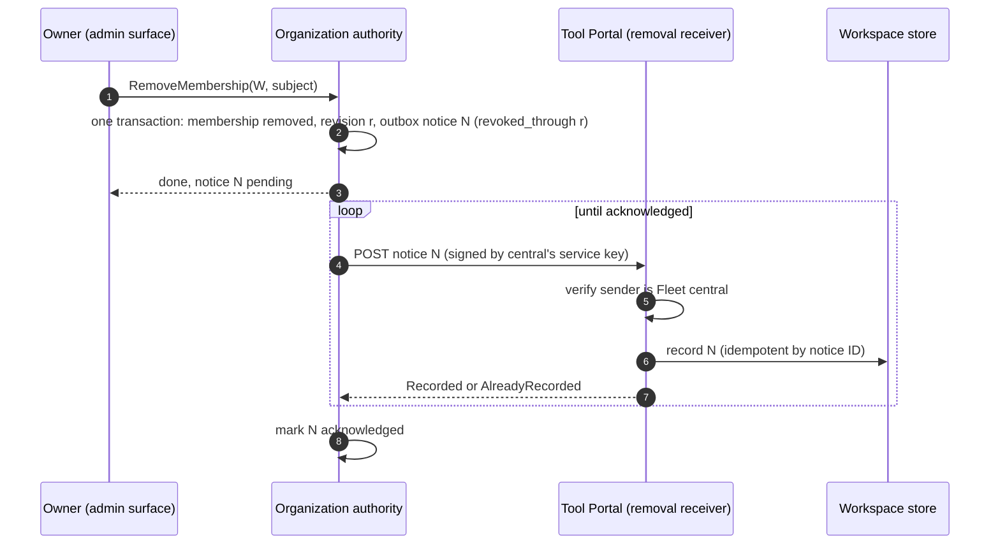
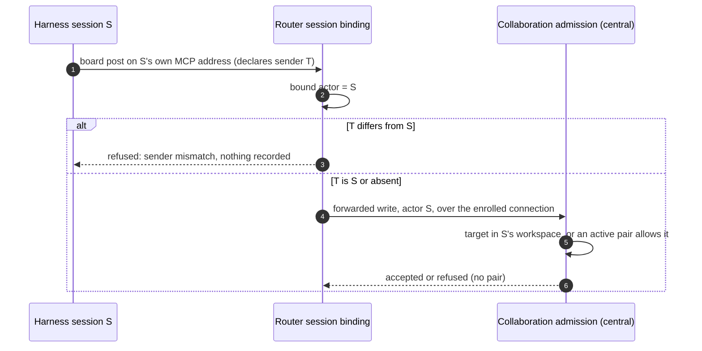
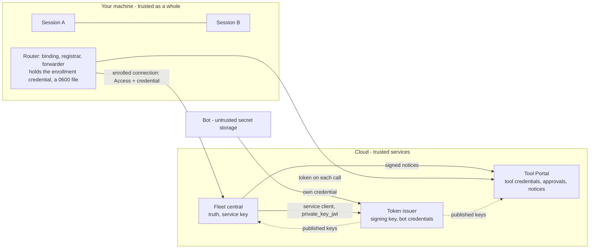

# Agent identity and workspace access: Program Design

How the fleet, the sign-in service and the Tool Portal realize the [Specification](specification.md)'s obligations. Authority: [Requirements](requirements.md). Proof plan: [Verification Design](verification-design.md).

## The structure in one picture



Fleet central holds every truth about who belongs where. The sign-in service proves bots and people and mints every token. The Tool Portal checks tokens and keeps two kinds of per-workspace state: approval single-use counts (as today) and the removal notices Fleet central pushes. No component calls Fleet central on a tool call.

## What exists today

| Area | Today | Anchor |
|---|---|---|
| Fleet identities | An actor is a `SessionRef` (Router installation, harness endpoint, conversation ID) or a human ID. Central's callers are only `Machine` or `Owner`. | `message-board/src/board_identity.rs:204–213`; `collaboration-central-core/src/access_contract.rs:33` |
| Fleet sender | The collaboration MCP server is stateless. It takes the sender from call arguments, and checks only that the service ID is this Router's. | `collaboration-mcp/src/collaboration_api_router.rs:1–3`; `collaboration-service/.../message_operations.rs:52–61` |
| Fleet session context | A session's workspace is looked up: working directory, then git origin, then attached workspaces, then projects. No stored link exists. | `collaboration-service/.../board_hook_operations.rs:169–320` |
| Machines | Owner-only enrollment. A Router connects with an Access service token plus a Bearer enrollment credential, and the connection is bound to that machine. No key column. | `registry_migrations/0001_machine_enrollments.sql`; `machine_enrollment.rs:400–445`; `central_router.rs:119–275` |
| Central hosts | One core, with Cloudflare Durable Object and Tokio hosts. Its object addresses are Copy, Registry, Fleet, Connection and Mailbox. | `platform_capabilities.rs:45`; `core_contract.rs:36–42` |
| Sign-in issuer | Better Auth 1.7.8 with the OAuth provider. Agent clients use client credentials, and a token is issued only for a linked workspace resource. | `packages/auth/src/sign-in-core/response-release/sign-in-response-release.ts:114–146`; `provider-configuration.ts:260` |
| Tool Portal check | Verify the token offline, then read membership and persona from the workspace's store. Persona is a key into the workspace's tool profiles. | `tool-host-core/src/caller-admission/caller-check.ts:19–38`; `hosted-mcp-proxy.ts:85,119` |
| Tool Portal store | Holds membership/persona records, agent-management and retirement state, and approval single-use counts. | `tool-host-core/src/workspace-authority/models/workspace-authority-state.ts`; `approval-token-use-rules.ts` |

**Constraint degree:**

- **Compatibility-bound** on the fleet's existing workspace IDs, project records and machine enrollment.
- **Migration-bound** on the Tool Portal's workspace store, where approval state must survive.
- **Platform-bound** on Better Auth 1.7.8, which has client credentials, `private_key_jwt` and an extension-grant surface, but no token exchange.

**What stays authoritative:**

- The fleet's workspaces, projects and machine enrollments.
- The issuer's signing keys and published key set.
- The Tool Portal's tool profiles and approval rules.

**What changes:**

- Who holds membership: it moves out of the Tool Portal and sign-in into Fleet central.
- How a session is identified: bound by the Router, not declared by the caller.
- How removal reaches the Portal: pushed notices.

## The choices, and why

| Choice | Selected | Credible alternative | Why selected | Accepted cost, and who pays | Reopen if |
|---|---|---|---|---|---|
| Who mints tokens | The sign-in service (Better Auth) | Fleet central mints in Rust; or a TypeScript identity service that owns all truth (Y) | Keeps the tested issuer on a maintained library and keeps truth where workspaces already live (owner: "same design") | Two services involved in every issuance. The Fleet and sign-in teams maintain one contract between them. | Better Auth can't host the session grant, or a Portal-only product without Fleet central becomes the priority (then Y) |
| How the Portal knows membership | **Token-only**, plus pushed removal notices | A live check per call (rejected by the owner as too heavy); copies of membership (the owner found them "fishy") | Lightest per-call path. Removal bites on push, and expiry is the backstop. | Up to one token lifetime of stale access if a push is lost. The admin sees pending notices. | Removals must be guaranteed instant even when the Portal is unreachable |
| How a machine proves itself | Its existing enrolled connection | Per-machine key files (rejected by the owner); platform identity such as Fly OIDC (later) | No new secrets on machines | Vouching needs Fleet central reachable | Cloud VMs arrive (then platform identity) |
| How a session gets its token to the Portal | A Router forwarder attaches it | Token in the harness's MCP config (can't refresh); the session fetches its own token (an agent holding a credential) | The agent never holds a credential, and refresh is invisible | A new Router component on the tool path | A harness gains native per-call auth headers the Router can set |
| Who asks the issuer for a session token | Fleet central, as a service client of the issuer | The Router as client (needs a machine credential at the issuer, a new machine secret) | No machine secrets; central already decides | Central holds one service credential for the issuer | — |
| How removal and issuance stay ordered | **Grant revision numbers** from the organization authority | Wall-clock effective times | A decision made just before a removal, but minted after it, is still covered. No clock skew. | Every token carries a revision | — |
| Where narrowing is enforced | The Tool Portal, at call time against the workspace's profiles | Fleet central at session start (would need a copy of profile definitions) | Profiles have one owner, the Portal | A widened persona is refused on the first call, not at start | Owner wants refusal at start |
| Organization isolation (D2) | One organization authority per organization (a Durable Object on Cloudflare; its own SQLite database on Tokio) | One shared store keyed by organization | D2's "segregated by durable objects", any host (U16) | One object per organization to operate | — |

## Where each entity lives



| E | Semantic owner | Package or module home | Schema/type home | Shape at each boundary | Disposition | Convention |
|---|---|---|---|---|---|---|
| E1 Organization | Organization authority | `collaboration-central-core` (new module `organization_authority`) | `collaboration-central-core/src/identity_contract.rs` (new) | `organization_id`: UUID string in tokens, admin API and notices | persisted | Rust newtype with fallible constructor; serde-tagged enums (`access_contract.rs:31`) |
| E2 Workspace | Fleet object (existing) | `collaboration-central-core` workspaces table (existing) | `message-board/src/board_metadata.rs:119` `Workspace` (existing) | `workspace_id`: UUIDv7 string; the Portal's MCP address is derived from its origin plus `workspace_id` (existing `workspaceResourceIdentifier`, `tool-access` contracts) | persisted | existing |
| E16 Project | Fleet object (existing) | `project_directory` (existing) | `board_metadata.rs` `ProjectDirectoryEntry` (existing) | `project_id` string in session registration and token | persisted | existing |
| E3 Person | Better Auth (existing) | `packages/auth` (existing) | Better Auth user (existing) | person ID string in the person token; central's person membership keys on it | persisted | existing |
| E4 Bot | Organization authority | `organization_authority` (new) | `identity_contract.rs`: `BotId`, `BotRecord` (new) | `bot_id` UUIDv7 string; token `sub` for bots is `bot_id` | persisted | Rust newtype |
| E5 Bot credential | Better Auth (existing agent-client store) | `packages/auth` `d1-persistence/agent-registration-store.ts` (modified: binds `bot_id`; workspace links removed) | Better Auth OAuth client plus metadata (modified) | `client_id` string; metadata `{ botId }` set only through central's admin path | persisted | Zod at the boundary (`domain-typescript`) |
| E6 Fleet machine | Machine registry (existing) | `machine_enrollments` (existing) | `machine_enrollment.rs` `AdmittedMachine` (existing) | installation `service_id` and `peer_id`; the token's `machine` field is the installation ID | persisted | existing |
| E15 Machine allowance | Organization authority | `organization_authority` (new) | `identity_contract.rs`: `MachineAllowance` (new) | admin API `{ installationId, workspaceId, state }` | persisted | Rust |
| E7 Fleet harness session | Organization authority | `organization_authority` session registry (new) | `endpoint_identity.rs` `SessionRef` (existing) plus `identity_contract.rs` `FleetSessionRecord` (new) | session registration request; token `sub` = canonical `SessionRef` string; the token's `session` object | persisted (with retention) | existing `SessionRef` plus Rust |
| E8 Membership | Organization authority | `organization_authority` (new) | `identity_contract.rs`: `Membership { workspace, principal: Principal, persona, state, revision }` (new) | issuance decision; admin lookup | persisted | Rust tagged enum `Principal { Person, Bot, FleetHarnessSession }` |
| E9 Bot collaboration | Organization authority | `organization_authority` (new) | `identity_contract.rs` (new) | admin API; collaboration admission | persisted | Rust |
| E17 Workspace pair | Organization authority | `organization_authority` (new) | `identity_contract.rs` (new) | admin API; collaboration admission | persisted | Rust |
| E10 Persona | Tool Portal workspace configuration (existing) | `tool-access` profile resolution (existing), plus a new `portal.sessionDefaultProfile` key | `tool-access` configuration schema (modified) | persona name string in the token | persisted (configuration) | Zod, `z.infer` |
| E11 Workspace token | Better Auth issuer (existing, modified claims) | `packages/auth` (modified) | `tool-access` contracts: `workspaceTokenClaimsSchema` (new; the single home, imported by `packages/auth` and `tool-host-core`; Rust consumers test against fixtures generated from it) | JWT claims, below | derived (signed, never stored) | Zod discriminated union |
| E12 Removal notice | Organization authority (sends); Portal workspace store (keeps) | central outbox (new); Portal store (modified) | `identity_contract.rs` `RemovalNotice` (new, the contract home); the Portal derives its Zod schema from the generated JSON Schema, checked by a contract test | HTTP JSON, below | persisted on both sides | Rust serde, with the Zod derived from it |
| E13 Isolation record | Organization authority | session registry (new) | `identity_contract.rs`: `AgentIsolation`, `MachineEnvironment` (new; from the Fleet attestation design) | session registration; the token's `session.isolation` | persisted | Rust tagged enum |
| E14 Shared bucket | Organization authority (a derived query) | `organization_authority` (new) | `identity_contract.rs` lookup result (new) | admin lookup | derived | Rust |

### Shapes that cross boundaries

**Workspace token claims** (issuer → Tool Portal, and Fleet central for bot collaboration), `tool-access` contracts:

```ts
const isolationSchema = z.discriminatedUnion("kind", [
  z.object({ kind: z.literal("host") }),
  z.object({ kind: z.literal("processSandbox"), mechanism: z.enum(["seatbelt", "bubblewrap", "landlock"]), instanceId: z.string() }),
  z.object({ kind: z.literal("container"), runtime: z.string(), containerId: z.string(), instanceId: z.string() }),
  z.object({ kind: z.literal("vm"), launcher: z.literal("agent-vm"), vmId: z.string(), instanceId: z.string() }),
]);
export const workspaceTokenClaimsSchema = z.discriminatedUnion("subject_kind", [
  z.object({
    subject_kind: z.literal("bot"),
    iss: z.string(), aud: z.string(), sub: z.string(), jti: z.string(), iat: z.number().int(), exp: z.number().int(),
    organization_id: z.string(), workspace_id: z.string(), persona: z.string().min(1),
    grant_revision: z.number().int().nonnegative(),
  }),
  z.object({
    subject_kind: z.literal("fleetHarnessSession"),
    iss: z.string(), aud: z.string(), sub: z.string(), jti: z.string(), iat: z.number().int(), exp: z.number().int(),
    organization_id: z.string(), workspace_id: z.string(), persona: z.string().min(1),
    grant_revision: z.number().int().nonnegative(),
    session: z.object({ machine: z.string(), harness: z.string(), project_id: z.string(), isolation: isolationSchema }),
  }),
]);
export type WorkspaceTokenClaims = z.infer<typeof workspaceTokenClaimsSchema>;
```

**Issuance decision** (Fleet central → sign-in service; Fleet central's session token broker), `identity_contract.rs`:

```rust
#[serde(tag = "kind", rename_all = "camelCase")]
pub enum IssuanceDecision {
    Grant {
        organization_id: OrganizationId,
        workspace_id: WorkspaceId,
        subject: Principal,
        persona: PersonaName,
        grant_revision: GrantRevision,
        lifetime_seconds: TokenLifetimeSeconds, // <= 3600, the organization's configured value
        session: Option<SessionGrantFacts>,     // machine, harness, project, isolation
    },
    Refuse { reason: IssuanceRefusal },
}
#[serde(rename_all = "camelCase")]
pub enum IssuanceRefusal { NotMember, IdentityNotProven, MachineNotAllowed, Retired }
```

`Unavailable` is not a decision: a transport failure or timeout. Callers treat it as refuse-unavailable (R25).

**Removal notice** (Fleet central → Tool Portal), `identity_contract.rs`:

```rust
#[serde(rename_all = "camelCase")]
pub struct RemovalNotice {
    pub notice_id: NoticeId,               // UUIDv7, the idempotency key
    pub organization_id: OrganizationId,
    pub workspace_id: WorkspaceId,
    pub subject: RemovalSubject,           // tagged: bot | fleetHarnessSession | machine
    pub revoked_through: GrantRevision,    // tokens with grant_revision <= this are covered
    pub reason: RemovalReason,             // membershipEnded | personaChanged | botRetired | credentialRetired
                                           // | machineRevoked | allowanceWithdrawn | sessionRemoved
}
#[serde(tag = "result", rename_all = "camelCase")]
pub enum RemovalNoticeAck { Recorded { notice_id: NoticeId }, AlreadyRecorded { notice_id: NoticeId } }
```

**Session registration** (Router → Fleet central, over the enrolled connection), `identity_contract.rs`:

```rust
pub struct RegisterFleetSession {
    pub session: SessionRef,                    // bound by the Router, never declared by the agent
    pub project_id: ProjectId,
    pub starter: Starter,                       // tagged: owner { person_id } | memberSession { session } (OD1)
    pub requested_persona: Option<PersonaName>, // None means the workspace's session default
    pub isolation: AgentIsolation,
    pub machine_environment: MachineEnvironment,
}
#[serde(tag = "result", rename_all = "camelCase")]
pub enum RegisterFleetSessionResult {
    Registered { workspace_id: WorkspaceId, persona: PersonaName },
    Refused { reason: SessionRefusal }, // projectUnknown | machineNotAllowed | starterNotAllowed | personaUnknown
}
```

## Components

| Component | Owns | Home | Consumers | Changes when |
|---|---|---|---|---|
| **Organization authority** (new) | E1, E4, E7, E8, E9, E13, E15, E17; grant revisions; the configured token lifetime; the removal outbox; the shared-bucket view | `collaboration-central-core` organization module, hosted as one object per organization (Cloudflare Durable Object class `OrganizationObject`; Tokio: one SQLite database per organization) | session token broker, admin surface, collaboration admission, the sign-in service (issuance decisions) | membership or issuance policy changes |
| **Session token broker** (new) | Turning a Router's request into a token: decide, then mint as a service client | `collaboration-central-core` | Router forwarder | the session grant contract changes |
| **Admin surface** (modified) | Owner-only commands and lookups (R13, R14) | `central_router.rs` admin routes (modified) | the owner's CLI and console | admin commands change |
| **Collaboration admission** (modified) | Who may post or message where: bound actor, workspace pairs, bot collaborations | `project_admission`, `session_request_admission` (modified); a new bot collaboration route | Router (forwarded writes), bots | collaboration rules change |
| **Fleet object** (existing) | E2, E16 | existing | organization authority (project → workspace) | — |
| **Machine registry** (existing) | E6 | existing | organization authority, session token broker | — |
| **Session binding** (new, Router) | Which session each collaboration call came from | `collaboration-mcp` and `collaboration-service` (modified); `acp-client-runtime` per-session MCP list (modified) | collaboration MCP tools | harness wiring changes |
| **Session registrar** (new, Router) | Registering each launched or attached session with its project, starter, persona and isolation | `collaboration-service` (new module `fleet_session_registrar`) | session binding, forwarder | launch facts change |
| **Tool Portal forwarder** (new, Router) | Getting, caching in memory and attaching each session's token; one retry on 401 | `codex-router-host` (new module `portal_session_forwarder`) | the harness's Tool Portal MCP entry | token lifetime or Portal contract changes |
| **Token issuer** (existing, modified) | Bot credentials (E5), minting (E11), the session grant | `packages/auth` | bots, session token broker, Tool Portal (published keys), Fleet central (published keys) | token claims or grants change |
| **Caller check** (existing, modified) | Admit or refuse a call: token, notices, persona | `tool-host-core/src/caller-admission` | hosted MCP proxy | admission rules change |
| **Workspace store** (existing, modified) | Approval single-use counts (unchanged) and received removal notices (new) | `tool-host-core/src/workspace-authority`; Cloudflare `WorkspaceAuthority` Durable Object; Node store | caller check, removal receiver, approval use | store shape changes |
| **Removal receiver** (new, Portal) | Accepting only Fleet central's notices; acknowledging | `tool-host-core` (new route `/internal/v1/removal-notices`) | Fleet central | notice contract changes |

**Removed:**

- The Tool Portal's agent-management route and retirement (`workspace-agent-management.ts`, `workspace-agent-retirement.ts`, `agent-retirement.ts`), and its membership records.
- The sign-in service's workspace links (E11 in the people sign-in design).

The owner now manages access through the admin surface, and membership lives only in the organization authority.

**Allowed edges:**

- Router → Fleet central, over the enrolled connection.
- Fleet central → issuer, as a service client.
- Issuer → Fleet central, for issuance decisions.
- Fleet central → Tool Portal, for removal notices only.
- Tool Portal → issuer published keys, and Fleet central → issuer published keys, both cached.

**Forbidden edges, and how they're enforced:**

| Forbidden edge | Enforced by |
|---|---|
| Tool Portal → Fleet central on a tool call (R17) | the caller check has no Fleet client: a dependency rule, checked by lint and review |
| An agent or bot → the admin surface | a person token is required: runtime guard |
| An agent supplying its own sender | the bound actor is required: runtime guard |
| The issuer minting without a decision | the response-release gate: runtime guard (existing seam) |

## How a session gets and uses its token

```mermaid
sequenceDiagram
  autonumber
  participant H as Harness (Codex/Claude/Cursor)
  participant R as Router
  participant OA as Organization authority
  participant B as Token issuer
  participant P as Tool Portal
  Note over R: start session S for project X
  R->>OA: RegisterFleetSession(S, X, starter, persona?, isolation)
  OA->>OA: X's workspace W; machine allowed for W; starter allowed (OD1)
  OA-->>R: Registered(W, persona) or Refused(reason)
  H->>R: MCP tools/call on S's own Portal address
  R->>OA: IssueSessionToken(S)  [session token broker]
  OA->>OA: decide: S active, machine enrolled and allowed, revision g
  OA->>B: session grant with the Grant decision (central is the client)
  B-->>OA: token (exp = iat + lifetime, grant_revision g)
  OA-->>R: token
  R->>P: tools/call + bearer token
  P->>P: verify signature, audience W, expiry
  P->>P: workspace store: any notice for S, or S's machine, with revoked_through >= g?
  P->>P: persona within W's session default?
  P-->>R: result, or refused (unauthenticated | not permitted)
  R-->>H: result
```

The forwarder caches the token in memory and fetches a new one before it expires. It never hands the token to the harness.

**Change from today:**

- **Added:**
  - session registration;
  - the session token broker and the session grant;
  - the forwarder;
  - the store's notice check.
- **Removed:** the Portal reading membership from its store (`caller-check.ts:28–31`).
- **Changed:**
  - persona comes from the token claim, not the store;
  - the token subject is a session, not an agent client.
- **Unchanged, and must stay:**
  - offline signature verification;
  - audience derived from the configured origin, never Host;
  - approval single-use in the store.

## How a bot gets its token



**Change from today:**

- **Changed:** the issuance gate (`sign-in-response-release.ts:114–146`). It no longer reads its own workspace links; it asks Fleet central. If Fleet central doesn't answer within the timeout, the token is refused (fail closed).
- **Removed:** the workspace link store.

## How a removal reaches the Tool Portal



**Why revisions instead of times:** the Specification's grant mark (C1) is `grant_revision`, and its revoked-through mark (C3) is `revoked_through`. A token decided at revision g ≤ r is covered, however late it was minted. A decision taken after the removal refuses, because the membership is gone. The organization authority serializes its own writes, so revisions are ordered within an organization.

Every way access is lost writes a notice in the same transaction as the change: membership ended, persona changed, bot retired, credential retired, machine revoked, allowance withdrawn, session removed. For a machine revocation the notice subject is the machine, so it covers every session on it (R20).

## How a collaboration call is attributed



**Session binding:**

- **Codex:** each app-server thread's tool connection carries the harness-stamped thread ID.
- **Claude and Cursor (ACP):** the Router gives each session its own MCP address, holding an unguessable binding ID minted at launch. The provider runtime's MCP server list moves from one per provider to one per session (`provider_connection_task.rs:280–286, 451–453`).

**Change from today:**

- **Removed:** taking the sender from the call arguments (`message_tools.rs:18`).
- **Added:**
  - the binding lookup;
  - the mismatch refusal;
  - the pair check in central.
- **Changed:** central records the forwarded actor as the bound session.

## State

**A fleet harness session** (organization authority):

| State | Entered by | Leaves to | Guard |
|---|---|---|---|
| active | `RegisterFleetSession` accepted | removed, ended | The project exists, the machine is allowed for its workspace, and the starter is allowed (OD1). |
| removed | The admin removes it, or its allowance or machine is withdrawn | — (terminal) | Writes a removal notice. |
| ended | The Router reports the conversation archived or deleted | — (terminal) | The Router stops attaching tokens. |

An illegal transition is any return from removed or ended to active. It is refused: a new conversation is a new session.

**A removal notice** (outbox, organization authority):

| State | Entered by | Leaves to | Guard |
|---|---|---|---|
| pending | The transaction that caused the removal | acknowledged | Resent with capped backoff. Shown to the admin while pending. |
| acknowledged | `Recorded` or `AlreadyRecorded` from the Portal | lapsed | — |
| lapsed | 60 minutes after acknowledgment | — | Kept as history. The Portal may drop it after 60 minutes. |

**Grant revision:** one counter per organization, raised by every change that grants or removes access. Each decision reads it and stamps it into the token.

## Failure, recovery and concurrency

| Situation | Detected by | Handling | Owner |
|---|---|---|---|
| Fleet central unreachable for issuance | timeout on the decision or token request | Refuse (C2 unavailable). The forwarder retries on the next call, and existing tokens run to expiry. | Session token broker; token issuer |
| Fleet central unreachable for a bot's decision | the issuer's timeout | Refuse with `temporarily_unavailable` | Token issuer |
| Tool Portal unreachable for a notice | no acknowledgment | Resend with capped backoff, and show as pending. Expiry is the backstop. | Organization authority |
| Duplicate notice | same notice ID | `AlreadyRecorded`, no effect | Removal receiver |
| Portal restart | — | Notices are persisted in the store and survive a restart | Workspace store |
| Issuance racing a removal | revisions | Covered by `revoked_through` if g ≤ r, or refused if the decision comes after | Organization authority |
| A session's token expiring mid-call | — | The call admitted at its start completes. The next call needs a fresh token. | Caller check |
| Two starts for one conversation | same `SessionRef` | The second returns the existing registration, or is refused if the session is removed or ended | Organization authority |
| Sender mismatch | binding lookup | Refused, nothing recorded | Session binding |
| The issuer's signing key rotates | published key set | The Portal and central refetch the key set on an unknown key ID, once per request | Caller check |

## Trust boundaries



| Asset | Where | Protects | If stolen |
|---|---|---|---|
| Enrollment credential | Router, a 0600 file (the owner rejected the Keychain) | Machine vouching | Every session on that machine can be impersonated until you revoke it |
| Central's service key | Central's host secret store | Getting session tokens minted; signing notices | Tokens for any session, and forged notices, until rotated. This is the highest-value key. |
| Issuer signing key | Better Auth (existing) | Every token | Any token, until rotated |
| Bot secret or key | The bot's own storage (unknown) | That bot | That bot, until retired (accepted limit, U2) |
| Session binding ID | Router memory and that session's MCP config | Attribution | Another process on the same machine (same user) could post as that session. This is the shared-bucket limit, recorded in E14. |

Sessions on one machine are not isolated from each other unless their isolation kind says so (R23). The Router is trusted for every session on its machine.

## Other qualities

| Quality | Realization |
|---|---|
| Privacy | Tokens carry the machine, project and isolation only for sessions, and nothing secret. Notices carry IDs and reasons only. |
| Reliability | Fail closed on issuance. The outbox with acknowledgment and backoff for notices. Persisted notices at the Portal. |
| Performance | Per call, the Portal verifies the signature and reads the workspace store once, which replaces today's membership read. Issuance happens once per token lifetime per identity and workspace. |
| Observability | Admin lookups show pending notices, shared buckets, and identities with their workspaces. Each refusal logs a bounded reason class. |
| Platform | One contract, any host. Central runs on a Cloudflare Durable Object per organization, or on Tokio with SQLite per organization. The Portal runs on Cloudflare or Node. Every service-to-service request carries a signed client assertion and is verified against the sender's published keys, including over a service binding. |
| Isolation (first round) | Recorded and shown. Never enforced. |

## Changes and cutover

- **Tool Portal (#262 line):**
  - membership records and the agent-management route are removed;
  - the store keeps approval counts and adds notices;
  - the caller check reads the token's persona.
- **Sign-in (#263 line):**
  - workspace links are removed;
  - the issuance gate asks Fleet central;
  - the session grant is added;
  - bot credentials carry `botId`;
  - people sign-in asks Fleet central for organization admission (D2's location).
- **Fleet:** the organization authority, the session token broker, binding, the registrar, the forwarder, admin commands and lookups, and collaboration admission.

There is no coexistence period. The test deployments are the only consumers, so the cutover is a hard replacement, with no migration of the old Portal membership records.

## Requirement trace

| U | R | E | Owner | Interface | Shape and home | State | Failure | Proof |
|---|---|---|---|---|---|---|---|---|
| U1 | R1: three kinds only | E3, E4, E7 | Organization authority; token issuer | `Principal` enum; token `subject_kind` | `identity_contract.rs`; `workspaceTokenClaimsSchema` | none: classification | Unknown kind rejected at parse | Contract: claims and principal parse/refuse |
| U3, U17 | R2: a session is accepted only as vouched for by its machine | E6, E7 | Session token broker | `IssueSessionToken` over the enrolled connection | `identity_contract.rs` | session active | Revoked or expired machine → `IdentityNotProven` | Fleet integration: an enrolled and a revoked machine each request |
| U19 | R3: attribution to the arriving session | E7 | Session binding | per-session MCP address; mismatch refusal | `collaboration-mcp` error variant `SenderMismatch` (new) | none: per call | Mismatch refused, nothing written | Real harness runs: Codex, Claude, Cursor A-as-B |
| U2 | R4: bot accepted only with an active credential; storage note shown | E4, E5 | Token issuer | client credentials; lookup | Better Auth client + `botId`; `BotRecord` | credential active/retired | Retired → `invalid_client` | Sign-in integration; admin lookup |
| U20 | R5: people sign-in as designed | E1, E3 | Token issuer | the people sign-in design's interfaces | existing | as in that design | as in that design | The people sign-in design's proof |
| U5 | R6: a bot is a member of at most one workspace | E4, E8 | Organization authority | admin `SetBotMembership` | `Membership` | membership active/removed | A second membership → refused | Central unit + admin API |
| U6 | R7: a session is a member of its project's workspace | E7, E8, E16 | Organization authority | `RegisterFleetSession` | `RegisterFleetSession` | session active | Unknown project → refused | Router + central integration with a real session |
| U6 | R8: no allowance → start refused (OD1 gap for the starter rule) | E6, E7, E15 | Organization authority | `RegisterFleetSession` | `SessionRefusal::MachineNotAllowed` | — | Refused | Central integration; **gap: OD1 starter rule** |
| U11 | R9: persona = session default or narrower | E8, E10 | Caller check | profile comparison at call | `portal.sessionDefaultProfile` | none | Wider → refused "not permitted" | Portal unit + host e2e |
| U20, U21 | R10: person membership is admin-managed | E3, E8 | Organization authority | admin `SetPersonMembership` | `Membership` | active/removed | Non-admin refused | Admin API integration |
| U7 | R11: a bot collaborator may message, nothing more (OD3 gap: allowed or automatic) | E9 | Collaboration admission | bot collaboration route | bot token + `BotCollaboration` | collaboration active/withdrawn | Tool, start or role refused | Central integration + Portal refusal; **gap: OD3 admission rule** |
| U8, U7 | R12: messaging across workspaces needs a pair | E17 | Collaboration admission | pair check on forwarded writes | `WorkspacePair` | pair active/withdrawn | No pair → refused | Router + central integration |
| U21 | R13: admin actions only by people | E2, E4, E6, E8, E9, E15, E17 | Admin surface | person-token guard | person token claims | none | Bot or session → refused, nothing changed | Admin API integration |
| U9 | R14: lookups answer | E2–E17 | Organization authority | admin lookups | `identity_contract.rs` lookup results | none: read | — | Admin API integration |
| U10 | R15: tokens only to active members; claim fields | E8, E11 | Token issuer + organization authority | `IssuanceDecision::Grant`; claims | `workspaceTokenClaimsSchema` | — | Refuse → no token | Contract + sign-in integration |
| U12 | R16: lifetime ≤ configured ≤ 60 min; default 5 | E11 | Organization authority | `lifetime_seconds` in the decision | `TokenLifetimeSeconds` (bounded newtype) | organization setting | Out of range unrepresentable | Unit on the newtype + issued token `exp - iat` |
| U10, U12 | R17: Portal admission with no fleet call | E10, E11, E12 | Caller check | `checkHostedCaller` (modified) | claims schema; store notice read | none | Each C1 refusal before tools run | Portal host e2e (production entry) |
| U14, U15 | R18: consult the truth once; allowance for sessions | E8, E11, E15 | Organization authority | `IssuanceDecision` | `identity_contract.rs` | grant revision | Unavailable → refuse | Central integration; sign-in integration with central down |
| U13 | R19: every removal kind sends a notice; refuse from receipt | E8, E12, E15 | Organization authority; workspace store | outbox; `RemovalNotice` | `identity_contract.rs` | notice pending → acknowledged | Lost → resend; expiry backstop | Central + Portal integration per reason |
| U13 | R20: coverage by revision; machine covers all its sessions | E11, E12 | Caller check | `revoked_through` vs `grant_revision` | both shapes | — | — | Portal unit (property) + e2e |
| U13 | R21: resend until acknowledged; visible; kept 60 min; survives restart | E12 | Organization authority; workspace store | outbox; persisted notices | `RemovalNotice` | notice states | Restart → still applied | Integration with Portal down and restarted |
| U13, U15 | R22: notices only from Fleet central | E12 | Removal receiver | signed-request verification | central's published keys | none | Forged → refused | Portal host e2e with a forged notice |
| U18 | R23: isolation recorded and shown, not enforced | E7, E13, E14 | Organization authority | registration; lookup | `AgentIsolation`, `MachineEnvironment` | recorded | — | Central integration + token claims |
| U17 | R24: no new machine keys | E6 | Router | enrolled connection only | none: no new key material | none | — | Structural review: no key generation path |
| U14 | R25: no issuance while the truth is unavailable; stop at expiry | E11 | Token issuer; session token broker | decision timeout → refuse | — | — | Fail closed | Integration with central stopped |
| U16 | R26: one contract, any host | all | Each service's host adapter | versioned HTTP + JSON; signed requests | `identity_contract.rs` generated JSON Schema; Zod derived | — | — | The same suites on Cloudflare and on Tokio/Node |

**Coverage:**

- **R1–R26:** every row above is covered, except **R8**, whose starter rule waits on **OD1**, and **R11**, whose admission rule waits on **OD3**.
- **E1–E17:** each is bound in the binding table.
- **Supersessions:** as listed in the Specification.

## Deviations and unresolved decisions

- **OD1:** who may start a session for W (the starter check in `RegisterFleetSession`). The slot is designed; the rule waits on the owner.
- **OD3:** whether a bot collaboration needs the admin's allowance. The design holds `BotCollaboration` records the admin sets, which is the recommended answer. If the owner chooses "automatic", collaboration admission derives a collaboration for every workspace in the bot's organization other than its member workspace, and the record becomes a withdrawal instead.
- **agent-vm VM sessions:** the `Vm` isolation kind and its launch record need agent-vm to hand the host Router a launch record over a local channel. That is agent-vm's work. In the first round, only Router-launched `Host` and `ProcessSandbox` sessions are registered.
- **Persona widening** is refused at the first call, not at session start. Profiles are owned by the Tool Portal, and Fleet central keeps no copy of them.
- **People's organization admission** moves to Fleet central. The D2 sign-in revision (people sign-in, 34d1a0e0) changes location before it is built.
