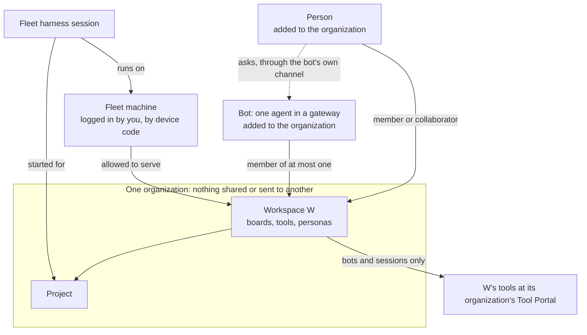

# Agent identity and workspace access: Requirements

Who acts in the fleet and the Switchboard, how each one proves who it is, which organization and workspace it belongs to, how machines log in, and how access is granted and taken away.

This design set has four documents:

- **Requirements:** this file.
- **[Specification](specification.md)**
- **[Program Design](program-design.html)**
- **[Verification Design](verification-design.md)**

Two entries lead into them: [index.md](index.md) for agents, and [index.html](index.html), a page for people. A fifth document, [Alternatives](alternatives.md), draws every option weighed and decides nothing. The owner's decisions of 2026-10-26 were first drawn on the [Organization model](../../wip/2026-10-26-organization-model/index.html) page.

## The picture you confirmed

First a person or a bot is added to an organization; then it joins that organization's workspaces as a member or a collaborator. A session is a **member** of the workspace of the project it was started for. A **collaborator** may only send messages and tasks to a workspace's members. People never hold tool tokens; they get work done through bots.

## Who is affected

| Class | Role here |
|---|---|
| **Owner (admin)** | Runs the fleet and owns each organization today. Creates organizations and workspaces, adds people and bots to an organization, logs machines in, allows machines to serve workspaces, sets memberships and collaborations, and allows workspace pairs. Today that is Shravan. |
| **Fleet harness sessions** | Codex, Claude or Cursor conversations on logged-in fleet machines. They do project work, talk on boards and call tools. |
| **Bots** | One agent running in a gateway such as Hermes, owned by the owner or not. The bot is what logs in; the gateway that runs it is not an identity here. |
| **Other people** | People the owner adds to an organization. They get work done by talking to bots, not by holding tools or logging in machines. |
| **Customers of the product** | Others who run the Switchboard, or the fleet, themselves. The product must not depend on the owner's own Cloudflare Access account. |
| **Future maintainers** | People reading this set to change it. |

## Needs

**Authority states:**

- **authorized:** said directly by the owner.
- **authorized (relayed):** the owner's words, quoted verbatim by the Board/Fleet Lead.
- **existing decision:** an owner decision already recorded in the fleet framework or the people sign-in design.

**Priority:** every row is part of the first identity round. The Switchboard Lead assigned that from the owner's direction to build this set now. U34 sets the order of the machine-login rows: they are built first and switched on only behind Cloudflare Access. The owner's 2026-10-30 order of work decides what is built first; see [Item two and the later steps](#item-two-and-the-later-steps).

| ID | Need | Why it matters | Evidence | Authority |
|---|---|---|---|---|
| U1 | There are exactly three kinds of identity: **person**, **bot** and **fleet harness session**. | Every grant, refusal and record has to say who acted, and today the fleet can only name a machine or the owner. | Owner: "lets deifne diffrent things. bots … 2. collaborator or emember …"; the naming thread ending in "Fleet Harness session". | authorized, 2026-10-24 |
| U2 | A **bot** is one agent running in a gateway (such as Hermes), whether or not the owner owns it. The bot logs in and proves who it is with its own credential; how the gateway keeps the bot's memory and credential is the gateway's business. The system accepts that this proof is only as good as how the bot's secret is kept, and says so. | Bots are outside the owner's control, but must still be accountable. | Owner, 2026-10-24: "ability for a bot to prove who they are even if its it could be isnecure as we dont knwo hwo they keep secrets". Owner, 2026-10-26: "bot si an agent in hermes. i meant seperate form the gateway"; "liste bot just kuse teh word bot". Supersedes the 2026-10-24 wording "fully systems with memory and agents". | authorized, 2026-10-24; revised 2026-10-26 |
| U3 | A **fleet harness session** is one Codex, Claude or Cursor conversation on a logged-in fleet machine. The machine vouches for it. It never logs in and holds no secret of its own. | The owner's agents are sessions the fleet already knows by conversation ID. | Owner, 2026-10-22: "i have session ids for agents on myk router" (F-77). Owner, 2026-10-24, on attestation "with session id"; "fleet sesison are assocviated with fleet rotuer"; the name "Fleet Harness session". | authorized |
| U4 | An identity relates to a workspace as a **member** or a **collaborator**. A person or a bot may be either; a session is always a member. | Some identities do a workspace's work; others only talk to its members. | Owner: "we have agetns taht are part of wrokspace and commkunciate to workspace"; "collaborator or emember". Owner, 2026-10-26: "you add peope bot to organzisiton. then join workspaces or allwoed to as members, or collaborators." | authorized, 2026-10-24; revised 2026-10-26 |
| U5 | A bot is a member of at most **one** workspace, and only when the admin picks it. It is a collaborator of any others. | Membership is a grant the owner controls. | Owner: "bot can be a member, but me admin shoudl pick. a bot shoudl only be member in one workspace. rest collaborator." Kept by the owner's pick on 2026-10-26 (review of the Organization model page). | authorized, 2026-10-24; kept 2026-10-26 |
| U6 | A fleet harness session belongs to **the workspace of the project it was started for**. It runs on one logged-in machine. The admin allows each machine to serve chosen workspaces of its organization, and one machine may serve several. A session's workspace does not come from its repository. | Sessions work on projects, projects live in workspaces, and a machine may host work for several workspaces. | Owner rejected the repository rule ("this is not the right topology"), asked "1 rotue rand 3 in workspace then what?", then confirmed "yes" to session → project → workspace, with the machine allowed to serve workspaces. | authorized, 2026-10-24 |
| U7 | A **collaborator** may only send messages and tasks to a workspace's members. It never uses that workspace's tools and never starts work in it. The admin makes someone a collaborator, per workspace. | Talking to a workspace must not grant its tools or let an outsider launch work there. | F-75. Owner: "Collaboration only" for agents not on the owner's machines; "rest collaborator". Owner's pick on 2026-10-26: "The admin, per workspace" (comment: "maybe this is a good use for managers"). | authorized / existing decision |
| U8 | Cross-workspace messaging between sessions is allowed **per workspace pair** by the admin, e.g. "members of Personal may message members of OSS". There are no per-session approvals. | Sessions in one workspace ask sessions in another for status, and the owner controls which pairs may. | Owner chose "Per workspace pair" on 2026-10-24. | authorized, 2026-10-24 |
| U9 | The system can say which organization and workspace each registered identity belongs to, and which others it collaborates with. The admin can see which workspace a bot is in. | The owner must be able to answer "who is this, and where does it belong?" | Owner: "abiltiy to see which workspace a bot this", "know which works ace each identy regsitered with t system belkongs to". | authorized, 2026-10-24 |
| U10 | Only members get a workspace's tools, through that workspace's own MCP address, with a token for that workspace only. | Tools are scoped per workspace. | F-73, F-75, F-82. | existing decision |
| U11 | A session's tool profile (persona) is its workspace's **default for sessions**. Whoever starts the session may narrow it, never widen it. | A reviewer and an implementer need different tools, and nobody may grant themselves more. | Owner chose "Workspace default, narrow only" on 2026-10-24. | authorized, 2026-10-24 |
| U12 | There is no live check per tool call. A workspace token carries what the Switchboard needs. Its lifetime is configurable: 5–10 minutes by default, never more than 1 hour. | A per-call check against the fleet is too heavy. | Owner: "i dont want live its too heavy" (relayed); "yes 5 to 10 configurable ok with max of 1 hour". | authorized |
| U13 | Removals are pushed from the fleet to the Switchboard. Removing access stops the next call once the push arrives; the token's expiry is only the backstop. | Removal must bite immediately, not after a token expires. | Owner: "we need to hav epush removals"; "i can pkush form fleet to tool prtal and remove?" | authorized, 2026-10-24 |
| U14 | When the fleet's central service is unavailable, no new tokens are issued, and work stops once existing tokens expire (fail closed). | The owner accepts the system stopping rather than running on stale grants. | Owner: "if central is out yes system shouldn't work? that's how it should be?" (relayed). | authorized (relayed) |
| U15 | The fleet holds the truth about identities, organizations, workspaces, projects, membership, collaboration and machines. The TypeScript sign-in service on Better Auth proves people and bots and mints tokens. The Switchboard is downstream. Workspaces keep their existing IDs. | One owner per truth, with no hand-written token server in Rust. | Owner: "we have fleet taht shoud be doing the login"; "better auth is onlyk ts … fleet is decoup0ed"; "portal be downstream" (relayed); "same design". | authorized |
| U16 | One versioned contract between services, on any host. Cloudflare is one runtime, and the same design runs decoupled from it. | The product runs on Cloudflare or elsewhere without a second design. | Owner: "make sure the system makes sense for service hosted in durable object or not, same for all services" (relayed); "maqke sure clodufalre is one runtiem and we decokuple yes? same design". | authorized |
| U17 | No new private keys on machines. A machine proves itself through the machine login of U33. A machine's own secrets (a device-code machine's refresh credential, and until U34's switch its existing enrollment secrets) are kept as Fleet's decision 1201 says: in the Router's encrypted secret store, with plaintext only in debug. A machine with no encrypted store keeps its refresh credential only in memory (OD9). | The owner rejected per-machine key files and a Keychain-held machine identity. | Owner: "i dont want bespoke private keysin mahcine"; the Keychain "doesn't work" as a machine identity (relayed). Decision 1201 (owner, 2026-10-24): "no plain text secrets for prod. only for debug". The 2026-10-24 clause "proves itself through its existing enrollment" is superseded by U33. Owner, 2026-10-27, on machines without a store: "why would this not just use an authority and in memory with login?" | authorized, 2026-10-24; revised 2026-10-26 and 2026-10-27 |
| U18 | Each session records its machine and isolation kind (`Host`, `ProcessSandbox`, `Container` or `Vm`). The system shows which workspaces share a machine's bucket. Only `Vm` actually separates files; `ProcessSandbox` with the auto classifiers is best effort. Nothing is blocked on isolation in the first round. | Sessions on one open machine can read each other's files. The leak must be visible before it can be fenced. | Owner: the agreed isolation kinds ("we arleayd talked aobut kind for room"); "files can only really be enforced with vms"; "agree" to "record and show now, enforce later" (2026-10-24). Kept pending OD7. | authorized, 2026-10-24 |
| U19 | Every agent-collaboration call from a fleet harness session is attributed to the session it actually came from. A call naming a different session is refused. | Today a session can post as another and be stored as it. | Owner's framing: Fleet uses session information "to authenticate collaboration MCP requests as the actual Actor" (Fleet follow-ups, 2026-10-23). Live runs on Codex, Claude and Cursor showed false senders stored. | authorized (relayed) |
| U20 | People sign in with Google, GitHub or a passkey. An organization's owner decides who may sign in. Organizations are kept apart. Only people reach administration. | Existing people sign-in rules carry over. | F-64; D2 (owner, 2026-10-20); F-78; F-82; people sign-in R1–R4, R19, R20. | existing decision |
| U21 | Only the owner (admin) adds people and bots to an organization, sets memberships and collaborations, allows machines to serve workspaces, allows workspace pairs, creates workspaces, logs machines in (approving each device-code login). Managers are a later concept: they are per workspace (F-29), and what they may do is not decided. | Granting access is the owner's call. | D2: "owners can allow people to log in or allow auth related stuff"; F-78; SD1 and SD9 (owner only). Owner, 2026-10-26: "we can add managers later but it can be a cocnetp, right now its just owner". | existing decision; revised 2026-10-26 |
| U22 | The sign-in service stores everything in **SQLite through Drizzle**, with the driver injected per runtime: D1 through Drizzle on Cloudflare, `better-sqlite3` through Drizzle on Node. Better Auth uses its Drizzle adapter. Migrations are generated by `drizzle-kit` and checked in. Never Kysely, hand-written SQL strings, or `node:sqlite`, in product code or tests. The owner approves the schema and migrations before code. | Sign-in was built on hand-written D1 SQL and Kysely, which the owner did not choose. | "obviously fuckkgin drizzle eveyrwhere"; "you fcukikgn iditon we kuse d1"; "we kuse drizzle and sqlite"; the owner's review row "Hand-written D1 SQL, plus Better Auth's Kysely adapter"; "i will nto allow you to yolo zqlite migraiton crap". | authorized, 2026-10-24 |
| U23 | The sign-in service has **one core** holding every sign-in rule, and each runtime is a host that injects storage, clock, identifiers, crypto and outbound calls, the way codex-router's Fleet central does. | U16 asks for one design on any host; the owner named how. | "it shoudl be runtime seperated like fuckign codex router"; "you inject stukff not pkul out engines"; "feet styel yes"; crypto "yes inject it too". | authorized, 2026-10-24 |
| U24 | Type safety is paramount: discriminated unions for states and results. Only **UUIDv7** is ever used as a UUID; no other version. | One identifier format; types that say what is valid. | "type safeyt and good tyeps and descrimatn union"; "we ony use uuidv7. do not ever use any otehr kuuid ok?". | authorized, 2026-10-24 |
| U25 | Sign-in tests never use wall-clock time, include **Hegel** property tests, and are TypeScript. | Deterministic proof of time-dependent and ordering behaviour. | "i dont allow wall clock time ever in tests"; "use hegal"; TypeScript-only verification (followups §7). | authorized, 2026-10-24 |
| U26 | **Organization first.** A person or a bot is first added to an organization; only then may it be a member or a collaborator of that organization's workspaces. | The organization decides who exists in it before any workspace grants anything. | Owner, 2026-10-26: "you add peope bot to organzisiton. then join workspaces or allwoed to as members, or collaborators. my mental mdoel." | authorized, 2026-10-26 |
| U27 | One Fleet central serves several organizations, each with its own fleet and workspaces. **Nothing is shared or sent between organizations.** A person may be in several organizations; a bot, a fleet machine and a workspace each belong to exactly one. | Organizations must stay apart even on one shared service. | Owner, 2026-10-26: "organization registry -> each organization has fleet central its own fleet -> workspaces"; "i dont want cross organization any sharing stuff or comm"; "a single router only belongs to one organization"; "yes person can belong to any orgs but not agents". | authorized, 2026-10-26 |
| U28 | Communication is only between workspaces of the same organization. A communication allowance reveals only the other workspace's ID and name. | Talking across workspaces must not expose more than the owner allowed. | Owner, 2026-10-26: "communication is within organization between workspace"; recorded with the allowance's visibility in the 2026-10-26 handoff's settled decisions. | authorized, 2026-10-26 |
| U29 | A fleet machine knows only the workspaces it is allowed to serve and the workspaces it may communicate with. | A machine must not learn the rest of its organization. | Owner, 2026-10-26: "if a machine not enrolled in a workspace or cant communicate with it (communication allowance) they dont know about the rest". | authorized, 2026-10-26 |
| U30 | **People never hold tool tokens.** People get work done by talking to a bot that has access, through the bot's own channel. The bot acts with its own authority. After someone leaves, the bot's own channel decides whether it still listens to them; the system controls only what the bot itself may do. | People don't log in machines or call tools; bots are the existing channel. | Owner, 2026-10-26: "members cannot lkokg in anytnhing into a router, they use existin channels or bots to communciate"; "people members i eman"; "a bot is an existing chanenl. talk tok botds who have access". Owner's pick: "Hermes's channel decides who it listens to"; on the alternative, "how is tha teven psosible. the reuiwrments and hcoices need to consdire reality". | authorized, 2026-10-26 |
| U31 | **Only the owner logs machines in**, by approving each machine's device code (U33). A machine belongs to exactly one organization. Someone must authorize every machine. Logging VMs in automatically, through something that creates them, is later and not part of this set. | One person controls which machines join. | Owner, 2026-10-26: "owner then managers -> can log in a router"; "right now its just owner"; "only owner can log a comptuer in or if a meember is allwoe dto log in a computer, someone has to authorizxe that machien"; "so later we can have something that can spin kup vms and enrol them". Owner, 2026-10-27: "agent-0vm is out of scope this is idnenty and tool protal which is moving outf"; "whya re we talkigna bout agent-vm when we are mvoign it out its scope creep". | authorized, 2026-10-26; narrowed 2026-10-27; unattended login parked 2026-10-30 (owner: "i think i like oidc trsut but it woudl be a cloduk provider or my own provider lsets parkt taht for later") |
| U32 | Once a machine is logged in, **anyone who can operate it can start sessions** for the workspaces it may serve. The system knows the machine and the session, not the person at the keyboard. | There is no way to control the person at a logged-in machine; control is per machine. | Owner, 2026-10-26: "if a rotuer is lgoged in anyoen can startw e hav eno way of contorllign this". | authorized, 2026-10-26 |
| U33 | **One login model for every machine.** Every machine (Mac, Linux server or VM) logs in by a **device code** the owner approves, then keeps itself logged in with short-lived signed tokens it renews on its own. Each token names its issuer, so another kind of issuer, such as something that creates VMs, can be added later without changing this one. | No long-lived machine secrets, one way to check every machine, and room to grow. | Owner, 2026-10-26: "login i want login to work with device codes in codex"; "can i use this for all my machiens mac, linux vms eveyrthing?"; "lets make it expandable". Owner, 2026-10-27: machine issuers and agent-vm are scope creep here (U31). | authorized, 2026-10-26; narrowed 2026-10-27 |
| U34 | **Three steps, no half steps:** (1) build the new machine login while today's login (Cloudflare Access plus the enrollment credential) runs unchanged; (2) switch, behind Access: the fleet accepts only the new login and every machine logs in again; (3) remove Cloudflare Access once step 2 works on every machine and every rule in this set holds (OD11: after the second cut). | Access can't stay forever; the switch must be proven while Access still guards everything. | Owner, 2026-10-26: "i can t use clodflare accesStoken foreverwe weant to slowly move off the access token"; "we keep cloduflare access and build the other too, then we keep cloduflare access on untilo we ready to switch over"; "no half steps. after we switch over wer remvoe clodufalre access"; "everythign in access gakurd till i can prove lognin works behidn it?"; "its accept behind no? not eaitehr?"; "yes, this is safer". Owner, 2026-10-28: "yes" to OD11, which sets when step 3 happens. | authorized, 2026-10-26; step 3's timing 2026-10-28 (OD11) |
| U35 | Routers run on **Linux** as well as macOS, including Linux inside a VM. Everything a Router needs works on each: on macOS its secret store's key is in the Keychain, on Linux under systemd it comes from a systemd encrypted credential, and anywhere else the refresh credential is kept only in memory (OD9). Proving the Router inside a VM is out of scope, and no new Linux CI job is added. | Mac-only machinery does not serve the fleet. | Owner, 2026-10-26: "this is off, we luse liux or fmvs not ok"; "this has been said mutliple times"; "a firecracker vm coudl commuknciate to a rotuer otusdide vm too no". Owner, 2026-10-27: on proving VMs, "no we dont need to prove this. out of scope"; on a Linux CI job for the login journey, "No". | authorized, 2026-10-26; revised 2026-10-27 |
| U36 | A person or bot added back to an organization gets **no workspace role back** until the admin grants it again. | No forgotten access returns by surprise. | Owner's pick, 2026-10-26: "No: grant them again". | authorized, 2026-10-26 |
| U37 | **One Switchboard deployment per organization.** | A fault or overload in one organization's Switchboard should not reach another's. | Owner's pick, 2026-10-26: "Yes: one deployment per organization" (re-confirmed). | authorized, 2026-10-26 |
| U38 | There is **no organization room rule.** Keeping organizations on separate machines or VMs is the owner's operating practice, not something the system declares, checks or shows. | A rule nothing checks adds nothing. | Owner, 2026-10-26, on the declared room rule: "thers no point to this". | authorized, 2026-10-26 |
| U39 | A session can **start a helper session on another machine** of its organization, for a project in its own workspace, when that machine is allowed to serve the workspace. So a session on the Mac can start the first session on another fleet machine without anyone logging in to that machine. | Today a session on another machine can only be started from that machine, by SSH and a launcher script, outside the fleet. | Owner, 2026-10-27: "router shoudl  allow you to create a new session why it snot working?"; "so how are we solving htis as well?  currently we cant start sessions in antoehr cumoter even fi its in teh fleet". Today the client refuses a creator on another Router (`collaboration-client/src/conversation_client.rs:312–326` on codex-router `main`), and the fleet carries only messages, notifications, cancels and wakes between machines (`collaboration-mail-protocol/src/mail_content.rs:52`). The rule (own workspace, machines allowed to serve it) extends OD1's "a session may start helpers in its own workspace". | authorized, 2026-10-27 (the need); rule from OD1 and U6 |
| U40 | **The owner can see, live, who is logged in and what each is working on.** In stages: first every logged-in machine of the organization, whether it is connected now and when it was last seen, and the sessions on it with what each is working on and whether it is running; then people signed in and bots, as a follow-up. The view is read-only; it changes no access. | U9 lets the owner look up one identity at a time. The owner wants to open one view and see, live, which machines and sessions are present and what they are doing. | Owner, 2026-10-30: "in ui i can see who is logged in and what"; on the scope options, "c, but we can do this in stages. we can do b plus then c as follow up"; "i mean authencated and live to know". UI: no current UI. The view is new, and where it lives is Program Design's. | authorized, 2026-10-30 |

## Goal boundary

**Goal:** one coherent identity and access system across the fleet and the Switchboard. It covers who acts, how each one proves who it is, which organization and workspace each belongs to, how machines log in, and how tool access is granted and removed.

**Existing foundation to reuse:**

- The fleet's machine enrollment, owner administration and Cloudflare Access gate (Fleet central), until U34's switch.
- The fleet's workspaces, boards and projects, and their existing IDs.
- Each Router's saved installation identity.
- The sign-in service and its tested token issuer (from draft PR #263), and Better Auth 1.7.11.
- The Switchboard's per-workspace MCP address and token check (from draft PR #262).
- Both now in `agent-collaboration/switchboard`, copied from #262's head, which contains #263.

**What is missing:**

- An identity for sessions and bots in the fleet.
- Organization admission as the first step for people and bots, and organization separation on one Fleet central.
- Member and collaborator records, and machine-to-workspace allowances.
- Tokens for members, with pushed removal.
- Attribution of collaboration calls to the session that actually made them.
- A record of each session's machine and isolation.
- The machine login of U33: device-code approval, short-lived machine tokens and renewal.
- A production secret store for Routers on Linux, and an in-memory refresh credential where no store exists.
- A way for a session to start a session on another machine of its organization (U39).
- The switch of U34 and the removal of Cloudflare Access.
- A live view for the owner of who is logged in and what each is working on (U40).

**May change:** Fleet central and the Router (codex-router, the `agent-collaboration/agent-collaboration` repository), the sign-in service (`packages/auth`), and the Switchboard (`tool-host-core`, `tool-host-cloudflare`, `tool-host-node`). Since 2026-10-30, the sign-in service and the Switchboard live in `agent-collaboration/switchboard`, which was copied from agent-vm and stripped down to them. agent-vm itself is frozen and changes for neither. The Fleet board release now shipping is not changed by this set. The Switchboard's storage, host structure, tests and build follow the [Switchboard remediation](../2026-10-24-tool-portal-remediation/requirements.md) design; this set changes only what the Switchboard checks and keeps for identity, and U37's one deployment per organization. The order of work across both repositories is the [delivery orchestration](../2026-10-24-delivery-orchestration/requirements.md) design.

**Non-goals:**

- No named-agent registry, and no per-session approval by the owner.
- No live per-call membership check.
- No new private keys on machines, and no Keychain-held machine identity.
- No hardware-derived machine identity or attestation.
- No Rust port of Better Auth, and no token server written in Rust.
- No enforcement of isolation in the first round. Isolation is asserted by whatever launched the session, and nothing proves it.
- No organization room rule (U38).
- No control over who physically operates a logged-in machine (U32).
- No check by the system of who asks a bot through its own channel (U30).
- No tool access for collaborators, and no tool tokens for people.
- No people-facing MCP clients with refresh tokens yet.
- No managers' powers yet (U21).
- No mixed old and new machine login (U34).
- No automatic VM login through something that creates VMs, and no agent-vm work (U31, U33). agent-vm is out of this set.
- No proof inside a VM, and no new Linux CI job (U35).
- No change of access from the who-is-logged-in view: it only shows (U40). It never shows the person at a machine's keyboard (U32).

**Acceptable outcome-level evidence:**

- Real sessions get and use a workspace token for their project's workspace.
- A false sender is refused.
- A removal stops the next call once pushed.
- No token is issued while Fleet central is down.
- A collaborator is refused tools, and a person gets no tool token.
- Nothing crosses organizations: membership, collaboration, pairs and messages to another organization are refused.
- A machine logs in only with the owner's device-code approval; a revoked machine cannot renew.
- A session on one machine starts a helper on another machine that serves its workspace; a start for another workspace, or on a machine that doesn't serve it, is refused.
- With Access still in front, the old enrollment credential is refused; after Access is removed, the new login works and unauthenticated traffic is refused.
- The owner can look up any identity's organization and workspace, any machine's organization, what authorized it, and its shared bucket.
- The owner opens the who-is-logged-in view and sees each logged-in machine and its sessions. A machine connecting or disconnecting, and a session starting or stopping, shows within the view's freshness bound (OD14). Nobody else can open it, and it shows nothing from another organization.

## Item two and the later steps

On 2026-10-30 the owner set the order of work in five steps. Steps 1 and 2 are **item two**, designed in detail now. Step 3, and steps 4 and 5 together, get their own high-level design documents later. Each step takes whole deliverables from the [delivery plan](plans/2026-10-27-agent-identity-delivery.html), so nothing a step depends on lands after it.

| Design doc | The owner's words (2026-10-30) | Deliverables |
|---|---|---|
| **Item two: steps 1 and 2**, in detail | "auth works and central is only exposed to systems connected to cloudflare via websocket and authenticated"; "in ui i can see who is logged in and what"; "whole of d1" | **D1**: your sign-in, the organization core, machine login by device code, session registration and attribution, starting a helper on another machine, and messaging on the new login, ending with the production switch behind Cloudflare Access. **The who-is-logged-in view (U40)**: machines and their sessions, live, first. People and bots follow as stage C. |
| **Step 3**, high level | "workspace mcp connection and login to switchboard", and an admin panel and approval UI | **D2** (people, bots and roles; workspace pairs; machines see only what they serve), **D3** (workspace tokens and Switchboard tool calls), **D5** (removal), and the admin panel and approval UI, which aren't designed yet |
| **Steps 4 and 5**, high level | "all my local agents can use workspace switchboard"; "bots can use mcp to talk to fleet agent collaboration" | D3's session path rolled out to every local harness, **D4** (collaboration and bot messages), and an MCP door for bots, routed through central to the right agent, which isn't designed yet |
| After step 5 | — | **D6** (everything live together) and **D7** (off Cloudflare Access, OD11) |

"Authenticated" means nothing reaches Fleet central without proving who it is (R27, R40, R43). It does not mean WebSocket-only: machines connect over a WebSocket, while the owner's admin actions, the sign-in service's requests and bots' collaboration calls use their own authenticated addresses (owner, 2026-10-30: "i mean authencated and live to know").

## Owner decisions

OD2, OD4 and OD14 are still open; the rest are decided.

| ID | Decision | Recommendation or decision |
|---|---|---|
| OD1 | Who may start a session for a project in workspace W, and whether a conversation started outside the fleet may join W later. | **Decided (owner, 2026-10-24):** a start names its project and the Router checks it; conversations started outside the fleet get no binding and join no workspace in the first round. **Decided (owner, 2026-10-26, U32):** anyone who can operate a logged-in machine can start sessions for the workspaces it may serve; a session may start helpers in its own workspace. Closed. |
| OD2 | Default token lifetime within 5–10 minutes. | 5 minutes. It is configuration and changeable. The Lead uses 5 minutes unless the owner says otherwise. Options in [Alternatives §5](alternatives.md#5-how-long-does-a-token-live). |
| OD3 | Is a bot (now also a person) automatically a collaborator of every workspace in its organization, or only where the admin allows? | **Decided (owner's pick, 2026-10-26, U7):** the admin, per workspace. Closed. Managers granting collaborators for their own workspace is a later idea, not decided. |
| OD4 | The sign-in service's tables and migrations (U22): Better Auth 1.7.11's tables as its CLI generates them for the Drizzle adapter, with the review edits (no SQL time default; IDs from the injected generator), plus `session.organizationId`, `sign_in_audit`, `organization_admission_claim`, `admitted_person_guard` and the device-code tables (and, at stage C, `bot_token_release`), as drawn in the Program Design ("The sign-in tables, for the owner's approval"). | Approve the drawn tables and the generated migration SQL together, before code is written against them. |
| OD5 | When someone leaves an organization, do their workspace roles end with it? | **Decided (owner, 2026-10-27):** yes. Leaving the organization ends every membership and collaboration in it, and removal notices go out for each affected bot. Sessions keep their own identity and are not ended by a person leaving. Closed. |
| OD6 | How long a device code stays usable before it expires. | **Decided (owner, 2026-10-27):** 10 minutes, configurable, single use. Closed. |
| OD7 | Keep the per-session room record (U18) now that the organization room rule is dropped (U38)? | **Decided (owner, 2026-10-27):** keep it. Closed. |
| OD8 | How are organizations' Fleet data (workspaces, projects, boards) kept apart inside one Fleet central? | **Decided (owner, 2026-10-27):** one Fleet object per organization. The first organization adopts today's Fleet storage through a fixed mapping on both hosts (the Cloudflare object named `fleet`, the Tokio key for it), so no rows are rewritten, though it is still a storage cutover. Closed. |
| OD9 | How does a Linux machine without systemd log in? | **Decided (owner, 2026-10-27):** by device code, like every machine, keeping its refresh credential only in memory. After its Router restarts, the owner approves it again; it is the same machine, with the same sessions. The owner asked "why would this not just use an authority and in memory with login?", and machine issuers are out of this set (U31). Closed. |
| OD10 | Which VMs must the Router be proven in? | **Decided (owner, 2026-10-27):** none. "no we dont need to prove this. out of scope"; agent-vm is out of this set (U31). Closed. |
| OD11 | What runs between the production switch (U34 step 2, at D1) and the second cut, where the rest of this set goes live. | **Decided (owner, 2026-10-28, "yes" to the recommended option):** today's behavior inside the organization. Every logged-in machine still reads every workspace until the filtered view (D2). Collaboration calls are attributed to their real session but aren't checked per workspace until D4. The Switchboard keeps working on today's agent tokens, so the sign-in service keeps today's agent path until D3 replaces it. Cloudflare Access stays in front until every rule in this set holds, then comes off (U34 step 3, D7). Closed. |
| OD12 | The name for what this set called the Tool Portal. | **Decided (owner, 2026-10-28):** Switchboard. The design documents use it from now on. The code packages keep their `tool-*` names until the repository move, and older documents (the 10-14 base design, research notes) keep the old name. Closed. |
| OD13 | Where Switchboard's code and the sign-in service's code live. | **Decided (owner, 2026-10-28, "yes agent collaboration"); how it happens superseded (owner, 2026-10-30).** - **Where:** agent-vm moved into the `agent-collaboration` GitHub organization. - **How:** the Switchboard and the sign-in service were copied, not moved, into a new repository, `agent-collaboration/switchboard`, from #262's head `2dfea38e`, and the copy was stripped down to them (merged as `8f6be960`). - **The packages:** the two type packages they use (the agent-facing SDK and the OAuth contracts) were copied with them and renamed `@agent-collaboration/*`. They are no longer used from agent-vm as published packages. - **agent-vm:** frozen; it may stay broken until the owner returns to it. Closed. |
| OD14 | How fresh the who-is-logged-in view must be (U40): how soon a machine connecting or disconnecting, or a session starting or stopping, must show. | **Open.** The Lead proposes 15 seconds. This is configuration, not a design choice; the Lead uses 15 seconds unless the owner says otherwise. |
| OD15 | What item two covers, and the view's scope. | **Decided (owner, 2026-10-30).** Item two is the whole of D1 plus the who-is-logged-in view. The view is staged: machines, their sessions, and live state first; then people signed in and bots ("c, but we can do this in stages. we can do b plus then c as follow up"). Closed. |

**Inherited, not asked again here:** the owner check for admin actions uses the people sign-in design's freshness bound **SD8** (how old the confirmation that you're still active may be when an admin change applies). That design still lists it as the Lead's 5-second proposal, for you to decide with D5. This set follows whatever is decided there. Whatever bound is chosen, it holds when you make the change; creating a workspace, which Fleet applies shortly after, is checked when you ask. Until U34's step 2, the fleet's existing operator check (Cloudflare Access) proves the fleet operator, not an organization's owner; from step 2 the fleet operator signs in through the sign-in service like any admin.
