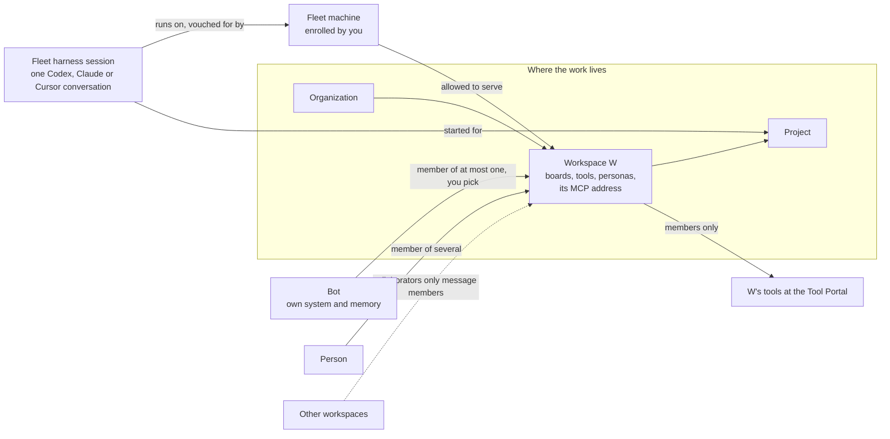

# Agent identity and workspace access: Requirements

Who acts in the fleet and the Tool Portal, how each one proves who it is, which workspace it belongs to, and how its access is granted and taken away.

This design set has four documents:

- **Requirements:** this file.
- **[Specification](specification.md)**
- **[Program Design](program-design.md)**
- **[Verification Design](verification-design.md)**

Two entries lead into them: [index.md](index.md) for agents, and [index.html](index.html), a page for people. A fifth document, [Alternatives](alternatives.md), draws every option weighed and decides nothing.

## The picture you confirmed

A session is a **member** of the workspace of the project it was started for. A **collaborator** may only send messages and tasks to a workspace's members.

## Who is affected

| Class | Role here |
|---|---|
| **Owner (admin)** | Runs the fleet. Creates organizations and workspaces, enrolls machines and allows them to serve workspaces, registers bots and picks their membership, and allows collaboration between workspaces. Today that is Shravan. |
| **Fleet harness sessions** | Codex, Claude or Cursor conversations on the owner's enrolled machines. They do project work, talk on boards and call tools. |
| **Bots** | Whole systems with their own memory and agents, owned by the owner or not. Examples: managed Hermes, Sun, Muse, a customer's bot. |
| **Other people** | Organization members the owner allows to sign in. |
| **Customers of the product** | Others who run the Tool Portal, or the fleet, themselves. The product must not depend on the owner's own Cloudflare Access account. |
| **Future maintainers** | People reading this set to change it. |

## Needs

**Authority states:**

- **authorized:** said directly by the owner.
- **authorized (relayed):** the owner's words, quoted verbatim by the Board/Fleet Lead.
- **existing decision:** an owner decision already recorded in the fleet framework or the people sign-in design.

**Priority:** every row is part of the first identity round. The Tool Portal Lead assigned that from the owner's direction to build this set now.

| ID | Need | Why it matters | Evidence | Authority |
|---|---|---|---|---|
| U1 | There are exactly three kinds of identity: **person**, **bot** and **fleet harness session**. | Every grant, refusal and record has to say who acted, and today the fleet can only name a machine or the owner. | Owner: "lets deifne diffrent things. bots … 2. collaborator or emember …"; the naming thread ending in "Fleet Harness session". | authorized, 2026-10-24 |
| U2 | A **bot** is a whole system with its own memory and agents, whether or not the owner owns it. It proves who it is with its own credential. The system accepts that this proof is only as good as how the bot keeps its secret, and says so. | Bots are outside the owner's control, but must still be accountable. | Owner: "bots (fuklly systems with emmory and agents weather or not i own them)", "ability for a bot to prove who they are even if its it could be isnecure as we dont knwo hwo they keep secrets". | authorized, 2026-10-24 |
| U3 | A **fleet harness session** is one Codex, Claude or Cursor conversation on an enrolled fleet machine. The machine vouches for it. It never logs in and holds no secret of its own. | The owner's agents are sessions the fleet already knows by conversation ID. | Owner, 2026-10-22: "i have session ids for agents on myk router" (F-77). Owner, 2026-10-24, on attestation "with session id"; "fleet sesison are assocviated with fleet rotuer"; the name "Fleet Harness session". | authorized |
| U4 | An identity relates to a workspace as a **member** or a **collaborator**. | Some identities do a workspace's work; others only talk to its members. | Owner: "we have agetns taht are part of wrokspace and commkunciate to workspace"; "collaborator or emember". | authorized, 2026-10-24 |
| U5 | A bot is a member of at most **one** workspace, and only when the admin picks it. It is a collaborator of any others. | Membership is a grant the owner controls, and a bot's memory belongs to one workspace. | Owner: "bot can be a member, but me admin shoudl pick. a bot shoudl only be member in one workspace. rest collaborator." | authorized, 2026-10-24 |
| U6 | A fleet harness session belongs to **the workspace of the project it was started for**. It runs on one enrolled machine. The admin allows each machine to serve chosen workspaces, and one machine may serve several. A session's workspace does not come from its repository. | Sessions work on projects, projects live in workspaces, and a machine may host work for several workspaces. | Owner rejected the repository rule ("this is not the right topology"), asked "1 rotue rand 3 in workspace then what?", then confirmed "yes" to session → project → workspace, with the machine allowed to serve workspaces. | authorized, 2026-10-24 |
| U7 | A **collaborator** may only send messages and tasks to a workspace's members. It never uses that workspace's tools and never starts work in it. | Talking to a workspace must not grant its tools or let an outsider launch work there. | F-75 (an outsider reaches a workspace only through agent-collaboration). Owner: "Collaboration only" for agents not on the owner's machines; "rest collaborator". | authorized / existing decision |
| U8 | Cross-workspace messaging between sessions is allowed **per workspace pair** by the admin, e.g. "members of Personal may message members of OSS". There are no per-session approvals. | Sessions in one workspace ask sessions in another for status, and the owner controls which pairs may. | Owner chose "Per workspace pair" on 2026-10-24. | authorized, 2026-10-24 |
| U9 | The system can say which workspace each registered identity belongs to, and which others it collaborates with. The admin can see which workspace a bot is in. | The owner must be able to answer "who is this, and where does it belong?" | Owner: "abiltiy to see which workspace a bot this", "know which works ace each identy regsitered with t system belkongs to". | authorized, 2026-10-24 |
| U10 | Only members get a workspace's tools, through that workspace's own MCP address, with a token for that workspace only. | Tools are scoped per workspace. | F-73, F-75, F-82. | existing decision |
| U11 | A session's tool profile (persona) is its workspace's **default for sessions**. Whoever starts the session may narrow it, never widen it. | A reviewer and an implementer need different tools, and nobody may grant themselves more. | Owner chose "Workspace default, narrow only" on 2026-10-24. | authorized, 2026-10-24 |
| U12 | There is no live check per tool call. A workspace token carries what the Tool Portal needs. Its lifetime is configurable: 5–10 minutes by default, never more than 1 hour. | A per-call check against the fleet is too heavy. | Owner: "i dont want live its too heavy" (relayed); "yes 5 to 10 configurable ok with max of 1 hour". | authorized |
| U13 | Removals are pushed from the fleet to the Tool Portal. Removing access stops the next call once the push arrives; the token's expiry is only the backstop. | Removal must bite immediately, not after a token expires. | Owner: "we need to hav epush removals"; "i can pkush form fleet to tool prtal and remove?" | authorized, 2026-10-24 |
| U14 | When the fleet's central service is unavailable, no new tokens are issued, and work stops once existing tokens expire (fail closed). | The owner accepts the system stopping rather than running on stale grants. | Owner: "if central is out yes system shouldn't work? that's how it should be?" (relayed). | authorized (relayed) |
| U15 | The fleet holds the truth about identities, organizations, workspaces, projects, membership, collaboration and machines. The TypeScript sign-in service on Better Auth proves people and bots and mints tokens. The Tool Portal is downstream. Workspaces keep their existing IDs. | One owner per truth, with no hand-written token server in Rust. | Owner: "we have fleet taht shoud be doing the login"; "better auth is onlyk ts … fleet is decoup0ed"; "portal be downstream" (relayed); "same design". | authorized |
| U16 | One versioned contract between services, on any host. Cloudflare is one runtime, and the same design runs decoupled from it. | The product runs on Cloudflare or elsewhere without a second design. | Owner: "make sure the system makes sense for service hosted in durable object or not, same for all services" (relayed); "maqke sure clodufalre is one runtiem and we decokuple yes? same design". | authorized |
| U17 | No new private keys on machines. A machine proves itself through its existing enrollment. That enrollment's own secrets are kept as Fleet's decision 1201 says: in the Router's existing encrypted secret store, its data key in the Keychain, with plaintext only in debug. | The owner rejected per-machine key files and a Keychain-held machine identity. Encrypting the existing enrollment secrets at rest is a separate, later owner decision, not a new key. | Owner: "i dont want bespoke private keysin mahcine"; the Keychain "doesn't work" as a machine identity (relayed). Decision 1201 (owner, 2026-10-24): "no plain text secrets for prod. only for debug" (Fleet's production enrollment design). | authorized, 2026-10-24 |
| U18 | Each session records its machine and isolation kind (`Host`, `ProcessSandbox`, `Container` or `Vm`). The system shows which workspaces share a machine's bucket. Only `Vm` actually separates files; `ProcessSandbox` with the auto classifiers is best effort. Nothing is blocked on isolation in the first round. | Sessions on one open machine can read each other's files. The leak must be visible before it can be fenced. | Owner: the agreed isolation kinds ("we arleayd talked aobut kind for room"); "files can only really be enforced with vms"; "agree" to "record and show now, enforce later"; "its fine its semi permiable" (2026-10-24). | authorized, 2026-10-24 |
| U19 | Every agent-collaboration call from a fleet harness session is attributed to the session it actually came from. A call naming a different session is refused. | Today a session can post as another and be stored as it. | Owner's framing: Fleet uses session information "to authenticate collaboration MCP requests as the actual Actor" (Fleet follow-ups, 2026-10-23). Live runs on Codex, Claude and Cursor showed false senders stored. | authorized (relayed) |
| U20 | People sign in with Google, GitHub or a passkey. An organization's owner decides who may sign in. Organizations are kept apart. Only people reach administration. | Existing people sign-in rules carry over. | F-64; D2 (owner, 2026-10-20); F-78; F-82; people sign-in R1–R4, R19, R20. | existing decision |
| U21 | Only the owner (admin) registers bots and sets their membership, allows machines to serve workspaces, allows workspace pairs to collaborate, enrolls machines, and creates workspaces. | Granting access is the owner's call. | D2: "owners can allow people to log in or allow auth related stuff"; F-78; SD1 and SD9 (owner only). | existing decision |

## Goal boundary

**Goal:** one coherent identity and access system across the fleet and the Tool Portal. It covers who acts, how each one proves who it is, which workspace each belongs to, and how tool access is granted and removed.

**Existing foundation to reuse:**

- The fleet's enrolled machines and owner administration (Fleet central).
- The fleet's workspaces, boards and projects, and their existing IDs.
- The sign-in service and its tested token issuer (draft PR #263).
- The Tool Portal's per-workspace MCP address and token check (draft PR #262).

**What is missing:**

- An identity for sessions and bots in the fleet.
- Member and collaborator records, and machine-to-workspace allowances.
- Tokens for members, with pushed removal.
- Attribution of collaboration calls to the session that actually made them.
- A record of each session's machine and isolation.

**May change:** Fleet central and the Router (codex-router), the sign-in service (`packages/auth`), and the Tool Portal (`tool-host-core`, `tool-host-cloudflare`, `tool-host-node`). The Fleet board release now shipping is not changed by this set.

**Non-goals:**

- No named-agent registry, and no per-session approval by the owner.
- No live per-call membership check.
- No new private keys on machines, and no Keychain-held machine identity. (Keeping the existing enrollment secrets in the Router's Keychain-encrypted store is Fleet's decision 1201, not a new key.)
- No Rust port of Better Auth, and no token server written in Rust.
- No enforcement of isolation in the first round. Isolation is asserted by whatever launched the session, and nothing proves it (no hardware attestation).
- No platform-signed machine identity (Fly OIDC) yet.
- No tool access for collaborators.
- No people-facing MCP clients with refresh tokens yet.

**Acceptable outcome-level evidence:**

- Real sessions get and use a workspace token for their project's workspace.
- A false sender is refused.
- A removal stops the next call once pushed.
- No token is issued while Fleet central is down.
- A collaborator is refused tools.
- The owner can look up any identity's workspace and any machine's shared bucket.

## Open owner decisions

| ID | Decision | Recommendation (not decided) |
|---|---|---|
| OD1 | Who may start a session for a project in workspace W, and whether a conversation started outside the fleet may join W later. | You, or a session that is already a member of W. A collaborator never may. This follows Fleet's workspace design and the owner's "rest collaborator". Whichever you choose, the start names its project explicitly and its starter is proven: you, signed in, or the session the request came from; a creator the request merely declares proves nothing (Fleet check, 2026-10-24). **Decided (you, 2026-10-24):** conversations started outside the fleet get no binding and join no workspace in the first round; the boundary is semi-permeable, as U18 records ("its fine its semi permiable"). A running conversation can't be given a binding by resuming it, so joining later would need its own attach step. **Later (your direction, 2026-10-24):** a launch hook (a UI now, Agent Studio support later) registers a conversation you start yourself before it starts, so it has its binding from its first call. Options drawn in [Alternatives §14](alternatives.md#14-open-who-may-start-a-session-in-a-workspace-od1). |
| OD2 | Default token lifetime within 5–10 minutes. | 5 minutes. It is configuration and changeable. The Lead uses 5 minutes unless the owner says otherwise. Options in [Alternatives §5](alternatives.md#5-how-long-does-a-token-live). |
| OD3 | "Rest collaborator" (U5): is a bot automatically a collaborator of every workspace in its organization other than its member workspace, or only of the workspaces you allow? | Only where you allow it, as with workspace pairs (U8). A bot you don't own then reaches only the workspaces you pick. Options drawn in [Alternatives §15](alternatives.md#15-open-is-a-bot-automatically-a-collaborator-of-every-other-workspace-od3). |

**Inherited, not asked again here:** the owner check for admin actions uses the people sign-in design's freshness bound **SD8** (how old the confirmation that you're still active may be when an admin change applies). That design still lists it as the Lead's 5-second proposal, for you to decide with D5. This set follows whatever is decided there. Whatever bound is chosen, it must hold when the change applies, and the fleet's existing operator check (Cloudflare Access) proves the fleet operator, not an organization's owner.
