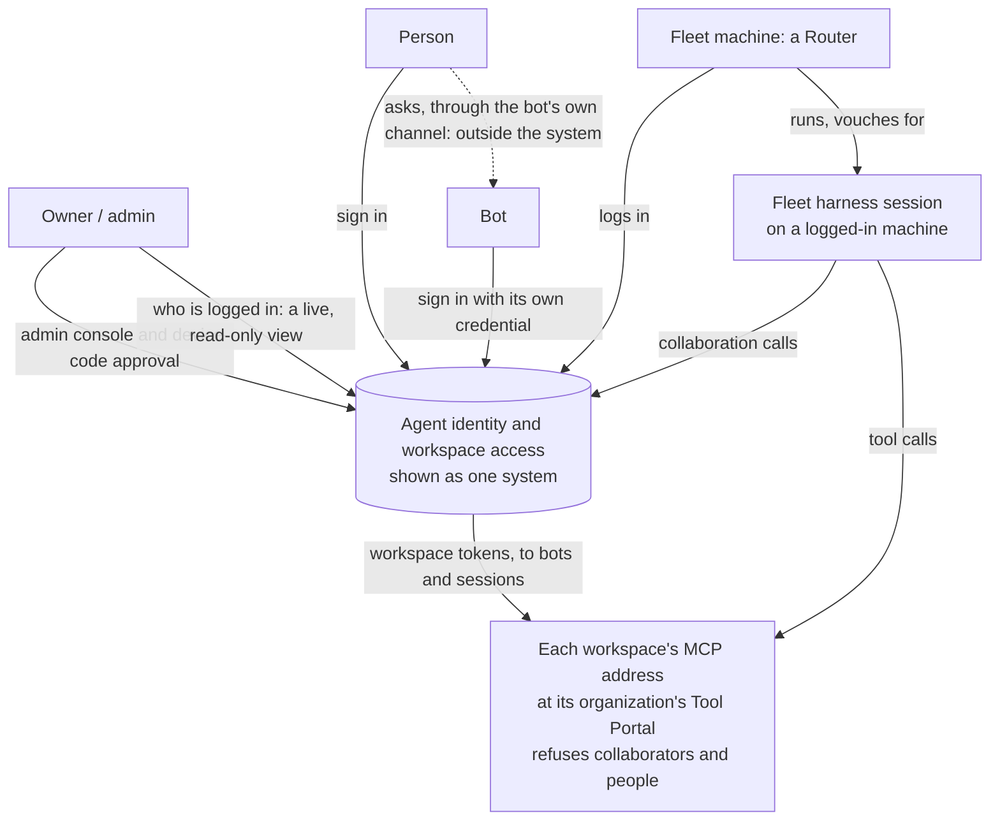
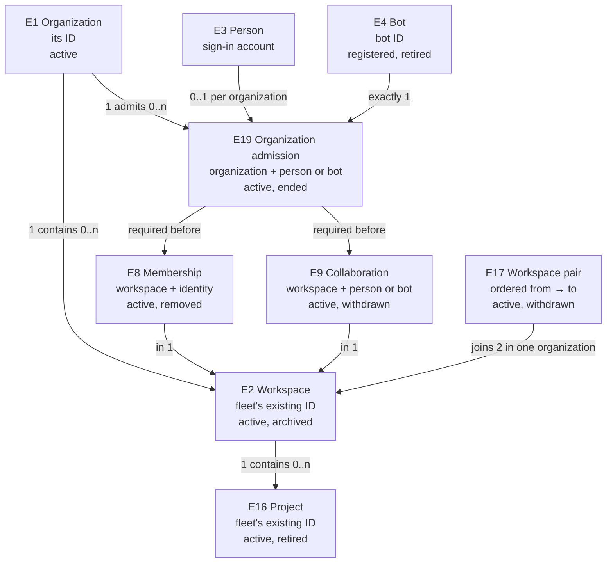
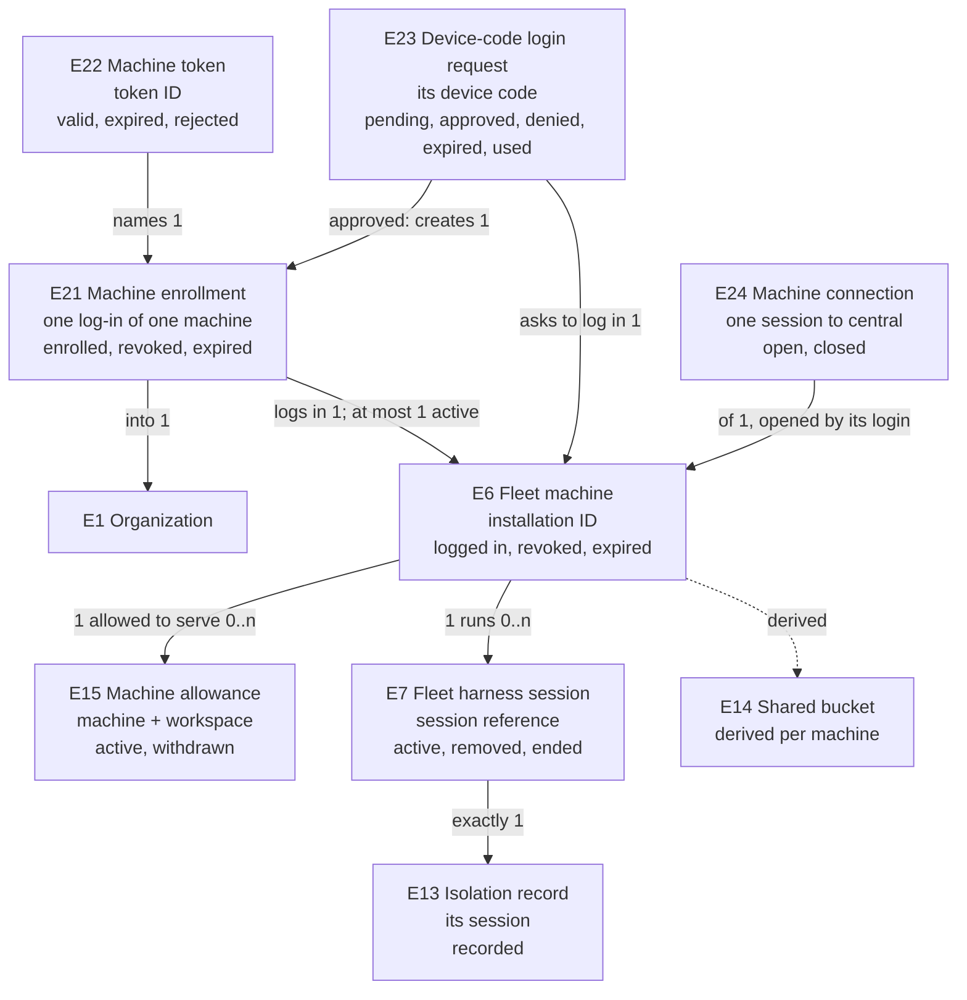
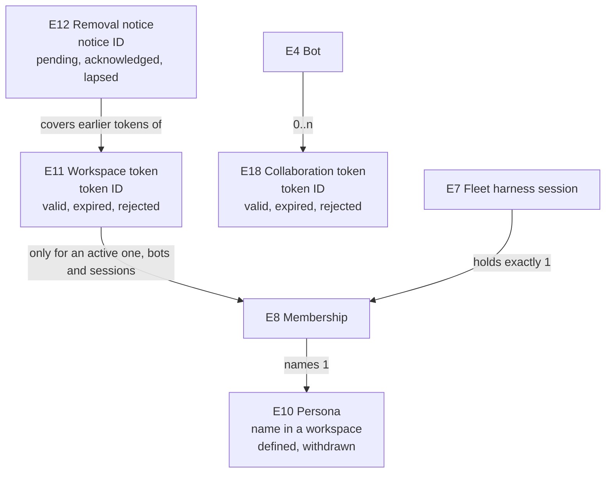

# Agent identity and workspace access: Specification

What must be observably true about who acts, how each identity is proven, which organization and workspace it belongs to, how machines log in, and how tool access is granted and removed. Authority: [Requirements](requirements.md). Structure: [Program Design](program-design.html). Proof: [Verification Design](verification-design.md).

## Who uses this, and where they see it

## Problem today

| ID | Problem | Where it shows |
|---|---|---|
| P1 | The fleet cannot name an agent. Its central service knows only a machine or the owner, and an agent-collaboration call's sender is whatever the call claims. | Fleet code: `AccessCaller {Machine, Owner}`. Live runs on Codex, Claude and Cursor stored a session claiming to be another as that other session. |
| P2 | The Switchboard's agents are separately registered clients holding their own secrets, with no connection to the fleet's sessions. | Draft PRs #263 and #262 compared with the fleet. |
| P3 | Nothing records which workspace an identity belongs to or may talk to. A session's workspace is only guessed from its working directory, and any declared session can join any thread. | Fleet code: the context lookup from the working directory; thread seats only. |
| P4 | Self-contained tokens keep working after a removal until they expire. | Inherent to token-only checking. |
| P5 | Sessions on one open machine can read each other's work, and nothing shows it. | Same OS user on the owner's machines. |
| P6 | One Fleet central has no organizations: its workspaces, machines and records carry no organization, and workspace names are unique across the whole fleet. | Fleet code at `f465808f`: `core_migrations/0003_fleet_records.sql`, `registry_migrations/0001_machine_enrollments.sql`. |
| P7 | A machine proves itself with two long-lived secrets tied to the owner's own Cloudflare Access: an Access service token and an enrollment credential whose expiry must match it. Enrolling needs the fleet operator's token, and the Router's production secret store exists only on macOS. | Fleet code at `f465808f`: `enrollment_prepare.rs`, `machine_enrollment.rs` (Access client must match), `access_rules.rs`, `keychain_data_key.rs` (non-macOS store unavailable). |

## Outcomes

| ID | Outcome | Success condition |
|---|---|---|
| O1 | Every acting identity is one of three kinds and is attributed correctly. | A false sender is refused. Every grant and record names a kind and an ID. |
| O2 | Only bots and sessions that are members of W use W's tools, within their persona. Collaborators only message. People hold no tool tokens. | A collaborator's or a person's tool call is refused. A member's allowed call is admitted. |
| O3 | The owner can see each identity's organization and workspace, each machine's organization and what authorized it, and each machine's shared bucket. | Lookups answer for every identity and machine. |
| O4 | A removal stops the next call once pushed, and expiry is the backstop. When the fleet's truth is unavailable, the system fails closed. | As in R16, R18–R21 and R25. |
| O5 | The same behavior holds on Cloudflare and on any other host, and every Router behavior holds on macOS and Linux. | The same obligations pass on each. |
| O6 | Organizations share one Fleet central yet stay apart, and the organization comes first for every workspace role. | Every request that would cross organizations is refused; no role exists without admission (R34, R35). |
| O7 | Every machine logs in by a device code the owner approves and renews itself with short-lived tokens, and Cloudflare Access is removed only after the new login is proven behind it. | R39–R43 hold, at each of U34's steps. |
| O8 | The owner sees, live, who is logged in and what each is working on: machines and their sessions first, then people and bots. | The view shows each machine and session with its current state within OD14's bound, and only to the owner (R47–R50). |

## Entities

The entity table is the normative home. Program Design binds each entity to its storage and wire shapes.

| ID | Term | Identity rule | Relationships | Invariants | Observable states | Canonicalizes | Basis |
|---|---|---|---|---|---|---|---|
| E1 | **Organization** | Its organization ID. | One Fleet central serves 0..n E1. Has 0..n E2, E4, E6 and E19. Has an owner. | Nothing is shared or sent between two E1s (R34). | active | sign-in E12; Switchboard E1 | U20, U27, D2, F-82 |
| E2 | **Workspace** | Its workspace ID: the fleet's existing UUIDv7, kept as is. | Belongs to exactly one E1. Has 0..n E16, E8, E9, E10, E15 and E17. Has one MCP address at its organization's Switchboard. | Its ID never changes. | active, archived | Switchboard E2; the fleet's workspace record | U10, U15, U37, F-73 |
| E16 | **Project** | Its project ID: the fleet's existing project. | Belongs to exactly one E2, through its board. Has 0..n E7 started for it. | Never moves to another workspace without its sessions ending. | active, retired | the fleet's project-directory entry | U6 |
| E3 | **Person** | Their sign-in account in one deployment (sign-in E2). | Has 0..n E19 (at most one per E1). Has 0..n E8 and E9. | Never a bot or a session. Never holds a workspace or collaboration token. | as in the sign-in design | sign-in E2 Person | U1, U20, U30 |
| E19 | **Organization admission** | The pair of one E1 and one person or bot admitted to it. A person's admission is their allowlist entry in that organization, bound to them, with current standing (sign-in E8); a bot's is its registration (E4). Admitting the same identity again after it ended is a new admission. | Belongs to one E1 and one E3 or E4. | Required before any E8 or E9 in that E1 (R35). A bot has exactly one, in its E1; a person at most one per E1. A new admission carries no earlier role (R37). | active, ended | "added to the organization"; sign-in E8 allowlist entry and standing; bot registration | U26, U27, U36 |
| E4 | **Bot** | Its bot ID, assigned once when the admin registers it in one E1. A bot that registers again is a new bot unless the admin restores the old one. | Belongs to exactly one E1. Has 1..n E5, at most one E8, 0..n E9 and 0..n E18. | One agent running in a gateway; the gateway is not an identity here, and how it keeps the bot's memory and credential is its business. Never a member of two workspaces. Its bot ID is not any of its credentials' client IDs. | registered, retired | "bot", "agent in a gateway such as Hermes", sign-in E9 Agent client | U1, U2, U5 |
| E5 | **Bot credential** | Its client ID. | Belongs to exactly one E4. | How the bot's secret is stored is unknown to the system, and the system says so. | active, retired | sign-in E9's client credentials | U2 |
| E6 | **Fleet machine** | Its installation ID, kept in the Router's own saved state. Replacing the Router program keeps it; a fresh installation state is a new fleet machine. | Belongs to exactly one E1, through its E21. Has 0..n E21, at most one active. Runs 0..n E7. Has 0..n E15. | Holds no private key (R24). Knows only the E2s it may serve or communicate with (R34). Whether a machine may later move to another organization is not decided here (Fleet Q-B11). | logged in, revoked, expired (from its E21) | "Router installation", "peer", "machine" | U3, U17, U27, U31, U35 |
| E21 | **Machine enrollment** | Its enrollment ID: one authorization of one E6 into one E1. Each log-in or re-log-in of the same installation is a new enrollment of the same E6. | Belongs to one E6 and one E1. Authorized by its E1's owner approving one E23. | At most one active per E6, and all of an E6's enrollments name one E1. Records what authorized it. Its machine holds one refresh credential, in an encrypted store or only in memory (R41). | enrolled, revoked, expired | "logged in", "enrolled"; today's enrollment record | U31, U33, U34 |
| E23 | **Device-code login request** | Its device code, which the machine keeps and never shows; the short user code is what the owner checks. | Asks to log one E6 into one E1, under a label the machine supplies. Approved or denied by that E1's owner. | Works at most once. Expires (OD6). Approving it logs in only that installation, only into that organization. | pending, approved, denied, expired, used | "device code", "the code the Router prints" | U33 |
| E22 | **Machine token** | Its token ID. | Identifies one E6 and its E21, and names its E1 and its issuer, the sign-in service. | Short-lived (R40). Accepted only by Fleet central, never by the Switchboard. The sign-in service mints one only for an enrolled E21. Naming its issuer lets another kind of issuer be added later (U33). | valid, expired, rejected | "machine login token" | U33 |
| E24 | **Machine connection** | One authenticated session between one E6's Router and Fleet central, from when it opens to when it closes. A reconnect is a new connection. | Belongs to one E6, and to the E21 whose login opened it. An E6 has 0..n over time. | Opened only with that machine's valid login: today Cloudflare Access plus its enrollment credential; from U34's step 2, a machine token (R40). Counts only while its E21 is the machine's active one (R40). Carries no person. | open, closed | "connected", "online"; "last seen" is the latest moment central heard from an open connection, or its close time | U40; R46's "connected" |
| E15 | **Machine allowance** | The pair of one E6 and one E2. | Belongs to one E6 and one E2 of the same E1. | Only the admin grants or withdraws it. | active, withdrawn | "machine access", "the machine serves the workspace" | U6, U21, U27 |
| E7 | **Fleet harness session** | Its session reference: its machine's installation, plus its harness endpoint (Codex, Claude or Cursor), plus its conversation ID. A new conversation is a new session. | Runs on exactly one E6. Was started for exactly one E16 in its machine's E1. Holds exactly one E8, in that project's workspace. Has exactly one E13. | Holds no secret. Never logs in. Accepted only as vouched for by its machine. Its machine has an active E15 for its workspace. Once removed or ended, its membership ends and no grant is decided for it again. Started by whoever operates its machine, or by another session of its workspace (R8, R46); no person is recorded as its starter. Records its start time: the moment its Router registered it, which exists for every harness. | active, removed, ended. While active, its machine reports it as **working** (a turn is in progress, including one waiting on an approval or a question) or **idle** (no turn in progress, whether or not the harness has it loaded). It is unknown while its machine has no open E24. | "agent" (as an identity), "Router session" | U1, U3, U6, U19, U32, U40 |
| E8 | **Membership** | The pair of one workspace and one identity (E3, E4 or E7). | Belongs to one E2 and one identity, in one E1. Names one E10, or the session default for a session. | Requires the identity's active E19 in the workspace's E1 (for a session, its machine's enrollment there). A bot or session has at most one active membership; a person may have several. A session's membership is in its project's workspace. A person's membership grants no tool token. | active, removed. A persona change keeps the membership with a new persona. | sign-in E11 Workspace link; the Switchboard's member record | U4, U5, U6, U10, U26 |
| E9 | **Collaboration** | The pair of one person or bot and one workspace. | Belongs to one E3 or E4 and one E2, in one E1. | Requires the identity's active E19 in that E1. Only the admin creates it, per workspace. Never grants tools or starting work. Never held together with a membership in the same workspace. | active, withdrawn | "correspondent", "collaborator" | U4, U5, U7, U26 |
| E17 | **Workspace pair** | An ordered pair: a from-workspace and a to-workspace. | Belongs to two E2s in one E1. | It lets members of the from-workspace message members of the to-workspace, and nothing more. It never grants tools or starting work. It reveals only the other workspace's ID and name. | active, withdrawn | "Personal may message OSS", "communication allowance" | U8, U28 |
| E10 | **Persona** | Its name within one workspace. | Defined by the Switchboard for an E2. One per workspace is marked the **session default**. Named by 0..n E8. | Says which tools it makes available and which of them may run without approval. A name that is not defined allows nothing. A session's effective persona is what both its workspace's current session default and any persona its starter named allow (R9). | defined, withdrawn | Switchboard persona; "tool profile" | U10, U11 |
| E11 | **Workspace token** | Its token ID. | Names one E2, one E1, one identity (E4 or E7), and one E10 or the session default. For an E7, also its E6, its machine environment, its E16 and its E13. Carries its grant's place in its organization's order (its grant mark) and its grant expiry. | Issued only to an active member that is a bot or a session, never to a person. Unusable after its grant expiry: the moment its grant was decided plus the configured lifetime, never more than 60 minutes after that decision, however late it was minted. | valid, expired, rejected | sign-in E10 Agent proof | U10, U12, U30 |
| E18 | **Collaboration token** | Its token ID. | Names one E4 and its E1. Names no workspace and no persona. | Issued only to a registered bot presenting an active credential. Accepted only by the fleet's collaboration service, never by the Switchboard. Grants no tools. Same lifetime rules as E11. | valid, expired, rejected | — | U2, U7 |
| E12 | **Removal notice** | Its notice ID. | Names one E2, one identity (or one E6, for every session on it), and the removal's place in its organization's order (its removal mark). | Covers every token for that identity in that workspace whose grant mark is before its removal mark, however late the token was minted. A notice received later with an earlier mark never lowers what is covered. | pending, acknowledged, lapsed | "pushed removal", "reject entry" | U13 |
| E13 | **Isolation record** | Its session. | Belongs to exactly one E7. Names its E6, its machine environment (physical or cloud VM), its isolation kind (`Host`, `ProcessSandbox`, `Container` or `Vm`), an instance ID minted at launch, whatever the kind, and its launch context (working directory, repository, commit, model, and who launched it). | Asserted by what launched the session; nothing proves it. Recorded at launch and never changed. | recorded | "room" (per session); the proposed `AgentIsolation` and `MachineEnvironment` | U18 |
| E14 | **Shared bucket** | One fleet machine, derived. | For one E6: the E2s that have had member sessions with isolation kind `Host` on it. | Derived from E7 and E13. Shown, never enforced, in the first round. | as derived | "leaky bucket" | U18 |

Three small maps of the same table, one per question. Each box shows the entity, what makes two of them the same, and its states; each line shows the relationship and how many.

**Organizations and who is in them**

**Machines and how they log in.** E20, the machine issuer, was removed on 2026-10-27 (U31): the sign-in service issues every machine token.

**Tokens and removal**

## Obligations

Item two, the owner's steps 1 and 2 (2026-10-30), builds D1's obligations and R47–R49 first, then R50 as stage C. The rest are built in steps 3 to 5. See [Requirements: item two and the later steps](requirements.md#item-two-and-the-later-steps).

### Identity and proof

| ID | Obligation | Over | Traces to |
|---|---|---|---|
| R1 | Every agent actor the system grants workspace access or collaboration to, or records as acting, MUST be exactly one of: person (E3), bot (E4), fleet harness session (E7); a workspace or collaboration token MUST name one of them. A fleet machine (E6) and the services' own credentials are infrastructure, not agent actors: a machine token names a machine and a service token names no actor, each under its own audience, and neither is ever accepted as an agent actor. | E3, E4, E6, E7 | U1, P1, O1 |
| R2 | A fleet harness session MUST be accepted only as vouched for by the logged-in fleet machine it runs on. The session presents no secret. A machine whose enrollment is revoked or expired vouches for nothing. | E6, E7, E21 | U3, U17, P1, O1 |
| R3 | When an agent-collaboration call arrives from a fleet harness session, it MUST be recorded as coming from the session whose binding it arrived on. If the call names a different session as its sender, it MUST be refused and nothing recorded. The binding that tells sessions apart is a capability held in the machine's own harness configuration, not a secret the session proves: on one machine user, a process that obtains another session's binding can act as that session. That is the shared-bucket limit (E14, U18), accepted for the first round; this obligation does not separate sessions on one machine from each other. | E7 | U19, U18, P1, O1 |
| R4 | A bot MUST be accepted only when it presents an active credential registered to it. Each bot's record MUST show that its proof depends on how its secret is kept. | E4, E5 | U2, O1 |
| R5 | Person sign-in and organizations MUST behave as the people sign-in design states (its R1–R4, R9, R12, R14, R19 and R20). | E1, E3 | U20 |

### Organizations

| ID | Obligation | Over | Traces to |
|---|---|---|---|
| R34 | Every workspace, bot and fleet machine MUST belong to exactly one organization; a session belongs to its machine's organization, and its project MUST be in that organization. A person MAY be admitted to several. No membership, collaboration, workspace pair, machine allowance, message, task or token MAY span two organizations; a request that would MUST be refused with nothing changed and nothing about the other organization revealed. A fleet machine MUST be told only about the workspaces it is allowed to serve and the workspaces its workspaces are paired with, and a workspace pair MUST reveal only the other workspace's ID and name. | E1, E2, E4, E6, E7, E8, E9, E15, E17 | U27, U28, U29, P6, O6 |
| R35 | An identity MUST NOT become a member or collaborator of workspace W unless it is admitted to W's organization at that moment: a person through an allowlist entry in that organization bound to them, with current standing (people sign-in R19); a bot through its registration in that organization; a session through its machine's active enrollment in that organization. Otherwise the request MUST be refused with nothing changed. | E8, E9, E19, E21 | U26, U27, O6 |
| R36 | When a person's or bot's admission to an organization ends, every membership and collaboration it holds there MUST end with it, and a removal notice MUST go to each workspace where a bot membership ended (R19). A session's own membership does not end because a person left. | E8, E9, E19 | U26, OD5 |
| R37 | When a person or bot is admitted to an organization again after its admission ended, it MUST hold no membership or collaboration there until the admin grants one again. No earlier role MAY be restored automatically. | E8, E9, E19 | U36 |
| R38 | A person MUST never receive a workspace token or a collaboration token, whatever their memberships. A bot's tool call MUST be decided only by the bot's own membership and persona; anything the bot says about who asked it MUST NOT widen what it may do. Who may talk to a bot through the bot's own channel is outside the system: ending a person's roles changes nothing in any bot's channel. | E3, E4, E8, E11, E18 | U30, O2 |

### Membership and collaboration

| ID | Obligation | Over | Traces to |
|---|---|---|---|
| R6 | A bot MUST be a member of at most one workspace. Only the admin creates, changes or removes that membership. Any other relationship a bot has to a workspace is a collaboration (E9). | E4, E8, E9 | U5, P3, O2 |
| R7 | A fleet harness session MUST be a member of exactly one workspace: the workspace of the project it was started for. It is recorded at start and never changes for that session. A conversation registered for one project MUST NOT be registered again for another; repeating its original registration has no further effect. A session's repository or working directory MUST NOT decide its workspace. | E7, E8, E16 | U6, P3 |
| R8 | Starting a fleet harness session for a project in W MUST be refused if its machine has no active allowance for W. The start MUST name its project; a project taken from the working directory MUST be refused. Starting needs no sign-in: whoever can operate a logged-in machine may start sessions for the workspaces it may serve, and the start is recorded as coming from that machine, not from a person. A session MAY start a helper session only for a project in its own workspace: on its own machine, or on another machine of its organization as R46 says. A conversation MUST NOT be prompted until its registration succeeds; one whose registration is refused, or whose outcome is unknown, admits no effect, and nothing replays or deletes it automatically. | E6, E7, E15 | U6, U32, OD1 |
| R46 | A fleet harness session MAY ask to start a helper session on another fleet machine of its organization, for a project in its own workspace W. A member session of W MAY list the machines allowed to serve W, with each one's label. The start MUST be admitted only when, at the time of the request, the requesting session is active and a member of W (identified as R3 says), the project is in W, and the target machine is connected (has an open machine connection, E24), has an active enrollment in the same organization and has an active allowance for W. Otherwise it MUST be refused with nothing created, revealing nothing about a machine of another organization. The start names the working directory and execution settings to use on the target machine; the target MUST refuse, creating nothing, when that directory doesn't exist there, and MUST also apply R8. Each start carries its own identifier: repeating it with the same content MUST return the first answer, repeating it with different content MUST be refused, and one start MUST create at most one session. Each admitted start has a deadline fixed at admission, after which the target MUST begin nothing. The new session MUST record the requesting session as its starter. The answer MUST be exactly one of: started (with the new session), refused (nothing was created), or unknown (the outcome could not be learned, because the request may have reached Fleet central or the target). An unknown start that later completes MUST be visible to the requester under the same identifier. A start that cannot reach the target machine MUST be refused, not queued, and nothing replays it automatically. | E6, E7, E15, E16 | U39, U6, OD1 |
| R9 | A session's effective persona MUST be what both W's session-default persona and the persona its starter named, if any, allow: a tool is available only if both make it available, and it runs without approval only if both let it. The effective persona MUST NEVER make available a tool, or allow a call without approval, that W's session default in effect does not. A named persona W does not define allows nothing. A change to W's tool profiles or session default takes effect from the first call served by the deployment that carries the change; until then calls use the configuration that deployment carries. | E8, E10 | U11 |
| R10 | A person MAY be a member or collaborator of any number of workspaces in organizations they are admitted to (R35). Only the admin manages person membership and collaboration. | E3, E8, E9 | U20, U21, U4 |
| R11 | A bot with an active collaboration in W MAY send messages and tasks to W's members, and W's members MAY send messages and tasks to it, only while that collaboration is active. It MUST be refused W's tools, board writes in W, starting work in W, and board roles in W. It proves itself to the fleet's collaboration service with a collaboration token (C6), never with a workspace token. Only the admin creates a collaboration, per workspace. A person's collaboration is recorded and shown (R14) and grants no tools and no effect in W; people send no collaboration messages of their own in this round (they ask bots, R38). | E9, E18 | U7, U2, U30, O2 |
| R12 | A member of workspace A MAY send messages and tasks to members of workspace B only while an active workspace pair A→B exists, and A and B MUST be in the same organization. Otherwise the message MUST be refused. A workspace pair never grants B's tools, board writes in B, starting work in B, or board roles in B. | E17 | U8, U7, U28 |
| R28 | Every collaboration effect (a direct message, sent or replied, a task, a board write, a role change, or a change to the fleet's own workspace, board, repository, project directory or decision records) MUST be admitted against the fleet's current truth, for the bound actor and its target, before it takes effect, on every path that produces it: wherever it is committed, forwarded or delivered, and whichever Router or fleet service commits it. Members of the target's workspace may do what their board role allows. A workspace pair (R12) admits only messages and tasks between the paired workspaces' members; a bot collaboration (R11) admits only messages and tasks between that bot and the workspace's members, both ways, whether or not the bot is a member anywhere. No effect is admitted across organizations (R34). Creating a workspace is an admin command (R13), never a collaboration effect; renaming and archiving one keep their existing rules and are admitted like other fleet writes. While the truth can't be consulted, the effect MUST be refused. A refused effect MUST leave nothing stored and nothing delivered. | E7, E9, E17 | U7, U8, U19, U15, U27 |
| R13 | Only the admin MAY: add people and bots to an organization or end their admission; set memberships and collaborations; allow or withdraw machine allowances and workspace pairs; create workspaces; approve or deny a device-code login; revoke a machine's enrollment; and read the lookups (R14). Creating an organization and naming its first owner act across organizations, so only the fleet's operator MAY do them; no organization's owner gains that. The admin is the active owner of the organization the action belongs to, signed in to that organization and current there, confirmed at the time of the action as the people sign-in design's R9, R19 and R20 require (its freshness bound SD8 is still open there). One exception, by the owner's direction (2026-10-24): creating a workspace is confirmed when the owner asks, and the admitted, empty workspace is still created if ownership changes before the fleet applies it. Each admin change MUST be recorded as the people sign-in design's R12 requires, in the same step as the change; a change whose record can't be written MUST NOT happen. Anyone else MUST be refused with nothing changed and nothing revealed: another member of the organization, another organization's owner, an owner whose own entry was removed, a session no longer current, a bot or a fleet harness session; and, for creating an organization, any organization owner who is not the fleet's operator. Managers have no admin power in this round. | E1, E2, E4, E6, E8, E9, E15, E17, E19, E21, E23 | U21, U20, U31, F-78 |
| R14 | For any identity, the system MUST answer its kind, its organizations, its member workspace and persona, and its collaborations. For a session, it also answers its machine, project and isolation record. For any workspace, it answers its members, collaborators, workspace pairs and allowed machines. For any machine, it answers its organization, its enrollment's state and what authorized it, its allowed workspaces and its shared bucket. For any removal, it answers whether every affected workspace has acknowledged it. | E1–E23 | U9, O3 |

### Tokens and tool calls

| ID | Obligation | Over | Traces to |
|---|---|---|---|
| R15 | Only an active member of W that is a bot or a session MUST receive a workspace token for W. The token MUST name the issuer, the audience (W's MCP address), the workspace, the organization, the identity's kind and ID (for a session, its whole session reference), the persona (a name, or the session default), its grant mark, the issue time, the expiry and the grant expiry. For a session it MUST also name the machine environment, the project and the isolation record. A token that names a session MUST come only through the fleet's session issuance. | E11, E8 | U10, U30, O2 |
| R16 | A workspace token MUST be unusable after its grant expiry: the moment its grant was decided, on the fleet's clock, plus the configured lifetime. No leeway MAY be added to the grant expiry when a token is checked. Minting it later, retrying, or presenting the same decision again MUST NOT extend that moment. The issuer MUST mint nothing from a grant decision once its own clock reads more than 60 seconds past the decision time (at exactly 60 seconds it may still mint); under the clock model (R21) that is between 0 and 120 seconds of real time after the decision. The admin MUST be able to set the configured lifetime, and it MUST NOT exceed 60 minutes. Its default is 5 minutes (OD2: the Lead's proposed default, not yet the owner's choice). | E11, E18 | U12 |
| R17 | The Switchboard MUST admit a call on W's MCP address only with a valid workspace token for W: before both its expiry and its grant expiry, naming W's workspace and W's organization, not covered by any received removal notice, and only for tools its effective persona allows (R9). It MUST NOT call the fleet to decide a call. | E10, E11, E12 | U10, U12, O2 |
| R18 | Issuing a workspace token MUST consult the current truth once. If the identity is not an active member of W at that moment, no token is issued. For a session, a removed or ended session, or a machine without an active allowance for W or without an active enrollment, also gets no token. | E8, E11, E15, E21 | U14, U15, O4 |
| R45 | Each organization's workspaces MUST be served by a Switchboard deployment that serves no other organization. A deployment MUST refuse a token naming a workspace or organization it does not serve. | E1, E2, E11 | U37 |

### Removal

| ID | Obligation | Over | Traces to |
|---|---|---|---|
| R19 | When a membership ends, a persona changes, a bot or bot credential is retired, a machine's enrollment is revoked, a machine allowance is withdrawn, or a session is removed or ended, the fleet MUST send a removal notice to the Switchboard for each affected workspace. From the moment each affected organization records the removal, no new grant MUST be decided there for the removed access, even while notices are on their way; every grant decided there before that moment MUST be covered by its notice. From the moment the fleet records a revoked enrollment, Fleet central MUST also admit no new connection or renewal on any token for it, and the sign-in service MUST mint it no machine token. From receipt, the Switchboard MUST refuse every token the notice covers. The admin MUST see the removal as pending until every affected workspace has acknowledged it. | E8, E12, E15, E21 | U13, P4, O4 |
| R20 | Each grant decision and each removal MUST hold its own place in its organization's order. A removal notice MUST cover every token for that identity in that workspace whose grant was decided before the removal, however late the token was minted. A token whose grant was decided after the removal, with any new persona, MUST be accepted. A machine notice covers every session on that machine. A notice delivered later than another for the same identity and workspace, with an earlier removal mark, MUST NOT lower what is covered. | E11, E12 | U13 |
| R21 | The fleet MUST resend a removal notice until the Switchboard acknowledges it. The Switchboard MUST acknowledge a notice only after recording it durably. The Switchboard MUST keep each notice until every token it covers has passed its grant expiry: at least the 60-minute maximum lifetime plus the allowed clock difference (at most 60 seconds) after receipt, by its own clock. The fleet's, the sign-in service's and the Switchboard's clocks are assumed to differ pairwise by at most 60 seconds (the clock model). It MUST still apply notices after a restart. | E12 | U13, O4 |
| R22 | The Switchboard MUST accept removal notices only from the fleet. A notice from anyone else MUST be refused and change nothing. | E12 | U13, U15 |

### Machine login

| ID | Obligation | Over | Traces to |
|---|---|---|---|
| R39 | A fleet machine MUST be logged in (enrolled) into exactly one organization, and only by the active owner of that organization approving a device-code login request for that machine (R42). Every enrollment MUST record what authorized it. Anyone else MUST be refused with nothing changed: a person who is not that organization's owner, a bot or a session. | E6, E21, E23 | U31, U33, O7 |
| R40 | From U34's step 2, Fleet central MUST accept a machine's connection only with a valid machine token: issued by the sign-in service, naming that machine's installation, its organization and its active enrollment, and unexpired. Fleet central MUST take the machine's identity, organization, enrollment state and expiry only from that token and the enrollment it names. A machine token's lifetime MUST follow the workspace token's bounds (configurable, at most 60 minutes; proposed default 5 minutes, as OD2). A machine with an active enrollment MUST be able to obtain a fresh machine token before its current one expires without a person acting, for as long as its Router runs. Once its enrollment is revoked or expired, the sign-in service MUST mint it no machine token, and Fleet central MUST refuse its next connection and renewal. A connection MUST count only while its enrollment is the machine's active one: once a newer log-in supersedes it, every grant and effect it asks for MUST be refused. Logging an active installation in again MUST keep its installation identity: its sessions' references, its allowances and its board relationships stay attached. Logging it in after its enrollment was revoked restores nothing: its sessions stay removed and its allowances are granted again by the owner. | E6, E21, E22 | U33, U34, O7 |
| R41 | A machine logged in by device code MUST hold at most one long-lived credential of the new login (its refresh credential). The Router MUST keep it in an encrypted secret store when the machine has one available to the Router (the macOS Keychain; on Linux, a systemd encrypted credential provided to the Router's service), and only in memory when it has none, so that after the Router restarts the owner approves the machine again. A store that exists but cannot be used (access denied, an invalid key, damaged or half-migrated contents) MUST be reported as an error, never treated as absent, and its contents MUST NOT be overwritten. The choice MUST hold for the Router's lifetime and be reported at login. Plaintext on disk is allowed only in debug builds. No private key MAY be created on a machine for this (R24). | E6, E21 | U17, U33, U35, P7 |
| R42 | When a machine asks to log in by device code, it MUST show a short user code and a web address. The approval page MUST show the machine's label, the organization it will join and the code, and MUST let only that organization's active owner approve or deny it. A code MUST work at most once and MUST expire no later than its configured lifetime (OD6: 10 minutes). Attempts to enter codes MUST be limited in rate. A denied, expired or already-used code MUST log nothing in. Approving a code MUST log in only the installation that made that request, only into that organization; it MUST NOT log in any other installation, and MUST NOT give the approving person's own sign-in to the machine. | E6, E21, E23 | U33, U31 |
| R43 | The switch to the new login MUST happen in U34's three steps, and at no time MAY Fleet central accept both the old and the new machine login. Step 1: while the new login is built, today's login (Cloudflare Access plus the enrollment credential) MUST keep working unchanged. Step 2, with Cloudflare Access still in front: Fleet central MUST accept a machine only through R40; the old enrollment credential MUST be refused even with a valid Access token, and a missing, invalid, expired or other-organization machine token MUST be refused even with a valid Access token; the owner's admin actions MUST be authorized through the sign-in service (R13), not through Access identity; every machine is logged in again (R40 keeps its identity). Step 3, once every obligation in this set holds on every machine (OD11): Cloudflare Access is removed; every obligation in this set MUST hold with no Access token present, and unauthenticated, malformed or wrong-kind requests to Fleet central MUST be refused with nothing changed, with request-rate limits still applied. | E6, E21, E22 | U34, U31, O7 |

### Machines and exposure

| ID | Obligation | Over | Traces to |
|---|---|---|---|
| R23 | Each session MUST record its isolation record at start, as asserted by what launched it. For each machine, the system MUST show which workspaces have had member sessions with isolation kind `Host` on it (its shared bucket). Nothing MUST be refused on the basis of the isolation record in the first round. (OD7: kept unless the owner strikes it.) | E7, E13, E14 | U18, P5, O3 |
| R24 | No fleet machine MAY need a new private key of its own to prove itself, and none MAY be created on a machine for that. A machine proves itself only through the machine login of R39–R42. | E6 | U17, U33 |
| R44 | Every obligation in this set that a Router takes part in MUST hold with the Router on macOS and on Linux. A Router inside a VM is a Linux machine; nothing VM-specific is required or proven (U35). | E6 | U35, O5 |

### Who is logged in

| ID | Obligation | Over | Traces to |
|---|---|---|---|
| R47 | The owner MUST be able to open a who-is-logged-in view of their organization. For every fleet machine with an enrollment in that organization, it MUST show: - its label and installation; - its enrollment state: enrolled, revoked or expired; - who approved its log-in, and when; - the workspaces it may serve; - whether it has an open machine connection now (E24), and when it was last seen. For each active session on such a machine, it MUST show: - its harness: Codex, Claude or Cursor; - its project and workspace; - its isolation kind; - when it started; - whether it is working, idle, or unknown (E7). A revoked or expired machine MUST stay listed, shown as revoked or expired and not connected. Opening or refreshing the view MUST change nothing. | E6, E7, E13, E15, E16, E21, E24 | U40, O8 |
| R48 | Each of these MUST show in the view within the freshness bound (OD14; the Lead's proposal is 15 seconds) of when it happens, while Fleet central can be reached: - a machine connection opening or closing; - a session starting, stopping, ending or being removed. A machine whose connection ends without closing cleanly (a crash, or lost network) MUST show as not connected within the same bound, with its last-seen time. While a session's machine has no open connection, the session's state MUST show as unknown, never as working or idle. | E7, E24 | U40, O8 |
| R49 | Only the organization's admin (R13) MAY open the view. It MUST show only that organization's machines, sessions, workspaces and projects (R34). Anyone else MUST be refused with nothing revealed: another organization's owner, a member, a bot, a session, or a machine. While Fleet central's truth can't be consulted, the view MUST say it is unavailable, and MUST NOT show an earlier picture as current. The view MUST NOT show who operates a machine (U32). | E1, E6, E7, E24 | U40, U32, U21 |
| R50 | **Stage C, after R47–R49.** The view MUST also show the organization's people and bots: - for each admitted person, whether they are signed in now, and when they last signed in; - for each bot, its membership workspace, whether its credentials are active, and when it last obtained a token. R48's freshness and R49's visibility apply to these rows too. | E3, E4, E5, E8, E19 | U40 |

### Hosts, outages and service requests

| ID | Obligation | Over | Traces to |
|---|---|---|---|
| R25 | While the fleet's truth cannot be consulted, no new grant MUST be decided, so no new workspace, collaboration or device-code machine token issues and no new machine connection or renewal is admitted; a grant already decided and handed to the issuer MAY still mint within its redemption window (R16), and nothing mints after it. The Switchboard MUST refuse each call once its token's expiry or grant expiry has passed on its own clock. No grant MAY be extended on stale information. | E11, E18, E22 | U14, O4 |
| R26 | Every interaction between the fleet, the sign-in service and the Switchboard MUST use one versioned contract whose meaning does not depend on the host. Each service MUST behave the same on Cloudflare and on a non-Cloudflare host. | all | U16, O5 |
| R27 | Every request between the fleet, the sign-in service and the Switchboard (C7) MUST be authenticated as coming from that edge's one expected caller, for that one operation, to the receiving service. A request from another caller, for another operation or another receiving service, with an expired credential, or naming an organization or workspace its caller may not act for, MUST be refused and change nothing. Repeating an accepted request MUST have no further effect beyond what C7 states for that operation. | all | U13, U15, U16 |

### Storage, hosts and tests (the sign-in service)

The Switchboard's version of these rules is the [Switchboard remediation](../2026-10-24-tool-portal-remediation/specification.md) design's. These obligations cover the sign-in service.

| ID | Obligation | Entities | Traces to |
|---|---|---|---|
| R29 | All of the sign-in service's persistent state MUST be in SQLite reached through Drizzle: D1 through Drizzle on Cloudflare, a `better-sqlite3` file through Drizzle on Node. Better Auth MUST reach it through its Drizzle adapter. Its schema MUST change only through migrations `drizzle-kit` generates and the repository checks in; each database MUST apply them through exactly one mechanism before it serves a request. No Kysely or `node:sqlite` MAY appear in the sign-in service's code or tests, and no code MAY execute SQL text: queries use the Drizzle query builder, which MAY include its `sql` template for an expression inside a builder call with bound parameters (an `exists` subquery, a `max()` in an upsert), but never `sql.raw(`, `db.run\|all\|get\|values(sql…)`, a driver's own `.prepare(` or `.exec(` (D1 or `better-sqlite3`). **Owner gate (OD4):** the schema and its migrations, including the device-code tables, are approved by the owner before code that uses them is written. | E3, E5, E11, E18, E23 | U22 |
| R30 | Every sign-in rule (the token-kind dispatch, the final checks before a token is released, the person admission request to the fleet, the device-code approval, the service request receivers, the audit) MUST live in one runtime-free core. The core MUST reach storage, time, identifiers, cryptography and outbound requests only through capabilities its host supplies, and each capability is required. The Cloudflare host and the Node host MUST each supply them and add no sign-in rule. This realizes R26 for the sign-in service. | E3, E5, E11, E18, E23 | U23, U16 |
| R31 | Each decision that writes more than one row MUST hold without an interactive transaction, because D1 has none: it MUST be either one conditional statement, or a fixed batch whose later statements stay correct when an earlier conditional statement changes no row. A decision MUST NOT read a row in code and then write on the strength of that read. In particular: - cleaning up a refused first sign-in MUST NEVER delete a Person whom another sign-in still has pending, or whom central has admitted to any organization; - a sign-in attempt MUST release only its own pending claim; - an unknown answer from central MUST NOT be treated as a refusal; - a repeated or concurrent claim for the same Person and organization MUST succeed without error; - a device code MUST be consumed at most once, however many concurrent polls redeem it. | E3, E23 | U22, U16, U33 |
| R32 | No UUID other than version 7 MAY be minted or stored by the sign-in service. Every identifier it mints as a UUID, and every model identifier Better Auth obtains from its configured identifier generator, MUST be a UUIDv7. Two kinds of value are not UUIDs and keep their own form. Secret material (client secrets, session tokens, PKCE verifiers, signing keys, device codes and user codes) MUST stay random secret bytes or codes. A key Better Auth derives from presented data to make something single-use (the client-assertion record keyed by a digest of the assertion's `jti`, which is the `private_key_jwt` replay gate) MUST stay derived, because a fresh identifier would remove the replay protection. | E3, E5, E23 | U24 |
| R33 | No sign-in test MAY read the wall clock or wait on real time to decide an outcome. Time-dependent behaviour, including the expiries Better Auth computes itself, MUST be exercised with a controlled clock, and no production build MAY be changed to make that possible. The sign-in service's tests MUST include Hegel property tests of at least: the token-kind dispatch over every client kind, grant and resource; the claim-and-cleanup ordering of R31; the device code's single use under concurrent redemption; and the token claims' parse round-trip. | E11, E18, E23 | U25 |

## Observable contracts

### C1 Workspace token

| Field | Meaning |
|---|---|
| issuer | The sign-in service |
| audience | W's MCP address, derived from the Switchboard's configured origin and never from a request's Host |
| workspace, organization | E2 and E1 IDs |
| principal | The identity's kind (`bot` or `fleetHarnessSession`) and its ID: a bot's E4 ID, or a session's whole session reference. Never a person. |
| persona | An E10 name, or the session default |
| machine environment, project, isolation | For a session only: from E13, E16 and E13 |
| issued at, expires at | When it was minted, and the expiry the issuer stamped |
| grant expires at | The moment its grant was decided plus the configured lifetime (R16). Never later than 60 minutes after the decision |
| grant mark | Its grant's place in its organization's order |

**Accepted:** the signature verifies against the issuer's published keys; the audience is W's address; the workspace is W and the organization is W's organization, served by this deployment (R45); the time on the Switchboard's clock is before the grant expiry, with no leeway, and before the expiry, allowing at most 60 seconds; for a session principal, the token came through the fleet's session issuance (a session's machine is its session reference's installation, which is what a machine notice names); no received removal notice covers it (a notice for its principal, or its machine, whose removal mark is after the token's grant mark).

**Refused, before any tool runs:**

- **as unauthenticated:** no token, a bad signature, the wrong audience, a workspace or organization that isn't W's or isn't served by this deployment, a session token not issued through the fleet's session issuance, or a token past either expiry;
- **as not permitted:** a token covered by a removal notice, or a tool its effective persona does not allow (R9).

### C2 Token issuance

| Outcome | When |
|---|---|
| issued | An active member that is a bot or a session, the identity is proven (R2 or R4), the truth was consulted, the issuer's clock is at most 60 seconds past the decision time, and for a session it is active and its machine is logged in and allowed to serve W |
| refused: not a member of W | No active membership, including a collaborator of W, a person, and a removed or ended session |
| refused: identity not proven | An unknown bot, a retired credential, a machine that isn't logged in or whose enrollment is revoked, or a session its machine did not vouch for |
| refused: machine not allowed for W | A session whose machine has no active allowance for W |
| refused: unavailable | The truth could not be consulted, or the issuer's clock is more than 60 seconds past the decision time (R16, R25) |

### C3 Removal notice

**Fields:** notice ID, workspace, the identity (kind and ID, or a machine for every session on it), the removal mark (the removal's place in its organization's order), and reason class (membership ended, persona changed, bot retired, credential retired, machine revoked, allowance withdrawn, session removed, session ended).

**Coverage:** a notice covers a token for its identity (or for any session on its machine) in its workspace when the token's grant mark is before the notice's removal mark. For each identity and workspace, the highest removal mark received applies; a later-arriving lower mark changes nothing.

**Delivery:**

- Each notice request is authenticated as from the fleet (R22, R27, C7).
- Delivering the same notice ID twice has the effect of delivering it once.
- The Switchboard acknowledges each notice ID only after recording it durably.

### C4 Lookups (admin)

As in R14, visible only to the admin (R13). An identity's lookup for a bot also states that its proof depends on how its secret is kept. A machine's lookup names what authorized its enrollment.

### C5 Collaboration attribution and messaging

- A session's call is recorded as coming from the session whose binding it arrived on. A declared sender that differs is refused, with a reason naming the mismatch. The binding is a capability held by the machine's harness configuration (R3).
- A bot's message is accepted only with a collaboration token (C6) for an active credential of that bot. It is recorded and shown as from that bot, never as a fleet harness session. A reply to it is kept for that bot and handed only to that bot, on a request with its collaboration token; the bot may cancel only its own messages.
- Every collaboration effect is admitted before it takes effect, on every path that produces it (R28). A pair or a bot collaboration admits messages and tasks only: a task is a collaboration message, never a change to a board's task records.
- A message to another workspace's member is refused unless a workspace pair allows it (R12) or the sender is a bot collaborator of that workspace (R11). A message to another organization is always refused (R34).

### C6 Collaboration token

| Field | Meaning |
|---|---|
| issuer | The sign-in service |
| audience | The fleet's collaboration address |
| organization | The bot's E1 |
| principal | `bot` and its E4 ID |
| issued at, expires at, grant expires at | As in C1 |

Issued only to a registered bot presenting an active credential, after consulting the fleet's truth. Accepted only by the fleet's collaboration service, which then admits each message by the bot's collaborations (R11) and workspace pairs (R12) as recorded at that moment. The Switchboard refuses it (wrong audience). It names no workspace and grants no tools.

### C7 Service requests

| Caller → receiver | Operation | What a repeat does |
|---|---|---|
| Sign-in service → fleet | Decide whether to issue a workspace or collaboration token to a bot | Decides again; each decision takes its own grant mark. Nothing else changes. |
| Fleet → sign-in service | Mint a session's workspace token from a grant decision | Mints a token with the same grant expiry and grant mark; never extends it. Refused after the redemption window. |
| Fleet → Switchboard | Deliver a removal notice | No further effect (same notice ID). |
| Fleet → sign-in service | Confirm that a person's session is current, for an admin action (people sign-in R9). The person's standing in the organization is the fleet's own truth and is checked there. | Confirms again. Nothing changes. |
| Fleet → sign-in service | Provision a bot credential for a registered bot (client ID, the bot and its organization; a secret returned once, or a public key) | The same client ID returns the same credential and no new secret. |
| Fleet → sign-in service | Disable a bot credential | Disabled, or already disabled. Nothing else changes. |
| Fleet → sign-in service | Set a workspace's resource at the issuer when the workspace is created or archived (its MCP address, enabled or not); it records existence only | Same values: unchanged. |
| Sign-in service → fleet | Admit a Google or GitHub sign-in to an organization: may bind the allowed, unbound entry for the provider-verified email (and the owner binding), with its record (people sign-in `admitSignIn`, moved) | A repeat adds no binding. |
| Sign-in service → fleet | Read a person's standing in an organization, for a passkey sign-in, a person token or a session confirmation (people sign-in `standing`, moved) | Reads again. Writes nothing. |
| Sign-in service → fleet | Decide a device-code approval: the approver is that organization's active owner, and the request names one installation and that organization; on yes, create or renew that installation's enrollment, recording the owner's approval | A repeat for the same request changes nothing more; a used code is refused. |
| Sign-in service → fleet | Decide whether to issue a fresh machine token for a device-code machine's enrollment | Decides again; nothing else changes. Refused for a revoked or expired enrollment. |

Each request is authenticated as R27 states. A credential is accepted only by the receiving service it names and only for the operation it names. A credential is a bearer credential protected in transit: whoever holds an unexpired one can make that one kind of request within its scope, so each receiver also checks that the request's body is well-formed and within that scope.

### C8 Machine login by device code

What the owner and the machine see:

1. The Router's login asks for the organization and shows a **short user code** and a **web address**, and keeps waiting.
2. On any device, the owner opens the address, signs in, and sees the machine's label, the organization it will join, and the code; the owner confirms the code matches the one the Router shows, then approves or denies.
3. On approval the Router reports that it is logged in to that organization and then connects with machine tokens, renewing them by itself. On denial, expiry or a code already used, it reports that and logs nothing in.

| Outcome | When |
|---|---|
| logged in | The organization's active owner approved this request before it expired, and it had not been used |
| refused: not the owner | Anyone other than that organization's active owner tries to approve |
| denied | The owner denied it |
| expired | Its lifetime (OD6) passed before approval |
| already used | The code was approved or redeemed before |
| unavailable | The fleet's truth could not be consulted; nothing is logged in |

### C9 Machine token

| Field | Meaning |
|---|---|
| issuer | The sign-in service |
| audience | Fleet central |
| machine | The installation ID (E6) |
| enrollment, organization | E21 and E1 |
| issued at, expires at | Within R40's bounds |

**Accepted by Fleet central:** the signature verifies against the sign-in service's published keys; the enrollment is active and names this installation and organization; the token is unexpired. **Refused:** any other token, any token at the Switchboard (wrong audience), and, from U34's step 2, any connection without a machine token, including one presenting only the old enrollment credential.

### C11 Starting a session on another machine

C10 (machine issuer registration) was removed on 2026-10-27 with U31's narrowing.

| Field | Meaning |
|---|---|
| start identifier | Chosen by the requesting machine; the same identifier with the same content returns the first answer, with different content is refused |
| requesting session | E7, as its binding names it (R3) |
| target machine | The installation ID of a machine allowed to serve W |
| project | E16 in the requesting session's workspace W |
| on the target | The harness to start (Codex, Claude or Cursor), the working directory on the target machine, the execution settings a local start takes, and optionally a narrower persona (R9) |
| deadline | Fixed by Fleet central at admission, from the start's timeout within central's maximum; the target begins nothing after it |

| Result | When |
|---|---|
| started | The checks of R46 and the target machine's R8 passed; carries the new session's reference, and whether it completed after the start was reported unknown |
| refused: not a member | The requesting session is not active, or not a member of W |
| refused: project not in W | The project is unknown or in another workspace |
| refused: machine not allowed | The target is unknown, in another organization, not enrolled, or has no allowance for W; one answer for all four, so nothing about another organization is revealed |
| refused: machine not connected | The target machine has no open connection |
| refused: identifier reused | The identifier was already used with different content |
| refused by the target | The working directory is missing on the target, the target's own start check refused it (R8), the deadline passed, or the provider's create failed |
| refused: unavailable | The request never reached Fleet central, or the fleet's truth could not be consulted (R25); nothing was created |
| unknown | The request may have reached Fleet central or the target, and no outcome arrived by the deadline plus one minute; the requester reads the outcome later under the same identifier, and nothing is retried |

Asking for the outcome later, under the same identifier, returns whichever of these results Fleet central recorded, a refusal at admission included. A session the target registered counts as started from that moment, even if the target's own report is lost.

### C12 Who is logged in (admin view)

The owner's live, read-only view of their organization (R47–R50). Only the admin opens it (R49).

| Row | Field | Meaning |
|---|---|---|
| Machine | label, installation | The label the machine supplied when it logged in, and its installation ID |
| | enrollment state | enrolled, revoked or expired (E21) |
| | approved by, approved at | The owner who approved its device code, and when (R39) |
| | may serve | The workspaces it has an active allowance for (E15) |
| | connection | connected now, or not connected (E24) |
| | last seen | The latest moment central heard from it |
| Session, under its machine | harness | Codex, Claude or Cursor |
| | project, workspace | What it was started for (R7) |
| | isolation kind | From its isolation record (E13) |
| | started at | When its Router registered it (E7) |
| | state | working (a turn in progress, including one waiting on an approval or a question), idle, or unknown when its machine has no open connection. Removed and ended sessions aren't listed. |
| Person (stage C) | name, signed in now, last signed in | From the sign-in service (R50) |
| Bot (stage C) | name, membership workspace, credential active, last token | R50 |
| The view | as of | When the picture was taken |
| | unavailable | Shown instead of rows while the fleet's truth can't be consulted (R49) |
| | refused | Anyone but the admin gets a refusal that reveals nothing (R49) |

## Failure and partial outcomes

| Situation | Observable outcome |
|---|---|
| The fleet's truth is unavailable | No new grant is decided, so no new workspace, collaboration or device-code machine token issues and no new machine connection is admitted; a grant already handed to the issuer may still mint inside its redemption window. Existing tokens keep working until either expiry, then calls and connections are refused. No collaboration effect is admitted. Nothing can be removed during the outage, because nothing can change. |
| The fleet's and the Switchboard's clocks differ, by up to 60 seconds | A token may be refused up to 60 seconds before its grant expiry (Switchboard clock ahead), or accepted up to 60 seconds after it in real time (Switchboard clock behind). A covered token is never accepted after its notice is dropped. |
| A grant is decided but minting is delayed or repeated | Once the issuer's clock is more than 60 seconds past the decision, nothing mints (between 0 and 120 seconds of real time). A token minted in time is still unusable after its grant expiry. A repeat yields nothing longer-lived. |
| A removal is recorded but its notices haven't reached every workspace | No new grant for the removed access. The admin sees it as pending. Each workspace refuses covered tokens from receipt; the removed identity stops at grant expiry at the latest. |
| A removal notice is not delivered | The fleet keeps resending, and the admin sees it as unacknowledged. The removed identity stops at grant expiry at the latest. |
| Notices for one identity arrive out of order | The highest removal mark received applies. |
| A persona changes and a new token is requested at once | The new token's grant mark is after the change's removal mark, so it is accepted; the old one is refused from receipt. |
| The Switchboard restarts | Acknowledged notices are still applied. |
| A session ends (its conversation archived or deleted) | Its membership ends, no new token issues, and a removal notice reaches its workspace. |
| A collaborator or a person calls W's tools | Refused: they hold no token for W. |
| A request would cross organizations | Refused with nothing changed and nothing about the other organization revealed. |
| A person leaves an organization | Their memberships and collaborations there end. Sessions keep their own identity. A bot's own channel may still listen to them (U30). |
| A remote start's answer is lost, or its target disconnects or doesn't answer | Once the request may have reached Fleet central, the requester gets unknown, never refused, and nothing replays the start. It reads the outcome later under the same identifier. If the target did create the session, it is registered as R7 says, the start reads as started, and no second session is created. |
| A machine without an encrypted store restarts | Its refresh credential is gone. It shows a new device code and stays offline until the owner approves it; it is the same machine, with its sessions and allowances (R40, R41). |
| A machine's encrypted store exists but can't be used | Access is denied, or the key or contents are invalid or half-migrated. The Router reports an error and doesn't log in; it neither falls back to memory nor overwrites the store (R41). |
| A person is added back to an organization | They hold no role until the admin grants one again. |
| A machine's enrollment is revoked, or its allowance withdrawn, mid-session | No new tokens for its sessions in that workspace, no fresh machine token after revocation, and a removal notice reaches each affected workspace. |
| A device code is denied, expires or is reused | Nothing is logged in; the Router reports why. |
| Someone other than the owner tries to approve a device code | Refused with nothing changed. |
| A machine logs in again while an old connection is still open | The old connection's enrollment is superseded: it is refused for every grant and effect, and closed. The machine's sessions and allowances carry over to the new login. |
| A device-code machine's refresh credential leaks | Whoever holds it is that machine until the owner revokes the enrollment. |
| The step 2 switch breaks login | Machines are offline until a fix is deployed; the old login is not brought back, because a machine revoked after the switch would regain access through it. Cloudflare Access still guards Fleet central, so nothing is exposed. |
| A bot's secret leaks | Whoever holds it is that bot until the admin retires the credential. This is the accepted limit in U2. |
| A Router restarts while a session is being started or registered | The conversation is registered once. Until its registration completes, its binding admits nothing; a start that never completes leaves no member effect. A conversation created before a refused or lost registration may remain, idle: it is sent no prompt and can act as no member. |
| A machine is compromised, or a process on it reads another session's binding | Every session on it can be impersonated, and its isolation records can't be trusted, until the machine's enrollment is revoked. |
| A session reads another workspace's files on a shared machine | Not prevented in the first round. The shared bucket shows it is possible. Only `Vm` would prevent it. |
| Two organizations' Routers run on one machine | Not detected or prevented (U38). Keeping organizations on separate machines or VMs is the owner's practice. |
| A machine crashes or loses its network without closing its connection | Within OD14's bound the view shows it as not connected, with its last-seen time, and its sessions as unknown (R48). |
| The owner opens the view while the fleet's truth can't be consulted | The view says it is unavailable. It shows no earlier picture as current (R49). |
| Someone other than the owner opens the view | Refused, with nothing revealed (R49). |

## What this set does not do

- No live per-call check to the fleet from the Switchboard.
- No hardware proof of isolation or of machine identity, and no enforcement on isolation yet.
- No organization room rule (U38).
- No separation between sessions on one machine user: a session's binding is a capability, not a secret it proves.
- No control over who operates a logged-in machine (U32).
- No check of who asks a bot through its own channel (U30).
- No tools for collaborators, workspace pairs or people.
- No new keys on machines.
- No refresh tokens for people's own MCP clients.
- No managers' powers.
- No mixed old and new machine login at any time.
- No automatic VM login through something that creates VMs (U31), and no VM-specific proof (U35).
- No change to the Fleet board release now shipping.
- Removal does not erase what an identity already read, copied or sent.
- The who-is-logged-in view changes no access, and never shows who operates a machine (U32, U40).

## Proof obligations

| ID | For | Passes when | A wrong build fails because | Reference |
|---|---|---|---|---|
| V1 | R1 | Every workspace or collaboration grant and every recorded agent actor carries exactly one of the three kinds. A machine token and a service token each parse only under their own schema and audience and are refused wherever an agent actor is expected. | A grant or record has no kind, or two; or a machine or service token is accepted as an agent actor. | E3, E4, E6, E7 |
| V2 | R2, R24 | A session token issues only through its logged-in machine. A machine with a revoked or expired enrollment gets nothing. No machine private key exists. | A token issues for a machine that isn't logged in, or a machine key appears. | R2, R24 |
| V3 | R3, C5 | Real Codex, Claude and Cursor sessions naming another session are refused, and own-session calls are recorded as their own. A wrong, expired, cross-installation or reused binding is refused. | A false sender is stored, or a stale binding is accepted. | U19; Fleet live findings, 2026-10-23 |
| V4 | R4 | An active bot credential is accepted. A retired credential or unknown bot is refused. A bot with two credentials is the same principal through either. The bot record shows the storage note. | A retired credential works, a credential's client ID is taken as the bot, or the note is missing. | R4, C2 |
| V5 | R6, R10 | A second bot membership is refused. Only the admin sets one. A person admitted to the organization may hold several memberships and collaborations. | A bot ends up with two memberships, or a non-admin sets one. | U5 |
| V6 | R7, R8 | A started session is a member of its project's workspace, whatever its repository. A start on a machine with no allowance for that workspace, or without a project, is refused, and a conversation whose registration is refused is never prompted and admits nothing. The start is recorded as from the machine; a helper started by a session lands only in that session's workspace. | The workspace follows the repository or working directory, a conversation refused at registration is prompted or acts, or a helper lands in another workspace. | U6, U32 |
| V7 | R9 | A session's available tools and approval-free calls are exactly what both its default and its named persona allow. A named persona wider than the default adds nothing. An undefined persona allows nothing. A stricter default applies from the first call served by the deployment that carries it, with the same token, on every serving instance. | A session uses a tool or skips an approval the default in effect does not allow. | U11 |
| V8 | R11, R12, R28, C5, C6 | A bot collaborator's message, sent with a collaboration token, reaches a member, recorded as from that bot; the member's reply reaches only that bot. A paired workspace's member message is delivered. An unpaired one is refused, on the holding Router, through forwarding, and as a direct message, with nothing stored or delivered. Board writes, role claims and session starts by collaborators or paired workspaces' members are refused even while a pair exists. A person's collaboration admits no effect. A collaboration token is refused at the Switchboard, and a workspace token at the collaboration service. With the truth unavailable, nothing is admitted. | A collaborator gets a workspace token, writes a board, starts work or takes a role, an unpaired effect is stored on any path, or a token is accepted at the wrong service. | U7, U8 |
| V9 | R13, C4 | The organization's active, current owner's admin action applies with its record, including approving a device code and revoking an enrollment. A member who isn't the owner, another organization's owner, a removed owner, a stale session, a bot and a session are each refused with nothing changed and nothing revealed. Only the fleet's operator creates an organization. An admin change whose record can't be written doesn't happen. | An unauthorized admin action applies, reveals something, or applies without its record. | U21, U20 |
| V10 | R14, C4 | Lookups answer correctly for a person, a bot, a session, a workspace, a machine (organization, enrollment state, what authorized it) and a pending removal. | An answer is missing or wrong. | U9 |
| V11 | R15, R16, C1 | Every token carries the C1 fields. Its grant expiry is its decision time plus the configured lifetime. With equal clocks, a mint 59 seconds after the decision succeeds and one at 61 seconds yields nothing; with the issuer's clock behind or ahead of the fleet's, the outcome follows the issuer's own clock as R16 states. A delayed or repeated mint never yields a later grant expiry. A person never receives a workspace token. | A field is missing, a lifetime is exceeded, a delayed mint outlives its grant, the window is measured on the wrong clock, or a person gets a token. | U12, U30 |
| V12 | R17 | An allowed member call is admitted. Each C1 refusal is refused before any tool runs. The Switchboard makes no fleet call per tool call. | A covered, expired or foreign token runs a tool, or the Switchboard calls the fleet per call. | U10, U12 |
| V13 | R18, R25, C2 | A non-member, an ended session, a session on a machine not allowed for W, or a session on a machine whose enrollment is revoked, is refused. With the truth unavailable, no new grant is decided, a grant already handed to the issuer mints only inside its window, and calls stop at grant expiry. | A token issues without consulting the truth, without an allowance or without an active enrollment, a decision is made during the outage, a mint completes after its window, or a call succeeds after grant expiry. | U14 |
| V14 | R19, R20, C3 | After each removal kind, the next call is refused once the notice arrives. A grant decided before the removal but minted after it is refused. A grant decided right after a persona change is accepted. A late, lower notice lowers nothing. While a removal is pending, no new grant is decided for it. A revoked enrollment gets no new connection or machine token. | A covered token works after receipt, a post-change grant is refused, a lower notice reopens access, a grant issues during a pending removal, or a revoked machine connects. | U13 |
| V15 | R21 | An undelivered notice is resent and shown. A notice is acknowledged only once recorded. Notices survive a Switchboard restart and are kept until every token they cover has passed its grant expiry. | A notice is lost, acknowledged before it is kept, hidden, or forgotten while a covered token could still be accepted. | U13 |
| V16 | R22 | A notice not from the fleet changes nothing. | A forged notice removes anyone. | U15 |
| V17 | R23 | A session's isolation record, with its instance ID and machine environment, is in its record and its token, and each machine's shared bucket is shown. Nothing is refused for isolation. | It is missing, or isolation blocks a call. | U18 |
| V18 | R26 | The same obligations pass with each service on Cloudflare and on a non-Cloudflare host. | Behavior differs by host. | U16 |
| V19 | R27, C7 | Each C7 request from its expected caller, for its operation, to its receiver, is accepted, including with a newly rotated key during its overlap. The wrong caller, operation or receiver, a body naming an organization or workspace the caller may not act for or the receiver doesn't host, a malformed body, an expired credential and a withdrawn or unknown key are each refused with nothing changed. A repeat has only the effect C7 states, including for credential provisioning and disabling, person admission and device-code approval. | A request is accepted from the wrong caller, for another operation or out-of-scope organization, or with a withdrawn key, or a repeat changes more than C7 allows. | U13, U15, U16 |
| V20 | R28, R7 | Every collaboration effect is checked before it takes effect on each path that produces it: a board write on the holding Router and forwarded to it, a direct message sent or replied, and the fleet's workspace, board, repository, project-directory and decision-record writes. A refused effect leaves nothing stored or delivered. A conversation registered for one project is refused for another; resending its original registration changes nothing; a Router restart mid-registration leaves one registration and no effect before it completes. | An effect is stored or delivered before admission on any path, or one conversation holds two registrations. | U7, U8, U19, U6 |
| V21 | R29 | The sign-in service runs on D1 and on a `better-sqlite3` file through Drizzle and Better Auth's Drizzle adapter; a database created from the checked-in migrations serves every sign-in, token, device-code and receiver case; a scan finds no Kysely, `node:sqlite`, `sql.raw(`, `db.run\|all\|get\|values(sql`, a driver's own `.prepare(` or `.exec(` (D1 or `better-sqlite3`); the owner's approval of the schema and migrations (OD4) is recorded before the first commit using them. | SQL text executed outside the query builder, Kysely remains, a database serves before its migrations run, or code that uses the schema predates its approval. | U22 |
| V22 | R30 | The same sign-in suite passes on the Cloudflare host and the Node host, and a core run with recording capabilities shows every time, identifier, crypto and outbound use went through them. | A rule lives in one host, or the core reaches a platform global. | U23, U16 |
| V23 | R31 | Many concurrent first sign-ins and cleanups for the same Person never delete a Person who is pending or admitted. In particular: attempt A is refused while held, attempt B for the same pair is admitted, then A is released and cleans up, and the Person, the account and the admitted guard all survive. In the opposite order and across a restart the same holds. With B's answer unknown, no guard exists, and B's pending claim alone keeps the Person and account from deletion. A repeated claim succeeds; each multi-row decision gives the same result on D1 and on `better-sqlite3`. Concurrent redemptions of one approved device code yield exactly one machine login. | An admitted or pending Person is deleted; a refused attempt releases another attempt's claim; an unknown answer releases a claim; a repeated claim errors; a decision holds on one database only; a device code logs in twice. | U22, U33 |
| V24 | R32 | Every UUID-shaped identifier the service stored during the sign-in suite parses as version 7. The client-assertion records carry the derived `jti` digest key, and a replayed assertion is refused. No secret, device code or user code is a UUID. | A version-4 or version-5 UUID anywhere; a client-assertion record with a fresh random key (replay then passes); a UUID used as a secret or code. | U24 |
| V25 | R33 | A scan of the sign-in tests finds no wall-clock read or real-time wait; expiries are crossed by moving a controlled clock; the four Hegel families exist and run. | A test depends on real time, or an expiry is only tested by waiting. | U25 |
| V26 | R34 | A membership, collaboration, workspace pair, machine allowance, message, task or token that would span two organizations is each refused with nothing changed and nothing revealed. A machine is told only about its allowed and paired workspaces, through every way it reads the fleet's records (directory, snapshot and feed, and after a reconnect), and a pair shows only the other workspace's ID and name. When an allowance or pair is added or withdrawn, what the machine is sent changes with it. A person admitted to two organizations acts in each separately. | Anything crosses organizations, a machine learns of an unrelated workspace, or a pair reveals more than ID and name. | U27, U28, U29 |
| V27 | R35 | A membership or collaboration for a person, bot or session not admitted to W's organization is refused; the same request after admission succeeds. | A role exists without admission. | U26 |
| V28 | R36 | Ending a person's or bot's admission ends its roles in that organization, removal notices reach each workspace with an ended bot membership, and sessions are unaffected. | A role survives the end of admission, or a session ends because a person left. | U26, OD5 |
| V29 | R37 | A person or bot admitted again holds no role until the admin grants one. | An earlier role comes back by itself. | U36 |
| V30 | R38 | A person's request for a workspace or collaboration token is refused, whatever their memberships. A bot's tool call carrying any requester label is decided only by the bot's membership and persona. | A person gets a token, or a requester label widens a bot's access. | U30 |
| V31 | R39 | The owner's device-code approval logs a machine into that organization and records the approval. Anyone else's approval is refused. | A machine logs in without its organization's owner, or the record lacks what authorized it. | U31, U33 |
| V32 | R40 | From step 2, a connection with a valid machine token is accepted and one without is refused. A machine renews before expiry with no person acting, running past its first token's expiry. After revocation or enrollment expiry, renewal and the next connection are refused. A connection on a superseded enrollment gets no grant and no effect. Logging an active installation in again keeps its session references, allowances and board relationships; logging it in after revocation restores no session and no allowance. Two machines approved by the same owner stay distinct through first token, refresh and restart. Fleet central's decisions do not change when the Access identity changes. | An expired, revoked or foreign machine token is accepted, a superseded connection still acts, a machine stops when its first token expires, re-login changes the installation's identity or revives what revocation removed, one machine's refresh yields another's token, or a decision depends on Access identity. | U33, U34 |
| V33 | R41 | A device-code machine holds exactly one refresh credential of the new login: in an encrypted store where the machine has one, and only in memory where it has none, where a restarted Router shows a new device code. A store that exists but is denied or damaged is reported as an error and left untouched. Production builds write no plaintext. No private key is created. | A machine holds more long-lived secrets, the in-memory credential reaches disk, a denied or damaged store is silently treated as absent or overwritten, plaintext appears in production, or a key is created. | U17, U33, U35 |
| V34 | R42, C8 | The Router shows a code and an address; the approval page shows the label, organization and code; only the owner can view, approve or deny it, and someone else opening it leaves it for the owner; a code works once and expires at its configured lifetime; rapid code attempts are limited; a denied, expired or used code logs nothing in; approving logs in only the requesting installation, into only that organization, and gives the machine nothing of the owner's sign-in. | A code works twice or after expiry, someone else approves, an approval logs in another installation, or the machine receives the owner's sign-in. | U33; RFC 8628 §5 |
| V35 | R43 | Step 1: today's login works unchanged. Step 2, with Access in front: the old enrollment credential is refused even with a valid Access token; a missing, invalid, expired or other-organization machine token is refused even with a valid Access token; admin actions are authorized through the sign-in service; every machine logs in again. Step 3, with Access removed: every obligation still holds, and unauthenticated, malformed or wrong-kind requests are refused with nothing changed, under rate limits. At no point are both logins accepted. | Both logins are accepted at once, the old credential works at step 2, anything depends on Access at step 3, or unauthenticated traffic changes anything. | U34 |
| V36 | R44 | Every Router-involving obligation passes with the Router on macOS and on Linux. | Behavior differs between the two, or one can't run it. | U35 |
| V37 | R45, C1 | Each organization's Switchboard deployment serves only that organization's workspaces and refuses a token naming another organization's workspace. | One deployment serves two organizations, or accepts another organization's token. | U37 |
| V38 | R46, C11 | A session on machine A starts a helper for a project in its workspace W on machine B, which serves W, in a working directory on B that differs from A's. The helper runs on B, is a member of W, and names A's session as its starter. A member session lists the machines allowed to serve W. A start for another workspace's project, on a machine without an allowance for W, on a machine of another organization, by an ended session, to a disconnected machine, or naming a directory missing on B is refused and creates nothing, and the other organization's machine is not revealed. Two starts at once reach their own answers even when they finish in reverse order. A duplicate delivery or a restart around B's create yields one session. With the answer to A lost after B created the session, A gets unknown and then reads started under the same identifier, and no second session exists. A start past its deadline is begun nowhere. | A helper is created in a refused case, two sessions come from one start, an answer reaches the wrong start, a lost answer is reported as refused, its starter is recorded as anyone else, or a refused start is queued and later replayed. | U39 |
| V39 | R47, C12 | Two logged-in machines, one connected and one not, each have sessions. The owner's view lists both machines with their enrollment state, approver and approval time, allowed workspaces, connection and last-seen time. It lists each active session with its harness, project, workspace, isolation kind, start time and state. A revoked machine is listed as revoked and not connected. Opening the view changes nothing. | A machine or session is missing, a field is wrong, a revoked machine shows as connected, or opening the view changes state. | U40 |
| V40 | R48 | Each of these shows in the view within OD14's bound: a machine connecting; a machine whose network is cut without a clean close (shown not connected, with its last-seen time); a session starting, and stopping. A session whose machine has no open connection shows as unknown. | A change shows later than the bound, a cut-off machine stays connected, or a session shows working or idle while its machine is not connected. | U40, OD14 |
| V41 | R49 | Only the organization's owner opens the view. Another organization's owner, a member, a bot, a session and a machine are each refused with nothing revealed. The view shows nothing from another organization. While the fleet's truth can't be consulted it says it is unavailable, and shows no earlier picture as current. It shows no one at a machine's keyboard. | Someone else sees it, another organization's machine appears, or an earlier picture shows as current. | U40, U32 |
| V42 | R50 | Stage C: each admitted person shows as signed in or not, with their last sign-in; each bot shows its membership workspace, credential state and last token. Both follow V40's freshness and V41's visibility. | A person or bot is missing or shown wrongly, or is shown to someone other than the owner. | U40 |

## Coverage

| U | E | P | O | R | C | V |
|---|---|---|---|---|---|---|
| U1 | E3, E4, E7 | P1 | O1 | R1 | — | V1 |
| U2 | E4, E5, E18 | — | O1 | R4, R11 | C2, C6 | V4, V8 |
| U3 | E6, E7 | P1 | O1 | R2 | C2 | V2 |
| U4 | E8, E9 | P3 | O2 | R6, R7, R10, R11 | — | V5, V6, V8 |
| U5 | E4, E8, E9 | P3 | O2 | R6 | — | V5 |
| U6 | E6, E7, E15, E16 | P3 | — | R7, R8 | C2 | V6, V20 |
| U7 | E9, E17, E18 | — | O2 | R11, R12, R28 | C5, C6 | V8, V20 |
| U8 | E17 | — | — | R12, R28 | C5 | V8, V20 |
| U9 | E1–E23 | P3 | O3 | R14 | C4 | V10 |
| U10 | E2, E10, E11 | P2 | O2 | R15, R17 | C1 | V11, V12 |
| U11 | E10 | — | — | R9 | — | V7 |
| U12 | E11, E18 | — | — | R16, R17 | C1, C6 | V11, V12 |
| U13 | E12 | P4 | O4 | R19–R22, R27 | C3, C7 | V14–V16, V19 |
| U14 | E11, E18, E22 | — | O4 | R18, R25 | C2 | V13 |
| U15 | all | P2 | — | R18, R22, R27, R28 | C7 | V13, V16, V19, V20 |
| U16 | all | — | O5 | R26, R27 | C7 | V18, V19 |
| U17 | E6, E21 | P7 | — | R2, R24, R41 | — | V2, V33 |
| U18 | E13, E14 | P5 | O3 | R3, R23 | C4 | V17 |
| U19 | E7 | P1 | O1 | R3, R28 | C5 | V3, V20 |
| U20 | E1, E3, E19 | — | — | R5, R10, R13 | C7 | V9, V19; the sign-in design's own proof |
| U21 | E2, E4, E6, E15, E17, E19, E21 | — | — | R13 | C4 | V9 |
| U22 | E3, E5, E11, E18, E23 | — | O5 | R29, R31 | — | V21, V23 |
| U23 | E3, E5, E11, E18, E23 | — | O5 | R30 | C7 | V22 |
| U24 | E3, E5, E23 | — | — | R32 | — | V24 |
| U25 | E11, E18, E23 | — | — | R33 | — | V25 |
| U26 | E8, E9, E19 | P6 | O6 | R35, R36 | — | V27, V28 |
| U27 | E1, E2, E4, E6, E15, E17, E19 | P6 | O6 | R34 | C5 | V26 |
| U28 | E17 | — | O6 | R12, R34 | C5 | V26 |
| U29 | E6, E15, E17 | — | O6 | R34 | — | V26 |
| U30 | E3, E4, E11, E18 | — | O2 | R11, R15, R38 | C1, C2 | V11, V30 |
| U31 | E6, E21, E23 | P7 | O7 | R13, R39, R42 | C8 | V9, V31, V34 |
| U32 | E6, E7 | — | — | R8 | — | V6 |
| U33 | E21, E22, E23 | P7 | O7 | R39–R42 | C7, C8, C9 | V31–V34 |
| U34 | E21, E22 | P7 | O7 | R40, R43 | C9 | V32, V35 |
| U35 | E6 | P7 | O5 | R41, R44 | — | V33, V36 |
| U36 | E19 | — | O6 | R37 | — | V29 |
| U37 | E1, E2, E11 | — | — | R45 | C1 | V37 |
| U38 | — | — | — | — (a non-goal: no obligation) | — | — |
| U39 | E6, E7, E15, E16 | — | — | R8, R46 | C11 | V38 |
| U40 | E3, E4, E5, E6, E7, E13, E15, E19, E21, E24 | — | O8 | R47–R50 | C12 | V39–V42 |

## What this replaces

These earlier rules change. Each is superseded only where stated.

| Earlier rule | Now |
|---|---|
| People sign-in **R10** ("this service MUST NOT issue proofs to machines or VMs") | It still issues nothing that identifies a person to a machine. It does issue workspace tokens for sessions, requested through the fleet, and machine tokens for machines the owner logged in by device code (R40, R42). |
| People sign-in **R15**, **E9**, **E10**, **E11** (an agent client signs in as itself and gets a proof for a linked workspace) | Bots keep this as E4 and E5, with membership from E8. Sessions never sign in (R2). The workspace link E11 is replaced by E8 membership. |
| People sign-in **R17**, **R18** (removal refuses "on its next call" by a stored-record check) | Removal is pushed (R19–R21), with grant expiry as the backstop. |
| **D2** location ("per-organization Durable Object in the sign-in service") | The meaning is kept: each organization is isolated and its owner decides who may sign in. Storage follows U15 (the fleet holds organizations): the per-organization Durable Object the owner asked for is the fleet's organization authority object, one per organization, bound in Program Design. The sign-in service keeps people's logins, sessions and credentials in D1. People sign-in R9, R19 and R20 carry over unchanged to the fleet's admin (R13). |
| **F-75** ("external agents get agent-collaboration only") | A bot may be a member of one workspace when the admin picks it (U5). Every other relationship stays collaboration-only. |
| **F-32** ("a bot in several workspaces sees the union of their tools") | Superseded by U5: a bot is a member of at most one workspace. |
| The fleet's "context" lookup (a session's workspace from its working directory) | A session's workspace is its project's workspace (R7). The lookup may remain as a convenience; it never decides membership. |
| Switchboard workspace unit, #262 (membership store and agent-management route) | Membership comes from the token (R15, R17) and removal notices. The per-workspace store keeps approval replay state and removal notices. Management moves to the fleet admin (R13). One deployment per organization (R45). |
| People sign-in **R11** and **V8** (each deployment runs on the owner's Cloudflare account with its own D1, proven by D1 identifiers) | A deployment runs either on the owner's Cloudflare account with its own D1, or on the new Node host with its own `better-sqlite3` file (U16, U23, R29, R30). Each deployment still has its own database, never shared, and no vendor service; V8's D1 check applies to Cloudflare deployments, and V21's file check to Node ones. |
| This set's 2026-10-24 machine proof ("a machine proves itself only through its existing enrollment"; "no platform-signed machine identity yet"; enrolling and revoking machines only by the fleet operator) | Machines log in by the owner's device-code approval and renew with short-lived tokens (R39–R42); the organization's owner logs machines in and revokes them (R13); the switch follows U34's three steps (R43), after which Cloudflare Access and the old enrollment credential are gone. No private key on each machine still holds (R24). |
| This set's 2026-10-24 meaning of a bot ("a whole system with its own memory and agents") | A bot is one agent running in a gateway; the gateway is not an identity (U2, E4). |
| E9 Bot collaboration | E9 Collaboration: a person or a bot; a person's collaboration grants no effect in this round (R11). |

## Noun mapping

| This set | People sign-in design | Switchboard design | Fleet code today |
|---|---|---|---|
| E1 Organization | E12 Organization | E1 Organization | — |
| E19 Organization admission | E8 Allowlist entry and standing (people); — (bots) | — | — |
| E2 Workspace | E6 Relying service (each workspace's MCP address) | E2 Workspace | `workspaces` record |
| E16 Project | — | — | `project_directory` entry |
| E3 Person | E2 Person | — | `Identity::Human` |
| E4 Bot | E9 Agent client (the credential holder) | E3 Agent (when a bot) | — |
| E5 Bot credential | E9's client credentials | — | — |
| E6 Fleet machine | — | — | Router installation (service identity and peer), machine enrollment |
| E21 Machine enrollment | — | — | `machine_enrollments` row (old credential, until step 2) |
| E22 Machine token | — | — | — (today: Access service token plus enrollment credential) |
| E23 Device-code login request | the device-code plugin's request | — | — |
| E15 Machine allowance | — | — | proposed in Fleet decision 902 (not built) |
| E7 Fleet harness session | — | E3 Agent (when a session) | `Identity::Session` (`SessionRef`) |
| E8 Membership | E11 Workspace link | member and persona record | thread seat (not membership) |
| E9 Collaboration | — | — | — |
| E17 Workspace pair | — | — | — |
| E10 Persona | — | persona | — (board roles are not personas) |
| E11 Workspace token | E10 Agent proof | per-workspace token | — |
| E18 Collaboration token | — | — | — |
| E12 Removal notice | — | — | — |
| E13 Isolation record | — | — | proposed `AgentIsolation` and `MachineEnvironment` (not built) |
| E14 Shared bucket | — | — | — |
| E24 Machine connection | — | — | the Router's machine session to Fleet central (the `/v1/session` WebSocket) |
