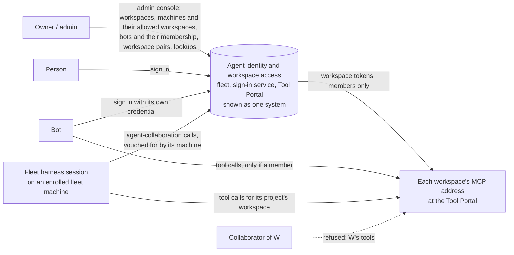
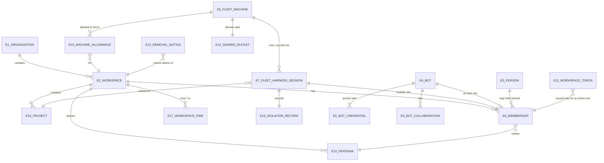

# Agent identity and workspace access: Specification

What must be observably true about who acts, how each identity is proven, which workspace it belongs to, and how tool access is granted and removed. Authority: [Requirements](requirements.md). Structure: [Program Design](program-design.md). Proof: [Verification Design](verification-design.md).

## Who uses this, and where they see it

## Problem today

| ID | Problem | Where it shows |
|---|---|---|
| P1 | The fleet cannot name an agent. Its central service knows only a machine or the owner, and an agent-collaboration call's sender is whatever the call claims. | Fleet code: `AccessCaller {Machine, Owner}`. Live runs on Codex, Claude and Cursor stored a session claiming to be another as that other session. |
| P2 | The Tool Portal's agents are separately registered clients holding their own secrets, with no connection to the fleet's sessions. | Draft PRs #263 and #262 compared with the fleet. |
| P3 | Nothing records which workspace an identity belongs to or may talk to. A session's workspace is only guessed from its working directory, and any declared session can join any thread. | Fleet code: the context lookup from the working directory; thread seats only. |
| P4 | Self-contained tokens keep working after a removal until they expire. | Inherent to token-only checking. |
| P5 | Sessions on one open machine can read each other's work, and nothing shows it. | Same OS user on the owner's machines. |

## Outcomes

| ID | Outcome | Success condition |
|---|---|---|
| O1 | Every acting identity is one of three kinds and is attributed correctly. | A false sender is refused. Every grant and record names a kind and an ID. |
| O2 | Only members of W use W's tools, within their persona. Collaborators only message. | A collaborator's tool call is refused. A member's allowed call is admitted. |
| O3 | The owner can see each identity's workspace and each machine's shared bucket. | Lookups answer for every identity and machine. |
| O4 | A removal stops the next call once pushed, and expiry is the backstop. When the fleet's truth is unavailable, the system fails closed. | As in R18–R21 and R25. |
| O5 | The same behavior holds on Cloudflare and on any other host. | The same obligations pass on both. |

## Entities

The entity table is the normative home. Program Design binds each entity to its storage and wire shapes.

| ID | Term | Identity rule | Relationships | Invariants | Observable states | Canonicalizes | Basis |
|---|---|---|---|---|---|---|---|
| E1 | **Organization** | Its organization ID. | Has 0..n E2. Has an owner and the people allowed to sign in. | Organizations never share members, sessions or records (sign-in R19). | active | sign-in E12; Tool Portal E1 | U20, D2, F-82 |
| E2 | **Workspace** | Its workspace ID: the fleet's existing UUIDv7, kept as is. | Belongs to exactly one E1. Has 0..n E16, E8, E9, E10, E15 and E17. Has one MCP address at the Tool Portal. | Its ID never changes. | active, archived | Tool Portal E2; the fleet's workspace record | U10, U15, F-73 |
| E16 | **Project** | Its project ID: the fleet's existing project. | Belongs to exactly one E2, through its board. Has 0..n E7 started for it. | Never moves to another workspace without its sessions ending. | active, retired | the fleet's project-directory entry | U6 |
| E3 | **Person** | Their sign-in account in one deployment (sign-in E2). | May sign in to the E1s that allow them. Has 0..n E8. | Never a bot or a session. | as in the sign-in design | sign-in E2 Person | U1, U20 |
| E4 | **Bot** | Its bot ID, assigned once when the admin registers it. A bot that registers again is a new bot unless the admin restores the old one. | Belongs to the E1 that registered it. Has 1..n E5, at most one E8, and 0..n E9. | Never a member of two workspaces. Its internal agents act as the bot and are not identities here. | registered, retired | "bot", "external agent", sign-in E9 Agent client | U1, U2, U5 |
| E5 | **Bot credential** | Its client ID. | Belongs to exactly one E4. | How the bot stores the secret is unknown to the system, and the system says so. | active, retired | sign-in E9's client credentials | U2 |
| E6 | **Fleet machine** | Its fleet enrollment: one Router installation the owner enrolled. Re-enrolling is a new enrollment. | Runs 0..n E7. Has 0..n E15. | Proves itself only through its existing enrollment, with no new key. | enrolled, revoked, expired | "enrolled machine", "Router installation", "peer" | U3, U17, U21 |
| E15 | **Machine allowance** | The pair of one E6 and one E2. | Belongs to one E6 and one E2. | Only the admin grants or withdraws it. | active, withdrawn | "machine access", "the machine serves the workspace" | U6, U21 |
| E7 | **Fleet harness session** | Its machine's installation, plus its harness (Codex, Claude or Cursor), plus its conversation ID. A new conversation is a new session. | Runs on exactly one E6. Was started for exactly one E16. Holds exactly one E8, in that project's workspace. Has exactly one E13. | Holds no secret. Never logs in. Accepted only as vouched for by its machine. Its machine has an active E15 for its workspace. | active, removed, ended | "agent" (as an identity), "Router session" | U1, U3, U6, U19 |
| E8 | **Membership** | The pair of one workspace and one identity (E3, E4 or E7). | Belongs to one E2 and one identity. Names one E10. | A bot or session has at most one active membership; a person may have several. A session's membership is in its project's workspace. | active, removed. A persona change keeps the membership with a new persona. | sign-in E11 Workspace link; the Tool Portal's member record | U4, U5, U6, U10 |
| E9 | **Bot collaboration** | The pair of one bot and one workspace. | Belongs to one E4 and one E2. | Never grants tools or starting work. Never held together with a membership in the same workspace. | active, withdrawn | "correspondent", "collaborator" (for a bot) | U4, U5, U7 |
| E17 | **Workspace pair** | An ordered pair: a from-workspace and a to-workspace. | Belongs to two E2s in one E1. | It lets members of the from-workspace message members of the to-workspace, and nothing more. It never grants tools or starting work. | active, withdrawn | "Personal may message OSS" | U8 |
| E10 | **Persona** | Its name within one workspace. | Defined by the Tool Portal for an E2. One per workspace is marked the **session default**. Named by 0..n E8. | Says which tools, reads and writes it allows. A name that is not defined allows nothing. A session's persona is the default or one that allows no more than it. | defined, withdrawn | Tool Portal persona; "tool profile" | U10, U11 |
| E11 | **Workspace token** | Its token ID. | Names one E2, one identity (E4 or E7), one E10 and one E1. For an E7, also its E6, E16 and E13. | Issued only to an active member. Lives no longer than the configured lifetime, and never more than 60 minutes. | valid, expired, rejected | sign-in E10 Agent proof | U10, U12 |
| E12 | **Removal notice** | Its notice ID. | Names one E2, one identity (or one E6, for every session on it), and the point in its organization's order of grants and removals that it revokes through. | Covers every token for that identity in that workspace whose grant was decided at or before that point, however late the token was minted. | pending, acknowledged, lapsed | "pushed removal", "reject entry" | U13 |
| E13 | **Isolation record** | Its session. | Belongs to exactly one E7. Names its E6, its machine environment (physical or cloud VM), its isolation kind (`Host`, `ProcessSandbox`, `Container` or `Vm`), and an instance ID minted at launch. | Asserted by what launched the session; nothing proves it. Recorded at launch and never changed. | recorded | "room"; the proposed `AgentIsolation` and `MachineEnvironment` | U18 |
| E14 | **Shared bucket** | One fleet machine, derived. | For one E6: the E2s that have had member sessions with isolation kind `Host` on it. | Derived from E7 and E13. Shown, never enforced, in the first round. | as derived | "leaky bucket" | U18 |

## Obligations

### Identity and proof

| ID | Obligation | Over | Traces to |
|---|---|---|---|
| R1 | Every identity the system grants anything to, or records as acting, MUST be exactly one of: person (E3), bot (E4), fleet harness session (E7). | E3, E4, E7 | U1, P1, O1 |
| R2 | A fleet harness session MUST be accepted only as vouched for by the enrolled fleet machine it runs on. The session presents no secret. A revoked or expired machine vouches for nothing. | E6, E7 | U3, U17, P1, O1 |
| R3 | When an agent-collaboration call arrives from a fleet harness session, it MUST be recorded as coming from the session it arrived on. If the call names a different session as its sender, it MUST be refused and nothing recorded. | E7 | U19, P1, O1 |
| R4 | A bot MUST be accepted only when it presents an active credential registered to it. Each bot's record MUST show that its proof depends on the bot's own secret storage. | E4, E5 | U2, O1 |
| R5 | Person sign-in and organizations MUST behave as the people sign-in design states (its R1–R4, R12, R14, R19 and R20). | E1, E3 | U20 |

### Membership and collaboration

| ID | Obligation | Over | Traces to |
|---|---|---|---|
| R6 | A bot MUST be a member of at most one workspace. Only the admin creates, changes or removes that membership. Any other relationship a bot has to a workspace is a bot collaboration (E9). | E4, E8, E9 | U5, P3, O2 |
| R7 | A fleet harness session MUST be a member of exactly one workspace: the workspace of the project it was started for. It is recorded at start and never changes for that session. A session's repository or working directory MUST NOT decide its workspace. | E7, E8, E16 | U6, P3 |
| R8 | Starting a fleet harness session for a project in W MUST be refused if its machine has no active allowance for W. **Gap (OD1):** who may start a session for W. Recommended: the owner, or a session already a member of W. | E6, E7, E15 | U6, OD1 |
| R9 | A session's persona MUST be W's session-default persona, or one the starter chose that allows no more than that default. A starter's attempt to widen it MUST be refused. | E8, E10 | U11 |
| R10 | A person MAY be a member of any number of workspaces in organizations they may sign in to. Only the admin manages person membership. | E3, E8 | U20, U21 |
| R11 | A bot with an active bot collaboration in W MAY send messages and tasks to W's members. It MUST be refused W's tools, starting work in W, and board roles in W. **Gap (OD3):** whether a bot collaboration exists for every workspace in the bot's organization other than its member workspace, or only where the admin allows it. Recommended: only where the admin allows it. | E9 | U7, O2, OD3 |
| R12 | A member of workspace A MAY message members of workspace B only while an active workspace pair A→B exists. Otherwise the message MUST be refused. A workspace pair never grants B's tools, starting work in B, or board roles in B. | E17 | U8, U7 |
| R13 | Only the admin MAY register bots and set their membership or collaboration, allow or withdraw machine allowances, allow or withdraw workspace pairs, enroll or revoke machines, and create workspaces. A bot or session attempting any of these MUST be refused with nothing changed. | E2, E4, E6, E8, E9, E15, E17 | U21, F-78 |
| R14 | For any identity, the system MUST answer its kind, its member workspace and persona, and its collaborations. For a session, it also answers its machine, project and isolation record. For any workspace, it answers its members, bot collaborators, workspace pairs and allowed machines. For any machine, it answers its allowed workspaces and its shared bucket. | E2–E17 | U9, O3 |

### Tokens and tool calls

| ID | Obligation | Over | Traces to |
|---|---|---|---|
| R15 | Only an active member of W MUST receive a workspace token for W. The token MUST name the issuer, the audience (W's MCP address), the workspace, the organization, the identity's kind and ID, the persona name, the issue time and the expiry. For a session it MUST also name the machine, the project and the isolation record. | E11, E8 | U10, O2 |
| R16 | A workspace token's lifetime MUST NOT exceed the configured lifetime. The admin MUST be able to set the configured lifetime, and it MUST NOT exceed 60 minutes. Its default is 5 minutes (OD2). | E11 | U12 |
| R17 | The Tool Portal MUST admit a call on W's MCP address only with a valid, unexpired workspace token for W that no received removal notice covers, and only for tools the token's persona allows. It MUST NOT call the fleet to decide a call. | E10, E11, E12 | U10, U12, O2 |
| R18 | Issuing a workspace token MUST consult the current truth once. If the identity is not an active member of W at that moment, no token is issued. For a session, a machine without an active allowance for W also gets no token. | E8, E11, E15 | U14, U15, O4 |

### Removal

| ID | Obligation | Over | Traces to |
|---|---|---|---|
| R19 | When a membership ends, a persona changes, a bot or bot credential is retired, a machine is revoked, a machine allowance is withdrawn, or a session is removed, the fleet MUST send a removal notice to the Tool Portal for each affected workspace. From receipt, the Tool Portal MUST refuse every token the notice covers. | E8, E12, E15 | U13, P4, O4 |
| R20 | A removal notice MUST cover every token for that identity in that workspace whose grant was decided at or before the removal, however late the token was minted. A token whose grant was decided after the removal, with any new persona, MUST be accepted. A machine notice covers every session on that machine. | E11, E12 | U13 |
| R21 | The fleet MUST resend a removal notice until the Tool Portal acknowledges it. An unacknowledged notice MUST be visible to the admin. The Tool Portal MUST keep each notice for at least 60 minutes, and it MUST still apply notices after a restart. | E12 | U13, O4 |
| R22 | The Tool Portal MUST accept removal notices only from the fleet. A notice from anyone else MUST be refused and change nothing. | E12 | U13, U15 |

### Machines and exposure

| ID | Obligation | Over | Traces to |
|---|---|---|---|
| R23 | Each session MUST record its isolation record at start, as asserted by what launched it. For each machine, the system MUST show which workspaces have had member sessions with isolation kind `Host` on it (its shared bucket). Nothing MUST be refused on the basis of the isolation record in the first round. | E7, E13, E14 | U18, P5, O3 |
| R24 | No new private key MAY be created on, stored on, or required from a fleet machine for any obligation in this set. A machine proves itself only through its existing enrollment. | E6 | U17 |

### Hosts and outages

| ID | Obligation | Over | Traces to |
|---|---|---|---|
| R25 | While the fleet's truth cannot be consulted, no workspace token MUST be issued. The Tool Portal MUST refuse each call once its token has expired. No grant MAY be extended past expiry on stale information. | E11 | U14, O4 |
| R26 | Every interaction between the fleet, the sign-in service and the Tool Portal MUST use one versioned contract whose meaning does not depend on the host. Each service MUST behave the same on Cloudflare and on a non-Cloudflare host. | all | U16, O5 |

## Observable contracts

### C1 Workspace token

| Field | Meaning |
|---|---|
| issuer | The sign-in service |
| audience | W's MCP address, derived from the Tool Portal's configured origin and never from a request's Host |
| workspace, organization | E2 and E1 IDs |
| subject | The identity's kind (`bot` or `fleetHarnessSession`) and its ID |
| persona | The E10 name |
| machine, project, isolation | For a session only: E6, E16 and E13 |
| issued at, expires at | Expiry minus issue time ≤ the configured lifetime ≤ 60 minutes |
| grant mark | The point in its organization's order of grants and removals at which this token's grant was decided |

**Accepted:** the signature verifies against the issuer's published keys; the audience is W's address; the token is unexpired; no received removal notice covers it (a notice for its identity, or its machine, whose revoked-through mark is at or after the token's grant mark).

**Refused, before any tool runs:**

- **as unauthenticated:** no token, a bad signature, the wrong audience, or an expired token;
- **as not permitted:** a token covered by a removal notice, or a tool the persona does not allow.

### C2 Token issuance

| Outcome | When |
|---|---|
| issued | An active member, the identity is proven (R2 or R4), the truth was consulted, and for a session its machine is allowed to serve W |
| refused: not a member of W | No active membership, including a collaborator of W |
| refused: identity not proven | An unknown bot, a retired credential, an unenrolled or revoked machine, or a session its machine did not vouch for |
| refused: machine not allowed for W | A session whose machine has no active allowance for W |
| refused: unavailable | The truth could not be consulted (R25) |

### C3 Removal notice

**Fields:** notice ID, workspace, the identity (kind and ID, or a machine for every session on it), the revoked-through mark (the removal's point in its organization's order of grants and removals), and reason class (membership ended, persona changed, bot retired, credential retired, machine revoked, allowance withdrawn, session removed).

**Delivery:**

- Delivering the same notice ID twice has the effect of delivering it once.
- The Tool Portal acknowledges each notice ID.
- A notice not from the fleet is refused.

### C4 Lookups (admin)

As in R14. An identity's lookup for a bot also states that its proof depends on its own secret storage.

### C5 Collaboration attribution and messaging

- A session's call is recorded as coming from the session it arrived on. A declared sender that differs is refused, with a reason naming the mismatch.
- A message to another workspace's member is refused unless a workspace pair allows it (R12) or the sender is a bot collaborator of that workspace (R11).

## Failure and partial outcomes

| Situation | Observable outcome |
|---|---|
| The fleet's truth is unavailable | No new tokens. Existing tokens keep working until they expire, then calls are refused. Nothing can be removed during the outage, because nothing can change. |
| A removal notice is not delivered | The fleet keeps resending, and the admin sees it as unacknowledged. The removed identity stops at token expiry at the latest. |
| The Tool Portal restarts | Acknowledged notices are still applied. |
| A collaborator calls W's tools | Refused: it holds no token for W. |
| A machine is revoked, or its allowance withdrawn, mid-session | No new tokens for its sessions in that workspace, and a removal notice reaches the workspace. |
| A bot's secret leaks | Whoever holds it is that bot until the admin retires the credential. This is the accepted limit in U2. |
| A machine is compromised | Every session on it can be impersonated, and its isolation records can't be trusted, until the machine is revoked. |
| A session reads another workspace's files on a shared machine | Not prevented in the first round. The shared bucket shows it is possible. Only `Vm` would prevent it. |

## What this set does not do

- No live per-call check to the fleet.
- No hardware proof of isolation, and no enforcement on isolation yet.
- No tools for collaborators or workspace pairs.
- No new keys on machines.
- No refresh tokens for people's own MCP clients.
- No change to the Fleet board release now shipping.
- Removal does not erase what an identity already read, copied or sent.

## Proof obligations

| ID | For | Passes when | A wrong build fails because | Reference |
|---|---|---|---|---|
| V1 | R1 | Every grant and recorded actor carries exactly one kind. | A grant or record has no kind, or two. | E3, E4, E7 |
| V2 | R2, R24 | A session token issues only through its enrolled machine. A revoked machine gets nothing. No new machine key exists. | A token issues for an unenrolled or revoked machine, or a machine key appears. | R2, R24 |
| V3 | R3, C5 | Real Codex, Claude and Cursor sessions naming another session are refused, and own-session calls are recorded as their own. | A false sender is stored. | U19; Fleet live findings, 2026-10-23 |
| V4 | R4 | An active bot credential is accepted. A retired credential or unknown bot is refused. The bot record shows the storage note. | A retired credential works, or the note is missing. | R4, C2 |
| V5 | R6, R10 | A second bot membership is refused. Only the admin sets one. | A bot ends up with two memberships, or a non-admin sets one. | U5 |
| V6 | R7, R8 | A started session is a member of its project's workspace, whatever its repository. A start on a machine with no allowance for that workspace is refused. | The workspace follows the repository, or a start succeeds without an allowance. | U6 |
| V7 | R9 | A session gets the default persona, or a narrower one. Widening is refused. | A session holds a persona wider than the default. | U11 |
| V8 | R11, R12 | A bot collaborator's message to a member is delivered. A paired workspace's member message is delivered. An unpaired one is refused. Tool calls, session starts and role claims by collaborators are refused. | A collaborator gets a token, starts work or takes a role, or an unpaired message is delivered. | U7, U8 |
| V9 | R13 | Each admin action by a bot or session is refused with nothing changed. | A non-person changes access. | U21; F-78 |
| V10 | R14, C4 | Lookups answer correctly for a person, a bot, a session, a workspace and a machine. | An answer is missing or wrong. | U9 |
| V11 | R15, R16, C1 | Every token carries the C1 fields, and its lifetime is within the configured value and 60 minutes. | A field is missing or a lifetime is exceeded. | U12 |
| V12 | R17 | An allowed member call is admitted. Each C1 refusal is refused before any tool runs. The Portal makes no fleet call per tool call. | A covered, expired or foreign token runs a tool, or the Portal calls the fleet per call. | U10, U12 |
| V13 | R18, R25, C2 | A non-member, or a session on a machine not allowed for W, is refused. With the truth unavailable, no token issues, and calls stop at expiry. | A token issues without consulting the truth or without an allowance, or a call succeeds after expiry. | U14 |
| V14 | R19, R20, C3 | After each removal kind, the next call is refused once the notice arrives. A token issued after the notice is accepted. | A covered token still works after receipt, or a post-notice token is refused. | U13 |
| V15 | R21 | An undelivered notice is resent and shown. Notices survive a Portal restart and are kept for 60 minutes or more. | A notice is lost, hidden or forgotten early. | U13 |
| V16 | R22 | A notice not from the fleet changes nothing. | A forged notice removes anyone. | U15 |
| V17 | R23 | A session's isolation record is in its record and its token, and each machine's shared bucket is shown. Nothing is refused for isolation. | It is missing, or isolation blocks a call. | U18 |
| V18 | R26 | The same obligations pass with each service on Cloudflare and on a non-Cloudflare host. | Behavior differs by host. | U16 |

## Coverage

| U | E | P | O | R | C | V |
|---|---|---|---|---|---|---|
| U1 | E3, E4, E7 | P1 | O1 | R1 | — | V1 |
| U2 | E4, E5 | — | O1 | R4 | C2 | V4 |
| U3 | E6, E7 | P1 | O1 | R2 | C2 | V2 |
| U4 | E8, E9 | P3 | O2 | R6, R7, R11 | — | V5, V6, V8 |
| U5 | E4, E8, E9 | P3 | O2 | R6 | — | V5 |
| U6 | E6, E7, E15, E16 | P3 | — | R7, R8 | C2 | V6 |
| U7 | E9, E17 | — | O2 | R11, R12 | C5 | V8 |
| U8 | E17 | — | — | R12 | C5 | V8 |
| U9 | E2–E17 | P3 | O3 | R14 | C4 | V10 |
| U10 | E2, E10, E11 | P2 | O2 | R15, R17 | C1 | V11, V12 |
| U11 | E10 | — | — | R9 | — | V7 |
| U12 | E11 | — | — | R16, R17 | C1 | V11, V12 |
| U13 | E12 | P4 | O4 | R19–R22 | C3 | V14–V16 |
| U14 | E11 | — | O4 | R18, R25 | C2 | V13 |
| U15 | all | P2 | — | R18, R22 | — | V13, V16 |
| U16 | all | — | O5 | R26 | — | V18 |
| U17 | E6 | — | — | R2, R24 | — | V2 |
| U18 | E13, E14 | P5 | O3 | R23 | C4 | V17 |
| U19 | E7 | P1 | O1 | R3 | C5 | V3 |
| U20 | E1, E3 | — | — | R5, R10 | — | (the sign-in design's own proof) |
| U21 | E2, E4, E6, E15, E17 | — | — | R13 | — | V9 |

## What this replaces

These earlier rules change. Each is superseded only where stated.

| Earlier rule | Now |
|---|---|
| People sign-in **R10** ("this service MUST NOT issue proofs to machines or VMs") | It still issues no proof that identifies a machine. It does issue workspace tokens for sessions, requested through the fleet. |
| People sign-in **R15**, **E9**, **E10**, **E11** (an agent client signs in as itself and gets a proof for a linked workspace) | Bots keep this as E4 and E5, with membership from E8. Sessions never sign in (R2). The workspace link E11 is replaced by E8 membership. |
| People sign-in **R17**, **R18** (removal refuses "on its next call" by a stored-record check) | Removal is pushed (R19–R21), with expiry as the backstop. |
| **D2** location ("per-organization Durable Object in the sign-in service") | The meaning is kept: each organization is isolated and its owner decides who may sign in. Storage follows U15 (the fleet holds organizations) and is bound in Program Design. |
| **F-75** ("external agents get agent-collaboration only") | A bot may be a member of one workspace when the admin picks it (U5). Every other relationship stays collaboration-only. |
| The fleet's "context" lookup (a session's workspace from its working directory) | A session's workspace is its project's workspace (R7). The lookup may remain as a convenience; it never decides membership. |
| Tool Portal workspace unit, #262 (membership store and agent-management route) | Membership comes from the token (R15, R17) and removal notices. The per-workspace store keeps approval replay state and removal notices. Management moves to the fleet admin (R13). |

## Noun mapping

| This set | People sign-in design | Tool Portal design | Fleet code today |
|---|---|---|---|
| E1 Organization | E12 Organization | E1 Organization | — |
| E2 Workspace | E6 Relying service (each workspace's MCP address) | E2 Workspace | `workspaces` record |
| E16 Project | — | — | `project_directory` entry |
| E3 Person | E2 Person | — | `Identity::Human` |
| E4 Bot | E9 Agent client (the credential holder) | E3 Agent (when a bot) | — |
| E5 Bot credential | E9's client credentials | — | — |
| E6 Fleet machine | — | — | machine enrollment, Router installation |
| E15 Machine allowance | — | — | proposed in Fleet decision 902 (not built) |
| E7 Fleet harness session | — | E3 Agent (when a session) | `Identity::Session` (`SessionRef`) |
| E8 Membership | E11 Workspace link | member and persona record | thread seat (not membership) |
| E9 Bot collaboration | — | — | — |
| E17 Workspace pair | — | — | — |
| E10 Persona | — | persona | — (board roles are not personas) |
| E11 Workspace token | E10 Agent proof | per-workspace token | — |
| E12 Removal notice | — | — | — |
| E13 Isolation record | — | — | proposed `AgentIsolation` and `MachineEnvironment` (not built) |
| E14 Shared bucket | — | — | — |
