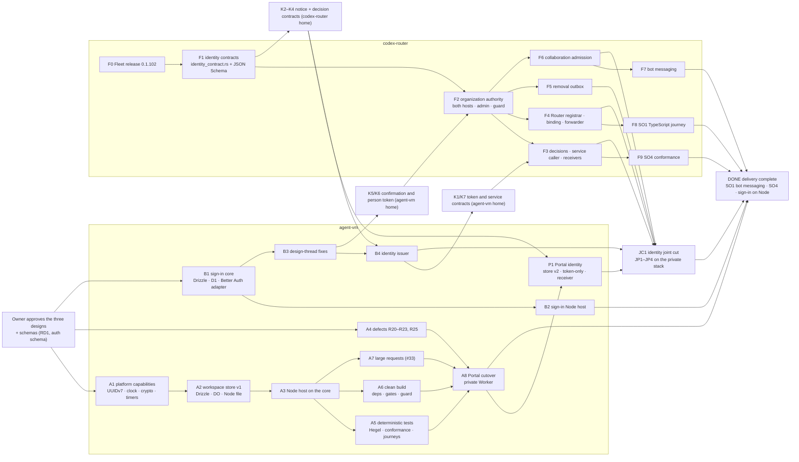

# Delivery orchestration: Program Design

The order of work across agent-vm and codex-router. It names every workstream and slice, where each waits on the other, the contracts that cross the repositories, the joint cuts, their proofs, and who owns each gate. The [Specification](specification.md) says what the order must satisfy (R1–R9); the [Verification Design](verification-design.md) says how that is checked.

## The order in one picture

**The shape:** agent-vm's Tool Portal remediation (A) and the sign-in revision (B) need nothing from codex-router, so they run as soon as the designs are approved. codex-router ships its release (F0) first, then its identity work (F1–F9). The two sides meet at one identity joint cut (JC1), where every changed cross-repository contract goes live together after its joint proofs pass.

## Workstreams

| Workstream | Repository | Lead | Governing design | Starts when |
|---|---|---|---|---|
| **A** Tool Portal remediation | agent-vm | Tool Portal Lead | [Tool Portal remediation](../2026-10-24-tool-portal-remediation/program-design.md) | the owner approves the designs; A2 also waits on RD1 |
| **B** Sign-in revision | agent-vm | Tool Portal Lead | [people sign-in](../2026-10-20-people-sign-in/program-design.md) and [agent identity](../2026-10-24-agent-identity/program-design.md) (sign-in parts) | the owner approves the designs and the sign-in schema |
| **P** Portal identity | agent-vm | Tool Portal Lead | agent identity (Tool Portal parts) on the remediated store | A8 has cut over, and K2 is produced |
| **F0** Fleet release | codex-router | Fleet Lead | the Fleet release (unchanged by this design) | now |
| **F** Fleet identity | codex-router | Fleet Lead | agent identity (Fleet central and Router parts) | F0 has shipped (R3) and the owner approves the designs |
| **J** Joint | both | Tool Portal Lead coordinates; each Lead runs its own side | all three | B4, P1, F3–F6 have merged |

## Slices and dependency points

Every slice merges as one pull request. "Waits on" lists its dependency points; each one points earlier in the order, and there is no cycle.

| Slice | Repository | Realizes | Waits on | Gates |
|---|---|---|---|---|
| A1 platform capabilities | agent-vm | remediation R3 (clock, IDs, crypto, timers as capabilities), R10 (the closed unions in the capability contracts), R11 (the type-check guard), R12 | design approval | agent-vm check, unit, integration; review |
| A2 workspace store v1 | agent-vm | remediation R4–R8, R10 (the store's result unions) | A1; RD1 (schema and `drizzle-kit`); RD6 (Node state directory) | as A1, plus host e2e on sunclaw |
| A3 Node host on the core | agent-vm | remediation R1, R2, R24 (one canonical encoder) | A2 | as A2 |
| A4 defects | agent-vm | remediation R20, R21, R22, R23, R25 | design approval | as A1 |
| A5 deterministic tests | agent-vm | remediation R13, R14, R15; the `verify-tool-portal` journeys | A3 | as A2 |
| A6 clean build | agent-vm | remediation R16, R18, R19; R17 in part (see "Parked work this touches") | A3 | as A1 |
| A7 large requests | agent-vm | remediation R26 | A3; the #33 evidence | as A2, plus the deployed check |
| A8 Portal cutover | agent-vm | remediation R9, and the complete remediation going live | A4, A5, A6, A7 | deployed cutover check (temporary) on the private Worker and a Node host |
| B1 sign-in core and storage | agent-vm | identity R29, R30, R31, R32, R33; people sign-in R3 (the per-attempt claim and cleanup), R12 (audit) | design approval; OD4 (the sign-in schema) | as A2 |
| B2 sign-in Node host | agent-vm | identity R30 (the Node host), U16 for sign-in; people sign-in R11 as superseded | B1 | as A2 |
| B3 design-thread fixes | agent-vm | the nine still-open #237 threads: identity R5 (people sign-in R1–R20 as revised: linking never binds, introspection by client authentication, `checkedAt` from the first session read); produces K5 and K6 (generated schema plus examples from the real issuer) | B1 | as A1 |
| B4 identity issuer | agent-vm | identity R1, R4, R15, R16, R18, R25, R26, R27 (issuer side): token claims, closed dispatch, fleet-session grant, bot claims, one-operation service tokens, receivers for K4, person confirmation, person admission asked of central (K3); produces K1 and K7 | B3; K2–K4 produced by F1 | as A2; its central-facing paths use stand-ins until JC1, named as unverified |
| P1 Portal identity | agent-vm | identity R9 (persona narrowed at the Portal), R17, R19–R22 (Portal side); remediation store version 2 and R9 (no approval revived at the re-key): token-only caller check, principal keys, removal receiver (K2), `deriveRemovalSubjectKey` | A8; K2 produced by F1 | as A2 |
| F0 Fleet release | codex-router | — | — | codex-router's own gates (Fleet Lead) |
| F1 identity contracts | codex-router | identity R26: the Rust contract home (`identity_contract.rs`) and generated JSON Schema for K2–K4 | F0; design approval | codex-router gates |
| F2 organization authority | codex-router | identity R5 (admission at central), R6, R7, R10, R13, R14, R20: organizations, owner and admission, bots, membership, allowances, pairs, session registry, marks; admin commands and the guard (with the fleet-operator exemption fixed), which consumes K5 and K6 | F1; K5 and K6 produced by B3 | codex-router gates; both central hosts |
| F3 decisions, service caller, receivers | codex-router | identity R18, R25, R27 (central side): grant decisions (K3), C7 service caller, central's receivers; consumes K1 and K7 | F2; K1 and K7 produced by B4 | as F2 |
| F4 Router registrar, binding, forwarder | codex-router | identity R2, R3, R7, R8, R23, R24: session registration, binding, start check, token forwarding | F2 | as F2 |
| F5 removal outbox | codex-router | identity R19, R20, R21: removal notices (K2, with the token's session shape) with acknowledgement and resend | F2 | as F2 |
| F6 collaboration admission | codex-router | identity R12, R28: admission on every collaboration effect path | F2 | as F2 |
| F7 bot messaging | codex-router | identity R11: bot origin, mailbox, receipts | F6 | as F2 |
| F8 SO1 TypeScript journey | codex-router | identity SO1 (observes R2, R3, R7, R8, R11, R23, R28): the fleet identity journey, in TypeScript, replacing any Python | F4 | codex-router gates |
| F9 SO4 conformance | codex-router | identity SO4 (observes R6, R13, R14, R19–R21 on both central hosts) | F3 | codex-router gates |
| JC1 identity joint cut | both | every K going live together | B4, P1, F3, F4, F5, F6 merged; JP1–JP4 passing | JP1–JP4 |
| DONE delivery complete | both | every governed outcome delivered, not only the cut: identity U7 (bot messaging), U16 (both hosts, including the sign-in Node host), remediation U1–U15 | A8, JC1, B2, F7, F8, F9 merged and deployed on the private stack | identity SO1 (native sessions and bot messaging), SO4 on both central hosts, and the sign-in suite on the Node host, all against the deployed cut builds; a slice not merged keeps DONE open |

**Why A runs ahead of P.** Store version 1 keeps today's membership records, so the remediated Tool Portal is deployable on its own (A8) without waiting for codex-router. P1 then moves the store to version 2 and switches the caller check to identity tokens. The cost is one extra migration, and the benefit is that A never blocks on F.

**Why B4 and P1 meet only at JC1.** B4 changes the token claims and P1 changes the check that reads them. Either one alone, deployed, breaks issuer-to-Portal calls; that is exactly what broke the identity build. So both merge behind JC1: they land on master, and the private test stack keeps running the previous issuer and Portal builds until JC1 deploys both together.

**The deploy hold before JC1 (O4).** From the moment B4 or P1 merges until JC1 completes, the sign-in Worker and the Tool Portal (Worker and Node host) are not deployed from master, not even for an unrelated fix. A fix needed on the private stack in that window is deployed from a branch cut at the last commit before B4 or P1 merged, with the fix cherry-picked. The Tool Portal Lead owns the hold and records it on the work thread when it starts and ends. Without it, an ordinary deploy would ship B4 or P1 alone, which is exactly the half-shipped contract R4 forbids.

**How JC1 cuts over.** The private test stack's only callers are the test Router's sessions and the test bot, so a hard cutover is a short, owned interruption, not a compatibility layer. The Tool Portal Lead owns it and records each step's evidence:
1. **Stop admission.** Stop the test Router's sessions and the test bot, the stack's only callers. Evidence: the Router reports no active session, and the bot's process has exited. The stop time is recorded from the Router's own clock.
2. **Settle.** Confirm every request admitted before the stop has finished, not merely that logs went quiet. `wrangler tail` on the Tool Portal and sign-in Workers, started before step 1, must show a recorded outcome for every invocation that began before the stop time. The Node host is stopped through its listener's close, which returns only after its open requests end. Any armed approval left by an interrupted call stays `ambiguous` in the store, which is the designed outcome, not a reason to wait.
3. **Deploy in order.** Deploy Fleet central, then the sign-in Worker, then the Tool Portal Worker and Node host. Read back each component's deployed build identity. Central first is safe, because its new routes are unused by the old callers. The Tool Portal deploy runs store version 2: membership tables dropped, approval rows re-keyed, Worker and Node approval keys rotated.
4. **Prove, with a proof cohort only.** Once every component reads back its cut build, JP1–JP4 run with a named proof cohort: one test Router session and one test bot, started by the operator for the proofs, while the ordinary sessions and bot stay stopped. The cohort's requests are the first the new builds serve, and they are the proofs' subjects. They are not a resumption.
5. **Resume.** Start the ordinary sessions and the bot only after every component's build identity reads back as the cut's build, and JP1–JP4 have passed against exactly those builds.

**If a deploy fails part-way, or any JP fails: admission stays stopped, and the stack is repaired forward.** The previous Tool Portal and issuer builds are not redeployed. Store version 2 has already dropped their tables and re-keyed approval state, and their approval and signing keys are retired, so an old build could not run correctly against the store it would find. Redeploying old code must also never reactivate old keys against a replay store that no longer holds their uses. The fix is a corrected build of the failed component, then steps 3–5 again. Nothing runs while the stack is mixed, not even the proof cohort: it starts only after every component reads back its intended cut build, and it is stopped before any repair of a failed proof. No caller observes a mixed state. The cost is that the private stack stays down until the fix lands; no rollback mechanism is built to avoid that.

## Cross-repository contracts

Each shape has one home, and its home generates the artifact the other side tests against. The consumer's test parses the real producer's generated output; nothing is written by hand on both sides.

| Contract | Home (producer) | Generated artifact | Consumer and its test | Goes live at |
|---|---|---|---|---|
| K1 workspace and collaboration token claims | agent-vm `tool-access/contracts` (Zod) | JSON Schema plus example tokens minted by the real issuer in tests | codex-router central (collaboration token) parses them in F3's tests | JC1 |
| K2 removal notice and acknowledgement | codex-router `identity_contract.rs` | JSON Schema plus example notices from the real outbox | agent-vm Portal receiver (Zod derived from the schema) parses them in P1's tests | JC1 |
| K3 decision requests and replies (`DecideBotIssuance`, `IssuanceDecision`, `PersonAdmissionRequest`, `OrganizationStanding`) | codex-router `identity_contract.rs` | JSON Schema plus example replies from the real organization authority | agent-vm issuer parses them in B4's tests | JC1 |
| K4 credential and resource management (`ProvisionBotCredential`, `DisableBotCredential`, `SetWorkspaceResource`) | codex-router `identity_contract.rs` | JSON Schema plus example requests from the real service caller | agent-vm issuer receivers parse them in B4's tests | JC1 |
| K5 session confirmation (RFC 7662 introspection reply) | agent-vm people sign-in (reply shape) | example replies from the real issuer | codex-router admin guard parses them in F2's tests (produced by B3) | JC1 |
| K6 person token claims (`personTokenClaimsSchema`) | agent-vm `tool-access/contracts` | JSON Schema plus example tokens from the real issuer | codex-router admin guard in F2's tests (produced by B3) | JC1 |
| K7 service-token claims and audiences (C7) | agent-vm issuer | example tokens from the real issuer per edge | codex-router receivers in F3's tests | JC1 |

**How the artifact crosses the repositories is the owner's decision (OD-R3).** The identity build's scheme was agreed between agents, which the owner rejected.

| | Option | Gain | Cost |
|---|---|---|---|
| **Recommended** | The home commits its generated artifact with its source commit. The consumer keeps a copy pinned to that commit and refreshes it only by a deliberate commit. The consumer's existing test command parses the copy. | No network in tests; a change is a visible commit on both sides; no new gate | Someone has to refresh the copy, and a stale copy passes until refreshed (JP1–JP4 catch a mismatch before JC1) |
| Alternative | The home publishes the artifact in a versioned package (npm for agent-vm, a crate for codex-router), and the consumer depends on a version | Versioned and discoverable | A Rust crate consuming a TypeScript-owned schema, or the reverse, needs packaging on both sides, and agent-vm's publishing isn't set up yet (#264) |

## Joint proofs (the real path)

All four run on the private test stack: the remediated Tool Portal Worker, the sign-in Worker, Fleet central on its Durable Object host, and a real Router with real harness sessions. They also run against the Tool Portal's Node host and central's Tokio host where noted. No stand-in sits on the path a proof claims.

| Proof | What is done | What must be seen | Runs on |
|---|---|---|---|
| JP1 real token, one effect | a real fleet session (registered through the real Router) and a real bot each get a workspace token from the real issuer and call one allowed tool | exactly one upstream effect each; the Portal's analytics data point names the principal | Tool Portal Worker and Node host; central on Durable Objects |
| JP2 removal stops the next call | the owner removes that principal through central's admin command | the principal's next call is refused, also after a Tool Portal restart; central's removal status reads acknowledged | Tool Portal Worker and Node host |
| JP3 refusals | a forged token, an expired token, a non-member's token and a collaborator's token each call a tool | each is refused with its refusal reason and nothing runs | Tool Portal Worker |
| JP4 a person's admin command | the owner signs in and sends an admin command | it applies with a live session; after sign-out the same command is refused | central with the real sign-in Worker |

The row 14 real-issuer check deferred from the Tool Portal's deployed cycles is JP1 and JP3.

## Gate owners

| Gate | Definition owned by | Run by | Result read and accepted by |
|---|---|---|---|
| agent-vm `pnpm check` (plus the approved type-check guard) | the owner | each slice's Implementer | Tool Portal Lead |
| agent-vm CI: unit, integration, e2e, Python, inventory | the owner | CI | Tool Portal Lead |
| agent-vm host e2e and stress runs | the owner | Implementer and Verifier on sunclaw | Tool Portal Lead |
| agent-vm VM e2e | the owner | CI only | Tool Portal Lead |
| `verify-tool-portal` and `verify-auth` journeys | the Tool Portal Lead (journey contents) | Verifier | Tool Portal Lead |
| private test Worker deployed checks | the owner (the Cloudflare account) | Verifier, with the owner's `wrangler` login | Tool Portal Lead |
| codex-router gates and SO1, SO4 | the codex-router owner | Fleet Lead's helpers | Fleet Lead |
| independent review per milestone | the reviewing role | Reviewer Sidekick (Sol xhigh, a different lineage from each Lead) | each repository's Lead |
| JP1–JP4 | this design | both Leads' Verifiers, on the private stack | Tool Portal Lead, with the Fleet Lead's agreement on its side |

No gate is added except the type-check guard; the producer-against-consumer contract tests run inside each repository's existing test commands.

## What happens to #262 and #263

#262 (head `2dfea38e`) is the collapsed Tool Portal stack and already contains #263's sign-in issuer. Its auto-merge is paused, and #238–#247 are open beneath it. This is OD-R1, the owner's decision.

| | Option | Gain | Cost | Risk |
|---|---|---|---|---|
| **Recommended** | **Revert #262's gate changes on its branch, then merge #262 and fix on master.** The one revert commit restores `scripts/run-check-gate.ts`, `vitest.config.ts` and the gate composition to `38569fca` and removes the 26 added scripts and the `e2e-deployed` project (RD5), before the merge. Workstreams A and B then start from master as stacked PRs, and #238–#247 close as landed. Hold every package publish (#264) and deploy from master until A8 lands. | Small reviewable remediation slices; the stack closes; one base for everyone; master never carries gate changes you didn't approve | Master carries the known-wrong storage and Node host until A2 and A3 merge; the revert lands before RD5 is formally decided, which matches its recommendation | A publish or deploy from master before A8; the hold prevents it |
| Alternative | Merge #262 as it is and fix on master | As above, one commit sooner | Master also carries the unapproved gate changes (`run-check-gate.ts`, `vitest.config.ts`, 26 scripts) until A6 reverts them, against your rule on check gates (U9, remediation U10) | Any check run on master in that window uses gates you didn't approve |
| Alternative | Hold #262 and build the remediation on its branch | Master never carries the wrong code | A long-lived 768-file branch that every slice rebases onto; review sees one enormous merge at the end | Drift from master |
| Alternative | Close #262 and rebuild from master, porting what holds up | The cleanest history | Redoing work that is mostly right (the engine, the rules, the Worker routing) | Weeks of rework |

**If deferred:** A1, A4 and B1 can't start, because their base is undecided.

## Parked work this touches

- **#255 (S4c2, managed distribution) is parked by the owner.** It carries the deletion of `@agent-vm/mcp-portal` and `@agent-vm/tool-portal` (Tool Portal check 12), which is what removes the 1.x MCP SDK from product code (remediation R17). Until it is unparked, A6 removes the 1.x SDK from every new package and from `gateway-runtime`, and R17 stays partial for the two old packages. This is OD-R4.
- **#33 (large requests)** is A7; it waits on the evidence named in the remediation Program Design.

## When a slice is blocked on the owner

A slice that needs an owner decision stops, and the question goes to the owner at once: an HTML question page in the agent-vm worktree's `docs/wip/`, and a one-line note through Sun (cursor-local/45c0db23). Slices that don't depend on it continue. The open questions this design already knows are OD-R1 to OD-R4 here, RD1 to RD6 in the remediation design, and the identity and sign-in decisions in their revised designs.

## How each obligation is realized and observed

| U | R | E | owner | interface | shape and home | state | failure | proof |
|---|---|---|---|---|---|---|---|---|
| U1 | R1 design before build | E3 | each repository's Lead | each slice names its governing rows | the slices table above | slice: planned → ready → building → merged | a slice without approval or rows doesn't start | each plan's slice list against this order and the approval record |
| U2 | R2 one complete order | E2 E3 E5 E7 | Tool Portal Lead (this design) | the slices table and the picture | this document | dependency points open → met | a missing slice or a forward dependency is a design defect | a walk of the dependency graph for completeness and cycles |
| U3 | R3 the Fleet release first | E2 E3 | Fleet Lead | F1 waits on F0 | slices table | F0 shipped | F1 not ready until then | codex-router's release record before F1's first commit |
| U4 | R4 contracts go live whole | E4 E9 | Tool Portal Lead with the Fleet Lead | JC1; the previous builds keep running on the private stack until it | contracts table | contract: produced → consumed → live | a partial deploy is not allowed; the stack keeps the old pair | a deployed-version check at JC1: issuer, Portal and central builds are the JC1 builds together |
| U5 | R5 one home, one direction | E4 | each contract's home Lead | generated artifact plus consumer test | contracts table | — | a consumer test fails on producer drift | each consumer's contract test parsing the home's generated artifact at its pinned commit |
| U6 | R6 the real joint path | E6 E9 | both Leads' Verifiers | JP1–JP4 | joint proofs table | joint proof: planned → passing | JC1 doesn't happen while any fails | JP1–JP4 on the private stack and Node host |
| U7 | R7 owner questions fast | E10 | each Lead | HTML page plus Sun | `docs/wip/` question pages | question: open → decided | — | the trace's timestamps: question sent when the block was found |
| U8 | R8 where heavy runs happen | E7 | each Implementer and Verifier | sunclaw; CI for VMs | gate owners table | — | — | run records naming sunclaw or CI |
| U9 | R9 gates as approved | E7 E8 | the owner | gate owners table | gate files at `38569fca` plus the guard | — | an unapproved gate change is reverted | gate-file diff; the gate owners table |

## Deviations and unresolved decisions

| ID | Decision | Recommendation |
|---|---|---|
| OD-R1 | #262 and #263 | Revert #262's gate changes on its branch, merge it, fix on master; hold publishing and deploys until A8 |
| OD-R2 | Whether the codex-router slices handed out before today stand | They are re-cut as F1–F9 from this design after F0 ships |
| OD-R3 | How a contract artifact crosses the repositories | A pinned copy of the home's committed artifact, refreshed by a deliberate commit |
| OD-R4 | Unparking #255's deletion of the two old packages | Unpark only that deletion, so R17 can complete; the rest of #255 stays parked |
