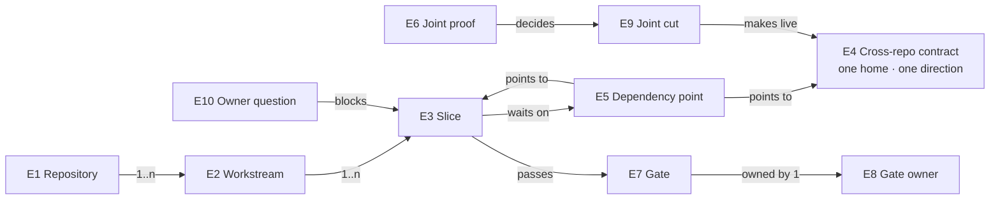

# Delivery orchestration: Specification

What must be observably true of the order of work. Each obligation traces to a need in the [Requirements](requirements.md). The order itself is the [Program Design](program-design.html); the proof is the [Verification Design](verification-design.md).

## What these obligations are about

| | Thing | Same one when | Belongs to | Always true | Its states |
|---|---|---|---|---|---|
| E1 | **Repository** | the same Git repository: agent-vm or codex-router | holds 1..n E2 | each has its own gates and its own Lead | — |
| E2 | **Workstream** | one ordered body of work in one repository, led by one Lead, governed by one design set | belongs to one E1; holds 1..n E3 | its slices follow the order in this design | not started → in progress → done |
| E3 | **Slice** | one reviewable unit of change that merges as one pull request | belongs to one E2; may depend on E3s and E4 versions | names the governing design rows it realizes; passes every E7 assigned to it before merging | planned → ready (dependencies met) → building → merged |
| E4 | **Cross-repository contract** | one shape that crosses the two repositories, identified by its name and version | has exactly one home repository and one generation direction; produced by one side, consumed by the other | a consumer parses the real producer's output in its tests | proposed → owner-approved → produced → consumed → live (at an E9) |
| E5 | **Dependency point** | one ordered pair: a slice that cannot be ready until a named slice has merged or a named contract version is produced | links one waiting E3 to one E3 or one E4 version | always points backward in the order; never forms a cycle | open → met |
| E6 | **Joint proof** | one named observation that exercises both repositories on one named target | belongs to the joint workstream; decides one or more E9 | runs the real producers and consumers on its path; no stand-in on the path it claims | planned → passing \| failing |
| E7 | **Gate** | one required check a slice passes before merging: a repository check command, a CI job, an independent review, or an E6 | owned by one E8 | its definition changes only with the repository owner's approval | — |
| E8 | **Gate owner** | the role accountable for running a gate and reading its result | — | one per gate | — |
| E9 | **Joint cut** | one deployment step where the producer and consumer of a changed E4 go live together | belongs to the joint workstream | happens only after its E6s pass; before it, every deployed path keeps the old contract version | planned → cut |
| E10 | **Owner question** | one decision only the owner can make, brought to them once | blocks the slices that depend on it | sent as an HTML page or through Sun as soon as it blocks; other slices continue | open → decided |

## Obligations

**R1 — Design before build.** (U1)
No slice (E3) starts building until the owner has approved this design and the governing design it realizes. Every slice names the design rows (R or U identifiers) it realizes.
- **Fail:** a slice building before approval; a slice that realizes no named design row.

**R2 — One complete order.** (U2)
Every slice in all three governing designs appears exactly once in the order, with its workstream, repository, dependency points (E5) and gates (E7). Every dependency point points to a slice or contract version earlier in the order, and the dependencies form no cycle.
- **Complete means delivered:** every slice reaches one terminal delivery barrier through its dependency points, so the order cannot be declared finished while any slice is unmerged.
- **Readable:** the order is also a page a person can open, with the picture and tables rendered, at desktop and phone width (U2).
- **Fail:** a slice missing from the order; a dependency on a later slice; a cycle; a slice that can stay unmerged when the order is declared finished; no readable page.

**R3 — The Fleet release first.** (U3)
No codex-router identity slice is ready before the Fleet release has shipped.
- **Fail:** a codex-router identity slice building while the Fleet release is unshipped.

**R4 — Contracts go live whole.** (U4)
A change to a cross-repository contract (E4) reaches a deployed path only at a joint cut (E9) where its producer and its consumer both speak the new version. Until that cut, every deployed path keeps the version it already speaks. No merged slice makes a deployed consumer receive a version it cannot parse.
- **Fail:** a deployed Switchboard refusing tokens because the issuer changed claims first, or the reverse; a merged slice that breaks a deployed consumer.

**R5 — One home, one direction, a real test.** (U5)
Each cross-repository contract has exactly one home repository and one generation direction. The consumer's tests parse output generated by the real producer at the contract's current version. A change on the producer side that the consumer can't parse fails the consumer's tests.
- **Fail:** a shape written by hand on both sides; a consumer test fed a fixture no producer generated; a contract with two homes.
- **Constraint:** no new gate is added to carry this (R9); the producer-against-consumer test runs inside each repository's existing test commands.

**R6 — The real joint path.** (U6)
Before a joint cut is called done, its joint proofs (E6) pass on their named targets with the real producers and consumers on the path. The joint proofs cover at least:
- a real bot and a real fleet session each getting a real token from the real issuer and making exactly one real effect through the Switchboard, on both Switchboard hosts;
- a real removal from Fleet central stopping that principal's next call, including after a Switchboard restart;
- a forged or stale token, a non-member and a collaborator each being refused, with nothing run;
- a person's admin command checked against their live session.
- **Fail:** a joint cut called done on two separate fixture suites; any stand-in on the path a joint proof claims.

**R7 — Owner questions go out fast.** (U7)
When an owner decision (E10) blocks a slice, the question reaches the owner, as an HTML page or through Sun, in the same working step it is found. Slices that don't depend on it continue.
- **Fail:** a blocking question held until the next report; independent slices idle while a question is open.

**R8 — Where heavy runs happen.** (U8)
Heavy test runs (workerd host suites, stress, socket, long-running) run on sunclaw. Agent VM boots run in CI only.
- **Fail:** a heavy run on the owner's Mac; a local VM boot.

**R9 — Gates as approved, each with one owner.** (U9)
Each repository's gates (E7) keep the definitions their owners approved; the only gate this work adds is the Switchboard core's type-check guard. Each gate has exactly one owner (E8).
- **Fail:** a new check step, CI job or check script; a gate nobody owns.

## Coverage

| U | E | R | Proof obligation |
|---|---|---|---|
| U1 | E3 | R1 | V1 every slice traces to approved design rows and starts after approval |
| U2 | E2 E3 E5 E7 | R2 | V2 the order is complete and acyclic |
| U3 | E2 E3 | R3 | V3 no codex-router identity slice before the release |
| U4 | E4 E9 | R4 | V4 no deployed consumer receives a version it can't parse |
| U5 | E4 | R5 | V5 every contract's consumer parses real producer output |
| U6 | E6 E9 | R6 | V6 the joint proofs pass on their targets before the cut |
| U7 | E10 | R7 | V7 each blocking question went out when found |
| U8 | E7 | R8 | V8 heavy runs on sunclaw; VMs in CI |
| U9 | E7 E8 | R9 | V9 gate definitions unchanged apart from the guard; one owner each |
