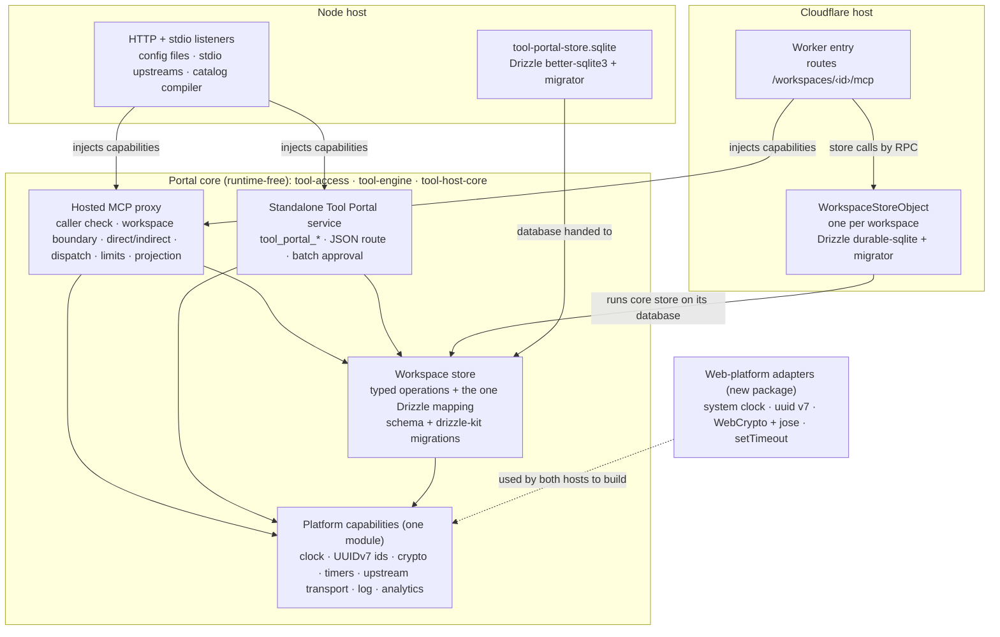
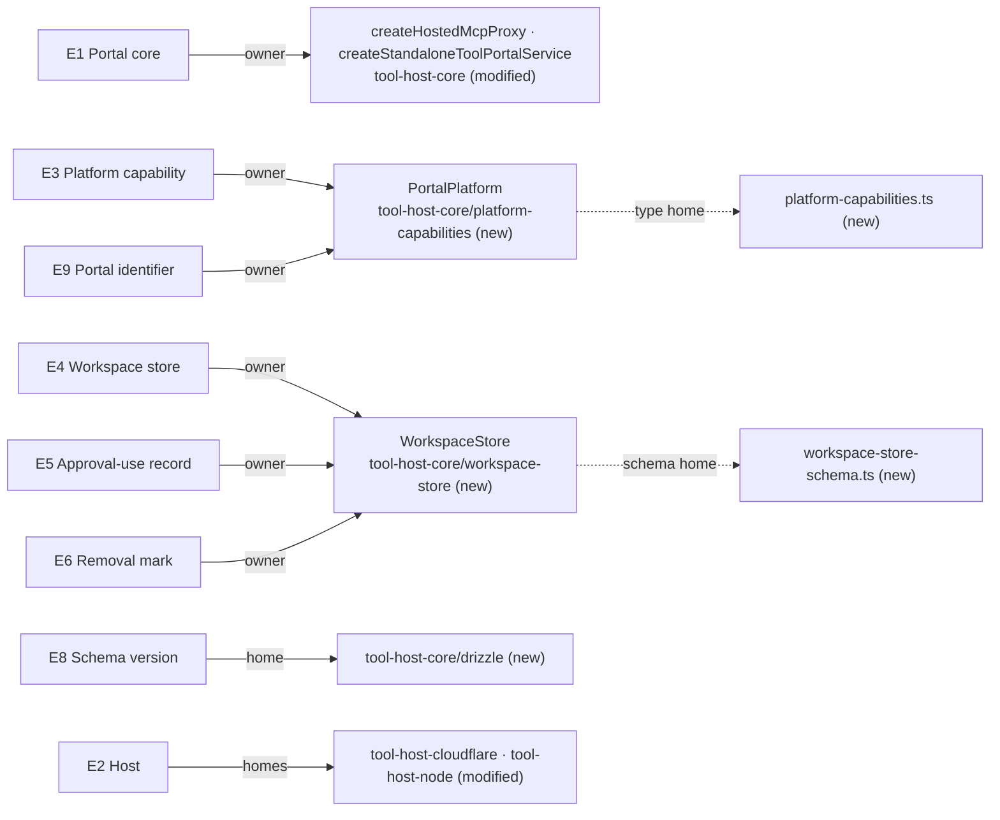
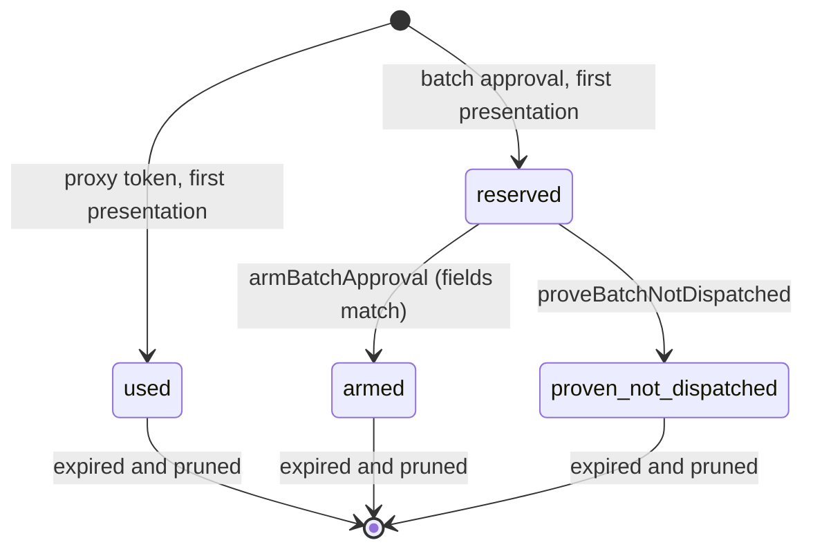

# Tool Portal remediation: Program Design

How the fixed Tool Portal code is built. The [Specification](specification.md) says what must be true (R1–R26); this document says which component owns each truth, what crosses each boundary, and where each obligation is observed. The [Verification Design](verification-design.md) chooses how each one is proven.

## The structure in one picture

One core holds every rule. Each host builds the platform capabilities for its runtime and hands them in. The workspace store's schema, migrations and every query live in the core; a host only opens the database.



**Selected structure:** the Fleet central shape in TypeScript. The core owns the rules, the schema, the migrations and the queries; the hosts own only platform construction, listeners, and opening the database. Both Tool Portal databases are synchronous Drizzle drivers, so the core takes a synchronous Drizzle database and uses real synchronous transactions; no statement-plan executor is needed.

## Today in #262

Every anchor below is at `2dfea38e`.

| Area | Today | Anchor |
|---|---|---|
| Core store port | Key-value: `read(key): Promise<unknown>`, `write(key, value)`, `transaction(decide)`. No schema, no migrations. | `tool-host-core/src/workspace-authority/models/workspace-authority-store.ts:2–13` |
| Cloudflare store | The `WorkspaceAuthority` Durable Object binds that port to `ctx.storage.get/put/transaction` on a class declared `new_sqlite_classes`. Records: `member:<clientId>`, `member-removal:<clientId>`, and one `approval-uses-v1` JSON blob (token id → expiry) capped at 512 KiB. | `tool-host-cloudflare/src/durable-workspace-authority/workspace-authority.ts:8–25`; `workspace-authority-state.ts:4–9`; `workspace-authority.ts:26–56`; `wrangler.example.jsonc:22–29` |
| Cloudflare composition | The Worker builds `createHostedMcpProxy` with verifier, configuration, secrets, analytics, transport, `clock: Date.now`, `newId: crypto.randomUUID`, and a DO stub per workspace from `idFromName(workspaceId)`. | `tool-host-cloudflare/src/index.ts:44–74` |
| Node composition | Never imports `tool-host-core`. Builds its own gateway from `tool-engine` with an in-memory `Map` operation store, an in-memory approval-token list (`createInMemoryApprovalTokenUse({ now: Date.now })`), and a separate standalone portal whose batch-approval replay records live in `tombstonesByTokenId` (a `Map`). Its service generation comes from configuration, so a restart with the same configuration forgets used approvals. | `tool-host-node/src/node-host-composition.ts:77–82, 195–213, 276–294`; `operation-records/node-operation-store.ts:47–115`; `standalone-tool-portal/standalone-batch-approval.ts:261–457`; `mcp-proxy-server/node-authenticated-http-server.ts:161` |
| Duplicated logic in Node | Configuration-to-providers mapping, the stdio upstream runtime (a copy of the engine's client cache, generation, retry and timeout logic), canonical JSON with `localeCompare`, and a request-operation bridge. | `host-configuration/mcp-config.ts:13` ↔ `tool-host-core/src/hosted-configuration/mcp-configuration.ts:4`; `stdio-upstream-runtime.ts:57` ↔ `tool-engine/src/upstream-mcp-connectors/upstream-mcp-client-runtime.ts:48`; `standalone-dispatch-identity.ts:19` |
| Ports with platform fallbacks | `props.now ?? Date.now()`, `props.jti ?? globalThis.crypto.randomUUID()`, `options.now ?? Date.now`, direct `globalThis.crypto.subtle` in seven core files, `setTimeout` in the engine's upstream timeout. | `tool-access/src/contracts/agent-proof.ts:96`; `person-proof.ts:119`; `tool-engine/src/mcp-gateway/signed-tokens/approval-token-signing.ts:39–40`; `agent-catalog-view-cache.ts:114`; `upstream-mcp-protocol.ts:286–299`; full list in the evidence for this design |
| Test-only production surfaces | `createVolatileWorkspaceAuthorityStore` exported from the core's public index; auth's `beforeFinalCheck` and `observeManagement` hooks (auth package, owned by the identity design). | `tool-host-core/src/index.ts:36`; `volatile-authority-store.ts:6` |

**Constraint degree:** compatibility-bound on the Tool Portal's three ways in, tool names, results and approval token bytes; platform-bound on Durable Object SQLite, `better-sqlite3`, Drizzle 0.45.2 and the MCP 2026-07-28 SDK; migration-bound on the workspace store, where the only consumers are the private test deployment and local runs (identity Program Design, "Changes and cutover").

**What stays authoritative:** the Tool Portal Specification's checks 1–17, today's limits, the approval token formats, workspace configuration, and the engine's dispatcher and gateway, which both hosts already reuse.

## The choices, and why

| Choice | Selected | Credible alternative | Why the selection wins | What would reopen it |
|---|---|---|---|---|
| Who writes the store's queries | The core owns typed operations and the one Drizzle implementation; hosts pass in a database (owner: "feet styel yes", "interface and mappign") | A store interface in the core implemented per host | One query per operation means a fix lands once; per-host queries are the drift the owner rejected | None inside this boundary; it is the owner's decision |
| The database type the core accepts | `BaseSQLiteDatabase<'sync', unknown, typeof workspaceStoreSchema>`; synchronous transactions | Fleet's generic executor-in-a-transaction port, or a prebuilt statement-plan executor that also fits D1 | Both Portal drivers are synchronous (`durable-sqlite` runs `transactionSync`; `better-sqlite3` is native sync), so real transactions express every decision directly; a plan executor would add an abstraction no Portal obligation needs | The Portal gaining an asynchronous database, such as D1 |
| Where the store runs on Cloudflare | Inside the workspace's Durable Object; the Worker calls it by RPC | The Worker opening D1 directly | The owner chose a Durable Object with Drizzle; one object per workspace gives isolation by construction and serializes each workspace's decisions | A measured per-workspace throughput limit |
| Where web-standard adapters live | A small new package used by both hosts | Each host writing its own adapters; or adapters inside the core | Two hosts copying adapters is duplication the owner forbids; adapters in the core would make it reach platform globals | Either host needing a different implementation of a capability |
| How the storage change cuts over | A hard replacement: a new Durable Object class, the old one deleted, and the approval signing keys rotated | Reading the old key-value rows into the new tables at first start | Only test deployments hold state (identity Program Design); rotation makes every old token fail verification, which satisfies R9 without keeping key-value code alive | A production deployment existing before cutover |
| Membership during this work | Store version 1 keeps today's membership and removal-intent records as tables; the identity cutover's version 2 drops them | Ship only the identity-target tables, with the identity cutover in the same release | Keeps the Tool Portal deployable after this work without waiting for codex-router | The owner choosing one combined Portal cutover |

## Where each thing lives

| E | Semantic owner | Package or module home | Schema/type home | Shape at each boundary | Disposition | Convention |
|---|---|---|---|---|---|---|
| E1 Portal core | the core composition roots `createHostedMcpProxy` and `createStandaloneToolPortalService` | `tool-access`, `tool-engine`, `tool-host-core` (modified) | the packages' public indexes | the host calls one composition root per server kind with `PortalPlatform` and its server configuration | derived | Zod at boundaries; discriminated unions (`AGENTS.md:415–419`) |
| E2 Host | the host composition (`tool-host-cloudflare` Worker entry and `WorkspaceStoreObject`; `tool-host-node` startup) | `tool-host-cloudflare`, `tool-host-node` (modified) | none: a host defines no shared type | passes `PortalPlatform` and a store access in; receives `HostedMcpProxy.handle(request): Promise<Response>` | derived | — |
| E3 Platform capability | `PortalPlatform` | `tool-host-core/src/platform-capabilities` (new) | `tool-host-core/src/platform-capabilities/models/platform-capabilities.ts` (new) | `PortalPlatform`, below | derived | interfaces with branded values |
| E4 Workspace store | `WorkspaceStore` (the core's Drizzle implementation) | `tool-host-core/src/workspace-store` (new; replaces `workspace-authority`'s key-value store) | `workspace-store/models/workspace-store.ts` (operations and results); `workspace-store/workspace-store-schema.ts` (Drizzle tables) | `WorkspaceStore` operations, below; on Cloudflare the same operations cross Durable Object RPC with structured-clone values | persisted | Drizzle `sqlite-core` schema; Zod parse of every row read |
| E5 Approval-use record | `WorkspaceStore` | as E4 | tables `proxy_token_use` and `batch_approval_use`; domain type `ApprovalUse` | `ApprovalPresentation` result, below | persisted | discriminated union |
| E6 Removal mark | `WorkspaceStore` | as E4 | tables `removal_mark`, `removal_notice` (store version 2); the notice's wire contract stays `RemovalNotice` in the identity design's Rust home | `RemovalNoticeRecording` result, below | persisted | discriminated union |
| E8 Schema version | `drizzle-kit` output, applied by each host's migrator | `tool-host-core/drizzle/` (new, checked in, published in the package files) | the migration journal `drizzle/meta/_journal.json` | SQL files for `better-sqlite3`; the generated `migrations.js` bundle for the Durable Object | persisted | drizzle-kit 0.31.10 (the version paired with drizzle-orm 0.45.2) |
| E9 Portal identifier | `PortalIdSource` | `tool-host-core/src/platform-capabilities` | `Uuid7` branded string, parsed by `uuid7Schema` | every minted id, as a canonical lower-case UUID string | derived | branded type with a Zod refinement on version 7 |
| E10 Controlled clock | the test host | test fixtures in each package (never production entries) | `PortalClock` | supplied as `platform.clock` | derived | — |
| E11 Check gate | the owner | `scripts/run-check-gate.ts`, `vitest.config.ts`, `.github/workflows/` (restored to `38569fca`) plus one guard step | — | — | — | — |
| E12 Known defect | the component named in "The defects and their owners" | as listed there | — | — | — | — |
| Workspace (Tool Portal E2) | workspace configuration | existing | existing | `workspaceId` from the address `/workspaces/‹id›/mcp` on Cloudflare; one configured portal per Node host | existing | existing |
| Approval (Tool Portal E7) | `tool-engine` approval signing and verification (existing) | `tool-engine/src/mcp-gateway/signed-tokens`; `standalone-tool-portal` batch approval (moved from `tool-host-node`) | existing token formats, unchanged bytes | the approval token string in call input or MCP metadata | derived | existing |
| Removal notice (identity E12) | the identity design's organization authority (sends); `WorkspaceStore` (keeps) | identity design | `RemovalNotice` (identity contract home) | HTTP JSON to the removal receiver route | persisted | owned by the identity design |



## Components and who owns what

| Component | Owns | Home | Consumed by | Changes when |
|---|---|---|---|---|
| **Hosted MCP proxy** | every rule on the MCP proxy way in: caller check, workspace boundary, persona narrowing, `direct`/`indirect`, search/describe, dispatch, approval checks, limits, projection, redaction, the analytics data point | `tool-host-core/src/hosted-mcp-proxy` (modified) | both hosts | an MCP proxy rule changes |
| **Standalone Tool Portal service** | the standalone Tool Portal's operations and its signed batch approval: challenge, verification, reservation, arming, canonical batch fingerprint | `tool-engine/src/standalone-tool-portal` (modified: absorbs `standalone-batch-approval`, `standalone-batch-dispatch` decisions and `standalone-dispatch-identity` from `tool-host-node`) | the Node host's standalone routes | a standalone rule changes |
| **Workspace store** | E4–E6: every approval-use, membership, removal-intent and removal-mark record; their atomic decisions; retention pruning | `tool-host-core/src/workspace-store` (new) | the proxy, the standalone service, the removal receiver | the store's schema or a decision rule changes |
| **Platform capabilities** | the one list of what a host must supply, and the value types that cross it | `tool-host-core/src/platform-capabilities` (new) | every core component; both hosts | a capability is added or its contract changes |
| **Upstream MCP runtime** | client cache, generations, retries, pagination, timeouts and redaction for every upstream server, remote or stdio | `tool-engine/src/upstream-mcp-connectors` (modified: takes `timers`; the Node stdio copy is deleted) | the proxy | an upstream protocol rule changes |
| **Web-platform adapters** | building `PortalPlatform` values from web-standard APIs: system clock, UUIDv7 from `uuid@11.1.1` `v7()`, WebCrypto plus `jose` for signatures, `setTimeout` timers | `packages/tool-host-web-platform` (new) | both hosts only | a web API or adapter library changes |
| **Cloudflare host** | the Worker's routing, Cloudflare bindings, `WorkspaceStoreObject` (opens Durable Object SQLite, runs the migrator inside `blockConcurrencyWhile`, exposes the store's operations by RPC) | `tool-host-cloudflare` (modified) | Cloudflare | a Cloudflare binding or runtime API changes |
| **Node host** | HTTP and stdio listeners, configuration files, the stdio process transport for upstream servers, the catalog TypeScript compiler, opening `tool-portal-store.sqlite` with `better-sqlite3` and running the migrator | `tool-host-node` (modified: the parallel portal, Map stores and copied runtime are deleted) | agent-vm configuration validation, `mcp-portal` until it is deleted, the Portal SDK's tests | a Node API or a listener changes |

**Allowed dependency edges:** hosts → core; hosts → web-platform adapters; web-platform adapters → `tool-host-core` (types only); core packages → each other in the existing order (`tool-access` ← `tool-engine` ← `tool-host-core`); core → `drizzle-orm` and `drizzle-orm/sqlite-core` only.

**Forbidden edges, and what catches them:**

| Forbidden | Caught by |
|---|---|
| core → `node:*`, `cloudflare:*`, a Drizzle driver module (`drizzle-orm/durable-sqlite`, `drizzle-orm/better-sqlite3`, `drizzle-orm/d1`), `better-sqlite3`, `jose`, `uuid` | the approved type-check guard (R11): those modules and their types are not resolvable in the guard configuration |
| core → `Date.now`, no-argument `new Date()` or `Date()`, `crypto`, `setTimeout`, `setInterval`, `AbortSignal.timeout`, `performance`, `Math.random` | the guard's library set: these names don't exist in it, so each use is a compile error |

### The type-check guard

The guard is one `tsconfig.portable.json` per core package (`tool-access`, `tool-engine`, `tool-host-core`), run by the existing `typecheck` step. An experiment against the pinned dependencies showed it works (`c-drizzle-drivers/experiment-2/report-2.md`):

- **`noLib: true`, `types: []`.** The program sees only the libraries listed next.
- **A checked-in standard library.** TypeScript's own ES2024 library files, except the ES5 file, which is replaced by a copy with four members removed: `Date.now`, `Date`'s no-argument constructor, `Date`'s callable form, and `Math.random`. A small TypeScript generator in `tool-host-core` derives the copy from the pinned TypeScript release, so an upgrade regenerates it rather than hand-editing it.
- **A checked-in web-standard declaration file.** The declarations for `Request`, `Response`, `Headers`, `URL`, `ReadableStream`, `TextEncoder`, `TextDecoder`, `AbortSignal` and `AbortController`, with their referenced types (about 1,400 lines), extracted from the pinned `lib.dom.d.ts`, with `AbortSignal.timeout` removed. Same generator.
- **`skipLibCheck: true`.** With it off, the pinned Drizzle and MCP server declarations report 85 errors, because they name Node's `Buffer` in blob columns and `ReadBuffer`. The cost: an unresolved type inside a dependency's declarations behaves as `any`. The core's own code is still fully checked.
- **A declaration inventory.** `types: []` doesn't stop an explicit `/// <reference types="node" />` or a transitive Workers reference. So the guard run also lists the declaration files the program loaded (`tsc --listFilesOnly`) and fails if any belongs to `@types/node`, `@cloudflare/workers-types` or `workerd`. This is part of the same approved guard, not a separate gate.

What the guard cannot catch: a deliberate cast or `any`, `eval`, and effects inside a dependency at runtime. The conformance and determinism observations cover those behaviourally.
| host → a rule listed under the hosted proxy or standalone service | the conformance suite: identical outcomes on both hosts (V1) |
| any module other than `WorkspaceStore` writing a store table | the store's tables are not exported; only `WorkspaceStore` operations are |

## Platform capabilities: the one list

Every capability is required; no field is optional and no core code supplies a default. Values crossing this boundary are branded so a raw `number` or `string` cannot stand in for them.

```ts
// tool-host-core/src/platform-capabilities/models/platform-capabilities.ts
export type EpochMilliseconds = number & { readonly __brand: 'EpochMilliseconds' };
export type Uuid7 = string & { readonly __brand: 'Uuid7' };

export interface PortalClock {
	readonly nowMs: () => EpochMilliseconds;
}

export interface PortalIdSource {
	/** Mints one UUIDv7. Never another version. */
	readonly nextId: () => Uuid7;
}

export type SignatureVerification =
	| { readonly kind: 'verified'; readonly protectedHeader: Readonly<Record<string, unknown>>; readonly payload: unknown }
	| { readonly kind: 'rejected'; readonly reason: 'malformed' | 'bad-signature' | 'unknown-key' | 'unsupported-algorithm' }
	| { readonly kind: 'keys-unavailable'; readonly reason: 'fetch-failed' | 'invalid-key-set' };

export interface PortalCrypto {
	readonly sha256: (bytes: Uint8Array) => Promise<Uint8Array>;
	readonly hmacSha256Sign: (props: { readonly secret: Uint8Array; readonly data: Uint8Array }) => Promise<Uint8Array>;
	readonly hmacSha256Verify: (props: {
		readonly secret: Uint8Array;
		readonly data: Uint8Array;
		readonly signature: Uint8Array;
	}) => Promise<boolean>;
	/** Verifies a compact JWS signature only. Claim checks (exp, aud, iss) stay in the core, against PortalClock. */
	readonly verifyJwsSignature: (props: {
		readonly compactJws: string;
		readonly keySetUrl: string;
	}) => Promise<SignatureVerification>;
}

export type TimerOutcome = { readonly kind: 'elapsed' } | { readonly kind: 'aborted' };

export interface PortalTimers {
	/** Resolves when delayMs has passed on the host's timer, or when signal aborts. */
	readonly wait: (props: { readonly delayMs: number; readonly signal: AbortSignal }) => Promise<TimerOutcome>;
}

export interface PortalPlatform {
	readonly clock: PortalClock;
	readonly ids: PortalIdSource;
	readonly crypto: PortalCrypto;
	readonly timers: PortalTimers;
	readonly log: (event: ObservationLog) => void; // existing shape, tool-host-core/hosted-mcp-proxy/models/observation-log.ts
	readonly analytics: AnalyticsSink; // existing shape, tool-host-core/call-analytics/models/call-analytics.ts
	readonly createUpstreamMcpTransport: UpstreamTransportFactory; // existing shape, tool-engine upstream connectors
}
```

**Representative caller.** The engine's upstream timeout today races `setTimeout` (`upstream-mcp-protocol.ts:286–299`). After the change:

```ts
const outcome = await Promise.race([
	callPromise.then((result) => ({ kind: 'settled', result }) as const),
	props.timers.wait({ delayMs: props.timeoutMs, signal: props.signal }).then((timer) =>
		timer.kind === 'elapsed' ? ({ kind: 'timed-out' } as const) : ({ kind: 'aborted' } as const),
	),
]);
```

In a test, a controlled timer resolves `elapsed` exactly when the controlled clock passes the deadline.

**What moves behind these capabilities:**

| Today | After |
|---|---|
| `props.now ?? Date.now()` in agent and person proof verification | `platform.clock.nowMs()`; claim checks stay in `tool-access` |
| `jose` signature verification inside `tool-access/contracts` | `platform.crypto.verifyJwsSignature`; `jose` moves to the web-platform adapters |
| `globalThis.crypto.subtle.digest` in seven core files | `platform.crypto.sha256` |
| HMAC import/sign/verify for approval and bearer tokens | `platform.crypto.hmacSha256Sign` / `hmacSha256Verify` |
| `props.jti ?? crypto.randomUUID()`, `newId: crypto.randomUUID`, Node `randomUUID()` receipt and correlation ids | `platform.ids.nextId()` (UUIDv7) |
| `setTimeout` in the engine's upstream timeout | `platform.timers.wait` |
| `options.now ?? Date.now` in the agent catalog cache, and the omitted `now` at `workspace-engine.ts:157` and `node-host-composition.ts:203` | `platform.clock` passed explicitly |

Secrets stay random secret material: signing keys and token entropy are not identifiers and are not UUIDs (Specification R12).

## The workspace store

### Operations and results

The core owns this interface and its only implementation. Every result is a closed union; a storage failure is its own variant, never a business outcome.

```ts
// tool-host-core/src/workspace-store/models/workspace-store.ts
export type PrincipalKey = string & { readonly __brand: 'PrincipalKey' };
export type ApprovalTokenId = string & { readonly __brand: 'ApprovalTokenId' };

export type StoreFailure = { readonly kind: 'store-unavailable'; readonly reason: 'database-error' | 'migration-incomplete' };

export type ProxyTokenPresentation =
	| { readonly kind: 'first-use' }
	| { readonly kind: 'already-used' }
	| { readonly kind: 'saturated' }
	| StoreFailure;

export interface BatchReservation {
	readonly tokenId: ApprovalTokenId;
	readonly principal: PrincipalKey;
	readonly batchFingerprint: `sha256:${string}`;
	readonly operationIds: readonly Uuid7[];
	readonly serviceGeneration: string;
	readonly expiresAtMs: EpochMilliseconds;
}

export type BatchReservationResult =
	| { readonly kind: 'reserved'; readonly reservation: BatchReservation }
	| { readonly kind: 'already-consumed' }
	| { readonly kind: 'ambiguous'; readonly reason: 'dispatch-armed' }
	| { readonly kind: 'saturated' }
	| StoreFailure;

export type BatchArmResult =
	| { readonly kind: 'armed' }
	| { readonly kind: 'not-dispatched'; readonly reason: 'consumed-without-dispatch' }
	| { readonly kind: 'ambiguous'; readonly reason: 'dispatch-armed' }
	| StoreFailure;

export type MembershipRead =
	| { readonly kind: 'member'; readonly persona: string }
	| { readonly kind: 'removed' }
	| { readonly kind: 'not-member' }
	| StoreFailure;

export type RemovalNoticeRecording =
	| { readonly kind: 'recorded'; readonly highestRevision: number }
	| { readonly kind: 'already-recorded'; readonly highestRevision: number }
	| StoreFailure;

export interface WorkspaceStore {
	readonly presentProxyToken: (props: {
		readonly tokenId: ApprovalTokenId;
		readonly principal: PrincipalKey;
		readonly expiresAtMs: EpochMilliseconds;
	}) => Promise<ProxyTokenPresentation>;
	readonly reserveBatchApproval: (reservation: BatchReservation) => Promise<BatchReservationResult>;
	readonly armBatchApproval: (reservation: BatchReservation) => Promise<BatchArmResult>;
	readonly proveBatchNotDispatched: (reservation: BatchReservation) => Promise<boolean | StoreFailure>;
	// store version 1 (today's records, removed by the identity cutover):
	readonly readMembership: (principal: PrincipalKey) => Promise<MembershipRead>;
	readonly setMembership: (props: SetMembershipProps) => Promise<MembershipWrite>;
	readonly beginRemoval: (props: BeginRemovalProps) => Promise<RemovalIntentResult>;
	readonly completeRemoval: (props: CompleteRemovalProps) => Promise<RemovalIntentResult>;
	// store version 2 (added by the identity cutover):
	readonly recordRemovalNotice: (notice: RemovalNoticeInput) => Promise<RemovalNoticeRecording>;
	readonly readRemovalMark: (subject: PrincipalKey) => Promise<{ readonly kind: 'none' } | { readonly kind: 'mark'; readonly highestRevision: number } | StoreFailure>;
}
```

`SetMembershipProps`, `MembershipWrite`, `BeginRemovalProps`, `CompleteRemovalProps` and `RemovalIntentResult` keep today's fields and variants from `workspace-authority-state.ts` and `agent-retirement.ts` (`member | removed`; `pending | complete`; `unlink | disable`; `requestId`), now as closed unions. `RemovalNoticeInput` is parsed from the identity design's `RemovalNotice` at the receiver.

**Construction:**

```ts
export type WorkspaceStoreDatabase = BaseSQLiteDatabase<'sync', unknown, typeof workspaceStoreSchema>;

export function createWorkspaceStore(props: {
	readonly database: WorkspaceStoreDatabase;
	readonly clock: PortalClock;
	readonly limits: WorkspaceStoreLimits; // today's caps, as row counts
}): WorkspaceStore;
```

Both `drizzle(ctx.storage, { schema })` (Durable Object) and `drizzle(sqliteFile, { schema })` (`better-sqlite3`) produce a `WorkspaceStoreDatabase` without a cast; the C experiment confirmed the union-mode type and is confirming the `'sync'` type (see "Open evidence").

### The tables (for the owner's approval, RD1)

**Store version 1** (this work):

| Table | Columns | Keys and checks | Holds |
|---|---|---|---|
| `proxy_token_use` | `token_id` text not null · `principal` text not null · `expires_at_ms` integer not null · `recorded_at_ms` integer not null | primary key (`token_id`, `principal`); index on `expires_at_ms` | E5 for the MCP proxy approval token |
| `batch_approval_use` | `token_id` text primary key · `principal` text not null · `state` text not null · `batch_fingerprint` text not null · `operation_ids` text not null (JSON array of UUIDv7) · `service_generation` text not null · `expires_at_ms` integer not null · `recorded_at_ms` integer not null | `state` check in (`reserved`, `armed`, `proven-not-dispatched`); index on `expires_at_ms` | E5 for the standalone batch approval |
| `membership` | `principal` text primary key · `state` text not null · `persona` text null | `state` check in (`member`, `removed`); `persona` not null when `state = 'member'` | Tool Portal E4 Membership, as today |
| `membership_removal` | `principal` text primary key · `status` text not null · `operation` text not null · `request_id` text not null | `status` check in (`pending`, `complete`); `operation` check in (`unlink`, `disable`) | today's agent-retirement intents |

**Store version 2** (the identity cutover, sequenced by the delivery orchestration):

| Change | Detail |
|---|---|
| drop `membership`, `membership_removal` | membership and agent management leave the Tool Portal (identity Program Design) |
| re-key `principal` | from the agent client id to the identity design's canonical `principal`; existing approval-use rows are deleted, which is safe because the cutover rotates approval keys |
| add `removal_mark` | `subject` text primary key · `highest_revision` integer not null · `received_at_ms` integer not null |
| add `removal_notice` | `notice_id` text primary key · `subject` text not null · `removal_revision` integer not null · `received_at_ms` integer not null; index on `received_at_ms` |

No column has a database default: every timestamp is written from `PortalClock` and every identifier from `PortalIdSource`, so no wall clock enters storage. Rows are parsed with Zod when read; a row that does not parse fails closed as `store-unavailable` with the field named in the log.

### How each decision stays atomic

Each operation runs as one synchronous Drizzle transaction on the store's database. Inside it, queries use `.get()`, `.all()` and `.run()`; nothing inside awaits.

| Operation | Inside one transaction | Why it holds |
|---|---|---|
| `presentProxyToken` | delete expired `proxy_token_use` rows; count unexpired rows and answer `saturated` at the cap; `insert … on conflict do nothing returning token_id` | the insert's returning row decides first use; a concurrent second insert returns nothing |
| `reserveBatchApproval` | delete expired rows; read the row for `token_id`; if present answer from its `state` (`armed` → `ambiguous`, otherwise `already-consumed`); else check the cap and insert as `reserved` | the read and insert are one transaction |
| `armBatchApproval` | `update … set state = 'armed' where token_id = ? and state = 'reserved' and <reservation fields match> returning token_id`; if no row, read it to answer `ambiguous` or `not-dispatched` | the conditional update moves `reserved` to `armed` at most once |
| `recordRemovalNotice` (v2) | insert into `removal_notice` on conflict do nothing; upsert `removal_mark` with `highest_revision = max(existing, new)`; prune notices older than 61 minutes by `PortalClock` | the mark is written with `max`, so a lower or repeated notice cannot lower it |

**Why this is atomic on each host:**

- **Durable Object:** Drizzle's `durable-sqlite` transaction runs inside `ctx.storage.transactionSync`, and the object processes one call at a time.
- **Node:** `better-sqlite3` transactions run with `behavior: 'immediate'`, so a second process using the same file waits for the write lock. The file is opened as `oauth-broker` opens its catalog (`oauth-credential-catalog.ts:38`): WAL, `foreign_keys = ON`, `synchronous = FULL`, a busy timeout.

### Where the database lives and how it is migrated

| | Cloudflare | Node |
|---|---|---|
| Database | `WorkspaceStoreObject`, a new Durable Object class, one per workspace (`idFromName(workspaceId)`), SQLite-backed | `<stateDirectory>/tool-portal-store.sqlite`, one per configured portal |
| Opened by | the object's constructor: `drizzle(ctx.storage, { schema: workspaceStoreSchema })` | Node startup: `new Database(path)` with the pragmas above, then `drizzle(file, { schema })` |
| Migrations | `migrate(db, migrations)` from `drizzle-orm/durable-sqlite/migrator`, inside `ctx.blockConcurrencyWhile`, using the core's generated `migrations.js` | `migrate(db, { migrationsFolder })` from `drizzle-orm/better-sqlite3/migrator`, before the listener starts, using the core's published `drizzle/` folder |
| History | `__drizzle_migrations` inside the object's SQLite; the only mechanism for that database | `__drizzle_migrations` in the file; the only mechanism for that database |
| A migration fails | the constructor throws; every call to that workspace fails closed with `store-unavailable` until a fixed deployment | startup fails; no listener opens |
| Configuration | `wrangler` migration tag `v3`: `new_sqlite_classes: ["WorkspaceStoreObject"]`, `deleted_classes: ["WorkspaceAuthority"]` | Node host configuration gains a required `stateDirectory` (RD6) |

`drizzle-kit` is configured once, in the core: `dialect: 'sqlite'`, `driver: 'durable-sqlite'`, `schema: './src/workspace-store/workspace-store-schema.ts'`, `out: './drizzle'`. That one command writes both the SQL files the Node migrator reads and the `migrations.js` bundle the Durable Object imports. `drizzle-kit` 0.31.10 is a new development dependency of `tool-host-core`; the owner approves it with the schema (RD1).

## How a call works now

### An MCP proxy call on Cloudflare

```mermaid
sequenceDiagram
  participant C as Client
  participant W as Worker (Cloudflare host)
  participant P as Hosted MCP proxy (core)
  participant O as WorkspaceStoreObject (Cloudflare host)
  participant S as WorkspaceStore (core)
  participant U as Upstream MCP server
  C->>W: POST /workspaces/‹id›/mcp
  W->>P: handle(request) with PortalPlatform + store access
  P->>P: verify token: platform.crypto.verifyJwsSignature, then claims vs platform.clock
  P->>O: readMembership(principal) [RPC]
  O->>S: readMembership
  S-->>O: MembershipRead
  O-->>P: MembershipRead
  alt approval token present
    P->>O: presentProxyToken(tokenId, principal, expiresAtMs) [RPC]
    O->>S: one transaction
    S-->>P: first-use | already-used | saturated | store-unavailable
  end
  P->>U: tools/call via platform.createUpstreamMcpTransport, timeout via platform.timers
  U-->>P: result
  P->>P: project + redact; platform.analytics.write(data point)
  P-->>W: Response
  W-->>C: Response
```

| Edge | Status | Shape |
|---|---|---|
| Worker → proxy: `clock: Date.now`, `newId: crypto.randomUUID` (`index.ts:60–61`) | **changed**: `PortalPlatform` from the web-platform adapters | `PortalPlatform` |
| proxy → workspace object: `workspaces.forWorkspace(id)` → `WorkspaceAuthority` (`hosted-mcp-proxy-ports.ts:15–20`) | **changed**: `WorkspaceStore` operations on `WorkspaceStoreObject` | `WorkspaceStore` results above |
| object → storage: `ctx.storage.get/put` (`workspace-authority.ts:14–21`) | **removed** | — |
| object → storage: Drizzle transaction on Durable Object SQLite | **added** | tables above |
| token verification → `jose` inside `tool-access` | **changed**: `platform.crypto.verifyJwsSignature`, claims in the core | `SignatureVerification` |
| one-use refused when the use cannot be recorded (Tool Portal check 13) | **intentionally unchanged** | `store-unavailable` refuses the call; nothing runs |

### An MCP proxy call on Node

Today the Node host builds its own gateway (`node-host-composition.ts:51–295`). After the change it calls the same `createHostedMcpProxy` with its own `PortalPlatform` and a `WorkspaceStore` opened on `tool-portal-store.sqlite`. The sequence is the one above, with the RPC hop replaced by an in-process call.

| Edge | Status |
|---|---|
| Node gateway composition (`node-host-composition.ts:276–294`) | **removed**: replaced by the hosted proxy |
| in-memory approval token list (`node-host-composition.ts:82`) | **removed**: `presentProxyToken` on the file store |
| Node operation store `Map` (`node-operation-store.ts:53`) | **removed**: the proxy's request-local operation entries, as on Cloudflare (`request-operation-entries.ts:8`) |
| Node stdio upstream runtime copy (`stdio-upstream-runtime.ts`) | **removed**: the engine's upstream runtime with a Node stdio transport from the host |
| configured bearer credentials, listener rotation and drain (`node-authenticated-http-server.ts`) | **intentionally unchanged** in this work: the credential kinds each way in accepts are defined by the Tool Portal and identity designs; the bearer check's decision logic moves into the core's caller check, and the listener keeps only rotation and drain mechanics |

### A standalone batch approval on Node

```mermaid
sequenceDiagram
  participant C as Portal SDK client
  participant N as Node listener
  participant T as Standalone service (core)
  participant S as WorkspaceStore (core, file)
  C->>N: tool_portal_call (approval token in metadata or header)
  N->>T: call with PortalPlatform
  T->>T: verify HMAC via platform.crypto; fingerprint via canonical bytes (code-unit key order)
  T->>S: reserveBatchApproval
  S-->>T: reserved | already-consumed | ambiguous | saturated | store-unavailable
  T->>S: armBatchApproval
  S-->>T: armed | not-dispatched | ambiguous
  T->>T: dispatch through the one dispatcher
  T-->>N: Portal result
  N-->>C: result
```

| Edge | Status |
|---|---|
| `tombstonesByTokenId` `Map` (`standalone-batch-approval.ts:315`) | **removed**: `batch_approval_use` in the file |
| stale service generation refused (Tool Portal check 6) | **intentionally unchanged** |
| `localeCompare` key sort (`standalone-dispatch-identity.ts:19`) | **changed**: code-unit order (R24) |
| batch approval logic in `tool-host-node` | **moved** into the standalone service in the core |

## Approval-use lifecycle



| From | Event | Result |
|---|---|---|
| used | the same proxy token presented again | `already-used` |
| reserved, armed or proven-not-dispatched | the same batch approval presented again | `already-consumed`, or `ambiguous` when armed |
| armed | `armBatchApproval` again | `ambiguous` |
| armed | `proveBatchNotDispatched` | `false`: an armed approval may have taken effect |
| any | host restart | unchanged: rows are in the database |
| any | its expiry passes | pruned on the next write in that workspace |

## When things fail

| Failure | Detected by | What happens | Recovery owner |
|---|---|---|---|
| The database errors during a store operation | the store's transaction throws | the operation returns `store-unavailable`; the proxy refuses the call before dispatch, as when a use cannot be recorded today | the host's operator; no retry inside the store |
| A migration fails | the Durable Object constructor or Node startup | Cloudflare: that workspace refuses every call; Node: the process does not listen | a fixed deployment |
| The host restarts mid-call after arming | — | the client's request ends with the process; the record stays `armed`; a retry with the same approval gets `ambiguous` and nothing runs | the client decides; the Portal never replays |
| Two Worker copies present the same token at once | both reach the one workspace object, which runs one call at a time | exactly one `first-use` | the store |
| Two Node processes share one store file | `behavior: 'immediate'` transactions | the second waits for the write lock, then sees the first's row | the store |
| A removal notice arrives late with a lower revision (v2) | `max` in the upsert | the mark keeps the higher revision; the receiver acknowledges `already-recorded` or `recorded` | the store |
| Signature keys cannot be fetched | `verifyJwsSignature` returns `keys-unavailable` | the call is refused as unauthenticated | the host's operator |
| A store row fails to parse | Zod at read | `store-unavailable`, field named in the log; never treated as "no record" | the host's operator |

## The defects and their owners

| R | Owner | Change |
|---|---|---|
| R20 Google timeout kind | `tool-access` access assessor (`access-assessor.ts:166–172`) | choose the Google command schema by the configured kind before parsing, so a quick command's schema has no `timeoutMs` |
| R21 one call's failure stays its own | `tool-engine` gateway call approval (`gateway-call-approval.ts:36`, `portal-tool-handlers.ts:80–91`) | assess each call separately (`Promise.allSettled` semantics), returning a per-call result union; only a call whose own assessment failed is refused |
| R22 advertised schema | `tool-engine` portal input schemas (`portal-input-schemas.ts:22`) | publish `callExecutionInputSchema`, the schema the handler parses |
| R23 origins at load | Node host configuration schema (`node-host-config.ts:26`) | the schema applies today's origin rules (`http-request-policy.ts:50`), so load fails with the field named |
| R24 canonical order | the core's one canonical encoder (the engine's `canonicalDispatchJson`) | sort keys by code-unit order; the Node copy is deleted |
| R25 transport extra | Portal SDK TypeScript transport (`node-tool-portal-mcp-transport.ts:123`) | forward every callback argument |
| R26 large requests | the hosted proxy's body reading (new `request-body` module in `tool-host-core`), with a host-supplied body source | see "Large requests" below |

### Large requests (R26)

**What the evidence shows.** The MCP SDK's handler (`@modelcontextprotocol/server` 2.3.1, `createMcpHandler.ts:486–518, 958`) clones every POST, reads it as complete text up to `maxRequestBodySize`, and answers an overrun with 413. The Tool Portal sets 4 MiB (`hosted-mcp-proxy.ts:97`). Nothing in that path returns 502, and the Worker's own catch returns 503 (`tool-host-cloudflare/src/index.ts:77–79`). So the deployed 502 came from somewhere the deployed check never recorded: it keeps only the status and drops headers and body (`deployed-portal-client.ts:96–139`). The handler accepts a `parsedBody` option that skips its own body read, cap and clone (`createMcpHandler.ts:124`). On Cloudflare the account's request ceiling is 100 MB on Free and Pro plans, an isolate has 128 MB shared by concurrent requests, and a Worker's `/tmp` is memory, not disk.

**The design.**

1. **The core owns body reading.** A `request-body` module reads the request body as a stream and parses it incrementally into the JSON-RPC message, with no clone and no retained raw text. The hosted proxy then calls the SDK handler with `parsedBody`, so the SDK's 4 MiB cap and clone are no longer on the path. Malformed JSON keeps today's protocol error and runs nothing.
2. **The host supplies where the bytes go while they are read.**
   - **Cloudflare:** the stream goes straight into the incremental parser; there is no disk to spill to.
   - **Node:** a body larger than a small in-memory threshold is first written to a temporary file under `stateDirectory`, then parsed from that file as a stream. The file is removed on completion, error or abort.
3. **No Portal size refusal.** The Portal adds no byte cap of its own. What remains is the platform's: Cloudflare's account request ceiling answers above it with its own 413, and the parsed message must fit in the isolate's memory.
4. **First, decide the 502.** Before building, one correlated deployed observation is taken on the private test Worker: the raw response with status, headers, body and CF-Ray, plus the Worker invocation outcome from `wrangler tail`, for a request just over 4 MiB. If it shows the 502 comes from outside the Worker, step 1 does not fix it, and the cause becomes its own finding.

**The owner's tradeoff (RD7).** With no Portal cap, one request whose parsed form approaches the isolate's memory can end the other calls running in that isolate at the time. Incremental parsing also needs a streaming JSON parser, which is a new dependency. The options are in the Requirements, RD7.

## Clean build and gates

| Item | Design |
|---|---|
| MCP SDK generations | Product code uses only the 2026-07-28 SDK (`@modelcontextprotocol/{core,server,client,node}`). The 1.x SDK leaves product code with the deletion of `@agent-vm/mcp-portal` and `@agent-vm/tool-portal` at agent-vm's cutover (Tool Portal check 12) and from `gateway-runtime`'s runtime dependencies. Tests that must speak to a 2025-era client or server use one fixture module, per RD3. |
| esbuild, jose, vitest | One version each across the workspace: esbuild 0.27.7 (the version master already uses), jose 6.2.12 (Better Auth's) in the web-platform adapters and auth only, vitest 4.1.5 with the same range everywhere. |
| Miniflare | No direct alpha pin. Hosts' tests use the Miniflare that the chosen `wrangler` release depends on; if every current `wrangler` release depends on an alpha, that is recorded as an owner decision rather than silently kept. |
| Gates | `scripts/run-check-gate.ts`, `vitest.config.ts`, root `package.json` scripts and `.github/workflows/` return to `38569fca`. The 26 scripts #262 added go (RD5). The one added gate is the core type-check guard: a `tsconfig.portable.json` per core package, run by the existing `typecheck` step. |

## Security and the other qualities

| Quality | Owner | Mechanism | Fails how | Observed at |
|---|---|---|---|---|
| One-use approvals | `WorkspaceStore` | transactional first-use insert; durable rows | refuse when the use cannot be recorded | concurrent-presentation and restart seams (V7, V8) |
| Workspace isolation in storage | the host's database choice | one Durable Object per workspace; one file per Node portal; no table carries another workspace's rows | — | V4 cross-workspace case |
| Cutover safety | the Cloudflare host's deployment | new object class, old class deleted, approval keys rotated | an old token fails signature verification | V9 |
| Secrets | the core's redaction (unchanged) | no argument, result or credential is stored | — | existing Tool Portal check 7 |
| Privacy | `WorkspaceStore` | stores token ids, principals, fingerprints and timestamps only | — | schema review |
| Reliability | each host | fail closed on store or migration failure | listed above | V6, V7 |
| Observability | the core's log capability | each store failure logs a bounded reason and table name, never row contents | — | log review in V1 |

## How each obligation is realized and observed

| U | R | E | owner | interface | shape and home | state | failure | proof |
|---|---|---|---|---|---|---|---|---|
| U1 | R1 every rule in the core: same outcomes on both hosts | E1 E2 | hosted MCP proxy; standalone service | `createHostedMcpProxy`, `createStandaloneToolPortalService` | `PortalPlatform`, `HostedMcpProxy` in `tool-host-core` | none: rules are stateless apart from the store | as each rule today | conformance suite run against the Cloudflare host in workerd and the Node host over HTTP |
| U1 | R2 the Node host runs the core | E1 E2 | Node host | the same composition roots | as R1 | none: composition only | startup fails closed on store or migration failure | Node host process proof: every Node-only behaviour listed in the Tool Portal design, through the core |
| U1 U6 | R3 runtime only through capabilities | E1 E3 | platform capabilities | `PortalPlatform` | `platform-capabilities.ts` | none | missing capability is a type error, not a runtime default | fixed-capability determinism run; type-check guard |
| U2 U3 | R4 typed operations, one mapping | E1 E2 E4 | workspace store | `WorkspaceStore` | `workspace-store.ts`; `workspace-store-schema.ts` | E4 tables | `store-unavailable` variant | the same store suite on Durable Object SQLite and `better-sqlite3` |
| U3 | R5 only the chosen databases | E4 | Cloudflare host; Node host | Drizzle drivers in hosts only | — | — | — | source scan of Tool Portal packages for forbidden storage APIs |
| U3 U4 | R6 generated migrations, applied once | E4 E8 | each host's migrator; `drizzle-kit` config in the core | `migrate(...)` per driver | `tool-host-core/drizzle/` | `__drizzle_migrations` | constructor throws / startup fails | upgrade run from every earlier schema version on both databases; request-before-migration probe |
| U5 | R7 survives restart | E4 E5 E6 | workspace store | all store operations | tables above | durable rows | `store-unavailable` refuses | restart and redeploy runs on both hosts with presentations before and after |
| U3 U5 | R8 atomic decisions | E5 E6 | workspace store | `presentProxyToken`, `reserveBatchApproval`, `armBatchApproval`, `recordRemovalNotice` | as above | transitions in "Approval-use lifecycle" | the transaction aborts as a whole | contention runs: many copies and connections, exactly one first use, on both databases; Hegel interleavings |
| U3 U5 | R9 no approval revived at cutover | E5 | Cloudflare host deployment | object class migration and key rotation | `wrangler` tag `v3` | old object deleted | old token fails verification | cutover run on the private test Worker with a token used before it |
| U7 | R10 discriminated unions | E5 | every core component | every result type above | each module's `models/` | — | — | type tests: an unhandled variant fails to compile |
| U7 U10 | R11 core type-checks without runtime types | E1 E11 | the type-check guard | `tsconfig.portable.json` per core package | — | — | a forbidden import fails the type-check | the guard run, plus a deliberately forbidden import that must fail |
| U8 | R12 UUIDv7 identifiers | E9 | `PortalIdSource` | `nextId(): Uuid7` | `platform-capabilities.ts` | — | a non-v7 value fails `uuid7Schema` | every minted id parsed as v7 in the conformance runs; source scan for `randomUUID` |
| U9 | R13 no wall clock in tests | E10 | each package's test fixtures | controlled `PortalClock` and `PortalTimers` | test fixtures | — | — | source scan of test files; review of hang guards per RD4 |
| U9 U1 | R14 clock only through the capability | E3 E10 | hosts' production entries | `PortalPlatform` built from web-platform adapters | — | — | — | production bundle scan for clock substitution and test entries |
| U15 | R15 Hegel property tests | E5 E6 | the core's test suites | `WorkspaceStore`, the canonical encoder, the approval verifier | test suites | approval-use lifecycle | — | the five Hegel property families on both databases |
| U11 | R16 TypeScript verification | none: a constraint on tooling | each package's tests | — | — | — | — | source scan for Python outside the Python SDK's own tests |
| U12 | R17 one SDK generation | none: a dependency constraint | package manifests | — | — | — | — | lockfile and import scan |
| U12 | R18 one version each | none: a dependency constraint | package manifests | — | — | — | — | lockfile scan |
| U10 | R19 gates as approved | E11 | the owner | `scripts/run-check-gate.ts`, `vitest.config.ts`, CI | — | — | — | diff of gate files against `38569fca` plus the guard step |
| U13 | R20 Google timeout kind | E12 | `tool-access` access assessor | admission | `cli-allowance-policy.ts` schemas | — | refuse at admission | a quick Google command with `timeoutMs` refused |
| U13 | R21 one call's failure stays its own | E12 | gateway call approval | per-call assessment result union | `gateway-call-approval.ts` | — | only the failing call refused | a batch with one failing assessment and approval-free siblings |
| U13 | R22 advertised schema | E12 | portal input schemas | published `mcp_portal_call` schema | `portal-input-schemas.ts` | — | — | a schema-validating client sends `portalApprovalToken` |
| U13 | R23 origins at load | E12 | Node host configuration | config load | `node-host-config.ts` | — | load error names the field | an origin with a path refused at load |
| U13 | R24 canonical order | E12 | the canonical encoder | canonical bytes | `canonicalDispatchJson` | — | — | Hegel: equal data under shuffled keys and locales gives equal bytes |
| U13 | R25 transport extra | E12 | Portal SDK transport | `onmessage` wrapper | `node-tool-portal-mcp-transport.ts` | — | — | the wrapped client receives the second argument |
| U14 | R26 large requests streamed | E12 | the core's `request-body` module; the host's body source | `readJsonRpcBody(source) → parsed message \| malformed`; SDK `fetch(request, { parsedBody })` | `tool-host-core/src/request-body` (new) | Node: a temporary spill file per request, removed at the end | malformed body → today's protocol error, nothing runs; platform ceiling → Cloudflare's 413 | deployed over-budget call on the private Worker with the raw exchange kept; Node spill run with the temporary file observed and removed |

## Open evidence and unresolved decisions

- **R26 large requests:** the design is above; the deployed 502's cause is decided by one correlated observation before building, and the remaining bound is the owner's choice (RD7).
- **Settled by experiment:** the guard (above); both drivers satisfy `BaseSQLiteDatabase<'sync', …>` without casts, and one synchronous transaction rolls back identically on both; `uuid@11.1.1` `v7({ msecs, random })` is deterministic with injected time and bytes (the web-platform adapter passes `platform.clock.nowMs()` and 16 bytes from `crypto.getRandomValues`; tests pass seeded bytes).
- **Owner decisions,** all in the [Requirements](requirements.md#open-owner-decisions):
  - RD1: the tables above, and `drizzle-kit` as a development dependency;
  - RD3: the 1.x SDK in one fixture module;
  - RD4: hang guards;
  - RD5: the added scripts;
  - RD6: the Node `stateDirectory` written by agent-vm's effective-config writer (`packages/agent-vm/src/gateway/mcp-portal-effective-config.ts`);
  - RD7: large requests with no Portal cap.
