# Switchboard remediation: Requirements

The Switchboard code in PR #262 works, but it was built on choices the owner never made. This set fixes that code so it follows the owner's rules: one core that every runtime injects into, storage in SQLite through Drizzle, strong types, deterministic tests, the owner's check gates unchanged, one version of each dependency, and the known defects fixed.

This design set has four documents:

- **Requirements:** this file.
- **[Specification](specification.md)**
- **[Program Design](program-design.html)**
- **[Verification Design](verification-design.md)**

[index.md](index.md) leads agents through them; [index.html](index.html) is the page for people.

Two other design sets sit beside this one. The agent identity and sign-in work revises its existing documents ([agent identity](../2026-10-24-agent-identity/requirements.md), [people sign-in](../2026-10-20-people-sign-in/requirements.md)). The order of work across agent-vm, agent-collaboration and codex-router is in the [delivery orchestration](../2026-10-24-delivery-orchestration/requirements.md) set. The moved Switchboard packages are built in their own `agent-collaboration` repository from the move onward (OD13, recorded in the agent identity Requirements). What the Switchboard does for its callers (its three ways in, tools, approvals and workspaces) stays defined by the [Switchboard design](../2026-10-14-portable-tool-portal-hosts/requirements.md); this set changes how it is built, not what it promises, except where a row below says so.

## What is wrong today

PR #262 (head `2dfea38e`, 768 files, auto-merge paused) is the collapsed Switchboard stack. The owner reviewed it on 2026-10-24 and listed what it got wrong:

| What it built | Where |
|---|---|
| The Durable Object key-value API (`ctx.storage.get` and `put`) on a class declared SQLite-backed | `tool-host-cloudflare/src/durable-workspace-authority/workspace-authority.ts:14–21` |
| A key-value-shaped store interface in the core (`read(key)`, `write(key, value)`) | `tool-host-core/src/workspace-authority/models/workspace-authority-store.ts` |
| Hand-written D1 SQL, plus Better Auth's Kysely adapter | `packages/auth/src/**` (32 production `.prepare` calls) |
| State that should survive kept in in-memory Maps, lost on restart | `tool-host-node/src/**` |
| Both MCP SDK generations, an alpha Miniflare, and duplicate esbuild, jose and vitest versions | the lockfile |
| Check-gate scripts changed without approval | `scripts/run-check-gate.ts`, `vitest.config.ts`, 26 new scripts (3,484 lines) |

The owner's words: "The repo's existing pattern was right there in packages/oauth-broker (Drizzle on better-sqlite3)" and "this needs huge fixes".

```mermaid
flowchart LR
  subgraph TODAY["Today in #262"]
    CF1["Cloudflare host"] --> CORE1["tool-host-core<br/>key-value store port"]
    CF1 --> KV["Durable Object<br/>key-value get/put"]
    N1["Node host"] --> OWN["its own portal<br/>in-memory Maps"]
  end
  subgraph WANTED["Wanted"]
    CORE2["one core<br/>typed store interfaces + Drizzle mapping<br/>clock · UUIDv7 IDs · crypto · transport ports"]
    CF2["Cloudflare host<br/>injects Durable Object SQLite"] --> CORE2
    N2["Node host<br/>injects better-sqlite3"] --> CORE2
  end
```

## Who is affected

| Class | Why this work matters to them |
|---|---|
| **Owner** | Decides storage, schemas, migrations, test machinery and check gates. Today's code made those decisions without them. |
| **Agents and harnesses calling the Switchboard** | They must see the same tools, results and approvals on every host, and a one-use approval must stay one-use after a restart. |
| **Future maintainers** | One core means a fix lands once and holds on every runtime. Today the Node host is a second implementation. |
| **Customers who run the Switchboard themselves** | The product must run on Cloudflare or on a plain machine with the same behaviour (identity design U16). |

## The parts of this work

These are the owner's own items from the 2026-10-24 review, grouped. Every row below has one home part.

| Key | Part | What it gives |
|---|---|---|
| `one-core` | One core, injected | The Switchboard behaves the same on Cloudflare and on Node, because one core runs on both and each runtime only supplies its platform. |
| `storage` | Drizzle on SQLite | Workspace state lives in SQLite through Drizzle, behind typed interfaces the core owns, and survives restarts and redeploys. |
| `type-safety` | Types that say what is valid | Types and discriminated unions make invalid states unrepresentable; every identifier is a UUIDv7. |
| `deterministic-tests` | Deterministic tests | Tests never depend on the wall clock, and verification scripts are TypeScript. |
| `build-hygiene` | Clean build | One version of each dependency, and the owner's check gates exactly as the owner approved them. |
| `known-defects` | Known defects fixed | The open review findings and deployed-check failures are fixed. |

## Needs

**Authority:** every row is the owner's own statement (quoted), or an owner decision already recorded. "Owner, 2026-10-24" rows were said in the Switchboard Lead's sessions that day and are recorded in the work trace.

| ID | Part | Need | Why it matters | Evidence | Authority |
|---|---|---|---|---|---|
| U1 | `one-core` | The Switchboard has **one core** that holds every rule and decision. Each runtime is a host that supplies storage, clock, identifiers, crypto and transport to it, and never reimplements core logic. The model is codex-router's Fleet central: one core with a Cloudflare host and a Tokio host. | A fix must land once and hold everywhere. Today the Node host is a parallel implementation, so behaviour can drift. | "i told you … it shoudl be runtime seperated like fuckign codex router"; "you inject stukff not pkul out engines"; "make sure you udnetand what srequired for inejction and what i mean by it for ruknhtiem liekt eh fleet agent and pr does"; "feet styel yes". | authorized, 2026-10-24 |
| U2 | `storage` | The core owns typed store interfaces and the one mapping from them to Drizzle. Hosts supply only the Drizzle database for their runtime. | Storage logic written once cannot differ between runtimes. | "you hav ea n interface and mappign right"; "feet styel yes" (the Fleet core owns its schema, queries and migrations). | authorized, 2026-10-24 |
| U3 | `storage` | All persistent state uses **Drizzle on SQLite**, with the driver injected per runtime: a Durable Object's SQLite through Drizzle on Cloudflare, `better-sqlite3` through Drizzle on Node (the `packages/oauth-broker` pattern). Migrations are generated by `drizzle-kit` and checked in. Never the Durable Object key-value API, `node:sqlite`, hand-written SQL strings, or Kysely as the storage layer. | Consistent, reviewable, typed storage the owner chose. | "obviously fuckkgin drizzle eveyrwhere what teh fuck is this key value storage3?"; "kv in do is deprected"; "it hsoudl be fuckign durabl eobject with drizzle"; "we kuse drizzle and sqlite"; "no do not use node … node sqltie you must kuse drizzle". | authorized, 2026-10-24 |
| U4 | `storage` | The owner approves the storage engine, driver, schema and migrations **before any code** is written for them. | Storage is a one-way door; it was decided without the owner twice. | "yo udidnt even ask me this i will nto allow you to yolo zqlite migraiton crap"; "who aske ydou to pick this?". | authorized, 2026-10-24 |
| U5 | `storage` | State that has to survive does not live only in process memory. A host restart or redeploy must not lose it. | A restart that forgets a used approval lets it be used again. | The owner's review row "Durable state kept in in-memory Maps, lost on restart" — "this needs huge fixes". | authorized, 2026-10-24 |
| U6 | `one-core` | Crypto is injected into the core, like the clock and identifiers. | The core must not reach for a platform global; Fleet injects its signature checks. | "yes inject it too" / "for cyrpto". | authorized, 2026-10-24 |
| U7 | `type-safety` | **Type safety is paramount:** good types, discriminated unions for states and results, and a type-check that fails when the core uses a runtime's types. | Types are how the next reader knows what is valid; the core must not quietly depend on a runtime. | "yes tykpe check ype safety is paramount"; "type safeyt and good tyeps and descrimatn union". | authorized, 2026-10-24 |
| U8 | `type-safety` | Every identifier is a **UUIDv7**. No other UUID version is ever used. | One identifier format, time-ordered, from the injected source. | "we ony use uuidv7. do not ever use any otehr kuuid ok?". | authorized, 2026-10-24 |
| U9 | `deterministic-tests` | **No wall-clock time in tests, ever.** Time-dependent behaviour is tested with a controlled clock. | Wall-clock tests are flaky and prove the wrong thing. | "i dont allow wall clock time ever in tests"; agent-vm `AGENTS.md:158–182`. | authorized, 2026-10-24 |
| U10 | `build-hygiene` | `pnpm check`, CI gates and check scripts change only with the owner's approval. The core's type-check guard (U7) is approved. | The gates are the owner's proof contract. | "who teh fuck tkold you to chagne pnpm check"; U7's approval. | authorized, 2026-10-24 |
| U11 | `deterministic-tests` | Verification and tooling scripts are TypeScript. | One language for the tooling the owner reads. | Owner direction recorded 2026-10-24 (followups §7). Product Python, such as the Switchboard SDK, is separate. | authorized, 2026-10-24 |
| U12 | `build-hygiene` | One MCP SDK generation in the product, no alpha Miniflare, and one version each of esbuild, jose and vitest. | Two generations and duplicates mean two behaviours and two upgrade paths. | The owner's review row "Both MCP SDK generations, an alpha miniflare, duplicate esbuild, jose and vitest versions". | authorized, 2026-10-24 |
| U13 | `known-defects` | The review findings deferred from the stack, and the deployed-check failures, are fixed as part of this work, not dropped. | They are known wrong behaviour in code the owner wants merged. | "these can be fixced later first merg tool portal cahgnes"; "all code and issues should be part of the remaining design we want using orchestration"; "dotn forget all the issues". | authorized, 2026-10-24 |
| U14 | `known-defects` | A request larger than the Worker's body limit is **streamed or spilled**, not refused by a fixed cap; the owner does not accept a cap. | Today an oversize request gets a platform 502, and a cap would refuse legitimate large calls. | Owner on #33: stream or spill to disk, no cap accepted (followups §5). | authorized |
| U15 | `deterministic-tests` | Tests include **property-based tests with Hegel** (`@hegeldev/hegel`, the Rust-backed property and fuzz testing library already piloted in this repository), alongside example tests. | Generated inputs find the edge cases hand-picked examples miss, especially in one-use approvals, removal ordering and canonical encodings. | "you will use the rust fuzz testing lbiarry for tests too. use hegal"; the Hegel pilot accepted in #249. | authorized, 2026-10-24 |

## What this work changes from the Switchboard design

The [Switchboard design](../2026-10-14-portable-tool-portal-hosts/requirements.md) assumed (its question 3, line 171) that the standalone servers keep approval entries only for the life of the process. U5 replaces that assumption: approval state that guards a one-use promise survives a restart on every host. This is a deliberate change of outcome by the owner, not a consequence of having one core. It adds no record of every call: the Switchboard design's "a stored record of every call" stays out of scope.

## Goal boundary

**Goal:** the Switchboard code from #262, fixed to follow the owner's rules (U1–U14), with its callers seeing the same behaviour except the named defect fixes and the durability change above.

**Existing foundation to reuse:**

- #262's packages: `tool-access` (rules), `tool-engine` (dispatcher, gateway, connectors), `tool-host-core` (hosted proxy, workspace authority), `tool-host-cloudflare`, `tool-host-node`.
- The `packages/oauth-broker` composition: a schema module, checked-in `drizzle/` migrations, a host that opens the driver and runs the migrator.
- codex-router's Fleet central as the model for injection (`collaboration-central-core` with its Cloudflare and Tokio hosts and conformance suite).

**What is missing:**

- The Node host running the core instead of its own portal.
- Typed store interfaces and a Drizzle mapping in the core; Durable Object SQLite and `better-sqlite3` behind them.
- Required (not optional) clock, identifier and crypto ports, and UUIDv7 identifiers.
- Controlled-clock tests.
- The approved type-check guard; the unapproved gate changes reverted.
- One dependency version each.
- The defect fixes and large-request streaming.

**May change:** in `agent-collaboration`, after the move (OD13): `tool-access`, `tool-engine`, `tool-host-core`, `tool-host-cloudflare`, `tool-host-node`, their `package.json` files and that repository's lockfile, plus the type-check guard. In agent-vm: the Switchboard SDK's TypeScript transport (`agent-portal-sdk`, which stays there), the scripts #262 added, and `scripts/run-check-gate.ts` and `vitest.config.ts` back to the owner's approved state.

**Protected (changes only with a new owner decision):** `pnpm check` composition beyond U10's guard; CI workflows; codex-router; the sign-in service's storage design (owned by the identity and sign-in documents); agent-vm's VM, gateway and image code.

**Non-goals:**

- No new Switchboard features, and no change to its three ways in, tool names, inputs or results.
- No stored history of every call, and no recovery that replays a call after a restart.
- No new limits or hardening beyond U14.
- No mapping of workspaces onto agent-vm zones.
- No Fleet or Router changes in this set (the orchestration set sequences them).

**Acceptable outcome-level evidence:**

- One shared test suite passes against the Cloudflare host and the Node host, both on real Drizzle stores.
- A used approval stays used after a host restart and after a redeploy.
- The core type-checks with no Node or Workers types available.
- The lockfile has one MCP SDK generation in product code and one version each of esbuild, jose and vitest.
- `pnpm check` composition matches master plus the approved guard.
- No test reads the wall clock.
- Each listed defect has a test that failed before its fix.

## Open owner decisions

| ID | Decision | Recommendation (not decided) |
|---|---|---|
| RD1 | The storage schema and migrations (U4). | The tables are drawn in the [Program Design](program-design.html#program-design--the-workspace-store); nothing is built until you approve them. |
| RD2 | What happens to #262: merge it as it is and fix on master, or hold it and fix on its branch. | Owned by the [delivery orchestration](../2026-10-24-delivery-orchestration/requirements.md) set. |
| RD3 | Whether the old MCP SDK may stay as a test-only dependency, used solely to stand in for 2025-era clients and servers in compatibility tests. | Allow it in one test-fixture module only, never in product code; the alternative is hand-written protocol fixtures. |
| RD4 | Whether an end-to-end test may keep a timeout that only fails a hung external process or request (allowed by `AGENTS.md:178`), given "no wall clock time ever". | Allow it only as a hang guard that can fail a run and can never make it pass; every time-dependent assertion uses a controlled clock. |
| RD5 | The 26 scripts #262 added (closure verifiers, architecture tests) and the `e2e-deployed` Vitest project. | Remove them; any one worth keeping comes back as its own owner-approved check. |
| RD6 | Where the Node host keeps its store files and its spill files. A required `stateDirectory` means each deployment's configuration supplies one; for agent-vm that is its effective-config writer, in its protected gateway code, an agent-vm consumer outside the moved packages. Spill files must not go there: that root is durable and backed up. | **Option A (recommended):** allow two fields there: `stateDirectory`, pointing at the gateway's persistent state root, and an optional spill parent on temporary storage, not backed up. Spilling is on only when the deployment declares that the spill parent cannot exhaust the store: a separate allocation domain (not just another volume sharing free space), or an enforced quota or reservation protecting the store. agent-vm's writer provisions such a location and makes the declaration. Otherwise spilling stays off and large bodies are parsed in memory, still with no cap. **Option B:** spill to the temporary directory even on the store's filesystem, and accept that a full disk from spill files can make store decisions fail closed until it clears. |
| RD7 | Large requests with no Switchboard cap (U14). The Switchboard will stream-parse the body instead of buffering it, and Node will spill large bodies to a temporary file. Streaming removes one copy; it does not bound memory. The parsed request, and the copies validation, fingerprinting and forwarding make, must fit in the runtime's memory: 128 MB per isolate on a Worker, shared by concurrent calls from any workspace. One authenticated member's huge request, or several large ones at once, can exhaust it and end every other call running there. A call that had armed an approval then ends "ambiguous" for its client; the durable records stay correct. Streaming the parse also needs a streaming JSON parser, a new dependency. | **Option A (recommended for now):** accept the platform's limits as the only bound, with the shared-failure consequence written into R26. Cloudflare's own ceiling answers 413 above it; isolate memory is the rest. Approve one streaming JSON parser after the plan names it with its version. **Option B:** a bounded-memory path end to end. Values are streamed or spooled through validation, fingerprinting and dispatch, with admission and backpressure across requests, and possibly a separate bulk runtime on Workers. No cap, but a much larger design, to be designed separately. **Option C:** a Switchboard budget below isolate memory. That is a cap, and you rejected caps. |
