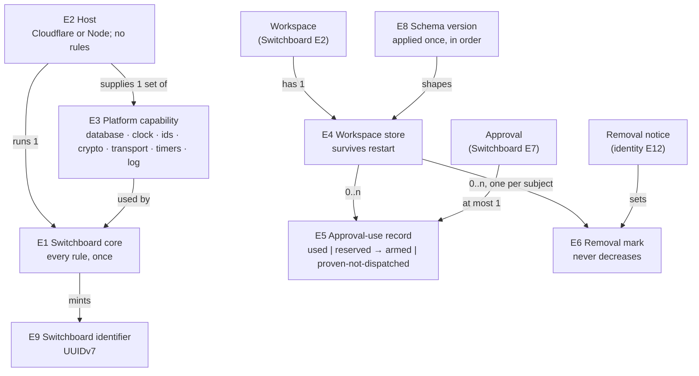

# Switchboard remediation: Specification

What must be observably true when the Switchboard code is fixed. Each obligation traces to a need in the [Requirements](requirements.md). How the code realizes it is the [Program Design](program-design.html); how each one is proven is the [Verification Design](verification-design.md).

**Reference for "same behaviour":** the Switchboard's promises to its callers are the [Switchboard Specification](../2026-10-14-portable-tool-portal-hosts/2026-10-14-portable-tool-portal-hosts.md) checks 1–17, with the identity changes in the [agent identity Specification](../2026-10-24-agent-identity/specification.md). This set must not change any of them, except where an obligation below names the change. The code reference is PR #262 at `2dfea38e`.

## The parts and their obligations

| Part | What it gives | Obligations |
|---|---|---|
| `one-core` | Same behaviour on Cloudflare and Node, because one core runs on both | R1 R2 R3 |
| `storage` | Workspace state in SQLite through Drizzle, behind core-owned typed interfaces, surviving restarts | R4 R5 R6 R7 R8 R9 |
| `type-safety` | Types that make invalid states unrepresentable; UUIDv7 identifiers | R10 R11 R12 |
| `deterministic-tests` | Controlled-clock tests, Hegel property tests, TypeScript verification | R13 R14 R15 R16 |
| `build-hygiene` | One version of each dependency; the owner's gates as approved | R17 R18 R19 |
| `known-defects` | Open findings and deployed-check failures fixed | R20 R21 R22 R23 R24 R25 R26 |

## What these obligations are about

Three nouns come from the Switchboard and identity designs and keep their meaning there: **Workspace** (Switchboard E2), **Approval** (Switchboard E7) and **Removal notice** (agent identity E12). The table defines the nouns this set adds.

| | Thing | Same one when | Belongs to | Always true | Its states |
|---|---|---|---|---|---|
| E1 | **Switchboard core** | the same release of the one implementation of every Switchboard rule and decision | used by every host of that release | holds every rule and decision listed in R1; reaches its runtime only through E3 capabilities | — |
| E2 | **Host** | one runtime's adapter in one release: the Cloudflare host or the Node host | runs exactly one E1; supplies one set of E3 | contains no Switchboard rule; only builds and supplies capabilities, and accepts connections | — |
| E3 | **Platform capability** | one kind of capability supplied by one host instance: the database, clock, identifier source, crypto, outbound transport, timers, log or analytics sink | supplied by one E2 to one E1 | every kind E1 needs is supplied; E1 has no fallback for a missing one | — |
| E4 | **Workspace store** | the durable state of one Workspace in one deployment of one host. On Node, one configured portal is one Workspace, as the Switchboard design treats one proxy configuration on a machine | belongs to one Workspace; holds E5 and E6 records | survives restart and redeploy; one Workspace's store is never read or written for another Workspace | — |
| E5 | **Approval-use record** | one Approval, identified by its token identifier and the principal it was issued to, recorded in one Workspace's store. Both kinds of Approval count: the MCP proxy's approval token and the standalone Switchboard's signed batch approval | belongs to one E4 and one Approval | at most one per Approval; created only by that Approval's first presentation; a later presentation of the same Approval is never accepted as a first use | proxy approval token: used → expired. Batch approval: reserved → armed → expired, or reserved → proven-not-dispatched → expired. A later presentation of an armed batch approval is answered "ambiguous": its effect may have started. A record is removable once the Approval's own expiry has passed |
| E6 | **Removal mark** | the highest removal a Workspace's store has received for one subject, together with the Removal notices that set it | belongs to one E4; set by Removal notices | never decreases; a lower or repeated notice changes nothing | held → expired (removable after the retention the identity design sets, at least 61 minutes after receipt) |
| E8 | **Schema version** | one checked-in migration, identified by its position in the migration history | belongs to the store schema; applied to each physical database | applied at most once to a database, in order, before that database serves a request | pending → applied |
| E9 | **Switchboard identifier** | one identifier the Switchboard itself mints (operation, record, receipt, request correlation, approval token identifier) | minted by E1 through the identifier capability | is a UUIDv7 | — |
| E10 | **Controlled clock** | one test-supplied time source for one test | supplied through the clock capability | moves only when the test moves it | — |
| E11 | **Check gate** | one step of `pnpm check` or one CI job | owned by the owner | changes only with the owner's approval | approved |
| E12 | **Known defect** | one finding listed under `known-defects`, identified by its PR thread or deployed-check row | — | has a test that fails before its fix and passes after | open → fixed |

## `one-core`: one core, injected

**R1 — Every rule lives in the core.** (U1)
The Switchboard core (E1) implements every Switchboard rule and decision: caller admission, the workspace boundary, persona narrowing, the `direct` and `indirect` cases, search and describe, dispatch through the one dispatcher, approval checks and one-use, removal fencing, today's limits, result and error projection, secret redaction, and the analytics data point. A host (E2) implements none of them.
- **Pass:** the same scenario gives the same outcome on the Cloudflare host and the Node host: the same tools listed, the same results, the same refusals with the same codes, the same approval outcomes, and the same analytics data point.
- **The one allowed difference: host-supplied limit values.** The rule that enforces a limit is the core's; the value is the host's. Today's values stay as the Switchboard design sets them (checks 8 and 15):
  - On both hosts: 4 MiB per upstream response, today's engine limit (`tool-engine` `upstream-mcp-protocol.ts:126` `defaultMaxResponseBytes`, used at `upstream-mcp-client-runtime.ts:58` at `2dfea38e`). It is shared, not a host difference.
  - On the Worker only: 50 calls per batch, 6 in flight and 16 MiB per reply (`tool-host-cloudflare/src/worker-limits.ts` at `2dfea38e`), and its approval-use cap.
  - On Node: none of the Worker-only three, and its own approval-use cap.

  A scenario that crosses a Worker-only limit passes when each host gives its own expected answer: a refusal on the Worker and a normal result on Node. A scenario that crosses the shared upstream-response limit gets the same refusal on both.
- **Fail:** any scenario whose outcome differs between hosts other than by a host-supplied limit value; any rule implemented in a host's own code; a Worker-only limit added to Node, the shared upstream-response limit removed from either host, or a Worker limit removed from the Worker.
- **Unchanged:** the standalone Switchboard's routes (its `tool_portal_*` MCP tools and its JSON route) and stdio stay on the Node host only, as the Switchboard design says; they too dispatch through the core.

**R2 — The Node host runs the core.** (U1)
The Node host composes the same core the Cloudflare host composes, including the hosted proxy, the workspace authority and the workspace store. It keeps only Node work: its HTTP and stdio listeners, configuration files, stdio connections to tool servers, the catalog TypeScript compiler, and the `better-sqlite3` database file.
- **Pass:** every Node-only behaviour the Switchboard design lists keeps working, and every rule in R1 runs through the core.
- **Fail:** a Node module that decides admission, approval, one-use, replay, canonical identity or result policy itself.

**R3 — The core reaches its runtime only through supplied capabilities.** (U1, U6)
The core reads time, mints identifiers, performs cryptographic operations (digests, signing, verification, key import), schedules timers, reaches other services and writes logs and analytics only through capabilities (E3) its host supplies. Every capability is required.
- **Pass:** a core built with a fixed clock, a seeded identifier source and fixed key material produces byte-identical outputs on repeated runs.
- **Fail:** any core code path that falls back to a platform clock, a platform random source, a platform crypto global, or a platform timer when a capability is missing, such as `props.now ?? Date.now()`.
- **Rules stay out of capabilities:** a capability performs one platform operation and decides nothing. How long an issuer's key set is trusted (at most 5 minutes, per the identity design) and when it is fetched again is a core rule on the clock capability. **Fail:** a key-set cache or refetch rule inside a capability adapter, running on the adapter's own clock.

## `storage`: Drizzle on SQLite

**R4 — Typed store operations, one Drizzle mapping, owned by the core.** (U2, U3)
The core defines the workspace store's operations in domain terms, with typed inputs and typed results, and owns the one implementation that maps them to a Drizzle SQLite schema. A host supplies only the Drizzle database for its runtime.
- **Pass:** both hosts run the same store implementation against their own database.
- **Fail:** a host that writes its own query for a store operation, or a store operation shaped as untyped key and value.

**R5 — The databases the owner chose, and nothing else.** (U3)
On Cloudflare the workspace store (E4) is the workspace's Durable Object SQLite, reached through Drizzle's Durable Object driver. On Node it is a `better-sqlite3` database file, reached through Drizzle's `better-sqlite3` driver.
- **What "no hand-written SQL" means:** every store statement is built with Drizzle's query builder. Drizzle's `sql` template is allowed only as an expression inside a query-builder call, with its values bound as parameters, for example `max(...)` in an upsert's `set` or an `insert … select` condition. Executing SQL text is forbidden.
- **Fail:** any use, in Switchboard storage, of:
  - the Durable Object key-value API (`get`, `put`, `list`, `delete`, `transaction` on key-value storage);
  - `node:sqlite` or Kysely;
  - executing SQL text: `sql.raw(`, `ctx.storage.sql.exec(`, `db.run(sql…)`, `db.all(sql…)`, `db.get(sql…)` or `db.values(sql…)`, or a driver's own `.prepare(` or `.exec(`;
  - an SQL string outside generated migrations.

**R6 — Generated, checked-in migrations, applied once.** (U3, U4)
The store's schema changes only through migrations that `drizzle-kit` generates and the repository checks in. Each physical database applies them through exactly one migration mechanism, in order, before it serves its first request. A database at an older schema version upgrades when opened.
- **Pass:** a database created at every earlier schema version opens, upgrades and serves requests with its records intact.
- **Fail:** a request served before migrations finish; a migration applied twice; two mechanisms recording history for one database.
- **Owner gate:** the schema and its migrations are approved by the owner before the code that uses them is written (U4).

**R7 — What survives a restart.** (U5)
Approval-use records (E5) and removal marks (E6) survive a host restart and a redeploy, on both hosts. After a restart:
- an Approval presented before the restart is never accepted as a first use again, until its own expiry: a used or reserved one is refused as already used, and an armed batch approval is answered "ambiguous";
- a removal received before the restart still refuses the removed subject.
- **Fail:** any of these lost or reset by a restart. Today the standalone Switchboard's batch-approval records live only in memory while its service generation comes from configuration, so a restart with the same configuration lets an unexpired approval be used again; that must become impossible.
- **Unchanged:** a batch approval issued for an earlier service generation is still refused after a restart with a new one (Switchboard Specification check 6).
- **Not stored:** a record of every call, call arguments, results or credentials (Switchboard design, "Not in this work").

**R8 — Atomic decisions on every driver.** (U3, U5)
Each of these decisions is atomic on every database the hosts use:
- **First use of an Approval:** when any number of requests present the same Approval at once, across Worker copies or Node connections, exactly one is accepted as first use, and every other is refused as used.
- **Recording a removal:** after any set of Removal notices arrives in any order, the removal mark equals the highest received; a lower or repeated notice never lowers it.
- **Arming a batch approval:** a reserved batch approval moves to armed, or to proven-not-dispatched, at most once.
- **Expiry is part of the decision:** the store decides expiry in the same atomic step, against one time that never goes down. An Approval presented at or after its expiry by that time is refused as expired and is never accepted as a first use, reserved or armed. This holds when the request was held between verification and the store, when the verifier's clock is ahead of or behind the store's, and when a host clock later steps back. A pruned record therefore never lets its Approval be used again.
- **One workspace per database:** a store refuses every decision when its database belongs to another workspace.
- **A removal reaches the tokens it names:** a removal notice and a token for the same bot, the same session or the same machine are matched by one canonical subject key. A machine's removal covers every session token on that machine.
- **Fail:** two first uses of one Approval; a second effect from one Approval after its record was pruned; a removal mark lowered by a late notice; a batch approval armed twice; a decision that holds on one driver and not another; one database serving two workspaces; a removal recorded under one encoding of a subject and read under another, so that it never covers the token.

**R9 — No approval comes back to life at either storage change.** (U3, U5)
The store changes twice: from the key-value layout to the SQLite layout (this work), and to store version 2 at the identity cutover, which re-keys approval records by principal and deletes the existing ones. At each change, no Approval used before it is accepted again after it, on the Worker or on any Node host.
- **Pass:** either every unexpired used-approval record is carried into the new store, or every Approval token issued before the change fails verification after it, because the approval keys are rotated on the Worker and on every Node host as part of the change.
- **Fail:** a token used before either change is accepted after it, on any host.

## `type-safety`: types that say what is valid

**R10 — States and results are discriminated unions.** (U7)
Every state machine and every result that crosses a boundary in the core is a discriminated union with one tag field, handled exhaustively. This covers at least: approval-use states (E5), the result of presenting an Approval, store results, dispatch outcomes, refusal reasons, the `client-deferred | portal-deferred` case, and capability failures.
- **Pass:** adding a variant without handling it everywhere fails the type-check; a value combining fields from two variants does not type-check.
- **Fail:** a state carried as optional fields or loose strings that permits combinations no variant allows.

**R11 — The core type-checks without any runtime's types.** (U7, U10)
The core, together with the rules and engine it uses, type-checks in a configuration where neither Node's nor Cloudflare Workers' type definitions are available. This check is an owner-approved gate (E11).
- **Fail:** any core import of `node:*`, `cloudflare:*`, a Drizzle driver module, or a type that only exists in one runtime.

**R12 — Every Switchboard identifier is a UUIDv7.** (U8)
Every identifier the Switchboard mints (E9) is a UUIDv7 from the identifier capability.
- **Pass:** every minted identifier parses as version 7.
- **Fail:** any `randomUUID()` or other UUID version in Switchboard code or its tests.
- **Not identifiers:** secret bytes such as signing keys and token entropy stay random secret material, not UUIDs. Identifiers received from other services keep their own format.

## `deterministic-tests`: tests that never read the clock

**R13 — No wall-clock time in tests.** (U9)
No Switchboard test reads the wall clock, sleeps, or waits on real time to decide an outcome. Expiry, TTL, retention, timeouts and polling are exercised by moving a controlled clock (E10).
- **Fail:** a test calling `Date.now()`, `new Date()` with no argument, `performance.now()` or a real timer to compute an expected value, an expiry or a deadline; a test that sleeps between probes.
- **Open:** whether an end-to-end test may keep a timeout that can only fail a hung external process (RD4).

**R14 — Time is controlled only through the clock capability.** (U9, U1)
Tests control time by supplying the clock capability. No production build substitutes `Date.now`, and no production bundle contains a test-only entry point or route.
- **Fail:** a build-time replacement of the clock; a test control route or class in a production bundle; a production export whose only purpose is tests.

**R15 — Hegel property tests.** (U15)
Property tests written with Hegel cover at least:
- one-use of an Approval under arbitrary interleavings and copies;
- removal marks under arbitrary orders and repeats;
- canonical encoding: equal data always gives the same bytes and fingerprint;
- every store operation's result after any sequence of operations, on both databases;
- the approval-use state machine, including a restart at any point.
- **Both databases** means a `better-sqlite3` file and Durable Object SQLite. Hegel runs in Node, so on the Durable Object it drives the store through the object's own methods, one generated step per call.
- **Fail:** any of these covered only by hand-picked examples; the Durable Object half dropped without an owner decision.

**R16 — Verification scripts are TypeScript.** (U11)
Every verification, journey and tooling script in this work is TypeScript. The Python Switchboard SDK's own tests stay Python, because they test product Python.
- **Fail:** a Python script that drives or asserts Switchboard protocol behaviour outside the Python SDK's own test suite.

## `build-hygiene`: clean build, owner's gates

**R17 — One MCP SDK generation in product code.** (U12)
Product code speaks MCP through one SDK generation, the 2026-07-28 SDK. The older SDK appears nowhere in product code; whether it may remain in one test-fixture module is RD3.

**R18 — One version of each build dependency.** (U12)
The workspace resolves exactly one version each of esbuild, jose and vitest, and no alpha release of Miniflare.

**R19 — The owner's gates, as approved.** (U10)
`pnpm check`, `vitest.config.ts` and CI match master `38569fca`, plus the approved type-check guard (R11). The scripts #262 added are removed unless the owner approves keeping one (RD5).

## `known-defects`: findings and deployed failures fixed

Each defect (E12) has a test that fails on the code at `2dfea38e` and passes after the fix.

**R20 — A Google command's timeout kind is enforced.** (U13; PR #238 finding)
When a Google command is configured as a quick command, a call carrying an open-style `timeoutMs` is refused at admission.

**R21 — One call's failure stays its own.** (U13; PR #241 finding)
If assessing one call in a batch fails, only that call is refused. Sibling calls are judged on their own assessment; a sibling that needs no approval runs.

**R22 — The advertised call schema matches what the call accepts.** (U13; PR #241 finding)
The published input schema of `mcp_portal_call` accepts exactly the fields its handler accepts, including `portalApprovalToken`.

**R23 — Invalid origins fail at configuration load.** (U13; PR #244 finding)
A configured allowed origin that is not a bare `http` or `https` origin (no user, path, query or fragment) is refused when the configuration loads, with an error naming the field, not when the listener starts.

**R24 — Canonical encoding is independent of locale.** (U13; PR #245 finding)
Canonical encoding sorts object keys by code-unit order, never by locale collation, so equal data gives the same fingerprint on every machine.

**R25 — The MCP transport passes everything through.** (U13; PR #245 finding)
The Switchboard SDK's MCP transport forwards every argument of the message callback, including MCP's second metadata argument, to the client it wraps.

**R26 — Large requests are streamed, not capped.** (U14; #33, deployed row 15)
A request whose body is larger than the Worker's in-memory budget is processed by streaming or spilling, not refused by a size cap of the Switchboard's own. On Node, when spilling is enabled (RD6), a large request body is spilled to a temporary file rather than held in memory; when it is not, the body streams into the parser in memory, as on the Worker.
- **Which way in:** this covers the MCP proxy way in, `/workspaces/‹id›/mcp` on the Worker and the Node host's MCP proxy listener, where today's 4 MiB request budget sits. The standalone Switchboard's JSON route keeps its 64 KiB request limit unchanged (Switchboard Program Design, "Limits today"; check 8). The standalone MCP route keeps today's limits.
- **Pass:** a call with a body above today's 4 MiB budget and within the platform's own request limit completes with the same result it would have under the budget.
- **Spill files are temporary, private and never durable:** a Node spill file is readable only by the host's user and is never written where the store or its backups live. It is gone after its request ends, however it ends, and after a restart following a crash, even when the dead process's id has been reused. One process never removes another live process's spill file. Spilling is enabled only where the deployment declares that the spill storage's exhaustion cannot exhaust the store's (RD6); a different device identifier alone is not that declaration; otherwise the body is parsed in memory.
- **The true limit, stated:** the parsed request and its working copies must fit in the memory of the runtime handling it. On a Worker, concurrent requests share that memory. A request that exhausts it ends the other requests running there, from any workspace. This limit stands until the owner decides RD7.
- **Fail:** a Switchboard-imposed size refusal; a 502 for a request within the platform's limit; caller data or an approval token left in a spill file after its request, in the store's location or in its backups.
- **Undefined here:** what Cloudflare itself does above its own request limit; the Switchboard cannot change that.

## Coverage

| Part | U | E | R | Proof obligation |
|---|---|---|---|---|
| `one-core` | U1 | E1 E2 | R1 | V1 the same scenarios on both hosts give the same outcomes, apart from each host's own limit values |
| `one-core` | U1 | E1 E2 | R2 | V2 every Node-only behaviour works through the core |
| `one-core` | U1 U6 | E1 E3 | R3 | V3 fixed capabilities give byte-identical outputs; no fallback path |
| `storage` | U2 U3 | E1 E2 E4 | R4 | V4 one store implementation on both databases |
| `storage` | U3 | E4 | R5 | V5 no forbidden storage call or SQL-text execution in Switchboard code |
| `storage` | U3 U4 | E4 E8 | R6 | V6 every earlier version upgrades; nothing served before migration |
| `storage` | U5 | E4 E5 E6 | R7 | V7 restart and redeploy keep approval uses and marks |
| `storage` | U3 U5 | E5 E6 | R8 | V8 exactly one first use under contention, on every driver; one subject key per removed identity |
| `storage` | U3 U5 | E5 | R9 | V9 no approval used before either storage change accepted after it, on any host |
| `type-safety` | U7 | E5 | R10 | V10 an unhandled variant fails the type-check |
| `type-safety` | U7 U10 | E1 E11 | R11 | V11 the core type-checks with no runtime types |
| `type-safety` | U8 | E9 | R12 | V12 every minted identifier is version 7 |
| `deterministic-tests` | U9 | E10 | R13 | V13 no test reads the wall clock |
| `deterministic-tests` | U9 U1 | E3 E10 | R14 | V14 no clock substitution or test entry in production bundles |
| `deterministic-tests` | U15 | E5 E6 | R15 | V15 the five property families exist and run |
| `deterministic-tests` | U11 | — | R16 | V16 no Python verification script |
| `build-hygiene` | U12 | — | R17 | V17 one SDK generation in product code |
| `build-hygiene` | U12 | — | R18 | V18 one version each; no alpha |
| `build-hygiene` | U10 | E11 | R19 | V19 gates equal master plus the guard |
| `known-defects` | U13 | E12 | R20–R25 | V20–V25 each defect's test fails before and passes after |
| `known-defects` | U14 | E12 | R26 | V26 an over-budget call completes on the deployed Worker and on Node |

## Not specified here

- The Switchboard's own promises (Switchboard Specification checks 1–17) and the identity obligations: unchanged, owned by those documents.
- How the workspace store's records are laid out in tables: the [Program Design](program-design.html), for the owner's approval (RD1).
- The sign-in service's storage: owned by the [agent identity](../2026-10-24-agent-identity/program-design.html) and [people sign-in](../2026-10-20-people-sign-in/program-design.html) designs.
- The order of work across repositories, and what happens to #262: the [delivery orchestration](../2026-10-24-delivery-orchestration/requirements.md) set.
