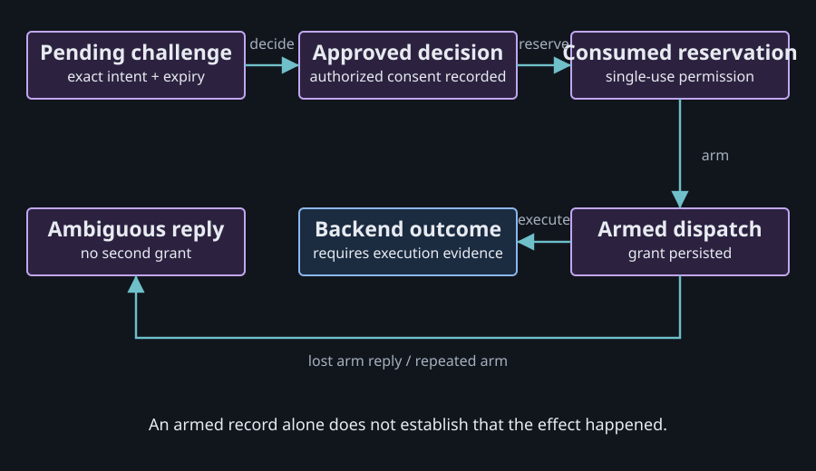
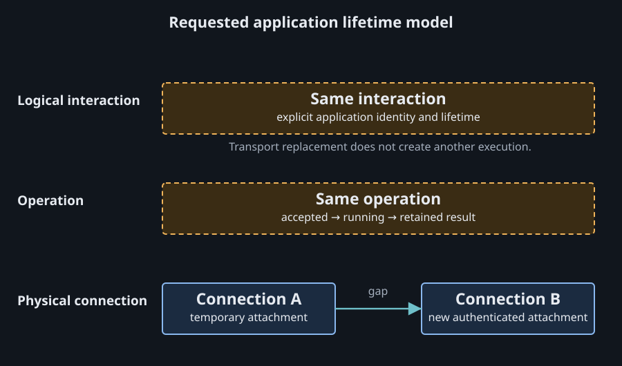

# Approval, operations and reconnects

An approval records consent to an exact action. Dispatch permission authorizes its execution under current policy. A reconnect restores communication and observation. Keeping those meanings separate prevents a lost response from becoming a duplicate effect.

Source snapshot: 2026-10-14, Agent VM `8535fdd4`. Current transitions below were inspected in source. The future operation-recovery contract is a proposal, not implemented behavior.

## Where approval lives

The managed approval engine is internal to `@agent-vm/agent-vm`, in `createControllerApprovalLedger`. There is no generic approval-engine package or Rust crate in this workspace. Shared SDK and control-contract packages carry schemas; Gateway Runtime adapts its approval port to controller RPCs. [Ledger implementation](https://github.com/ShravanSunder/agent-vm/blob/8535fdd433dc90fed627ee7a05f63e59d58cf8ee/packages/agent-vm/src/controller/approval/controller-approval-ledger.ts#L359), [approval port](https://github.com/ShravanSunder/agent-vm/blob/8535fdd433dc90fed627ee7a05f63e59d58cf8ee/packages/tool-portal/src/tool-portal-service.ts#L182).

Standalone Tool Portal and standalone MCP Portal have separate HMAC implementations with in-memory consumption/replay records. They do not have the managed controller's durable approval ledger. A common reusable package would be a future extraction.

## An exact approval passes through several states

| Step | What the controller records | What that proves |
| --- | --- | --- |
| Request | Pending challenge with expiry and intent fingerprint | A specific approval request exists |
| Decide | Approved or denied | An authorized decision was recorded |
| Reserve | `consumed-not-dispatched` and an exact reservation | The approval has been consumed |
| Arm | `dispatch-armed` and a grant | Dispatch permission was armed |
| Execute | Backend-specific outcome | Execution evidence must come from the backend |

The fingerprint binds the exact call and arguments, principal, backend, operation ID, semantic revisions and authority epochs. A recorded decision returns approved/denied state, not a grant. [Intent contract](https://github.com/ShravanSunder/agent-vm/blob/8535fdd433dc90fed627ee7a05f63e59d58cf8ee/packages/gateway-control-contracts/src/gateway-runtime-approval.ts#L49), [decision result](https://github.com/ShravanSunder/agent-vm/blob/8535fdd433dc90fed627ee7a05f63e59d58cf8ee/packages/agent-portal-sdk/src/approval-surface/models/gateway-approval-presentation-schema.ts#L74).

Current controller execution rechecks the configured operation before arming. A changed caller, target or policy can invalidate an earlier approval. Authentication, capability policy and human consent each answer a different question. [Final admission](https://github.com/ShravanSunder/agent-vm/blob/8535fdd433dc90fed627ee7a05f63e59d58cf8ee/packages/agent-vm/src/controller/control-session/gateway-control-domain-handler.ts#L1024).

## Lost replies do not create another permission

If the reservation reply is lost, a fresh reserve attempt sees that the approval was already consumed. If the arm reply is lost, a fresh arm attempt returns an ambiguous armed-dispatch result instead of another grant. An armed record alone does not prove the backend performed its effect. [Lost-reply behavior](https://github.com/ShravanSunder/agent-vm/blob/8535fdd433dc90fed627ee7a05f63e59d58cf8ee/packages/agent-vm/src/controller/approval/controller-approval-ledger.ts#L477).

For example, an upstream service may send an email and lose its response. Automatically repeating the call could send another email. The correct next action depends on the retained operation evidence and the provider's reconciliation or idempotency support.

## Connection and interaction lifetimes

| Identity or lifetime | Meaning | On reconnect |
| --- | --- | --- |
| Authenticated principal | Who may access the service | Authenticate and resolve current policy again |
| Logical interaction | Ongoing work and its context | May continue under its explicit lifetime contract |
| Operation | One requested effect | Recover the same operation's outcome |
| Connection | One physical attachment | Create a new connection identity |
| VM lease | Access to a host-owned environment | Follow host lease and active-use policy |
| Delivery cursor | Position in a retained event stream | Recover delivery within the retention window |

The diagram shows the requested application model. Current MCP `2026-07-28` removes protocol sessions and SSE replay, so a business interaction or operation handle belongs to the application. Agent VM resolves SDK `1.29.0`, whose supported protocol list stops at `2025-11-25`. [Current MCP changes](https://modelcontextprotocol.io/specification/2026-07-28/changelog), [pinned SDK source](https://github.com/modelcontextprotocol/typescript-sdk/blob/v1.29.0/src/types.ts).

## What Tool VM work already preserves

A control-session disconnect moves matching running active uses into an `observation-gap`, preserving their lease and use record. Resume requires the same principal, process, lease and VM generation, a live admitting parent, a time before the deadline and a newer attachment generation. Expiry makes the outcome ambiguous and quarantines the leaf. It does not automatically rerun the command. [Disconnect](https://github.com/ShravanSunder/agent-vm/blob/8535fdd433dc90fed627ee7a05f63e59d58cf8ee/packages/agent-vm/src/controller/leases/tool-vm-lease-authority-state.ts#L503), [resume](https://github.com/ShravanSunder/agent-vm/blob/8535fdd433dc90fed627ee7a05f63e59d58cf8ee/packages/agent-vm/src/controller/leases/tool-vm-lease-authority-state.ts#L533), [expiry](https://github.com/ShravanSunder/agent-vm/blob/8535fdd433dc90fed627ee7a05f63e59d58cf8ee/packages/agent-vm/src/controller/leases/tool-vm-lease-authority-state.ts#L654).

The Tool VM Portal relay is invocation-scoped. Invocation completion closes admission and cancels its pending work. An ended invocation's Portal authority cannot be recovered by keeping a detached program or opening another socket. [Relay lifetime](https://github.com/ShravanSunder/agent-vm/blob/8535fdd433dc90fed627ee7a05f63e59d58cf8ee/docs/architecture/tool-vm-portal-composition.md#L117).

## Proposed recovery contract

A generic durable operation service would need a caller-known operation key before submission, a stored payload fingerprint, identity-scoped deduplication, retained outcomes and an authorized lookup path. Reusing a key with different arguments must conflict. A lost initial reply must still be recoverable using that known key.

Current Portal results already distinguish proven not-dispatched, completed, terminated and ambiguous outcomes. The public capability interface does not yet expose a universal durable operation lookup API. Persisted state also cannot prove an external process or upstream effect survived a host restart. [Result schema](https://github.com/ShravanSunder/agent-vm/blob/8535fdd433dc90fed627ee7a05f63e59d58cf8ee/packages/agent-portal-sdk/src/portal-call-surface/models/portal-call-result-schema.ts#L47), [capability interface](https://github.com/ShravanSunder/agent-vm/blob/8535fdd433dc90fed627ee7a05f63e59d58cf8ee/packages/tool-portal/src/tool-portal-service.ts#L204).

## Evidence and limits

These are source observations and proposed contracts. No lost-reply experiment, live VM continuation or host-restart recovery was run. The diagrams and controls are explanatory views, not a running approval service.

Continue with [the system today](portal-system.md) or [the portable runtime idea](portable-runtime.md).
