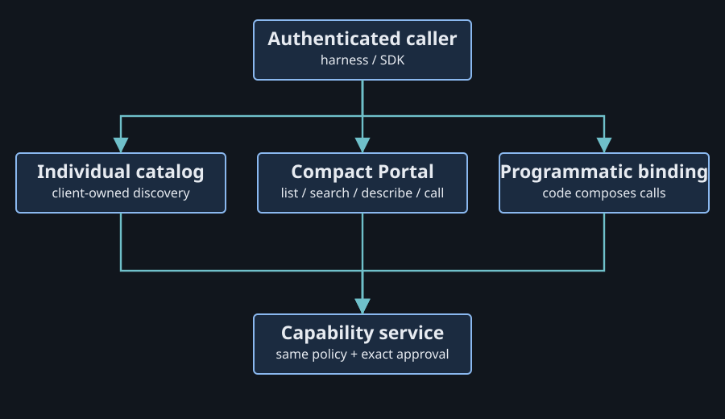

# One policy, different tool presentations

The service decides which operations a caller may use. The harness decides how the model discovers them and whether code can call them. Those responsibilities can cooperate without making a client's search or code mode an authorization signal.

Research snapshot: 2026-10-14. Repository source, official documentation and the release-pinned sources below were inspected. Installed harness versions and live compatibility were not checked.

## Three ways to reach the same capability

| Presentation | What the caller gets | Discovery and composition |
| --- | --- | --- |
| Individual catalog | A name and schema for each admitted operation | The harness may defer definitions or search internally |
| Compact Portal | List, search, describe and call operations | The model discovers operations through Portal |
| Programmatic client | Typed callers or tool bindings | Code combines calls and reduces intermediate results |

A shell can execute code without providing a binding to connected MCP tools. API-hosted programmatic calling, harness-local code mode and Agent VM's Tool VM SDK are distinct implementations.

## What the target harnesses establish

| Harness | Inspected behavior | Boundary |
| --- | --- | --- |
| Hermes | Managed profiles select compact or catalog; Tool VM generated TypeScript works with both | First-party adapter source, not a live installed run |
| Codex | Remote MCP and server instructions; code mode is documented as under development and off by default | Enabled behavior varies by configuration/version |
| Claude Code | Indexed official excerpts describe deferred MCP discovery | Full primary pages returned HTTP 403; current defaults remain unverified |
| Cursor | Remote MCP and client-owned discovery from tool-definition files | No inspected contract advertises code mode to the server |
| Pi `v1.2.0` | Official MCP, code-callable tool bindings and deferred search | CLI loads built-ins; SDK sessions add factories explicitly |
| OpenCode `v1.19.0`, optional | MCP with experimental code mode | Development-branch defaults differ from the release |

Sources: [Hermes registration](https://github.com/ShravanSunder/agent-vm/blob/8535fdd433dc90fed627ee7a05f63e59d58cf8ee/python/agent-vm-hermes-adapter/src/agent_vm_hermes_adapter/managed_tool_portal_capability_tools.py#L464), [Codex MCP](https://developers.openai.com/codex/mcp), [Codex configuration](https://developers.openai.com/codex/config-reference), [Cursor MCP](https://cursor.com/docs/mcp.md), [Cursor discovery](https://cursor.com/blog/dynamic-context-discovery), [Pi release exposure](https://github.com/earendil-works/pi/blob/06a466935536f8c9bcacb2d5efc0fc021be1bdff/packages/coding-agent/docs/mcp.md#L189-L234), [OpenCode release flag](https://github.com/anomalyco/opencode/blob/733b2c627e5aec39cb33cc22373bdce33053ef2c/packages/opencode/src/effect/runtime-flags.ts#L48).

The [Claude Code MCP page](https://code.claude.com/docs/en/mcp) and [Anthropic programmatic-calling page](https://platform.claude.com/docs/en/agents-and-tools/tool-use/programmatic-tool-calling) are primary-fetch gaps in this research. Their indexed excerpts do not establish a complete current feature matrix.

## Selecting a presentation

Standard MCP has no universal client capability declaring native tool search or code mode. Its current client capabilities include elicitation and namespaced extensions, among others. A client name, sampling capability or ordinary shell tool does not establish a usable tool-calling code environment. [Current capability schema](https://github.com/modelcontextprotocol/modelcontextprotocol/blob/2026-07-28/schema/2026-07-28/schema.ts).

Presentation should be an explicit agreement. For a harness with enabled native discovery, an individual authorized catalog can use that discovery. Compact Portal remains useful when the client lacks it. Programmatic access requires an actual callable binding, not merely instructions saying the agent can run code.

Current managed Hermes chooses presentation through the trusted profile's `catalogMode`. Standalone MCP Portal uses a startup `--catalog-mode` switch for the server instance. Per-client selection would be a new contract; it is not currently inferred from a connection handshake. [Managed snapshot](https://github.com/ShravanSunder/agent-vm/blob/8535fdd433dc90fed627ee7a05f63e59d58cf8ee/docs/architecture/tool-vm-portal-composition.md#L32), [standalone selection](https://github.com/ShravanSunder/agent-vm/blob/8535fdd433dc90fed627ee7a05f63e59d58cf8ee/packages/mcp-portal/src/mcp-proxy/portal-http-server.ts#L268).

OpenAI API tool search is also application-configured: an API application adds `tool_search` and defers selected tool definitions. That API setting does not become a standard MCP client capability. [Official API guide](https://developers.openai.com/api/docs/guides/tools-tool-search).

## How code mode meets approval

Each nested capability call still enters the service's policy and approval path. A script may collect information with several read calls, transform it locally and then attempt a protected write. The write receives its own exact approval decision. A script's existence or earlier successful read does not authorize later effects.

In managed Agent VM, the Tool VM SDK connects through an invocation-local relay. Generated functions are typed callers over that client; they do not connect directly to providers. Authority and the client/socket expire with the invocation. [Composition and authority](https://github.com/ShravanSunder/agent-vm/blob/8535fdd433dc90fed627ee7a05f63e59d58cf8ee/docs/architecture/tool-vm-portal-composition.md#L66).

Pi's release exposes MCP tools to its built-in code mode, deferred search or direct declarations. Its SDK explicitly adds MCP/code/search factories. OpenCode's released code-mode implementation calls the MCP client through its tool pipeline behind an experimental flag. These are real code-to-tool bindings in inspected release source, with installed-runtime behavior still unverified. [Pi SDK](https://github.com/earendil-works/pi/blob/06a466935536f8c9bcacb2d5efc0fc021be1bdff/packages/coding-agent/docs/sdk.md#L112-L116), [OpenCode nested call](https://github.com/anomalyco/opencode/blob/733b2c627e5aec39cb33cc22373bdce33053ef2c/packages/opencode/src/tool/code-mode.ts#L134-L159).

## Transport compatibility

Streamable HTTP is the interoperable remote MCP path established in the inspected Codex, Cursor, Pi and OpenCode sources. Direct Unix sockets and WebSockets require a client that supports the chosen binding. A private SDK/socket adapter can serve local runtime integration while HTTP MCP serves ordinary harness clients.

Current MCP `2026-07-28` carries protocol version/capabilities per request and removes protocol-level sessions. Agent VM's pinned SDK supports an older initialization/session contract. Endpoint compatibility must be qualified against actual client and server versions. [MCP release changes](https://modelcontextprotocol.io/specification/2026-07-28/changelog), [pinned SDK](https://github.com/modelcontextprotocol/typescript-sdk/blob/v1.29.0/src/types.ts).

Continue with [approval and reconnects](approval-and-reconnects.md) or [the portable runtime idea](portable-runtime.md).
