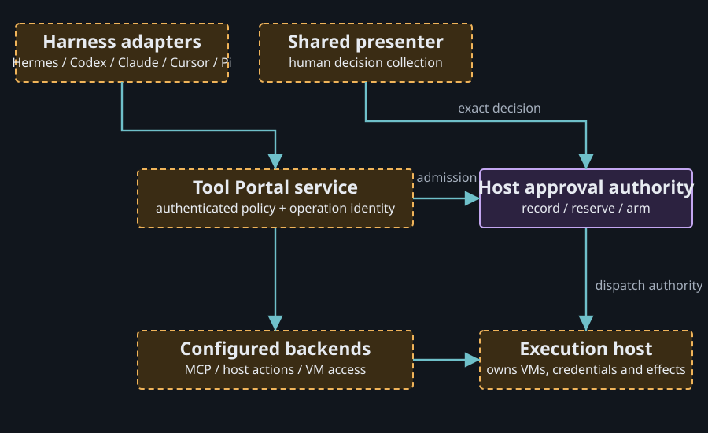

# A portable tool service for your machines

The goal is a configured capability service that several harnesses can use locally or remotely. It could connect to MCP providers, access approved host operations and create or use VMs on suitable execution hosts. Approval and reconnect behavior should remain consistent across those callers.

This is a proposed working model from the 2026-10-14 discussion. It is not an accepted specification, implementation plan or deployed service. Current code evidence is marked separately below.

## Keep the responsibilities visible

| Part | Proposed responsibility | Reason to remain separate |
| --- | --- | --- |
| Harness adapter | Translate the caller's authenticated context and presentation | Harness protocols and UI change independently |
| Tool Portal service | Catalog, policy and configured backend routing | Capability access is shared across harnesses |
| Approval domain | Exact intent, decision transitions, consumption and persistence | Consent and dispatch rules need one implementation |
| Execution host | Final dispatch, credentials, VMs and processes | The machine performing the effect owns its runtime |
| Operation owner | Accepted intent and retained outcome | A lost connection should not require another execution |
| Presenter or inbox | Show requests and deliver authenticated human decisions | Presentation can be shared without issuing grants |

The diagram illustrates a per-host-authority option with shared presentation. Central authority is a separate option. Neither placement was approved in the discussion.

## What can be reused, and what is coupled today

Tool Portal has an injected approval port and separate backend ports. Managed VM contracts are already backend-neutral. Router has a Rust `InteractionPort` that separates provider requests from Host decision handling. These are useful seams for service clients and adapters. [Portal port](https://github.com/ShravanSunder/agent-vm/blob/8535fdd433dc90fed627ee7a05f63e59d58cf8ee/packages/tool-portal/src/tool-portal-service.ts#L182), [VM contracts](https://github.com/ShravanSunder/agent-vm/blob/8535fdd433dc90fed627ee7a05f63e59d58cf8ee/packages/managed-vm/src/index.ts#L1).

The production runtime still accepts `hermes-managed-plugin`; its trusted principal embeds a Hermes profile. Managed approval binds controller/framework/gateway/runtime epochs. An external harness cannot simply reuse those identities. A generic adapter must establish authenticated caller and approver authority while retaining exact profile/target/revision binding and stale-attachment rejection. [Attachment contract](https://github.com/ShravanSunder/agent-vm/blob/8535fdd433dc90fed627ee7a05f63e59d58cf8ee/packages/gateway-runtime/src/production/gateway-runtime-service-config.ts#L108), [trusted principal](https://github.com/ShravanSunder/agent-vm/blob/8535fdd433dc90fed627ee7a05f63e59d58cf8ee/packages/agent-portal-sdk/src/contracts/trusted-context-contracts.ts#L112).

A reusable approval package is a sensible extraction candidate. It would hold state transitions and persistence contracts. MCP transport, VM creation and harness UI would remain outside that package. Currently the durable engine is internal to the Agent VM controller. [Current implementation](https://github.com/ShravanSunder/agent-vm/blob/8535fdd433dc90fed627ee7a05f63e59d58cf8ee/packages/agent-vm/src/controller/approval/controller-approval-ledger.ts#L359).

## A configuration-driven VM request

In the proposed model, an authenticated caller requests a named VM capability or execution profile. Configuration establishes the permitted execution host, image/profile, workspace binding and operations. The host checks policy and approval, creates or reuses its own VM lease, performs the work and retains the result.

An agent receiving access to a VM does not receive the controller's private socket or provider credentials. Managed Tool VM composition already uses a relay with frozen invocation authority. The generic service would need an equivalent explicit caller binding for external harnesses. [Existing relay](https://github.com/ShravanSunder/agent-vm/blob/8535fdd433dc90fed627ee7a05f63e59d58cf8ee/docs/architecture/tool-vm-portal-composition.md#L80).

Creating VMs on another machine requires an execution host installed there, an available backend/toolchain and an authenticated connection. The Portal cannot make an unsupported machine VM-capable through configuration alone. The current MCP provider adapter aggregates tools; arbitrary downstream resource/prompt forwarding is also outside its current interface.

## Rust, TypeScript and deployment

| Approach | What it gains | What it costs |
| --- | --- | --- |
| TypeScript service with Rust/Python/TypeScript clients | Reuses existing Portal, provider and VM integration | Node runtime distribution and a stable service contract |
| Rust service | Could meet a native-binary deployment requirement | Reimplementation and qualification of approval, provider and execution behavior |

The recommendation from this research is a TypeScript service with a Rust Router client. No benchmark establishes a performance reason to port it. A requirement for one native binary without Node would change that recommendation.

Transport is independent of implementation language. Unix sockets fit local runtime clients. Authenticated HTTPS Streamable HTTP fits ordinary remote MCP clients. A WebSocket can carry an application-owned control/event stream. Choosing a socket does not define identity, replay or execution ownership.

## How the Router work relates

The inspected `design/board-orchestration` worktree is at `d0bb5c10`. Its fleet design separates installation, logical machine session and physical connection IDs, and retains acknowledged positions across reconnects. That design concerns fleet records, project replication, leases and forwarded posts. It does not yet define a generic Portal approval/execution protocol.

Current Router provider interactions use a Host-owned approval interface and local service identities. A provider permission choice needs an explicit mapping to a Portal challenge; it cannot be treated as a dispatch grant by analogy. The current branch does not implement every central/project-replication crate described in its design. These are source/design findings, not hosted deployment proof.

Local references: [Router interaction port](/Users/shravansunder/code/projects/codex-router.collab-improvements/crates/acp-client-runtime/src/interaction_port.rs:34), [fleet connection design](/Users/shravansunder/code/projects/codex-router.collab-improvements/docs/specs/2026-10-04-board-orchestration-design/program-design-3-central-fleet.md:72).

## Options worth keeping open

| Placement | Benefit | Cost to the operator |
| --- | --- | --- |
| Per-host approval/operation authority, shared presenter | Preserves local dispatch ownership | Fleet policy and revocation must reach each host |
| Central authority, host executors | One place for fleet policy and decisions | New execution depends on central availability and remote grant validation |

The original request was to understand these options and the broader reusable service. Selecting one is not a prerequisite to reading this explainer. Further design must define authority placement, operation retention and cancellation lifetime before those contracts are implemented.

## Evidence and limits

The source research covers the package owners, coupling, harness presentations, Router seams and connection semantics. Installed client configuration, cross-machine execution, generic approval integration and live restart recovery remain unverified. These files explain the discussion; they do not authorize a Rust port, Gondolin patch, public deployment or runtime migration.

Continue with [the system today](portal-system.md), [approval and reconnects](approval-and-reconnects.md), or [harness presentation](harness-presentation.md).
