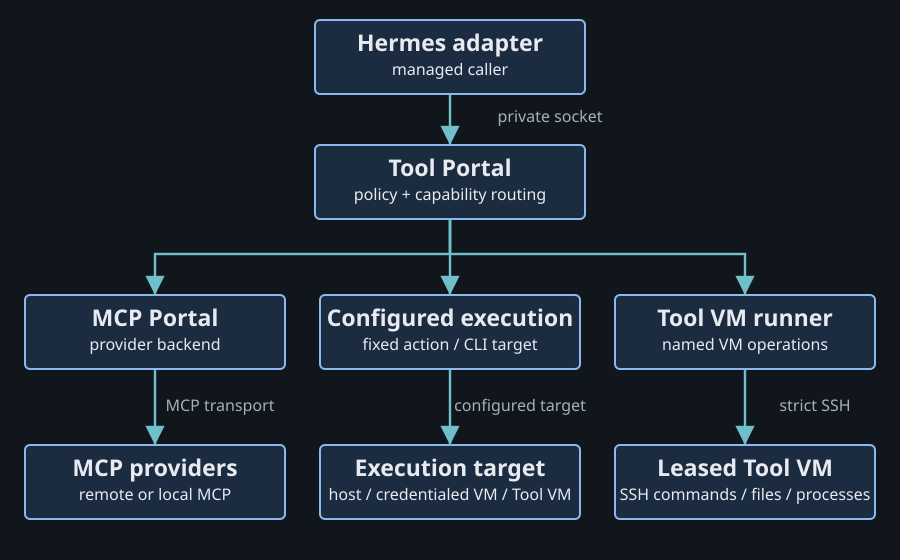
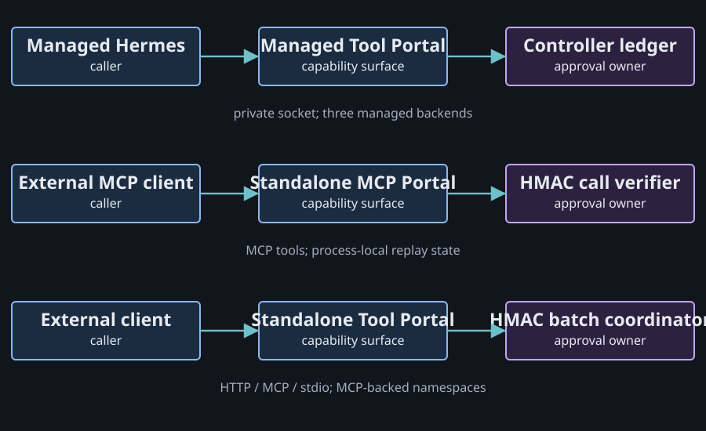

# Two portals, one capability path

Tool Portal gives an agent a permitted set of named operations. MCP Portal connects to the MCP servers behind some of those operations. Gateway Runtime hosts the managed service; the host controller owns VM lifecycle and managed approval records.

Source snapshot: 2026-10-14, Agent VM `8535fdd4`. This explainer describes inspected source. No live provider, VM or installed-harness behavior was exercised.

## Start with the map



The arrows mean requests and dispatch, not package dependencies. Managed Hermes supplies trusted invocation context through the private Gateway Runtime socket. Tool Portal selects the caller's configured profile and routes each admitted operation to its declared backend. MCP calls pass through MCP Portal; other calls use their own execution backends. [Production composition](https://github.com/ShravanSunder/agent-vm/blob/8535fdd433dc90fed627ee7a05f63e59d58cf8ee/packages/gateway-runtime/src/production/gateway-runtime-production-service.ts#L603).

## What each package owns

| Package | Its job | The boundary |
| --- | --- | --- |
| `tool-portal` | Cross-backend catalog, policy and capability calls | Selects the configured operation and backend |
| `mcp-portal` | MCP clients, provider discovery, schemas and calls | Owns MCP-specific upstream behavior |
| `gateway-runtime` | Managed service hosting, private socket and backend composition | Connects the managed client to the service |
| `agent-vm` | Host controller, VM leases, credentials and execution | Owns managed approval records and host effects |
| `agent-portal-sdk` | Shared contracts and Python/TypeScript/CLI clients | Gives consumers a typed way to call the service |

Tool Portal depends on MCP Portal. Both have standalone entrypoints, and both can be used as libraries. The production Gateway Runtime contract currently expects a managed Hermes client; its general package structure does not make that contract usable by every harness. [Package dependencies](https://github.com/ShravanSunder/agent-vm/blob/8535fdd433dc90fed627ee7a05f63e59d58cf8ee/packages/tool-portal/package.json#L55), [managed attachment](https://github.com/ShravanSunder/agent-vm/blob/8535fdd433dc90fed627ee7a05f63e59d58cf8ee/packages/gateway-runtime/src/production/gateway-runtime-service-config.ts#L108).

## The three managed backends

| Backend | Where the work goes | What configuration supplies |
| --- | --- | --- |
| `mcp_provider` | An upstream MCP server through MCP Portal | Provider connection, credentials and visible tools |
| `controller_execution` | A registered action or configured CLI | Operation, executable and fixed execution target |
| `tool_vm_runner` | Named operations in the leased Tool VM | Fixed commands, files and process operations |

A configured CLI target may be the controller host, a credentialed Managed VM or the agent's leased Tool VM. The `tool_vm` target uses the Gateway's strict-SSH path rather than a controller execution RPC. Backend classification and physical execution location are different facts. [Backend schema](https://github.com/ShravanSunder/agent-vm/blob/8535fdd433dc90fed627ee7a05f63e59d58cf8ee/packages/config-contracts/src/tool-portal-config.ts#L105), [configured execution](https://github.com/ShravanSunder/agent-vm/blob/8535fdd433dc90fed627ee7a05f63e59d58cf8ee/docs/reference/configuration/system-json.md#L723).

Installing a binary in a Tool VM does not add it to the Portal catalog. An operator must declare a named operation. Hermes terminal execution uses the separate Sandbox API, so a Portal command policy governs calls made through Portal, not every possible shell invocation. [Execution surfaces](https://github.com/ShravanSunder/agent-vm/blob/8535fdd433dc90fed627ee7a05f63e59d58cf8ee/docs/reference/configuration/system-json.md#L890).

## Configuration: connection, visibility and permission

`mcp.config.jsonc` describes upstream providers and transports. Managed `tool-portal.config.jsonc` selects complete profiles and namespace policy. Standalone `mcp-portal.config.jsonc` owns standalone MCP policy and authentication. Managed deployments do not load that standalone file as their policy authority.

Within a managed profile, each namespace has an explicit `backend.kind`:

```json
{
  "backend": { "kind": "mcp_provider" },
  "tools": { "allow": "*", "deny": [] },
  "calls": {
    "withoutApproval": { "allow": ["get_issue"], "deny": [] },
    "requiresApproval": { "allow": ["create_issue"], "deny": [] }
  }
}
```

This is an illustrative namespace policy, not a complete deployment file or a verified provider inventory. Visible tools outside both call selectors are blocked. Profiles do not inherit from another profile. Current managed policy uses `namespaces`; `capabilities` is rejected. [Canonical configuration reference](https://github.com/ShravanSunder/agent-vm/blob/8535fdd433dc90fed627ee7a05f63e59d58cf8ee/docs/reference/configuration/system-json.md#L671).

## Managed and standalone are different deployments



| Deployment | Client surface | Approval owner |
| --- | --- | --- |
| Managed Hermes | Private socket, generic or individual capability tools | Durable host controller ledger |
| Standalone MCP Portal | External MCP proxy | HMAC call verification with process-local replay state |
| Standalone Tool Portal | JSON HTTP, MCP HTTP or MCP stdio entrypoints | HMAC batch coordinator with process-local consumption state |

Standalone Tool Portal currently admits MCP-backed namespaces. Its standalone surface does not expose every managed backend. The three approval mechanisms share vocabulary, but they do not share one durable authority. [Standalone profile schema](https://github.com/ShravanSunder/agent-vm/blob/8535fdd433dc90fed627ee7a05f63e59d58cf8ee/packages/config-contracts/src/tool-portal-config.ts#L326), [standalone entrypoints](https://github.com/ShravanSunder/agent-vm/blob/8535fdd433dc90fed627ee7a05f63e59d58cf8ee/packages/tool-portal/src/standalone-entrypoint/index.ts#L1).

## Evidence and limits

The current MCP adapter aggregates tools. Standalone Tool Portal uses MCP `resources/read` for its own authorized artifacts; forwarding arbitrary downstream resources and prompts is additional work. [Upstream interface](https://github.com/ShravanSunder/agent-vm/blob/8535fdd433dc90fed627ee7a05f63e59d58cf8ee/packages/mcp-portal/src/upstream-mcp-client-runtime.ts#L99), [artifact read](https://github.com/ShravanSunder/agent-vm/blob/8535fdd433dc90fed627ee7a05f63e59d58cf8ee/packages/tool-portal/src/standalone-entrypoint/standalone-tool-portal-mcp-projection.ts#L174).

Some older subsystem prose still describes managed `capabilities` and an MCP listener. This explainer follows the current schema and configuration reference. It establishes source responsibilities, not runtime health or deployment completion.

Continue with [approval and reconnects](approval-and-reconnects.md), [harness presentation](harness-presentation.md), or [the portable service idea](portable-runtime.md).
