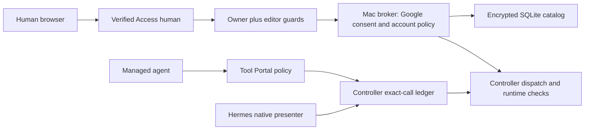
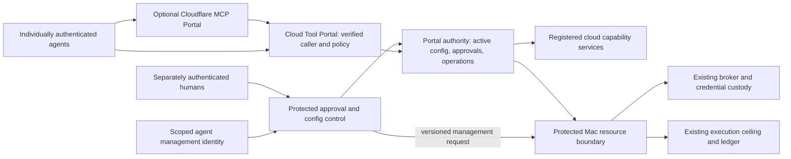

# Proposed approval and control model

**INFERENCE — recommendation for the Lead to review, not an accepted design:** keep the authenticated agent, the person it represents, the resource it uses, provider consent, standing policy, and approval of one operation distinct. Put editable portal policy and approval routing in a database owned by the portal authority. Keep the existing Mac broker authoritative for its Google authorizations and credentials initially; a cloud management surface can ask that owner to change them without copying its authority. Move that truth only after an explicit ownership decision and a separate migration design.

**UNKNOWN — choices still belonging to Shravan:** what “on behalf of a user” asserts; who administers an agent; whether account owners may delegate approvals; whether agents may activate bounded config changes themselves; whether Google policy moves to the cloud; and whether the Mac is a resource service or a second complete portal. Sections 8–9 make these choices inspectable. None is settled by this report.

**FACT — evidence boundary:** source baseline is `8535fdd433dc90fed627ee7a05f63e59d58cf8ee`, branch `design/portable-tool-portal-hosts`, on 2026-10-15. The commission permits only this report to be written. This is source research and a proposal: no implementation, database migration, tests, live Access/MCP integration, deployment, or rendered UI evaluation was performed. Existing untracked design documents were present before this work.

## 1. What changes in the Lead's draft

| Class | Draft assumption | Proposed correction and consequence |
| --- | --- | --- |
| INFERENCE, supported by F1–F5 below | A grant is simply “agent acts for person through account.” | Separate a generic **delegation** from a **provider authorization**. Google authorization additionally binds application/client, consent, scopes, generations and encrypted material. Things or a native Mac action may have no OAuth grant. |
| FACT + INFERENCE | Every agent has one owner. | Current `owners.allowedAgentIds` admits people to agent/account flows; its schema does not establish exclusive agent ownership. Propose explicit scoped agent-administrator assignments, with owner cardinality left to decision D2. |
| INFERENCE | Agent-own and on-behalf calls select mutually exclusive approval lanes. | Treat them as routing contexts. Every applicable gate remains required. A resource-owner approval cannot remove an agent-policy Ask, and agent approval cannot replace account consent. One operation approval can record several required approval scopes. |
| FACT + INFERENCE | Account-owner routing already exists for invocation approval. | Browser account ownership/editor checks exist; the managed invocation ledger instead records a configured managed approver and stable calling principal. Account-owner invocation routing is a proposed change, not reused current behavior. |
| INFERENCE | DB-backed config implies moving broker policy/grants to the cloud. | Cloud-editable configuration and cloud-owned provider authority are different choices. Compare protected remote management of Mac-owned state with migrating that state; do not infer the migration. |
| INFERENCE | One transactional store solves all races. | Co-locate portal policy activation, approval decisions and dispatch reservation within one portal authority transaction domain. A cloud transaction cannot atomically contain a Mac runtime or commit Google consent. Those remain explicit remote protocols. |
| UNKNOWN + INFERENCE | Agents may only propose, humans always approve configuration. | This is a safe candidate default, not the owner's quoted requirement. Offer bounded agent activation as a separate option. In either option, an ordinary tool credential cannot rewrite its own privileges or approver routing. |

### Current model: two different human decisions

**FACT — source topology, not a runtime trace:** the browser policy path and Hermes invocation path have different owners and identity evidence (F1–F4).



### Proposed model: one management experience, named authorities

**INFERENCE — topology to compare, not a selected deployment:** cloud and Mac may each instantiate Tool Portal. The diagram shows the smaller cloud-to-resource arrangement; substituting a full Mac portal adds an independent policy/operation authority and must preserve its pending outcomes.



**UNKNOWN — Cloudflare-to-custom-portal agent identity:** Cloudflare documents per-user upstream OAuth separately from portal login. Service-token portal access uses the configured admin credential upstream; `X-Forwarded-User-Agent` is client-controlled diagnostic information. These do not establish a trustworthy per-agent identity at our Worker. A verified end-to-end identity path, or independently bound upstream credentials/registrations, must be demonstrated before that route can satisfy per-agent authorization. Distinct registrations with an identical upstream URL are not documented as accepted; that candidate setup remains unqualified. Do not substitute client names or unsigned `onBehalfOf` fields. [Cloudflare MCP server portals](https://developers.cloudflare.com/cloudflare-one/access-controls/ai-controls/mcp-portals/#client-identity-header), [service-token behavior](https://developers.cloudflare.com/cloudflare-one/access-controls/ai-controls/mcp-portals/#connect-with-a-service-token), [R1 identity evidence](r1-cloudflare-mcp-identity.md).

## 2. Evidence that constrains the proposal

| ID / class | Direct observation and primary anchor | Implication for the proposal |
| --- | --- | --- |
| F1 FACT | [`catalog-schema.ts:7`](/Users/shravansunder/code/projects/agent-vm.design-portable-tool-portal-hosts/packages/oauth-broker/src/catalog-schema.ts:7) binds an account to `zoneId`, provider and provider subject, with one owner issuer/user identity. [`:30`](/Users/shravansunder/code/projects/agent-vm.design-portable-tool-portal-hosts/packages/oauth-broker/src/catalog-schema.ts:30) has a unique account/agent/application authorization, separate access and credential lifecycle states, generations and revisions. | An account is not a website login, and a provider authorization is not a generic delegation. A shared account or owner transfer changes current semantics. |
| F2 FACT | [`oauth-config.ts:112`](/Users/shravansunder/code/projects/agent-vm.design-portable-tool-portal-hosts/packages/config-contracts/src/oauth-config.ts:112) defines owner admissions and policy editors separately. [`google-permission-policy-service.ts:418`](/Users/shravansunder/code/projects/agent-vm.design-portable-tool-portal-hosts/packages/agent-vm/src/controller/oauth/google-permission-policy-service.ts:418) requires exact account-owner issuer/subject before granting scoped editor capability. | Website access, account ownership and lasting-policy edit authority are three checks. Existing editor admission does not permit editing another person's account. |
| F3 FACT | [`gateway-control-domain-handler.ts:1914`](/Users/shravansunder/code/projects/agent-vm.design-portable-tool-portal-hosts/packages/agent-vm/src/controller/control-session/gateway-control-domain-handler.ts:1914) accepts the decision only through a current approval-purpose caller context and configured managed authority; it supplies the configured approver ID and stable principal. [`controller-approval-ledger.ts:676`](/Users/shravansunder/code/projects/agent-vm.design-portable-tool-portal-hosts/packages/agent-vm/src/controller/approval/controller-approval-ledger.ts:676) checks pending state, expiry, current authority and principal equality. | This is not a generic authenticated-human account-owner decision record. Reusing it requires an explicit adapter/identity contract, not relabeling the current approver ID. |
| F4 FACT | [`hermes_approval_presenter.py:123`](/Users/shravansunder/code/projects/agent-vm.design-portable-tool-portal-hosts/python/agent-vm-hermes-adapter/src/agent_vm_hermes_adapter/managed_tool_portal/hermes_approval_presenter.py:123) captures an authorized originating session; [`:299`](/Users/shravansunder/code/projects/agent-vm.design-portable-tool-portal-hosts/python/agent-vm-hermes-adapter/src/agent_vm_hermes_adapter/managed_tool_portal/hermes_approval_presenter.py:299) returns approved/denied/cancelled/unavailable through native presentation. [`oauth-account-policy-renderer.tsx:96`](/Users/shravansunder/code/projects/agent-vm.design-portable-tool-portal-hosts/packages/oauth-approval-ui/src/server/oauth-account-policy-renderer.tsx:96) renders lasting Google policy changes and preview/confirmation. | Today's browser page and native invocation prompt do different jobs. Improving one page cannot by itself unify their authority. No claim about current visual quality is made. |
| F5 FACT | [`google-account-policy.ts:31`](/Users/shravansunder/code/projects/agent-vm.design-portable-tool-portal-hosts/packages/tool-portal/src/google-account-policy.ts:31) evaluates command admission, matching active policy, maxima, overrides/defaults and consent. [`google-runtime-credential-policy.ts:56`](/Users/shravansunder/code/projects/agent-vm.design-portable-tool-portal-hosts/packages/oauth-broker/src/google/google-runtime-credential-policy.ts:56) checks agent/account/application/zone, owner admission, client/catalog binding and actual scopes before credential use. | Allow/Ask does not create provider consent, executable support or credentials. Missing/corrupt/applying policy is not implicit Allow. |
| F6 FACT | [`oauth-account-policy-repository.ts:119`](/Users/shravansunder/code/projects/agent-vm.design-portable-tool-portal-hosts/packages/oauth-broker/src/oauth-account-policy-repository.ts:119) saves with state/revision/defaults CAS and history in a transaction. [`google-account-policy-editor.ts:308`](/Users/shravansunder/code/projects/agent-vm.design-portable-tool-portal-hosts/packages/agent-vm/src/controller/oauth/google-account-policy-editor.ts:308) saves `applying`, contains old material, and only then activates. | Policy change already includes runtime containment, not just a row update. A remote owner must preserve that distinction. |
| F7 FACT | [`catalog-schema.ts:83`](/Users/shravansunder/code/projects/agent-vm.design-portable-tool-portal-hosts/packages/oauth-broker/src/catalog-schema.ts:83) encrypts account policy too. [`envelope-codec.ts:33`](/Users/shravansunder/code/projects/agent-vm.design-portable-tool-portal-hosts/packages/oauth-broker/src/envelope-codec.ts:33) binds credentials to account/agent/application/authorization, owner, generation, client/catalog and provider subject. [`google-credential-payload.ts:40`](/Users/shravansunder/code/projects/agent-vm.design-portable-tool-portal-hosts/packages/oauth-broker/src/google/google-credential-payload.ts:40) checks SQL hints against authenticated payload. | Copying just policy cells or relabeling ciphertext cannot migrate authority safely. Cloud-editable ciphertext needs the real owner to verify/decrypt/update it, or a separately designed representation change. |
| F8 FACT | [`tool-portal-config.ts:307`](/Users/shravansunder/code/projects/agent-vm.design-portable-tool-portal-hosts/packages/config-contracts/src/tool-portal-config.ts:307) defines complete managed profiles and OAuth application policy; [`:326`](/Users/shravansunder/code/projects/agent-vm.design-portable-tool-portal-hosts/packages/config-contracts/src/tool-portal-config.ts:326) limits standalone profiles to MCP-provider namespaces. [`:39`](/Users/shravansunder/code/projects/agent-vm.design-portable-tool-portal-hosts/packages/config-contracts/src/tool-portal-config.ts:39) rejects overlapping direct/Ask selectors. | Reuse policy contracts. A public host does not already admit privileged native/controller execution. “Any execution kind” requires controlled resource contracts, not widening standalone parsing alone. |
| F9 FACT | [`standalone-tool-portal-approval.ts:286`](/Users/shravansunder/code/projects/agent-vm.design-portable-tool-portal-hosts/packages/tool-portal/src/standalone-entrypoint/standalone-tool-portal-approval.ts:286) retains token-consumption tombstones in a process-local map. [`standalone-tool-portal-bearer-credentials.ts:8`](/Users/shravansunder/code/projects/agent-vm.design-portable-tool-portal-hosts/packages/tool-portal/src/standalone-entrypoint/standalone-tool-portal-bearer-credentials.ts:8) binds credentials to an agent/profile revision. | Preserve separately revocable agent identity; replace public-host in-memory replay custody through the already-reviewed durable operation design. |
| F10 FACT | Portable [`entities and obligations:30`](/Users/shravansunder/code/projects/agent-vm.design-portable-tool-portal-hosts/docs/specs/2026-10-14-portable-tool-portal-hosts/2026-10-14-portable-tool-portal-hosts.md:30), [`program-design.md:267`](/Users/shravansunder/code/projects/agent-vm.design-portable-tool-portal-hosts/docs/specs/2026-10-14-portable-tool-portal-hosts/program-design.md:267), and [`public-host-contracts.md:49`](/Users/shravansunder/code/projects/agent-vm.design-portable-tool-portal-hosts/docs/specs/2026-10-14-portable-tool-portal-hosts/public-host-contracts.md:49) specify exact durable approval, admit/reserve/arm, expiry at send, honest ambiguity and independent result lookup. | Reuse E1–E9, identity and operation semantics. New nouns/routing require a spec extension; they do not replace that work. These are target contracts, not implemented capabilities. |
| F11 FACT | Portable [`requirements.md:54`](/Users/shravansunder/code/projects/agent-vm.design-portable-tool-portal-hosts/docs/specs/2026-10-14-portable-tool-portal-hosts/requirements.md:54) excluded a new approval UI in that earlier cycle; [`program-design.md:355`](/Users/shravansunder/code/projects/agent-vm.design-portable-tool-portal-hosts/docs/specs/2026-10-14-portable-tool-portal-hosts/program-design.md:355) retains authored JSONC and excludes moving existing Google grants. | The new owner statements expand design scope to UI and database-managed approval config. Those exact clauses need supersession; other preservation/security obligations remain. |

**FACT — prior-source precedence:** the complete September 20 browser-identity requirements/specification/design distinguish human Access identity from resource consent and invocation approval. The August 29 broker requirements/specification/design were also read; their Tailnet-only login, static account slots, revoke operation and older envelope are historical, superseded by September/current code. They must not overwrite current `accountId`, disconnect and Access semantics. See [current system reference:515](/Users/shravansunder/code/projects/agent-vm.design-portable-tool-portal-hosts/docs/reference/configuration/system-json.md:515) and [September specification:7](/Users/shravansunder/code/projects/agent-vm.design-portable-tool-portal-hosts/docs/specs/2026-09-20-cloudflare-browser-identity/specification.md:7).

## 3. Proposed nouns, identity and state

**INFERENCE — every row in this table is proposed meaning.** Existing names are retained where their meaning survives; internal type names are illustrative, not implemented schemas. “Authority” below means one named authorization domain, not one process or machine. Missing assignments fail closed. No lifecycle row grants permission by its label alone.

| Noun / same-instance rule | States and legal movement | Who may move it / relationships |
| --- | --- | --- |
| **Portal authority** (`E1`): immutable authority ID; a different process/transport does not create another authority. | `active → unavailable → active`; explicit `retired` is terminal. Restoring older dispatch authority cannot revive it. | Protected activation/recovery owner. Owns profiles, assignments, operations and approval records. Cloud and Mac are separate unless explicitly front ends for the same authority. |
| **Person / user**: the human represented or acting in control; current identity is verified issuer plus subject. Display names/email are attributes. Optional future internal person ID can link several verified identities only through an explicit protected linking flow. | Admitted or suspended for a particular authority/scope; login validity is separate. No automatic subject replacement. | Human verifier establishes identity; authorized membership administrator admits/suspends it. A person can fill several roles; this does not merge their permissions. |
| **Authenticated principal**: verifier-issued issuer/subject or credential ID, audience and credential revision; tagged human/agent/service. | Valid, expired, revoked or rejected at each request. Rotation preserves mapped agent/person only when authorized binding is unchanged. | Host verifier plus credential owner. A service principal is never inferred to be a human approver. |
| **Agent** (`E2` mapping): stable authority-scoped logical agent ID, with one current complete profile assignment. Harness/model/session changes preserve it; unrelated agents do not share it by name. | `configured → enabled → suspended → enabled`; `retired` terminal. | Scoped agent administrator; agents cannot self-enroll. Many credential instances may map to it if explicitly allowed; a profile may be shared without sharing caller identity. |
| **Role assignment**: subject + authority + scope + permission, with revision; permissions distinguish agent administration, config proposal/activation, invocation decision and resource delegation. | `proposed → active → revoked/expired`; changed scope is a revised assignment requiring its grantor's authority. | Administrator for that scope, with no implicit cross-resource grant. Agent administrator, account custodian, editor, operator and approver are roles, not synonymous people. |
| **Resource**: registered resource ID plus owning authority and binding; account, Things library, protected CLI capability or VM service are explicit kinds. | `configured → available/unavailable`; `retired` terminal. | Resource authority owns custody and executable ceiling. Network reachability creates no registration or delegation. |
| **Resource account**: provider/account subject within its resource authority; an alias is not identity. Retain existing zone/provider/provider-subject binding for Google. | Known; usable/unusable derived from authorizations; disconnected access does not erase the account's identity. Owner transfer is a separate protected transition. | Account custodian from verified enrollment; shared/delegated ownership awaits D3. Several accounts may belong to one person, and one account may be authorized for several agents. |
| **Delegation**: immutable delegation ID binding grantor person/resource scope, grantee agent, permitted represented person, capabilities, limits and revision. | `proposed → active → suspended/revoked/expired`; expansion is a new revision requiring grantor authority. Revocation does not assert effects were undone. | Resource custodian or explicitly delegated grantor. Generic “agent may act for this person” authority; does not contain a provider refresh token or prove a fresh human request. |
| **Provider application**: configured application/client binding within an issuer/provider context, with binding revision. | Configured, current, retired; changing client binding invalidates dependent intent rather than silently reusing consent. | Credential/broker operator. One account can have independent authorizations for several applications. |
| **Provider authorization**: existing authorization ID, unique account × agent × application within its authority, bound to provider subject/client/scopes/generation. | Preserve independent `connected/replacing/disconnecting/disconnected` access and `active/degraded/reauthorization-required` credential lifecycle. A connected authorization can still be unusable. | Account-owner ceremony commits/replaces/disconnects; broker refresh changes credential material under existing rules. Generic delegation alone cannot create it. |
| **Provider credential** (`E8`): protected credential identity and material version in its owning broker/secret store. Refresh changes material, not the represented account. | Available, expired, revoked or unavailable. Provider refresh/replacement is not permission expansion. | Credential owner/broker only; no tool argument selects arbitrary secret refs or bytes. |
| **Capability / upstream binding** (`E3/E5`): authority + qualified capability name, with current executable binding revision; configured provider/resource ID is stable across address rotation. | Visible/hidden per caller; available/unavailable; binding current/superseded. | Capability/config owner. Endpoint, backend, executable, credential context and resource authority are protected configuration. |
| **Policy / complete profile** (`E4`): stable profile or scoped policy ID; immutable revisions. Its scope identifies agent capability or delegation/resource restrictions. | Draft/validated/current/superseded; dispositions `deny/ask/allow`. No implicit profile inheritance. Existing Google explicit/inherit cells may retain their documented fallback semantics. | Scoped editor may propose; authorized activator makes a revision current. Defaults, consent recommendation and ceilings remain distinct fields. |
| **Acting context**: one operation's tagged `agent-autonomous` context, or `delegated` context naming represented person, delegation and selected resources. | Resolved/current or rejected; immutable within an admitted operation. Context change changes intent. | Trusted policy resolver validates a caller's selection against current assignments; caller input never creates the relationship. D1 settles whether a live human-request binding is additionally required. |
| **Operation** (`E6`): authority + verified caller + caller-supplied stable item ID; exact work includes capability, canonical arguments and acting/resource context. | Retain awaiting-approval, approved, reserved, armed, running, completed, not-dispatched, ambiguous and result-expired states. Only matching live authority can advance them. | Operation authority admits/reserves/arms/settles; executor reports observations. Batch IDs, connections and logical sessions are correlation. No replay after possible effect. |
| **Approval** (`E7`): one operation's exact intent, required approval scopes/eligible principals and relevant revisions plus deadline. It can contain one decision per required scope without creating several operation identities. | `pending → approved/denied/expired/revoked`; approved is consumed once on reserve. Changed intent/role/policy invalidates it. “Partially approved” is pending with recorded scope decisions. | Only currently eligible verified approvers decide; authority consumes atomically. One approval authorizes one first dispatch, never standing policy or missing consent. |
| **Approval requirement / scope decision**: one named policy gate within an approval, identified by that gate's authority, protected scope and relevant policy/routing revision. | Required/pending, approved or denied; expiry/revocation/staleness invalidates satisfaction. All required gates must be satisfied; an arbitrary vote count is not sufficient. | Approval resolver derives the required set; a currently eligible person decides the named scope. Changing the required set cannot reuse a decision over different intent. |
| **Approver**: a verified person with current `approval:decide` authority for a named agent/resource scope. A scope can define an explicitly allowed delegate. | Eligible/ineligible at decision and dispatch validation. A prior decision remains audit history after eligibility is removed. | Assignment owner controls eligibility. A requester is not an approver by possession of tool credentials. A person may hold two scopes and explicitly decide both. |
| **Editor / operator**: verified principal with distinct scoped management permissions. Operator describes operational responsibility, not universal account ownership. | Assigned/revoked/expired; an edit session has its own authentication/CSRF expiry. | Role owner. Config activation does not imply invocation approval, provider consent, controller admin or secret access. |
| **Config change**: one immutable change ID, target authority, base revision, bounded typed diff, proposer and affected scopes. Edits produce a new change revision. | `draft → validated → awaiting-authorization/authorized → applying → active`; alternatives `rejected/cancelled/expired/conflict/failed`. Pending containment stays applying. | Scoped proposer creates/withdraws; validator checks; required activators authorize exact diff; authoritative owner applies via CAS. Invocation approval cannot activate a config change. |
| **Audit event**: append-only event ID within its truth owner's sequence, recording authenticated actor, prior/new revision, subject, action and outcome. | Recorded or absent; a correction appends a linked event. | Same authoritative transition appends it. No editable event is authorization. Cloud views of Mac events are attributed observations, not a second writer. |
| **Logical session** (`E9`) / **notification**: caller correlation or delivery record, respectively; neither identifies a person or grants a decision. | Associated/absent; notification pending/sent/failed/acknowledged. These states never imply approval or execution. | Harness supplies admitted correlation; presenter delivers bounded challenge links. Approval authority owns the real decision. |

## 4. Routing and exact approval

**INFERENCE — proposed admission rule:** authenticate the agent; resolve its current profile and configured capability binding; resolve the acting context and resources; enforce every local ceiling and provider-consent gate; compute applicable policy decisions; resolve required approver scopes; admit one exact operation. Any Deny blocks it. Any unavailable required authority leaves it unavailable. All applicable Ask requirements must be satisfied before dispatch. Allow at one gate cannot cancel Ask or Deny at another.

**INFERENCE — approval records follow authority:** one local E7 can hold several locally owned scope decisions. If a remote resource retains its own Ask authority, its approval record remains there and the parent operation records a correlated reference/observation; the cloud does not decide or consume that remote record in its own DB transaction. A unified inbox may present both. Moving the remote decision authority into the cloud is a separate delegated-authority contract, not a presentation change. This preserves the one-E7-per-E6 relationship within each authority without pretending that two machines share a transaction.

**INFERENCE — routing table:** these are defaults proposed for D1–D3, not current behavior or accepted owner intent.

| Context | Required standing authority | Who receives an Ask |
| --- | --- | --- |
| Agent-autonomous call to an operator-owned capability | Enabled agent, profile admission and resource-service ceiling. An agent does not acquire personal ownership of the tool. | Configured approver for that agent/capability scope. “Agent owner” is shorthand only after D2 defines it. |
| Agent acts for Alice on Alice's Google account | Above gates, current Alice→agent delegation, exact account/application authorization, valid consent/scopes and account policy. | Account/delegation approver for resource Ask, plus agent-policy approver if that gate also asks. Never silently send it only to the person using the current chat. |
| Agent acts for Alice using Bob's shared resource | Explicit Alice representation and Bob/resource-custodian delegation must both permit it. | Every affected scope's configured approver. Alice's request alone cannot authorize Bob's resource. Shared-account model awaits D3. |
| One operation affects several resources | Explicit configured compound capability plus authority for every affected resource; reject a caller-invented mixed-resource bundle. | Required scopes for every affected resource and agent gate. Batch items otherwise remain separate operations/decisions. |
| Config change | Scoped management authority and allowed diff, not tool-call authority. | Config activator(s) for every changed security scope; consent changes still use the broker's human ceremony. |

**INFERENCE — proposed normal sequence:** deciding remains separate from executing, preserving portable C2. A queued automatic continuation would change that contract and needs a separate decision; it is not assumed here.

```mermaid
sequenceDiagram
  participant A as Agent
  participant P as Portal authority
  participant H as Eligible human
  participant R as Resource authority
  A->>P: Stable item ID + call + selected delegated context
  P->>P: Verify agent, resolve context, policies and required scopes
  P-->>A: Awaiting approval; no dispatch
  H->>P: Authenticated exact decision and expected revision
  P->>P: Record scope decision; all scopes required
  P-->>H: Decision recorded; no execution claim
  A->>P: Same item ID and identical work
  P->>P: Current revisions + expiry; consume and reserve once
  P->>R: Configured intent-bound resource admission
  R->>R: Verify delegation and local consent/execution ceiling
  alt Current and admitted
    P->>P: Final arm under current cloud authority
    P->>R: One bound dispatch attempt
    R-->>P: Existing operation receipt or observed outcome
    P-->>A: Result or honest uncertainty
  else Rejected or authority unavailable
    R-->>P: Denied, stale, consent required or unavailable
    P-->>A: No-dispatch result if proven
  end
```

**UNKNOWN — distributed revocation contract:** the sequence names two independent admission points; it does not claim one transaction spans cloud and Mac. A resource-service contract must bind the cloud permit to exact resource intent, operation ID, audience, expiry and current local revisions, prevent replay at the resource, and distinguish prepare from effect. If it cannot prove no effect after a lost response, both authorities retain uncertainty. The existing controller's managed grants remain its own; cloud approval cannot mint one by renaming a token.

### Edge cases

**INFERENCE — proposed outcomes, with unresolved product choices named:**

| Case | Required behavior |
| --- | --- |
| One agent represents Alice and Bob | Preserve the same verified agent and select distinct authorized acting contexts and exact account IDs. Pending calls for Alice cannot be approved as Bob by changing a label. New represented person/delegation means changed intent and a fresh decision. |
| Shared account | Keep resource custody separate from who benefits. Initial candidate: one authoritative custodian with explicit approver/delegation assignments. Multiple-owner quorum is D3, never inferred from a shared email/login. |
| Shravan wants to override | Shravan can act through explicitly granted scope permissions. No implicit superuser override of another person's resource consent or provider scopes. A break-glass policy, if wanted, is D4 and separately audited. |
| Approver is offline | Remain pending until expiry. Notify through configured channels; lack of delivery/response is not approval. Substitute an approver only if a current pre-authorized delegation permits it, with changed routing invalidating stale pending intent where applicable. |
| Approval or config draft expires | Reject late decisions and late reserve/arm/send. Renewing the human login does not renew the approved work's expiry. A newly intended attempt uses new authorized intent; consumed authority is not recycled. |
| Approval and revocation race | Within one authority, serialized revision checks determine the winner. Revocation before arm blocks dispatch. After arm/send, record cancellation/containment intent and observed outcome; do not claim an external effect was undone. |
| Cloud permission revoked while Mac call prepares | Recheck cloud revision at final cloud arm and local revisions at resource dispatch; uncertain handoff remains ambiguous. Instant revocation across an offline Mac is not promised. D5 decides whether already-issued short-lived permits can finish after cloud revocation. |
| Account disconnect or scopes change mid-flight | Existing broker blocks new use and follows containment. Stale cloud approvals cannot restore it. Already-sent external work remains observed/ambiguous according to evidence. |
| Agent changes config to remove its own Ask | Reject activation without independent scoped activation authority. Do not let the proposed diff change the rules used to authorize that same diff. |
| Approver/role is removed after deciding | Final admission uses current role/policy revisions, invalidating stale approval; history retains who decided under which prior revision. |
| Outer/inner portal both require approval | Preserve both domains and parent/child operation references. Inner pending is not outer successful completion. Current generic MCP normalization treats a successful envelope as completed (F12 below), so this composition requires explicit outcome mapping before adoption. |
| Result expires or authority DB is restored | Keep deduplication/consumption protection after payload expiry. Restoration cannot revive old permits; follow the reviewed authority retirement/fresh-activation contract rather than replaying old work. |

**FACT — F12, nested result limitation:** [`mcp-provider-capability-backend.ts:607`](/Users/shravansunder/code/projects/agent-vm.design-portable-tool-portal-hosts/packages/mcp-portal/src/mcp-provider-backend/mcp-provider-capability-backend.ts:607) maps a core item with successful status to a proven completed outcome and puts structured content into its value. **INFERENCE:** an inner portal returning pending as a successful MCP payload can therefore look like outer completion; an explicit nested-operation contract is required to preserve the inner meaning. This source observation does not establish a reproduced runtime failure.

**FACT — F13, execution-policy limit:** [`system-json.md:745`](/Users/shravansunder/code/projects/agent-vm.design-portable-tool-portal-hosts/docs/reference/configuration/system-json.md:745) explicitly limits Tool VM `suggest*` policy to calls through Tool Portal; terminal/Python/SSH execution within that VM bypasses those route restrictions. **INFERENCE:** “all goes through my controls” must name the mediated resource/effect. Approving a broad code-execution capability does not prove every command it later runs receives separate approval. Keep credentials and protected external resources behind their real enforcing authority; do not claim universal mediation from an invocation policy. A stronger VM-wide behavior change would require an explicit owner decision and a separate boundary design, not a new claim about the existing runner.

**FACT — F14, existing requester shape:** the shared trusted context has an optional [`requester.authenticatedSubjectId`](/Users/shravansunder/code/projects/agent-vm.design-portable-tool-portal-hosts/packages/agent-portal-sdk/src/contracts/trusted-context-contracts.ts:121), but the inspected Hermes [`build_managed_trusted_context`](/Users/shravansunder/code/projects/agent-vm.design-portable-tool-portal-hosts/python/agent-vm-hermes-adapter/src/agent_vm_hermes_adapter/managed_profile_adapter.py:235) supplies principal/correlation without that requester. **INFERENCE:** reuse a verified requester observation if a future adapter can establish it, while keeping D1's person/delegation semantics explicit. The field alone supplies neither an issuer-qualified represented-person identity nor a delegation or account-owner approval rule.

## 5. Configuration as data and the management experience

**INFERENCE — proposed stored data:** database records cover complete profiles, agent assignments/credential references, configured capabilities/resource bindings, human/agent role assignments, delegation records, approver routing, approval TTL/limits, immutable config revisions and activation history. Store operation identity/state, exact approval decisions/consumption and bounded audit alongside the active portal policy. Store secret references and binding identities, never resolved provider credentials, in portal config. Host bootstrap bindings and code-enforced safety constraints remain deployment inputs; “approval config in a DB” does not require storing a KEK in the DB.

**INFERENCE — one serving truth:** initial JSONC import can create a validated draft. After cutover, active DB state is the policy source; exports are review/backup material. A deploy cannot overwrite current policy from an old bundled file. Do not maintain file and DB as two writable authorities. Preserve complete profiles and strict schemas; explicit Google cell fallback is a specific established rule, not permission to introduce generic profile inheritance.

**INFERENCE — this applies to every approval authority, including a retained Mac authority:** keeping Google policy Mac-owned is not a proposal to leave its editable owner/editor admissions, approval routing, ceilings and policy defaults permanently authored in JSONC. Those policy inputs also become versioned DB configuration at their owning authority, exposed through its protected management commands and compiled into its current runtime snapshot. Existing encrypted Google consent/credential rows can remain Mac-owned throughout that configuration cutover. Host network bindings, secret custody and provider application registration are separate deployment inputs unless explicitly included; the scope of “all approval config” does not move them silently. Moving file-owned policy inputs into a Mac DB is still a schema/config-source cutover requiring a plan and proof, even though it does not transfer ownership to the cloud.

**INFERENCE — change record and revision contract:** a config change names `changeId`, `targetAuthorityId`, `baseRevision`, `schemaVersion`, a typed bounded diff, proposer identity, affected scopes and validation outcome. Its immutable authorized revision records who authorized that exact diff and when; activation uses CAS against the same base. A conflict requires reload, revalidation and new authorization if meaning changed. UI and agent APIs call the same domain commands. SQL consoles/direct DB credentials are not the normal editing interface.

**INFERENCE — bootstrap and capacity:** reuse the reviewed revision-zero protected bootstrap once; after initial activation only current DB assignments authorize changes. An unavailable database never falls back to bootstrap or bundled policy. Bound config/operation/audit storage and returned history; when a required atomic audit/identity record cannot be retained safely, reject new authority-changing commits or dispatches rather than dropping evidence or recycling consumed identities. Result-payload expiry remains separate from dispatch tombstones.

**INFERENCE — separate three decisions in the page:**

1. **Approve this action once:** agent, represented person if any, target account/resource, exact effect/arguments, required decision scope and expiry. Show approved-awaiting-resubmission separately from running/completed/ambiguous. Do not include a hidden “always allow” side effect.
2. **Change standing permissions:** display current/default/effective policy and which hard limits/consent restrict it. Preview the exact diff, affected agent/resources and activation state. Confirmation changes policy, not execution of an outstanding call.
3. **Connect or change an account:** retain explicit provider consent, account identity confirmation and scope choices. Login or one-call approval cannot perform this transition.

**FACT:** existing account policy UI already distinguishes default/override/effective and preview/confirmation ([renderer:91](/Users/shravansunder/code/projects/agent-vm.design-portable-tool-portal-hosts/packages/oauth-approval-ui/src/server/oauth-account-policy-renderer.tsx:91)); it is useful foundation. **INFERENCE:** extend that semantic clarity into a protected agent/resource workspace and a scoped approval inbox. The Lead's requested UX phase owns layout, copy, interaction and visual redesign. This report specifies required meanings, not an approved screen or a claim that the current page was visually inspected.

### What can apply immediately

**INFERENCE — candidate default pending D6:** “immediate” means an already-authorized actor can commit a bounded transition now; it never means unauthenticated or unaudited.

| Change | Candidate authority and activation |
| --- | --- |
| Draft/proposal, labels, descriptions, notification preference without target/recipient privilege changes | Scoped editor/agent may save immediately within its existing management grant. No active tool authority changes. A purported cosmetic change that alters intent display must be reclassified. |
| Emergency restriction, credential/delegation suspension or deny | Authorized scope owner may restrict immediately; invalidate dependent pending work. If runtime material must be contained, status is applying/pending until the real owner acknowledges containment. Ordinary agents cannot revoke unrelated agents/resources. |
| Deny→Ask, Ask→Allow, new capability, larger ceiling, new credential/resource binding, approver or editor changes | Exact reviewed diff requires the relevant independent scope activator; for resource authority, its custodian must authorize. Any newly added activator cannot authorize its own introduction. |
| Provider-consent/scopes expansion or owner transfer | Broker/account-owner ceremony or explicit migration workflow; never a config activation shortcut. |
| Agent-owned bounded non-security setting | D6 may grant immediate activation under a typed field/value ceiling; authorization is evaluated against the old active configuration. |

**INFERENCE — agent proposal workflow:** authenticate the proposing agent and separate management scope; read authorized current config; submit a typed diff plus purpose; receive validation and affected-scope preview; obtain required authorization or exercise an explicitly pre-delegated bounded activation permission; call activation with expected revision; inspect active/applying/conflict state. Audit the actual proposer and actual approver separately. A human editor can use the same path directly. The default proposal-only rule is a recommendation; D6 selects the permitted automation.

## 6. Owned truth, storage and transactions

**INFERENCE — recommended initial ownership:** the cloud is the portal's policy/approval authority; the Mac is the existing Google resource authority and executor. These are different truths, not two writable copies of the same policy. A cloud management UI may display authenticated Mac snapshots and forward scoped commands with expected Mac revisions. A Mac-owned change is not “active” merely because the cloud saved the request.

| Truth | Recommended owner / write path | Copies and failure semantics |
| --- | --- | --- |
| Portal agent identity mappings, complete profiles, capability bindings, portal-local delegation/role/routing config | Portal authority DB; protected management activation only. | Front ends read revisioned snapshots. A stale or unavailable authority cannot arm a call. Resource-authority roles/delegations are separate scoped grants, not writable copies of portal assignments. |
| Portal operations, approval decisions, consumption, current policy revision | Same portal authority partition; admit/decide/reserve/arm/settle commands. | Public lookup/presenters are readers. They never issue private permits. |
| Existing Google account identity, owner, application authorizations, selected/actual scopes, encrypted policy and credentials | Existing Mac broker/catalog; its verified enrollment/policy/refresh/disconnect methods. | Cloud holds bounded attributed views or command status, not editable authoritative duplicates. Missing Mac is unavailable. Moving any of these rows is D7. |
| Mac resource-owner/editor admissions, resource-local delegation/approver rules, ceilings and policy defaults | Mac resource authority DB after its config-source cutover; protected versioned management and activation commands. | Cloud management forwards changes to this owner and shows its acknowledged revision. It cannot claim activation from a saved cloud request. Current file/compiler inputs must be cut over explicitly; existing broker rows are not reinterpreted. |
| Managed controller authority epochs, approval grants and runtime containment | Existing controller ledger/runtime owners. | Cloud cannot replace controller epochs or replay a public grant as managed authority. A new protected resource interface is D8. |
| Native Mac resource permission and OS access | Registered Mac resource service and its configured local ceiling. | Cloud Allow is necessary where configured, never sufficient to bypass local ceiling/OS consent. Resource inventory remains a separate evidence question. |
| Human login | Configured identity provider plus verifier; application role assignments in owning DB. | Verified login does not itself create membership, delegation or resource consent. |
| Audit | Each state owner records its own atomic event. | A unified UI can join events by operation/change ID and authority; it cannot invent one global transaction order across machines. |

### Atomicity required of the repository abstraction

**INFERENCE — expose domain transitions, not a false universal SQL transaction:**

- **Activate config:** verify current actor rights against old active revision; validate complete candidate and affected scope approvals; CAS active revision; append activation/audit and invalidation revisions atomically.
- **Decide:** verify exact intent, pending state, current eligible scope, required role/policy revisions and expiry; append attributable decision and advance approval record in one transaction.
- **Reserve/arm:** check current assignment, policy, binding/delegation revisions, expiry and all required decisions; consume approval and create one reservation atomically. Arm rechecks after asynchronous input work. A possible-send record cannot yield another permit after restart.
- **Settle:** only matching operation/reservation/incarnation may record an observation. A storage error cannot become success; unknown dispatch remains ambiguous.
- **Broker mutation:** preserve existing account/authorization/policy/event transaction and applying→containment→active protocol. Provider exchange, HTTP dispatch, runtime retirement and notifications are outside DB transactions; their observations drive subsequent guarded transitions.

**FACT — storage basis:** SQLite-backed Durable Objects provide per-object strongly consistent transactional storage, and `transactionSync` accepts a synchronous callback that rolls back on exception. D1 `batch` is transactional and rolls back on a failing statement; D1 replica Sessions provide sequential consistency, not an application-wide locking protocol. [Durable Object storage](https://developers.cloudflare.com/durable-objects/api/sqlite-storage-api/#transactionsync), [D1 batch](https://developers.cloudflare.com/d1/worker-api/d1-database/#batch), [D1 replication](https://developers.cloudflare.com/d1/best-practices/read-replication/).

**INFERENCE — recommendation for D9:** retain the reviewed per-authority Durable Object SQLite design for cloud and SQLite for an independent Node authority. It fits conditional multi-record transitions without moving the current broker. Put the behavioral guarantees above behind repository ports and share schemas where shapes agree. A shared Drizzle schema/driver switch is not evidence of equivalent atomicity. D1 remains viable if conditional SQL/batches enforce every guard and audit/invalidation mutation together, checked under real concurrency; zero affected rows must not let later statements grant authority. Do not add D1 as a second writable policy store or implement two cloud backends before there is a need.

**UNKNOWN — migration-specific availability:** if policy truth moves to cloud while credentials remain Mac-owned, the design must state how every local call obtains current policy, how old local writers/admissions are fenced, and how a cloud revision waits for credential/runtime containment. Cached Allow during cloud outage is not assumed. A DB transaction cannot close this cross-machine gap.

## 7. Reuse and explicit deltas from E1–E9

**INFERENCE — proposed change map; FACT anchors identify the existing foundation, not implementation of the target.**

| Foundation | Reuse | Change needing design/qualification |
| --- | --- | --- |
| E1 authority; E2 caller; E4 complete profile — [portable binding table:22](/Users/shravansunder/code/projects/agent-vm.design-portable-tool-portal-hosts/docs/specs/2026-10-14-portable-tool-portal-hosts/program-design.md:22) | Stable authority/caller, per-request verified mapping, complete profiles and distinct operator audience. | Database-native editable revisions and scoped human/agent management roles. “Agent owner” and represented-user delegation are new meaning. |
| E3 capability; E5 upstream — [portable host composition:74](/Users/shravansunder/code/projects/agent-vm.design-portable-tool-portal-hosts/docs/specs/2026-10-14-portable-tool-portal-hosts/program-design.md:74) | Configured endpoints/credential contexts and host-neutral capability policy. | Explicit resource/account/delegation context for non-MCP execution; separately governed privileged resource server. No arbitrary shell shortcut. |
| E6 operation — [portable intent:206](/Users/shravansunder/code/projects/agent-vm.design-portable-tool-portal-hosts/docs/specs/2026-10-14-portable-tool-portal-hosts/program-design.md:206) | Stable caller/item equality, canonical arguments, revisions, reserve/arm/settle, deduplication and ambiguity. | Add represented person/delegation/resource and required decision-scope revisions to intent; define remote admission/receipt correlation. Old intent cannot be reinterpreted under new fields. |
| E7 approval — [controller ledger:72](/Users/shravansunder/code/projects/agent-vm.design-portable-tool-portal-hosts/packages/agent-vm/src/controller/approval/controller-approval-ledger.ts:72) and [public operator control:329](/Users/shravansunder/code/projects/agent-vm.design-portable-tool-portal-hosts/docs/specs/2026-10-14-portable-tool-portal-hosts/program-design.md:329) | Exact one-call approval, expiry, independent decision/dispatch, controller grant custody. | Explicit eligible human identities and one or more required scope decisions. Preserve one E7 per E6 using decisions within it; if separate approvals are chosen instead, revise E6/E7 cardinality deliberately. |
| E8 credential — [envelope binding:33](/Users/shravansunder/code/projects/agent-vm.design-portable-tool-portal-hosts/packages/oauth-broker/src/envelope-codec.ts:33) | Existing identity/AAD, broker refresh, access-token custody and mediation. | No initial migration. Any changed account/owner/client/generation binding needs actual broker-authorized transformation or reauthorization, not SQL relabeling. |
| E9 logical session — [portable entity table:42](/Users/shravansunder/code/projects/agent-vm.design-portable-tool-portal-hosts/docs/specs/2026-10-14-portable-tool-portal-hosts/2026-10-14-portable-tool-portal-hosts.md:42) | Correlation independent of connection and authority. | A represented-person field is not a logical session. A chat sender becomes authority only through verified mapped evidence. |
| OAuth tables/repositories — [enrollment transaction:191](/Users/shravansunder/code/projects/agent-vm.design-portable-tool-portal-hosts/packages/oauth-broker/src/oauth-catalog-repositories.ts:191) | Account/auth uniqueness, owner checks, encrypted policy, CAS/events and lifecycle. | Generic resource delegation should reference this authorization without flattening it. Cloud-owned migration needs a row-by-row ownership and transition inventory. |
| Policy contracts — [Tool Portal profile:307](/Users/shravansunder/code/projects/agent-vm.design-portable-tool-portal-hosts/packages/config-contracts/src/tool-portal-config.ts:307), [MCP-specific policy:57](/Users/shravansunder/code/projects/agent-vm.design-portable-tool-portal-hosts/packages/config-contracts/src/mcp-portal-approval-policy.ts:57) | Selectors/schema validation, backend distinction, exact invocation policy and separate MCP-specific authority. | Database activation uses those contracts. Do not apply MCP annotation/direct-call precedence as a replacement for cross-backend Tool Portal policy or the proposed conjunctive resource gates. |
| Existing web/native presentation — F4 | Hono renderers, native forms, bounded server-owned contexts and native presenter as a delivery surface. | Shared protected challenge API/inbox and permission editor with clear action/config/consent decisions; independently attributed browser approver. No automatic elevation of chat/API callers. |

## 8. Owner decisions for the Lead to bring one at a time

**UNKNOWN — none of the following is answered by the code. INFERENCE — recommendations are candidate choices only.** Arrows show how each option changes the current model; they are compact comparison notation, not deployment claims. D7 is the most consequential storage decision. D1–D3 settle the domain before its schema is frozen.

| Decision | Options, gain and cost / who pays | Recommendation; consequence of deferral |
| --- | --- | --- |
| **D1: What does “on behalf of a user” mean?** Current `agent → account authorization`. | A: `agent → standing person/resource delegation → account`; works unattended, person pays for bounded ongoing trust. B: `verified human request → agent → resource`; stronger request provenance, humans/integrators pay for channel identity and expiry binding. Both keep agent identity. | Start with explicit standing delegation; add live-human provenance only for named sensitive contexts. If deferred, no represented-user contract/schema is final; ordinary agent policy research continues. |
| **D2: Who controls an agent?** Current `owner admissions → allowed agents`, no exclusive owner relation. | A: `agent → scoped administrators/approvers`; supports household/shared use, operator manages assignments. B: `agent → exactly one owner → delegates`; simple responsibility, owner-transfer rules and migrations become necessary. | Explicit scoped assignments; one primary contact can be display metadata. If deferred, do not add an `agent.ownerId` or derive it from account ownership. |
| **D3: Who approves use of a shared resource/account?** Current `account → one owner`. | A: `custodian → named approval delegates`; preserves clear custody, custodian maintains delegates. B: `account → several owners → any/all/quorum`; supports joint control, users and maintainers pay for quorum/transfer/revocation semantics. | One custodian plus explicit scopes initially, without claiming it is the only possible product model. If deferred, shared-account cross-person use remains denied; single-owner paths remain designable. |
| **D4: Does Shravan have universal override authority?** Current separate owner/editor/managed-approver roles. | A: only explicitly assigned scopes; least surprise, operator must assign rights. B: audited break-glass role with named scope/expiry/reason; operational recovery, affected resource owners bear override risk. Neither option creates provider scopes or consent. | No implicit override. Design a bounded break-glass flow only if requested. If deferred, no universal bypass is built. |
| **D5: What can finish after cloud revocation?** Current local ledger checks current authority before arm. | A: an already-armed exact short-lived permit may finish; bounded availability, owner accepts in-flight race. B: resource requires fresh cloud admission immediately before its effect; tighter revocation, users pay latency/outage coupling and still cannot undo a sent external request. | Fresh resource admission for privileged effects, with explicit last-check/possible-send boundary and no claim of distributed instantaneous revocation. If deferred, cloud-to-Mac effect contract remains blocked. |
| **D6: How can agents edit configuration?** Current operator config plus owner/editor browser mutation. | A: `agent → validated proposal → scoped human activation`; strongest default separation, human pays attention. B: `agent → bounded typed activation grant`; fewer interruptions, grantor pays for explicitly enumerated fields/values and independent expansion approval. | A for security expansions; B can serve non-security settings and pre-authorized restrictions. Owner must choose allowed self-service scope; “agents can edit” does not settle it. Deferral leaves agent activation unavailable, proposal workflow design continues. |
| **D7: Where does Google policy truth live?** Current `Mac broker DB → policy + consent + credentials`. | A: `cloud UI → protected Mac management API → same owner`; smaller authority delta, Mac must be online to apply changes. B: `cloud DB → policy/delegation; Mac → consent/credentials`; unified cloud policy, maintainers pay for migration, local-writer fencing and a remote containment/activation protocol. C: move credential custody too; largest trust/secret-distribution change, presently unjustified. | A first; revisit B only for an owner need that requires independent cloud authority while the Mac is offline. If deferred, preserve broker ownership and do not migrate grants/ciphertext. |
| **D8: Is the Mac a resource service or another full portal?** Current managed controller has no general public privileged resource contract. | A: `cloud portal → narrow Mac service`; fewer public policy/operation owners, maintainer defines resource admission. B: `cloud portal → full Mac Tool Portal`; independent local clients/authority, maintainer must preserve inner pending/status and delegated identity. C: side-by-side cloud/Mac portals; independent entry points, user must choose placement. | A if centralized control is the goal; B only if independent Mac portal use is required. This is a recommendation to the Lead, not a supersession of the owner's two-instance statement. Deferral blocks privileged cloud dispatch; portable MCP-only work remains valid. |
| **D9: Which cloud database owns atomic transitions?** Reviewed target `one authority → DO SQLite`. | A: same plus repository ports; straightforward local transaction semantics, operator manages per-authority access through APIs. B: `authority → D1 guarded batches`; familiar SQL management, maintainer proves equivalent CAS/consumption/revision ordering and avoids stale admission reads. | A for initial authority; abstraction promises behavior, not drop-in drivers. D1 remains feasible, unproven here. Deferral blocks storage implementation, not domain agreement. |
| **D10: How is per-agent identity preserved through Cloudflare's outer portal?** Current custom Node bearer maps to one agent. | A: independently bound upstream credentials/registrations per agent; clear mapping, operator pays setup/catalog overhead. B: supported verified end-to-end token/assertion identifying each agent; less duplication, integrator must prove issuance/audience/claim propagation. C: shared identity; simpler, loses per-agent controls and cannot satisfy the stated outcome. | Require A or proven B; never infer identity from forwarded client name. Deferral blocks claims of supported per-agent Cloudflare aggregation; direct authenticated Tool Portal clients remain a path to qualify. |

## 9. Phases from today's source to the proposed target

**INFERENCE — delivery outline for later planning, not an implementation plan or authorization to execute.** Each phase has a real exit condition; code/file/task ordering belongs to the later plan. No phase is “done” based on this source report.

| Phase | Outcome and evidence needed | Irreversible boundary |
| --- | --- | --- |
| 1. Settle domain and authority | Owner chooses the representation, roles, approval-scope routing, config automation and cloud/Mac ownership. Revise separate Requirements/Specification/Program Design so new UI/DB scope explicitly supersedes earlier exclusions. Walk agent-own and Alice/Bob/shared-resource examples. | None while a proposal; acceptance fixes contracts others will consume. |
| 2. Qualify identities and connectivity | Through actual chosen harness and Cloudflare path, observe which credential reaches Worker and Mac. Prove two agents remain distinct; spoofed client names/represented people fail. Demonstrate the selected confidential private/public route and signed control identity. | New external Access/registration/network trust configuration requires its own authority; no account mutation authorized here. |
| 3. Build database config/approval authorities | Database-native desired→validated→active config, separately authenticated control, exact operations/decisions/reserve/arm and bounded history. Include retained Mac-owned approval/config inputs through that owner's adapter, preserving broker grant custody. Real DO/SQLite storage concurrency, restart, expiry, storage-failure and cross-agent denial proof. | File-to-DB policy-source cutover at each affected authority, stored schema and public contract versions. Retire old public in-memory proofs; do not import them as fresh approvals. |
| 4. Deliver human and agent management | Protected inbox, one-call decision, policy preview/activation, agent proposals/scoped editing and explicit account-consent entry. Preserve native form security and verify desktop/phone, keyboard, no-JS behavior where applicable; native presenters consume the same approved challenge semantics. | Public management API and human-role contract; generic tool credentials cannot be retroactively treated as control credentials. |
| 5. Admit remote resource execution | Implement the chosen Mac resource/full-portal contract with delegated agent/person/resource intent, local ceiling, replay protection and correlated outcome/status. Real Mac/provider/VM proofs match each claimed backend; no generic shell/admin shortcut. | New public privileged resource/security boundary and any managed approval adapter. Requires owner selection before exposure. |
| 6. Optional broker-policy authority migration | Only if D7 selects B: inventory every account/auth/policy/default/generation/event/material/approval/runtime state; fence old writers and admissions; define and verify applying/containment/activation across cloud and Mac; reconcile in-flight work; keep credential binding valid. | Ownership move and persisted-meaning/data migrations. No dual writable policy path; no relabeled encrypted record or revived consumed approval. |
| 7. Hard cutover and qualification | One active contract/policy owner per domain; reject old clients/snapshots, preserve managed security gates, validate actual ingress/control/resource paths and recovery. Exact-head tests, UI proof and deployment evidence stay separate. | Authority retirement, schema/contract activation and deployment. Restore/rollback must not revive dispatch rights; follow explicit recovery design. |

**INFERENCE — minimum falsifying scenarios for later proof:** an account owner cannot waive agent Deny; agent administrator cannot consent to another person's account; two agents sharing a profile cannot inspect/consume each other's work; Alice→Bob substitution fails; changes to approver/policy/delegation after approval prevent stale dispatch; expiry between reserve/arm/send yields zero sends where proven; duplicate/concurrent/restarted requests dispatch at most once; a lost Mac reply never causes replay; a pending inner portal never becomes outer completed; a policy save with failed containment stays applying; an old restored snapshot cannot revive a grant. These are proof obligations, not tests run in this assignment.

## 10. Owner-statement coverage

**FACT — source of need:** the following normalized rows trace the verbatim statements supplied in the commission. **INFERENCE — mapping:** the last column identifies candidate realizations or explicit choices, not inferred owner acceptance.

| Owner statement / intent | Model element or open decision |
| --- | --- |
| Tool Portal “can be part of cloudflare mcp portal”, connected to tools and execution kinds | Optional outer aggregator; E1–E5 preserved; explicit resource kinds and bindings; D8/D10. Existing standalone MCP-only and controller security boundaries remain until a governed resource contract exists. |
| Cloudflare portal → cloud Tool Portal → cloud / Mac Tool Portal exposed to Cloudflare | Topology in section 1; independent authorities versus narrow resource composition in D8; actual route qualification in phase 2. The report does not silently choose a network product or remove the Mac instance. |
| All through the access-control system/protected portal; any agents with auth/config/approvals | Verified agent principal, complete profile, scoped roles/delegation, conjunctive gates, separate human control identity; D10 prevents shared upstream identity from silently collapsing agents. F13 names the existing route-local Tool VM limit rather than promising approval of every effect of arbitrary code. |
| Update and improve the current approval page; design carefully | Three distinct human decisions in section 5, scoped inbox/editor and explicit execution states. UX/visual design belongs to the Lead after domain decisions, with current renderer reuse and required browser proof. |
| All approval configuration should be config stored in a database | Versioned routing/roles/TTL/policy and atomic activation in sections 5–6. No second writable JSONC authority after cutover; secrets remain with their custody owner. |
| DO or D1 abstracted; cloud-manageable and easy for agents to edit | Domain-transition repository contract, verified storage tradeoff D9, same management commands for UI/agents, D6 bounded activation/proposal choice. No raw SQL grants or asserted adapter equivalence. |
| Approval/control per agent or on behalf of a user; rethink carefully | Distinct agent and represented-person identities, delegation/provider authorization split, scoped required decisions, edge cases in section 4; D1–D4 remain owner decisions. |
| Do not assume; research what is unclear | FACT/INFERENCE/UNKNOWN labels; primary local anchors and current Cloudflare sources; D1–D10; source and proof limits below. |

## 11. Research coverage and checkpoint

**FACT — routes used:** local code/docs first; bounded Perplexity lookups for current Cloudflare storage and managed MCP Portal behavior; decisive Cloudflare documentation read directly through public Markdown endpoints. The standard web tool returned an HTTP 404 tool failure, so direct read-only HTTP retrieval supplied the primary text. No DeepWiki question was needed for an external library API: no new ORM/library API is proposed as proven. Prior memory was searched for `agent-vm`, `portable`, and `portal-host`; no task-specific portable approval conclusion was taken from memory.

**FACT — questions covered:** (1) existing identity/policy/approval owners, (2) sufficient nouns and routing for represented users, (3) configuration activation and atomicity, (4) cloud/Mac ownership alternatives, (5) migration/proof boundaries. Complete portable requirements/specification/program-design/public-host-contracts and September browser-identity artifacts were read; August broker requirements/specification/program-design were read as historical context. Current system reference was read at the relevant OAuth/Tool Portal sections, not reviewed end-to-end. UI source was inspected; UI runtime was not.

**FACT — inherited material:** [research README](README.md) records the owner's pause with permission for current researchers to finish, owner statements and the Lead's unverified draft. [Advisor pressure test](advisor-domain-pressure-test.md) was read; F1–F14 above were independently checked at their primary anchors. The Advisor's separation of cloud management from broker ownership agrees with this report's independently inspected constraints; it is not owner acceptance. The one-file commission overrides the research skill's separate temporary-ledger default; this section carries the coverage record instead. No helpers were started, as explicitly required by the commission.

**FACT — parallel reports arrived before handback and were read:**

| Evidence report | Synthesis / acceptance boundary |
| --- | --- |
| [R1: Cloudflare MCP identity](r1-cloudflare-mcp-identity.md) | Primary portal credential selection and diagnostic-header constraints were independently checked. Duplicate-URL registration, exact metadata/result forwarding and actual client compatibility remain UNKNOWN. No new harness-support claim is adopted from the report. D10 retains the identity qualification gate. |
| [R2: Cloudflare runtime/storage](r2-cloudflare-runtime-storage.md) | Primary DO/D1 atomicity was independently checked; sections 6/D9 preserve same-object/database atomicity and avoid ORM-driver equivalence. The VPC route/QUIC/streaming/timeout details are inherited research, not independently qualified here; phase 2 and D8 leave network selection and real protocol proof to the Lead. |
| [R3: broker domain](r3-oauth-broker-domain.md) | Schema, enrollment transaction, encrypted bindings, final credential/policy checks and applying/containment/activation were independently checked. Its migration inventory supports D7 without deciding it. Runtime/deployment/catalog population remain UNKNOWN. |
| [R4: approval, identity and Mac tools](r4-approvals-identity-mac-tools.md) | Controller approver identity, Hermes presentation, standalone maps, requester gap, E1–E9 and Tool VM route-local policy were independently checked. Upstream Telegram responder details and deployed Mac/Things permissions remain inherited/unverified here and are not used to decide routing. |

**UNKNOWN — remaining evidence:** no deployed per-agent identity chain, cloud/Mac admission/revocation protocol, concrete broker migration, runtime resource inventory or UI rendering was tested. Mermaid sources in this report were inspected for owners/direction/branches; destination rendering was not verified. These gaps prevent calling the future design implementation-ready; they do not prevent handing back the bounded proposal.

**FACT — trace gap:** verified Router service `0ff962c5-7fa3-4c18-a5ca-1bbe8db09e89` lists only Agent Studio/Router and development-workflow projects, with no Agent VM home. The commission supplied neither an execution root nor an authorized session-log file. Direct checkpoints were sent to the commissioning Lead under the `agent-router:agent-collaboration` plugin; no board/thread was created or resolved, and no log file was written outside the one-report grant.

**FACT — handback transport:** the exact requested full-file send was rejected with `direct-message body exceeds 64 KiB`. Router history showed no saved full-report message. The report remains at its authorized shared-worktree path; a short summary/path handback is the supported alternative. Structural checks found 50 existing local report/source links, no missing targets or out-of-range line anchors; tracked `git diff --check` passed. Those checks do not verify Mermaid rendering or future behavior.

**FACT — delivery observed:** the summary/path handback was saved as push `01a1413e-fed0-7652-8c0c-218d915d2009` to commissioning session `claude-local/6852afea-7ca8-44d5-8f44-039f53c2a204`, with `deliveryState: delivered` and `peerMessageWritten`. This proves the peer message was written, not that the Lead reviewed or accepted the proposal.

**INFERENCE — return:** `decision-needed`, to the Lead. This proposal covers the requested nouns, routing/edge cases, DB-config workflow, truth/transaction ownership, current-code reuse/deltas, owner decisions, phases and owner-statement trace. It is not an independent readiness verdict for the governing design and does not authorize implementation. The Lead should reconcile the completed research reports and bring one concrete decision at a time, then own the requested UX phase and canonical design revisions.
