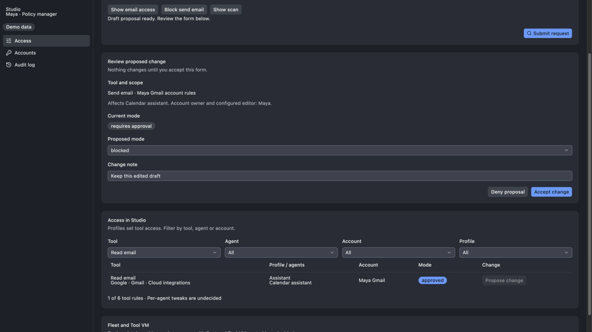
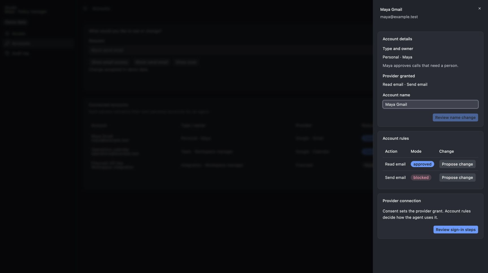
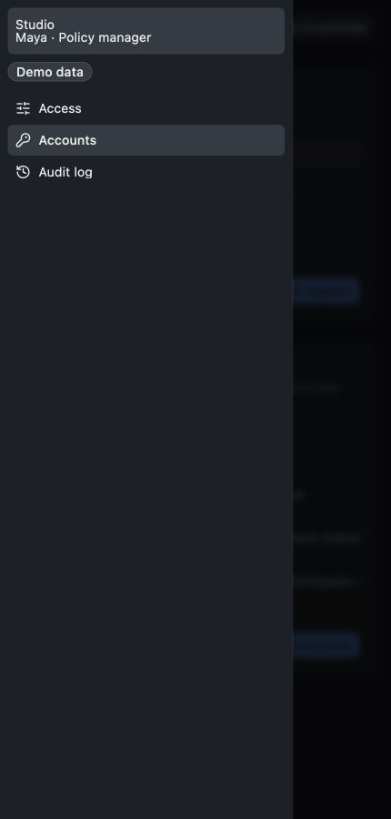

# Tool Portal control panel

The panel lets a person inspect access and change it through an editable proposal. A request such as “Show Maya’s email access” filters the associated view. “Block send email” produces a form with the current value, proposed value, scope and affected agents. The person can edit that form, accept it or deny it. There is no chat transcript.

This design describes the reusable browser package called `tool-control-ui` in the brief (the newer fleet F-63 names its publication `@agent-collaboration/tool-access-ui`). It is a composition of shadcn components, separate from the host, authorization, credential custody and storage. The accompanying mock uses local example data. Real sign-in, OAuth, protected commands, auto judging and durable audit remain unverified integrations.

## The frame and the associated view

The shell uses `SidebarProvider`, `Sidebar`, and `SidebarInset`. Navigation has just **Access**, **Accounts**, and **Audit log**. Organization name and signed-in person appear in the sidebar header. Workspaces are a later layer inside an organization, so the first version is organization-scoped. Tools and agents never become separate navigation destinations. The page has one title and one always-visible request bar at the top; proposals and results appear immediately below it. At phone width `SidebarTrigger` opens the registry mobile Sheet.

Access is one association table, with filters for **Tool**, **Agent**, **Account**, and **Profile**. A row connects a human tool name, provider, tool kind, complete role profile, agents using that profile, account if needed, current mode, and the person entitled to change it. Filtering by agent changes what is shown, not the scope of a profile edit. A profile edit explicitly lists every affected agent before acceptance. Personal account rules remain per account, agent and application, rather than turning into shared profile rules.

Composition: a `Card` with `CardHeader`/`CardTitle`, labelled `Select` filters, a `Table`, and a `CardFooter` count. Row actions are outline `Button`s. A tool with no account says “No account needed”; an integration without a key says “Needs key”. Provider and tool kind are subordinate facts in the tool cell. The three tool kinds are the owner's (2026-10-20): **Organization tools**, **Per-user tools** and **Computer tools**. That answer closed the older "fourth bucket" question (fleet Q-C11).

The default view answers “Who can use what?” without hiding profiles or account dependencies. Choosing a row opens its configuration as a right `Sheet`; using the request bar to propose a change places that editable form below the bar. Both routes use the same form compositions. The mock demonstrates row proposals inline and Accounts details in a Sheet.

## Request bar: show or propose

The request bar is a labelled `Input`, example requests as outline `Button`s, and one primary Submit request action in the enclosing `CardFooter`. It is the sole natural-language entry, on every destination. It does not open a second overlay. A short live status line describes what changed in the view.

```text
Request bar
  ├─ Show → selected filters / composed read view → no settings changed
  └─ Propose → current values + editable form + affected scope
                   ├─ Deny → discard proposal → settings unchanged
                   └─ Accept → authorized command → confirmed result → refresh + audit
```

Jev through OpenRouter classifies a request as show or propose and selects an allowed UI composition. It does not emit executable UI or acquire authority. An ambiguous target produces a clarification with labelled choices; it never picks a tool, account or scope silently. An unsupported request explains the gap and retains the existing view. The router must not automatically accept a proposal. Its loading state uses `Skeleton`; failures use `Alert variant="destructive"` with Retry. The mock deliberately uses deterministic example routing, without a model call.

Only one proposal is active. A second request leaves it intact and asks the person to accept or deny it first. Choosing a different navigation destination does not submit it. Closing an editor never accepts it. Errors preserve edits. A stale revision refreshes the current values and requires renewed review; an unconfirmed result asks the person to read current state before retrying. No browser success toast is shown until the host confirms the outcome.

## Proposal form and configuration coverage

The form's heading says **Review proposed change**, followed by the scope, current value, proposed controls, affected agents/accounts and authorized decision maker. Each input is a shadcn `Field` with `FieldLabel`, optional `FieldDescription`, and `FieldError`. Related choices use `FieldSet`/`FieldLegend`/`FieldGroup`; several choices use `Checkbox`; one choice uses `Select` or `RadioGroup`; save-time on/off choices use `Switch`. The form remains editable through acceptance; there is no locked preview that forces a browser Back operation.

The footer has outline **Deny proposal** and primary **Accept change**. Accept validates the current edited values. A proposal never counts as a decision. Destructive or hard-to-undo acceptance first opens an `AlertDialog` naming the consequence, such as “Block Send email? Calendar assistant will lose this action.” Dismissal preserves the form. Acceptance updates the confirmed view, closes the form and produces a `Sonner` toast; denial changes no configuration.

Everything exposed by the current Tool Portal configuration must have a panel composition. The following coverage map defines where each belongs; it does not invent new command or storage contracts.

| Configuration | Where and form |
| --- | --- |
| Organization tools and tool kinds | Access → organization scope; grouped tool choices and allowed Switches; affected profiles/agents shown before removal |
| Complete profiles: tools, modes, applications, ceilings, limits and consent recommendations | Access → profile scope; FieldSets by concern, selecting a complete profile with no inheritance; consent recommendations visibly separate from call policy |
| Agent registration and profile assignment | Access → agent filter → agent Sheet; name, harness, selected complete profile; no per-agent permission overrides |
| Approval modes and existing exact-call approval options | Access → tool rule; mode Select, mechanism-specific fields; fixed limits shown separately from mode |
| Integration provider, transport, egress and credential requirements | Access → integration details; provider-specific form and protected credential/OAuth handoff; no generic raw-config editor |
| Personal account consent and read/write rules | Accounts → account Sheet; owner-specific agent/application rules, bounded by profile ceilings and provider grants |
| Team accounts and agent assignments | Accounts → team Sheet; manager-owned assignment form, with the affected agents |
| People, organization owner/members and managers | Organization header → organization Sheet; existing organization/auth service commands; no new destination or inferred manager powers |
| Connection checks | Access → built-in scan composition, scoped by current filters |
| Fleet / Tool VM | Labelled slot only; integration meaning is undecided |

The mock implements the association/filter composition, one mode proposal, account details, connection requirements, a scan composition, and an audit read view. The remaining forms above are specified compositions, not implemented configuration editors. Completing their field inventory against the new host's configuration contracts is a prerequisite for claiming “everything configurable” in the product.

## Status words and approval configuration

Use these exact lowercase approval badges everywhere:

| Mode | Badge variant | What the person sees |
| --- | --- | --- |
| approved | default | Runs within existing permissions; does not bypass other blocked gates |
| auto | secondary | Judge decides inside fixed limits; asks a person when unsure |
| requires approval | outline | The resource's authorized person must approve the particular call |
| blocked | destructive | Cannot run; approving a call cannot override this |

Modes are settings, not a call's lifecycle. Connected is a separate default account Badge; Needs key, Needs account and Awaiting confirmation use outline account Badges. A proposal or scan result never uses an approval-mode badge to imply authorization.

The approved form has an **Approved until** time field in the future composition. It shows the time zone and the mode that will resume. Expiry returns to that previous mode. Blocked has no time field. Current governing requirements exclude temporary grants from the first version, so the first-version form shows this as a labelled future slot rather than enabling it. The brief requires its meaning to be designed, not silently forgotten.

Auto's composition shows the configured judge, eligible tools/accounts, fixed limits and escalation destination. Those backend contracts and delivery timing are still open; the mock renders an explicit slot and disables Accept for auto. Do not fabricate a working judge, invent limit values, or confuse the request router with the approval judge.

Exact-call approvals are a separate composition in the associated view, surfaced when a call awaits the signed-in person's decision. Its detail Sheet shows agent, tool, account, arguments/effect summary, reason, current gates and actual mechanism deadline. **Approve call** and **Deny call** affect only the exact call or batch named by that mechanism; they do not change the mode. A blocked or expired call has no approval action. Different current mechanisms keep their existing deadlines and scope; five minutes is not a universal UI default. The mock does not simulate call dispatch.

## Accounts and provider consent

Accounts has a `Table`: Account (name and address), Type/owner, Provider, Status, Used by and an Open account action. Type is authoritative metadata supplied by the owning service; a person cannot relabel a personal account as team to make it assignable. Account details use a right `Sheet` with the same `Card` compositions as other editors:

1. **Account details:** name, provider, type, owner, agent/application bindings and confirmed connection state.
2. **Provider granted:** the actual grants in an `Item` list, with provider-specific options rather than one universal list. Gmail reads and sends differ from Calendar reads and writes.
3. **Account rules:** separate read/write mode choices for each bound agent/application, the profile ceiling, current mode and who approves. Owner edits become a proposal; acceptance never changes Google's consent by itself.
4. **Connection:** exactly which API key/token is required, its configured/not-configured status, or OAuth sign-in/reconnect. Secret values are never displayed in a table or placed in request text. A protected host-owned form handles supplying or replacing a secret; its concrete transport is an open slot.
5. **Assignments:** team managers can give a team account to the organization's agents. Personal accounts have the owner-led connection flow instead.

Personal flow: **agent's private link → Better Auth sign-in → choose consent → real provider OAuth screen → return → confirm connection → set rules**. People sign in with Google, GitHub or passkeys; organizations have an owner and members. The service verifies identity and account binding independently of the view. On return, a confirmation Card names the account and actual grants. Confirm requires a valid name. Cancel bypasses name validation and opens an AlertDialog that names the account and consequence. Retained Off/Custom choices stay inactive while Off is selected. The mock shows the provider handoff boundary; it does not imitate the provider screen or accept credentials.

Who decides remains visible: the personal account's owner approves its protected calls, unless their chosen mode handles them otherwise; changing their rules also retains the existing configured-editor check. A team manager assigns team accounts. The policy manager changes tool/profile policy. An agent cannot raise its own permissions. “On behalf of” is an attribution label only, never a source of account access.

Disconnect uses a row `DropdownMenu` action and an `AlertDialog` naming the account and affected agents. Rename uses the common proposal form. The mock's rename control is explicitly an integration slot, not a fake successful save.

## Built-in scan and audit

“Show scan” composes the scan **inside Access**, below the request bar, without adding a navigation section. It names each integration, the observed connection/configuration status and one actionable next step. Production checks must say whether they are static configuration checks or live provider checks, show when they ran, retain failures and offer Retry. The mock's results are labelled examples and contact no provider. A scan proves no extra permission and never expands access.

Audit log is its own destination. A `Table` shows When, Who, Change, Target and Details (before → after). Human labels lead; machine identifiers live in details. Agent actions can display “agent, on behalf of person” only when that attribution was supplied. Every security/permission change must be recorded by the owning host; the browser's in-memory demo audit is not durable proof. No retention or database is chosen here.

## Consistent visual hierarchy

Use the existing base-mira registry components and the `cn` package already used by them. Keep the base mock's theme, changing only the main background token to the owner's `#1C2026`; Bridge grey remains for editor/terminal surfaces. No custom layout stylesheet or component paint is added.

The hierarchy is shell → page title → request → active proposal/result → association table. Section titles use `CardTitle`, statuses use fixed Badge variants, and every record list uses labelled Table columns. A form has one primary action at its footer; secondary actions are outline. Layout utilities live on ordinary wrappers, while registry components retain their own spacing. Empty results use `Empty`; request failures use destructive `Alert`; success uses Sonner. Long tables scroll inside their registry wrapper at narrow widths, while the sidebar becomes its mobile Sheet. Mobile cells retain labels and actions rather than hiding account or authority context.

## Open slots

- Fleet and Tool VM composition.
- Workspaces inside an organization: a later layer, so the first version is organization-scoped.
- Per-agent tweaks; first version remains profile-only for configured policy.
- Auto judge placement, concrete fixed-limit fields and delivery timing; mode meaning remains fixed.
- Approved-until delivery timing; meaning is fixed and excluded from the current first version.
- Host configuration field inventory, revision/activation commands and error contracts; database/storage is not selected by this UI design.
- Protected credential-entry and provider-specific OAuth field contracts; the real OAuth screen belongs to the provider.
- Exact-call approval presentation adapters and generic pending-call continuation; retain each existing authority mechanism.
- Organization/member/manager editor contracts from the auth and identity owners.
- Live scan targets and result contract; example scan results are not runtime proof.

## Sources

- [UI guidance](../2026-10-19-agent-vm-ui-guidance/ui-guidance.md): registry compositions and consistency bar; newer owner wording above supersedes its old approval labels and undecided account-owner text.
- [October 18 review](../2026-10-18-agent-vm-review/review.md), React and React-v2 captures, and its `react-prototype`: retained component/theme baseline and browser failure cases.
- [Fleet framework F-41–F-56](../../../docs/specs/2026-10-18-fleet-framework/2026-10-18-fleet-framework.md): request bar, associated view, reusable package and UI parts. Governing copies were inspected in `/Users/shravansunder/code/projects/agent-vm.docs-tool-portal-design/`.
- [Tool Portal owner decisions](../../../docs/specs/2026-10-14-portable-tool-portal-hosts/requirements.md) and Program Design, “Approval modes and who decides”: personal-account owner, option C and first-version timing.
- Fleet concepts §7.4 and decisions-and-open-questions.md: D-9; the current assignment fixes its status vocabulary.
- Existing September 4 account-permission and September 13 profile-OAuth requirements: separate actual consent, complete profiles and per-agent/account/application rules.
- [DeepWiki shadcn source lookup](https://deepwiki.com/search/i-am-extending-an-existing-bas_f097a056-b6e8-445b-ab79-07ccaeb7e698), followed by the copied registry source: exact local component APIs. DeepWiki did not establish the lint command; `.oxlintrc.json` and the installed plugin do.

See [mock/README.md](mock/README.md) for the runnable preview and its evidence limits.

## Mock walkthrough

The desktop walkthrough observed show filtering, an editable proposal, Deny without changing the rule, an exact destructive confirmation, Keep editing retaining the draft, acceptance updating the row and a matching demo audit event. Account details showed the personal owner, granted provider actions and distinct rule controls. At 430 × 900, the sidebar opened as its registry Sheet and closed with Escape; the account table scrolled within its container. The viewport override was reset.

The corrected routing shows both Read email and Send email for “Show email access” (2 of 6 rules), and just Read email for “Show Read email” (1 of 6). The proposal-preservation check edited the note, navigated to another account and observed its proposal action disabled with an explanation; closing that account retained the original Send email target, blocked mode and edited note. These are browser-memory mock observations, not production proof.







Raw mock-only checks are retained in `mock/evidence/lint.log`, `typecheck.log`, `format-check.log` and `build.log`. No product suite was run because this assignment changes only the standalone mock and design.
